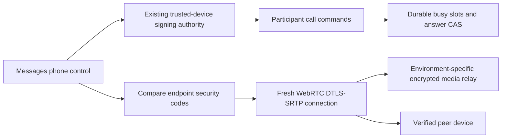

# People calling

Status: disabled mentor-review implementation on the private-pod development line.
This does not complete the agreed E2EE messages/native calling release.

## Visual Map



## Implemented boundary

The `/one/messages` phone control attaches to `DirectCallSession`, the existing
platform-aware API transport and the hub `one/calls.py` router. Web uses the
existing `/api/one/[...path]` proxy. No second signaling service, account registry
or agent router is introduced. No audio or plaintext SDP reaches the backend.

Preparation reserves durable account slots before microphone permission. Only a
complete encrypted offer rings the recipient. A revision compare-and-set selects
one answering device; losing devices cannot receive later signals or credentials.
Both endpoints must report transport connection before the backend marks a call
active. The browser displays Connected from its actual peer connection.

Each command binds owner, operation, device, nonce, expiration and the SHA-256 of
canonical payload bytes through registered-device ECDSA. Proofs expire within
120 seconds; consumed nonces cannot replay. Active relationship, both-direction
block and device-revocation checks gate signaling and credentials. End remains
available after a block/disconnect. Canonical graph locks precede call/device
locks; busy admission, state, signals and proof consumption share transactions.

The existing rate limiter permits 180 commands/minute. Without a shared limiter
URI, this remains process-local; it is not distributed quota or capacity proof.

## Encryption and verification

Purpose-separated, nonextractable P-256 encryption handles live beside the
existing installation signing key. They are not shared Circle keys or vault keys.
Public enrollment bindings are signed by the canonical device identity. A
mismatched existing key cannot silently be replaced and strand ciphertext.

SDP uses RFC 9180 HPKE through pinned `@hpke/core` 1.9.0: DHKEM(P-256,
HKDF-SHA256), HKDF-SHA256 and AES-256-GCM. Every envelope uses a fresh single-shot
sender context. This version is beyond the affected range in
[CVE-2025-64767](https://github.com/dajiaji/hpke-js/security/advisories/GHSA-73g8-5h73-26h4).
No custom ratchet is introduced.

Signatures cover exact ciphertext and recipient key IDs. Authenticated encryption
binds call, conversation, both devices, description kind and sequence. Each party
anchors its actual local encryption/signing tuple, then compares the two winning
endpoints' security code over a trusted independent channel. A directory-only
fingerprint would not protect against directory substitution. Verification is
remembered only for that endpoint pair in the current UI session.

Media uses a new peer connection per call and standard DTLS-SRTP. Only relay ICE
candidates are accepted. Signed/encrypted SDP fingerprints are verified before
remote descriptions are used. TURN forwards ciphertext; it never terminates media
or performs inference. See [WebRTC security architecture](https://www.rfc-editor.org/rfc/rfc8827.html).

## Lifetime and maintenance

Calls acquire the existing exclusive foreground voice lease. Late permission,
playback and HTTP results cannot restart or overwrite superseded calls.
Microphone loss, lease revocation, backgrounding, page exit, hangup and owner
teardown stop tracks/audio locally without waiting for HTTP cleanup. One modal
owns call/verification state. Verification is the top Back layer; failures are
visible and announced.

Preparation/ringing expires after 45 seconds. Calls and opaque relay credentials
have an absolute one-hour maximum from creation. Credentials remain memory-only;
the deployment TURN secret never reaches clients. Real allocation expiry and
long-call behavior require independent relay qualification.

Terminal actions erase offers/proofs/signals and release slots. The bounded
maintenance entrypoint expires abandoned calls, clears their ciphertext and
compacts terminal metadata after 24 hours:

```bash
cd consent-protocol
python -m hushh_mcp.services.direct_call_retention --limit 100
```

Only aggregate counts are printed. Governed scheduler installation and live
erasure verification are rollout prerequisites; this change installs no cloud
job. Expiry is admission closure, not evidence that unscheduled maintenance ran.
Existing account-erasure guards and actor/device/conversation FK cascades apply.

## Release gates and remaining agreed scope

Capability admission requires `DIRECT_CALLS_ENABLED`,
`DIRECT_MESSAGES_E2EE_QUALIFIED`, and `DIRECT_CALLS_NATIVE_QUALIFIED` all equal `1`,
plus a valid environment `DIRECT_CALLS_TURN_HOST` and server-only
`DIRECT_CALLS_TURN_SECRET`. Defaults remain unavailable. These are admission
controls, not qualification evidence. Deployment workflows do not set them here.

Remaining release blockers:

- Implement/verify People text and attachment E2EE, historical migration and
  recovery, client-produced previews and navigation-key compatibility. Existing
  messages remain server-readable and their history is unchanged.
- Implement native media/signaling ownership, CallKit/PushKit and Android Telecom
  plus foreground-service integration. Native calls remain unavailable; no
  foreground WebView fallback claims locked-screen support.
- Prove trusted relay TLS/renewal, invalid/expired allocations, independent-network
  media, physical-device background/locked answer, interruption/revocation,
  capacity/cost, telemetry privacy and scheduled retention.
- Optional named private-agent participation requires both people's exact
  scope/provider approvals and qualified owner-pod inference. It is currently
  false. No recording, transcription, PKM ingestion or Live Memory source is added.

## Schema and integration

Migration 407 owns public device-key bindings, calls, busy slots, replay nonces
and encrypted signals. Its manifest, rollback and environment schema contracts
are aligned. Migration 315 is preserved. Rollback refuses live calls and never
touches message/attachment tables.

Review against `claude/hushh-infrastructure-analysis-7o991c`. Qualify on Dev before
reviewed main-compatible promotion; do not import the whole pod delta as a calling
shortcut. UAT/production use separately authorized exact green main commits and
isolated relays/credentials. The old `prod` branch is not deployment authority.
Source and CI results are not deployment receipts.
