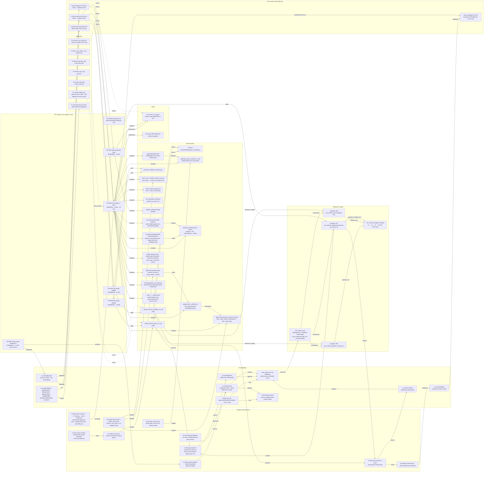

# Personal World Model UAT Ship Knowledge Graph (2026-10-15)

Status: frozen at 2026-10-15 21:21Z when the owner stopped the ship work. Environment: UAT (`hushh-pda-uat`, us-central1). This graph records what the four-PR ship (8044, 8048, 8049, 8053) changed, how the UAT release pipeline broke and was repaired, what is serving now, and what is still open. It is context for people and agents, not a permission grant or a runtime router. The [Personal World Model reference](./personal-world-model.md) holds the product contract and the [PWM runbook](../operations/pwm-runbook.md) the operating steps; replay-mode migrations are governed by [migration governance](../operations/migration-governance.md).

## Visual Map



## 1. Stopped

| What | State |
|---|---|
| Background watcher `b2a3m79ee` (smoke → backend dispatch → migration watch) | Dead. It dispatched run 38746111424 at 13:50Z and was killed when the previous session ended. Nothing else from it ran. |
| Deploy dispatches from this session | None in flight. No further dispatches will be made. |
| Peer agent session holding backend dispatches | Told at 21:21Z: hold released, report delivered (run id, outcome, serving revisions). |
| Workflow agents / subagents | None running. |

Nothing of mine is executing anywhere.

---

## 2. What is done

| # | Item | State | Evidence |
|---|---|---|---|
| 1 | **PR 8044** `fix(one): let the final PWM report restate the identity reason` (`validate_receipts` identity equality; the research-breaking hotfix) | Merged **and live on UAT** | merged 12:10Z, `28e9a63f46`, 4 files +144/−1 |
| 2 | **PR 8048** `fix(db): admit the reviewed version 4 referral policy in the 289 replay guard` | Merged **and live**; replay passes | merged 13:00Z, `5194604412`, 2 files +111/−12 |
| 3 | **PR 8049** `feat(one): stream live PWM progress and rebuild the pane on the Payouts design` (never-idle pane, SSE progress, 17 review findings fixed) | Merged **and live** (frontend since 13:41Z, backend since 19:15Z) | merged 13:26Z, `db4ff6f766`, 48 files +5144/−487 |
| 4 | **PR 8053** `fix(db): admit the reviewed version 4 successor in the 338 catalogue replay guard` | Merged **and live**; replay passes | merged 13:47Z, `342285b5cd`, 2 files +89/−0 |
| 5 | UAT DB migration replay with both adapters | **Proven**: step "Apply UAT DB migrations behind account deletion fence" = success in run 38746111424 (sha `342285b5cd`) | GitHub run 38746111424, job "Deploy UAT Scope" |
| 6 | UAT backend `consent-protocol` | Serving **`consent-protocol-02192-yuj`**, 100 % traffic, Ready | `deploy-sha=812974bf48` (merge of PR 8045; descends from all four PRs above), `github-run-id=38789822005`, created 19:15Z |
| 7 | UAT frontend `hushh-webapp` | Serving **`hushh-webapp-01778-dpv`**, 100 % traffic | same deploy-sha and run, created 19:19Z |
| 8 | Branch hygiene | `feat/pwm-live-progress`, `fix/referral-replay-guard-v4`, `fix/referral-catalogue-replay-guard-v4` deleted local + remote; hotfix worktrees removed | `git worktree list` |
| 9 | Agent session memory (replay guards, PWM ship state, research failure modes) | Updated outside the repo | — |

**Net result:** every change in this ship (8044, 8048, 8049, 8053) is on UAT right now, carried by the first green backend deploy after the Vertex-probe fix (PR 8063, merged 17:20Z by another session).

---

## 3. Not done / not verified

| Item | Why |
|---|---|
| End-to-end check that "Try again" in the PWM pane yields a real draft on UAT | Not exercised. Only revision provenance was verified. `scripts/ops/pwm_uat_status.py` was not run. |
| My own backend dispatch (run 38746111424) | Migrations passed, then Cloud Build step 3 (cloud-sdk step) failed at 14:06Z. Build `2e50a47c-26d5-426c-a2e6-cc65e610ed65`. Consistent with the Vertex probe deadline that PR 8063 fixed later; exact step name not recovered from the Actions log. Superseded by run 38789822005. |
| Leftover local scratch worktree (detached at `342285b5cd`, no uncommitted work) | Left in place on "stop". Safe to remove. |
| UAT is now behind `main` | Runs after 38789822005 (all by other sessions) failed: 38800788972 and 38801844367 at "Verify backend candidate readiness and exact-SHA provenance", 38806222207 at Cloud Build (left `consent-protocol-02198-zad` non-serving), 38806479656 cancelled, 38808335887 at "Wait for scope-aware UAT capacity". PRs 8059–8084 (incl. 8068 Live Mirror) are not on UAT. |
| Docs gap | `docs/reference/one/personal-world-model.md` does not mention `retry_after_s` on the budget refusal or the 2-streams-per-owner cap. |
| Hidden-tab false stall (review findings R2/R3) | Only partially addressed by the `visibilitychange` refresh. |
| Stream cap is per-process | Fine on UAT's instance count; revisit before multi-instance prod. |
| Referral settings **version 5** | Will break UAT deploys again unless the 289 and 338 adapters and 347's own guard are re-reviewed. |
| Legacy-user consent sign-off (PWM owner model) | Still pending (from earlier memory). |

---

## 4. Timeline (UTC, 2026-10-15)

| Time | Event |
|---|---|
| 12:10 | PR 8044 merged (`28e9a63f46`) |
| ~12:3x | Backend deploy run 38733904078 **rolled back** at step "Apply UAT DB migrations": `migration 289: retired version 2 requires exactly one active, reviewed version 3 successor` |
| 13:00 | PR 8048 merged (`5194604412`): 289 adapter admits reviewed v3→v4 lineage |
| ~13:0x | Backend deploy run 38739715393 **rolled back** one file later: `migration 322: existing v3 does not match the active USD catalogue` (migration 338) |
| 13:26 | PR 8049 merged (`db4ff6f766`) |
| 13:29 | Frontend-only deploy run 38743186583 **success** → `hushh-webapp-01776-jl7` (13:41) |
| 13:47 | PR 8053 merged (`342285b5cd`): 338 adapter |
| 13:4x | Post-merge smoke 38745756226 **success** |
| 13:50 | Backend deploy run 38746111424 dispatched by this session at `342285b5cd` |
| ~14:0x | Its migration step **passes** (both adapters hold); 14:06 Cloud Build step 3 fails; run failed |
| 14:47, 16:44 | Runs 38754515501, 38771581680 (other sessions) fail the same way at Cloud Build |
| 17:20 | PR 8063 merged (`21359dae22`): pay command-flow imports before Vertex probe deadlines |
| 17:56, 18:09 | Runs 38781503794, 38783215352 **success** |
| 18:56 | Run 38789822005 **success** at `812974bf48` → `consent-protocol-02192-yuj` (19:15) and `hushh-webapp-01778-dpv` (19:19), both 100 % |
| 20:17–21:14 | Four later runs by other sessions fail or are cancelled (see §3) |
| 21:21 | Owner: stop everything. Peer notified. This file written. |

---

## 5. Knowledge graph

The diagram in the Visual Map above is the same graph; the tables and JSON below carry the full node and edge detail.

### 5.1 Nodes

| Id | Type | Label | Key facts |
|---|---|---|---|
| G1 | Goal | "Try again" yields a real PWM draft on UAT | Needs PR 8044 live on the backend. Live since 19:15Z. End-to-end not yet exercised. |
| G2 | Goal | Never-idle PWM pane with live progress | PR 8049. Frontend live 13:41Z, backend 19:15Z. |
| PR8044 | PR | fix(one): let the final PWM report restate the identity reason | `fix/pwm-final-identity-equality` · merged 12:10Z · `28e9a63f46` · 4 files +144/−1 |
| PR8048 | PR | fix(db): admit reviewed v4 referral policy in the 289 replay guard | `fix/referral-replay-guard-v4` · 13:00Z · `5194604412` · 2 files +111/−12 |
| PR8049 | PR | feat(one): stream live PWM progress, rebuild pane on Payouts design | `feat/pwm-live-progress` · 13:26Z · `db4ff6f766` · 48 files +5144/−487 |
| PR8053 | PR | fix(db): admit reviewed v4 successor in the 338 catalogue replay guard | `fix/referral-catalogue-replay-guard-v4` · 13:47Z · `342285b5cd` · 2 files +89/−0 |
| PR8063 | PR | fix(ci): pay command-flow imports before Vertex probe deadlines | other session · 17:20Z · `21359dae22` · first green backend deploy after it: 38781503794 |
| PR347 | PR | the PR that added migration 347 (merged morning of 10-15) | root cause of I1 and I2 |
| MA | File | `consent-protocol/db/migration_authority.py` | replay adapters, pinned to published-file SHA-256 |
| AD289 | Function | `_replay_referral_policy_v2_sql` | guard now `successor_count NOT IN (1, 2)`; when 2, verifies v4 = v3 ‖ 347's exact JSON patches (points, streak_rules, tie_break_rules, qualification_policy_version=2) |
| AD338 | Function | `_replay_referral_catalogue_v3_sql` | checksum `8dc49973…fb98`; accepts retired v3 only if exactly one v4 row is active with `activated_at = v3.retired_at` |
| TMA | Test | `consent-protocol/tests/test_migration_authority.py` | Postgres test runs 347 twice, checks idempotence, tamper cases; two unit tests on adapted SQL text; `*_postgres` tests skip locally (no initdb), run in CI |
| PRJ | File | `profile_research_jobs.py` | budget refusal returns `retry_after_s`; provider-rejected start refunds budget; 3 starts/hour |
| WMP | File | `world_model_progress.py` | `slice = max(1, len(starts))` |
| WMS | File | `api/routes/one/world_model_stream.py` | SSE; MAX_OPEN_STREAMS=2 per owner; 429 + Retry-After 5 |
| ADK | File | `one_adk/world_model.py` | started row carries `"at": time.time()` |
| VR | Function | `validate_receipts` identity equality | the research-breaking bug fixed by PR 8044 |
| CGE | File | `hushh_mcp/agents/capability_graph_evolution.v1.json` | three `one.capability_deprecation.v1` entries for `actions:profile.world_model.invite/.reject/.research`, `active_run_policy: reject` |
| SVC | File | `lib/services/world-model-research-service.ts` | empty stream treated as failure |
| STORE | File | `lib/world-model/research-store.ts` | fields `progress`, `live`, `lastActivityAt`, `retryAt: number \| null` |
| PROV | File | `components/profile/world-model-provider.tsx` | failed=true on exhausted watch; single retry timer; refresh on `visibilitychange` |
| PANE | Files | `personal-world-model-page.tsx`, `world-model-progress.tsx` | Payouts-style compact settings groups; exported `identityGroupTitle` |
| COPY | Files | `profile-research-card.tsx`, `world-model-invitations.tsx`, `feed-item-renderers.tsx` | plain product copy, no internal names |
| VOICE | File | `app/one/profile/world-model/page.voice-action-contract.json` | relabelled voice actions |
| PROXY | Route | `app/api/one/[...path]` | `GET /api/one/world-model/jobs/stream`; the old `app/api/world-model/[...path]` was reverted to main |
| OPS | Files | `scripts/ops/pwm_uat_status.py`, `docs/reference/operations/pwm-runbook.md` | timeline/ops tooling, not yet run against the live revision |
| TWEB | Tests | `profile-pane-world-model.test.tsx`, `world-model-proxy-stream.test.ts` | observe mock never resolves (live watch); proxy test retargeted |
| REPLAY | Mechanism | UAT migration replay mode | every migration body executes on every backend deploy |
| M289 | Migration | `289_one_referral_program_settings_v2.sql` | pinned "exactly one active v3" until PR 8048 |
| M338 | Migration | `338_one_referral_usd_catalogue.sql` | pinned "v3 active" until PR 8053 |
| M347 | Migration | `347_one_referral_dashboard_lifecycle.sql` | activates v4, retires v3; verifies its own v4 |
| TBL | Table | `one_referral_program_settings` | partial unique index enforces one active row; lineage v1→v2→v3→v4 |
| DU | Workflow | `.github/workflows/deploy-uat.yml` | inputs scope, sha (must be on main); jobs: Select UAT target → Wait for capacity → Deploy UAT Scope |
| STEP | Step | Apply UAT DB migrations behind account deletion fence | where I1 and I2 surfaced; passed in run 38746111424 |
| CB | Step | Deploy backend using Cloud Build | includes `verify-managed-vertex-runtime` probe (I3) |
| R33 | Run | 38733904078 | rolled back at STEP (289 guard) |
| R39 | Run | 38739715393 | rolled back at STEP (338 guard) |
| R43 | Run | 38743186583 | frontend-only, success 13:29Z, sha `db4ff6f766` |
| R46 | Run | 38746111424 | backend, sha `342285b5cd`, dispatched 13:50Z by this session; STEP success, CB failure 14:06Z (build `2e50a47c…`) |
| R89 | Run | 38789822005 | success 18:56Z, sha `812974bf48` (merge of PR 8045); produced the serving revisions |
| RLATE | Runs | 38800788972, 38801844367, 38806222207, 38806479656, 38808335887 | other sessions; provenance-verify ×2, Cloud Build ×1, cancelled ×1, capacity-wait ×1 |
| BE | Revision | `consent-protocol-02192-yuj` | 100 %, Ready, created 19:15Z, labels deploy-sha=812974bf48 run=38789822005 |
| FE | Revision | `hushh-webapp-01778-dpv` | 100 %, created 19:19Z, same labels |
| FE76 | Revision | `hushh-webapp-01776-jl7` | first live frontend of PR 8049, 13:41Z (since superseded) |
| BE98 | Revision | `consent-protocol-02198-zad` | latest ready from failed run 38806222207, not serving |
| I1 | Incident | 289 guard pin | `migration 289: retired version 2 requires exactly one active, reviewed version 3 successor` |
| I2 | Incident | 338 guard pin | `migration 322: existing v3 does not match the active USD catalogue` |
| I3 | Incident | Vertex probe deadline | Cloud Build killed before probe finished; fixed by PR 8063 |
| I4 | Incident | classifier block | plain `successor_count < 1` relaxation denied as "Security Weaken" |
| D1 | Decision | explicit allow-list of v4 contents | accepted by classifier; stricter than a relaxation |
| D2 | Decision | frontend-only deploy while backend blocked | R43 |
| D3 | Decision | single backend dispatch, peer holds | the peer agent session |
| D4 | Decision | capability-graph deprecations for voice label changes | `build:ui-contracts` otherwise fails |
| D5 | Decision | failure semantics for streams and budget | empty stream = failure; cap 2; `retry_after_s` |
| REV | Process | adversarial review | 4 reviewers, 17 findings, lanes G1/G2/G3, revert-proof tests; backend 297 pass, web 939 pass |
| F1–F7 | Follow-up | see §3 | — |

### 5.2 Edges

| From | Relation | To |
|---|---|---|
| PR8044 | implements | G1 |
| PR8049 | implements | G2 |
| PR8049 | supports | G1 |
| PR8044 | changes | VR |
| PR8048 | adds | AD289 |
| PR8053 | adds | AD338 |
| AD289, AD338 | lives in | MA |
| PR8048, PR8053 | tested by | TMA |
| PR8049 | changes | PRJ, WMP, WMS, ADK, CGE, SVC, STORE, PROV, PANE, COPY, VOICE, PROXY, OPS, TWEB |
| SVC | reads | PROXY |
| PROXY | forwards to | WMS |
| PROV | writes | STORE |
| PANE | renders | STORE |
| VOICE | requires | CGE |
| REPLAY | re-executes | M289, M338, M347 |
| M289 | creates v2 of | TBL |
| M338 | creates v3 of | TBL |
| M347 | creates v4 / retires v3 in | TBL |
| PR347 | adds | M347 |
| M347 | caused | I1, I2 |
| AD289 | rewrites on replay | M289 |
| AD338 | rewrites on replay | M338 |
| AD289 | resolves | I1 |
| AD338 | resolves | I2 |
| I4 | led to | D1 |
| D1 | shaped | AD289 |
| DU | runs | STEP, CB |
| STEP | executes | REPLAY |
| R33, R39 | failed at | STEP |
| I1 | seen in | R33 |
| I2 | seen in | R39 |
| I2 | led to | D2 |
| D2 | produced | R43 |
| R43 | deployed | FE76 |
| R46 | passed | STEP |
| R46 | failed at | CB |
| I3 | seen in | R46 |
| PR8063 | resolves | I3 |
| PR8063 | unblocked | R89 |
| R89 | deployed | BE, FE |
| BE | serves | PR8044, PR8048, PR8049, PR8053 |
| FE | serves | PR8049 |
| RLATE | left | BE98 |
| RLATE | causes | F7 |
| D3 | governed | R46 |
| REV | hardened | PR8049 |
| D4 | shaped | CGE |
| D5 | shaped | WMS, SVC, PRJ |
| F1 | risk to | AD289, AD338 |
| F5 | verifies | G1 |
| F6 | cleanup after | PR8049 |

### 5.3 Machine-readable graph

```json
{
  "frozen_at": "2026-10-15T21:21:00Z",
  "repo": "hushh-labs/hushh-research",
  "environment": {"project": "hushh-pda-uat", "region": "us-central1"},
  "nodes": [
    {"id": "G1", "type": "goal", "label": "Try again yields a real PWM draft on UAT", "status": "live_not_verified_e2e"},
    {"id": "G2", "type": "goal", "label": "Never-idle PWM pane with live progress", "status": "live"},
    {"id": "PR8044", "type": "pr", "number": 8044, "title": "fix(one): let the final PWM report restate the identity reason", "branch": "fix/pwm-final-identity-equality", "merged_at": "2026-10-15T12:10:05Z", "merge_commit": "28e9a63f46", "files": 4, "additions": 144, "deletions": 1, "live_on_uat": true},
    {"id": "PR8048", "type": "pr", "number": 8048, "title": "fix(db): admit the reviewed version 4 referral policy in the 289 replay guard", "branch": "fix/referral-replay-guard-v4", "merged_at": "2026-10-15T13:00:30Z", "merge_commit": "5194604412", "files": 2, "additions": 111, "deletions": 12, "live_on_uat": true},
    {"id": "PR8049", "type": "pr", "number": 8049, "title": "feat(one): stream live Personal World Model progress and rebuild the pane on the Payouts design", "branch": "feat/pwm-live-progress", "merged_at": "2026-10-15T13:26:16Z", "merge_commit": "db4ff6f766", "files": 48, "additions": 5144, "deletions": 487, "live_on_uat": true},
    {"id": "PR8053", "type": "pr", "number": 8053, "title": "fix(db): admit the reviewed version 4 successor in the 338 catalogue replay guard", "branch": "fix/referral-catalogue-replay-guard-v4", "merged_at": "2026-10-15T13:47:45Z", "merge_commit": "342285b5cd", "files": 2, "additions": 89, "deletions": 0, "live_on_uat": true},
    {"id": "PR8063", "type": "pr", "number": 8063, "title": "fix(ci): pay command-flow imports before Vertex probe deadlines", "branch": "fix/uat-vertex-probe-timeout-20261015", "merged_at": "2026-10-15T17:20:17Z", "merge_commit": "21359dae22", "owner_session": "other"},
    {"id": "PR347", "type": "pr", "label": "PR that added migration 347 (morning 2026-10-15)"},
    {"id": "MA", "type": "file", "path": "consent-protocol/db/migration_authority.py"},
    {"id": "AD289", "type": "function", "name": "_replay_referral_policy_v2_sql", "guard": "successor_count NOT IN (1, 2)", "verifies": "v4 == v3 || 347 patches"},
    {"id": "AD338", "type": "function", "name": "_replay_referral_catalogue_v3_sql", "source_checksum": "8dc499738dc5d0e7d5b1d2e7d664c66381b885bf90e9563371f8259ac304fb98"},
    {"id": "TMA", "type": "test", "path": "consent-protocol/tests/test_migration_authority.py", "note": "*_postgres tests skip locally, run in CI"},
    {"id": "PRJ", "type": "file", "path": "consent-protocol/.../profile_research_jobs.py", "behaviour": ["retry_after_s on budget refusal", "refund on provider-rejected start", "3 starts/hour"]},
    {"id": "WMP", "type": "file", "path": "consent-protocol/.../world_model_progress.py", "behaviour": ["slice = max(1, len(starts))"]},
    {"id": "WMS", "type": "file", "path": "consent-protocol/api/routes/one/world_model_stream.py", "behaviour": ["SSE", "MAX_OPEN_STREAMS=2 per owner", "429 + Retry-After 5"]},
    {"id": "ADK", "type": "file", "path": "consent-protocol/one_adk/world_model.py", "behaviour": ["started row carries at=time.time()"]},
    {"id": "VR", "type": "function", "name": "validate_receipts", "bug": "identity equality"},
    {"id": "CGE", "type": "file", "path": "consent-protocol/hushh_mcp/agents/capability_graph_evolution.v1.json", "change": "3 deprecations: actions:profile.world_model.invite/.reject/.research"},
    {"id": "SVC", "type": "file", "path": "hushh-webapp/lib/services/world-model-research-service.ts", "behaviour": ["empty stream = failure"]},
    {"id": "STORE", "type": "file", "path": "hushh-webapp/lib/world-model/research-store.ts", "fields": ["progress", "live", "lastActivityAt", "retryAt"]},
    {"id": "PROV", "type": "file", "path": "hushh-webapp/components/profile/world-model-provider.tsx", "behaviour": ["failed=true on exhausted watch", "single retry timer", "visibilitychange refresh"]},
    {"id": "PANE", "type": "files", "paths": ["hushh-webapp/components/profile/personal-world-model-page.tsx", "hushh-webapp/components/profile/world-model-progress.tsx"]},
    {"id": "COPY", "type": "files", "paths": ["profile-research-card.tsx", "world-model-invitations.tsx", "feed-item-renderers.tsx"]},
    {"id": "VOICE", "type": "file", "path": "hushh-webapp/app/one/profile/world-model/page.voice-action-contract.json"},
    {"id": "PROXY", "type": "route", "path": "hushh-webapp/app/api/one/[...path]", "endpoint": "GET /api/one/world-model/jobs/stream"},
    {"id": "OPS", "type": "files", "paths": ["consent-protocol/scripts/ops/pwm_uat_status.py", "docs/reference/operations/pwm-runbook.md"]},
    {"id": "TWEB", "type": "tests", "paths": ["hushh-webapp/__tests__/components/profile-pane-world-model.test.tsx", "hushh-webapp/__tests__/app/api/world-model-proxy-stream.test.ts"]},
    {"id": "REPLAY", "type": "mechanism", "label": "db/migrate.py --migration-mode replay"},
    {"id": "M289", "type": "migration", "file": "289_one_referral_program_settings_v2.sql"},
    {"id": "M338", "type": "migration", "file": "338_one_referral_usd_catalogue.sql"},
    {"id": "M347", "type": "migration", "file": "347_one_referral_dashboard_lifecycle.sql"},
    {"id": "TBL", "type": "table", "name": "one_referral_program_settings", "lineage": ["v1", "v2", "v3", "v4"]},
    {"id": "DU", "type": "workflow", "path": ".github/workflows/deploy-uat.yml"},
    {"id": "STEP", "type": "step", "name": "Apply UAT DB migrations behind account deletion fence"},
    {"id": "CB", "type": "step", "name": "Deploy backend using Cloud Build", "probe": "verify-managed-vertex-runtime"},
    {"id": "R33", "type": "run", "id_gh": 38733904078, "conclusion": "rolled_back", "failed_step": "STEP", "error": "migration 289: retired version 2 requires exactly one active, reviewed version 3 successor"},
    {"id": "R39", "type": "run", "id_gh": 38739715393, "conclusion": "rolled_back", "failed_step": "STEP", "error": "migration 322: existing v3 does not match the active USD catalogue"},
    {"id": "R43", "type": "run", "id_gh": 38743186583, "scope": "frontend", "sha": "db4ff6f766", "created": "2026-10-15T13:29:53Z", "conclusion": "success"},
    {"id": "R46", "type": "run", "id_gh": 38746111424, "scope": "backend", "sha": "342285b5cd", "created": "2026-10-15T13:50:17Z", "conclusion": "failure", "steps": {"STEP": "success", "CB": "failure"}, "cloud_build": "2e50a47c-26d5-426c-a2e6-cc65e610ed65", "dispatched_by": "this session"},
    {"id": "R89", "type": "run", "id_gh": 38789822005, "sha": "812974bf48", "created": "2026-10-15T18:56:50Z", "conclusion": "success", "dispatched_by": "other session"},
    {"id": "RLATE", "type": "runs", "ids_gh": [38800788972, 38801844367, 38806222207, 38806479656, 38808335887], "conclusions": ["failure:provenance", "failure:provenance", "failure:cloud_build", "cancelled", "failure:capacity_wait"], "dispatched_by": "other sessions"},
    {"id": "BE", "type": "revision", "service": "consent-protocol", "name": "consent-protocol-02192-yuj", "traffic": 100, "created": "2026-10-15T19:15:15Z", "deploy_sha": "812974bf4875130dd8db2a81fc882fa129adf2d1", "run": 38789822005},
    {"id": "FE", "type": "revision", "service": "hushh-webapp", "name": "hushh-webapp-01778-dpv", "traffic": 100, "created": "2026-10-15T19:19:53Z", "deploy_sha": "812974bf4875130dd8db2a81fc882fa129adf2d1", "run": 38789822005},
    {"id": "FE76", "type": "revision", "service": "hushh-webapp", "name": "hushh-webapp-01776-jl7", "traffic": 0, "note": "first live frontend of PR 8049 at 13:41Z"},
    {"id": "BE98", "type": "revision", "service": "consent-protocol", "name": "consent-protocol-02198-zad", "traffic": 0, "run": 38806222207, "deploy_sha": "e5240e4ab4"},
    {"id": "I1", "type": "incident", "label": "289 guard pin broke backend deploys after 347"},
    {"id": "I2", "type": "incident", "label": "338 guard pin broke backend deploys after 347"},
    {"id": "I3", "type": "incident", "label": "Vertex probe deadline killed Cloud Build"},
    {"id": "I4", "type": "incident", "label": "classifier rejected plain guard relaxation as Security Weaken"},
    {"id": "D1", "type": "decision", "label": "allow-list exact v4 contents instead of relaxing the guard"},
    {"id": "D2", "type": "decision", "label": "deploy frontend-only while backend blocked"},
    {"id": "D3", "type": "decision", "label": "one backend dispatch at a time, the peer agent session holds"},
    {"id": "D4", "type": "decision", "label": "capability-graph deprecations for voice label changes"},
    {"id": "D5", "type": "decision", "label": "empty stream = failure; stream cap 2/owner; retry_after_s on budget refusal"},
    {"id": "REV", "type": "process", "label": "4 adversarial reviewers, 17 findings, lanes G1/G2/G3", "tests": {"backend": 297, "web": 939}},
    {"id": "F1", "type": "followup", "label": "referral settings v5 needs review of 289 + 338 adapters and 347 guard"},
    {"id": "F2", "type": "followup", "label": "docs: retry_after_s and stream cap in docs/reference/one/personal-world-model.md"},
    {"id": "F3", "type": "followup", "label": "hidden-tab false stall only partly fixed (R2/R3)"},
    {"id": "F4", "type": "followup", "label": "stream cap is per-process"},
    {"id": "F5", "type": "followup", "label": "run pwm_uat_status.py; verify Try again end-to-end on UAT"},
    {"id": "F6", "type": "followup", "label": "remove the local scratch worktree"},
    {"id": "F7", "type": "followup", "label": "UAT behind main: PRs 8059-8084 not deployed"}
  ],
  "edges": [
    ["PR8044", "implements", "G1"], ["PR8049", "implements", "G2"], ["PR8049", "supports", "G1"],
    ["PR8044", "changes", "VR"], ["PR8048", "adds", "AD289"], ["PR8053", "adds", "AD338"],
    ["AD289", "lives_in", "MA"], ["AD338", "lives_in", "MA"],
    ["PR8048", "tested_by", "TMA"], ["PR8053", "tested_by", "TMA"],
    ["PR8049", "changes", "PRJ"], ["PR8049", "changes", "WMP"], ["PR8049", "changes", "WMS"], ["PR8049", "changes", "ADK"],
    ["PR8049", "changes", "CGE"], ["PR8049", "changes", "SVC"], ["PR8049", "changes", "STORE"], ["PR8049", "changes", "PROV"],
    ["PR8049", "changes", "PANE"], ["PR8049", "changes", "COPY"], ["PR8049", "changes", "VOICE"], ["PR8049", "changes", "PROXY"],
    ["PR8049", "changes", "OPS"], ["PR8049", "changes", "TWEB"],
    ["SVC", "reads", "PROXY"], ["PROXY", "forwards_to", "WMS"], ["PROV", "writes", "STORE"], ["PANE", "renders", "STORE"], ["VOICE", "requires", "CGE"],
    ["REPLAY", "re_executes", "M289"], ["REPLAY", "re_executes", "M338"], ["REPLAY", "re_executes", "M347"],
    ["M289", "creates_version", "TBL"], ["M338", "creates_version", "TBL"], ["M347", "creates_version_retires_previous", "TBL"],
    ["PR347", "adds", "M347"], ["M347", "caused", "I1"], ["M347", "caused", "I2"],
    ["AD289", "rewrites_on_replay", "M289"], ["AD338", "rewrites_on_replay", "M338"],
    ["AD289", "resolves", "I1"], ["AD338", "resolves", "I2"], ["I4", "led_to", "D1"], ["D1", "shaped", "AD289"],
    ["DU", "runs", "STEP"], ["DU", "runs", "CB"], ["STEP", "executes", "REPLAY"],
    ["R33", "failed_at", "STEP"], ["R39", "failed_at", "STEP"], ["I1", "seen_in", "R33"], ["I2", "seen_in", "R39"],
    ["I2", "led_to", "D2"], ["D2", "produced", "R43"], ["R43", "deployed", "FE76"],
    ["R46", "passed", "STEP"], ["R46", "failed_at", "CB"], ["I3", "seen_in", "R46"],
    ["PR8063", "resolves", "I3"], ["PR8063", "unblocked", "R89"], ["R89", "deployed", "BE"], ["R89", "deployed", "FE"],
    ["BE", "serves", "PR8044"], ["BE", "serves", "PR8048"], ["BE", "serves", "PR8049"], ["BE", "serves", "PR8053"], ["FE", "serves", "PR8049"],
    ["RLATE", "left", "BE98"], ["RLATE", "causes", "F7"], ["D3", "governed", "R46"], ["REV", "hardened", "PR8049"],
    ["D4", "shaped", "CGE"], ["D5", "shaped", "WMS"], ["D5", "shaped", "SVC"], ["D5", "shaped", "PRJ"],
    ["F1", "risk_to", "AD289"], ["F1", "risk_to", "AD338"], ["F5", "verifies", "G1"], ["F6", "cleanup_after", "PR8049"]
  ]
}
```

---

## 6. Related documentation

| Doc | What it holds |
|---|---|
| [personal-world-model.md](./personal-world-model.md) | product contract, endpoints, prompt and graph plan |
| [pwm-runbook.md](../operations/pwm-runbook.md) | operating steps and the UAT status script added by PR 8049 |
| [migration-governance.md](../operations/migration-governance.md) | migration authority and replay rules behind the 289 and 338 adapters |
| [ci.md](../operations/ci.md) | the UAT deploy workflow and its gates |

---

## 7. User stories to check by hand (not yet exercised)

1. **Owner opens Profile → Personal World Model.** The status row is never blank: it says what is happening before progress arrives, then shows the progress rows while research runs.
2. **Owner taps "Try again" after a failed draft.** Research restarts and a real draft arrives; the final report restates the identity reason instead of breaking on identity mismatch (PR 8044).
3. **Owner hits the start budget (3 per hour).** The pane shows when they can retry rather than an endless spinner (`retry_after_s` → `retryAt`).
4. **Owner leaves the tab hidden and comes back.** The pane refreshes instead of showing a stale "stalled" state.
5. **Owner opens the pane in a third tab.** The stream cap (2 per owner) returns a clean refusal with a retry hint, not a hang.

