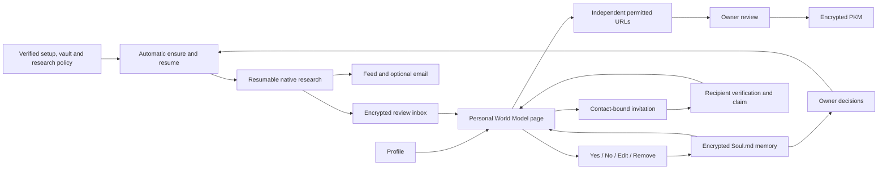

# Personal World Model: product and engineering KT

## Visual Context

Canonical owner: [One Index](./README.md).



Hub content execution is available only in Shared. Private owners require a qualified pod capability; their work never falls back to the hub.

## User experience

The Vertex lane enables research by default after setup disclosure. Once setup
is resolved, `ensure` can create a missing preference row with readiness email
enabled. Azure UAT instead requires the separate Azure/search-provider opt-in described
below. An existing disabled row is never turned back on; no migration rewrites
existing rows. The owner keeps an off switch for research and readiness email.

Research controls live in **Research and email**; the main journey does not require a manual URL. After vault unlock on any non-setup route, the app-wide world-model provider calls `ensure`: eligible new-owner research starts in the background, an existing owner without a model can start preparation, and interrupted work resumes through the existing consent and budget gates. Research only progresses while an authenticated client keeps calling `ensure` or `/jobs`; the server keeps the derived chat key for at most 300 seconds. Legacy Google/Bing drafts are purged after 24 hours. The UAT Tavily review inbox remains encrypted until explicit discard or account deletion, independently of sign-out. A model is prepared again automatically after seven days without research activity. A purged recent completion retains that cadence; **Check for updates** explicitly requests research through normal budgets. Automatic messages remain outside chat.

Profile has one compact **Personal World Model** row immediately below Memory. It opens the Personal World Model panel in Profile, using the existing icons, typography, cards, Back navigation and vault authority. The panel distinguishes preparation, reviewable findings, saved state and retryable failure.

The panel has two groups: **To review** contains cited streamed and final findings with **✓** and **✕**; **Confirmed by you** contains the owner's committed declarations. Each row uses the existing Profile font, layout, detail sheet and pending feedback. Findings appear as validated cumulative batches arrive; the page does not wait for the final report. An empty authoritative batch revokes earlier provisional findings.

- **✓** commits the exact statement to encrypted owner memory before moving it to Confirmed by you. Source-derived uncertainty is not an identity verification.
- **✕** commits a rejection before hiding the row. Normalized statement hashes suppress the same statement across later batches, final reports and sign-in sessions; the model also receives a bounded list of prior decisions to avoid equivalent claims. Host code does not promise deterministic paraphrase matching.
- **Edit** saves only the owner's corrected wording.
- **Remove** deletes the saved statement and records its removal after sign-out/sign-in.

Pending or failed writes never look successful. Rejected/removed decision records are not silently pruned at 512 entries; encrypted write size limits still apply. Owner declarations remain distinct from the retained research and do not independently certify its sources.

Native Google search suggestions stay displayed with the grounded findings they belong to. **Invite someone** is a later, separate action shown only once the model is usable, never while preparing or empty. The invitation claim block stays reachable on the page in every state. The inviter enters a name and an email, phone, or both; no public profile URL is required. Either supplied contact may be used to claim after verification. Full research starts under the recipient's own account and remains under their control. Older invitation links may still carry selected, cited public professional preview facts. Claiming never grants the inviter access to the recipient’s model.

### Easy user stories

1. **Find my public work.** Alex finishes setup and unlocks the vault; preparation starts when the configured provider's consent is active. Public company and project pages support cited findings under **To review** as batches arrive. Alex taps **✓** on a correct finding; it moves to **Confirmed by you** only after its encrypted save succeeds.
2. **Separate namesakes.** Two people share Alex's name. A school or location match alone is insufficient. The draft stays uncertain rather than mixing their biographies.
3. **Find preferences.** Alex explicitly says “blue is my favorite color” in an attributed public interview. That can be proposed with its citation. Wearing blue, buying a gift, or requesting fewer ads does not prove a durable preference or dislike.
4. **Find little information.** Public search finds no reliably linked sources. The page explains that limitation. It does not fill empty sections with guesses.
5. **Keep control.** Alex taps No on a wrong fact; it does not come back and nothing opposite is saved. Alex corrects another with Edit and later removes it; it stays removed after signing in again. Research itself writes no approved memory.
6. **Invite Sam.** Once Alex's model is usable, Alex enters Sam's name, email and international phone. The link is bound to both contacts, and Sam can use either verified contact to claim it. Sam's own model prepares automatically after setup unless Sam turned research off. Claiming shares nothing with Alex; the inviter does not receive Sam's private findings.

## Exact prompt and models

The single authored system instruction is the `one_personal_world_model.system_instruction` block in [the One manifest](../../../consent-protocol/hushh_mcp/agents/one/agent.yaml). Python loads this manifest; it contains no duplicate system prompt. The generated product-agent registries describe the same specialist. The instruction also tells the specialist not to propose again any claim in the owner's confirmed or rejected decisions, or an equivalent of one, and never to infer the opposite of a rejected claim. The model decides equivalence; host code does not.

The specialist's `gemini-default` currently resolves to **Gemini `gemini-3.8-flash`**, with medium thinking and a 32,768-token output ceiling. Gemini uses **native Google Search grounding on Vertex**. No Tavily key is needed. **URL Context on Vertex** remains available for separately supplied owner pages; it is no longer needed to create an invitation. Google research and saved owner knowledge have separate source-use contracts.

All managed text/chat, PWM, Live Voice, and embedding clients read [managed-ai-runtime.json](../../../consent-protocol/config/managed-ai-runtime.json).

UAT's PWM override selects **Azure GPT-5 mini** (`pwm-gpt-5-mini-eval`) for
planning and strict-schema report compilation. UAT now uses Tavily Search for discovery with a fresh `pwm-azure-tavily-v1` opt-in. The old Bing opt-in does not authorize Tavily. It shares
the same authored specialist instruction. Only fresh authenticated owner fields
are admitted: name plus verified email and canonical verified phone when present,
with at least one verified contact required. A name alone cannot start research.
Existing `ensure`, `/research`, jobs and SSE routes are retained. Azure additionally
requires a fresh `pwm-azure-bing-v1` owner opt-in; default Vertex enrollment and an
invitation claim do not grant Azure consent. Research never automatically writes
approved memory.

The planner can pivot through received public source titles/URLs and candidate
anchors. Separate candidate, anchor and source ID namespaces prevent accidental
cross-reference. Failed coverage searches cannot donate citations to findings.
Public self-reports stay attributed; a degree listing, selected-work repository
or merged PR metadata does not establish graduation, creation or who merged it.
Shorter names and unlinked institutional/company/aggregator records remain
uncertain. Raw citations are not independent verification of their contents, so
Azure candidates remain for owner review. No minimum finding count is forced.

Azure's native planner schema projects the existing admitted identity/coverage
branches, selected candidate and anchor IDs. Candidate-for-review coverage uses
public name/anchors; contacts remain limited to identity research. The prompt
requests a short question and at most two anchors within the original host
bounds. A coherent review candidate should receive public coverage rather than
repeat exact-contact searches; competing candidates still require identity work.
Company, GitHub and social profiles need an explicit received first-party URL
cross-link before their anchors are combined. Reports place missing evidence and
namesake observations in gaps, not personal findings. These are model-authored
semantic instructions, not a host guarantee of page support or identity. A returned invalid plan may receive one charged correction using the
same context and failed field/type feedback. Four model slots must remain before
repair, preserving search, assessment and final reporting. Invalid correction
stops expansion and preserves existing cited findings; provider errors and loss
of authority are never retried as plan corrections. Logs contain only bounded
error types, never model field names or contact values.

Within the unchanged 240-second slice, follow-up search reserves 145 seconds:
up to 45 seconds for reassessment and 100 seconds for final reporting. Reporting
keeps its 90-second provider cap. Optional provisional batches yield when that
reserve is needed. This replaces a 230-second follow-up admission requirement
that effectively prevented expansion after ordinary initial-call latency.

An identity assessment that fails schema or evidence validation may receive one
paid, tool-free model repair using the same admitted identity and received
sources. The replacement must pass the unchanged validators. The host never
fills a candidate or substitutes an identity decision. Repair preserves owner
authority, the final-report time/slot reserve and every charged usage receipt;
insufficient time pauses the slice without another search.

The existing provisional extraction receives the selected candidate's label and
owned anchors, not merely its ID. Compilation receives the selected assessment,
validated selected-candidate finding batches and their admitted source metadata.
Unpartitioned discovery notes and other candidates are withheld from this model
input; their complete checkpoint and returned research remain intact. Selected
anchors still permit reporting when optional batches fail or skip. This reduces
contamination; receipt validation does not independently prove semantic attribution.

Azure assessment requires a connected model-declared reciprocal-link graph over
all distinct URLs owned by the selected candidate, including orphan owned anchors.
One exact URL is valid without an edge. The host never chooses or splits people;
a missing chain receives the existing charged model correction. The same guard
checks restored work. This validates declared linkage, not page contents. Unlinked
results remain in the full research record and cannot supply typed findings.
Correction receives the disconnected receipt-reference groups, never a host-selected
person. When received bridges are absent, the model can select one supported page
for review and leave other discoveries as separate leads in the retained research.
A failed multi-page assessment uses a compact correction schema: one candidate,
one anchor and one scalar source reference, or explicit no match. The host only
expands scalar transport fields to the existing arrays, preserving the model's IDs,
identity choice and assertions. The original assessment and graph validators still
apply. This prevents a paid correction from returning the same disconnected cluster.
The owner-only provisional stream applies the same current-anchor receipt fence.
If reassessment changes the selected page while reusing a candidate ID, earlier
coverage batches cannot survive as claims about that new page. Unmarked Vertex
coverage retains its original contract.
An Azure page citation may legitimately have an empty title. Its raw title, URL
and offsets remain exact; the source card uses only the generic "Public page"
label. This does not relax URL, range, completion or billing validation. Starting
anchors do not prohibit the search stage from using newly retrieved public URLs.
If opening a public page fails, the search prompt uses its remaining native-tool
call for an indexed URL/handle search. Unreadable pages remain unavailable. Final
compilation audits proposed batches for distinct, owner-reviewable personal
statements; structural receipt validation does not make a proposal a verified fact.

After compilation, GPT-5 mini reviews the immutable cited facts and returns only
the IDs to keep plus a new summary. The host resolves those IDs without rewriting
statements, topics, confidence or citations, then applies the same evidence
validation. It never classifies meaning with a keyword filter. This extra call
uses the existing 16-call budget and a 35-second bound. The accepted intermediate
report is checkpointed first; a paused review resumes there without buying
research or compilation again. A completed review is bound to that report's
digest. Missing or repeated IDs fail closed.

A schema-invalid fact selection or resulting report may receive one charged,
tool-free model correction using the same immutable proposed facts, identity,
owner decisions and schema. The original validators run again; an invalid
correction fails, and the host never returns the unreviewed proposal instead.
The existing model-slot, remaining-time and access checks apply to both calls.
Saved review checkpoints are validated without repair or new provider calls.
Validation diagnostics contain only fixed stage/attempt labels and error types;
they exclude field paths, messages, input and exception context.

Review may retain zero findings without changing the assessed identity. An empty
matched or uncertain report means no new personal statements remain to review;
it does not imply no identity candidate exists. A no-match report still cannot
contain findings. The shared client decoder accepts the same cardinality.
This is semantic cleanup, not independent source verification or proof of owner
identity, and it cannot recover facts omitted by compilation.

Provisional extraction and final compilation use their scoped instructions
authored inside the PWM manifest, rather than the whole research prompt. The
model still chooses every fact; there is no host semantic deduplication or
replacement. Both stages and report repair retain the same manifest-owned output
privacy exclusions and owner-decision rules: never repropose confirmed/rejected
equivalents or infer their opposite. Missing contacts, identity decisions and source availability belong
in identity or gaps, never findings. A fixed-evidence Azure experiment returned
one account–repository attribution with scoped extraction, while the whole
research instruction returned four padded rows even with high reasoning. This
is a limited stage experiment, not owner-account or general quality acceptance.
Identity assessment/repair uses medium reasoning with an 8,192-token ceiling.
Provisional extraction also uses medium reasoning, retaining its 2,048-token and
35-second bounds. Only final compilation/repair uses high reasoning. Other stages keep low effort,
and every call retains the existing 90-second outer cap. The SDK deadline matches
that cap; planner and provisional limits remain shorter. Optional sections contain
positive personal findings, with no placeholder facts or minimum count. Empty
uncertain reports remain valid when no new positive findings survive review.

The provider report schema excludes coverage: the existing host ledger authors
all twenty rows before unchanged full report validation. The final schema limits
section kinds to topics with observed, candidate-compatible search receipts.
All twenty public coverage rows remain present.
Each section's citation enum projects the original receipt rules for that exact
candidate and topic, intersected with selected-candidate owned-anchor sources.
The final host validator receives that same narrowed catalog, including on repair;
a received, observed coverage lead alone cannot become a selected-person citation. Other
namesake pages cannot supply citations merely because search returned them.
When native topic specializations exceed Azure's schema budget, one shared
shape carries the eligible citation union instead. Evidence is never truncated;
the full per-topic eligibility remains in the prompt and original validator.
A schema/evidence-invalid report may receive one charged, tool-free correction
using the same research and assessed identity, then passes the original
validators again. No section is silently removed or relabelled by the host;
provider failures, authority loss and exhausted budgets are not repaired.
Both report calls remain within the existing sixteen-call generation budget.
Repair receives failed field paths and error types without exception input or
context; the original schema's length, item-count and pattern bounds still apply.
Retained completed checkpoints are reused only for their current identity/policy
binding. A purged completed draft still follows the seven-day preparation
interval; the existing **Check for updates** action requests fresh research
through the normal admission and paid budgets.

Azure usage receipts contain only input, output and cached-token counts plus
provider elapsed milliseconds. They use the existing charged model slots in the
encrypted work checkpoint and are excluded from model-visible research history.
Owner-authorized JSON research responses expose their aggregate in
`X-Hussh-PWM-Usage`; the web proxy preserves that header. JSON and SSE result
bodies keep their existing strict shape. Unacknowledged calls or missing SDK
usage produce nullable totals, never an assumed zero. Bing request totals use
the provider's reported `tool_usage.web_search.num_requests`. Completed `open_page`
and `find_in_page` calls accept an explicit zero Bing-query count; actual `search`
actions still require a positive count, and missing usage is never inferred.
A malformed search
receipt (including a missing billable count) admits no evidence and leaves that
paid call unacknowledged. Further search stops at the existing conservative
budget boundary, while earlier assessed receipts can still produce a draft;
Bing totals remain unknown. Currency requires
identified provider rates and remains an estimate rather than an invoice total.

| Environment | Vertex project | Text/PWM | Live | Embeddings |
| --- | --- | --- | --- | --- |
| Local | `hushh-pda-uat` | `gemini-3.8-flash` | `gemini-live-2.5-flash-native-audio` | `gemini-embedding-001` |
| Dev / Production | `hushh-gemini-bridge` | same | same | same |
| UAT | `hushh-gemini-bridge` | same text; PWM uses Azure GPT-5 mini | same | same |

The hosted profiles share the managed Vertex project while retaining separate workload identities and infrastructure projects. This table describes the release configuration; serving state requires revision and runtime-probe evidence.

`ONE_PROFILE_RESEARCH_ENABLED` controls the research kill switch. UAT deployment
reads `ONE_PROFILE_RESEARCH_ENABLED_UAT` (default false); enabling it still requires
each owner's separate Azure/Bing opt-in. Disabling it stops new research and
resumes without deleting encrypted drafts or changing ordinary chat. The
notification scheduler alone does not stop generation. Drive background
processing has its separate `DRIVE_WORK_DRAIN_UAT_ENABLED` switch.

The default 3.8 text model uses the verified `global` endpoint; Live remains regional `us-central1`. Cloud Run, SQL, Firebase, and application-secret infrastructure projects are separate from the managed Vertex project. BYOK remains a separate explicitly selected runtime.

Change the checked-in environment profile and deploy its revision. The compiler and runtime share validation and a normalized configuration hash. Candidate readiness compares the image's hash and exercises the configured text and enabled Live targets. The runtime config CI contract rejects managed environment reads outside the canonical settings boundary. Local development retains explicit overrides; hosted runtimes use the packaged profile and ignore retired per-surface project overrides.

## Six identity baselines and confidence pivots

These are stages of one manifest-backed specialist, not six independent services:

1. Read the trusted account name and verified contact; preserve missing values.
2. Keep separate candidate identities from public results.
3. Look for first-party identity anchors and exact identifier linkage.
4. Pivot from combined identifiers to name/email, name/phone, and then evidenced public anchors; never invent a pivot.
5. Inspect contradictions, dates, namesakes, and mirrored sources.
6. Return a decision with a plain-English reason before broad coverage.

Identity states are `owner_linked`, `candidate_for_review`, `ambiguous`, and `no_match`. The report maps these to matched/uncertain/no-match. **Probability stays null:** no calibrated identity estimator has been validated. Each fact carries the model's supported, uncertain, or conflicting label. The host computes a separate 1–4 **source-trail review score** from received citations, source-host diversity, identity state and conservative topic caps. A citation receipt does not prove that the page supports the claim, so the UI shows the source trail and asks the owner to check it. Strong fact support does not establish that its subject is the owner.

Six baselines describe the reasoning process, not a six-query limit. Overall host-enforced bounds are 32 search invocations and 128 logical model calls across resumable slices. One search invocation may issue multiple Google queries; this is not a billable-query cap. Regional failover can make additional provider requests within a logical model call. Python enforces authority, budgets, receipts, schema, and deadlines. Semantic linkage and interpretation belong to the LLM and owner review.

## Twenty optional topic layers

The model contract keeps these twenty topics. The page groups them for display only (`PWM_SECTIONS` in `hushh-webapp/lib/services/world-model-decision-service.ts`): About = Personal; Work = Career, Business, Achievements; Education = Education; Projects = Projects, Publications; Interests = Interests, Community, Entertainment, Travel, Food; Preferences = Preferences, Dislikes, Style, Shopping, Communication; Public presence = Digital presence, Public records, Security. The grouping never reinterprets a statement.

| Layer | Supported scope |
| --- | --- |
| Business | Companies, products, evidenced founder roles |
| Career | Current/historical roles and expertise |
| Education | Studies and qualifications; enrollment distinguished from graduation |
| Personal | Public non-sensitive biography |
| Projects | Technical and creative work |
| Publications | Papers, books, articles, interviews, talks |
| Achievements | Awards; participation distinguished from winning |
| Community | Volunteering and organizing |
| Interests | Explicitly described hobbies/topics |
| Preferences | Stated choices, likes, routines |
| Dislikes | Explicit exclusions/dislikes; unknown is not dislike |
| Style | Stated colors, design, clothing choices |
| Food | Stated tastes |
| Travel | Published interests, excluding live whereabouts |
| Entertainment | Books, film, music, games |
| Shopping | Explicit product/brand choices |
| Communication | Stated language, tone, format/accessibility preferences |
| Digital presence | Evidenced public profile links |
| Public records | Non-sensitive professional registries |
| Security | Reserved for authorized breach metadata; adapter not implemented |

PWM permits up to 40 distinct facts per topic and 269 across the whole report, with one to three exact source references per fact. This is a ceiling, never a target: the prompt forbids filler, repeated identifier fragments, inferred preferences from professional work and claims of safety from missing search hits. The UI shows every received point as a Yes/No review row with source detail. Empty categories are omitted. Topic coverage is a checklist, not a claim that information exists or every platform was searched. Private family relationships, children's dossiers, criminal allegations, sensitive inferences, private accounts, and stolen credentials are outside this public-web discovery endpoint.

### How advertising preferences relate

Advertising systems can combine account settings, activity, contextual signals, and inferred audience categories. Those are different evidence types. A “fewer ads” setting controls advertising; a search or click does not automatically establish a preference. PWM's prompt distinguishes owner declarations, public self-statements, platform actions, observed activity, platform inference, and PWM hypotheses. A saved research decision carries only the owner's wording, topic, decision time and basis `owner_declaration`; an independently supplied source fact carries reviewed text and its exact sources. Structured import/action provenance is a future schema extension, not an implemented private-account feed.

References: [Google My Ad Center](https://support.google.com/My-Ad-Center/answer/12155764), [Google advertising data controls](https://safety.google/privacy/ads-and-data/), [Google Takeout](https://support.google.com/accounts/answer/3024190).

## API and execution

Owner endpoints require an authenticated owner token and the unlocked-vault derived `X-Hussh-Chat-Key`. Invitation-preview alone accepts its opaque capability token in a POST body, exposing only the selected professional preview. Responses are private/no-store. Subject authority is inferred from the authenticated owner, never a client-supplied user ID.

| Endpoint | Meaning |
| --- | --- |
| `POST /api/one/world-model/research` | Explicit integration endpoint with name and verified contact |
| `POST /api/one/world-model/jobs` | Start or reuse owner research with server-resolved identity |
| `GET /api/one/world-model/jobs` | Poll the current job/draft |
| `DELETE /api/one/world-model/jobs?draft_id=…` | Discard that draft generation |
| `GET/PUT /api/one/world-model/preferences` | Read/update the research off switch and readiness-email preference |
| `POST /api/one/world-model/ensure` | Create the default preference once setup is resolved, then idempotently prepare or resume |
| `POST/GET/DELETE /api/one/world-model/source-reviews` | Optional owner-supplied source review; automatic PWM and invitations do not require it |
| `POST /api/one/world-model/source-reviews/complete` | Verify acknowledged owner PKM receipts for that source draft |
| `POST /api/one/world-model/invitation-preview` | Token-authorized public professional preview, without full-model authority |
| `POST /api/one/world-model/invitations/reject` | Verified intended recipient deletes the unclaimed invitation |
| `POST/GET /api/one/world-model/invitations` | Create/list a contact-bound invitation; an optional second contact may claim the same link |
| `DELETE /api/one/world-model/invitations/{id}` | Revoke an invitation |
| `POST /api/one/world-model/claims` | Match verified recipient contact and record explicit claim consent |

Integration request:

```json
{
  "name": "Account display name",
  "email": "verified-owner@example.com",
  "phone_number": "+14155550123"
}
```

Name and at least one verified contact are required. Phone uses E.164. Every supplied field must match the freshly resolved owner's account. The UI normally calls `/ensure` or `/jobs` without sending identifiers. Arbitrary submitted identities are rejected.

**Pages you choose** also has an explicit Azure research action when Azure/Bing
research is already enabled and a fresh run is allowed. The owner confirms up to
three public profile links and their public-source permission. These links enter
normal charged web retrieval as starting leads, not received evidence or verified
identity. They never grant access to private accounts. A changed URL set starts a
new work generation, retains hourly starts, and cannot replace a live pending
lease. Omission carries existing profiles and prior decisions across resumes.
A bare server-requested restart keeps the explicit profile action available;
the server still checks the live lease and CAS fence before admitting it. A
pending or paused checkpoint does not expose that recovery action.
Web and Android use the shared form; the corresponding iOS owned form requires
its additive `profileWorldModelPublicProfiles` capability. Older binaries retain
their existing source-review action. The separate Gemini page-review action and
the owner’s encrypted Memory save remain unchanged.

`/ensure` and `POST /jobs` accept an optional body carrying the owner's earlier decisions, so research does not propose them again:

```json
{
  "owner_decisions": {
    "confirmed": ["Works on payments infrastructure"],
    "rejected": ["Likes blue"]
  }
}
```

Each list holds at most 269 statements of 1 to 600 characters. The server stores them in the sealed, chat-key-encrypted job state under `inputs`, carries them across resumes, and passes them to the specialist as data. The client separately hides any draft statement whose claim key is already decided; that is an exact-key match only.

A pending result uses HTTP 202. An offered result includes `draft_id`, `report`, `research.identity`, `research.checked_topics`, `research.gaps`, `research.searches_used`, and `pkm_written: false`. Missing configuration or failure before any successful search yields unavailable, not proof that no information exists. Pending, paused, and unavailable results may also carry `validated_facts`: provisional, cited, candidate-bound findings from the encrypted checkpoint. The owner-only SSE stream sends a cumulative `partial` frame when that list changes; an empty list revokes earlier provisional findings. These findings can be reviewed immediately. Accepting one records an owner declaration; it does not bypass final-report evidence validation or promote omitted findings back into the model report. The UI shows observed search/source counts instead of a synthetic completion percentage, and retains the latest checkpoint summary during a retry.

The specialist deadline is 240 seconds; the job deadline is 270 seconds. The existing derived key's lifetime remains bounded to 300 seconds. Search calls currently execute serially. Attempt slots are charged durably before dispatch and survive retries and identity edits within the checkpoint budget window. Native search receipts, assessed candidates and topic attempts are checkpointed before the next dependent step. A slice ends before the existing 300-second key authority expires; the app-wide provider's next `ensure` or `/jobs` call from an active owner session resumes the same generation. No key is persisted to run indefinitely after sign-out. An interrupted closed app resumes after the next vault unlock. Full unattended processing after key expiry would require a separately designed processing grant; this release does not claim it.

`managed-ai-runtime.json.pwm_research` declares providers, search/model limits, slice/job/lease durations, preview bounds and notification scheduler identity. Secret-free native Vertex ADC remains the provider authority. Migration 340's old Tavily accounting table remains for migration compatibility, with no active PWM reader or writer. Native research uses the durable per-generation search and model limits above; it does not claim the legacy 900-credit monthly ceiling.

The readiness email is on by default and can be turned off. It uses the existing Workspace mail adapter, not another email provider. A metadata-only completion record is committed with the encrypted draft; only a ready or partial offered report leaves an actionable Feed projection. Failed, insufficient-identity, and empty drafts retain internal attention records without a visible Feed item or email. A later promotion of the same draft removes any historical attention projection before creating a fresh reviewable Feed item, so dismissing an old failure cannot hide real findings. At most one email is sent per draft. The email links to the Personal World Model page and does not refer to a settings screen. Email leases, generation checks, owner preferences and current checkpoint checks prevent duplicate/stale dispatch. Uncertain delivery is not blindly retried. UAT uses the configured test inbox; if that test configuration is absent, email is suppressed. A dedicated OIDC Cloud Scheduler endpoint wakes a bounded drain after scale-to-zero. Provisioning is part of the UAT release and remains behind the feature switch.


## State, save, reset, and invitations

Research uses encrypted checkpoints in namespace `one.personal_world_model.v1`, with identity/policy binding and durable attempts. A draft is not approved knowledge. Discard writes a content-free tombstone and changes the checkpoint fence, preventing an old worker from restoring it. Completion verifies every supplied owner-review commit receipt and dismisses only the specified draft generation; the legacy saved flag cannot bypass those checks. Completion grants no new write authority, and `POST /source-reviews/complete` still refuses a display-only Google research draft with 409.

Owner decisions on research facts live in the owner's vault-encrypted Soul.md memory, PKM domain `one_memory` (`hushh-webapp/lib/pkm/markdown-memory.ts`). The browser writes them through the existing `appendMarkdownMemoryFacts` writer, which uses compare-and-set and resolves only after the encrypted commit. `WorldModelDecisionService` (`hushh-webapp/lib/services/world-model-decision-service.ts`) is the only PWM caller:

| Decision | Memory write |
| --- | --- |
| Yes | Append the exact statement as a bullet |
| No | No bullet; private metadata only |
| Edit | `correct` mutation of the existing bullet to the owner's wording, or append when no bullet exists |
| Remove | `delete` mutation of the bullet; private metadata keeps it removed |

Private metadata `_pwm_claims`, keyed by `pwmClaimKey(statement)`, is stored beside `_source_summaries` in the same encrypted domain object. Every Soul.md writer preserves it, and it is never sent to a model as memory context. Each entry records only the decision, the owner-confirmed or declined wording, its topic, the decision time and basis `owner_declaration`. Grounded answer text, grounding source URLs and titles, and search-suggestion HTML are never saved. Every write resolves with the reloaded memory only after commit, rejects on any failure so the page never shows false success, and is idempotent on retry. There is no second plaintext biography store.

Account deletion removes `one_memory` with the rest of the owner's encrypted PKM, the `one_adk_sessions` research checkpoints, the research preference row and invitation state.

Invitation storage contains a random token hash, one or two keyed contact commitments and an optional AES-GCM encrypted inviter-supplied name or legacy professional preview. Its key is derived from the random invitation token and bound to the invitation ID. Raw contacts, token and plaintext name/preview are not stored. New links open `/world-model/invite` with the token in the URL fragment. Login, phone verification, setup and vault continuation preserve the invitation destination. Links expire in seven days, with at most twenty pending invitations per inviter. Claims verify either intended contact under the shared graph lock; a legacy professional preview transfers to the recipient’s encrypted source-review checkpoint, while a name-only invitation transfers no findings. Repeated claims by the same recipient are idempotent. Rejection, revocation, reset and deletion remove invitation state. After claiming, the recipient's own model is prepared automatically unless they turned research off; sharing is a separate action.

Native Google results never enter memory as grounded content; only the owner's declaration from a Yes or Edit is saved. Only independently supplied permitted source drafts use `profile_review_v1`; checked/edited facts and their exact sources pass through the existing review and acknowledged-save contract. A provider receipt without successful retrieval cannot support a source fact.


## Apollo/AgentOne knowledge graph implementation plan

“Apollo” is treated here as the application graph; this change does not integrate Apollo.io or a new third-party enrichment database.

1. Project **Subject → Claim → Source**, plus topic membership, from approved PKM only. Use stable PKM domain/entity identities and normalized source identities.
2. Carry a snapshot/content revision. Invalidate graph projections when a source or fact is edited, deleted, retracted, or becomes inaccessible.
3. Extend the existing review/PKM schema with structured evidence basis, observation/publication dates, source-use rights, and supersession/contradiction relationships. Do not silently append unreviewed metadata to the current exact save payload.
4. Add graph/topic filters and inspectable source/claim nodes, with uncertainty and history. Reuse the existing Soul.md and PKM edit/delete flows.
5. Clear decrypted projection state on logout, vault lock, key rotation, or owner change. Keep graph persistence encrypted and canonical.
6. Add graph sharing through explicit consent grants. Invitation claims never imply permission to share.

The current page is a sectioned fact/source list, not an interactive graph. Authorized private-account imports, licensed breach metadata, calibrated probabilities and an interactive graph remain future work. Resumable native search, typed candidate assessments and independently supplied URL Context sources are implemented. Existing Instagram/LinkedIn VM workers live in `hushh-labs/HusshOne`; the Instagram scrape endpoint can initiate Follow requests and both need auth/retention hardening before any owner-scoped read-only PWM integration. They are not invoked by this release.

## Source and exposure references

- [Google Search grounding](https://docs.cloud.google.com/gemini-enterprise-agent-platform/models/grounding/grounding-with-google-search) and [URL Context](https://docs.cloud.google.com/gemini-enterprise-agent-platform/models/url-context): native retrieval capabilities and receipt/display requirements.
- [Dedupe active labeling](https://docs.dedupe.io/en/latest/API-documentation.html), [Splink evaluation](https://moj-analytical-services.github.io/splink/api_docs/evaluation.html), and [confidence calibration](https://proceedings.mlr.press/v70/guo17a.html): references for future labeled evaluation. PWM's deterministic source-trail score is capped at 4 and is not a calibrated probability or a claim verification.
- [Google Cloud service terms](https://cloud.google.com/terms/service-terms): grounding reuse has specific restrictions; owner confirmation alone does not remove provider restrictions.
- [Wikidata access and CC0](https://www.wikidata.org/wiki/Wikidata:Data_access), [Crossref REST metadata](https://www.crossref.org/documentation/retrieve-metadata/rest-api/), and [GitHub public users API](https://docs.github.com/en/rest/users/users#get-a-user): candidates for future direct-source adapters, not wired into this release.
- [Have I Been Pwned API](https://haveibeenpwned.com/API/v3): future authorized exact-identifier breach metadata checks; no collection or display of leaked passwords/tokens. No provider configured means unavailable. “No hit” never means never breached or currently safe.

## Release evidence

See the PR and its exact-commit CI for final verification. Contract/unit tests can prove state, schema, authority, and budget behavior. They do not establish live research precision, source coverage, or latency. Those require live managed Vertex access and consented, labeled evaluation cases before quality claims.


## Automated acceptance and user checks

- Native SDK test: actual nested ADK runner calls native-search child, records received citations, assesses identity and returns a typed report; paid slots precede dispatch.
- Negative controls: wrong-candidate sources, unsupported contact chains, invented coverage, failed URL receipts and unrequested URLs fail closed.
- Lifecycle checks: resumed work preserves spent budgets and `owner_decisions`; turning research off and on again clears old evidence; reset/discard fences old writers; email authority survives cancellation until its provider call ends.
- Review checks: selecting one source fact must never save the unchecked neighbor. Invitation payload includes selected facts only, with token/ID-bound encryption.
- Decision checks: Yes saves the exact statement; No writes no bullet and never an opposite; Edit saves only the corrected wording; Remove stays removed after reload; `_pwm_claims` survives other Soul.md writers and is excluded from model memory context; a failed commit shows no success; retries are idempotent.
- Default-on checks: `ensure` creates a missing preference only after setup is resolved and never flips an explicit opt-out; `owner_decisions` are bounded and carried in the sealed job state across resumes.

User checks on the deployed UAT revision: finish setup and unlock; navigate elsewhere and return while preparation continues; open the Feed item and the email link; open Personal World Model from Profile; inspect the source trail; tap Yes, No, Edit and Remove, then sign out and in and confirm each decision held; turn research off and confirm it stays off; invite someone using a name plus email and phone, claim through either verified contact, and reject another invitation. No automatic PWM chat messages should appear. Live source quality and p50/p95 improvements are not claimed from unit tests.

## Profile presentation

The Profile row opens the Personal World Model panel. Although the pane sits beside the app-wide provider, both use the same owner/key/token-scoped external store; React provider ancestry is unnecessary. Normal `/one/profile/world-model` requests redirect to `/one?profile_pane=1&profile_panel=world-model`; invitation requests containing `claim` retain their contact-bound route. Edit and Remove happen in the research surface; Memory still lists saved statements. Opening the panel may reuse a recent purged completion under the existing seven-day automatic cadence. **Research and email → Check for updates** explicitly requests new research through the normal budgets. Research, review, saving and invitation permissions remain unchanged.

## Operations: see what is happening

Research is observable without reading owner content. The backend logs one
`one.pwm_decision` line per `/ensure` and `/start` decision and
`one.pwm_started` / `one.pwm_finished` / `one.pwm_failed` per run slice, with
codes and counts only (`status`, `provider_code`, `searches_used`,
`model_calls_used`, `starts_hour`); provider refusals surface as
`provider_code=403`. Cloud Run request logs carry the HTTP status of
`/ensure` and `/jobs`, so owner-side 429s are visible next to the runs.

- Quick status: `python3 scripts/ops/pwm_uat_status.py --env uat --hours 2`
  prints the serving revision and its `GENAI_GOOGLE_CLOUD_PROJECT`, run and
  HTTP counts, a timeline and one verdict (`Research can run`, `Provider
  blocked (403) since <time>`, `Owner is rate limited`, `Idle`); `--json` for
  machines.
- Runbook: [pwm-runbook.md](../operations/pwm-runbook.md) has the exact
  `gcloud logging read` queries, how to read 403 / 429 / long pending, what
  the owner sees for each backend state, the frontend-only deploy path during
  a provider outage, and the log-based alert to create.

### Retained UAT review inbox

The `azure_openai_tavily` policy reuses Azure GPT-5 mini assessment, candidate separation, source validation, compilation and fact review. A charged model query stage produces one bounded Tavily query; the native Search response supplies actual result URLs/snippets and credit usage. It never fabricates Azure web-search calls or citation spans. Basic search uses documented keyless access with a shared provider cap, eight invocations per generation, a 25-second HTTP timeout, bounded response size and no transport retry or paid fallback. A quota or dependency failure is reported as unavailable while already received work remains reviewable.

Tavily receives only the admitted public-search context, never owner tokens, vault keys or private memory. The opt-in names Tavily and its input reuse policy. Its API terms permit integration and do not impose the Bing Grounding output-cache prohibition; third-party source rights still apply. See [Tavily terms](https://www.tavily.com/terms) and [official keyless transport](https://github.com/tavily-ai/tavily-js/blob/main/src/utils.ts). This is the shared-rate UAT trial, not a dedicated search quota or SLA.

Retained research uses the existing owner-key encrypted `one_adk_sessions` store in `one.personal_world_model.v1/tavily-profile-v1`. Google/Bing `profile` rows keep their 24-hour cleanup and never migrate their contents into the durable inbox. Recent legacy start timestamps alone carry into initial rollout; each provider lineage retains its charged slots and work together. Operator rollback to an older binary is not a cross-provider budget proof. Explicit refresh replaces the current research generation through the existing budget gates; explicit discard tombstones its contents. Owner identity, consent-generation, key lifetime and ciphertext-CAS fences remain mandatory, including after restart. An `attention` completion is not successful preparation and cannot suppress missing research for seven days.

The no-traffic candidate probe additionally performs one non-personal Tavily search and requires real returned sources. Azure model readiness alone is insufficient to claim search readiness.

### Find more from approved public links

For Azure research, **Find more about me** appears beside **Up to date** after
all current findings have been reviewed. It opens the existing public-source
chooser without starting research. The chooser can suggest up to three admitted
public HTTPS citation URLs from confirmed findings in the current draft and from
saved, owner-approved source records. Private declaration text is never parsed
for links or supplied to public search. A tick confirms the statement; the
chooser requests separate permission to use the selected links as search leads.

The existing explicit jobs refresh supplies those URLs through `public_profiles`.
The encrypted checkpoint retains previously approved links for later refreshes;
**Use my existing search details** reuses that scope and verified contact inputs.
Legacy declarations without citations are not invented into source records.
The system instruction remains unchanged: a lead is not proof of identity, and
new received findings still require review. Current owner decisions continue as
private suppression context, outside search queries.

Both page refresh entrypoints refuse an unreviewed queue, an in-flight review
save, or pending/paused research. Accepted statements stay in **Confirmed by
you** and normalized rejected statements stay hidden as new batches arrive.
The existing owner, token, consent, budgets and checkpoint CAS still apply.
This page guard does not introduce a cross-tab expected-draft precondition;
concurrent API refresh semantics are unchanged.
