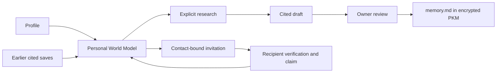

# Personal World Model: product and engineering KT

## Visual Context

Canonical owner: [One Index](./README.md).



## User experience

Profile has **Personal World Model** immediately below Memory. `/one/profile/world-model` is a dedicated compact page, using the existing Profile icons, typography, cards, Back navigation, and vault authority. Opening it reads approved information. **Build my model** explicitly starts research. Chat no longer mounts Magic Intelligence offers or queues automatic onboarding research.

The page provides a plain-English draft, identity explanation, topic coverage gaps, expandable cited facts, editable review, confirmation, earlier cited saves, and contact-bound invitations. Approved facts are saved to memory.md, where they remain editable/removable through Memory; the "Your model" list shows only earlier saves that kept their sources. An invitation reserves a private starting point; it does not pre-research a third party or grant the inviter access.

### Easy user stories

1. **Find my public work.** Alex builds a model. A public company page and project repository support career and project facts. Alex reviews and saves only correct statements.
2. **Separate namesakes.** Two people share Alex's name. A school or location match alone is insufficient. The draft stays uncertain rather than mixing their biographies.
3. **Find preferences.** Alex explicitly says “blue is my favorite color” in an attributed public interview. That can be proposed with its citation. Wearing blue, buying a gift, or requesting fewer ads does not prove a durable preference or dislike.
4. **Find little information.** Public search finds no reliably linked sources. The page explains that limitation. It does not fill empty sections with guesses.
5. **Keep control.** Alex edits/selects a draft, then confirms the exact reviewed content. Dismissing discards the draft. Research itself writes no approved PKM data.
6. **Invite Sam.** Alex creates a link bound to Sam's email or international phone. Sam signs in, verifies the matching contact, explicitly claims it, and chooses whether to start research. Claiming shares nothing with Alex.

## Exact prompt and models

The single authored system instruction is the `one_personal_world_model.system_instruction` block in [the One manifest](../../../consent-protocol/hushh_mcp/agents/one/agent.yaml). Python loads this manifest; it contains no duplicate system prompt. The generated product-agent registries describe the same specialist.

The specialist's `gemini-default` currently resolves to **Gemini `gemini-3.6-flash`**, with medium thinking and a 16,384-token output ceiling. Gemini interprets public search receipts. The implemented retrieval adapter uses **Tavily Basic**, rather than Google Search grounding, for this persistent reviewed-evidence workflow.

All managed text/chat, PWM, Live Voice, and embedding clients read [managed-ai-runtime.json](../../../consent-protocol/config/managed-ai-runtime.json).

| Environment | Vertex project | Text/PWM | Live | Embeddings |
| --- | --- | --- | --- | --- |
| Local/dev | `hushh-pda-uat` | `gemini-3.6-flash` | `gemini-live-2.5-flash-native-audio` | `gemini-embedding-001` |
| UAT | `hussh-511311` (Parth) | same | same | same |
| Production | `hushh-vertex-personal54` | same | same | same |

Text locations are `global`, `us`, `eu`; Live is regional `us-central1`. Cloud Run, SQL, Firebase, and application-secret infrastructure projects are separate from the managed Vertex project. BYOK remains a separate explicitly selected runtime.

Change the checked-in environment profile and deploy its revision. The compiler and runtime share validation and a normalized configuration hash. Candidate readiness compares the image's hash and exercises the configured text and enabled Live targets. The runtime config CI contract rejects managed environment reads outside the canonical settings boundary. Local development retains explicit overrides; hosted runtimes use the packaged profile and ignore retired per-surface project overrides.

## Six identity baselines and confidence pivots

These are stages of one manifest-backed specialist, not six independent services:

1. Read the trusted account name and verified contact; preserve missing values.
2. Keep separate candidate identities from public results.
3. Look for first-party identity anchors and exact identifier linkage.
4. Pivot from combined identifiers to name/email, name/phone, and then evidenced public anchors; never invent a pivot.
5. Inspect contradictions, dates, namesakes, and mirrored sources.
6. Return a decision with a plain-English reason before broad coverage.

Identity states are `owner_linked`, `candidate_for_review`, `ambiguous`, and `no_match`. The report maps these to matched/uncertain/no-match. **Probability stays null:** no calibrated identity estimator has been validated. Each fact independently has supported, uncertain, or conflicting evidence. Strong fact support does not establish that its subject is the owner.

The prompt limits identity searching to six queries; overall host-enforced bounds are 32 search attempts and 20 logical ADK model calls. Regional failover can make additional provider requests within a logical model call. Python enforces authority, budgets, receipts, schema, and deadlines. Semantic linkage and interpretation belong to the LLM and owner review.

## Twenty optional topic layers

| Layer | Supported scope |
| --- | --- |
| Business | Companies, products, evidenced founder roles |
| Career | Current/historical roles and expertise |
| Education | Studies and qualifications; enrollment distinguished from graduation |
| Personal | Public non-sensitive biography |
| Projects | Technical and creative work |
| Publications | Papers, books, articles, interviews, talks |
| Achievements | Awards; participation distinguished from winning |
| Community | Volunteering and organizing |
| Interests | Explicitly described hobbies/topics |
| Preferences | Stated choices, likes, routines |
| Dislikes | Explicit exclusions/dislikes; unknown is not dislike |
| Style | Stated colors, design, clothing choices |
| Food | Stated tastes |
| Travel | Published interests, excluding live whereabouts |
| Entertainment | Books, film, music, games |
| Shopping | Explicit product/brand choices |
| Communication | Stated language, tone, format/accessibility preferences |
| Digital presence | Evidenced public profile links |
| Public records | Non-sensitive professional registries |
| Security | Reserved for authorized breach metadata; adapter not implemented |

Each section permits up to eight facts with one to three exact source references. Empty categories are omitted. Topic coverage is a checklist, not a claim that information exists or every platform was searched. Private family relationships, children's dossiers, criminal allegations, sensitive inferences, private accounts, and stolen credentials are outside this public-web discovery endpoint.

### How advertising preferences relate

Advertising systems can combine account settings, activity, contextual signals, and inferred audience categories. Those are different evidence types. A “fewer ads” setting controls advertising; a search or click does not automatically establish a preference. PWM's prompt distinguishes owner declarations, public self-statements, platform actions, observed activity, platform inference, and PWM hypotheses. The current saved fact contract carries reviewed text and sources; structured import/action provenance is a future schema extension, not an implemented private-account feed.

References: [Google My Ad Center](https://support.google.com/My-Ad-Center/answer/12155764), [Google advertising data controls](https://safety.google/privacy/ads-and-data/), [Google Takeout](https://support.google.com/accounts/answer/3024190).

## API and execution

All endpoints require an authenticated owner token and the unlocked-vault derived `X-Hussh-Chat-Key`. Responses are private/no-store. Subject authority is inferred from the authenticated owner, never a client-supplied user ID.

| Endpoint | Meaning |
| --- | --- |
| `POST /api/one/world-model/research` | Explicit integration endpoint with name and verified contact |
| `POST /api/one/world-model/jobs` | Start or reuse owner research with server-resolved identity |
| `GET /api/one/world-model/jobs` | Poll the current job/draft |
| `DELETE /api/one/world-model/jobs?draft_id=…` | Discard that draft generation |
| `POST /api/one/world-model/complete` | Verify acknowledged owner PKM receipts and dismiss that draft |
| `POST/GET /api/one/world-model/invitations` | Create/list the owner's invitations |
| `DELETE /api/one/world-model/invitations/{id}` | Revoke an invitation |
| `POST /api/one/world-model/claims` | Match verified recipient contact and record explicit claim consent |

Integration request:

```json
{
  "name": "Account display name",
  "email": "verified-owner@example.com",
  "phone_number": "+14155550123"
}
```

Name and at least one verified contact are required. Phone uses E.164. Every supplied field must match the freshly resolved owner's account. The UI normally calls `/jobs` without sending identifiers. Arbitrary submitted identities are rejected.

A pending result uses HTTP 202. An offered result includes `draft_id`, `report`, `research.identity`, `research.checked_topics`, `research.gaps`, `research.searches_used`, and `pkm_written: false`. Missing configuration or failure before any successful search yields unavailable, not proof that no information exists. Later search failures may produce a partial cited draft with gaps.

The specialist deadline is 240 seconds; the job deadline is 270 seconds. The existing derived key's lifetime remains bounded. Search calls currently execute serially. Attempt slots are charged durably before dispatch and survive retries and identity edits within the checkpoint budget window. The shared monthly Tavily ledger has a 900-credit ceiling; it cannot account for calls made by other applications using the same provider key. Use a dedicated free-tier key with paid overages disabled at the provider.

Without `PWM_TAVILY_API_KEY`, research returns unavailable. Page access, approved facts, and invitations remain usable. No Brave or paid fallback is required. API keys stay in Secret Manager/runtime settings, never the prompt or frontend.

## State, save, reset, and invitations

Research uses encrypted checkpoints in namespace `one.personal_world_model.v1`, with identity/policy binding and durable attempts. A draft is not approved knowledge. Discard writes a content-free tombstone and changes the checkpoint fence, preventing an old worker from restoring it. Completion verifies every supplied owner-review commit receipt and dismisses only the specified draft generation; the legacy saved flag cannot bypass those checks. The UI supplies receipts for its selected review. Completion grants no new write authority.

Approved content is saved to the owner's `memory.md` (the `one_memory` PKM domain) exactly as reviewed: one bullet per checked, edited statement, in one atomic encrypted write by the `profile_research_review` writer. Taste-and-choice topics (interests, preferences, dislikes, style, food, travel, entertainment, shopping, communication) go under Preferences; every other topic, including company findings, goes under Facts. No model rewrites the text and no source links are saved with it. The exact duplicate check is the writer's; a paraphrase of an existing bullet is added, and the 18,000-character memory.md limit applies. The acknowledged `one_memory` commit receipt, not the write response, decides completion. The "Your model" list still projects sourced `profile_fact` records from earlier structured saves, excludes reserved branches and deleted/retracted records, and clears with owner/key/session changes. The earlier structured path (`profile_review_v1`) remains in the codebase as a compatibility rollback and is called by no screen. There is no second plaintext biography store.

Invitation storage contains a random token hash and keyed contact commitment, not raw contact, name, biography, or findings. Links expire in seven days, with at most twenty pending invitations per inviter. Atomic claims require a matching verified contact, active setup/vault, unexpired unclaimed link, and explicit consent. Reset and invite writes share account graph locks; locked authority checks reuse the transaction connection. Revoke removes the stored commitment. Account reset/deletion clears participant invitations.

## Apollo/AgentOne knowledge graph implementation plan

“Apollo” is treated here as the application graph; this change does not integrate Apollo.io or a new third-party enrichment database.

1. Project **Subject → Claim → Source**, plus topic membership, from approved PKM only. Use stable PKM domain/entity identities and normalized source identities. Facts saved to memory.md carry no source, so this projection needs a structured evidence record before it can include them.
2. Carry a snapshot/content revision. Invalidate graph projections when a source or fact is edited, deleted, retracted, or becomes inaccessible.
3. Extend the existing review/PKM schema with structured evidence basis, observation/publication dates, source-use rights, and supersession/contradiction relationships. Do not silently append unreviewed metadata to the current exact save payload.
4. Add graph/topic filters and inspectable source/claim nodes, with uncertainty and history. Reuse existing PKM edit/delete flows.
5. Clear decrypted projection state on logout, vault lock, key rotation, or owner change. Keep graph persistence encrypted and canonical.
6. Add graph sharing through explicit consent grants. Invitation claims never imply permission to share.

The current page is a fact/source list, not an interactive graph. Authorized account imports, licensed breach metadata, calibrated probabilities, direct-source fallback, a separate assessment agent, and progressive/parallel research remain future work.

## Source and exposure references

- [Tavily pricing](https://www.tavily.com/pricing) and [terms](https://www.tavily.com/terms): optional provider capability; free-tier allowance is not unlimited search.
- [Google Cloud service terms](https://cloud.google.com/terms/service-terms): grounding reuse has specific restrictions; owner confirmation alone does not remove provider restrictions.
- [Wikidata access and CC0](https://www.wikidata.org/wiki/Wikidata:Data_access), [Crossref REST metadata](https://www.crossref.org/documentation/retrieve-metadata/rest-api/), and [GitHub public users API](https://docs.github.com/en/rest/users/users#get-a-user): candidates for future direct-source adapters, not wired into this release.
- [Have I Been Pwned API](https://haveibeenpwned.com/API/v3): future authorized exact-identifier breach metadata checks; no collection or display of leaked passwords/tokens. No provider configured means unavailable. “No hit” never means never breached or currently safe.

## Release evidence

See the PR and its exact-commit CI for final verification. Contract/unit tests can prove state, schema, authority, and budget behavior. They do not establish live research precision, source coverage, or latency. Those require a configured search key and consented evaluation cases before quality claims.
