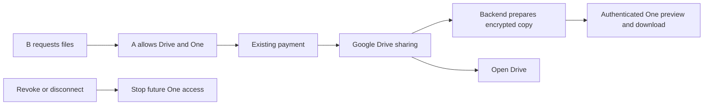
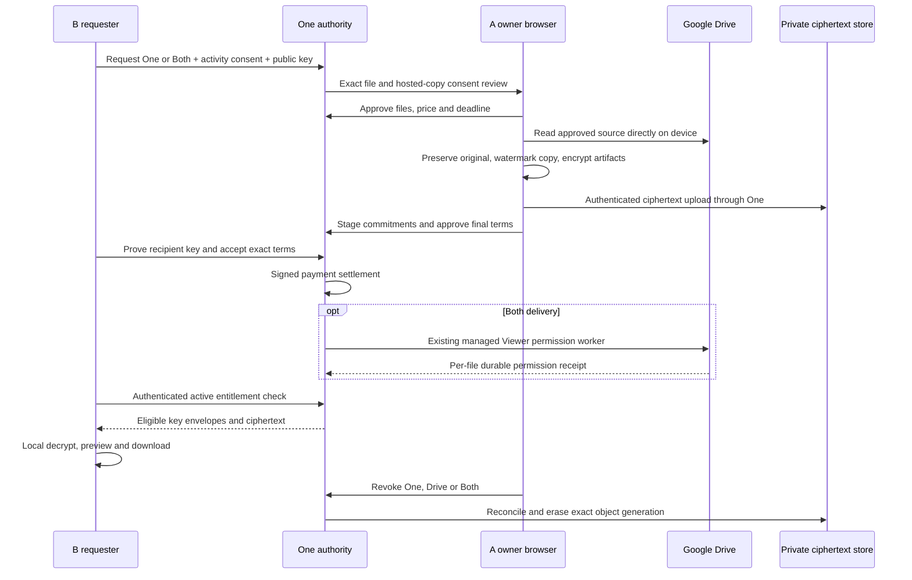

# Protected One document delivery

## Visual Map

## Current default: background copies

New file requests use the existing Drive request, approval and payment with an
additive protected One copy. B sends the request with the access-activity notice;
A's single **Allow** authorizes Drive sharing and server-readable encrypted
hosting. New combined requests require this Allow even for Trusted connections.
Historical requests and Drive-only Trusted behavior keep their existing policy.

Azure still authors the Drive query. Newly sealed provider-results policy v3
uses Google's unique valid file results without another filename, relevance,
type or date filter. Existing query compilation remains authoritative: when its
date basis is created/modified, the date range is in the provider query; a
title-date plan does not acquire an invented Last modified rule. Owner-only
coverage records whether date pushdown was expressed. Original permission,
recipient, payment and provider download restrictions remain enforced.

After payment and a confirmed Drive grant, the existing backend drain prepares
One copies without A's browser remaining open. Uploaded files keep their original
bytes. Google Docs, Sheets and Slides use labelled PDF, XLSX and PPTX exports
respectively; their preparation-time snapshot is labelled with an export time.
Changed sources and failed preparation do not remove the working Drive link or
create another checkout. Native Google export limits remain explicit provider
failures. PDF preview uses the existing bounded canvas and a request-reference
watermark; original downloads remain unchanged. Unsupported previews retain
Download and Open Drive.

The protected reader is the single document screen for Preview, Download and
the owner's Access controls (Activity and manual Stop One access). PDF page
navigation reuses the parsed document; closing or ending access destroys it.
Only the selected file action shows loading. No additional account enablement,
copy mode picker, owner upload or preparation step is introduced. Existing and
new accounts use the same request path; historical requests retain their actual
consent rather than acquiring hosting permission retrospectively.

`/one/documents/open?ref=<request-uuid>&delivery=background` is an authenticated
locator, never a bearer grant or public object URL. Every content read checks
the original paid entitlement, owner placement and connection generation,
relationship, explicit access deadline and revocation. Disconnect permanently
withdraws old copy consent; reconnect does not restore it. Without an explicit
grant deadline, the copy remains until revoked or erased, matching Drive's
until-removed grant. Pending-request TTLs are not access deadlines.

One stores only encrypted chunks and encrypted file keys at rest, but its backend
can read transient source bytes in this mode. This is not zero knowledge. It
does not use an escrowed vault key. Owner activity distinguishes preview/download
requests from completed transfers, with server times and participant roles;
neither proves viewing, saving, screenshots or offline forwarding. Country is
unknown unless a separately qualified source provides it. Stopping One access
fences future reads; saved copies cannot be recalled. Drive access has its
existing separate removal path.

Implementation and storage custody:
[background document delivery](../../../consent-protocol/docs/reference/document-delivery-background.md).
The device-encrypted v1 contract below remains supported for existing requests.

## Device-encrypted v1 compatibility

This is the v1 implementation contract for device-encrypted browser PDF delivery. Runtime
admission and deployed evidence remain separate from source availability. One is
the private agent; A owns the documents and B requests/pays for them. Existing
Drive-only requests keep their original entrypoints, payment rules and workers.

## Consent and delivery

B explicitly chooses Google Drive, secure One link, or Both. The One modes require
the versioned activity notice and B's current public connector key. A separately
selects exact source files, authorizes hosting an encrypted copy, chooses a finite
deadline/price, and approves the final prepared package. Drive connection and
Trusted status do not imply this consent. Changed terms require a fresh review
before payment; an allocated Checkout attempt fences owner preparation changes.

Packet browsing and the optional agent-package request flow have separate
capabilities. An available packet catalog does not add access-period or actor
fields to a legacy Drive request. An unchanged retry keeps its request key;
starting another request creates a separate intent.

The owner starts with file selection. Price, expiry and copy consent appear
after a supported PDF is selected. Cancelling the picker preserves the draft;
completing selection refreshes the local source catalog. If device preparation
fails after approval is acknowledged, retry uses the acknowledged revision.
Known shared Drive failures retain the existing safe status/code mapping.

The initial source is a selected PDF no larger than 4 MiB. A's browser reads the
source directly from Google's fixed Drive API after source metadata and download
capability checks, then rechecks the same revision and integrity. It preserves
original bytes and creates a separate raster PDF with a recipient-bound watermark.
No server document conversion or file-key escrow is used. Limits are 25 files,
40 pages/PDF, 4 million rendered pixels/page, 4 MiB/rendition and 32 MiB total
ciphertext. Unsupported files fail before checkout. Interrupted preparation needs
an explicit fresh generation because file keys are not persisted in plaintext.

The protected HTTPS route is `/one/documents/open?ref=<opaque-request-uuid>`.
The URL is a locator; One authentication, current vault authority and paid
entitlement are still required. No key, bearer token, source ID or email enters
the URL. B can open the finalized copy while A is offline. B does not need Google
content OAuth for One-only copies. Both requires the existing verified Google
recipient identity and the existing managed permission queue/executor.

Terms, status, payment, recovery and revoke expose bounded transaction metadata;
only approved selected file names, media types, sizes and opaque references may
appear there. Owner source enumeration and full provider descriptors use the
separate `/delivery/source-selection` endpoint and the existing owner-placement
content guard. The browser requests that source view only during owner
preparation. Recipient access and later owner controls do not depend on source
catalog access. Existing Drive content admission remains authoritative.

Browser preview and download decrypt locally. The default copy is watermarked;
the explicit original download preserves bytes and signatures. Native viewer and
preparation admission remain false pending actual iOS/Android transport, PDF and
Save/Share qualification. The native surface offers browser handoff. See the
[parity inventory](../../../hushh-webapp/native-route-inventory.json).

## Cryptographic bindings

Runtime validation belongs to
`consent-protocol/hushh_mcp/services/document_delivery/contracts.py`; client pairing
belongs to `hushh-webapp/lib/consent/document-hosting-crypto.ts`. Canonical JSON
recursively sorts ASCII keys, uses compact UTF-8, finite safe integers and explicit
nulls. Times use server UTC ISO strings with exactly three millisecond digits.
Hashes are lowercase SHA-256 hex. A document recipient fingerprint hashes the
decoded 32-byte X25519 public key, separately from the legacy registry's
base64-text fingerprint field.

| Binding | Canonical input |
| --- | --- |
| Preparation P | `{version:1,requestId,ownerUserId,recipientUserId,generationId,sourceSelectionDigest}` |
| Content AAD | `{version:1,purpose:"one-document-content",preparationDigest:P,artifactId,fileRef,role}` |
| Descriptor | `{artifactId,fileRef,role,iv,plaintextBytes,ciphertextBytes,ciphertextSha256}` |
| Content C | `{version:1,preparationDigest:P,artifacts:[descriptors sorted by artifactId]}` |
| Terms T | Hash of the exact versioned terms below |
| Recipient wrap AAD | `{version:1,purpose:"one-document-recipient-key",contentCommitment:C,termsDigest:T,artifactId,recipientUserId,recipientKeyId,recipientKeyFingerprint}` |
| Owner recovery AAD | `{version:1,purpose:"one-document-owner-recovery",preparationDigest:P,artifactId,ownerUserId}` |
| Package D | `{version:1,contentCommitment:C,termsDigest:T,wraps:[{artifactId,role,sha256:<complete wrap hash>} sorted by artifactId then role]}` |

Each artifact uses a fresh AES-256-GCM key and 12-byte nonce. Raw HTTP artifact
bytes include the final 16-byte authentication tag; IVs use standard base64.
Roles are `original`, `watermarked` and `manifest`, with manifest `fileRef:null`.
The encrypted private manifest maps file references to names, source provenance
and original/derivative artifact IDs/hashes. It contains no keys or wraps and
does not include its own descriptor. C includes its encrypted descriptor.

Terms are `{version:1,revision,requestId,ownerUserId,recipientUserId,receiveThrough,
contentCommitment:C,amountCents,currency:"usd",accessExpiresAt,
rights:{preview:true,download:true},activityDisclosureVersion,copyDisclosureVersion,
recipientKeyId,recipientKeyFingerprint}`. Final owner approval, B's acceptance
and payment bind T and D. Content AAD excludes recipient-key identity, so key
rotation can rewrap the same content without changing source bytes.

Recipient wraps use the existing X25519/SHA-256/AES-GCM export-key bundle, with
the exact connector key ID. Owner recovery wraps encrypt the key hex under A's
existing vault key with the recovery AAD. The server has no readable content key.
B's single-use five-minute possession challenge uses a fresh random challenge,
not a file key; only this existing-bundle challenge omits AAD, with request/user/
key/expiry bound in SQL.

Paid reads request the exact historical connector key from the existing encrypted
PKM record. They never silently replace it. History retains old valid keys and
rejects duplicate-ID key substitution or overflow. Before payment, the server
withholds every B wrap, including the manifest. Paid metadata release can describe
pending files; only fulfilled files' key envelopes are returned.

The hosted lane protects content from server-side reading under the trusted
client and public-key directory assumptions. It does not resist a malicious
replacement web client or key-directory substitution. Existing Drive background
processing remains a separate server-readable lane. Consent is not itself a
cryptographic zero-knowledge guarantee.

## Financial and lifecycle authority

One order purchases one exact request package. Both counts each file once;
previewing does not charge again. Legacy Google-already-accessible charge waivers
remain Drive-only. B must prove the exact key and accept the exact current T/D
before Checkout. Stripe's signed callback must match the allocated order,
attempt, amount, currency and mode before paid authority is established.

All status, payout, refund and erasure readers use the same mode-aware delivery
summary. In One mode a fulfilled file records hosted key release. In Both mode
the same file also requires the real durable Drive permission receipt. Partial
Both delivery releases available files independently and retains unresolved
files for reconciliation/refund. No fabricated successful ACL receipt is allowed.

Release, refund claim, revoke and account erasure serialize through the existing
relationship/request/order authority and consistent lock order. External provider
I/O stays outside those transactions. A refund claim fences future release before
provider I/O; an uncertain refund remains fenced. Historical delivery receipts are
retained after revoke and original payment commitments survive request erasure.
Late Drive grants after cancellation require provider reconciliation/removal.

Owner-device recovery rewraps unchanged ciphertext only after B proves the new
key and A explicitly authorizes repair. The amendment references original paid
T/D and preserves parties, C, mode, price, rights and deadline. It creates no
second charge/delivery earning and cannot restore expired or revoked authority.

Revoke has independent One, Drive and Both scopes. One blocks future ciphertext/
key release immediately. Drive removal is asynchronous and applies only to
receipt-proven app-created permissions; preexisting or independent access remains.
Disconnect, hiding a Feed item, signing out, revoking access and erasing an account
remain separate actions. Already downloaded copies/screenshots cannot be recalled.

## Tracking, storage and retention

Activity distinguishes server-authorized package/ciphertext retrieval from
client-reported rendering, requested download and system/browser handoff. The
latter does not prove the person read or saved a file. Events use server times,
bounded kinds, request/interaction/artifact binding and event-ID deduplication.
Unknown country stays unknown. No arbitrary forwarded IP header becomes verified
location; no exact location, screenshot or offline-forwarding claim is made.

Product analytics uses the static `one_documents` route ID. Its SDK URL context
removes document query/hash locators, including protected referrers and the
document resume parameter nested in a login redirect. Custom `dataLayer` events
and direct SDK event parameters retain their metadata-only schema. SDK global and
stream defaults refresh before dispatch; their configuration arguments carry the
separate URL context. Release verification must recheck that Enhanced Measurement is disabled
on the governed web streams and inspect actual SDK collection with synthetic
document locators. Payload tests do not qualify arbitrary custom vendor tags;
changing those tags or enabling automatic collection requires fresh verification.

Migration 424 registers ten request/crypto/obligation tables in the runtime
data-plane contract. File/source metadata uses existing encrypted Drive custody;
packages hold ciphertext descriptors and key envelopes, never plaintext keys.
Activity retention is 90 days. Preparation and unfinished uploads expire after
30 minutes, bounded by the approved access deadline. Financial binding
and object cleanup obligations survive request/account cascades under their
existing obligations policy.

Idempotent response projections use authenticated encrypted custody bound to
the request, operation, body digest and retry key. Retired cleanup purges the
selection, cached results, key challenges and package envelopes after fencing
release. Recipient-account erasure also removes its public-key directory pins.

The dedicated private GCS bucket requires uniform access, public-access prevention,
a pinned immutable creation identity, and no holds, retention lock, versioning or
soft-delete history. Resumable-session custody fences unknown late writes. Cleanup
must observe a terminal/cancelled session and remove the exact observed generation,
then verify absence; uncertain outcomes remain pending. A DELETE response alone
does not prove erasure. No public/signed download URL or shared plaintext CDN cache
is used. Blob URLs and decrypted buffers are released on completion/unmount.

## Rollout and verification ownership

`BACKEND_RUNTIME_CONFIG_JSON` carries `protected_document_delivery`,
`document_delivery_bucket`, and `document_delivery_bucket_identity`. Retention
compilation pins project/environment and exact dedicated bucket naming and rejects
cross-environment identities. The release is environment-wide for all authenticated
platform users, with no per-account cohort or A/B experiment. Per-document identity,
relationship, copy consent, payment and entitlement remain mandatory. Issued readers/reconciliation retain
storage settings when admission is turned off.

Deploy compatible schema, bucket configuration and readers with intake off first.
Keep that reader-capable revision as rollback authority before enabling intake for
everyone in UAT, then production after UAT verification. Rollback turns intake off
while preserving paid reads, refunds and cleanup. Never fall back to a pre-reader
binary after issuing paid packages. Each API and worker revision pins the resolved
`PROTECTED_DOCUMENT_DELIVERY_ENABLED` as a literal environment value. Changing
runtime JSON requires a governed revision deployment; mutable Secret Manager
`:latest` is never evidence that an already running process has intake off.
A first pre-reader rollback is allowed only while the serving API demonstrably
cannot issue copies and authoritative SQL has no contracts, financial bindings
or cleanup obligations; both conditions are checked again immediately before
rollback. The governed manual rollback workflow uses the same compatibility
resolver before its existing traffic mutator, binds the exact target service,
revision, source and immutable image, and applies the same fresh empty-inventory
and effective-off proof to a pre-reader target. This also protects an explicit
operator-selected revision rather than relying on a healthy HTTP response.
The account-lifecycle producer qualification remains an independent prerequisite.
An empty hosted inventory never authorizes rollback to an incompatible provider
cleanup producer; such a transition requires forward recovery.
Production activation follows its separately
authorized deployment gate with the same required verification and provenance.

Production retains its existing Drive feature switches. A configured hosted-copy
bucket independently requires the existing provider/custody secret bindings and
the private worker's fixed sharing scheduler, including with intake off. The
hosted maintenance profile preserves the indexing and suggestions jobs' prior
state. It requires the same operator attestation of Google scopes/callbacks,
private worker provenance, Stripe/origin bindings and rollback evidence as the
existing release path. No hosted release grants authority to activate legacy
Drive enrollment.

Focused protocol tests own actual SQL lifecycle, payment, release, recovery,
revocation, retention and races. The existing legacy autoshare/payment PostgreSQL
suite owns Drive regression. Client tests own AAD/digest/key/authority boundaries,
direct Google source checks and reader expiry/session fences. Existing Next proxy
tests own exact binary forwarding and auth/error behavior. The Integration gate's
`scripts/ci/document-delivery-check.sh` composes production client/components,
actual FastAPI routes, isolated PostgreSQL, real Stripe signature verification,
PDF.js rendering and real browser downloads, with provider/auth/PKM transport
boundaries alone synthetic. Native runtime and live production proof are separate.

Public API shapes live in [API contracts](../architecture/api-contracts.md).
The routed owner is `new-feature-tri-flow`, with backend API, security/consent,
quality, parity and repo-operations handoffs. The completed candidate still needs
the local core mirror, independent review, exact-head hosted checks, merge queue,
landed-main smoke and requested-environment deployment proof.
