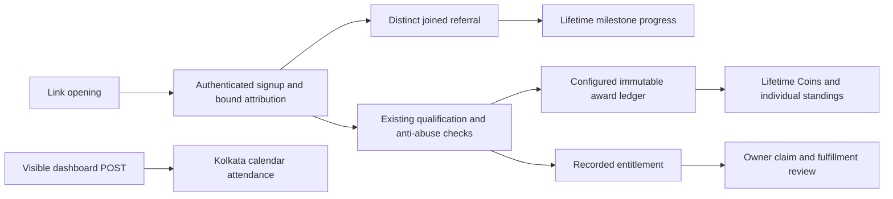

# Referral dashboard contract and audit

This is the implementation contract for `ui/referral-dashboard-polish`. Source verification does not establish the authenticated account's records, deployed revision, applied shared migrations, or prize delivery.

## Visual Map



## Current definitions

| Metric | Authority and meaning |
| --- | --- |
| Coins | `SUM(points)` in the existing lifetime score ledger, including reversals. Response `points` and `coins` are aliases of one total; never add them. The historical database `coins` column remains unchanged. No cash-wallet balance or weekly subtotal is involved. |
| Joined referrals | Distinct registered referred identities with a matching bound attribution, excluding self referrals and rejected, revoked or ineligible attribution. An expired qualification window does not undo a registration. Link opens and pending invitations do not count. Summary `joined_count`/`total_count` and reward `joined_referral_count` use the same predicate. |
| Rank | Lifetime earned Coins, then first positive earned event, then stable user identity. Registered referrers remain eligible at zero Coins. All rank surfaces share on-demand snapshots independent of prize publication. Pinned pages and off-page viewer lookup remain supported. Chosen public aliases retain priority. Otherwise, `display_name` uses the viewer-permitted Connect directory; hidden, inactive and unresolved people remain anonymous. The viewer may see their own account name. These are profile names, not legally verified names. No peer identifiers or contact details are returned. |
| Streak | Consecutive authenticated dashboard-visit calendar dates in Asia/Kolkata. POST owns attendance; GET never awards a visit. Owner locking and user/date uniqueness make retries and devices idempotent. Date is sampled after locking. Old app attendance remains separate; unmarked legacy app-open requests return a read-only status. New requests carry an explicit dashboard surface. Past dashboard visits are not fabricated. |
| Weekly period | Monday 00:00 Asia/Kolkata through following Monday, exclusive. Persisted bounds and server time sampled after database work anchor one weekly-prize countdown. A database wait across cutoff resolves the next round. Both `active` and `campaign_active` require enabled prizes and an open round; calendar existence alone never runs the timer. The display uses days, hours, minutes and seconds without an extra daily calendar track. Invalid/missing timing shows an unavailable state, never a device-clock deadline. Foreground, reconnect and expiry refresh it. |
| Reward progress | `min(joined_referral_count / threshold, 1)`. Feature the next unreached, unearned threshold without subtracting tiers or waiting for earlier claims. Recorded historical entitlements stay accessible. Qualification, claim, approval and fulfillment remain separate. |

The approved ladder is 10 Amazon voucher, 100 wireless earbuds, 500 Apple Watch and 10,000 iPhone. The v6 UAT activation restores Apple Watch under the existing `airpods_500` compatibility key; the current server-owned catalogue remains authoritative until activation. Historical earned entitlements retain their recorded labels and artwork. The approved voucher amount remains. At exactly 10/100/500 joins, feature threshold 100/500/10,000. At 10,000 joins all progress milestones are reached; this does not promise all rewards are claimable or fulfilled.

## Verified source defects and corrections

| Surface | Source finding | Correction |
| --- | --- | --- |
| Coins | UI used a separate column that omits activity awards and showed lifetime score only in a points subtitle. | Read the existing earned score as Coins, remove subtitle, align history/ranking without rewriting awards. |
| Referrals | Status buckets omitted registered expired referrals; frontend fell back to qualified count. | Explicit joined cohort independent of pagination/qualification. Actual status remains in Recent Referrals. |
| Rewards | Qualified-only progress and featured selection waiting on entitlement issuance. v4 inherited Apple Watch under the legacy AirPods key. | Joined progress and next threshold; forward v5 reconciles AirPods while retaining old Apple Watch entitlements. |
| Ranking | Separate positive coins column and scheduler publication were required. | Lifetime earned score, zero-score registered referrers, on-demand publication and cohort/rank comparison before reuse. |
| Streak | Global One entry/resume wrote app attendance. Dashboard navigation did not own the write; date preceded the concurrency lock. | Existing hook mounted only on dashboard; success refresh, server-midnight timer, background suppression and lock before date. |
| Week | Monday/Kolkata already existed, but calendar activity could imply an active prize campaign and a pre-query clock could become stale during database work. | One enabled weekly-prize countdown using persisted bounds and fresh server time; explicit units replace total-hours ambiguity. Lifetime progress and valid streaks persist. |
| Circles | Automatic genealogy was presented as membership; separate legacy service scored selected Location Circles. Neither proves accepted referral-team membership. | Preserve histories. Public reads show preview with no teams/rank; selection returns 409. No trusted-circle permission is granted. |
| Cache | No warm publication; reconnect missed repair reads; refresh failures hid real loaded values. | Lifecycle-fenced owner-keyed memory, logout invalidation, reconnect/trailing refresh and retained values with refresh-failure status. Resources render independently. |

How It Works reads active award configuration and calls the amounts Coins. Zero-value and disabled flash promises are omitted. Joined progress itself never creates an award: existing configured registration, qualification, product-event and streak writers retain their idempotent event keys and award amounts.

## Circle League — Win Together

**Proposal only; preview remains inactive.** Preview creates no memberships, participants, prizes, badges, Coins or sharing permissions.

Opt-in teams would hold up to five people including the owner, one active team per person, with explicit acceptance. Shared progress would show individual contributions and non-monetary badges at 5, 10 and 25 joined referrals. Standings would use only referral-linked Coins from approved award rules, separately from joined progress and personal lifetime balances.

Attribution must freeze at the referred person's signup. Later qualification credit follows that attribution; switching teams affects future referrals only. Weekly recognition snapshots may show top circles/contributors without expiring cumulative progress or excluding repeat winners. Personal Coins and rewards stay personal. Team membership grants no PKM, documents, KYC, location or trusted-circle permissions.

Launching requires separate approval and accepted-membership, signup-attribution, contribution and recovery contracts. Genealogy and trusted-circle selection cannot prove those contracts already exist.

## Migration and rollback

Weekly prize activation is an environment operation separate from the weekly
calendar. Preview with `python scripts/ops/configure_referral_uat.py prizes`.
After the reviewed backend is merged, passes post-merge smoke and is deployed,
run `python scripts/ops/configure_referral_uat.py prizes --apply --sha <deployed-main-sha>`
from that exact checkout. The fixed-target operator uses
`cloud-sql-python-connector[pg8000]`, existing operator authentication and
process-only secret values; it accepts no production target.

Activation preserves v5 and inserts an exact v6 successor with prize enablement
and the requested 500-referral Apple Watch restored. All four historical replay adapters accept that successor
and reject changed configuration or broken lineage. The operation refuses
unresolved past rounds instead of creating retroactive awards. Repeat activation
is safe. Activation emits the existing referral-change notification so open
dashboards refresh. Upcoming rounds retain their original IDs, cutoff and policy
version and may finalize once under the enabled current policy. Existing prize
approval and fulfillment remain separate. Pause the
existing scheduler to stop processing; do not rewrite historical settings or
delete earned awards.

Additive migration **349** follows immutable 348. It adds dashboard attendance fields to existing tables and settings v5 from v4, preserving award amounts, campaign activation, old entitlements and every ledger row. In this branch 284/287 concern messaging/Drive; referral policy history is 289/338/347. Filenames do not establish applied environment history.

Release manifest and dev/UAT/production schema contracts select 349. Migration authority recognizes only the exact reviewed v5 successor while preserving earlier SQL checksums. Repeated release replay is verified in isolated PostgreSQL schemas.

Rollback deploys the preceding compatible application revision. Its SQL retains additive columns, attendance, awards, approved catalogue and immutable v5 lineage. It does not reactivate an historical policy or discard earned records; forward replay stays possible. Reverting the approved catalogue requires another versioned policy.

The user authorized committing and pushing this branch and verifying its existing PR checks. Shared migrations, merge, deployment and campaign activation remain separate. Live evidence must bind the account, running image and applied migration history to the inspected responses.

## Verification

Tests use disposable PostgreSQL with isolated random schemas and frontend fixtures. They cover legacy Coins, joined/status/link boundaries, reward tiers with delayed entitlements, retries/concurrency/replay, midnight/Monday/gaps, paginated ranks, owner-only claims, historical rewards, preview permissions, cache races and failures. Fixtures never populate a shared authenticated dashboard.

Exact commands/results and live-access limitations are reported at delivery. Unit, integration and build results do not constitute a real authenticated browser rehearsal.

## Local verification — 15 October 2026

All following records concern isolated local tests or this checkout's generated
build. No shared account information was inserted, reset or repaired.

| Command / check | Actual result |
| --- | --- |
| `.venv/Scripts/python.exe -m pytest` across all `test_one_referral*.py`, service referral tests, scoring-drain routes and `test_migration_authority.py` | 357 passed, including 33 real PostgreSQL lifecycle cases; two existing ADK warnings |
| `python -m pytest tests/test_developer_api_routes.py -q` with an isolated local registry database | 80 passed; initial missing-database run was resolved with disposable test configuration |
| `npm exec -- vitest run` dashboard, profile panel, service, attribution, stream and route-layout suites | 95 passed |
| `npm run verify:cache` | 90 passed |
| `npm run build:ui-contracts` | 454 Back behavior tests passed; Back/Search and derived contracts generated |
| `npm run verify:ui-contracts` | All eight checks passed, including 12 validator mutation regressions |
| `npm run verify:analytics` | 157 passed and Android observability scope verification passed |
| `npm run typecheck`; ESLint on changed frontend sources; Ruff on changed Python sources/tests | Passed |
| `npm run build` | Passed; 178 static pages generated |
| Cache manifest, service boundary and documentation verification | Passed |
| `python scripts/ops/verify_release_migration_contract.py` | Passed; release and all three schema contracts agree on head 349 |
| `python scripts/ops/data_model_audit.py --text` | Passed; 287 tables classified, no unclassified tables or legacy-write findings |
| `git diff --check` | Passed |

After merging `main` at `331821640`, the migration-authority and PostgreSQL
lifecycle pack passed all 81 tests. The merged dashboard passed 37 tests and
the Back behavior pack passed 454 tests. Full web core passed UI contracts,
validator regressions, TypeScript, full lint and production build. Backend
lint, mypy, release/schema contracts and the security scan passed; the composed
SQL uses fixed authored predicates with bound owner and snapshot values.

The required local core mirror passed gitleaks but could not read repository
secret-scanning alerts with this actor (HTTP 404). Additional local governance
and MCP package checks reached Linux-specific process handling and npm spawning
that Windows cannot execute. Hosted Linux checks on PR #8045 remain the
authority for those lanes and the full backend/frontend suites.

The isolated PostgreSQL URL selects loopback port 55432 and random schemas;
no application/shared database URL is used. The developer-API check creates and
removes its own random local database. Authenticated route fixtures retain
negative controls for missing authorization and cross-owner mutation attempts.
They are not a substitute for real Firebase authentication.

### Reproduce the focused checks

From `consent-protocol`, point `REFERRAL_TEST_DATABASE_URL` and
`ONE_COMMAND_TEST_DATABASE_URL` only at disposable local PostgreSQL, then:

```powershell
$referralTests = @(Get-ChildItem tests -Filter 'test_one_referral*.py' | ForEach-Object { $_.FullName }) + @(Get-ChildItem tests/services -Filter 'test_one_referral*.py' | ForEach-Object { $_.FullName }) + @('tests/test_referral_scoring_drain_routes.py', 'tests/test_migration_authority.py')
.\.venv\Scripts\python.exe -m pytest @referralTests -q --tb=short
```

From `hushh-webapp`:

```powershell
npm.cmd exec -- vitest run __tests__/components/referral-dashboard-page.test.tsx __tests__/services/referral-stream.test.ts __tests__/services/referral-service.test.ts __tests__/services/referral-attribution.test.ts __tests__/components/referrals-panel.test.tsx __tests__/navigation/referrals-route-layout.test.ts --maxWorkers=2
npm.cmd run verify:cache
npm.cmd run typecheck
npm.cmd run build:ui-contracts
npm.cmd run verify:ui-contracts
npm.cmd run build
```

### Sanitized fixture evidence

| Persisted / server evidence | Frontend regression evidence |
| --- | --- |
| An existing ledger event with `points=50, coins=0` reads as `{points:50,coins:50}` and ranks the only eligible participant at 1 without scheduler publication. The event is unchanged. | The Coins card displays 50 and no Total Points subtitle. |
| Two registered, bound, in-progress relationships produce `joined_count=2`, `qualified_count=0`, next progress 2 and threshold 10. A link opening alone produces no join. | Referrals displays 2 without a qualification subtitle; Recent Referrals retains both statuses; rewards displays 2/10 and 20%. |
| Qualifying one of those identities leaves joined count 2; repeated settlement leaves the earned balance unchanged after the once-only configured award. | Reward progress consumes the joined field independently of qualification. |
| The full 503-person tie/pagination fixture preserves deterministic ranks and the off-page viewer. Account deletion immediately closes a cached rank gap. | Summary rank and viewer-row rendering use that same rank response, including a viewer outside an empty page. |
| Concurrent visits settle once per Kolkata date; consecutive/missed dates and Sunday/Monday preserve the specified streak behavior. Unmarked old app-open calls do not record a dashboard visit. | Visible midnight, foreground/reconnect, hidden-page suppression, malformed timestamps and bounded retries are covered. |
| Historical Apple Watch entitlement text remains unchanged under the new AirPods catalogue; claims still require a recorded entitlement. | Earlier rewards remain accessible while the featured threshold advances. |

### Remaining live evidence and activation boundaries

- No authenticated browser tab was attached to this chat, so the real signed-in
  account and its reported 50/2/rank/circle values were not verified.
- Existing port 3000 serves `tmp/pr8032`, not this checkout. That independent
  server and its branch were left untouched. No local backend runtime was
  configured with application database credentials.
- No shared migration history, deployed image, live scheduler, native-device
  journey, prize fulfillment or current Founder Wiki article was verified. The
  private Founder Wiki refresh/read tool was not exposed in this session.
- Migrations, backend and frontend require coordinated review/release before
  live verification. Old response contracts fail visibly instead of guessing
  joined totals or presenting genealogy as accepted teams.
- Circle League remains preview-only; accepted referral-team membership,
  signup-frozen team attribution and badge activation remain approval-dependent
  future work. Historical genealogy and legacy contribution records remain.
- No merge, deployment, shared migration or campaign activation was performed.
  Application rollback retains additive history and policy lineage. Push and
  exact-head hosted check results are recorded on the existing PR.

The preserved branch is `ui/referral-dashboard-polish`. No branch was created or
switched. Existing PR #8045 carries the signed commits and hosted check results.

### Changed files

- `consent-protocol/api/routes/one/referrals.py`
- `consent-protocol/db/contracts/dev_minimum_schema.json`
- `consent-protocol/db/contracts/prod_core_schema.json`
- `consent-protocol/db/contracts/uat_integrated_schema.json`
- `consent-protocol/db/migration_authority.py`
- `consent-protocol/db/migrations/349_one_referral_dashboard_truth.sql`
- `consent-protocol/db/migrations/rollback/349_one_referral_dashboard_truth.rollback.sql`
- `consent-protocol/db/release_migration_manifest.json`
- `consent-protocol/hushh_mcp/operons/referral/joined.py`
- `consent-protocol/hushh_mcp/services/one_referral_activity_service.py`
- `consent-protocol/hushh_mcp/services/one_referral_challenge_service.py`
- `consent-protocol/hushh_mcp/services/one_referral_leaderboard_service.py`
- `consent-protocol/hushh_mcp/services/one_referral_rewards_service.py`
- `consent-protocol/hushh_mcp/services/one_referral_scoring_service.py`
- `consent-protocol/hushh_mcp/services/one_referral_service.py`
- `consent-protocol/hushh_mcp/services/one_referral_weekly_award_service.py`
- `consent-protocol/tests/services/test_one_referral_leaderboard_service.py`
- `consent-protocol/tests/services/test_one_referral_scoring_service.py`
- `consent-protocol/tests/services/test_one_referral_service_summary.py`
- `consent-protocol/tests/test_one_referral_dashboard_routes.py`
- `consent-protocol/tests/test_one_referral_lifecycle_postgres.py`
- `contracts/architecture/runtime-topology-index.v1.json`
- `docs/reference/architecture/api-contracts.md`
- `docs/reference/one/referral-backend.md`
- `hushh-webapp/__tests__/components/referral-dashboard-page.test.tsx`
- `hushh-webapp/__tests__/components/referrals-panel.test.tsx`
- `hushh-webapp/__tests__/services/referral-attribution.test.ts`
- `hushh-webapp/__tests__/services/referral-service.test.ts`
- `hushh-webapp/__tests__/services/referral-stream.test.ts`
- `hushh-webapp/app/one/one-auth-gate.tsx`
- `hushh-webapp/cache-coherence-screen-manifest.generated.json`
- `hushh-webapp/components/profile/referrals-panel.tsx`
- `hushh-webapp/components/referrals/referral-dashboard-page.tsx`
- `hushh-webapp/components/referrals/referral-journey.tsx`
- `hushh-webapp/contracts/ui-review/back/4d20066fe65a6c69a29d5b5ea46ead8ebc75614fb2b44f9c7415da34c5e0a0c7.json`
- `hushh-webapp/contracts/ui-review/search/e502080ade1d9e7e73e86bd0e8e309c117e22ba28d4dbc782461ac967974fd32.json`
- `hushh-webapp/lib/cache/use-stale-resource.ts`
- `hushh-webapp/lib/referral/use-daily-app-activity.ts`
- `hushh-webapp/lib/referral/use-referral-stream.ts`
- `hushh-webapp/lib/services/cache-service.ts`
- `hushh-webapp/lib/services/referral-service.ts`
- `hushh-webapp/scripts/architecture/audit-cache-coherence.mjs`
