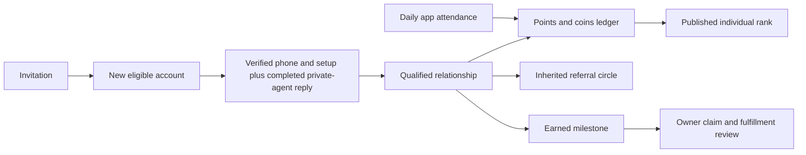

# Referral backend audit and implementation

Scope: `ui/referral-dashboard-polish`, FastAPI + PostgreSQL (Cloud SQL), Firebase identity, Next.js/Capacitor service transport. Existing unrelated generated-contract edits are preserved.

## Visual Map



| Feature | Frontend / API | Persistence / owner | Original gap | Implemented behavior |
| --- | --- | --- | --- | --- |
| Invitation | referral-service, `/resolve`, `/bind` | referral codes, attributions, relationships / one_referral_service | Binding race; pending attribution discarded on network errors | Atomic, immutable binding; retries retain the opaque attribution; one joined account increments total once |
| Recent referrals | dashboard and profile panel, `/summary` | relationships, actor identity cache | Generic member label; no pagination or registered total | Real privacy-safe names, date, status and activity step; server counts and pagination |
| Qualification | setup and identity hooks | vault setup, verified phone, referral policy, usage events | Setup alone qualified; engagement tables have no writer | Completed private-agent reply after setup/attribution, identity eligibility, one settlement |
| Balances / history | `/points`, `/transactions` | score_events / activity and scoring services | One balance labeled both points and coins; no transaction history | Separate persisted balances, source events, idempotency, owner-only history and reversible ledger entries |
| Daily streak | `/app-open`, `/engagement` | attendance days, streak_state / activity service | Referral qualification dates were used as daily app activity | Atomic calendar-day attendance, current/longest streak, missed-day reset, configured bonus |
| Individual rank | `/leaderboard` | snapshot headers/entries / scoring service | No publisher caller; capped at 500; unstable ties and misleading freshness | Bulk publication over all eligible owners, coin ranking, stable ties, viewer rank, pinned-snapshot pagination |
| Circles | `/circle`, `/circles/leaderboard` | referral-network circles/members / network service | Location teams do not represent inherited referral genealogy | Recursive parent inheritance, cycle protection, valid members and qualified descendants, independent rank |
| Challenge | `/challenge` | settings, reward rounds / challenge service | Computed window only; no persisted status or server clock | Persisted start/end/timezone/status, server-relative countdown, expiry checked on reads and settlement |
| Rewards | `/milestones`, `/rewards/claim` | milestone entitlements, fulfillment records / rewards service | UI inferred earned state; no owner claim flow | Persisted earned/claimed/fulfillment states, once-only owner claims, backend next milestone and dynamic catalogue |
| Scheduled work | OIDC scoring drain | scoring jobs / maintenance service | Backoff ignored; retry overflow; stale leases not fenced | Due-time backoff, bounded retry, lease fencing, fair usage recovery, expiry, publication and ended-round handling |
| Live refresh | `/stream`, web/native referral stream | PostgreSQL notification doorbells / referral listener | Devices shared a queue; in-flight refresh could lose updates | Per-device queues, owner-scoped events, dataless snapshot broadcast and queued frontend revalidation |

## Authoritative policy

Migration 289 supplied qualification 100, flash total 200, three-day bonus 15, milestones at 10/100/500/10,000, and Monday 00:00 Asia/Kolkata cutoff. Weekly prize activation remains an explicit operational decision (`feature_active = false`).

The user selected referral activity **5 → 15 upgrade**: registration awards 5 points, qualifying usage upgrades that by 10 points. Qualification records 100 points and 100 referral coins independently (200 total coins inside a configured flash window, replacing 100). Activity rewards do not create referral coins. Historic ledger `points` represented referral coins; migration preserves those earned values and adds an explicit coins column. Referral coins are not Hashcoins and create no cash-wallet liability.

The original How It Works page's 5/15 values described connections and daily Memory updates; it did not define the new referral activity awards. The selected upgrade policy is now stored centrally alongside the existing product activity rules: daily changed encrypted Memory data earns 15 points, a newly active mutual connection earns 5 per participant once per pair, and a successful private-agent reply earns 10 points. Trusted persistence events award these values; dashboard text reads the same backend configuration. The legacy leaderboard entry field `points` remains a compatibility alias for the coin ranking metric; `/points` returns the separate actual points and coins balances.

Daily app-open/login activity is counted once per server calendar day in the configured program timezone. Three consecutive days earn the configured coin bonus; the displayed streak continues beyond three. A missed day resets the current run, while longest run and earned transactions persist. Dashboard reads never award activity.

Qualification requires verified phone, completed setup, and at least one successful server-persisted private-agent reply after setup and attribution. Login, client telemetry, failed/interrupted replies and arbitrary client balances do not qualify. Current One chat commits a content-free referral usage event in the same SQL statement as its encrypted ADK session revision; only a final model reply in the server-bound One namespace with a preceding user event in the same invocation qualifies. Legacy completed-message storage retains its database trigger. A bounded maintenance sweep recovers missed synchronous qualification hooks. Historical settled qualifications are preserved.

Referral circles inherit immutable membership from the parent referrer. They use separate referral-network membership, preserving Location Circle access and capacity. The existing competition metric is retained: valid qualified descendant referrals. Inactive registrations contribute zero score; member and qualified-member counts are reported separately. Circle gifts require a configured circle competition and are not inferred from individual rank.

Earned milestones, claims, and fulfillment are separate persisted states. Claiming never means shipped or delivered. The backend determines the next unearned configured milestone.

## Deployment and verification

Apply migration 347 after 346 using the existing migration release lane. No production database is modified by local tests. Enable the existing authenticated scoring scheduler for qualification reconciliation, score settlement, snapshot publication and ended-round processing. Weekly gifts and shipping remain disabled until their operational configuration is supplied.

Test results and remaining external prerequisites are recorded at delivery; local verification does not establish deployment or real gift delivery.

Verified on Windows using Python 3.13.16 and disposable PostgreSQL 18, with no production data or external delivery side effects:

| Check | Observed result |
| --- | --- |
| All referral backend unit, property, service and authenticated-route suites, including scoring drain | 287 passed after main reconciliation after main reconciliation |
| Real PostgreSQL lifecycle integration suite, included above | 17 passed |
| Six referral frontend suites: dashboard, profile panel, service, attribution, stream and route layout | 87 passed after main reconciliation |
| TypeScript typecheck and ESLint on changed frontend files | Passed |
| Ruff on changed/new Python files | Passed |
| Migration release manifest and all three schema contracts | Passed, head 347 aligned |
| Required Back behavior pack | 452 passed after main reconciliation |
| Back/Search, catalog, Surface Map, gateway, Siri, route orchestration and validator gate | Passed; 12 validator regression tests passed |
| Production Next.js build | Passed, 172 pages generated |
| Documentation verification and `git diff --check` | Passed |

The SQL suite verifies the invitation → join → trusted usage → qualification → score → rank → milestone → claim journey, concurrent binding/claims/attendance, replay safety, timezone rollover, challenge deadlines, deletion/rebuilding of referral networks, late-parent subtree inheritance, retry/lease failures, more than 500 ranked users and owner authorization. Browser components are tested against service fixtures; this is not a live Firebase/model-provider browser session.

## Changed file groups

- Migration 347 and its registered rollback extend the existing ledger, daily attendance, claims, persisted rounds and referral genealogy. The rollback retains all earned history and additive schema. Exact replay rejects conflicting policy versions.
- Referral core, policy, scoring and maintenance services enforce product usage, idempotency, bounded retries/leases, due-work fairness, bulk snapshot publication and historical rule selection.
- Activity, network and challenge services keep their database and business rules below authenticated API routes. Existing web/native proxy transport remains the owner of requests.
- Dashboard, profile panel, How It Works and service contracts consume persisted names, balances, streaks, ranks and reward state. App-entry and attribution hooks support retries and server time.
- Focused unit, API, frontend and disposable PostgreSQL tests cover the complete lifecycle and concurrency failures.

| Paths | Reason |
| --- | --- |
| `consent-protocol/db/migrations/347_one_referral_dashboard_lifecycle.sql`; `db/migrations/rollback/347_one_referral_dashboard_lifecycle.rollback.sql` | Forward and behavioral rollback, durable source triggers, attendance, balances, genealogy, claims and rounds |
| `consent-protocol/db/release_migration_manifest.json`; `db/contracts/{dev_minimum_schema,prod_core_schema,uat_integrated_schema}.json` | Register release 347 and describe its tables, columns and functions |
| `consent-protocol/api/routes/one/referrals.py`; `api/routes/referral_scoring_drain.py`; `api/referral_listener.py` | Authenticated contracts, bounded scheduled recovery and device-safe realtime refresh |
| `consent-protocol/hushh_mcp/operons/referral/policy.py`; `hushh_mcp/services/one_referral_service.py` | Verified qualification, names/counts, immutable binding and selected activity policy |
| `consent-protocol/hushh_mcp/services/one_referral_activity_service.py`; `one_referral_network_service.py`; `one_referral_challenge_service.py`; `one_referral_maintenance_service.py` | Implement persisted activity/streaks, referral genealogy, challenge timing and bounded recovery |
| `consent-protocol/hushh_mcp/services/one_referral_scoring_service.py`; `one_referral_program_settings_service.py`; `one_referral_leaderboard_service.py`; `one_referral_rewards_service.py`; `one_referral_weekly_award_service.py` | Central versioned policy, safe jobs/ledger/snapshots, rewards and round finalization |
| `consent-protocol/hushh_mcp/services/agent_chat_service.py` | Best-effort qualification reconciliation after a persisted completed reply; durable trigger survives callback failure |
| `hushh-webapp/lib/services/referral-service.ts`; `lib/referral/use-daily-app-activity.ts`; `lib/referral/use-redeem-referral-attribution.ts`; `app/one/one-auth-gate.tsx` | Shared transport contracts, actual app-entry/resume attendance and reliable attribution retry |
| `hushh-webapp/components/referrals/referral-dashboard-page.tsx`; `referral-journey.tsx`; `components/profile/referrals-panel.tsx` | Backend-driven stats, recent activity, independent circles, clock, catalogue, claim states and policy text |
| `consent-protocol/tests/test_one_referral_lifecycle_postgres.py`; `test_one_referral_dashboard_routes.py`; `test_one_referral_policy.py`; `test_one_referral_properties.py`; `test_referral_scoring_drain_routes.py`; `tests/services/test_one_referral_*.py`; `consent-protocol/scripts/test-ci.manifest.txt` | Database/concurrency/security regression evidence and existing suite contract updates |
| `hushh-webapp/__tests__/components/{referral-dashboard-page,referrals-panel}.test.tsx`; `__tests__/services/referral-attribution.test.ts` | Real-data rendering, in-flight refresh, owner switching, claims, attendance and transient attribution failures |
| `docs/reference/architecture/api-contracts.md`; `docs/reference/one/README.md`; this report | API documentation, audit, policy reconciliation, verification and rollout requirements |
| `hushh-webapp/contracts/ui-review/back/4932e5190ca14bcc28d95504ecaf86ff7964b0281a03de71a37fcaecb6f35919.json`; `contracts/ui-review/search/c5e5e86727cd651a30a6af2191d04f46e117ae430ee00d7d98fee478d824aadf.json` | Required immutable review records for the current UI source after behavioral verification |
| `{contracts,consent-protocol/contracts,hushh-webapp/contracts}/kai/one-capability-graph.v1.json` | Required generator refreshed source-digest metadata consistently across the three mirrors; no authored action changes |

Implementation stays on the existing `ui/referral-dashboard-polish` branch. The seven generated files already modified when this task began were preserved. Read-only backend and frontend specialists reviewed independent feature/trust boundaries; implementation and final validation stayed in this checkout.

## Operational prerequisites

The existing OIDC scoring scheduler must be enabled and dispatched against the deployed revision. Set `REFERRAL_SCORING_DRAIN_ENABLED=true` and the existing pins `REFERRAL_SCORING_DRAIN_SCHEDULER_AUDIENCE`, `REFERRAL_SCORING_DRAIN_SCHEDULER_PROJECT_ID` and `REFERRAL_SCORING_DRAIN_SCHEDULER_SERVICE_ACCOUNT_EMAIL`. Migration 347 must deploy before the new backend/frontend. No production credentials or deployment action are part of this local change. Weekly prize activation, circle competition gifts and actual physical fulfillment remain operationally unconfigured; the UI reports their available state without inventing gifts, deadlines or delivered status.

To run database integration checks, set `REFERRAL_TEST_DATABASE_URL` to disposable PostgreSQL and run `python -m pytest tests/test_one_referral_lifecycle_postgres.py` from `consent-protocol`. Each case creates and cleans its own random schema. These tests use actual PostgreSQL transactions and triggers; Firebase token admission is separately tested with negative controls and verified-owner dependency fixtures. They do not establish live Firebase, model-provider, scheduler or production deployment readiness.

Live browser/physical-device journeys remain separate release evidence. The PostgreSQL suite uses CI's existing `ONE_COMMAND_TEST_DATABASE_URL`; `REFERRAL_TEST_DATABASE_URL` can override it locally. Disposable validation environments and logs remain ignored under `.venv-referral*` and `tmp/referral-validation`.

For repeatable referral checks in PowerShell, from `consent-protocol` with the project's Python 3.13 dependencies and a disposable database configured:

```powershell
$referralTests = @(Get-ChildItem tests -Filter 'test_one_referral*.py' | ForEach-Object { $_.FullName }) + @(Get-ChildItem tests/services -Filter 'test_one_referral*.py' | ForEach-Object { $_.FullName }) + @('tests/test_referral_scoring_drain_routes.py')
python -m pytest @referralTests -q
```

From `hushh-webapp`:

```powershell
npm.cmd run typecheck
npm.cmd exec -- vitest run __tests__/components/referral-dashboard-page.test.tsx __tests__/services/referral-service.test.ts __tests__/services/referral-attribution.test.ts __tests__/components/referrals-panel.test.tsx __tests__/services/referral-stream.test.ts __tests__/navigation/referrals-route-layout.test.ts
npm.cmd run verify:ui-contracts
npm.cmd run verify:docs
npm.cmd run build
```

From the repository root, run `python scripts/ops/verify_release_migration_contract.py`. Migration rollback is behavioral: deploy the previous application version and apply the registered rollback to retire new policy/trigger behavior, retaining earned awards, claim history and additive tables/columns.

## UAT release preparation

The user explicitly selected **UAT only**. Current main owns migrations 332–346 and the USD catalogue; lifecycle migration 347 creates program settings version 4 from active version 3, preserving the $25 voucher, wireless earbuds, Apple Watch, iPhone and all existing earned descriptions. Behavioral rollback restores version 3.

The canonical runtime transport now recognizes the four referral scoring scheduler settings. Deployment sync retains only an explicitly activated, fully validated environment/project/audience/service-account configuration, rejecting mixed environments and unrelated keys. Runtime configuration and directory compatibility suites: 18 passed.

The fixed UAT operator is `scripts/ops/configure_referral_uat.py`. Run its `config` phase before the governed deployment so the new revision loads the canonical runtime secret. It validates the UAT database instance and keeps the payload in process memory. After the exact landed-main SHA passes CI, smoke and the governed UAT deployment, run its `scheduler --run` phase. The job calls the authenticated drain every minute with the fixed UAT identity/audience, a 120-second deadline and bounded retries. Require a fresh successful matching scheduler attempt using `scripts/ci/verify-cloud-scheduler-attempt.py`.

Canonical UAT reviewer credential and review-mode preflight succeeded. Existing reviewers can prove persisted reads, owner boundaries and same-day attendance, but a full new-user referral needs a newly invited account; shared reviewers must not be reset to manufacture eligibility. A claim requires a genuinely earned entitlement; a two-account journey cannot naturally reach the first ten-referral reward.

Live-path tracing found that current One chat uses encrypted ADK sessions rather than the legacy message table. The new bounded writer hook is configured in `consent-protocol/api/routes/one/agent_chat.py` and implemented in `consent-protocol/hushh_mcp/one_adk/encrypted_session_service.py`. Its successful session CAS and usage outbox are atomic; failed replies and replayed sources cannot duplicate qualification or awards. The disposable PostgreSQL suite now has 18 passing cases, and the combined SQL/encrypted-session suites have 32 passing cases.

Completed usage requires a visible, nonempty model reply from a server-bound One invocation with a prior user turn. Internal reasoning and whitespace-only responses are negative controls. The final focused referral suite passes 285 tests; encrypted-session/runtime-map tests pass 23. Local governance and web-core pass. The full backend run on Windows reports 11,411 passed, 442 skipped, 86 failures and 31 errors outside the referral files, including Linux-only `resource`, `fcntl`, permission and shell contracts. The canonical Linux CI lane must pass before merge; these checks are not waived or rewritten for Windows.

The active local GitHub login cannot read the mandatory security-alert surface (HTTP 404). The canonical CI workflow has its existing dedicated security-alert credential; that unchanged mandatory check must pass on the PR before merge. No production mutation or manual Cloud Run deployment is authorized.

After syncing main through `edcff65ed`, the lifecycle migration is 347 because upstream owns 339–346. The refreshed source also excludes owner-bound stopped runs from successful usage, preserving the upstream chat checkpoint transaction behavior. All 18 PostgreSQL cases pass after restarting the disposable local database; 290 unit/session/runtime cases pass separately. Back navigation checks pass 453 tests and the canonical generators refreshed the combined source contracts. Cloud deployment and fresh-account browser evidence remain separate gates.

The latest combined-head web-core and integration lanes pass, including TypeScript, ESLint and the Next production build. Full backend lint, mypy (236 source files) and Bandit pass. The updated full backend run reports 11,993 passed, 475 skipped, 92 failed and 33 errors outside referral files on Windows. The refreshed governance lane reaches a Linux-only `os.killpg` test that cannot run on Windows. Those full Linux governance/backend lanes and the unchanged security-alert gate remain mandatory PR checks.

The release vehicle is [PR 8038](https://github.com/hushh-labs/hushh-research/pull/8038), targeting UAT only. Final focused frontend coverage is 88 passing tests; the 18 PostgreSQL cases pass with migration 347. A deployment claim requires the exact landed-main SHA, successful post-merge smoke, governed UAT workflow, runtime provenance and live reviewer results; a passing local test or PR alone is insufficient.
