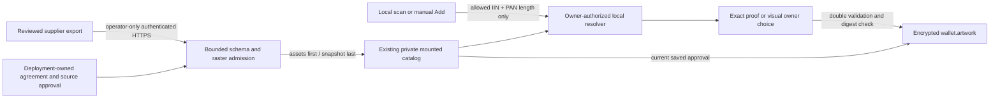

# Wallet original artwork providers

## Visual Map



## Status and activation boundary

PR #8028 was merged before this extension. Its scanner, encrypted Wallet writer,
network resolver, private artwork segment and authenticated artwork endpoints are
the integration base. The missing pieces were a configured metadata adapter,
approved feed ingestion, real image decoding, visual candidate previews, and
independent saved-version approval. This extension adds those pieces.

**No licensed live provider or sandbox account is configured.** The separate
[reviewed atlas](./wallet-card-atlas.md) supplies owner-selected bank designs; it
does not establish automatic physical-card matching or live-provider coverage. The organization confirmed that no provider agreement exists.
The shipped adapter is an HTTPS implementation of the **Hussh approved-feed v1
interchange**, not an implementation of an undocumented Visa, Mastercard or bank
API. An approved supplier/exporter must implement or map to this contract under a
reviewed agreement. Synthetic tests are owned fixtures, not provider coverage.

Activation requires all of:

1. A supplier agreement permitting download, metadata stripping and durable
   private display copies for all authenticated Wallet owners, with issuer
   approval for each blank asset. Tenant-limited and temporary licenses are
   unsupported by this global digest endpoint and encrypted-copy design.
2. An authoritative product **and physical variant/generation** registry. Digital
   token artwork or an issuer logo alone does not establish a physical match.
3. A reviewed feed URL, optional asset CDN, supported countries/networks,
   completed source/blank-art review, and a server-only bearer credential.
4. An approved persistent private filesystem with atomic rename and OS locking
   shared by the publisher and readers. The existing local catalog storage is
   reused. Ephemeral Cloud Run storage and unverified GCS FUSE semantics do not
   satisfy this requirement. No public bucket or new storage provider is added.
5. An operator schedule publishing a fresh complete snapshot before its approval
   lease expires, plus operational ownership of failures and emergency revocation.

## Official provider evaluation, 2026-10-15

Documentation access does not grant artwork rights. “Not established” means the
inspected official source does not establish the capability or grant for Hussh.
Country/network coverage must be contracted per provider and issuer; none of the
rows below establishes worldwide physical-card coverage.

| Candidate / official source | Metadata and variants | Download / synchronization | Access, authentication and disclosure | Physical match / retention and coverage limitation |
| --- | --- | --- | --- | --- |
| [Visa Acceptance TMS](https://developer.visaacceptance.com/docs/vas/en-us/tms/developer/ctv/rest/tms/tms-card-art.html) | Network-token/instrument context, not a public prefix product registry | Card-art retrieval within TMS; supplier catalog sync not established | Pilot/enrolled service and merchant API credentials; token/program context | Physical variant and third-party durable-display grant not established. The [Visa digital standards](https://corporate.visa.com/content/dam/VCOM/corporate/about-visa/documents/visa-digital-card-brand-standards-sept2025.pdf) allow digital art that differs from physical art. |
| [Mastercard MDES](https://github.com/Mastercard/mastercard-api-client-tutorial/blob/main/java/MDES_Digital_Enablement.yaml) | Product configuration and asset references in tokenization context | Get Asset; immutable assets receive new IDs on replacement, token update notifications | Program onboarding; [OAuth RSA and signing](https://github.com/Mastercard/mastercard-api-client-tutorial/blob/main/java/README.md); token/program disclosures | Public prefix matching, physical generation proof, countries, sandbox entitlement and Hussh retention rights not established. |
| [American Express SRC](https://network.americanexpress.com/globalnetwork/dam/jcr%3A8bc15f5f-e4a6-4a26-9f57-95a4894c2c15/Technical%20Specification%20Guide%20-Version%201.1.1.pdf) | DigitalCardData art can be card-specific **or issuer-specific** | artUri, dimensions/status; bulk product sync not established | Restricted onboarding, key exchange, mTLS and signed/encrypted messages; [production approval](https://developer.americanexpress.com/documentation/how-it-works) | Gold/Platinum/Centurion physical variants and private retention rights require an additional agreement. |
| [RuPay / NPCI NTS](https://www.npci.org.in/PDF/npci/press-releases/2021/NPCI-Press-Release-NPCI-launches-NTS-platform-for-tokenization-of-RuPay.pdf) | Certified tokenization platform | Public physical artwork download/sync contract not established | Token requestor certification; no Hussh credentials or sandbox entitlement | Classic/Platinum/Select examples are architecture goals, not available artwork. |
| [Discover DDX](https://www.discoverglobalnetwork.com/solutions/technology-payment-platforms/discover-digital-exchange-ddx/) / [Stored Token Services](https://partner.discoverglobalnetwork.com/products/discover-stored-token-services?tab=documentation) | Tokenized-card visual/issuer metadata | cardImageData in approved token service; catalog sync not established | Partner agreement, certification and controlled credentials/endpoints | Physical variants, countries and durable display rights not established. |
| [Diners Club issuer example](https://dinersclubus.bmo.com/home/consumer-cards/conscards-l2/digital-payments) | Issuer-specific wallet support | No public product/artwork feed established | Issuer/program agreement required | Cannot infer global Diners designs from Discover support. |
| [JCB tokenization](https://www.global.jcb/en/press/2025/202505131100_products.html) / [TSP context](https://developers.google.com/pay/tsps/reference/overview/jcb-applet) | Approved network/TSP context | Public physical-artwork registry/download/sync not established | Approved issuer/TSP program; sandbox/auth/disclosures require provider contract | No physical variant or retention grant for Hussh established. |
| [UnionPay developer platform](https://www.unionpayintl.com/ZT/pre/api/en/) | International program access | Public physical-artwork synchronization not established | Application, sandbox and certification context; actual product access requires approval | No contracted countries, exact variants or retention grant for Hussh. |
| [VGS Card Art](https://docs.verygoodsecurity.com/cmp/products-and-services/card-art) | Network-token metadata; tenant-enabled service | Get Card metadata with six-hour signed image URLs; local download contemplated under network/issuer terms | VGS enablement and network-token context, not a prefix-only lookup | Discover uses fixed/non-dynamic artwork. Temporary URL is not itself a retention grant; exact physical variants and Hussh rights unproven. |
| [PCI Proxy / Datatrans assets](https://docs.pci-proxy.com/docs/request-card-assets) | Existing network-token alias | Card assets after [token enrollment](https://docs.pci-proxy.com/docs/network-tokenization); bulk sync not established | Basic authentication; [generic sandbox signup](https://docs.pci-proxy.com/docs/quick-start) is not artwork entitlement | Visa/MDES/Maestro/Amex token support is not physical design coverage or durable retention permission. |
| [Marqeta](https://www.marqeta.com/docs/developer-guides/mq-eu-tokenization) | Program-owned card_art_id | Issuing-program integration | Program owner credentials | Does not identify arbitrary external bank cards. |
| [Galileo / SoFi retrieval](https://docs.tech.sofi.com/pro/docs/retrieving-card-information) | Credential-image API | Personalized credential images | Issuing-program scope | Excluded: images may include PAN, name, expiry or CVV and are unsuitable for blank artwork ingestion. |

No inspected official service establishes a generally accessible six/eight-digit
prefix-only API that proves the exact physical design. No scraping, vendor
endpoint guesses, issuer logos or generic network images populate this catalog.

## Data flow and authority


Owner lookup performs **no external request**, including no external prefix
disclosure. MetadataProvider and ArtworkProvider remain separate ports. The
configured artwork adapter synchronizes global approved feed information; the
imported metadata provider identifies eligible products locally. Neither port
receives complete PAN, name, expiry, security codes, vault key or customer photo.

Matching distinguishes network, issuer, family, product and exact variant.
Product proof requires a product ID and evidence reference. Variant proof also
requires independent variant verification and an artwork version. Candidates
respect provider namespace, network, country, product and proven variant/version.
Conflicting imported mappings lower confidence; there is no majority vote.
Only one approved design under authoritative product+variant proof is exact.
An exact product with unknown physical variant remains ambiguous, even with one
available image. Issuer-only candidates require owner selection. Unknown uses a
reviewed local photo or a simple design. No examples are hardcoded into React.

## Configuration and feed contract

Non-secret runtime fields are hydrated through `BACKEND_RUNTIME_CONFIG_JSON`:

| JSON field | Equivalent environment variable | Default |
| --- | --- | --- |
| `wallet_artwork_providers_enabled` | `HUSHH_WALLET_ARTWORK_PROVIDERS_ENABLED` | false |
| `wallet_artwork_providers_path` | `HUSHH_WALLET_ARTWORK_PROVIDERS_PATH` | unset |
| `wallet_artwork_catalog_path` | `HUSHH_WALLET_ARTWORK_CATALOG_PATH` | unset |

`WALLET_ARTWORK_PROVIDER_CREDENTIALS_JSON` is a **separate server secret** mapping
approved provider IDs to bearer tokens. Provision it through the established
environment-specific secret manager reference; never put it in a public Next.js
variable, source file, provider registry, runtime config JSON or command argument.
No secret value or provider response is logged by the sync CLI.

The deployment-owned registry has schema
`hushh.wallet.artwork.providers.v1` and a `providers` array (maximum 20).
Each grant declares `provider_id`, `adapter: approved_feed_v1`, exact
`manifest_url`, `asset_base_url`, `asset_requires_auth`, `agreement_reference`,
`blank_artwork_review_reference`, `approved_by`, `approved_at`,
`rights_policy: perpetual_private_display`,
`audience: all_authenticated_wallet_owners`, `metadata_stripping_allowed: true`,
`countries`, `networks`, `timeout_seconds` (1–15, default 5), and
`approval_max_age_seconds` (60–86400, default 3600).
No vendor response can create this grant. Changing any grant field invalidates
its imported approvals until re-admission, including with the same feed revision.

The provider returns `hushh.wallet.artwork.feed.v1`: `provider_id`, monotonic
integer `revision`, `complete: true`, aware `published_at`/`valid_until`,
`artworks` (maximum 256) and `metadata` (maximum 2000).
Artwork includes immutable `source_asset_id` + `artwork_version`,
issuer/product/variant IDs and display names, country, network, optional permitted
IIN prefixes, SHA-256 `source_digest`, raster `mime`, `status`,
`issuer_approval_reference`, durable `rights_policy`, `blank_artwork: true`,
`allow_overlay` and `selectable`. Metadata declares permitted prefixes and PAN
lengths, issuer/country/family/type/tier and explicit product/variant evidence.
Unknown fields are rejected. Pydantic models in `wallet_artwork_providers.py`
and `wallet_artwork_catalog.py` are the executable schemas; export JSON Schema
using `ProviderRegistry.model_json_schema()` or `ArtworkFeed.model_json_schema()`.

Assets are fetched only from `asset_base_url + source_digest + extension`.
Fixed HTTPS destinations must have public DNS, port 443, no userinfo/query,
redirects or traversal. The existing `PublicMcpTransport` pins vetted DNS answers
to the socket while preserving TLS hostname validation. Environment proxies and
redirects are disabled, and bytes are capped during transport. API credentials
never follow a cross-origin CDN request. Authenticated assets require the same
origin as the manifest. Providers requiring OAuth, signed URLs or personalized
token requests need a separately reviewed adapter; v1 does not pretend to support
them by guessing vendor endpoints.

## Operator publication and recovery

From `consent-protocol`, with the normal backend environment and uv toolchain:

```bash
uv run python scripts/sync_wallet_artwork.py --provider approved-source-id
uv run python scripts/sync_wallet_artwork.py --provider approved-source-id --apply
```

Dry-run is the default and writes no files. `--apply` is a privileged operator
action, never a browser/owner route. Exit 2 means unconfigured; other failures
produce a closed `provider_sync_failed` code, aggregate counters and nonzero exit.
The operator schedule is intentionally not deployed or enabled by this PR.

The complete snapshot first publishes verified revocations/omissions and marks
that source incomplete. New selections from an incomplete source are rejected.
Images are decoded and re-encoded in a worker thread, preserving proportions and
pixels while stripping metadata. Only single-frame PNG/JPEG/WebP is accepted:
source <=1 MiB, output <=512 KiB, <=2048 per side, <=2 million pixels,
landscape/portrait long-to-short ratio 1.45–1.75. SVG, animation, corrupt data,
wrong MIME, oversized images and dirty published rasters fail closed. The
independent source review and per-asset issuer blank-art attestation address
personalized content; image decoding cannot prove absence of printed secrets.

Immutable digest-named PNGs are staged privately. An OS lock, source revision
ledger and atomic snapshot replacement protect concurrent publishers and stale
retries. Final aggregate schema admission occurs before publication. A source
asset/version cannot change issuer/product/variant/country/network/source digest
or resurrect a revoked revision. Use a new source version for replacement.
Partial download failure never rolls back verified revocations; retry the exact
same revision/digest. Same revision with different content and older revisions
are rejected. Sync is bounded to 60 seconds and 64 MiB transferred per provider.

Readers require the active grant fingerprint and a fresh approval lease. The
lease bounds **status freshness**, not the durable retention right. A missed sync
eventually shows simple designs; it never extends approval indefinitely. Keep
the schedule comfortably below the shortest lease and alert on nonzero exit.
For emergency withdrawal, disable the provider flag/remove its grant immediately
and publish revocation; clients recheck on resume and every visible minute.
Do not roll back to a snapshot that resurrects revoked rows. Disable the source
and correct forward with a higher revision. Orphan staged files are unserved;
retention/garbage collection requires a separate approved operator policy.

## Client storage, caching and compatibility

The compact picker uses authenticated image loading, final digest checking and
approval validation before and after downloads. A thumbnail is not permission
to persist a design. Operations have an eight-second overall deadline. Add stays
available during lookup/download and saves its currently confirmed design or
neutral fallback; it does not wait for a pending artwork choice. Explicit photo,
mask or simple-design choices fence late automatic responses, including consent
token renewal. Owner, auth generation and vault epoch checks remain in force.

New selection (`purpose: selection`, default) requires current catalog version,
selectable state and complete source. Existing display (`purpose: saved`) keeps
the immutable asset/product/variant/digest pinned across unrelated catalog
changes, while still requiring current approval, rights and grant. Revocation
and provider removal override both modes. Saved Wallet faces use an in-memory
display approval lasting at most 60 seconds in the current unlocked owner
snapshot. Focus/visibility resume rechecks approval, and a visible 45-second
timer refreshes it before expiry. Currently approved pixels remain visible
during that refresh; an expired approval hides them even if the request stalls.
A denied or failed recheck immediately uses neutral presentation. Cold loads
perform one recovery read and decode approved pixels before publishing faces.
Neither approvals nor image bytes are persisted in a new browser cache; image
transport remains `private, no-store`. There is no push revocation claim.
The existing immediate-hide display-status check applies to open picker tiles and selected
Add/editor previews. It hides imagery while approval is unknown, preserves the
owner's chosen reference, and never creates a persistence approval. Photo
artwork is unaffected. Owner/epoch/reference changes cancel stale display checks.

The optional provider ID/version extend encrypted artwork records additively.
Legacy neutral/photo/local-catalog records remain readable. Changing an existing
card design mutates only `wallet.artwork[cardId]` through the canonical PKM writer;
it preserves credentials, card ID, sharing history, grants and Trusted Circle.
Artwork remains private, encrypted, excluded from sharing/Memory/agent exports,
and normal card views remain masked. No DB schema or consent scope is added.

Development may enable the adapter only with owned synthetic feeds and test
secrets. UAT requires its own reviewed source grant, sandbox entitlement and
isolated secret/storage mount. Production requires all activation conditions
above, environment-specific secrets, monitored sync and native/device release
proof. Missing configuration leaves Wallet's photo and simple designs working.
No production activation, merge or deployment is part of this change.

## Visual verification

These are owned synthetic designs and test identities, with no licensed bank
artwork or actual customer information. Before captures use the original picker
from integration base `edcff65ed5f31f81fc90ff2fe9fff23e06cd44a8`; after captures use
the new picker with the same HTTP fixture and design candidates. Screenshots are
browser-rendered, with no generated mockup substituted for the application.

| Viewport | Before | After |
| --- | --- | --- |
| 390 px | [Original picker](../../assets/wallet-artwork/before-390.png) | [Visual picker](../../assets/wallet-artwork/after-390.png) |
| 1440 px | [Original picker](../../assets/wallet-artwork/before-1440.png) | [Visual picker](../../assets/wallet-artwork/after-1440.png) |


## Automatic network illustrations in Add

Add does not ask the owner to pick a bank or design. After network validation,
Wallet requests the approved cosmetic catalog through `/artwork/banks` with
`automatic=true` and the canonical network only. No PAN, card identifier, hash,
name or vault key enters that request. A matching network image is illustrative;
it does not identify the person's bank, product or physical design.

Allocation runs inside the canonical encrypted Wallet snapshot mutation. It
reuses an eligible same-number design, otherwise picks an unused image digest,
then the least-used digest when the available pool is exhausted. Different
issuers in the network pool participate together; image aliases do not defeat
rotation. A genuine revision conflict re-allocates against the freshly decrypted
snapshot; a transient send retry replays the same encrypted artifacts. Saved
`network_assigned` artwork is retained across reloads, subject to current display
approval. Missing coverage, unavailable/revoked bytes or the artwork storage
budget use the existing neutral fallback without blocking card saving. Owner or
vault changes abort the save. Other/unknown never substitutes the TROY image.

The repository's Cloud Build upload filter explicitly includes the bundled
Wallet artwork directory and its rasters. Packaging regressions check both the
files and every parent directory so a catalog cannot ship without its images.
