# Wallet bank designs from the supplied card atlas

## Visual Map

```mermaid
flowchart LR
  pdf[Hash-pinned local PDF] --> originals[100 lossless source extractions]
  originals --> review[Recorded crop / field removal / size / split recipes]
  review --> catalog[Reviewed private bank-design catalog]
  catalog --> bank[Owner selects bank and network]
  bank --> choice[Local unused-image suggestion]
  choice --> confirm[Owner reviews Add]
  confirm --> wallet[Existing encrypted Wallet artwork per card ID]
```



## Included artwork and its authority

The requester confirmed permission to publish the supplied images and retain
them in users' Wallets on 15 October 2026, then explicitly requested adaptations
so every entry could be included. This is a requester attestation, not an issuer
API agreement, network endorsement or evidence of physical-card identity.

The 100 source entries produce **101 display designs**: the IndiGo two-card
image is split into Mastercard and RuPay variants. TROY remains labelled a
**network illustration**, available under the explicitly selected Other network;
this release does not add TROY prefix recognition or claim it is a bank product.

All images originate from the supplied PDF. The complete
[review manifest](wallet-card-atlas.manifest.json) records its SHA-256, page,
entry, PDF image resource, placement, source links, original pixel hash,
adaptation recipe and reviewed output digest/pixel hash. Links are provenance
text only; neither tool fetches them. Source originals are preserved separately
and are not runtime assets or repository additions.

Runtime designs are **adapted bank artwork**, not untouched original physical
card faces. Recipes trim backgrounds, preserve portrait/landscape proportions,
remove printed sample fields and machine codes, flatten transparency, and
resize/compress as necessary. Removed fields are filled from clean surrounding
colors with a bounded smoothing operation. Two Bradesco Amex derivatives reuse
the matching licensed Centurion graphic from the supplied Amex entries to remove
number overprint; both source references are recorded. No new bank/network logo
or card product is generated. The original and adapted hashes are deliberately
different.

The runtime files are opaque, metadata-free WebP, at most 900 pixels per side
and 128 KiB per design (below the existing 512 KiB serving limit). Lossless
encoding is retained for small images; larger ones use quality-95 WebP and a
bounded size reduction. Visual inspection and local OCR review supplement byte,
dimension and pixel-integrity checks. OCR alone is not a blank-art approval.

## Manual Add behavior

After network recognition, Add offers the available bank/country choices from
the approved backend catalog. Selecting a bank is an owner statement and a
cosmetic choice; it does not verify the issuer or card product. Bank browsing
does not send a number, prefix, expiry, name, photograph, card ID or vault key.
No IIN association is inferred from a printed sample number in the PDF.

The unlocked Wallet service reads its existing encrypted artwork and secrets
in memory. The same full normalized number reuses an eligible existing design.
A different number prefers an unused image digest for that bank and network;
after every available image is used it selects the least-used design with a
stable tie-break. Aliases of identical image bytes do not count as new designs.
Last-four digits and PAN hashes are not used as card identity. No allocation
counter, additional server record or plaintext storage is introduced.

The owner can select another design, a simple design or the inspected card-photo
flow. Add remains available while bank artwork loads and can save a neutral
design if artwork is unavailable. Suffix-only edits cancel old suggestions;
owner/vault changes and inactive views cancel pending work. A draft's chosen
design is revalidated on resume rather than silently reallocated. Saving pins
the chosen reference under the existing card ID. Listing or adding another card
does not rotate previously saved cards, alter their credentials or change grants.

The bank response has `selectionBasis: owner_selected_bank` and
`requiresConfirmation: true`. It has no exact-match proof. Catalog entries with
`bank_design: true` are excluded from exact physical-variant matching, including
when an injected metadata provider happens to return their identifiers.

## Catalog and API integration

An unset `HUSHH_WALLET_ARTWORK_CATALOG_PATH` uses the bundled, reviewed catalog
under `consent-protocol/hushh_mcp/resources/wallet-artwork/`. A configured catalog
**replaces** that bundle; an invalid override fails closed, never silently
restores withdrawn bundled approvals. A reviewed override with no assets can
withdraw all artwork. Existing approval, digest, owner-authentication,
no-store, encrypted storage and revocation contracts still apply.

`POST /api/one/wallet/card-access/artwork/banks` accepts only:

```json
{"network":"mastercard","country":"IN"}
```

`country`, `bankKey` and `offset` are optional. Use the returned 32-character
hexadecimal bank key for a design request. Without a bank key the response
lists approved bank choices. With one it returns up to 24 designs and a
`nextOffset` cursor. The key binds provider namespace, issuer and country; network and approval are
filtered on each request. The endpoint shares the existing owner route and
proxy rather than introducing public assets or another credential authority.

## Reproduce and review

Use the existing backend environment (pdfplumber and Pillow are already present):

```bash
cd consent-protocol
python scripts/extract_wallet_card_atlas.py /path/to/World-Credit-Card-Atlas.pdf /new/source-output
python scripts/prepare_wallet_card_atlas.py /new/source-output /new/adapted-output
```

Extraction accepts only the reviewed PDF hash, reads and parses the same bounded
snapshot, checks the pinned image pixels, and refuses existing output paths.
It is bounded to 64 MiB input, 30 pages, 256 image resources, 16 million pixels
per image, 128 MiB extracted output and a 120-second extraction deadline.
The tools execute no PDF action, attachment, script or network request.
Preparation verifies the exact extracted source bytes/pixels before using a
recipe. Its output is a review pack, not an automatic approval or live upload.

For a changed PDF or recipe, repeat rights/blank-art review, record the new
final digests, update the packaged catalog and run the asset integrity and
owner/rotation tests. Never change an immutable digest-named file in place or
mark an unreviewed source sanitized merely to admit it.

## Verification and visual evidence

The existing `e2e/wallet-intelligent-card-add.layout.spec.ts` browser pack
exercises production Add, artwork rendering, service validation and PKM/AES
storage, with only external authentication/API responses substituted. The bank
cases use the actual packaged HDFC image bytes. They add two synthetic card
numbers, assert different artwork digests, reload and assert both assignments
remain unchanged. The complete pack covers crop Back, OCR review, chooser,
provider outage, encrypted save, change design, revocation and lock in Chromium
and WebKit. This is browser fixture proof, not physical-device camera proof.

Reviewed WebKit screenshots: [390px](../../assets/wallet-artwork/atlas-two-cards-390.png)
and [1440px](../../assets/wallet-artwork/atlas-two-cards-1440.png).
The nearest service and form tests protect private unused-first allocation,
retired aliases, same-number reuse, suffix edits, resume, immutable-choice
restoration and owner-epoch cancellation. Backend tests read and decode every
packaged asset through the production serving boundary, verify provenance
bindings and reject incomplete provider state, retired choices and exact-match
promotion of cosmetic designs.
