# Wallet bank designs from the supplied card atlas

## Visual Map

```mermaid
flowchart LR
  pdf[Hash-pinned local PDF] --> originals[100 lossless source extractions]
  originals --> review[Recorded crop / field removal / size / split recipes]
  review --> catalog[Reviewed private bank-design catalog]
  catalog --> bank[Owner provides network / bank / product]
  bank --> choice[One eligible product design or neutral]
  choice --> confirm[Owner reviews Add]
  confirm --> wallet[Existing encrypted Wallet artwork per card ID]
```



## Included artwork and its authority

The requester confirmed permission to publish the supplied images and retain
them in users' Wallets on 15 October 2026, then explicitly requested adaptations
so every entry could be included. This is a requester attestation, not an issuer
API agreement, network endorsement or evidence of physical-card identity.

The 100 source entries produce **101 display designs**: the IndiGo two-card
image is split into Mastercard and RuPay variants. TROY remains labelled a
**network illustration**, available under the explicitly selected Other network;
this release does not add TROY prefix recognition or claim it is a bank product.

The bundled `atlas-adapted-20261016-v2` catalog covers 25 issuer/country pairs in
16 countries: AE, AU, BR, CA, EG, FR, GB, HK, ID, IN, JP, MY, PH, SG, TR and US.
It contains 168 immutable records: 101 selectable designs and 67 superseded rows.
This is the complete supplied atlas, not a worldwide bank-card library.
New countries, products and physical editions need reviewed source artwork and
provenance; generating illustrations cannot establish an original bank design.
The existing [approved-feed importer](./wallet-artwork-providers.md) is the
publication path for a maintained supplier catalog. No live supplier is configured.

All images originate from the supplied PDF. The complete
[review manifest](./wallet-card-atlas.manifest.json) records its SHA-256, page,
entry, PDF image resource, placement, source links, original pixel hash,
adaptation recipe and reviewed output digest/pixel hash. Links are provenance
text only; neither tool fetches them. Source originals are preserved separately
and are not runtime assets or repository additions.

Runtime designs are **adapted bank artwork**, not untouched original physical
card faces. On 16 October 2026 the requester explicitly requested sharp blank
backgrounds, owner details inside the card, and the default landscape shape for
every card. The review includes 51 background repairs, 16 portrait adaptations
(one also needed background repair), and one rectified Chase front photograph:
67 new immutable revisions. Complete clean fronts were visually reviewed;
clipped texture patches were rejected because they left rectangular seams.

The repair plates were edited with imagegen from the already sanitized supplied
designs. They retain the recognizable bank/product design but are reviewed
derivatives, not issuer-supplied blank templates or proof of a physical match.
The manifest pins each edited PNG's hash, dimensions, scope and previous prepared
image hash. Preparation performs no model or network call: it verifies the
original extracted source and reviewed repair, flattens transparency, normalizes
the repaired front to 856 by 540, and applies the existing encoding bounds.
Current recipes never use the old blurred field-removal fill. Source originals
and reviewed PNG plates remain preserved outside the runtime repository.

The runtime files are opaque, metadata-free WebP, at most 900 pixels per side
and 128 KiB per design (below the existing 512 KiB serving limit). Lossless
encoding is retained for small images; larger ones use quality-95 WebP and a
bounded size reduction. Visual inspection and local OCR review supplement byte,
dimension and pixel-integrity checks. OCR alone is not a blank-art approval.

## Manual Add behavior

Owner Add accepts Bank name and Card product after explicit network selection.
Issuing region disambiguates same-named banks. Matching normalizes Unicode,
spacing and case, then requires exactly one bank and product design; missing or
ambiguous products keep a neutral card. No image chooser is required. The
selected product artwork remains an adapted illustration, not proof of the
physical edition. Manual matching does not use BIN/IIN or scanning.
Artwork browsing does not send a number, prefix, expiry, name, photograph, card ID or vault key.
No IIN association is inferred from a printed sample number in the PDF.

The same bank/product uses the same eligible design across different card
numbers. Neither Add nor display recovery allocates images by network, number
or usage count. Bank/product names stay inside encrypted Wallet secrets; no
allocation counter, additional server record or plaintext storage is introduced.

Add omits the simple-design control and empty design section;
Cancel stays left of Add to Wallet in one row at phone and desktop widths.
Add remains available while bank artwork loads and can save a neutral
design if artwork is unavailable. Saving pins the chosen reference under the
existing card ID. Listing or adding another card does not rotate pinned designs,
alter credentials or change grants. Only missing artwork with explicit saved
bank/product names can recover after Cards loads, without another PKM write.
Legacy cards without those names remain neutral. Explicit neutral choices,
saved photos and withdrawn references retain their existing rules.

The supplied Atlas designs permit an owner-only display layer containing the
name, masked number and expiry inside the card. Full numbers still require the
existing explicit reveal path. The text is never baked into shared catalog
images, sent to the artwork API, or added to agent summaries. External catalog
designs without overlay permission retain their restricted presentation.

Approval/recovery and image decoding use a plain surface at the same dimensions
as the final card, preventing a transient blue fallback during refresh. A genuine
unavailable image still settles to the existing fallback rather than loading
indefinitely. Every personalized card uses the default landscape frame.

The 67 prior immutable rows and image files are retained, excluded from new
selection, and explicitly linked to the corresponding reviewed revision. Saved
display validates the exact prior identity and both current approvals, loads the
new bytes with hash verification, then revalidates the original mapping after
download. Withdrawal or mapping changes fail closed. Retiring a target does not
disable unrelated catalog entries. Upgrades are memory-only and never rewrite
PKM; the saved card retains its identity and the approved same-design replacement.

The compatibility network-illustration API accepts `automatic: true`; its response has
`selectionBasis: network_illustration` and `requiresConfirmation: false`.
Owner Add uses bank browsing with `selectionBasis: owner_selected_bank`
and `requiresConfirmation: true`. Neither response has exact-match proof. Catalog entries with
`bank_design: true` are excluded from exact physical-variant matching, including
when an injected metadata provider happens to return their identifiers.

Card faces and artwork previews create temporary `Blob` objects and `blob:`
image URLs from the approved bytes. Stored artwork remains encrypted; object URLs
are never persisted and are revoked on replacement, unmount and vault changes.

## Catalog and API integration

An unset `HUSHH_WALLET_ARTWORK_CATALOG_PATH` uses the bundled, reviewed catalog
under `consent-protocol/hushh_mcp/resources/wallet-artwork/`. A configured catalog
**replaces** that bundle; an invalid override fails closed, never silently
restores withdrawn bundled approvals. A reviewed override with no assets can
withdraw all artwork. Existing approval, digest, owner-authentication,
no-store, encrypted storage and revocation contracts still apply.

`POST /api/one/wallet/card-access/artwork/banks` accepts only:

```json
{"network":"mastercard","country":"IN"}
```

`country`, `bankKey`, `offset` and `automatic` are optional. Wallet Add and
owner display recovery send only network, the explicitly saved issuing region,
opaque bank key and offset. Names are matched locally, without inferring a
country from the user's profile. Use the returned 32-character
hexadecimal bank key for a design request. Without a bank key the response
lists approved bank choices. With one it returns up to 24 designs and a
`nextOffset` cursor. The key binds provider namespace, issuer and country; network and approval are
filtered on each request. The endpoint shares the existing owner route and
proxy rather than introducing public assets or another credential authority.

## Reproduce and review

Use the existing backend environment (pdfplumber and Pillow are already present):

```bash
cd consent-protocol
python scripts/extract_wallet_card_atlas.py /path/to/World-Credit-Card-Atlas.pdf /new/source-output
python scripts/prepare_wallet_card_atlas.py /new/source-output /new/adapted-output --reviewed-edits /path/to/hash-named-reviewed-PNGs
```

Extraction accepts only the reviewed PDF hash, reads and parses the same bounded
snapshot, checks the pinned image pixels, and refuses existing output paths.
It is bounded to 64 MiB input, 30 pages, 256 image resources, 16 million pixels
per image, 128 MiB extracted output and a 120-second extraction deadline.
The tools execute no PDF action, attachment, script or network request.
Preparation verifies the exact extracted source bytes/pixels before using a
recipe. Its output is a review pack, not an automatic approval or live upload.
The reviewed-edits directory contains the PNGs named by the manifest's edit
digests; regenerating those edits is not a reproducible model operation. Only
compilation from the pinned reviewed plates is deterministic.

For a changed PDF or recipe, repeat rights/blank-art review, record the new
final digests, update the packaged catalog and run the asset integrity and
owner/rotation tests. Never change an immutable digest-named file in place or
mark an unreviewed source sanitized merely to admit it.

## Verification and visual evidence

The existing `e2e/wallet-intelligent-card-add.layout.spec.ts` browser pack
exercises production Add, artwork rendering, service validation and PKM/AES
storage, with only external authentication/API responses substituted. Network
cases use the actual packaged Visa, Mastercard, Amex, Discover and RuPay image
bytes at 320, 390 and 1440 pixels. They check embedded-field bounds, long names,
masking and landscape dimensions, then add two synthetic card
numbers for the same bank/product, assert identical artwork digests, reload and
assert both assignments remain unchanged. Amex, Discover and RuPay cases save
explicit bank/product names during an outage, then recover their matching image
without another encrypted write. Blob decoding and revocation are exercised too.
The complete pack covers crop Back, OCR review, provider outage, encrypted save, revocation and lock in Chromium
and WebKit. This is browser fixture proof, not physical-device camera proof.

Reviewed WebKit screenshots: [390px](../../assets/wallet-artwork/atlas-two-cards-390.png)
and [1440px](../../assets/wallet-artwork/atlas-two-cards-1440.png).
The [landscape RuPay examples](../../assets/wallet-artwork/atlas-landscape-rupay-390.png)
also reserve the network logo area; expiry and holder details do not share that space.
The nearest service and form tests protect exact-name product matching,
ambiguity, no network-based allocation, explicit neutral choices, retired aliases,
resume, immutable-choice restoration and owner-epoch cancellation. Backend tests read and decode every
packaged asset through the production serving boundary, verify provenance
bindings and reject incomplete provider state, retired choices and exact-match
promotion of cosmetic designs.
