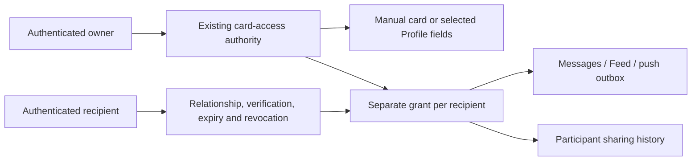

# Wallet sharing and activity

Wallet's existing Sharing tab lists sent and received grants for owner-entered
payment cards and the canonical Wallet Profile Card. Each recipient has separate
access, timing and revocation. The list loads additional pages as it scrolls and
keeps previously loaded history through refreshes. The full PR4 dashboard and
Personal Intelligence integration remain outside this change.

## Visual Map

## Authority and storage

`wallet_card_access_service.py` remains the orchestration authority. Closed source
adapters in `wallet_sharing_sources.py` reuse payment provenance and the canonical
Profile projection. `wallet_sharing_history.py` provides participant-scoped keyset
reads; history is descriptive and never authorizes viewing a card.

Payment grants retain their encrypted five-field projection: network, last four
digits, expiry month/year and issuing region. PAN, CVV/CVC, PIN, cardholder name,
vault keys and wrappers never enter the grant, history, message or Feed metadata.
Profile grants store only permitted field names and read values live from the
existing selected public projection. A newly selected field cannot expand an old
grant. Removed fields disappear on the next read. Pause hides the Profile; revoke,
delete or replacement terminates grants even if a Profile is later reactivated.

Creation checks authenticated ownership, canonical source eligibility, active
connections and block state. Explicit owner-added Trusted Circle recipients skip
extra identity verification; ordinary connections complete fresh same-user
Google/Apple reauthentication after a server challenge. Five failed proof attempts
per 300-second window are coordinated in Postgres. No password store or parallel
identity service is added. Every read rechecks relationship and source authority.

Existing Messages, Feed and push outbox commit atomically with each grant batch.
Retry keys retain the original expiry and reject conflicting reuse across source
types. Activity uses the existing audit ledger, bounded to lifecycle events per
grant/actor. `SHARE_DELIVERED` records accepted transactional delivery, not a push
receipt. Last accessed time updates on successful reads; the first open is audited.
Expiry is enforced on reads and audited lazily once. Legacy trust is explicitly
unknown. Grant lifetime may remain active while a paused Profile is unavailable.

## Rollout and rollback

Apply release migrations 322–325 in order through the migration authority before
deploying the new history UI. Migration 322 adds Profile requests/grants, safe
union view, audit fields, lifecycle guards and account-erasure integration. The
three existing-table indexes run concurrently in separate nontransactional
migrations. Existing manual sharing continues on migration 302 before 322;
Profile eligibility/history fail closed until the additive schema is installed.

Retain the existing direct-message encryption key and
`WALLET_CARD_ACCESS_ENABLED=true`; private Profile sharing additionally respects
`ONE_WALLET_CARD_ENABLED`. No deployment pipeline or protected file is changed.
Release schema contracts require version 325. Verify role permissions, source
removal, both participant directions and one trusted/one verified connection in
the target environment after deployment. This change does not deploy to UAT.

Rollback the application version or disable the existing feature flags. The
rollback scripts intentionally preserve additive tables, grants and audit history;
they do not erase shares or reverse terminal revocations. Account reset and full
erasure explicitly delete grants before Messages/Profile/PKM sources so write
guards cannot recreate or block erased information. Recipient erasure cascades
their grants without changing other recipients' access.

Browser recipients lose rendered contents on hide, navigation and expiry. Native
viewing retains the existing capture-protection restriction. Revocation cannot
recall information already viewed, exported by an older client or photographed.
Postgres remains the shared coordination tier; a Redis replacement belongs behind
the existing graph-lock and delivery ports, without changing access contracts.

See [API contracts](../architecture/api-contracts.md) and [Wallet](./wallet.md).

Both history directions preload in the mounted, unlocked Wallet. Confirmed
pages stay in component memory across tab changes and refresh on sharing
events, focus, visibility resume and the existing timer. They are cleared on
hide, owner change or vault-session invalidation; no persistent history cache
is introduced. Reading uses the owner session independently of card selection;
revocation additionally requires the current Sharing-tab activation. Group
headings use a readable 13px body font.
