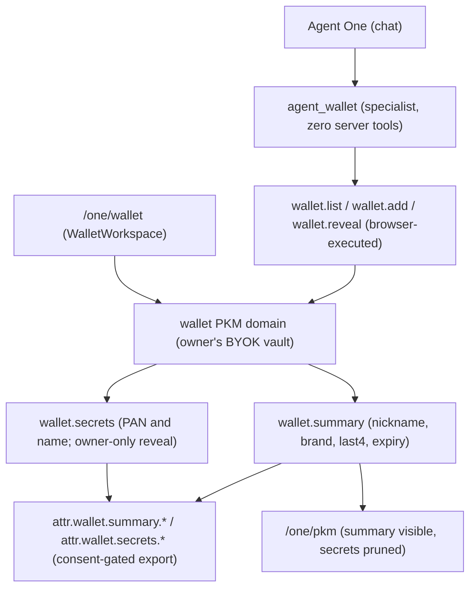

# Wallet (formerly Cards)

The Wallet is the owner's consent-scoped vault of payment cards inside the
private agent: a reserved PKM domain, a specialist agent, a route, chat
widgets, and two requestable scopes. It was designed as "payment cards" and
renamed to Wallet on 2026-09-02 (founder directive). Items inside it are still
called cards, because that is what they are; everything that names the feature
says Wallet. The **Wallet Profile** (public identity pass at `/one/wallet-card`,
`one_wallet_cards`, `ONE_WALLET_CARD_ENABLED`, `wallet-card-service.ts`) is a
separate identity lifecycle. The Cards tab now composes that lifecycle alongside
encrypted payment cards; it does not copy profile fields into the payment-card domain.

## Visual Map

## Naming map

| Surface | Before | Now |
|---|---|---|
| PKM domain | `payment_cards` | `wallet` (`OWNER_MANAGED_RESERVED_DOMAIN_SLUGS`) |
| Sub-intents | `payment_cards.summary` / `payment_cards.secrets` | `wallet.summary` / `wallet.secrets` |
| Requestable scopes | `attr.payment_cards.summary.*` / `attr.payment_cards.secrets.*` | `attr.wallet.summary.*` / `attr.wallet.secrets.*` |
| Static scope | `agent.cards.manage` (`AGENT_CARDS_MANAGE`, "Cards Management") | `agent.wallet.manage` (`AGENT_WALLET_MANAGE`, "Wallet Management") |
| Specialist agent | `agent_cards` (`agents/cards/agent.yaml`, LlmAgent `cards`, `_build_cards_agent`) | `agent_wallet` (`agents/wallet/agent.yaml`, LlmAgent `wallet`, `_build_wallet_agent`) |
| Route / screen | `/one/cards` (`ROUTES.ONE_CARDS`, screen `one_cards`, beacon `native-route-one-cards`) | `/one/wallet` (`ROUTES.ONE_WALLET`, screen `one_wallet`, beacon `native-route-one-wallet`) |
| Gateway actions | `route.one_cards`, `cards.list` / `cards.add` / `cards.reveal` | `route.one_wallet` ("Open Wallet"), `wallet.list` / `wallet.add` / `wallet.reveal` |
| Feature flags | `ONE_PAYMENT_CARDS_ENABLED`, `NEXT_PUBLIC_ONE_PAYMENT_CARDS_ENABLED` | none: renamed to `ONE_WALLET_ENABLED` / `NEXT_PUBLIC_ONE_WALLET_ENABLED`, then removed on 2026-09-02 when the Wallet shipped unconditionally |
| Kill switch | `HUSHH_CARDS_AGENT_DISABLED` | none: the renamed switch was declared in the manifest but never read, and the claim was removed |
| Backend validation | `payment_card_validation.py` (`validate_payment_card_envelope`) | `wallet_card_validation.py` (`validate_wallet_card_envelope`) |
| Frontend service | `lib/services/payment-cards-service.ts` (`PaymentCardsService`, `PAYMENT_CARDS_DOMAIN`) | `lib/services/wallet-service.ts` (`WalletService`, `WALLET_DOMAIN`) |
| Frontend types | `PaymentCardSummary`, `PaymentCardSecrets`, `PaymentCardInput` | `WalletCardSummary`, `WalletCardSecrets`, `WalletCardInput` |
| Components | `components/cards/cards-workspace.tsx` (`CardsWorkspace`) | `components/wallet/wallet-workspace.tsx` (`WalletWorkspace`, `WALLET_PAGE_SIZE`) |
| Chat widget state | `AgentCardWidget`, `cardWidgets` | `AgentWalletWidget`, `walletWidgets` |
| Chat sources | `agent_chat_cards_add` | `agent_chat_wallet_add` |
| Voice contracts | `cards-widgets.voice-action-contract.json`, `app/one/cards/page.voice-action-contract.json` | `wallet-widgets.voice-action-contract.json`, `app/one/wallet/page.voice-action-contract.json` |
| Test ids | `one-cards-*` | `one-wallet-*` (`one-wallet-workspace`, `one-wallet-list`, `one-wallet-search`, `one-wallet-no-match`) |
| Rehearsal | `verify-reviewer-payment-cards.mjs` | `verify-reviewer-wallet.mjs` |
| Memory | domain hidden (`INTERNAL_PKM_DOMAINS`) | domain visible as `wallet`; the `secrets` branch stays pruned |

Unchanged on purpose: `card_<uuid>` segment ids, `cardId` / `last4` / `brand`
fields, `secure-card-add-form.tsx` and `secure-card-reveal.tsx` (they render
one card), `lib/wallet/card-validation.ts` (it validates a card), and every
identity-pass identifier listed above. The chat's card-number paste guard was
generalized into the Secrets guard (`lib/pkm/secret-span-guard.ts`): a card
number sent in chat is kept in Secrets and offered to Wallet, never blocked and
never sent to the model (`consent-protocol/docs/reference/personal-knowledge-model.md`,
"The Secrets area").

## Where the pieces live

- Domain contract and sharing policy: `consent-protocol/hushh_mcp/services/domain_contracts.py`
- Scope policy and display metadata: `hushh_mcp/consent/pkm_scope_policy.py`, `hushh_mcp/consent/scope_helpers.py`
- Agent manifest and roster insertion: `hushh_mcp/agents/wallet/agent.yaml`, `hushh_mcp/one_adk/agent_tree.py` (unconditional)
- Store-domain guard: `api/routes/pkm_routes_shared.py` (`_enforce_wallet_write_policy`)
- Route, tile, breadcrumb, screen: `app/one/wallet/page.tsx`, `lib/onboarding/one-capabilities.ts`, `lib/navigation/top-shell-breadcrumbs.ts`, `lib/kai/actions/route-screen-derivation.ts`
- Chat integration: `components/agent/agent-chat-workspace.tsx` (`wallet.list` / `wallet.add` / `wallet.reveal` branches, the Secrets guard and its "Add this card to Wallet" offer)
- Deploy: nothing Wallet-specific. The feature carries no flag in any lane.

A rename must also cover string literals passed as ids: `_load_product_agent_manifest("wallet")`
and the LlmAgent `name="wallet"` were the two the first pass missed and they crashed boot.

## Wallet entry and card collection

The Sharing tab also includes [card sharing history](./wallet-sharing.md): sent and
received eligible cards, recipients, duration, expiry, verification, revocation
and activity. This uses the existing temporary-grant authority and preserves
the distinction between payment storage and the canonical Wallet Profile.

The first visit per account on a device to `/one/wallet` starts with the Wallet illustration and Continue,
without a duplicate Wallet page heading. Continue saves a cosmetic account-scoped device preference; later visits open
the workspace directly. This does not complete account setup or unlock the vault.

Cards owns the animated collection, safe summary search, and the existing
explicit reveal/removal actions. Profile, Referral and NWS are system cards and
remain present beside saved payment cards. They never enter payment-card storage
or invoke payment-card reveal/removal services.
Add opens the encrypted card-entry form directly. Save selects the new card in
Cards. Back and Cancel restore the previous Wallet tab or selected card; leaving
Add clears its draft. Explicit tab switching preserves and masks an unfinished draft. Vault lock
discards the form and revealed details. Chat and Secrets handoffs wait until
Continue, then use the existing card-entry flow.

The One dashboard preloads the same preprocessed WebP URL rendered by Wallet.
The illustration loads eagerly at high priority with an inline blur placeholder;
it does not wait for the card summary request or a server image transform.
Cold connections can still require an image download. The PNG remains the
source artwork.

## Adding a payment card

The Add tab accepts local camera capture, photo selection and manual entry.
Card number, name on card, expiry and network carry required markers. An
automatically identified network satisfies the network field; an unknown or unavailable
identification requires an explicit choice. Issuing region stays optional and is
always visible in the main form, without an additional-details disclosure. Security codes are never collected or retained. A blank network
uses number-based network detection; the owner selects Other for a valid unrecognized number;
a supplied provider supports overlapping network ranges. A supplied region is
validated, while a blank region stays blank. Existing nicknames remain readable;
new cards use the network label without asking for a nickname.

A confirmed encrypted save inserts the returned card immediately into Cards,
selects it, and clears the draft. Failed saves retain the draft for retry. The
card design comes from an approved catalog, an explicitly approved sanitized
private photo, or the solid neutral Wallet design; it is never chosen by card ID.
The owner-only presentation includes the entered cardholder name. It is read
from the encrypted secrets branch and never copied into the summary/index or
chat projection. Collection and selected-card faces show only the last four
number digits, as does the Card details row. The full number is decrypted only
after an explicit copy action. CVV requires its separate owner-only Show action; PIN stays hidden. Locking the vault or changing
accounts drops the presentation. Reads that fail do not become an empty wallet,
and writes use the current snapshot revision to preserve concurrent additions.

## Card browser

The Cards tab uses `WalletCardBrowser` to coordinate an All overview, the existing
animated card collection, and a selected-card detail view. Cards open with one
full face above the remaining stack. The deck fits the available viewport above
the shared bottom controls, showing two lower card edges at normal zoom. Native
vertical scrolling unfolds it into a spaced column. Reduced-motion users receive
a static list. Card taps and the compact View details control open the same
existing detail flow; the card switcher remains available to assistive technology.

Agent One cards use the owner's identity and existing sharing services. Profile
details compose `WalletCardWorkspace`, including the real QR, aggregate scans,
last scan, edits, pause/resume, rotation, removal and Apple Wallet handoff. Referral
uses the existing referral link, qualification counts and referral event stream.
NWS has no computed score in this release. Its emerald face shows the fixed
900/1000 sample requested for the card design; the accessible description and
details identify it as a sample, not an evaluation. The NWS face has no QR;
its existing Wallet Profile QR and sharing controls remain in details. Saved-card selection remains metadata-only; the existing explicit
Show card details action owns decryption, and leaving Cards or selecting All
clears any revealed values.

### Automatic Wallet Profile

`WalletProfileBootstrap` runs once account authentication and the existing vault
owner session are ready, without visiting Wallet. `POST /api/one/wallet-card/ensure`
creates only a missing row from available account basics. Existing payloads,
paused profiles and removed profiles are preserved, including concurrent first
requests. The management route uses the same operation instead of requiring a
setup form. Missing optional fields remain editable in Wallet Profile.

New QR tokens have an encrypted recovery envelope under the deployed credential
encryption key, bound to the owner and token digest. Public lookup still uses the
hash. A legacy QR can be adopted from its valid device-local token; if neither
token nor envelope exists, the owner must explicitly rotate. Opening Wallet never
silently invalidates a printed QR. Migration 285 adds the nullable envelope.

Owner mutations notify account-scoped subscribers immediately. Visible Wallet
views refresh on focus and every 15 seconds for remote changes and aggregate
scan updates; this is polling, not a Wallet Profile SSE stream. Referral updates
continue to use the existing referral stream.

Usernames are owner-scoped profile labels, not globally unique URLs. Defaults use
the account name (`Ankit Kumar Singh` → `ankit.kumar.singh`). They allow 3–30
lowercase ASCII letters/digits and single internal dots; reserved and blocked
labels are rejected on the server as well as in the form. A nonrepresentable or
unavailable name receives `member`, which the owner can edit.

Existing-account batch provisioning uses
`consent-protocol/scripts/backfill_one_wallet_cards.py`. It defaults to dry-run,
has bounded batches, prints counts only, requires encrypted link recovery when
applying, and never edits existing rows. Apply it in each environment only after
its schema and runtime are deployed; a UAT deployment does not deploy production.

### Add: local capture and review

Wallet Add and the secure chat widget share `SecureCardAddForm`. Take photo and
Choose from photos feed one local scan pipeline. The chat writer can read fields
and add a neutral card; private design changes remain owned by the Wallet page.
Previously saved cards and Secrets handoffs retain the encrypted WalletService path.

### Sharing: review and manage inside Wallet

Sharing shows existing Wallet-specific grants with the recipient and information
shared. Manage opens a shared dialog inside Wallet. Revocation reuses
`useConsentActions`, requires confirmation and an exact request ID, and never
falls back to a scope-wide revoke. Pending requests remain in Consent Center.
No grants or card-specific permissions are invented. Failed reads never appear
as empty access. Reads exceeding 15 seconds show retry; late results cannot
replace a newer read.

### Mail-aligned Wallet surfaces

Cards, Add and Sharing use the shared 820px workspace measure and Mail-style
feature surface tokens (solid surface, shared border, radius and shadow).
Feature headings use Location's shared semantic section typography.
Physical card faces remain capped at 420px inside the wider Cards panel.

Wallet onboarding uses the full-resolution preloaded artwork without a blur
placeholder, centered with its title and Continue action. Stacked cards hide
their separate detail links while pinned and remeasure after expansion settles;
the card itself remains the details action. Sharing uses a labelled illustrative
card instead of the header counters; real access remains in the lists below.

Sharing lists existing recipients and the information shared, with Manage and
confirmed revocation through the existing consent actions. Pending requests stay
in Consent Center. Loading and read errors are distinct from empty access.

Wallet panels use solid surfaces and Location section typography. The collection
omits example labels and fictional total-due content. Owner Add offers an optional,
masked CVV field beside Issuing region; PIN is not collected.

### Card browsing gestures

The Cards overview presents one full card above a compact lower stack. Vertical scrolling unfolds the remaining cards; reduced-motion users receive a static, fully unfolded list. A left drag or horizontal trackpad scroll opens card-local summary controls; selecting a card opens its details. The first-use swipe hint is scoped to the account and device through OnboardingLocalService. The overview swipe panel shows identity fields or masked payment metadata, using the Profile row styling. It contains no second View details button and never decrypts payment secrets.

### Saved payment card numbers and temporary sharing

Selecting a saved payment card keeps its face and Card details number masked.
The copy icon decrypts and copies the complete saved number without adding it
to the DOM. Owner, key, tab, selection, visibility and unmount changes invalidate
delayed copies. CVV has a separate owner-only Show action; PIN remains hidden.
Saved-card recipient rows show the
recipient name and shared date; revocation remains available for active grants.

The Add scanner illustration centers the portrait Agent One card over the
phone screen and raises it above the phone, using the supplied placement
reference. The transparent black-and-gold asset is
`hushh-webapp/public/wallet/card-scan-agent-one-emerging.webp` (built-in image
editing, then WebP compression). Add omits the design introduction and simple
design action; approved bank/photo selection stays available. Saved-card
details omit the Change card design entry. Built-in card QR panels use a small
QR on the left and a two-column action grid on the right.

Share is available on every owner-entered payment card without a separate
card-verification step. A confirmed Wallet write registers saved cards automatically;
sharing an older card refreshes its encrypted metadata without changing its details.
Sharing uses selected active connections and individual 5/10/15-minute server
grants. Default identity cards and other owners' cards are excluded. The shared
view decrypts the full card number on the recipient's unlocked device. Each
successful share creates a Messages reference and a Feed notice reading
“[Sender name] shared their card with you.” Explicit Trusted Circle recipients
can open it directly; other connections must complete fresh identity verification.
Owners can revoke access under Shared with. See the
[temporary sharing API contract](../architecture/api-contracts.md#wallet-profile-lifecycle)
for rollout requirements and browser/native limits.

New shares seal the number, cardholder name, network, expiry and region for each
selected recipient using the existing P-256/AES-GCM recipient-key envelope.
The server stores that opaque envelope inside the grant's encrypted contents;
it never receives the plaintext number, CVV, PIN or vault key. Both circle types
use the same payload. Recipient keys must already be registered, and the receiver
unlocks their Wallet to recover the key. Expiry, revocation, relationship checks
and identity verification still precede envelope delivery. Closing, backgrounding,
locking, or losing access clears the displayed details. These controls cannot
recall information a recipient has already copied or captured. Existing masked-only
grants remain readable; the owner must create a new share to include the full number.

#### Recipient browser safeguards

Full card viewing remains available in Messages for the authorized recipient.
Current grant messages and older encrypted card messages clear visible contents
and invalidate pending reveals when the window loses focus, the tab is hidden,
the page is left, or printing starts. Returning to the window does not reopen a
card. Identity verification may finish in a popup, but a grant is displayed only
after the window regains focus. The viewer suppresses copy, cut, drag and context
menu actions and hides its content in print layouts. Older encrypted messages
follow the same native-viewer restriction as grant messages; native capture
protection is not implemented by these browser safeguards.

Forwarding a grant reference does not grant another account access: server reads
remain recipient-bound. Older encrypted envelopes bind both participants with
authenticated encryption. Received cards have no forward/export control and do
not become owner Wallet cards. These controls cannot stop an authorized recipient
from transcribing or re-entering information they can see. Older encrypted copies
also retain their existing lack of grant expiry or revocation.

These are exposure-reduction measures, not screenshot prevention. Browsers cannot
reliably block OS screenshots or screen recordings, and neither the browser nor
the app can reliably detect a photo taken with another device. The viewer says
so explicitly; it does not request camera access or claim photo detection.

### Legacy encrypted Chat copies (read compatibility)

The previous Hussh Chat share option required choosing one person and confirming the selected card.
Canonical direct-message permission must allow sending, and the recipient must
have a registered secure key. The device encrypts only PAN, cardholder name,
network, expiry and region with a random AES-GCM key, wrapped separately for the
sender and recipient through the existing P-256 recipient-key seam. The
authenticated payload binds both participants, the saved card and a unique
share ID. CVV and PIN never enter the message.

Chat previews, search and replies show “Shared payment card”; encrypted card
messages cannot be edited into ordinary text. The recipient unlocks their
Wallet and explicitly opens the details on their device. Acknowledged sends
are recorded under that card's encrypted secrets and displayed in Shared with.
Existing Wallet-wide grants are labelled Wallet access separately. These are
snapshot copies: deleting the saved card or disconnecting cannot recall a copy
already received. If a required private key is unavailable, ask for a new share.

### Legacy password-protected copies (read compatibility)

The current Share card panel creates temporary grants only; it no longer offers
new password-protected copies. Existing files remain readable. The previous
flow used an 820px panel with Wallet typography. The owner chose and confirmed a password
of at least 12 characters, then prepares an encrypted file before a separate
Share encrypted file click. The shared file helper uses the system sheet where
available and downloads the same file otherwise. Cancellation never claims
delivery or starts a download. Generic exports do not invent recipient receipts.

`wallet-card-file.ts` projects only PAN, cardholder name, network, expiry and
region. A random 16-byte salt and PBKDF2-SHA256 with 600,000 iterations derive
a 256-bit AES-GCM key through the export-encryption seam. Authenticated metadata
binds the version and KDF parameters. The neutral `encrypted-card.json` package
contains no account/card identifier, password, CVV or PIN. Owner/card/password,
visibility and dialog lifecycle changes invalidate pending preparation.

The exact `/wallet/open` route is anonymous, outside the signed-in shell, and
analytics exempt. It reads a bounded local file and decrypts on the recipient's
device; it does not upload, persist or send card information to an API or model.
Malformed versions/KDF settings are rejected before derivation, oversized files
before reading, and incorrect passwords/tampering never reveal details. Changing
the file/password, hiding the page or unmounting invalidates delayed plaintext.

Send the password separately from the file. Anyone with both can open the copy;
the file has no expiry or recall. Recipients need no Hussh account, connection,
vault unlock or app installation. The reader route must be deployed to the
configured public app origin before people on other devices can use that URL;
localhost alone is only a developer preview.

### Complete card images

`wallet-card-image.ts` composes the approved artwork, bundled font, current face
fields and QR into one self-contained SVG. The face is revealed only after that
complete image loads; an opaque card placeholder occupies the same dimensions
while loading. Returning from details reuses cached public artwork. Personal
compositions and object URLs remain component-local and are invalidated when
identity or the QR link changes.

The same composition produces a 1080×681 PNG for Profile, Referral and NWS.
Share card prepares the file before the click to preserve Web Share activation.
Supported browsers share the PNG through the system sheet; unsupported browsers
download it. Installed apps use their existing file/share plugins and remove the
temporary cache file after the share sheet completes. Dismissing sharing does not
trigger a download. Copy link remains a separate action. Profile/NWS image sharing
is disabled when sharing is paused. Referral exports use the latest referral URL.
No export uploads the card or adds a new tracking authority; the existing QR
resolver still owns visits, pause and rotation behavior.

## Card network identification

The owner-authorized Wallet API provides the supported-network catalog at
`GET /api/one/wallet/card-access/networks` and classification at
`POST /api/one/wallet/card-access/networks/resolve`. Classification receives only
`iinPrefix` (exactly six ASCII digits), `panLength` and an optional
`selectedNetwork`; full PAN, last four digits, names, security codes and vault
keys are refused. The prefix remains transient request metadata and never enters
PKM, indexes, logs, caches, models, notifications or an external provider.

The existing backend `wallet_card_validation.py` owns the supported prefix
rules. Responses distinguish prefix matches, explicit owner choices, ambiguous
ranges and unknown ranges. Recognized prefixes and explicit owner selections
retain their network even when the length is wrong. The form explains a length
mismatch immediately, and local credential validation rejects saving the card
until it is corrected; an input mismatch is not a network-service outage.
These rules are not a live issuer registry. On lookup
failure, a valid card can still be saved with the neutral Card network. Client
Luhn, expiry and region validation remain local; the backend continues
validating only the non-secret stored envelope. The stored summary holds the
normalized network, and the full card remains encrypted with the owner's key.
Requests and saves are fenced by the existing validated account generation and
vault session epoch; signing out or locking the vault invalidates delayed replies
and prevents their eventual encrypted publication.

The frontend `CARD_BRANDS` list names networks with specialized local credential
rules; it is not a supported-network allowlist or a prefix classifier.
`BRAND_PAN_LENGTHS` and `REGION_LOCKED_BRANDS` validate an already identified or
selected network. The dropdown uses the backend catalogue without filtering
against that list. New backend network IDs survive resolution, encrypted storage
and existing-card reads, with generic credential checks and neutral artwork
until specialized client rules or approved artwork are available. Network-specific
credential rules for future networks still require a client update. Malformed
catalogue entries fail the request instead of silently disappearing.
The form distinguishes owner selection from prefix identification and explains
that neither verifies the card or issuing bank. The artwork resolver can match a
reviewed catalog using a permitted IIN; no external issuer provider is configured.

Visa previously lacked an official asset in the mark inventory, so its compact
mark showed a generic icon. The existing fallback cell now prints `VISA` for
recognition. No new official artwork or network partnership claim is introduced.

## Intelligent local scanning and private card design

### Architecture and failure causes

- `wallet-card-scanner.tsx` owns camera/gallery acquisition, unsaved Blob URLs,
  suggested edges, four draggable 44px corner handles (also adjustable with
  arrow keys) and the scan Back layer. Handles cannot cross or collapse the crop.
  `wallet-live-card-capture.tsx` uses the rear camera in the current browser page
  with an ID-1 guide; every stream stops on cancel, hiding or unmount. Android
  uses the system camera through `HushhCardCapture`; iOS uses Capacitor Camera.
  Native system camera UI has its own guide controls; Wallet crop review follows capture.
  Web capture crops the exact visible object-cover guide, including portrait
  camera sensors, so the captured photo matches the preview.
  The featured Add scanner also exposes photo selection. Live capture offers
  the same fallback when permission is denied or a frame cannot be captured;
  controls wrap on narrow screens. Partial and empty readings keep camera and
  photo actions available for another attempt without clearing manual edits.
- `wallet-card-scan.ts` validates headers before decoding, captures owner/session
  authority and supervises an owned worker. The previous worker depended on
  `OffscreenCanvas` and required a unique valid PAN before returning any fields.
  The new pipeline keeps fields independent and uses a portable RGBA/PNG codec.
  iOS Vision remains available; useful Vision fields survive optional artwork
  worker failures, with no partially inspected photo approved.
  Full-photo Vision reads bypass redundant browser crop preparation. Missing,
  failed or timed-out Vision recognition falls back to the bundled local OCR;
  cancellation and owner changes stop both paths, and selected crops still apply.
- `card-scan-worker.ts`, `card-scan-image.ts`, `card-scan-region.ts` and
  `card-scan-spatial.ts` perform bounded crop detection, a homography, rotations,
  lighting normalization and spatial number grouping locally. Transcript order
  alone never justifies joining a number with a short security code. Ambiguous
  validated PANs stay ambiguous across composed readings. Checksum-invalid
  readings are correction drafts; they cannot veto an independently valid PAN.
  Grouped low-confidence glyphs remain marked for review.
  A usable number, expiry and name draft stop redundant orientation passes;
  an unlabelled name need not become a confirmed field to be reviewed. Partial
  structured readings survive a later worker failure/deadline, but never cancel,
  lock or owner/session changes. Generic 12-digit numbers are supported too.
- `secure-card-add-form.tsx` preserves manual corrections, fills independently
  readable fields and offers one **Add to Wallet** confirmation. It does not
  save automatically. A backend metadata failure keeps the recognized fields.
  Typed and scanned cardholder names become uppercase in the form and save.
  Lock, owner change, cancellation and a second capture fence delayed effects.
- `wallet-service.ts` reuses backend network authority and the existing PKM
  AES-256-GCM write. A logical draft keeps one canonical card ID across uncertain
  replies and registration fallback. Card details and design commit atomically;
  the returned presentation appears immediately and decrypts after reload.
  Change Card Design preserves card identity, credentials, receipts and grants.

Inputs are JPEG, PNG or WebP, at most 15 MB compressed and 24 megapixels.
Native acquisition converts compatible library images to a fresh JPEG; unsupported
browser formats require a compatible photo. Decode is bounded to a 2000-pixel side;
rectified crops use at most 1600 pixels, while full photos retain their proportions.
Add requests fields only, with at most
five recognition passes; it uses the existing automatic catalog artwork on save.
Explicit photo-artwork callers can additionally use four masking and four
final-inspection passes. The complete scan has
a 90-second supervisor budget; crop preparation has 10 seconds, native OCR 30,
and acquisition 180. Pixel processing and OCR run in the owned local worker.
No camera/photo/transcript goes to a cloud vision service. Real-device latency,
embossed metal and severe glare are not guaranteed by these bounds.
Only the bundled public English language model is cached by Tesseract for reuse;
photos, credentials, transcripts and display approvals are not cached there.

### Authorized catalog and coverage

`wallet_artwork_catalog.py` defines the `MetadataProvider` port and a strict
versioned catalog. `HUSHH_WALLET_ARTWORK_CATALOG_PATH` optionally names a mounted,
reviewed JSON file; its `assets/` directory contains digest-named rasters.
The bundled reviewed card atlas supplies approved network illustrations; an
issuer provider agreement is not needed for these authorized local images.
There is no licensed issuer provider configured. The default-off approved-feed adapter, provider evaluation and
activation conditions are documented in [Wallet artwork providers](./wallet-artwork-providers.md). No API keys, partnerships, scraped assets or exact product coverage
are implied. A reviewed private photo or neutral face remains available when
approved artwork cannot be read.

The catalog records issuer, product, family, variant, country, network, IINs,
version, SHA-256 digest, raster MIME, provenance, rights reference, approving
reviewer/date and status. Only approved, sanitized assets with a reviewed
`perpetual_private_display` right are eligible. Time-limited licenses are rejected.
Approvals must be nonblank, timezone-aware and already completed. A catalog can
be replaced without a React change; new selections require the current catalog version. Saved immutable references
survive unrelated catalog updates but current revocation, grant or rights changes
invalidate their presentation on authorized reads and visible approval rechecks. This does not erase a durable
encrypted copy, so a license requiring copy deletion is unsupported.

The [supplied card atlas](./wallet-card-atlas.md) adds reviewed, adapted bank
designs assigned automatically by the selected network during Add. It does not
infer a bank from a sample number or claim an exact physical-card match. The
bundled catalog is replaced by an explicitly configured private catalog.

Vault unlock and the One dashboard warm a shared, memory-only Wallet display
projection before entry. Wallet joins that protected read, including approved
network artwork recovery for older saved cards. Returning to Wallet uses the
same owner/session-scoped snapshot without restarting the card load. Quiet
refreshes retain approved pixels until their original one-minute deadline;
explicit denial hides them immediately. Lock, owner change, verification,
vault epoch and Wallet mutation invalidate the projection. It never contains
full card numbers, CVV, keys or consent tokens. A cold load still needs the
protected read; unavailable artwork falls back to a readable neutral card.
Different numbers prefer unused image digests; the full number is compared only
inside the unlocked client. This display recovery does not write PKM, change
credentials or grants, replace a saved photo, or reallocate a withdrawn catalog
reference. Four background network workers share an eight-second deadline. Focus and
visible-minute checks retry even when all initial faces were neutral; a newly
saved fallback card also starts a quiet retry without delaying its appearance.

The owner-authorized endpoints under `/api/one/wallet/card-access/artwork` are
`POST /resolve`, `POST /banks`, `GET /assets/{sha256}` and `POST /validate`. Resolve accepts only
a six/eight-digit IIN, PAN length and optional selected network. It refuses full
credentials, names and photos without echoing them. Validate accepts at most
24 explicit catalog references, within the private 16 KB body cap. Responses
are private/no-store; binary transport uses arraybuffer on native.

An IIN/network match is issuer-only or ambiguous, never exact-product evidence.
Exact selection requires authorized provider product and variant proof, then
automatically prepares its unique approved design for owner review. Multiple
approved variants use a compact chooser. Download, save and reload revalidate
catalog authority. Revocation/outage before Add falls back to neutral without
discarding valid card details; an explicit design update asks for a current choice.
The approved-feed adapter reuses the pinned public HTTPS transport and requires
a deployment-owned permission/rights review before configuration.

### Private photo and owner-only security codes

The sanitizer flattens transparency onto an opaque background, discarding hidden
RGB/alpha information. It conservatively overwrites all detected printed text, plus any
owner-selected masking, in the pixel buffer. This can remove public text branding
too; it preserves the remaining photograph rather than fabricating issuer art.
It downsamples, encodes a new PNG containing only IHDR/IDAT/IEND, decodes those
final bytes and reinspects all four orientations. No source image, EXIF, hidden
layer or reversible overlay is stored. Uncertain output needs more masking and
reinspection or a neutral design. Final visual inspection and **I checked — use
photo** approval are required even when OCR sees no text.
OCR cannot establish privacy for text it never detects, so owner inspection is
part of the permission boundary, not an optional cosmetic step.

Photo approval binds the exact Blob/object, final digest, validated account
generation and vault epoch. Raw, copied, forged, stale and foreign approvals fail.
Editing the mask invalidates the prior choice. Sanitized PNGs are at most 512 KB;
the encrypted artwork branch is capped at two million JSON characters. The
no-CompressionStream path uses a smaller raster within the same byte cap.

`wallet.artwork` is an encrypted private PKM segment with exposure disabled,
`shareable=never` and `send_to_model=never`. Plaintext summaries keep only masked
metadata. Consent, readable downloads, Memory and private-agent context project
Wallet fields through an allowlist that excludes artwork, receipts and codes;
root consent export excludes Wallet. Projection cache version 2 cannot reuse old
cached plaintext projections. Dedicated card sharing retains its existing exact
owner-authorized encrypted payload and grant identities; artwork is not attached.
The client compares actual before/after values against reserved-writer authority
before encryption and after conflict reconstruction; chat cannot modify artwork.

Owner Add optionally accepts a three or four digit CVV, preserving leading zeros.
Only explicit manual entry writes `manual_cvv` inside the encrypted private
`wallet.secrets` segment. The canonical writer compares before/after values and
requires the confirmed owner Add authority for a change, including after a
conflict rebuild. Other writers preserve it or remove the whole card. A retry
cannot carry a previous number's code onto a different number.

Saved owner details mask the code until Show is tapped. It hides after 45 seconds,
backgrounding, lock, owner/key/epoch changes, card selection or leaving Cards.
There is no code copy action. `getCard`, card faces, OCR, chat widgets, model
context, readable downloads and card sharing never include it. Encrypted vault
restoration backups retain it inside ciphertext. General Memory security-code
capture stays prohibited; this field is not a Live Memory source.

Legacy `cvv`, `cvc` and `pin` values are never promoted to the new field. Current
writes scrub them and receipt extras and refuse malformed records. Historical
encrypted revisions, backups, delivered exports and older clients are not purged
by this feature; no production deletion is performed here.
Clients predating `manual_cvv` can strip it during a full Wallet rewrite. Deploy
the updated writer across active clients before enabling this field in a rollout.

Local PAN validation uses Luhn except for a backend-resolved UnionPay card,
consistent with [Braintree card-validator](https://github.com/braintree/card-validator).
A unique non-Luhn OCR number is marked for correction until backend resolution
and owner review; other networks still require their supported lengths/checksum.
This is storage validation, not payment authorization or issuer verification.

### Verification and release status

Only owned synthetic cards and test keys are used. `npm run test:wallet-scanning`
exercises real bundled Tesseract in Chromium/WebKit: 13/14/15/16/19 digits, Visa,
Mastercard, AmEx, RuPay, Discover and Diners layouts; dim/low contrast/shadow,
dark and embossed-style synthetic print, rotations, skew correction, partial
fields, competing PANs, worker cancellation
and language-asset failure. A production-component transport fixture proves
visible camera/photo selection → crop → local OCR → owner review → backend-shaped metadata
→ **real PKM segmentation and AES encryption** → Cards → reload → lock at
320/390/1440 px. Fixture authority and encrypted read/write endpoints are
explicit test seams, not a live-account or production-backend rehearsal.
Screenshots are generated as Playwright artifacts from synthetic information.
Mobile-width cases exercise camera-permission rejection and the visible gallery
fallback before recognition and saving. Native service tests exercise Vision
failure/timeout recovery, full-photo reads and cancellation; they are not device proof.

Unit/API checks cover private pixels/metadata, owner/epoch changes, final-byte
approval, code removal, writer value differences, network fallback, stable retry
identity, native binary transport, invalid catalog rights and revoked references.
The shipping Wallet/Location layout pack remains responsible for shared padding,
fonts, compact 44+ px controls, Back behavior and reduced motion.

Browser proof does not establish Samsung Internet or physical mobile camera
compatibility. iOS compile/device proof requires a Mac. Android production build
and authenticated device rehearsal require the approved local Firebase config;
the owned Android rehearsal compiled Kotlin, assembled and installed a debug
APK using an external local Gradle init script that warned on missing Google
Services configuration. Its static web build covered the root and Wallet routes,
not the complete native release export. App startup stopped at the existing
Firebase initialization requirement, so this proves compilation and packaging,
not camera permissions, capture, gallery, file cleanup or authenticated runtime
behavior. No replacement Firebase configuration was fabricated or committed.
Licensed product coverage, historical credential retention and native/device
rehearsals must be approved before this draft feature is released. No deploy or
merge is part of this task.

Manual entry inserts spaces after every four number digits and an expiry slash after the month. Generic Other cards support checksum-valid 12–19 digit numbers; known networks retain their own length rules, including 15-digit American Express. Formatting never adds separators to encrypted number storage or sends a full number to network lookup.

Wallet swipe controls use a 3px header-to-details gap (75% less than the inherited 12px Profile margin), with a compact heading and 48px read-only summary rows; the close target remains 44px. The versioned Agent One artwork reduces the shushing mark by 20% in both dimensions; Apple Wallet actions use a transparent icon. Timed profile recipients see the canonical card face using only their permitted name; membership dates, wallet identifiers and public QR links are excluded from this projection. Existing contact actions and grant expiry/revocation still apply.

The Scan to add card illustration is one complete lossless WebP with the supplied
shushing emoji embedded on a slim black card, above a phone with gold sides.
It preserves the complete source image's visible pixels. The scanner assembly has
black faces and gold borders; the front card has no printed QR or profile text.
The illustration and its surrounding Scan surface have transparent backgrounds.
