# Hussh Operations Index

## Visual Map

```mermaid
flowchart TD
  root["Operations Index"]
  n1["Branch Governance"]
  root --> n1
  n2["Ci"]
  root --> n2
  n3["Root Cli"]
  root --> n3
  n4["Coding Agent Mcp"]
  root --> n4
  n5["Developer Access Matrix"]
  root --> n5
  n6["Docs Governance"]
  root --> n6
  n11["Documentation Architecture Map"]
  root --> n11
  n17["Documentation Recursive Knowledge Model"]
  root --> n17
  n7["Env And Secrets"]
  root --> n7
  n8["Env Secrets Key Matrix"]
  root --> n8
  n9["Observability Google First"]
  root --> n9
  n12["Observability Architecture Map"]
  root --> n12
  n10["Production Db Backup And Recovery"]
  root --> n10
  n13["Observability Event Matrix"]
  root --> n13
  n14["Migration Governance"]
  root --> n14
  n15["Hussh Code Persona"]
  root --> n15
  n16["MuleSoft Managed Omni Gateway Private Space"]
  root --> n16
  n18["Personal World Model Runbook"]
  root --> n18
  n19["Source and Release Recovery"]
  root --> n19
```

Use this as the entrypoint for CI, docs governance, delivery, and environment operations.
For the owner-pod library, see [Private Files library](./private-files-library.md)
for storage, analysis consent, recovery, on-demand operation and cost assumptions.
One-time rollout notes belong in PRs, issues, or git history, not in the active operations surface.

Within the seven-layer architecture, operations is the primary Layer 1 governance surface and the cross-layer enforcement surface for documentation, release, and compatibility rules.

## Codex OS

Use the root CLI for agent-first onboarding and deterministic workflow routing:

- `./bin/hushh codex onboard`
- `./bin/hushh codex list-workflows`
- `./bin/hushh codex route-task <workflow-id>`
- `./bin/hushh codex impact <workflow-id> [--path <repo-path>]`
- `./bin/hushh codex pre-pr`
- `./bin/hushh codex ci-status [--watch]`
- `./bin/hushh codex data-model-audit`
- `./bin/hushh codex audit`

Repo governance baseline:

- Apache-2.0 for first-party code
- DCO signoff on PR commits
- `uv` as the canonical backend Python toolchain
- one required aggregate PR gate: `CI Status Gate`
- project-scoped development subagents live under `.agents/subagents/`; bounded execution defaults live in `.agents/config.toml`
- repo-scoped custom agents inherit the runtime-selected model by default and are enforced through the existing `Governance` lane plus local Codex validation

## Codex skills

Top-level owner skills:

- `.agents/skills/repo-context/`: broad repository orientation, cross-domain routing, and full-repo coverage mapping.
- `.agents/skills/frontend/`: broad frontend intake across routes, components, services, and verification ownership.
- `.agents/skills/mobile-native/`: iOS, Android, Capacitor plugin, and mobile parity intake.
- `.agents/skills/backend/`: backend runtime, route, service, agent, and package-surface intake.
- `.agents/skills/security-audit/`: IAM, consent, trust, vault, PKM, streaming, and verification/audit intake.
- `.agents/skills/docs-governance/`: documentation homes, consolidation, maps, and docs verification policy.
- `.agents/skills/repo-operations/`: CI/CD, branch protection, deploys, env parity, and runtime operations.
- `.agents/skills/oss-license-governance/`: Apache-2.0 licensing, SPDX/REUSE, package metadata, and third-party notice governance.
- `.agents/skills/contributor-onboarding/`: bootstrap, devcontainer, doctor, and contributor-first-run ownership.
- `.agents/skills/subtree-upstream-governance/`: optional mirror coordination, subtree sync, and maintainer-only subtree policy.
- `.agents/skills/analytics-observability-governance/`: GA4/Firebase/BigQuery topology, growth dashboard verification, environment split, and observability contract ownership.
- `.agents/skills/planning-board/`: planning-board workflows for the `Hushh Engineering Core` board.
- `.agents/skills/future-planner/`: future-state roadmap planning, R&D filtering, and promotion-boundary decisions.
- `.agents/skills/comms-community/`: public/community explanation workflows.
- `.agents/skills/codex-skill-authoring/`: repo-local skill creation, retrofit, linting, scaffolding, and taxonomy maintenance.
- `.agents/skills/agent-orchestration-governance/`: repo-scoped custom-agent authoring, bounded subagent limits, delegation authority, and handoff verification.

Specialist spoke skills live under the same tree and should be used after the correct owner skill or `repo-context` has narrowed the request.
Use `.agents/skills/github-contribution-governance/` as the repo-operations spoke for GitHub contribution attribution, author-email checks, PR targeting, and green-dot eligibility.
Use `.agents/skills/uat-scoped-deploy/` as the repo-operations spoke for frontend-only/backend-only UAT deploys, Cloud Build timing proof, and Cloud Run region/provenance evidence.
Use `.agents/skills/frontend-native-surface-mapper/` before route/API/native/plugin/voice mapping work so the generated frontend/native surface map stays authoritative.
Use `.agents/skills/frontend-cache-coherence/` when a screen needs warm-cache UX, TTL, stale background refresh, or reviewer-backed cache behavior proof.
Use `.agents/skills/reviewer-app-testing/` and workflow `reviewer-app-rehearsal` when Playwright must preserve an unlocked BYOK vault across same-session Next navigation and prove cold-session re-unlock separately.
Use `.agents/skills/pkm-upgrade-rehearsal/` and workflow `pkm-upgrade-rehearsal` for historical-shape preservation, rollback, scope-origin, reviewer, and exact-payload acceptance before a PKM upgrade.

Use `.agents/skills/morphy-ax/` and workflow `morphy-ax-governance` for shared agent-experience snapshots, presentation posture, typed semantic-assessment validation, compatibility, and AX performance budgets.
Workflow packs under `.agents/workflows/` are the canonical recurring task surface for routing and onboarding.
Use `ci-watch-and-heal` plus `./bin/hushh codex ci-status` when the task depends on live PR checks or GitHub Actions state.
Use `data-model-audit` plus `./bin/hushh codex data-model-audit` when migrations, table ownership, data classes, retention, or legacy memory write drift are in scope.
Use `github-contribution-governance` when contribution graph visibility, verified author email, PR target branch, or merge eligibility affects the task outcome.

## Portable PDF artifacts

All Codex and Claude PDF work uses the shared [portable PDF artifact skill](../../../.agents/skills/pdf-artifact-generation/SKILL.md).
The existing Codex workflow retains routing metadata under `.agents/skills/founder-brief-curation/`; the
portable behavior, full-bleed cover contract, semantic directives, and visual acceptance criteria live once
at `.agents/skills/pdf-artifact-generation/SKILL.md`. Do not create a host-local PDF renderer or stylesheet.
For a calendar-level monthly GitHub report, use its parameterized collector and monthly cadence reference;
the calendar is an event record, never a timekeeping or performance measure.

## References

- [Admin merge and release SOP](../../../.agents/skills/repo-operations/references/admin-release-sop.md): canonical queue, Admin PR landing, exact-SHA promotion, environment dispatch, proof, and closeout state machine.
- [ci.md](./ci.md): local/remote CI parity and required lanes.
- [pod-completion-judge.md](./pod-completion-judge.md): the completion ledger and explicit readiness assessment. Status is derived from checks, never declared; unevaluable reports UNKNOWN rather than PASS.
- [cli.md](./cli.md): canonical root command surface for repo-level workflows.
- [workos-sso-local-run.md](./workos-sso-local-run.md): local sandbox run for WorkOS enterprise SSO (dashboard setup, env, org seed, checks).
- [branch-governance.md](./branch-governance.md): branch rules, review gates, protected surfaces, and **the bypass lane** — the sanctioned maintainer cohort that may land directly on `main` and edit protected pipeline paths. It waives review, never validation: `CI Status Gate`, merge queue validation, and `Main Post-Merge Smoke Gate` still apply to every member. Live membership is `config/ci-governance.json` only — never transcribed into prose.
- [documentation-architecture-map.md](./documentation-architecture-map.md): canonical docs-home map across root, cross-cutting docs, and package docs.
- [documentation-recursive-knowledge-model.md](./documentation-recursive-knowledge-model.md): recursive folder contract, rewrite sequence, and long-doc split policy.
- [docs-governance.md](./docs-governance.md): documentation placement and quality gates.
- [env-and-secrets.md](./env-and-secrets.md): environment and secret contract.
- [env-secrets-key-matrix.md](./env-secrets-key-matrix.md): key-by-key environment matrix.
- [migration-governance.md](./migration-governance.md): canonical migration authority, the exact UAT/production DB contracts, and allowed SQL surfaces.
- [mulesoft-managed-omni-gateway-private-space.md](./mulesoft-managed-omni-gateway-private-space.md): current CRM transport, credential boundary, and UAT handshake proof.
- [pwm-runbook.md](./pwm-runbook.md): Personal World Model operator runbook: run lifecycle, log evidence, paging states, frontend-only deploy during a provider outage, and alerting.
- [brand-and-compatibility-contract.md](./brand-and-compatibility-contract.md): Hussh public naming rule and compatibility boundaries.
- [naming-policy.md](./naming-policy.md): compatibility pointer to the canonical brand contract.
- [developer-access-matrix.md](./developer-access-matrix.md): org-level developer IAM baseline, runtime identities, and DB access path.
- [observability-architecture-map.md](./observability-architecture-map.md): canonical analytics-plane and reporting-plane map.
- [observability-google-first.md](./observability-google-first.md): observability operating model.
- [observability-event-matrix.md](./observability-event-matrix.md): event taxonomy, emitter map, and dashboard contract.
- [runtime-capacity.md](./runtime-capacity.md): connection admission, application deadlines, retained-work lifecycle, provider observability and workload qualification.
- [production-db-backup-and-recovery.md](./production-db-backup-and-recovery.md): production DB recovery guide.
- [source-snapshot-rollback.md](./source-snapshot-rollback.md): recover main source, UAT/production traffic, TestFlight, iOS and Android releases through their governed lanes; includes pinned AgentOne backup snapshots.
- [hussh-code-persona.md](./hussh-code-persona.md): durable Hussh engineering and Codex product non-deviation contract.
- [coding-agent-mcp.md](./coding-agent-mcp.md): MCP host operations for local engineering environments.
- [subtree-maintainers.md](./subtree-maintainers.md): maintainer-only subtree sync and upstream coordination.
- [dev-fast-lane.md](./dev-fast-lane.md): the hosted dev environment agentic lane.
- [crm-registry-operations.md](./crm-registry-operations.md): CRM registry check, probe, apply, and deactivate operations.
- [one-company-hubspot-sync.md](./one-company-hubspot-sync.md): company-owned user roster, authentication timestamps, activity retention and erasure.
- [hussh-mcp-partner-integration-guide.md](./hussh-mcp-partner-integration-guide.md): partner-facing MCP integration guide.
- [hussh-rebrand-classification.md](./hussh-rebrand-classification.md): non-breaking rebrand bucket model.
- [android-bundle-id-migration.md](./android-bundle-id-migration.md): the com.hushh.app -> com.hussh.app Android-only bundle ID migration plan, including still-open sign-in items.
- [mulesoft-crm-schema-contract-v1.json](./mulesoft-crm-schema-contract-v1.json): machine-readable CRM field-role contract.
- [`../../../consent-protocol/scripts/README.md`](../../../consent-protocol/scripts/README.md): maintainer-only backend script map and when to use it.
