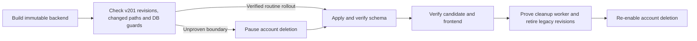

# Account deletion rollout and rollback

## Visual Map

Migration `201_account_deletion_tombstones.sql` and the tombstone-aware runtime
form one compatibility boundary. Applying the migration before the runtime is
necessary, but it is not sufficient on its own: a full deletion that was
already in flight before the DDL committed can finish without crossing either
root trigger, and a legacy account can lack one of the two root rows.

The current local follow-up adds draft migrations 418–421. Cleanup retains only
required existing encrypted custody; registration generations and cloud-removal
recovery are not enabled by source tests. Migration 421 records exact destructive
admission before dispatch and permits only unapproved, inert-review cancellation.
It retains cancelled history and blocks legacy restore/deprovision bypasses. Both
application consumers and the qualified migration chain must be installed before
these controls can be offered. See the [readiness decision](../quality/adk-orchestration-docs-audit.md)
for source versus deployed evidence.

## Reopened browser incident — 25 October 2026

This follow-up is source qualification until an exact-SHA release and deployed
owner journey prove otherwise. The 16:30–16:31 IST report matched a 271.6-second
DELETE that returned `ACCOUNT_DELETION_PAUSED`. UAT run
[40186576195](https://github.com/hushh-labs/hushh-research/actions/runs/40186576195)
failed migration 200 on an `actor_profiles` lock. It retained the root fences and
never deployed its candidate. Serving code was `24545d1`, not the newer staged
provider lifecycle. The reported owner binding was checked in memory; private
account identifiers and credentials do not belong in release evidence.

Background verification must keep the sealed recovery surface mounted. The
retained Account query cannot reopen Profile until authoritative session
admission succeeds. A release pause must be checked before provider or Files
work. New workers hold a shared dedicated-session admission lease through all
owned work; fence installation/removal takes its exclusive counterpart. Lost
sessions, unresolved dispatch receipts and erasing Files retain the pause.
Cancelling Files work joins every started provider thread, including siblings
of a failed DELETE. Local completion is separate from remote absence proof.

The Dev predeploy drain also found a historical fenced Files library whose
encrypted upload session had expired without a recorded local observation time.
An exact GCS session 404 can qualify `expired` only after purpose-bound session
custody, the fixed provider URI and fresh original-bucket identity are verified.
[Google documents both 404 and 410 as invalid session URIs](https://cloud.google.com/storage/docs/resumable-uploads#session-uris).
Generic missing status retains its conservative age requirement; conflicts,
changed custody or bucket identity, redirects and unavailable providers remain
unsettled. This terminal write receipt does not authorize deletion or establish
object absence: the normal owner approval, erasure and retention proofs still
apply. No historical local clock is backdated.

Deletion is confined to its selected environment. The reviewed shared Google
project hashes live in
`consent-protocol/config/account-deletion-authority.json`. Google revocation
covers every client in that project, so separate client IDs do not contain its
effect. See [Google's revocation contract](https://developers.google.com/identity/protocols/oauth2/web-server#tokenrevoke).
For those grants, the immutable inventory records `retain_shared_google`.
Explicit local-erasure confirmation permits removal of this environment's
custody while retaining shared access. It permits no refresh, shared watch stop
or revocation. Environment-exclusive grants retain the existing verified path.
Changing the policy invalidates the prior descriptor; uncertain effects require
reconciliation and cannot be converted into local approval.

Forward migration 423 requires producer receipt version 2 on fresh preparation
and rejects incompatible or shared-authority dispatch before external calls.
Historical version-1 receipts remain intact. New preparation requires the
installed contract. Application rollback retains this additive authority and
requires forward recovery for incompatible pending operations. Old synchronous
revisions cannot be protected retroactively by a receipt guard: deployment must
retire pre-contract consumers before removing the existing release fence.

`deploy/account-deletion/activate_release.py` composes the existing scheduler,
fresh HTTP-completion verifier and catalog-boundary SQL for shared Dev, UAT and
production. It qualifies exact serving SHA/run, installed producer contract and
old-revision retirement before activation. Commerce preview remains separate.
Failed activation cannot produce healthy acceptance. Current release tooling is
preserved when checking out an older target; incompatible source is refused.

Cleanup inspection/removal stays available when new provisioning is disabled.
GCP substrate teardown still refuses before reservation or irreversible work
when its independent control is off. The GCP account blocker uses the existing
reviewed cloud-removal path before explicit account continuation; Azure retains
its existing account-removal authority. These controls do not enable new
provisioning or certify physical removal of provider-retained copies.

## Surgical follow-up boundary — 24 October 2026

Fresh main `217007c715` is integrated locally, retaining its immutable 412–415
recovery-index migrations and bounded keyset erasure. Lifecycle authority now uses
418–421. The HTTP regression follows real 202 preparation and a durable worker claim
through finalization: 501 segments/300 revisions retain 700 ms statement limits,
trace correlation, peer preservation and atomic rollback. A failed final erasure
retains provider-cleanup authority; it does not delete Firebase identity or revoke
providers after the keys are gone. Source qualification does not enable enrollment
or certify a deployed environment.

The last verified serving account erasure removes local credentials before best-effort
provider release. A successful local deletion therefore cannot establish
project/account-wide OAuth revocation or recover a failed release after keys are
gone. The local follow-up now distinguishes confirmed Google revocation,
absence of only the submitted token and unconfirmed failures; durable staged
cleanup remains required before deployed acceptance is complete.

Local source now composes preparation, the existing cleanup worker, ordinary-use
fences, and the atomic erasure consumer. The forward migration retains original
encrypted custody through failure and replay. Refresh dispatch is journaled;
replacement authority is sealed into the same row before identity verification.
Late capture preserves custody without renewing a stale worker's authority.
Drive picker information survives cleanup-only rotation. Lost or uncertain
provider effects are retained for reconciliation, not replayed.

The API returns accepted cleanup separately from completed deletion. A
purpose-bound Firebase-verified status read survives refresh and terminal raw-ID
scrubbing; it grants no account or vault access. The privacy gate shows durable
progress without sign-out. Unsupported external-key revocation requires explicit
confirmation bound to the inventory digest, and cannot excuse uncertain OAuth
revocation. The UAT-only local reset now requires database attestation and empty
provider custody before following the same staged SQL path.

The latest focused checks passed **260 backend** and **167 frontend** cases,
including real disposable PostgreSQL, API/auth integration and the progress UI.
These are local contract results. The forward lifecycle migrations **418–421**
require replacement-account compatibility, combined-candidate qualification and
governed deployment. Main's migration 416 retains its separate owning contract. This is not deployed deletion or same-login registration evidence.

The agreed correction retains credentials only in their existing encrypted
custody, fences ordinary use, commits cleanup intent before provider calls and
persists exact outcomes before final erasure. Preparing a tombstone must also
phase-gate the existing push and marketing deletion triggers. Stop all affected
watches before revoking an associated grant. Provider failures remain repairable;
unsupported key revocation requires explicit local-erasure terms.

Same-login registration remains unavailable until the environment-local account
authority and its consumers are qualified. The local `419_account_generations`
authority now preserves Firebase's UID and immutable retired-account tombstones,
with an opaque owner for each replacement. Two complete erase/enroll cycles passed
on disposable PostgreSQL, including concurrent enrollment, exact cleanup replay,
old custom-token refusal and unchanged-owner write fencing. Removing the retired
UPDATE guard caused the same regression to fail. Anonymous/authenticated SQL
roles cannot call enrollment or read its ledger; future identity-table DDL inherits
the guard through migration 201's existing discovery.

The verifier and session-status response distinguish verified Firebase identity,
application owner and generation. `ACCOUNT_GENERATION_ADMISSION_ENABLED` defaults
off. Do not enable it or publish registration until remaining application callers
qualify. Federated and purpose-bound email recovery are implemented locally;
neither has been accepted on a deployed environment.
Conditional WorkOS and HushhTech custom-auth integrations remain incompatible
with generation-enabled admission. Their entrypoints now return explicit
unavailable outcomes before provider mutation or exchange; they never bind an
old callback to the latest owner. Do not enable generations beside active WorkOS
sign-in or offboarding until that integration's captured-generation mutation
authority qualifies. Startup refuses the conflicting configuration, preserving
the prior running service rather than silently withdrawing offboarding. The
existing generation-off behavior remains supported.

An owner-to-Firebase mapping is suitable for reads; it cannot authorize a deferred
Firebase mutation across retirement. Device and passkey mints now map the exact
captured application owner to its external UID and stamp owner/lane claims in the
custom token. They never change global Firebase claims. Browser device approval
returns that same application owner and distinguishes unavailable authority from
invalid proof. The 101 focused device/passkey/auth cases pass. Email now captures external UID,
application owner, environment, purpose and reservation provenance before delivery.
A code for an existing identity can never recreate a missing Firebase user.
Enrollment uses its consumed database proof, not custom-token authentication time.
Proof consumption and exact generation activation commit together under identity
lock 199; token minting follows outside that transaction. A final owner/policy/
expiry check controls token release. Lost enrollment responses recover through a
new ordinary code, without replaying activation. Historical unknown cleanup stays
Action required. Codes and enrollment tickets remain memory-only; the existing
challenge store holds encrypted destinations and keyed proof digests.

The local federated recovery path accepts independently fresh Google, Apple or
Microsoft identity proof only for explicit registration review. It does not admit
a retired account to private information. The owner confirms the exact prior
generation, cleanup operation and enrollment receipt. SQL stores the authentication
time and review digest, refusing changed proof on replay, expired proof and missing
receipt fields. Historical cleanup without qualified evidence stays **Action
required**. Unknown submission responses require status reconciliation, never an
automatic second enrollment. Normal session admission follows a confirmed result.
The frontend withdraws an old application principal before showing this recovery.

Full-account deletion now retains the external Firebase identity in every
environment. The existing `firebase_shared_identity_retained` classification is
kept for compatibility; it no longer implies a development-only policy. Only
verified provisional phone-orphan cleanup or a separately authorized enterprise
quarantine may use their narrower identity operations. Drain legacy deletion
workers before enabling replacement accounts: this change cannot undo an already
dispatched identity deletion.

Migration 419 records remote identity-write dispatch before provider calls,
using the existing owner 171→198 barriers and the enrollment identity-199 lock.
Its minimal receipts contain hashes, purpose, project, operation and settlement;
no names, credentials or SDK payloads. Dispatched or uncertain writes block both
enrollment and direct replacement INSERTs. Local erasure may still finish; only
an exact late settlement can release that enrollment barrier. There is no expiry
or automatic replay. Display-name and welcome-marker writes use an owned,
no-retry/no-redirect session with Google's documented
[Identity Platform update API](https://docs.cloud.google.com/identity-platform/docs/reference/rest/v1/projects.accounts/update).
Restoring the pinned SDK retry policy made the same transport regression fail
with five POSTs instead of one. The pinned Firebase SDK otherwise retries mutation
POSTs after read/status errors;
never change its shared session per call to work around that behavior.

The retirement cutoff includes a 60-second issuer-clock lead margin, then requires
independently fresh sign-in; refresh-token `iat` never supplies that proof.
Migrations 418–421 are registered locally with matching contracts but remain unapplied. On 24 October, the latest
focused recovery checks passed 248 backend and 379 frontend cases, plus 41 native
privacy cases. The real PostgreSQL rehearsal passed two erase/enroll cycles in
127.87 seconds, including changed-proof replay, direct-INSERT refusal and a pending
current-generation identity write. TypeScript and changed-source lint passed.
These focused results overlap prior suites; they are not the final combined mirror
or live acceptance. The subsequent email checks passed all 46 existing and new
cases against disposable PostgreSQL. The full-schema two-cycle rehearsal passed
in 127.76 seconds, including concurrent email enrollment, immutable capture,
stale-code refusal, response-loss recovery and fresh email registration. The
email frontend/API checks passed 112 cases. Remaining generation consumers and
combined acceptance still precede activation.

The reviewed implementation direction separates that
external identity from an immutable application owner per account generation:
generation 0 retains its existing owner key; a replacement uses a new opaque key.
Resolve this binding only during fresh authenticated admission, never inside an
old job, callback or grant. Vault, device, native, provider and pod contracts must
carry the explicit application owner before replacement enrollment is enabled.
No global Firebase claims, identity deletion, email-based relinking or transparent
SQL parameter rewriting can substitute for this boundary.

## Database erasure runtime boundary

Full account erasure runs its complete synchronous SQL transaction on one worker
thread, including connection acquisition, lifecycle locks and commit or rollback.
The server event loop remains available for heartbeats and unrelated requests.
Before taking any domain or lifecycle lock, the transaction sets local lock and
statement timeouts to 3 and 20 seconds respectively. These limits cancel SQL in
PostgreSQL; an HTTP or coroutine timeout alone cannot stop a database thread.
They bound individual statements, rather than the total erasure duration.

A failed statement rolls back the tombstone and erasure together and releases
the account barriers before returning the existing `ACCOUNT_DELETION_FAILED`
response. In the serving legacy path, provider release and Firebase cleanup are
post-commit only; the staged replacement above moves provider settlement before
local erasure and preserves the person's shared Firebase identity.
Clients must still confirm active status before retaining the session after a
reported rollback; an untyped transport failure remains an uncertain outcome.
Failed optional-table deletes log only the table name and elapsed time for
diagnosis, without record contents or credentials.

The regression rehearsal uses an empty disposable PostgreSQL database: it holds
a row lock during erasure, proves bounded rollback without a tombstone or lost
account rows, and then reads active account status while the row lock is still
held. The event-loop regression separately proves a blocked database worker does
not prevent the server heartbeat from running.

## Owner-cloud erasure boundary

Account deletion also requires its owner's cloud inventory to settle. Preserve
the reserved attempt, exact resource incarnations and original setup evidence;
stop writers and reconcile uncertain provider operations before deleting their
dependencies. An accepted cloud DELETE or destroyed key is not resource-absence
evidence. Retention and protected provider objects remain explicit outcomes.

The local Azure correction uses dev-only migration 960 to retain the producer's
provider-revocation counters and the exact `connector_history_v1` coverage marker
from a validated v4 pod tombstone. Old zero-counter checkpoints remain readable;
they do not prove historical grant coverage and must not be backfilled. Its
read-only preflight probes the complete producer shape against the installed
checkpoint validator before the pod destroys keys. Deploy the hub decoder and
schema acceptance before approving an image that emits the marker: older hub
decoders reject additional response fields. Rolling 960 back locks the
registry against new reservations and refuses existing Azure reservations or
new retained outcomes. Other erasure schema rollback requires its own fenced,
drained release procedure; an application rollback does not recover deleted keys.

Before requesting key destruction, the hub now makes an authenticated, read-only
`crypto-erase/preflight` call bound to the exact owner, service and revision.
Its proof cannot authorize deletion. Missing or incompatible old-image support
returns `POD_ERASURE_COMPATIBILITY_REQUIRED` before any destructive POST; update
or repair that image first. The pod still independently checks schema acceptance
and provider revocation before destroying keys. Inspection of cleanup terms must
never call the destructive owner-access preparation port.

Dev-only 961 records the original Azure setup nonce and coordinates in the
existing job before its first write. Same-cloud retries preserve prior bindings
in that job; stale bound workers require reconciliation, and protected history
cannot be cleared or moved to another cloud. The 64-binding cap refuses another
binding while allowing terminal bookkeeping. Owner locks serialize replacement
with erasure reservation; disabled or missing guards refuse admission. This fence
prevents subsequent setup stages and internal ARM write retries. Setup/rebuild
cancellation joins the actual local execution, including queued and repeated
cancellation, before reporting interruption. That exit is not proof that a cloud
operation has settled; teardown remains refused until provider operations settle.

The local owner flow now composes read-only inspection, exact resource/retention
approval, fresh Microsoft authorization and the existing joined cleanup worker.
Ordinary account deletion refuses before pod erasure when this backend needs that
review. Checkpoint-only pod erasure precedes cloud cleanup; every subsequent ARM
DELETE, including Hussh’s own role removal, uses the fresh delegated grant and the
same durable request/acknowledgement/settlement journal. No synthetic legacy
revocation receipt is created. Retained legacy receipts remain validated.
The checkpoint-only port receives that exact delegated backend explicitly;
general placement resolution must not replace it with standing federation.
Admin ADC can independently verify cloud IAM and resource state during rehearsal;
it never substitutes for the provider's owner OAuth revocation receipt. Unknown
revocation preserves encrypted retry custody and blocks final key destruction.

The callback cannot approve terms or fall through into setup. Execution records a
bounded, nonce-hashed authorization outcome before spawning; early failure and
expiry remain visible without retaining tokens or provider bodies. Inspection
failures return directly. Settings retains the account until the independent
finalization transaction passes. The new flow is source-qualified only: 962 is selected in the dev manifest
for governed rehearsal, together with 963’s complete archive projection.
Destructive admission remains unavailable until both contracts are installed;
selection does not establish disposable live acceptance. See [Azure lifecycle](../architecture/byoc-azure.md#erasure-heal-and-update-recovery-as-implemented).

## Remove cloud while keeping the account

The local follow-up adds **Remove cloud** to onboarding’s account menu and Hosting.
Discovery is read-only; the action is offered only when the installed schema
supports it. It opens a distinct **Remove cloud, keep account?** review. It does
not invoke account deletion. Vault unlock, exact resource/retention terms and
provider authority remain required. Opening the menu starts no inspection or
mutation. Native clients currently direct this operation to the website.

Dev-only migration972 binds this purpose to the existing erasure attempt and
resource journal. Azure execution rechecks that separate approval before OAuth
redemption and every worker admission. GCP reuses the recorded direct resource
erasure backend; it does not borrow Azure’s access-only capability. Approval
expires after ten minutes; a reviewed retry resumes the same retained operation.
Progress reads stop while hidden, on terminal/attention states, at their bounded
deadline and on closing. A running worker offers status refresh, not another
execution. Unknown progress is not rendered as verified resource counts.

Finalization requires qualified absence/retention evidence and reconciled setup
history. It atomically archives that proof, clears live cloud coordinates and
keys, advances the placement epoch, and retains the stable Hussh identity and
prior-home snapshots. The account, Firebase identity, vault and PKM stay. The
person chooses hosting again; Shared is never silently selected. A lost final
response is recoverable only while that exact released identity remains current.
An old response cannot remove or relabel a replacement pod. Unresolved historical
resources block completion; pending saves or provider timeouts do not release
custody. Eventual full account deletion removes this operation through its
existing independent transaction.

**Check hosting** observes only recorded owner resources through cloud control
APIs, without waking the pod. Confirmed absence, unreadable resources, a changed
incarnation and a running cleanup are distinct outcomes. Existing **Link existing
pod**, **Reconnect** and owner-approved Azure rebuild retain their own authority.
Reconnect repairs transport; it cannot recreate missing compute. Earlier cloud
homes remain visible when their cleanup cannot be proven. There is no
subscription-wide automatic reaper, label-only adoption or unattended deletion
of discovered resources.

This follow-up is locally verified source, not installed-cloud acceptance.
Migration972 remains dev-only; UAT/production do not acquire deletion authority
from a frontend deployment. Governed dev rehearsal must verify the exact schema,
owner review, cancellation/retry and resulting provider absence before availability
is claimed.

## GCP runtime quota grants

Dev-only migration 964 extends the existing runtime-grant erasure journal with a
`quota` slot. New GCP setup discloses both Vertex AI User and Service Usage
Consumer on the owner's project; the latter permits quota consumption, not API
enablement or billing changes. Each grant needs exact added-binding provenance,
the deleted service account's numeric identity and observed policy absence.
Repository release and finalization refuse a missing quota receipt or ambiguous
provenance. Older Vertex-only receipts remain readable. Apply 964 before admitting
the new bootstrap plan; do not backfill creation evidence from current IAM.
Drain quota-writing workers before schema rollback. Rollback also locks the custody
tables and refuses unresolved provision attempts, quota plans or retained receipts;
an application rollback cannot remove an unjournaled cloud grant.

## OAuth-project Gmail cleanup

Dev-only963 preserves the owner-specific full topic name, creation observation
and original operator IAM grants through notification retries, final provisioning,
host publication and erasure archival. Apply the schema before enabling the new
five-resource notification plan; old schemas refuse that plan before topic writes.
Legacy four-resource checkpoints remain readable. Rollback refuses retained
operator custody and requires forward recovery.

Cleanup uses verified attached consent-plane credentials for the OAuth developer
project; owner-project impersonation never supplies that authority. Delete only
the exactly bound, created topic after independently qualified subscription
cleanup, both original added grants, exclusive current IAM and a complete empty
subscription listing. Adopted/shared/conditional topics and unknown DELETE
outcomes remain pending. Pub/Sub exposes no immutable incarnation or conditional
DELETE token; the existing owner lifecycle fence remains mandatory. This is local
source evidence, not live operator-project cleanup acceptance.

## Private Azure setup and cleanup

Dev-only 961 records original setup bindings and bounded provider receipts in
`byoc_setup_jobs.stages`; it adds no credential store or second operation ledger.
Its latest verified dev ledger read (2026-10-15, 20:22 UTC) stops at 959. Recheck
that ledger before deploying: an applied migration must never be edited.

Fresh setup, approved updates and rebuilds hold a dedicated database session
until their actual thread exits. Version-2 hosted intents bind the original pod
identity, setup nonce and exact permitted requests. Updates additionally bind the
lease, operation, release, target and capability approval. Files dispatch requires
the current exact checkpoint. SQL restricts resource kinds independently of the
supplied request list; rebuild cannot recreate the group, identity, keys or
storage. Reject invalid rebuild intent before claiming a job.

The worker's exit, Azure's acceptance and Azure's terminal result are separate
receipts. Reserve acknowledgement, terminal and exit capacity before dispatch;
ordinary progress writes cannot spend it. A lost write response remains
unresolved and cannot be automatically replayed. Late results for admitted
writes remain retainable after erasure has fenced new work.

Interrupted cleanup may poll the original acknowledged operation using its
retained header kind, immutable URL/hash and request ID. Reconciliation requires
current owner/worker approval and never sends another DELETE. Reject changed
subscriptions and normalized path escapes before requesting the operation.
Legacy asynchronous receipts without a known header kind remain unresolved;
resource404 alone does not settle them. Independent absence still follows a
terminal provider receipt. Provider-retained copies need separate disclosure.

Cleanup now retains a fresh final GET-set receipt and actual worker exit as
separate, append-only execution receipts in the same erasure record. The final
readback binds the exact plan and retained resource-state digests; missing or
reappearing resources in that evidence refuse completion. The joined thread
runner fences cancelled dispatch and waits for exit-receipt persistence before
closing its dedicated session, including repeated cancellation. An exit may
truthfully be failed or cancelled with unresolved provider work. Receipt writes
can finish after approval expires; new mutations cannot. Neither receipt proves
provider-retained copies were purged, and source composition keeps public cleanup unavailable unless the complete
archive, retention and final account-deletion schema is installed.

The local full-inventory path additionally compares every canonical resource's
kind, API version, parent coverage and expected identity/configuration before
execution. It removes the exact `one-chat` deployment before its account, refuses
unknown/incompletely listed deployments and requires a verified empty listing
before parent removal. Parent authority is checked at dispatch, so observing an
already-deleted child can still recover after its parent disappears.

The retained cleanup state now holds SQL-derived original setup history. Its
hash must still match the protected setup job; oversized evidence refuses before
the first cleanup write. Final archival keeps that actual history and resource
receipts, and schema rollback refuses retained Azure live/archive custody.

[Key Vault deleted-record](https://github.com/Azure/azure-rest-api-specs/blob/220ad9c6554fc7d6d10a89bdb441c1e3b36e3285/specification/keyvault/resource-manager/Microsoft.KeyVault/stable/2023-07-01/keyvault.json),
[Storage deleted-record](https://github.com/Azure/azure-rest-api-specs/blob/220ad9c6554fc7d6d10a89bdb441c1e3b36e3285/specification/storage/resource-manager/Microsoft.Storage/stable/2023-05-01/storage.json)
and [AI account deleted-record](https://learn.microsoft.com/en-us/rest/api/aiservices/accountmanagement/deleted-accounts/get?view=rest-aiservices-accountmanagement-2024-10-01)
observations retain only exact resource identities and provider dates/policy.
Storage recovery handles and raw response bodies are excluded. A missing record
never establishes physical purge; no Storage purge date is invented. Read-only
observations may finish after mutation approval expires. Final active-resource
receipts bind the retention observations; source checks alone do not establish live cleanup or account-finalization
acceptance.

If replacement polling fails, only the existing exact incarnation/revision/image
verdict may settle that original request. Timeout remains unresolved. The explicit
`RoleAssignmentExists` denial is a terminal refusal, not an uncertain write.
Optional registry-image pruning is excluded from governed hosted updates until
its data-plane deletion has equivalent durable receipts; retain the predecessor.

These receipts do not qualify historical workers or authorize group-wide
resource deletion. Before full cleanup, reconcile every retained setup attempt,
stop old writers and upgrades, establish exact resource ownership and obtain
fresh owner authority through the existing deletion attempt. Preserve unrelated
resources. Record soft-delete and purge-protection retention separately from
logical erasure; never report cleanup solely from key destruction or an accepted
DELETE. The dev offer remains unavailable until the selected schema, owner interface and
disposable live cleanup have qualified together.
Once every retained backend revision carries the v201 contract, ordinary
rollouts keep account deletion available. The deploy first verifies the live
unfenced database, including both tombstone triggers, the DDL guard, every UID
write guard and the identity-presence backfill. It runs the same verifier after
migrations and still proves a fresh cleanup-scheduler drain before reporting a
healthy release. Migration 350 is the sole reviewed unrelated exception: its
Circle chat SQL files must match pinned hashes and the manifest must add only
that migration. The verifier change in this release is also pinned to its
reviewed hash. A changed account-deletion path, any other migration change,
an older revision, a stale fence, or failed verification takes the fenced path.
The same decision applies in UAT and production. A failed routine rollout to a
v201 revision does not install a new fence during rollback.

## Forward rollout authority gate

The release owner must complete this sequence for each environment:

1. Disable or gateway `DELETE /api/account/delete` on every serving revision.
2. Drain in-flight account-deletion requests and record that the request count
   is zero. Do not infer a drain from low traffic.
3. Apply migration 201 and verify both `BEFORE DELETE` root triggers on
   `actor_profiles` and `vault_keys`, plus every catalog-installed INSERT and
   changed-identity UPDATE guard. Verify the DDL event trigger is enabled so a
   later `CREATE TABLE` or `ALTER TABLE` cannot add an unguarded UID column.
   Confirm the versioned installer completed its hash-only
   `account_identity_presence` backfill and that exact UID lookup uses that
   table's primary-key index; the request path must not scan every UID column.
4. Shift 100% of traffic to a tombstone-aware bridge revision. If an old
   revision must remain temporarily, it must contain the same namespace-171,
   then namespace-198 lock and tombstone checks.
5. Provision a dedicated least-privilege Cloud Scheduler service account, pin
   its exact email and backend-origin OIDC audience on the runtime, and verify
   the enabled Cloud Scheduler job with
   `deploy/account-deletion/setup_cleanup_scheduler.sh`. The target must be the
   exact HTTPS `POST /api/account/deletion-cleanup/drain?limit=10` endpoint and
   must carry a Google-signed OIDC token. Never place a reusable credential in
   Scheduler headers or job metadata.
   The deploy identity also needs `logging.logEntries.list` so the release gate
   can require a fresh execution-log
   `type.googleapis.com/google.cloud.scheduler.logging.AttemptFinished` record
   for that exact job and URI with a concrete HTTP 2xx response. A changed
   `lastAttemptTime`, a missing HTTP status, or an earlier successful run is not
   completion evidence.
6. Run the two-connection stale-writer rehearsal. A writer waiting behind a
   deletion's namespace-171 lock must resume only after commit and fail with
   SQLSTATE `23514`; it must persist zero rows.
7. Re-enable account deletion only after steps 1-6 are evidenced.

Migration 201, its backend lifecycle runtime, and the web/native invalidation
UX must deploy as `scope=all`. The shared scope resolver
(`scripts/ci/resolve-deploy-scope.py`, used by UAT and production) rejects a
narrower manual override whenever any account-lifecycle boundary file differs
from either serving service.

## Production procedure

`.github/workflows/deploy-production.yml` runs the same controls as UAT. Every
backend deploy does these steps in order:

1. Build the backend image once and pin its exact linux/amd64 digest. With
   `backend_image_source=promote-from-uat`, copy the digest UAT verified for
   this SHA into the production registry instead of rebuilding (see
   [CI: deploy image pipeline](./ci.md#deploy-image-pipeline)); the pin and every
   later check are unchanged.
2. Qualify the unfenced path against every retained backend revision, changed
   files and the live database. If any proof fails, install the deletion fence
   on `hushh-pda:us-central1:hushh-vault-db` (database `hushh_vault`).
3. Reassert any required fence, run the production release migrations, then
   verify the migration 201 boundary and record the tombstone count.
4. Deploy that exact digest with no traffic, tagged
   `account-deletion-<run id>`, and check the candidate's `v201` label, image,
   SHA, and health before promotion.
5. Only after the release is classified healthy, configure and verify the
   Scheduler job, run it, and wait for a fresh HTTP 2xx `AttemptFinished` log.
   Then retire every pre-v201 backend revision, verify the boundary again, and
   remove a fence if this release required one.

The workflow does all of this itself. The step names and their order are
pinned by `consent-protocol/tests/test_account_deletion_release_workflow.py`.

Production dispatches share one global concurrency group, `deploy-production`,
with `cancel-in-progress: false`. Two releases can never interleave the fence.

Production facts:

- Scheduler job: `account-deletion-cleanup-production` in `us-central1`,
  target `POST https://api.hushh.ai/api/account/deletion-cleanup/drain?limit=10`,
  OIDC audience `https://api.hushh.ai`.
- Scheduler identity:
  `account-deletion-cleanup@hushh-pda.iam.gserviceaccount.com`. It holds no
  project roles; the Scheduler service agent mints its short-lived OIDC token.
- Deploy-identity access beyond the normal deploy roles: the custom project
  role `accountDeletionSchedulerOperator` (Scheduler jobs get, list, create,
  update, run), `roles/logging.viewer` so the gate can read `AttemptFinished`
  logs, and `iam.serviceAccounts.actAs` on the cleanup service account only.
  Grant actAs through `roles/iam.serviceAccountUser` on that one account; the
  setup script also needs its `iam.serviceAccounts.get` to describe the
  account instead of trying to create it.

A production release reports `healthy` only when activation succeeds. A failed
fenced transition keeps deletion closed (SQLSTATE `55000`) until a proven
recovery. A routine verified v201 rollout keeps deletion available even if its
candidate fails and traffic rolls back to v201.

### Recovery when a failed deploy leaves the fence installed

Prefer a new governed production deploy of a healthy SHA; its activation step
removes the fence with all of its evidence. Remove the fence by hand only when a
redeploy is not possible, and only in this order:

1. Confirm that 100% of traffic is on a revision labelled
   `account-deletion-contract=v201`, and that no pre-v201 backend revision
   remains (use `gcloud run revisions list` and read the labels).
2. Through the Cloud SQL Auth Proxy, run
   `deploy/account-deletion/verify_release_boundary.sql` against `hushh_vault`
   and confirm it succeeds.
3. Only then run `deploy/account-deletion/remove_release_fence.sql`. It drops
   both fence triggers in one transaction and refuses to commit if either one
   remains.

If the boundary check fails, leave the fence installed. Account deletion that
fails closed is the safe state.

Before step 7, also prove that operational scripts cannot delete and recreate
`actor_profiles` or `vault_keys`. Migration 201 deliberately interprets either
root deletion as full-account erasure. `fix_partial_vault_rows.py` is therefore
inspection-only, and the local reviewer mirror must use in-place root upserts.

This rollout closes the cross-device lifecycle bug; it does not by itself
settle every legal-retention decision. Existing retention policies continue to
govern append-only or regulated evidence such as
`fabric_receipts`, `consent_audit`,
`consent_audit_receipts`, and
`internal_access_events`, and the UAT-only `hushh_tech_link_events` identity
ledger. Their documented retention/redaction policy, rather than an incidental
cascade, controls whether they survive an account deletion. Although the
tamper-evident receipt chain remains retention-controlled,
`consent_audit_receipts.subject_id` is a raw account UID: migration 201 must
backfill it into `account_identity_presence` and reject new receipts for a
tombstoned UID so retention cannot become account resurrection.

The UAT schema also contains personal-agent/BYOC tables that are still parked
and flag-off in the release migration tree. Account deletion must never erase
their provider coordinates and leave an external agent or customer-cloud setup
running. There is no in-repo consumer for the parked
`personal_agent_deletion_tombstones` design. Therefore any BYOC job, lifecycle
event whose registry is missing, provisioned/non-unprovisioned registry status,
external provider coordinate, or existing deprovision intent blocks account deletion with
`ACCOUNT_DELETION_EXTERNAL_RESOURCES_REQUIRE_DEPROVISIONING` and rolls back the
whole database transaction. Only a registry proven `unprovisioned` with no
external coordinates may be removed directly. This remains a no-ship gate for
enabling personal-agent/BYOC provisioning: an owned provider deprovisioner and
independent absence proof must land before deletion can safely report success
for a provisioned account.

Live-catalog erasure coverage also includes
`one_location_visibility_preferences`,
`one_location_visibility_exclusions` (both owner and excluded-user roles),
`kai_location_referrals` (owner, referrer, and candidate roles), and the
personal-agent tables above. `hushh_tech_link_events` is deliberately excluded
from this transactional delete set because its append-only trigger requires an
explicit redaction design under the existing retention policy. This change does
not introduce a new release-approval authority; the normal release SOP applies.

The in-process 60-second cleanup loop is a latency optimization only. Cloud Run
may freeze an instance after a response, so the external scheduler is the
durability path for pending Firebase deletion/quarantine work.

### Shared identity and repeat sign-in

A shared Firebase identifier is supported across environments. A non-production
environment cannot delete that shared production principal. Backend erasure
still fences the environment's current application account permanently; signing in again
with that UID cannot restore the erased account. Normal and lost-vault deletion
report `ready_to_start_fresh` only after Firebase removal is confirmed. A
terminal tombstone preserves the installed-client `AUTH_ACCOUNT_NOT_FOUND` code
with additive `account_lifecycle: deleted`; current clients show a persistent
neutral deletion notice instead of a generic login loop. This discriminator
does not establish provider cleanup or authorize re-enrollment.

For repeat onboarding before terminal erasure, use the authorized account-reset
flow. A genuinely new Firebase UID is independent of the previous tombstone.
Same-UID re-registration requires an environment-scoped account-generation
contract across authentication, consent, devices, pod admission, background jobs
and database writes. Existing owners remain unchanged; retired authority must
never reach a replacement generation. Separate Firebase projects are an alternative,
not a prerequisite. Never clear a tombstone, reconnect by email or mutate a
production identity as an incident workaround.

Full-account cleanup now records `identity_retained` when validated nonproduction
authority deliberately preserves the shared identity. The hashed tombstone stays;
its raw cleanup UID and next-attempt timestamp are cleared, and the existing
`quarantined` bookkeeping state stops automatic retries. This does not mean that
Firebase was disabled, deleted or remotely logged out. Exact claim matching and
the non-null-UID guard refuse late settlements. Genuine provider/configuration
failures and provisional phone-orphan cleanup remain retryable. The response
continues to report `ready_to_start_fresh: false` until safe re-enrollment is
implemented or identity removal is independently confirmed.

## Maintainer UAT backend-only erasure

The test-account helper uses `AccountService.erase_uat_backend_account`, not
the public full-account deletion route. Execution requires exact email/UID
binding, a non-production runtime, and attestation of the connected UAT
PostgreSQL cluster using the existing server-identity contract.

It reuses canonical transactional erasure and its retention policy, but skips
provider credential snapshots and revocation. The same UID locks protect a
terminal tombstone containing no raw Firebase UID or cleanup intent. Existing
external-cleanup intents fail closed rather than being canceled. Firebase
sign-in and shared provider grants remain intact; the erased UID cannot
recreate its UAT account. This is erasure, not same-UID fixture repair.

Verify remaining owner/email-linked rows independently. Catalog discovery is
not authority for broad follow-on deletes or removal of append-only evidence.
Shared backups and any separately retained evidence remain subject to their
existing retention review; this operation is not a claim of legal clearance.

## Required monitoring

Retiring a feature does not retire its erasure obligation. Historical
`one_kyc_workflows` mail records remain in the optional-table cleanup for
account reset, full deletion, and UAT backend-only erasure. Delete them by
the current owner's UID before deleting the account spine; the legacy
foreign key otherwise sets the owner to null. This does not restore the
retired KYC intake feature or change audit retention.

Alert the IAM on-call when any of these conditions occurs:

- the `account-deletion-cleanup-*` scheduler is disabled or its last attempt
  failed;
- `account_deletion.cleanup_scheduler_failed` appears in Cloud Logging;
- a due tombstone remains in `pending`, `retry_pending`, or `quarantined` for
  more than ten minutes;
- a `running` claim remains older than the five-minute lease-reclaim window;
- `quarantine_incomplete` is returned by the synchronous cleanup attempt.

The rollout evidence must include scheduler state, exact target URI and method,
exact OIDC service-account email and audience, oldest due-intent age, counts by
cleanup status, and a successful bounded drain. Raw Firebase UIDs must not
appear in evidence.

## Rollback authority gate

Once any tombstone exists, an arbitrary pre-201 traffic rollback is forbidden.
An old verifier ignores tombstones, and unchanged-UID UPDATE guards intentionally
permit cleanup mutations; routing deleted identities to that code can recreate
state outside the intended bridge.

Backend traffic rollback additionally requires the target revision's exact
`deploy-sha` to pass the preserved current activation tool's `--qualify-source`
check. A `v201` label alone is insufficient: some such revisions erase Files
before reaching the SQL fence. The shared rollback helper enforces source
qualification for Dev, UAT, production and late Drive-worker rollback; missing,
unavailable or legacy source refuses the traffic mutation. An already-serving
no-op is not compatibility proof. Keep the installed fence on release failure.

Never drop a non-empty tombstone table. A code rollback leaves the additive
schema and triggers in place. Schema rollback is limited to an unused migration
whose table is still empty and follows the checked rollback script.

## Lost-response recovery

The session-status and authenticated lifecycle checks acquire shared UID locks
in namespace order 171 then 198 before reading the tombstone. If an exclusive
deletion barrier remains held longer than the bounded lookup window, the API
returns `423 AUTH_ACCOUNT_DELETION_IN_PROGRESS` with `Retry-After: 2`, not a
generic availability error. Web and native clients must retain their privacy
gate and boundedly re-probe on that state; they must never release cached Vault
content while it is unresolved.

Clients treat a network failure after submitting deletion as an uncertain
outcome. Immediately before `DELETE /api/account/delete`, retain the exact
UID-bound Firebase token used for that operation in memory. Probe
`GET /api/account/session-status` with that captured token first. Only if the
result remains inconclusive and Firebase can still issue a token should the
client force-refresh once and re-probe; a post-delete fresh token may be
impossible. `AUTH_ACCOUNT_NOT_FOUND` from either status probe or a repeated
delete is a successful terminal deletion outcome: clear local user state and
return to login. Any other lost or uncertain response remains fail-closed: a
momentary `active` probe can be a pre-commit database snapshot while deletion
is still finishing, so the client must clear local user state and must not offer
automatic Retry. This avoids requiring a now-erased `VAULT_OWNER` token to
repeat an already-committed destructive operation or racing that commit.

The independent managed-Dev audit found an additional incomplete contract. Managed
GCP pods may persist commit-log memory and Files under `pods/{hushhId}/` in a
shared bucket and derive keys from a shared master. Existing completion requires
BYOC setup and Memory Bank receipts, so it cannot establish managed completion.
Fresh managed creation is hard-disabled by the hosted-tier guard, independently
of deployment flags; existing registered resources still require cleanup.
Keep this path refused while its owner-prefix generations, retention, historical
memory modes and exact compute incarnation remain unqualified. Do not synthesize
BYOC receipts, delete a shared bucket/master, or report compute absence as account
erasure. The reported UAT owner had no registered pod/BYOC/lifecycle rows in the
2026-10-25T12:28Z read-only observation. This is scope evidence for that incident,
not a proof of managed-Dev deletion or a deployment result.

Shared-authority classification uses the configured registration and retained
owner/subject metadata before opening any token. It supplies no provider credential
and still requires the digest-bound local-copy confirmation. This metadata does
not prove the token’s historical client or external validity; report local-copy
erasure and retained external authority. Exclusive and unknown grants keep their
existing custody and verification requirements.

Connector v2 cleanup reads frozen JSONB row snapshots, whose timestamp fields are
ISO strings. Credential opening normalizes that representation before comparing
the encrypted envelope’s exact expiry; it still rejects changed owner, connector,
generation, version and expiry. The nearest credential regression covers typed
and JSON snapshots plus substituted expiry, and runs in the required deletion
check. A first read-only probe without complete adapter configuration is
unevaluable; it must not be classified as corrupt stored credentials.

Mixed provider inventories treat an explicitly approved, scoped shared Google
watch as retained while allowing unrelated exclusive grants to finish. Pending,
uncertain, unapproved or incorrectly scoped watch receipts still block revocation.
The focused dispatch regression fails against the previous implementation.

The existing CI backend path filter also selects deletion deployment helpers,
Dev/UAT/production workflows, their runtime-configuration writers and image build
inputs. Infrastructure-only edits therefore run Protocol and Integration,
including the required deletion pack. The path-contract regression rejects
excluded lifecycle/runtime inputs. Live console or secret changes still require
environment-bound runtime attestation; path selection is not deployed proof.
