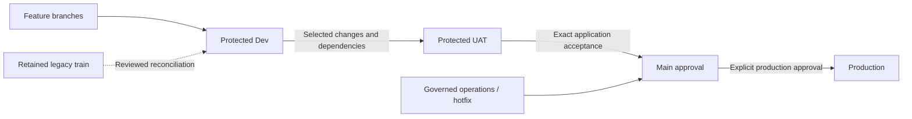

# Branch Governance

## Main-owned release control

Dispatch Dev, UAT and Production deployments from `main`. Application sources remain
isolated: qualified protected `dev`, protected `uat`, and approved Main content respectively.
Run names identify the application branch and SHA; the Actions Main badge identifies
execution authority. Merges never deploy. UAT needs no prior Dev deployment; production
retains UAT acceptance, compatibility and rollback requirements. This operations delta
does not publish an application, run migrations or change production traffic.

Current access comes only from the live GitHub teams: ordinary review/self-service uses
`allowed-maintainers-to-approve`; environments use their `deploy-*` team; protected CI,
fundamental guidance and emergency authorization use `pipeline-editors`. Saved usernames
are historical evidence, never current grants. A membership lookup failure refuses the
operation. An organization-owner role does not replace deployment-team membership.

Protected PR jobs classify affected authority without receiving membership credentials.
Native Team review and the trusted Main merge decision enforce approval. The queue requests
current permission at admission and completion through the existing Main broker; no PR
observer or recurring security-alert workflow runs. Explicit Main-origin deployments use
the protected security job directly in the same run, without a second branch broker run. Current mutation boundaries also request a bounded Main-owned
permission recheck, so revoked actors cannot keep using an earlier clearance. These
explicit operation checks do not scan alerts or observe ordinary PR events.

The canonical state-changing operator procedure is the
[Admin merge and release SOP](../../../.agents/skills/repo-operations/references/admin-release-sop.md).
This page defines branch policy and governed cohorts; it does not redefine the
exact-head Admin PR landing or environment dispatch sequence.

## Visual Map

UAT deployment requires an explicitly selected, qualified application SHA from
protected UAT history. Inspection reads the current protected tip and serving
revisions; neither inspection nor merging deploys an application.



## Dev / UAT branch preparation

The protected Dev branch is the configured development intake and the default
source for governed Dev deployment. Preserve its history and qualify the exact
candidate; an active branch does not prove that its tip is serving. The protected
UAT candidate is eligible after its exact-source CI and serving-baseline gates are qualified.
Main remains the release-control source; this transition
does not rewind application source or database history.

UAT-focused work can use exact-source CI without a preceding Dev deployment.
Select a merged application SHA from protected UAT history. Full CI runs on that exact commit
with `scope=all` and the observed serving application as `uat_base_sha`; the
Main-owned deployment records a typed `uat-exact-ci` predecessor. It verifies
canonical workflow authority, reviewed invocation configuration, complete current
attempts, service scope and the actual serving baseline under the deployment
lock. It refreshes refs and repeats admission before runtime-secret changes and
after image builds. A later failed required CI attempt or changed serving baseline refuses.
A descendant UAT merge does not retarget or invalidate the selected application;
a branch reset that removes it from protected history refuses. Legacy isolated
UAT retains its exact-tip requirement.
Reviewed application tests and dependencies may evolve; this follows the existing
protected-branch trust model, not malicious-code containment.

Historical acceptance and no-op receipts retain their original checks. Unknown
or in-flight baseline evidence refuses. A direct
candidate also on Main can use its explicit UAT CI evidence; an ordinary historical
Main release can retain Dev-backed admission. Missing Dev image evidence selects
a source build; explicit `promote-from-dev` still requires the real accepted image.
Historical Dev-backed receipts and direct-CI UAT receipts remain distinct and
verifiable. Production requires the accepted UAT application and selected services;
its historical reader does not require today's UAT tip to equal an old release.
Ordinary UAT selects protected application content; privileged Cloud Build recipes
and migration controllers must match the recorded trusted Main revision. Main retains release
orchestration and credential clearance; isolated UAT keeps its existing parity policy.

Source implementation is not a live qualification receipt. Run full exact-candidate
CI on protected UAT and verify current admission before deployment. Ordinary
Dev/UAT does not require a manual PR-history chain or serving-commit ancestry;
recheck captured per-service revisions, compatibility and rollback under the lock. No
application deployment is authorized by this operations change.

Capability graph checks compare against each actual target or serving base.
When freshly computed semantic indexes are identical and added, removed and
changed lists are empty, the serialized comparison's `from_revision` is `null`;
diagnostics retain the actual compared ref and revision. This keeps an empty
semantic transition deterministic without changing breaking-change checks,
runtime workflow compatibility or exact mirror checks. Nonempty transitions
retain base-specific comparison metadata and require separate validation for
each target before selective promotion is qualified. Exact-tree promotion
also needs the tested UAT candidate to incorporate the reviewed Main baseline;
a later Main change may require a new UAT candidate.

`branch_flow.prepared_branches` in `config/ci-governance.json` declares protection
policy references for `dev` and `uat`. These are branch policies, separate from
the top-level `dev` and `uat` environment dispatch cohorts. A declaration does
not create a branch, apply protection or grant deployment authority.

Destination drift is guidance, not an ancestry-age rejection. The queue verifies
all included changes against the actual destination and preceding queued changes.
The verifier resolves each declared policy and exact queue ruleset; undeclared
branches refuse. Ordinary mergers have no queue bypass. Named owner Admin merges additionally
require the separate strict-CI/PR guard described in Admin SOP. Source intent is not proof of live settings; read them
back after the reviewed activation.

Roll out combined-result validation separately on every destination (`main`,
`dev`, `uat` and the retained train). Admission executes authority code from the
merge group's protected **base**, so including the helper for the first time in
the activation PR is insufficient:

1. Land the queue helper, its dependencies and focused tests through the existing
   validation path; leave the current queue workflow active.
2. Land the activation workflow after verifying that foundation exists in the
   destination base. Preserve unrelated destination changes during each sync.
3. Observe a successful subsequent combined-result run using the corrected
   helper. The activation PR itself cannot certify a helper fix absent from its
   base.
4. Apply the reviewed merger/review restrictions and read back the result.
   Dev and shared UAT queue intake is non-strict. Isolated UAT keeps strict
   classic CI and independent review. The named owner direct route retains its
   independent strict CI and PR guard.

These are source and policy operations only. They do not deploy an application.

Before enabling intake, preserve existing refs and outstanding work, prepare each
branch from the then-current Main baseline, and apply/read back its protection.
The existing `uat` ref must not be reset merely because its history is old.
Default `apply-governance.py` reconciles Main/train safeguards without team-roster writes. Select prepared
branches explicitly to bootstrap their complete protection and exact-ref queue
rulesets without changing those other authorities:

```bash
python3 scripts/ci/apply-governance.py --branch dev --branch uat
python3 scripts/ci/apply-governance.py --branch dev --branch uat --apply
GITHUB_BRANCH=dev scripts/ci/verify-main-branch-protection.sh
GITHUB_BRANCH=uat scripts/ci/verify-main-branch-protection.sh
```

Selected mode never creates refs or deploys applications. It refuses ambiguous
rulesets, retargeting a ruleset that protects other refs, and unauthored stronger
push/review controls. Reconcile those explicitly rather than overwriting them.
On 26 October 2026, Dev was created from Main `b819614ccc` and both prepared
branches' protection passed live readback. UAT history reconciliation and the
selective-promotion authority remain separate from this protection checkpoint.

Manual UAT deployment pins the protected candidate, its exact CI attempt and both
serving SHAs. The manual approved-PR chain is retained for legacy isolated UAT,
not required for ordinary UAT. A Main-only SHA is not a normal UAT source. Direct UAT also requires
the exact full-scope candidate run, current attempt and observed serving base.
Historical Main-backed receipts remain readable under their original contract.

For production, `sha` remains the UAT-accepted application. When approval landed
as a different Main merge, `main_approval_sha` requires that merge's Main smoke,
incorporation of the application and identical complete Git trees. The workflow
retains this mapping and still requires UAT acceptance for the application SHA.
No ignored paths, new content or predecessor bypass are allowed. This optional
manual mode cannot be mixed with cadence, restoration or phone transitions.

The following work remains before the UAT selection transition:

1. Maintain Dev intake without discarding train or active branch work.
2. Select dependency-complete changes into UAT; stabilize there and carry fixes
   back to Dev. Keep both deployments manual. Direct UAT uses exact assembled-SHA
   qualification; an original cherry-picked commit's receipt cannot qualify it.
   Verify the direct route's admission and serving evidence before claiming the
   transition is operationally complete.
3. Promote the exact UAT-qualified application SHA through a reviewed Main
   promotion. Record the Main approval merge separately, prove no new content was
   introduced, and preserve service-specific acceptance and rollback.
4. Align all selectors, scoped/native release paths and operating instructions,
   then verify one complete release before retiring legacy routing.

This preparation changes no application content, deployed traffic, image
selection, WIF authority, scheduled cadence or capacity-maintenance behavior.

## Manual emergency production

The manual incident route waives Dev/UAT deployment acceptance only. It is not
an automatic deployment and cannot certify an ordinary promotion. Require an
explicit production incident request, both governed original/triggering actors,
an exact CI-qualified application SHA on a `hotfix/` or `fix/` branch and an
incident reference with a meaningful reason. Execute the existing production
workflow from Main; preserve its release helpers, policy and serving parser
before checking out application sources.

Supply `emergency_source_ref` and `emergency_reason` together. The application
must descend from both sources actually serving production. The workflow seals
the serving revisions, UIDs, configuration generations, images and workload
identities, then rechecks source CI and that baseline before runtime mutation.
It retains current-schema compatibility, backup, qualified rollback, health,
account-cleanup and provenance gates. A historical patch that fails those gates
is incompatible; the incident route cannot waive them.

Do not combine this route with cadence, a curated Main approval, restoration,
phone transitions, image promotion or capability activation. Record its separate
`predecessor_exception` in release status, never a fabricated UAT receipt. After
acceptance, forward-port the patch by behavior into Main, Dev and the selected
UAT history. A Main merge does not itself authorize another application rollout.

## Development intake and release approval

**Dev intake** is the default for new feature, fix, dependency and contributor
work. `branch_flow.intake_branch` selects `dev`; `train_branch` continues to own
the retained `integration/pr-train` protection. Do not rename that authority or
reset either branch. Existing train PRs keep their reviewed dependency context
until explicitly reconciled.

Dependabot version updates target Dev after activation. [GitHub security updates](https://docs.github.com/en/code-security/reference/supply-chain-security/dependabot-options-reference#target-branch)
continue to target the default branch; a governed maintainer must review their
actual routing and move or incorporate an eligible fix through the authorized
lane. The target-branch setting does not grant a bot Main merge authority.

| Lane | Source and authority |
|---|---|
| Dev | Feature PRs target protected `dev`; Main-owned tooling deploys an exact CI-green SHA in protected Dev history. The `ref` input locates a SHA but does not authorize a feature-only or Main-only commit. |
| UAT | Pin the protected UAT candidate and approved release PR. Direct UAT also requires exact full-scope CI, the current attempt and the observed serving base. Historical Main-backed receipts retain their Dev-backed checks but do not authorize a new Main-only selection. |
| Main | Review accepted UAT content for release. When its approval merge differs from the tested application SHA, require identical complete Git trees and preserve both identities. |
| Main operations/hotfix | A governed maintainer may branch from `origin/main` and open a PR directly into `main` by actor identity. CI, conversations, queue/Admin SOP and landed smoke remain mandatory. Merging does not deploy. |
| Production | Explicit UAT-accepted application plus Main approval, or the separately approved manual emergency route. Automatic publication remains disabled. |
| Legacy train | Preserve `integration/pr-train` history, protections and existing promotion PRs; do not use it as the default for new intake or silently promote all Dev work. |

`scripts/ci/verify-pr-base-policy.py` retains governed maintainer Main authority
and the currently declared promotion heads. This authorizes PR routing only;
it does not establish Dev/UAT acceptance or authorize a deployment. Keep
`allow_auto_merge` enabled so eligible PRs can enter the ordinary queue.

### Carry stable fixes back to development

The coding agent completing each merge also completes its reviewed downstream
source syncs: **Main → UAT and Dev; UAT → Dev**. Follow the canonical
[agent-owned completion procedure](../../../.agents/skills/repo-operations/references/maintainer-branch-freshness.md#agent-owned-downstream-completion)
for dependency preservation, equivalent-change detection, verification and conflict
handoff. Carry the reviewed change rather than replacing a destination's complete
tree; selected Dev promotion upward remains a separate review.

No bot, recurring sync workflow or unattended merge is introduced. A source merge
on any branch deploys nothing; deployments retain explicit authorization.

## Working Rules

1. New development starts from the intended protected Dev baseline and targets Dev. Preserve the active branch and dependency context.
2. After the UAT transition is authorized, curate UAT explicitly. A merge or cherry-pick produces a new assembled SHA; individual source receipts cannot qualify it.
3. The direct-CI source path admits a protected UAT candidate without a preceding Dev deployment only after exact full-scope CI, current-attempt, serving-base, and protected-security checks pass. Do not treat the end-to-end route as qualified until those proofs pass against reconciled history and the real serving baseline; the source change itself does not authorize a deployment.
4. Promote accepted UAT content to Main without adding untested content; preserve the application/approval mapping. Concurrent Main changes require reconciliation and affected verification.
5. Governed maintainer operations/hotfix PRs can target Main directly. Retain legacy train promotions without treating that branch as new intake or deploying automatically.
6. Continue follow-up fixes on the active development branch by default; do not create extra temporary branches for routine polish, validation follow-up, or same-lane fixes.
7. Create a new branch only when isolation is materially required, such as a post-merge hotfix from `main`, a deploy blocker that must land independently, or unrelated in-flight changes on the current branch.
8. After an isolated hotfix lands, return local work to the preserved development branch and delete the temporary branch after rollout validation.
9. Do not use `deploy_uat` or `deploy` as release branches; they are retired from the deployment path.
10. New UAT selections must be in protected UAT history. Direct candidates use
    the exact-CI admission path; historical Main-backed receipts remain readable
    with their original Dev-backed checks but do not authorize a new Main-only
    dispatch. UAT candidates also require canonical PR, queue, or full branch
    validation. Do not dispatch the direct path before its exact CI and admission
    proof pass.
11. Production deploys only the explicitly approved application through its Main approval or separately governed emergency admission. Automatic release cadence is retired.
12. Prepared-branch baseline and curated-selection PRs preserve history. Their merge does not deploy an environment; release tooling remains Main-owned.

## Engineering Branch Preservation Gate

Coding agents must run this gate before CI, deploy, PR, hotfix, or validation work:

1. Inspect and preserve the current developer branch before edits, branch switches, merges, or deploy operations.
2. Keep incremental fixes on the preserved developer branch when the current worktree can safely carry them.
3. Do not create temporary branches for routine follow-up work, UAT validation fixes, PR polish, or local hardening.
4. Use a temporary branch only when branch isolation is explicitly requested, an isolated `main` hotfix is required, or unrelated in-flight work makes the preserved branch unsafe for the fix.
5. If a temporary branch is used, delete it locally AND remotely after the work is safely preserved on the kept branches, then switch back to the preserved developer branch. Before deleting, verify every unique commit/file is represented on a kept branch, and close any throwaway PR opened from the temp branch.
6. If a normal fix lands on `integration/pr-train`, merge or rebase the landed train commits into the preserved developer branch before handoff.
7. If an emergency hotfix lands on `main`, reconcile it into `dev` and affected active branches without overwriting their unique work. Reconcile the legacy train when its active work requires it.
8. Do not end a task detached, on `main`, or on a temporary branch unless the user explicitly requested that final state or a concrete conflict blocks restoration. If branch switching happened mid-task (including from a parallel terminal), switch back to the developer's starting branch before handoff and state that you did.
9. HARD RULE — leave the tree clean at handoff: developer on their branch, no stray local temp branches, no stray remote temp branches, no dangling throwaway PRs. Auto-creating branches, abandoning the developer on a stray branch, or leaving temp branches behind is a defect to correct immediately, not an acceptable shortcut.

## Branch Types and Retention

| Branch type | Naming pattern | Retention |
|---|---|---|
| Developer branch | `feature/*`, `feat/*`, `agent_*`, developer-owned names | Keep while active |
| Development intake | `dev` | Durable protected branch for new development |
| Legacy train branch | `integration/pr-train` | Preserve its protected history and active work |
| Hotfix branch | `fix/*` | Delete after merge, required validation and safe back-sync |
| Deployment artifact | exact qualified application SHA and release provenance | Keep in Git history and deployment logs |
| Local backup branch | `backup/*`, `publishable/*` | Audit unique commits, salvage if needed, then delete |

Before deleting a local backup branch, classify its unique commits as:

1. already represented in `main`
2. obsolete and safe to drop
3. still valuable and worth promoting onto a reviewed branch from the appropriate current baseline

## Deployment Lanes

### Dev (fast lane)

1. Dispatch `Deploy to Dev` from Main. The qualified application remains an exact
   SHA in protected Dev history. Verify Main-origin admission through read-only
   `inspect-routing` before claiming activation; a source merge deploys nothing.
2. The `ref` input defaults to `dev` and only locates the application SHA. The
   selected SHA must belong to protected Dev history and carry an accepted exact
   CI result; an explicit lookup ref cannot authorize branch-only content.
3. Dev never requires `main` ancestry or `Main Post-Merge Smoke` — `main` stays the
   UAT → production signoff lane, and Dev proves selected changes before promotion.
4. Dev has no promotion authority: nothing deploys to UAT or production from dev.
5. Full contract: [dev-fast-lane.md](./dev-fast-lane.md).

### UAT

1. UAT deploys through its governed Main-owned workflow with an exact qualified application SHA.
2. The workflow checks out that exact application. Main owns orchestration and
   credential clearance; ordinary UAT keeps independent application/test content; privileged build
   and migration execution remains bound to the recorded Main authority. Manifest
   format, exact CI, migration compatibility and live-serving checks remain.
   Legacy isolated UAT and production approval retain their existing policies.
   Canonical Dev/UAT PR editing authority reads pinned protected Main
   policy, matching queue/Admin admission; a stale destination roster cannot
   block an approved editor. Candidate policy grants never authorize the PR.
3. Manual dispatch uses current `deploy-uat` membership, independently of Main merge
   authority. Preserve the existing Dev/UAT cohorts. Main's approved merge operators
   match its production operators, while protected edits require pipeline-editor.
   Changing one capability does not silently grant another.
4. Preflight requires reachability from protected UAT. Direct UAT candidates
   require exact current-branch CI and the observed serving base; source selection
   alone is not admission.
5. UAT candidates require an authenticated canonical PR, queue or full branch
   gate; diagnostics never qualify. Historical Main-backed release receipts keep
   their Main smoke and exact-SHA Dev-acceptance checks when read later.
6. The canonical GitHub deployment environment for this lane is `uat`.
7. Cloud Run traffic changes must be made only by the GitHub UAT workflow service account. Human `gcloud run deploy` or `gcloud run services update-traffic` against UAT is deploy-authority drift, even for maintainers.
8. Every UAT backend/frontend revision must carry `HUSHH_DEPLOY_ENV`, `HUSHH_DEPLOY_SOURCE`, `HUSHH_DEPLOY_SHA`, and `HUSHH_DEPLOY_RUN_ID` from the workflow. UAT release classification treats missing or mismatched provenance as `deploy_authority_drift` and rolls back the affected service.
9. Project IAM should remove direct human Cloud Run deploy/update permissions for UAT; humans dispatch the governed workflow, not the runtime service.

### Production

1. Production does not auto-deploy from branch pushes.
2. Production deploys through governed dispatch with the exact UAT-accepted application SHA. A distinct Main approval merge must pass smoke, incorporate that application and preserve its entire tree.
3. The workflow validates that the SHA is reachable from `origin/main`.
4. The workflow also validates that `Main Post-Merge Smoke Gate` succeeded for that SHA before deployment starts.
5. Manual operators must belong to the current `deploy-production` team. There is no unattended release exception. Automatic release cadence is retired; commits and workflow completions do not authorize deployment. See [explicit releases](./ci.md#explicit-releases-and-retired-cadence).
6. The canonical GitHub deployment environment for this lane is `production`.

## Protected Surfaces & Trust Model

The repository protects a set of high-blast-radius surfaces — the files that
decide who can merge, who can deploy, and what the pipeline does — behind
**three independent, defense-in-depth layers**. No single mistaken approval can
land a change to these surfaces.

### Protected surfaces

These paths are owned by `@hushh-labs/pipeline-editors` in `.github/CODEOWNERS` and are
listed in `config/ci-governance.json` under `main.protected_pipeline_paths`:

- `.github/workflows/`
- `.github/actions/`
- `scripts/ci/`
- `scripts/git/check-main-sync.sh` (destination drift diagnostics; a PR
  runs its own copy, so changing it needs the same review as the workflow)
- `deploy/`
- `config/ci-governance.json`
- `config/release-cadence.json` (cadence and automatic public-release policy)
- `config/protected-behaviors.json`
- `config/runtime-capacity.json` (the release admission budget: who may deploy
  is decided by these connection limits, so they change only with the same
  review as the deploy pipeline)
- `.github/CODEOWNERS`

### The three enforcement layers

1. **Native protected review.** CODEOWNERS requests only
   `@hushh-labs/pipeline-editors`. It has no blanket product/docs fallback, so a
   mixed protected PR does not also request the ordinary maintainer team. Native
   protected-path rules remain independent on Main, Dev and UAT. The owner team
   must retain the repository access required by GitHub for its review rules.
2. **CI protected-authority guard (fails closed).**
   `scripts/ci/verify-protected-pipeline-edits.py` runs in the required
   `CI Status Gate` and requires current-head pipeline-owner authorization for
   protected edits. Ordinary maintainer membership cannot satisfy this boundary.
   Missing change or approval evidence refuses clearance. Semantic changes to
   mixed-use files follow this same route, even without a CODEOWNERS request.
3. **Queue review and owner approval.** Ordinary Main PRs require independent
   current-head maintainer approval. Ordinary Dev/UAT authors may use governed
   maintainer self-service after required checks. Review-request labels alone
   authorize neither route. a configured pipeline editor may explicitly land their own exact PR head under the
   [owner self-approval procedure](../../../.agents/skills/repo-operations/references/admin-release-sop.md#3c-main-merger-policy-and-the-named-owner-admin-route).
   The Admin command verifies authenticated author identity, current validation
   and the exact tested merge tree; unresolved objections still block.

For protected PRs, including mixed CI/product/docs changes, request only the
pipeline-editor team. For an ordinary peer review, request the maintainer team
when needed. Do not add individual reviewer names to compensate for a routing
failure. Follow the canonical [review-routing procedure](../../../.agents/skills/repo-operations/references/admin-release-sop.md#review-routing-on-every-destination).

### Team authority and administration

GitHub teams are the approved membership authority. Repository policy defines
capabilities and safeguards; applying it must never restore a retired team member.

| Team | Capability |
|---|---|
| `allowed-maintainers-to-approve` | Ordinary Dev/UAT maintainer self-service and eligible peer review |
| `pipeline-editors` | Protected CI, release policy and fundamental engineering guidance |
| `deploy-dev` | Explicit Dev deployment |
| `deploy-uat` | Explicit UAT deployment and internal testing |
| `deploy-production` | Main merger admission and production/public release admission |

Merging and deploying are separate decisions even where they use the same team.
No merge deploys an application. Ordinary membership never grants protected-edit
approval. Main and UAT fixes are carried downstream by the agent completing the
merge, through reviewed source-only syncs.

Only the two leadership organization owners administer membership. Other people
retain ordinary team-member roles, with no team-maintainer or equivalent custom
organization role. Members cannot create teams. Check effective inherited access
and read back changes; organization ownership is not workflow deployment approval.

Automatic per-PR/queue team-observer runs are withdrawn. Native protected-path
review and queue exceptions still reference the pipeline-editor Team; required
functional CI and combined-result validation remain independent. The authenticated
Admin CLI reads current team membership before its exact-head decision.

Deployment Security runs only for explicitly requested releases. Legacy hosted
source/deployment roster consumers remain transitional; do not claim all runtime
admission is group-only. Historical observer receipts grant no new release authority.

For the initial native transition, preserve a live settings snapshot and run the
current landed Main tool with `--native-team-transition <preceding-main-sha>`.
Review its dry run, then repeat with `--apply`. It accepts only exact historical
user exceptions or the already-installed Team state, refuses a wider editor
cohort or concurrent change, and changes actor lists without relaxing any rule.
An interrupted transition is reconciled from live state; never restore a revoked
user merely to make old tooling pass. Native self-review bypass does not by itself
guarantee GitHub queue admission; retain the exact-head Admin procedure.

`apply-governance.py` no longer creates teams, adds/removes members or promotes
roles. It manages repository safeguards only. Do not run an older checkout's
roster reconciler. Access changes belong in GitHub's authorized team-management
surface and must not require an application deployment.

Keep deployment identities, environment bindings, current attempts, compatibility
and rollback checks independent of membership. Environment variables are consumed
through `vars.*`; configuration inspection reports their names, never secrets.

## Admin landing

Follow the [Admin SOP](../../../.agents/skills/repo-operations/references/admin-release-sop.md).
Ordinary Main merges require applicable independent review and combined-result
queue validation. Eligible Dev/UAT authors may request their own ordinary PR's
queue entry without blanket review. Protected CI and fundamental guidance still
require pipeline-editor authority on every destination.

The named-owner Admin route lets a configured pipeline editor explicitly approve their own
exact-head PR on Main, Dev, UAT or isolated UAT without a second owner. Its native strict CI/PR
guard and canonical command preserve current-base evidence, resolved conversations
and landed-tree verification. Other maintainers use the ordinary queue.
Historical bootstrap exceptions are not reusable approval.
Main's actual merger/requester is restricted to its approved production cohort.

### Changing access and release policy

Change membership through the appropriate GitHub team using an authorized
leadership account. Verify the resulting membership and effective repository
role. Do not edit legacy username arrays to add access or restore them over a
revocation. During migration, inspect the active admission receipt before
claiming a membership change has reached every runtime gate.

Changes to capability mapping, CI permissions, protected paths and release
safeguards remain protected PRs requiring pipeline-editor authority. Reconcile
approved repository settings with the current `apply-governance.py`, then read
back the specific rules and environment policies. Default reconciliation and
`--main-merge-policy`/`--branch` are separate safeguard operations; none creates
branches or deploys applications.

## Hotfix Playbook

1. Preserve the active developer branch before switching away.
2. Create the hotfix branch from the latest `main` only when an isolated hotfix is materially required.
3. Merge the hotfix into `main`.
4. Reconcile the landed hotfix into `dev` and affected active branches through their governed paths; preserve unique work and legacy train history.
5. Deploy only to an explicitly authorized environment, using its qualified source and release workflow.
6. Delete the hotfix branch locally and remotely after the required validation when safe.
7. Return to the preserved developer branch and incorporate the relevant landed changes without overwriting peer work.
8. If another blocker appears after that rollout, create a new hotfix branch from the updated `main` only when the same isolation criteria still applies.
9. Do not reuse an already-merged hotfix branch for a second fix.

## GitHub Admin Checklist

### `integration/pr-train`

1. Require pull requests before merge.
2. Require the `CI Status Gate` status check.
3. Require current combined-result validation; branch age alone is advisory.
4. Require conversation resolution before merge.
5. Enable merge queue for `integration/pr-train`.
6. Block force-pushes.
7. Block branch deletion.
8. Require at least 1 independent PR approval and approval of the most recent push.
9. Use this branch as the normal PR landing branch for non-maintainer contributor and agent work.

### `main`

1. Require pull requests before merge.
2. Require the `CI Status Gate` status check.
3. Require current combined-result validation; branch age alone is advisory.
4. Require conversation resolution before merge.
5. Enable merge queue for `main`.
6. Enable repository auto-merge so `gh pr merge` can hand eligible PRs to merge queue.
7. Block force-pushes.
8. Block branch deletion.
9. Require one independent PR approval, or the narrow owner self-approval path on `main`; CI and current combined-result proof remain required.
10. Require the queue and approved Main requester cohort; no human-only writer filter may block GitHub’s native queue writer, and no team bypass may skip combined-result verification.
11. Keep non-maintainer contributor and agent development off `main`; governed maintainer-authored branches cut from `origin/main` may open directly to `main`, while train work promotes from `integration/pr-train`.

Current operating note:

- `enforce_admins` should stay enabled
- repository `allow_auto_merge` should stay enabled; it allows queue placement and does not waive checks
- DCO is enforced in CI, not via a separate GitHub branch-protection primitive
- verify the live setting with `../../../scripts/ci/verify-main-branch-protection.sh`
- `integration/pr-train` and `main` both require 1 independent approval; the external community goes through PR + CI + review + queue on `integration/pr-train`
- GitHub cannot count a self-review; only the configured protected owners have the explicit self-authored Admin PR route
- require approval of the most recent push is enabled, so stale approvals cannot carry newly pushed code
- Author/admin status alone is not approval. An authorized owner must explicitly
  approve their captured head through Admin SOP; other PRs require ordinary review.
- Verify every actual Main queue requester against `main.merge_users`; no shared
  maintainer-team bypass may widen it. With `restrict_writes_to_merge_users=false`,
  remove the classic human-only writer filter only after the reviewed Main policy
  lands and native PR, review, CI, protected-change and owner guards pass readback.
  GitHub's queue writer can then land the verified result. Raw pushes remain blocked.
- Required CI, ordinary review or owner approval, and current combined-result proof apply. A merge is
  source-only and never authorizes deployment.

### Retired release branches

1. `deploy_uat` and `deploy` are no longer part of the deployment control plane.
2. They should not carry required checks or workflow expectations for new rollouts.
3. Leave them inert or archive/remove them only after the team confirms no external automation still points at them.

## Production Deployment Environment

The production workflow uses one active GitHub environment name:

| Environment | Intended use |
|---|---|
| `production` | Governed production lane authorized by live `deploy-production` membership |

The UAT workflow uses one active GitHub environment name:

| Environment | Intended use |
|---|---|
| `uat` | Maintainer-dispatched hosted validation lane for protected-UAT application SHAs with exact current CI |

Operational rules:

1. Only current members of `deploy-production` may dispatch the production workflow.
2. Main merging uses `main.merge_users`; production dispatch uses its separate explicit operator list. Neither grants the other operation.
3. `production` should not require reviewers and should not allow admin bypass.
4. Verify the live setup with `../../../scripts/ci/verify-production-environment-governance.sh`.
5. Verify both deploy lanes together with `../../../scripts/ci/verify-deployment-environment-governance.py`.
