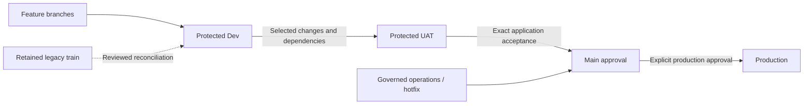

# Branch Governance

The canonical state-changing operator procedure is the
[Admin merge and release SOP](../../../.agents/skills/repo-operations/references/admin-release-sop.md).
This page defines branch policy and governed cohorts; it does not redefine the
exact-head Admin PR landing or environment dispatch sequence.

## Visual Map

The UAT branch and its default selector remain staged until their historical
baseline is reconciled and the transition is separately authorized.



## Dev / UAT branch preparation

The protected Dev branch is the configured development intake and the default
source for governed Dev deployment. Preserve its history and qualify the exact
candidate; an active branch does not prove that its tip is serving. The UAT-tip
default remains staged until its historical baseline and predecessor gates are
qualified together. Main remains the release-control source; this transition
does not rewind application source or database history.

The approved direction for UAT-focused work is direct admission after CI on the
exact selected application, without requiring a preceding Dev deployment. That
path is not yet implemented: the current UAT workflow still requires a Dev
receipt. It must gain a qualified exact-source CI proof and a distinct receipt
before that requirement can change. Production continues to require acceptance
of the same application and services in UAT.

The future direct receipt must identify the protected UAT application commit and
tree, the trusted Main-owned validation workflow and its current run attempt,
the exact security evidence, and the selected services. A PR merge-tree result or
an older successful attempt alone is not proof of the selected application.
Historical Dev-backed receipts must remain verifiable. If no qualified Dev image
exists, UAT builds the selected source with its own environment configuration.

The capability graph's committed comparison metadata currently depends on the
target base: the Dev sync has already produced different metadata from Main for
the same authored change. Before making selective promotion automatic, make the
committed history deterministic and separately validate each actual target-base
transition. Runtime workflow compatibility and exact mirror checks remain
required. Exact-tree promotion also needs the tested UAT candidate to incorporate
the reviewed Main baseline; a later Main change may require a new UAT candidate.

`branch_flow.prepared_branches` in `config/ci-governance.json` declares protection
policy references for `dev` and `uat`. These are branch policies, separate from
the top-level `dev` and `uat` environment dispatch cohorts. A declaration does
not create a branch, apply protection or grant deployment authority.

Preparation provides strict destination freshness, merge-queue event coverage,
and aggregate CI rejection of skipped freshness for both branches. Main keeps
its existing bounded PR freshness; queue admission remains strict. The existing
protection verifier resolves the declared branch policy and exact queue ruleset;
it refuses undeclared branches rather than silently treating them as Main.

Before enabling intake, preserve existing refs and outstanding work, prepare each
branch from the then-current Main baseline, and apply/read back its protection.
The existing `uat` ref must not be reset merely because its history is old.
Default `apply-governance.py` reconciles Main/train and teams. Select prepared
branches explicitly to bootstrap their complete protection and exact-ref queue
rulesets without changing those other authorities:

```bash
python3 scripts/ci/apply-governance.py --branch dev --branch uat
python3 scripts/ci/apply-governance.py --branch dev --branch uat --apply
GITHUB_BRANCH=dev scripts/ci/verify-main-branch-protection.sh
GITHUB_BRANCH=uat scripts/ci/verify-main-branch-protection.sh
```

Selected mode never creates refs or deploys applications. It refuses ambiguous
rulesets, retargeting a ruleset that protects other refs, and unauthored stronger
push/review controls. Reconcile those explicitly rather than overwriting them.
On 26 October 2026, Dev was created from Main `b819614ccc` and both prepared
branches' protection passed live readback. UAT history reconciliation and the
selective-promotion authority remain separate from this protection checkpoint.

Explicit UAT candidates can use a CI-qualified commit in the protected `uat`
history, with exact-SHA Dev acceptance still required before deployment. Main
candidates retain mandatory Main smoke. Automatic selection retains its current
Main baseline until the UAT selector and historical baseline are qualified. The
prepared UAT-tip selector refuses unknown, concurrent or non-forward baselines.
Its selection-time snapshot rechecks the remote UAT tip after reading receipts.
Before activation, the deployment admission must recheck that same tip under
the mutation lock; selection alone cannot fence a later branch update.

For production, `sha` remains the UAT-accepted application. When approval landed
as a different Main merge, `main_approval_sha` requires that merge's Main smoke,
incorporation of the application and identical complete Git trees. The workflow
retains this mapping and still requires UAT acceptance for the application SHA.
No ignored paths, new content or predecessor bypass are allowed. This optional
manual mode cannot be mixed with cadence, restoration or phone transitions.

The following work remains before the UAT selection transition:

1. Maintain Dev intake without discarding train or active branch work.
2. Select dependency-complete changes into UAT; stabilize there and carry fixes
   back to Dev. Keep both deployments manual. Until the direct-CI path is
   qualified, the final assembled SHA still needs Dev acceptance; an original
   cherry-picked commit's receipt cannot qualify it.
3. Promote the exact UAT-qualified application SHA through a reviewed Main
   promotion. Record the Main approval merge separately, prove no new content was
   introduced, and preserve service-specific acceptance and rollback.
4. Align all selectors, scoped/native release paths and operating instructions,
   then verify one complete release before retiring legacy routing.

This preparation changes no application content, deployed traffic, image
selection, WIF authority, scheduled cadence or capacity-maintenance behavior.

## Manual emergency production

The manual incident route waives Dev/UAT deployment acceptance only. It is not
an automatic deployment and cannot certify an ordinary promotion. Require an
explicit production incident request, both governed original/triggering actors,
an exact CI-qualified application SHA on a `hotfix/` or `fix/` branch and an
incident reference with a meaningful reason. Execute the existing production
workflow from Main; preserve its release helpers, policy and serving parser
before checking out application sources.

Supply `emergency_source_ref` and `emergency_reason` together. The application
must descend from both sources actually serving production. The workflow seals
the serving revisions, UIDs, configuration generations, images and workload
identities, then rechecks source CI and that baseline before runtime mutation.
It retains current-schema compatibility, backup, qualified rollback, health,
account-cleanup and provenance gates. A historical patch that fails those gates
is incompatible; the incident route cannot waive them.

Do not combine this route with cadence, a curated Main approval, restoration,
phone transitions, image promotion or capability activation. Record its separate
`predecessor_exception` in release status, never a fabricated UAT receipt. After
acceptance, forward-port the patch by behavior into Main, Dev and the selected
UAT history. A Main merge does not itself authorize another application rollout.

## Development intake and release approval

**Dev intake** is the default for new feature, fix, dependency and contributor
work. `branch_flow.intake_branch` selects `dev`; `train_branch` continues to own
the retained `integration/pr-train` protection. Do not rename that authority or
reset either branch. Existing train PRs keep their reviewed dependency context
until explicitly reconciled.

Dependabot version updates target Dev after activation. [GitHub security updates](https://docs.github.com/en/code-security/reference/supply-chain-security/dependabot-options-reference#target-branch)
continue to target the default branch; a governed maintainer must review their
actual routing and move or incorporate an eligible fix through the authorized
lane. The target-branch setting does not grant a bot Main merge authority.

| Lane | Source and authority |
|---|---|
| Dev | Feature PRs target protected `dev`; governed operators deploy an exact CI-green SHA through Main-owned tooling. Explicit feature refs remain supported. |
| UAT | Existing Main-based default and Dev acceptance remain active. The approved direction selects dependency-complete changes into protected `uat` and permits UAT after exact assembled-SHA CI without requiring a Dev deployment, once that admission path is qualified. |
| Main | Review accepted UAT content for release. When its approval merge differs from the tested application SHA, require identical complete Git trees and preserve both identities. |
| Main operations/hotfix | A governed maintainer may branch from `origin/main` and open a PR directly into `main` by actor identity. CI, conversations, queue/Admin SOP and landed smoke remain mandatory. Merging does not deploy. |
| Production | Explicit UAT-accepted application plus Main approval, or the separately approved manual emergency route. Automatic publication remains disabled. |
| Legacy train | Preserve `integration/pr-train` history, protections and existing promotion PRs; do not use it as the default for new intake or silently promote all Dev work. |

`scripts/ci/verify-pr-base-policy.py` retains governed maintainer Main authority
and the currently declared promotion heads. This authorizes PR routing only;
it does not establish Dev/UAT acceptance or authorize a deployment. Keep
`allow_auto_merge` enabled so eligible PRs can enter the ordinary queue.

### Carry stable fixes back to development

A reviewed UAT or production hotfix creates a follow-up for Dev containing the
source change, required dependencies and a link to the destination PR. Reconcile
that fix by behavior against the current Dev base, verify its destination CI and
record the merged Dev commit before closing the follow-up. A selective cherry-pick
or equivalent reviewed change is appropriate; do not merge all of UAT into Dev or
all of Dev into UAT. This is currently an operator procedure, not an automated
back-sync guarantee. An automated reminder must preserve those same review and
freshness boundaries before it is enabled.

## Working Rules

1. New development starts from the intended protected Dev baseline and targets Dev. Preserve the active branch and dependency context.
2. After the UAT transition is authorized, curate UAT explicitly. A merge or cherry-pick produces a new assembled SHA; individual source receipts cannot qualify it.
3. Until direct-CI admission is qualified, accept that assembled SHA on Dev and then UAT through Main-owned workflows and exact service receipts.
4. Promote accepted UAT content to Main without adding untested content; preserve the application/approval mapping. Concurrent Main changes require reconciliation and affected verification.
5. Governed maintainer operations/hotfix PRs can target Main directly. Retain legacy train promotions without treating that branch as new intake or deploying automatically.
6. Continue follow-up fixes on the active development branch by default; do not create extra temporary branches for routine polish, validation follow-up, or same-lane fixes.
7. Create a new branch only when isolation is materially required, such as a post-merge hotfix from `main`, a deploy blocker that must land independently, or unrelated in-flight changes on the current branch.
8. After an isolated hotfix lands, return local work to the preserved development branch and delete the temporary branch after rollout validation.
9. Do not use `deploy_uat` or `deploy` as release branches; they are retired from the deployment path.
10. UAT uses an exact CI-qualified application with Dev acceptance. Main candidates require Main smoke; UAT-only candidates require canonical PR, queue or full branch validation.
11. Production deploys only the explicitly approved application through its Main approval or separately governed emergency admission. Cadence remains disabled until it understands the same mapping.
12. Prepared-branch baseline and curated-selection PRs preserve history. Their merge does not deploy an environment; release tooling remains Main-owned.

## Engineering Branch Preservation Gate

Coding agents must run this gate before CI, deploy, PR, hotfix, or validation work:

1. Inspect and preserve the current developer branch before edits, branch switches, merges, or deploy operations.
2. Keep incremental fixes on the preserved developer branch when the current worktree can safely carry them.
3. Do not create temporary branches for routine follow-up work, UAT validation fixes, PR polish, or local hardening.
4. Use a temporary branch only when branch isolation is explicitly requested, an isolated `main` hotfix is required, or unrelated in-flight work makes the preserved branch unsafe for the fix.
5. If a temporary branch is used, delete it locally AND remotely after the work is safely preserved on the kept branches, then switch back to the preserved developer branch. Before deleting, verify every unique commit/file is represented on a kept branch, and close any throwaway PR opened from the temp branch.
6. If a normal fix lands on `integration/pr-train`, merge or rebase the landed train commits into the preserved developer branch before handoff.
7. If an emergency hotfix lands on `main`, reconcile it into `dev` and affected active branches without overwriting their unique work. Reconcile the legacy train when its active work requires it.
8. Do not end a task detached, on `main`, or on a temporary branch unless the user explicitly requested that final state or a concrete conflict blocks restoration. If branch switching happened mid-task (including from a parallel terminal), switch back to the developer's starting branch before handoff and state that you did.
9. HARD RULE — leave the tree clean at handoff: developer on their branch, no stray local temp branches, no stray remote temp branches, no dangling throwaway PRs. Auto-creating branches, abandoning the developer on a stray branch, or leaving temp branches behind is a defect to correct immediately, not an acceptable shortcut.

## Branch Types and Retention

| Branch type | Naming pattern | Retention |
|---|---|---|
| Developer branch | `feature/*`, `feat/*`, `agent_*`, developer-owned names | Keep while active |
| Development intake | `dev` | Durable protected branch for new development |
| Legacy train branch | `integration/pr-train` | Preserve its protected history and active work |
| Hotfix branch | `fix/*` | Delete after merge, required validation and safe back-sync |
| Deployment artifact | exact qualified application SHA and release provenance | Keep in Git history and deployment logs |
| Local backup branch | `backup/*`, `publishable/*` | Audit unique commits, salvage if needed, then delete |

Before deleting a local backup branch, classify its unique commits as:

1. already represented in `main`
2. obsolete and safe to drop
3. still valuable and worth promoting onto a reviewed branch from the appropriate current baseline

## Deployment Lanes

### Dev (fast lane)

1. Dev deploys through `Deploy to Dev` (manual dispatch from `main`, governed actor
   cohort identical to UAT).
2. The deployed content is `dev` by default, or any requested ref;
   the exact SHA must be reachable from that ref and carry a green `CI Status Gate`.
3. Dev never requires `main` ancestry or `Main Post-Merge Smoke` — `main` stays the
   UAT → production signoff lane, and Dev proves selected changes before promotion.
4. Dev has no promotion authority: nothing deploys to UAT or production from dev.
5. Full contract: [dev-fast-lane.md](./dev-fast-lane.md).

### UAT

1. UAT deploys through its governed Main-owned workflow with an exact qualified application SHA.
2. The workflow checks out that exact application; trusted release tooling remains Main-owned.
3. Manual dispatch is limited to the maintainer cohort in `config/ci-governance.json` (`uat.manual_dispatch_users`) — see that file for the live list (do not hardcode names here; they drift). This list is held equal to the merge cohort (`main.review_bypass_users`) by design — anyone trusted to land code on `main` may validate it in the UAT sandbox — and `scripts/ci/verify-deployment-environment-governance.py` fails if the two drift apart. To change the cohort, edit the JSON then run `python3 scripts/ci/apply-governance.py --apply` (see "Adding or removing a maintainer" below).
4. Preflight requires reachability from Main or the curated UAT branch, plus exact-SHA Dev acceptance for each selected service.
5. Main candidates require `Main Post-Merge Smoke Gate`. UAT-only candidates require an authenticated canonical PR, queue or full branch gate; diagnostics never qualify.
6. The canonical GitHub deployment environment for this lane is `uat`.
7. Cloud Run traffic changes must be made only by the GitHub UAT workflow service account. Human `gcloud run deploy` or `gcloud run services update-traffic` against UAT is deploy-authority drift, even for maintainers.
8. Every UAT backend/frontend revision must carry `HUSHH_DEPLOY_ENV`, `HUSHH_DEPLOY_SOURCE`, `HUSHH_DEPLOY_SHA`, and `HUSHH_DEPLOY_RUN_ID` from the workflow. UAT release classification treats missing or mismatched provenance as `deploy_authority_drift` and rolls back the affected service.
9. Project IAM should remove direct human Cloud Run deploy/update permissions for UAT; humans dispatch the governed workflow, not the runtime service.

### Production

1. Production does not auto-deploy from branch pushes.
2. Production deploys through governed dispatch with the exact UAT-accepted application SHA. A distinct Main approval merge must pass smoke, incorporate that application and preserve its entire tree.
3. The workflow validates that the SHA is reachable from `origin/main`.
4. The workflow also validates that `Main Post-Merge Smoke Gate` succeeded for that SHA before deployment starts.
5. Manual operators must be listed in `production.manual_dispatch_users`. The sole unattended exception is `production.automatic_release_workflow`: the protected-main release cadence controller, with immutable exact-run authority, complete input binding and a verified UAT source. The bot is never added to the human cohort. See [automatic native release cadence](./ci.md#automatic-native-release-cadence).
6. The canonical GitHub deployment environment for this lane is `production`.

## Protected Surfaces & Trust Model

The repository protects a set of high-blast-radius surfaces — the files that
decide who can merge, who can deploy, and what the pipeline does — behind
**three independent, defense-in-depth layers**. No single mistaken approval can
land a change to these surfaces.

### Protected surfaces

These paths are owned by the maintainer team in `.github/CODEOWNERS` and are
listed in `config/ci-governance.json` under `main.protected_pipeline_paths`:

- `.github/workflows/`
- `.github/actions/`
- `scripts/ci/`
- `scripts/git/check-main-sync.sh` (the Base Freshness Gate's implementation; a PR
  runs its own copy, so changing it needs the same review as the workflow)
- `deploy/`
- `config/ci-governance.json`
- `config/release-cadence.json` (cadence and automatic public-release policy)
- `config/protected-behaviors.json`
- `config/runtime-capacity.json` (the release admission budget: who may deploy
  is decided by these connection limits, so they change only with the same
  review as the deploy pipeline)
- `.github/CODEOWNERS`

### The three enforcement layers

1. **CODEOWNERS (GitHub-native, blocks merge).** Ownership is mapped to the
   `@hushh-labs/allowed-maintainers-to-approve` team, not a single user, so it
   auto-tracks membership and removes the single-owner bottleneck. For this to
   *block* (not merely request review), `main` and `integration/pr-train` must
   have **"Require review from Code Owners"** enabled, and the team must keep at
   least write/maintain repo access or GitHub silently ignores team entries.
2. **CI maintainer-actor guard (fails closed).**
   `scripts/ci/verify-protected-pipeline-edits.py` runs in the required
   `CI Status Gate` and fails the PR if a non-maintainer touches a protected
   surface. It requires `GH_TOKEN` in the governance job to resolve the PR's
   changed files; if it cannot resolve them it **fails closed** (blocks), never
   open. A `--self-test` runs in CI so the guard can never silently regress.
3. **Branch-protection approval.** The standard 1 independent approval plus
   approval-of-most-recent-push still applies underneath the two layers above.

### Production access administration

Production dispatch and protected pipeline edits are limited to the six actors
in the committed policy: `kushaltrivedi5`, `msainani`,
`RGlodAkshat`, `ankitkumarsingh1702`, `DamriaNeelesh`, and `imsharukhan`. Dev/UAT dispatch lists are unchanged.
The managed teams mirror these lists; changing a team alone does not change
workflow authority. Policy changes take effect after landing on Main.

Deploy-team members must not receive team-maintainer authority. Organization
owners can still administer teams and repository admins can change protection;
these are separate trust boundaries, not restrictions enforced by the deploy
allowlist. When revoking an operator, inspect inherited team grants as well as
direct repository permissions. A successful API mutation is insufficient:
read back effective repository permission and organization membership.

### Concentric privilege rings

Privilege is deliberately nested. Each inner ring is a strict subset of the one
outside it, and the boundaries are enforced, not informal:

| Ring | Team | Authority | Source of truth |
|---|---|---|---|
| Merge cohort | `allowed-maintainers-to-approve` | bypass review + merge queue | `main` / `pr_train` `review_bypass_users` + `merge_queue_bypass_users` |
| Pipeline editors | `pipeline-editors` | edit protected pipeline paths | `main.protected_pipeline_edit_users` |
| Dev deploy cohort | `deploy-dev` | dispatch a dev deploy | `dev.manual_dispatch_users` |
| UAT deploy cohort | `deploy-uat` | dispatch UAT deploy of a green `main` SHA | `uat.manual_dispatch_users` (held == merge cohort) |
| Production deploy cohort | `deploy-production` | dispatch production deploy | `production.manual_dispatch_users` |

Live membership is `config/ci-governance.json` only, never transcribed into this
table — counts here would go stale the first time someone joined. Read the file.

**Merging and deploying are separate capabilities.** Holding one has never implied
the other, and this is the single most common source of confusion: GitHub reports
a refused deploy as "maintainer but not admin", which points at GitHub's role
model when what actually refused the actor was `assert-governed-actor.py` reading
a list they were not on. When someone reports a permissions error, read the
workflow log line — the refusal names the surface and the actor — not the role UI.

Invariants enforced in CI by `verify-deployment-environment-governance.py`:

- **UAT == merge cohort.** Anyone trusted to land code on `main` may validate it
  in the UAT sandbox — no more, no less. The two lists are held equal and any
  independent drift fails the check.
- **The rings nest: production ⊆ uat ⊆ dev ⊆ merge cohort.** A more privileged
  lane can never be held by more people than a less privileged one. Asserted by
  `scripts/ci/test_apply_governance_teams.py`, which is pure config with no
  network and therefore runs in the *blocking* governance lane. That placement is
  the point: the UAT equality check above lives in the **advisory** lane, so when
  UAT drifted to nine names against a fourteen-name merge cohort, the failure was
  printed on every advisory run and blocked nothing for as long as it took
  someone to read it.
- **Production == approved dispatch cohort.** `production.manual_dispatch_users`
  must be exactly `["kushaltrivedi5", "ankitkumarsingh1702"]`; any independent
  widening or narrowing fails the check.
- **Deploy identity variables are present.** Each deployment environment must
  contain every name declared in its `required_environment_variables` policy.
  These are GitHub environment variables consumed through `vars.*`, not
  environment secrets. The verifier checks names only and never renders values.

### Why GitHub teams mirror the config, and never the reverse

Every ring above has a real GitHub team, created and kept in sync by
`apply-governance.py` from `config/ci-governance.json`. The teams exist so people
can be found, grouped and @-mentioned in one place. They are a **derived mirror**.
The gate never reads them.

The direction is a security property, not a preference:

1. **`GITHUB_TOKEN` cannot read org membership.** The workflow `permissions:`
   block has no `members` key — org reads are a GitHub App or PAT capability. A
   gate that queried teams live would need a long-lived org-scoped credential
   sitting in the production deploy path.
2. **A live query has no safe failure mode.** It either fails closed, so a GitHub
   org API blip blocks every production deploy, or fails open, so the gate waves
   anyone through. Reading a committed file needs no network at all.
3. **It would invert who can grant access.** Team membership is editable by any
   org owner or team maintainer. `config/ci-governance.json` is editable only by
   `protected_pipeline_edit_users`, enforced by `verify-protected-pipeline-edits.py`,
   and only through a reviewed PR that leaves a diff in `git log`. If the gate
   read teams live, adding someone to a team would silently grant production
   deploy, routing straight around the control that exists to limit exactly that.

So: **teams own nothing, the config owns everything, and widening access always
costs a reviewed protected-path PR.**

#### Team members are `member`, never `maintainer`

`apply-governance.py` adds every managed-team member at `role=member`, and demotes
anyone found at `maintainer` on each sync. This is load-bearing:
`allowed-maintainers-to-approve` sits in `main`'s branch-protection `bypass_teams`,
and a GitHub team *maintainer* can add members to their own team. At that role any
member could hand a newcomer review bypass on `main` with no PR, no review and no
trace in this repo — the same bypass the eight-person `protected_pipeline_edit_users`
ring exists to prevent. The script previously created every member at
`role=maintainer`, so this was live.

Organization owners are the exception, and the sync skips them. GitHub reports an
owner as a maintainer of every team they belong to and refuses to demote them
there, so attempting it would make `apply-governance.py` report drift on every run
and never converge — and a governance tool that always cries drift is one people
learn to scroll past. It costs nothing in safety: an owner can edit branch
protection and team membership directly, so the team role grants them nothing they
did not already hold. The demotion therefore applies to exactly the population it
matters for — org *members* who would otherwise gain a grant path they should not
have.

## The bypass lane

The most privileged path in the repository, gathered in one place because it was
previously described correctly but scattered across a dozen paragraphs with no heading
of its own — so nobody could find it by searching for what it is called.

**What it is.** A single sanctioned cohort — the `allowed-maintainers-to-approve` GitHub
team, declared in [`config/ci-governance.json`](../../../config/ci-governance.json) as
`review_bypass_users` and `merge_queue_bypass_users`. It applies to both the `main` and
`pr_train` branch policies.

**What it waives.** Two things only:

1. **Review.** A member may land a PR on `main` without a counted GitHub approval. A PR
   author still cannot self-approve through GitHub — sanctioned "self approval" *is* this
   explicit branch-protection bypass, not a review that GitHub counted.
2. **The train detour.** A member may open a PR **directly into `main`** from any branch,
   instead of routing through `integration/pr-train` or a registered promote branch.

It additionally carries the right to edit `protected_pipeline_paths`
(`.github/workflows/`, `deploy/`, `scripts/ci/`, `config/ci-governance.json`), through the
separate `protected_pipeline_edit_users` list.

**What it never waives — this is the load-bearing half.** Bypass waives *review*, never
*validation*. All of these still apply, to every member, on every PR:

- `CI Status Gate`
- merge queue validation
- `Main Post-Merge Smoke Gate`

A bypass that skipped validation would not be a lane, it would be a hole. Anything
presented as needing to "bypass CI" is out of contract — see
[ci.md](./ci.md) and never route it through this cohort.

**Where the live membership lives.** `config/ci-governance.json`, and nowhere else. Do
**not** transcribe the names into prose anywhere, including here — they drift, and a stale
copy in a document is worse than no copy. The rings table above shows the relationships;
the JSON shows who.

**How to change it.** Edit the JSON, then run
`python3 scripts/ci/apply-governance.py --apply`. The cohort lists are protected-surface
edits — see *Adding or removing a maintainer* below for the one standardized procedure,
and *Rule: deploy-actor lists are governance* for why they are not routine config.
`scripts/ci/verify-main-branch-protection.sh` and
`scripts/ci/verify-deployment-environment-governance.py` fail if the live GitHub state and
this JSON drift apart.

### Rule: deploy-actor lists are governance, not routine config

Changes to `manual_dispatch_users` (UAT or production) and to the maintainer
cohort lists are protected-surface edits: they require maintainer-team code-owner
review, pass the CI guard, and should be authored/merged by the owner. Widening
who can deploy is never a routine, self-mergeable change.

### Adding or removing a maintainer (the one standardized procedure)

`config/ci-governance.json` is the single source of truth. Editing it is the only
thing you author. One apply command pushes it to GitHub — never edit GitHub
settings by hand, that is what drifts (and silently leaves a "maintainer" who
cannot actually approve on `main`).

```bash
# 1. Edit config/ci-governance.json. For a full maintainer, add the GitHub login to:
#      main.review_bypass_users
#      main.merge_queue_bypass_users
#      dev.manual_dispatch_users        (held equal to the merge cohort)
#      uat.manual_dispatch_users        (held equal to the merge cohort)
#    Leave production.manual_dispatch_users and protected_pipeline_edit_users
#    unchanged unless the owner says otherwise — those are the narrow rings.
#    Granting merge alone does NOT grant deploy: the lists are independent, and
#    a name missing from a deploy list is refused at dispatch with no hint that
#    the config is where to look.

# 2. Push intent to GitHub (idempotent). Dry-run first, then apply:
python3 scripts/ci/apply-governance.py
python3 scripts/ci/apply-governance.py --apply

# 3. Confirm no drift (these run in CI too):
./scripts/ci/verify-main-branch-protection.sh
python3 scripts/ci/verify-deployment-environment-governance.py

# 4. Land the JSON edit through the train (it is a protected_pipeline_path —
#    needs maintainer-team review and should be merged by the owner).
```

`apply-governance.py` is the write side (JSON → GitHub branch-protection
review-bypass + the `allowed-maintainers-to-approve` team). The `verify-*`
scripts are the read side (drift detection). They are mirror images: if a verify
reports drift, run apply. UAT/production deploy authority needs no GitHub sync —
`scripts/ci/assert-governed-actor.py` reads `manual_dispatch_users` from the JSON
at workflow runtime.

## Hotfix Playbook

1. Preserve the active developer branch before switching away.
2. Create the hotfix branch from the latest `main` only when an isolated hotfix is materially required.
3. Merge the hotfix into `main`.
4. Reconcile the landed hotfix into `dev` and affected active branches through their governed paths; preserve unique work and legacy train history.
5. Deploy only to an explicitly authorized environment, using its qualified source and release workflow.
6. Delete the hotfix branch locally and remotely after the required validation when safe.
7. Return to the preserved developer branch and incorporate the relevant landed changes without overwriting peer work.
8. If another blocker appears after that rollout, create a new hotfix branch from the updated `main` only when the same isolation criteria still applies.
9. Do not reuse an already-merged hotfix branch for a second fix.

## GitHub Admin Checklist

### `integration/pr-train`

1. Require pull requests before merge.
2. Require the `CI Status Gate` status check.
3. Require strict/up-to-date checks.
4. Require conversation resolution before merge.
5. Enable merge queue for `integration/pr-train`.
6. Block force-pushes.
7. Block branch deletion.
8. Require at least 1 independent PR approval and approval of the most recent push.
9. Use this branch as the normal PR landing branch for non-maintainer contributor and agent work.

### `main`

1. Require pull requests before merge.
2. Require the `CI Status Gate` status check.
3. Require strict/up-to-date checks.
4. Require conversation resolution before merge.
5. Enable merge queue for `main`.
6. Enable repository auto-merge so `gh pr merge` can hand eligible PRs to merge queue.
7. Block force-pushes.
8. Block branch deletion.
9. Require at least 1 independent PR approval on `main`; CI status plus merge queue remain required merge gates.
10. Use review bypass plus the dedicated `Allowed Maintainers to Approve` team for the sanctioned maintainer bypass cohort only; do not rely on overlapping push restrictions.
11. Keep non-maintainer contributor and agent development off `main`; governed maintainer-authored branches cut from `origin/main` may open directly to `main`, while train work promotes from `integration/pr-train`.

Current operating note:

- `enforce_admins` should stay enabled
- repository `allow_auto_merge` should stay enabled; it allows queue placement and does not waive checks
- DCO is enforced in CI, not via a separate GitHub branch-protection primitive
- verify the live setting with `../../../scripts/ci/verify-main-branch-protection.sh`
- `integration/pr-train` and `main` both require 1 independent approval; the external community goes through PR + CI + review + queue on `integration/pr-train`
- admin ownership does not count as an independent PR approval
- require approval of the most recent push is enabled, so stale approvals cannot carry newly pushed code
- a PR author cannot self-approve through GitHub; sanctioned maintainer "self approval" means explicit branch-protection bypass, not a counted GitHub review
- the current live branch protection review-bypass allowlist is whatever `config/ci-governance.json` `main.review_bypass_users` declares (kept in sync by `scripts/ci/apply-governance.py`); do not transcribe names here — they drift
- the current live merge-queue bypass team is `Allowed Maintainers to Approve`, whose membership equals `main.merge_queue_bypass_users`
- An approved but inactive team invitation is reported separately, never as active authority. The live verifier permits an unrelated `pending/member` invitation only after confirming the executing operator is already an active governed member of the exact queue team. Missing/inaccessible memberships, active extra actors and all protection drift still block; a pending invitation never authorizes its recipient to operate.
- the sanctioned review-bypass cohort is intentional policy and should not be reported as governance drift when it matches `config/ci-governance.json`
- if an admin needs to proceed on a green PR, verify whether the live ruleset allows queue entry; do not assume approval is implicitly satisfied
- bypass actors may waive review through branch protection and bypass queue through the dedicated owner team path
- direct pushes to `main` are not the bypass model; use a green PR, either a governed maintainer-authored direct-main PR or a green `integration/pr-train` promotion PR, and bypass merge only when explicitly justified
- CI should still gate the landing decision; bypass is for review policy, not for skipping validation

### Retired release branches

1. `deploy_uat` and `deploy` are no longer part of the deployment control plane.
2. They should not carry required checks or workflow expectations for new rollouts.
3. Leave them inert or archive/remove them only after the team confirms no external automation still points at them.

## Production Deployment Environment

The production workflow uses one active GitHub environment name:

| Environment | Intended use |
|---|---|
| `production` | Governed production deploy lane for `kushaltrivedi5` and `ankitkumarsingh1702` |

The UAT workflow uses one active GitHub environment name:

| Environment | Intended use |
|---|---|
| `uat` | Maintainer-dispatched hosted validation lane for exact green `main` SHAs |

Operational rules:

1. Only actors listed in `production.manual_dispatch_users` may dispatch the production workflow.
2. Other developers may still merge to `main` through PR flow, but production dispatch remains restricted to the production dispatch cohort.
3. `production` should not require reviewers and should not allow admin bypass.
4. Verify the live setup with `../../../scripts/ci/verify-production-environment-governance.sh`.
5. Verify both deploy lanes together with `../../../scripts/ci/verify-deployment-environment-governance.py`.
