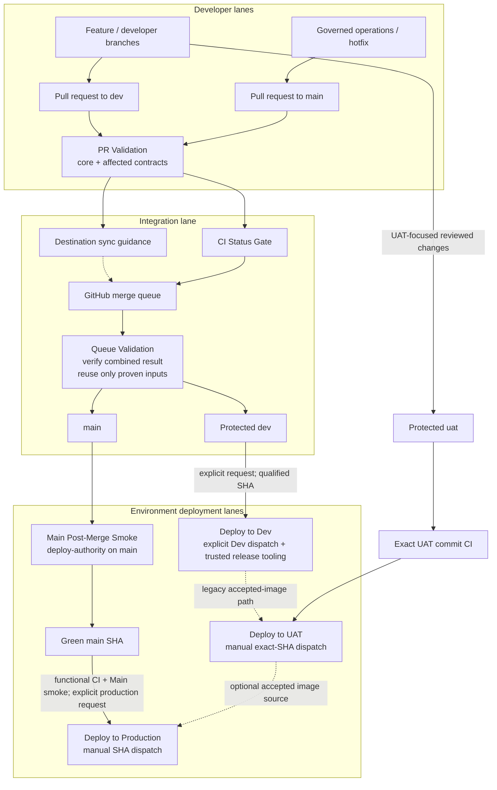

# CI Configuration Reference

## Main-owned release control

Dispatch Dev, UAT and Production deployments from `main`. Application sources remain
isolated: qualified protected `dev`, protected `uat`, and approved Main content respectively.
Run names identify the application branch and SHA; the Actions Main badge identifies
execution authority. Merges never deploy. UAT needs no prior Dev deployment; production
requires qualified protected Main, compatibility and rollback without preceding UAT deployment. This operations delta
does not publish an application, run migrations or change production traffic.

Current access comes only from the live GitHub teams: ordinary review/self-service uses
`allowed-maintainers-to-approve`; environments use their `deploy-*` team; protected CI,
fundamental guidance and emergency authorization use `pipeline-editors`. Saved usernames
are historical evidence, never current grants. A membership lookup failure refuses the
operation. An organization-owner role does not replace deployment-team membership.

Protected PR jobs classify affected authority without receiving membership credentials.
Native Team review and the trusted Main merge decision enforce approval. The queue requests
current permission at admission and completion through the existing Main broker; no PR
observer or recurring security-alert workflow runs. Explicit Main-origin deployments use
the protected security job directly in the same run, without a second branch broker run. Current mutation boundaries also request a bounded Main-owned
permission recheck, so revoked actors cannot keep using an earlier clearance. These
explicit operation checks do not scan alerts or observe ordinary PR events.
Every step calling `assert-governed-actor.py` supplies its existing job token
and requires `actions: write` for the bounded Main permission request. Forwarded
clearance does not replace that current-operation recheck. Keep the App key and
security-alert credential inside the protected Main job.
The same requirement applies to authored nested callers: UAT capacity waiting,
PLG frontend finalization and production incident dispatch. Cloud-read-only
preflight jobs still need Actions dispatch permission for their Main authorization
request; candidate build jobs remain unprivileged.

Explicit Dev/UAT release CI uses the verified serving comparison through the
existing `uat_base_sha` input (`scope=all`). For Dev, supply the accepted Dev
serving SHA. Graph validation checks that transition before replaying a landed
PR's comparison metadata; it never bypasses semantic or mirror-integrity checks.

App-browser automation is an explicit diagnostic, not a required PR, merge-queue
or release lane. Required web validation covers build/type correctness and affected
unit/runtime contracts. Browser-engine-specific document/phone behavior is not
certified by those non-browser results; use the existing explicit document/browser
commands when that qualification is requested. One's Browser capability tests are
separate runtime authority checks and remain selected when affected.

Dev deployment performs no app-browser rehearsal. Use the existing reviewer
diagnostic command explicitly when needed. UAT may explicitly request its
reviewer diagnostic; neither changed paths nor an unknown comparison base
selects a browser automatically. Unknown bases retain PKM preservation checks.


> **Branch state:** `dev` is the protected development intake and default Dev
> deployment source. UAT selects its protected branch independently, with exact
> candidate CI; deployment rechecks observed baselines, compatibility and rollback.
> Main owns release workflows. Branch state does not prove what is serving; see
> [branch preparation](./branch-governance.md#dev--uat-branch-preparation).


## Visual Map



This document describes CI and deployment authority. For an ordinary change,
run the nearest owner checks and let CI select affected regression owners from
its exact changed-file list. `focused` keeps authority/security checks and
affected owners; `release` adds core release-authority checks; `diagnostic`
runs the retained historical full set, including optional hygiene. A full local
core mirror is for cross-stage dependency changes or diagnosis, not a required
pre-push step. Browser journeys and engine-specific cryptography are explicit
diagnostics; required runtime/API/database checks do not claim browser-engine proof. Native
app checks run when native source or its contract changes. Unknown selection stays
conservative, and security/source-authority gates remain blocking. Dev can
deploy an exact CI-green branch SHA without merging application content to main.

The database connection budget inventories every dedicated caller. All share
a process-wide ceiling of three in `db.connection`, reserved before connecting
and released after session teardown. Saturation returns a retryable receipt-scan
busy state or defers background sweeps to their next interval; it never borrows
from the request pool. Per-caller limits still apply. The source-bound budget
and concurrency/failure checks must agree before changing this ceiling.

The canonical state-changing operator procedure is the
[Admin merge and release SOP](../../../.agents/skills/repo-operations/references/admin-release-sop.md).
This page defines CI behavior; it does not redefine Admin bypass or deployment
authority.

**Workflow files:** [.github/workflows/ci.yml](../../../.github/workflows/ci.yml), [.github/workflows/queue-validation.yml](../../../.github/workflows/queue-validation.yml), [.github/workflows/main-post-merge-smoke.yml](../../../.github/workflows/main-post-merge-smoke.yml)
**Pre-PR preparation:** [`./bin/hushh agents pre-pr`](./cli.md)
**Underlying local lane:** [`./bin/hushh ci`](./cli.md)
**Orchestrator:** [scripts/ci/orchestrate.sh](../../../scripts/ci/orchestrate.sh)

Canonical pre-PR command:

```bash
./bin/hushh agents pre-pr --base-ref origin/dev --body-file /path/to/pr-body.md
# Or inspect an existing, exact-head PR:
./bin/hushh agents pre-pr --pr <number>
```

Use the actual destination (`origin/main`, `origin/dev` or `origin/uat`). This
runs affected local owners, validates the PR body and protects core edits. Its
report lists affected runtime, database and native checks still required; a local
pass cannot satisfy exact-head hosted admission. Use `--diagnostic` for the
retained full mirror, optionally with `--include-advisory`.

Unknown application impact retains conservative unit/service coverage. Known
helpers belong to their existing test or compiler owner. Request timeouts retain
direct cancellation tests. App-browser tests, including layout and interaction
journeys, run only when explicitly requested; they do not block ordinary PRs,
combined-result queue checks or release qualification.

## Queue response and build limits

PR Validation runs before queue admission. Queue Validation then verifies the
current combined code; it does not merge or deploy first. A single-PR group can
reuse its latest successful PR attempt only when the tested base/tree and the
actual API, merged-tree and integration selection inventories agree. A behind
branch alone does not disqualify reuse. Changed code, PR-only lane profiles,
multiple PRs, missing proof or legacy receipts require combined validation.

Main/Dev/UAT use one native queue build at a time. Their CI concurrency is scoped
to the destination so a rebuilt temporary ref cancels obsolete checks. Legacy
speculative destinations retain independent per-ref execution. GitHub does not
guarantee event ordering: a late obsolete event can cancel a newer run, requiring
rebuild/retry; current-source admission still refuses stale results. Inspect the
current native group before retrying, rather than repeatedly pushing unchanged
source. This cancellation policy never applies to deployments or maintenance.

Main, Dev and UAT allow 120 minutes for required queue checks to return. This is
an expiry ceiling, not a runtime target: GitHub previously removed valid entries
at 30 minutes while their combined-result validation was still running. Inspect
runner waiting and actual test execution separately. Never turn missing, failed
or cancelled required checks into success to avoid expiry.

The bounded repair command is `python3 scripts/ci/apply-governance.py --queue-timeouts`
for inspection, followed by `--apply` for an approved policy change. It validates
all three scopes first, preserves every other rule and actor, refuses intervening
changes and verifies each write. It does not deploy or alter team membership. Its retained
`--queue-timeouts` flag applies only the reviewed response ceiling and build
concurrency; merge method, merge limits, reviews, bypasses and conditions stay
unchanged. Missing build policy preserves historical scheduling. Apply only after
the reviewed policy lands and active groups settle; record native readback.


## Manual deployment paths

Before qualification, reconcile Main-owned recipe and migration-controller imports,
including their SQL-generation helpers. An application-only branch may retain its
own migration inventory; synchronizing the reviewed controller does not activate
absent migrations or transfer an application tree to Main. Exact-input refusal is
a source dependency to repair before launching another expensive validation.

| Developer intent | Source | Required proof | Deployment |
| --- | --- | --- | --- |
| Feature integration | Feature PR into `dev` | Destination sync guidance and authoritative combined-result CI | Explicit Dev dispatch |
| UAT-focused release | Selected SHA in protected `uat` history; preserve branch history | Read-only `operation=inspect` reports ready for exact full-scope CI and the observed serving base; deployment repeats security and baseline checks | Explicit deployment; no Dev deployment required once ready |
| Historical Dev-backed release | Existing accepted application | Exact Dev receipt and verified image, or source build | Existing UAT path |
| Production release | Qualified protected Main application | Canonical functional CI and Main smoke; exact-tree approval when distinct; compatibility and rollback | Explicit production dispatch; no preceding UAT deployment required |
| Emergency production | Exact incident-approved source | Governed operator, focused CI, security, schema and qualified rollback | Manual incident route only |
| Operations/hotfix source | Reviewed Main PR | CI, Admin/queue procedure and landed smoke | Merge does not deploy an application |

### Direct production from qualified Main

Production is an explicit action by the live `deploy-production` team; no prior
UAT deployment is mandatory. Main owns the workflow and privileged release tools.
The existing source-admission owner requires canonical functional CI **and** Main
smoke, with current attempts and complete inventories. It rereads both proofs
together and checks the unchanged qualification again before traffic promotion.
A failed, cancelled or superseded attempt refuses release; smoke alone and old
UAT receipts cannot substitute. If the landed Main commit has no functional
qualification, qualify that exact Main source before dispatch. A distinct tested
application/Main approval pair may reuse proof only when their complete trees
match and the approval incorporates the application.

Optional `promote-from-uat` still requires acceptance of the actual immutable UAT
image. Recorded recovery/activation operations keep their original source and
checkpoint contracts. Normal direct Main deployment does not grant emergency
source authority. Merges and downstream source syncs deploy nothing.

### Branded sign-in repair of the restored frontend

The explicit `frontend_auth_domain_refresh=true` incident input is restricted to
candidate `00507b68ea293524f73ad42b1839984bcaa46c98`, whose application tree matches
the restored `d8a5fa4858741e611d39fd4f1f28b1ab930d057c` release. Its only source
change removes retired alert-reader credentials from historical CI. This is not
permission to deploy current Main application code.

The existing emergency route still requires exact-source validation, protected
deployment security, a governed incident and captured rollback revisions. It pins
the original frontend build secret versions, changing only the Firebase auth
domain to `id.hussh.ai`. It refuses a changed serving baseline or enabled document
intake; configured storage and the unchanged backend are preserved. Frontend
health includes the published auth-domain check and backend identity readback;
failure uses the existing rollback. No database migration or backend deployment
belongs to this frontend-only repair. Successful deployment invalidates its old
baseline, so another fresh invocation cannot reuse the exception.

If the restored baseline retains an operational-backend recovery anchor, the
repair binds its exact annotated tag object and accepted serving-backend origin.
Provider identity, IAM, initial traffic and the sealed schema boundary are checked
after cloud authentication and rechecked before mutation. The repair publishes
an immutable deployment tag and records its readback in the existing release
artifact; `deployed/production-latest` stays unchanged so the recovery anchor
cannot be lost. This does not activate the staged backend or clear its source
restriction. The regular hourly controller remains responsible for retirement.

On 3 November 2026, run [41608303952](https://github.com/hushh-labs/hushh-research/actions/runs/41608303952)
promoted frontend `hushh-webapp-00162-r4d` to 100%; backend
`consent-protocol-00309-nir` remained unchanged. Published login scripts use
`id.hussh.ai`. The final immutable-tag publication refused before creating a tag;
the original run remains failed and its artifact is preserved. Do not redeploy
the one-time repair to retry bookkeeping: its original serving baseline no
longer applies. Independent read-only verification
[41612439877](https://github.com/hushh-labs/hushh-research/actions/runs/41612439877)
passed. This proves current health, not retrospective tag/publication clearance.

Historical restoration evidence retains its reviewed producer exclusions even
when later dispatch modes add stricter conditions. The maintenance guard accepts
those exact exclusions only with the pinned historical restoration job; changed
or missing exclusions still refuse deployment.

### Verify the current Production release

```bash
gh workflow run deploy-production.yml --ref main -f operation=verify_current
```

Leave `sha` and all release inputs at their defaults. The protected verifier
reads the 100%-traffic revisions and checks the public backend/frontend health
routes before and after. Revision `deploy-sha` is the application source; the
run SHA identifies only the verifier. It creates no release artifact, tag or
GitHub deployment record and makes no Cloud Run changes. The existing
Production WIF principal remains deployment-capable; this mode constrains its
commands to fixed Cloud Run reads and public HTTP GETs.

The coding agent completes reviewed Main → UAT/Dev and UAT → Dev source syncs
as part of each merge task, following the [downstream completion procedure](../../../.agents/skills/repo-operations/references/maintainer-branch-freshness.md). No sync bot, scheduled release cadence or automatic application dispatch is installed. The standalone CI Security Alerts workflow is retired; source secret
scanning remains in PR validation and privileged unresolved-secret clearance runs
only in an explicit Main-owned deployment's protected job.

The two bundled public email-risk data files use actual-blob digest/bounds checks
and the existing domain-policy cases in Governance. Their runtime parser, test
module, schema and unrecognized neighboring inputs retain backend validation.
This data-only owner does not replace full application release qualification.
The synthetic worker CLI fixture retains both deployment and rollback consumer
suites in the controller owner. The database connection-ceiling reader also runs
there when deployment controls change, including configuration-driven worker
capacity. It remains in backend validation for runtime changes. Unknown helpers
retain conservative selection.

UAT admission retains Main’s connection limits and workload inventory while
binding the worker size to the immutable selected application profile, bounded
by Main’s reviewed ceiling. Both admission reads and the preserved checkout
overlay use that effective profile; a different Main default cannot silently
resize UAT. Environment, process and pool mismatches require correction before
cloud mutation.

Read-only UAT inspection checks the selected candidate's public email-risk snapshot
when email authentication is enabled. Expired or malformed inputs require a pinned
upstream refresh before qualification; the full integrity and activation checks
remain enforced during deployment. Base-pinned release `scope=all` keeps web/backend core
qualification, selecting native lanes only from their existing ownership filters
against that candidate and serving base. Explicit diagnostic scopes are unchanged.

For a direct UAT candidate, record the actual serving base, dispatch `ci.yml` on
`uat` with `scope=all` and `uat_base_sha`, then dispatch `deploy-uat.yml` from `main`
with `sha`, `ci_run_id`, `ci_run_attempt` and `ci_base_sha`. The explicit
release selects that protected application SHA after full exact-candidate CI;
ordinary Dev/UAT needs no manual PR-history chain or serving-commit ancestry.
Once selected, that frozen ordinary UAT SHA remains eligible after newer merges
while it remains in protected UAT history; CI, current authority and live-baseline
checks still apply. Never silently substitute the new tip.
The base identifies changed verification inputs, not merge authority. Recheck both
actual service revisions under the lock, including partial releases with different
frontend/backend SHAs. Compatibility, candidate health, qualified rollback and
Main-owned deployment security remain required. Legacy isolated-history recovery
keeps its separately reviewed approval contract. Do not substitute a PR merge-tree
check, another attempt or a branch status for the exact candidate run.
The complete same-SHA dispatch inventory must identify the selected current
attempt. A sole matching run needs no chronological ordering, so inconsistent
provider timestamps do not discard otherwise verified evidence. Multiple runs
still require valid chronology, including an older-ID run retried later; a newer
failed or pending attempt blocks. Incomplete inventories, stale attempts and
unverified source, jobs or producers always refuse admission. Never correct
provider timestamps, sort by run ID or choose only successful runs.
Ordinary UAT application code, dependencies and branch-owned tests may differ from
Main. Its exact current CI and manifest-format checks remain required. Privileged
build/deployment recipes and migration controllers must match the frozen trusted
Main revision; required-test execution changes require pipeline-editor authority.
This is a narrow execution boundary, not whole-directory parity. Compatibility,
health, rollback, serving-revision and production acceptance checks remain.

Current support requires the selected services to share that tested serving base;
a mixed or unknown baseline refuses before mutation. Historical UAT receipt
retention remains finite; expired evidence is not an exemption.

Manual capacity dry runs are named **revision inspection**, separate from mutation
jobs, and never publish mutation checkpoints. Failed inspections cannot masquerade
as interrupted deletions. After the existing history guard and source validation,
a new apply can publish a version-3 `preparing` journal before looking up the latest
deployment. Its observation is explicitly unknown, it remains due, and it never
certifies completion or replaces orphaned state. Existing custody is retained.
Failures before this boundary still require verified pre-mutation evidence; a
missing checkpoint never establishes successful cleanup.

## Recorded production restoration — 26 October 2026

Normal releases keep their exact application SHA and environment acceptance chain:
Exact UAT CI or historical Dev acceptance before UAT. Current production admission requires protected Main functional CI and Main smoke; preceding UAT deployment is optional. A normal manually
requested Main smoke must test the dispatch commit itself. Its check cannot
certify another checkout. Release checks verify the canonical producer, current
attempt, complete bounded inventory and job identity; later failed reruns refuse
stale success.

The one-time Shared-experience restoration uses the pinned
[`production-restoration.json`](../../../deploy/account-deletion/production-restoration.json)
record. The separate **Production Recovery Validation Gate** certifies only that
candidate, with an attempt-bound artifact. It does not create Dev/UAT acceptance
or authorize other commits. Its result neither replaces nor invalidates ordinary
Main smoke. Production admission requires both services built from source,
disabled legacy Drive intake, no new capability activation and a governed manual
operator. Credentials remain scoped to the production environment; Git push
credentials are supplied only to the final trusted release-tagging step.

The recovery workflow joins both immutable image builds before lifecycle fences.
Its database gate inspects the installed contract without replaying migrations;
a transactional writer barrier drains prior document writers and rejects new
issuance. Retained storage remains configured while its recovery worker
maintenance is disabled only after that barrier is verified. Candidate readback
requires phone recovery, WorkOS, replacement-generation admission, document
issuance and document work drain to be explicitly off.

An immutable, run-bound artifact records the original serving pair before any
release mutation. Retries recover that pair and accept only the original
revisions or this same run's candidate as current traffic. Rollback qualifies the
original destinations even when the failing candidate is unhealthy. An
unconfirmed cleanup restoration remains blocked in the release receipt. The
document barrier stays while a non-reader serves; removing it requires a
separately qualified reader activation.

**Deployment remains unverified until its release receipt and serving readback
pass.** Operations source, hosted recovery validation and live application
restoration are separate outcomes. No historical migration replay, Firebase
rollback or fabricated UAT receipt is allowed.

On 27 October, operation `40430296874`, attempt 2, promoted the recorded
`d8a5fa485874` application to both production services at 100% traffic:
backend `consent-protocol-00309-nir`, frontend `hushh-webapp-00160-2w2`.
Runtime parity, immutable provenance, health, account-session and native-domain
checks passed. The workflow remained **blocked** because system Python lacked
the recovery schema qualifier's database driver. The activation command must
use the already verified `PROTOCOL_PYTHON` environment.

The administrator continued this same approved operation using the unchanged
main-owned activation tool at `c9d26ee991`, the verified project environment and
explicit source/run arguments. Competing production mutation entrypoints were
paused and restored to their previous states. Canonical activation verified the
schema, exact document barrier, fresh Scheduler HTTP 200, compatible retained
revisions and serving traffic before confirming the deletion fence absent.
This separate admin repair does **not** turn the failed hosted attempt green or
create a normal promotion receipt. The existing macOS checkpoint retains its
`production-admin-activation-activation.json` and repair record. Signed-in production acceptance then passed through the existing Google login:
the returning account reached One without an alert, and its real
`/api/account/session-status` request returned HTTP 200. Public login and the
unauthenticated session contract also passed.

A hosted restoration completion can attest that same original operation through
`restoration_activation_run_id` and its exact `restoration_activation_attempt` on
the existing production workflow. It accepts only retained activation-only failed
evidence for the recorded source, with the original immutable serving pair and
document-barrier owner. It rebuilds no image and changes no traffic or schema.
Fresh canonical schema, barrier, Scheduler delivery, provenance, health and
already-absent deletion-fence checks must pass. The new verifier has its own
receipt and run identity; runtime labels retain the original deployment run.
The canonical activation configures and triggers the existing cleanup Scheduler;
this is not a read-only operation. Retained consumers needing retirement are
refused through the existing lifecycle inventory before activation begins.
This is a restoration serving reference, not Dev/UAT acceptance or a phone
rollback anchor. The original failed attempt remains unchanged.

The selective-promotion handoff remains preserved separately. Its branch-baseline
and application-SHA/approval-SHA mapping are not active. Its maintenance draft
needs corrections for forced capacity inspection, dry-run checkpoint state and
pre-mutation preparation failures. Do not import deployment-triggered maintenance
or use the two historical UAT exceptions as production authority.

## Workflow catalog and naming

Workflow files and required check names are stable API identifiers. Display names
use a clear action and purpose: **Deploy**, **Release**, **Resume**, **Verify**,
**Measure**, **Warm**, **Schedule**, **Maintain**, **Provision** or **Rollback**.
`PR Validation`, `Queue Validation` and `Main Post-Merge Smoke` keep their existing
names because governance and external tooling use them as release authority.
App Store and Android publication also retain the exact display names checked
by their dispatch verifiers; filenames and release receipts remain unchanged.
Never rename required job/check contexts for cosmetic consistency.

| Family | Workflow files | Purpose / trigger |
| --- | --- | --- |
| Validation | `ci.yml`, `queue-validation.yml`, `main-post-merge-smoke.yml` | PR checks; identical-tree queue reuse; landed-main smoke. No duplicate full suite in the queue |
| Deployment | `deploy-dev.yml`, `deploy-uat.yml`, `deploy-production.yml` | Governed manual exact-SHA deployment through existing shared build/provenance helpers |
| Native releases | `ship-ios-testflight.yml`, `release-ios-appstore.yml`, `ship-android-playstore-v1.yml` | Explicit release or continuation of a known upload; recovery does not rebuild/upload again |
| Device qualification | `ios-voice-device.yml` | Internal reusable physical-device evidence, selected by the native release; no standalone dispatch |
| Capacity | `capacity-maintenance-clock.yml`, `capacity-maintenance.yml` | Due-work controller, authenticated bounded cleanup; timer wait occurs before runner assignment |
| Operational recovery | `rollback.yml`, `prod-cloudsql-backup-posture.yml` | Governed rollback and daily live backup-posture verification |
| Security | `deployment-security.yml`, `verify-protected-lists.yml`, `supply-chain.yml` | Protected alert clearance inside explicit releases; protected-list fallback during cloud-timer qualification; changed-dependency SBOM/provenance |

| Dependency cache | `ios-swift-package-cache.yml` | Daily Main-owned Swift package cold-fetch verification and exact-key cache warm |
| Signing / package publication | `provision-wallet-pass-certificate.yml`, `publish-hushh-mcp.yml` | Explicit signing-resource creation and verified package publication |
Managed Vertex diagnosis uses `./bin/hushh diagnose uat-vertex --build-id <UUID>`
with authorized UAT log-reading credentials. It reads only that build and its
probe job (24 hours, bounded records and timeout), sanitizes the output and
removes temporary handles on failure. It grants no deployment acceptance and
replaces the standalone diagnostic workflow.

Backend-only UAT changes use the normal UAT deployment scope. The retired
One-chat cutover retains its historical provenance readers and numeric workflow
identity; its fixed-source exceptions grant no new release authority.


The separate weekly offline pod drill and weekday completion-judge workflow
files are removed from main. Both core test suites remain in Protocol CI's manifest;
the judge CLI and live completion receipts remain in the existing
[readiness workflow](./pod-completion-judge.md). No scheduled failure is needed to
announce an unchanged external prerequisite. Historical workflow entries do not
represent active source on the default branch.

Capacity tick run titles are protocol inputs for checkpoint reconciliation. They
retain their exact names independently of the workflow's display name. Dispatchers
and provenance readers should bind to workflow file paths rather than presentation
labels unless a specific authority contract explicitly requires the label.

GitHub also exposes platform-managed CodeQL, Dependabot and Copilot workflows,
and may retain entries for deleted workflow files. Those entries are not proof of
an active source workflow or a duplicate test. Reconcile old entries with main and
recent runs before disabling anything. Required security coverage must remain.
No remote disable, cancellation or schedule change is authorized by this local edit.

The orphan CI Trust Qualification workflow/helper is retired. Its accepted run
40598204935 attempt 1 recorded historical Linux/macOS qualification for source
`6267f321c821b0ff2e1995dcd50d4eff8b045dc9`; the hashed receipts are archived
privately. This records that historical scope only and grants no current CI or
release authority. GitHub history and artifacts remain intact.

## Release-chain review — 2026-10-23

One measured correction release, not a performance SLA:

| Stage | Elapsed | Evidence |
| --- | --- | --- |
| Full PR validation | 35m02s | [39981561301](https://github.com/hushh-labs/hushh-research/actions/runs/39981561301) |
| Landed-SHA smoke | 3m10s | [39986627702](https://github.com/hushh-labs/hushh-research/actions/runs/39986627702) |
| Dev, both services | 24m09s | [39987252665](https://github.com/hushh-labs/hushh-research/actions/runs/39987252665) |
| Sequential total before UAT | 62m21s | Includes gates, runner waits and cloud control-plane time |

Dev's backend wrapper took 10m20s, including a 6m19s native Gemini readiness
stage; migrations/schema took 3m08s and frontend rollout 2m30s. Images were
pinned before migrations; the frontend image built in parallel. These measurements
do not establish a redundant build or justify removing an authority gate.

The PR's 23 Ubuntu notices announced the `ubuntu-latest` migration to Ubuntu 26;
they were not download failures. Its successful hosted image was Ubuntu 24.04.5,
runner 2.338.0. Core PR/queue/security/smoke and dev/UAT/production workflows pin
`ubuntu-24.04` to retain that measured OS. A complete runtime inventory covered all
26 workflow YAML files (21 distinct literal `uses:` values), expanded the local
reusable workflows and composite action, and checked the composite action's nested
steps. It found no remaining Node.js 20 action runtime among the resolved actions.
The workflow actions and the nested provenance predicate now use Node.js 24:
Google auth/setup-gcloud/get-secretmanager-secrets v3; artifact v6, checkout v6,
setup-node v6, setup-java v5, setup-python v6, cache/restore/save v5; paths-filter
v4, setup-android v4, setup-xcode v1, Anchore SBOM v0, Play upload v1, and the
locally referenced setup-uv v7. The build-provenance wrapper moves v2 to v3, whose
pinned `attest@v3.0.0` and predicate@2.0.0 use Node.js 24. Workflow-used action
inputs and outputs were checked against tagged metadata. WIF identities,
permissions, application Node/Java versions, cache keys, and PR restore-only/main-save
boundaries remain intact. Node 24 requires runner 2.327.1 or newer. This addresses
the observed seven Node.js 20 deprecation warnings; hosted verification is still
required. A material latency reduction is not established.
[Runner announcement](https://github.com/actions/runner-images/issues/14748),
[cache runtime requirements](https://github.com/actions/cache#whats-new),
[Google auth v3 metadata](https://github.com/google-github-actions/auth/blob/v3/action.yml),
[setup-gcloud v3 metadata](https://github.com/google-github-actions/setup-gcloud/blob/v3/action.yml),
[setup-gcloud v2 metadata](https://github.com/google-github-actions/setup-gcloud/blob/v2/action.yml),
[artifact v6 metadata](https://github.com/actions/upload-artifact/blob/v6/action.yml),
[checkout v4 metadata](https://github.com/actions/checkout/blob/v4/action.yml),
[checkout v6 metadata](https://github.com/actions/checkout/blob/v6/action.yml),
[Android setup v3 metadata](https://github.com/android-actions/setup-android/blob/v3/action.yml),
[Android setup v4 metadata](https://github.com/android-actions/setup-android/blob/v4/action.yml),
[provenance v2 metadata](https://github.com/actions/attest-build-provenance/blob/v2/action.yml),
[provenance v3 metadata](https://github.com/actions/attest-build-provenance/blob/v3/action.yml).
`setup-gcloud@v3` defaults its tool cache off; the self-hosted iOS voice workflow
sets `cache: true` to preserve v2's self-hosted cache behavior. This does not
qualify the device runner.
`checkout@v6` keeps the used v4 inputs and credential persistence default. The
Android setup migration explicitly retains the former `cmdline-tools-version`
`12266719` default because v4 changes its default to `15859902`; the workflow also
keeps its explicit `platform-tools` package selection. The build-provenance workflow
continues to provide the same SBOM subject path and does not consume wrapper outputs.
Artifact v6 is the Node 24 runtime release; it retains ZIP uploads and the existing
artifact ID, URL and SHA-256 digest outputs. All current workflows keep hidden-file
exclusion and ZIP compression defaults; none reads action outputs directly. The
retention readers bind artifacts by their run/name/ID and verify the downloaded
ZIP size and digest before parsing only allowlisted members.

The latest five protected security workers each bound a distinct source
run/attempt. Their presence is credential isolation, not five new vulnerabilities.
The long run title participates in exact receipt discovery; renaming the producer
alone strands older PR consumers. Any title migration must preserve old/new
consumer compatibility, chronological newer-failure refusal and source/artifact
binding. macOS capacity notices are provider observations, not demonstrated code
failures. Unchanged historical evidence remains reusable where its inputs match.

## Run-history review — 2026-10-18

Read-only sample: 100 recent runs for discovery, then the last 20 completed PR
validations and 10 completed deployments per environment. Job/step metadata uses
the latest attempt; failed and cancelled runs are excluded from success timing.
These small, different source cohorts are diagnostic samples, not a speed SLA or
a controlled benchmark. Elapsed times include gates and waits, not billed CPU time.

| Successful scope | Dev median | UAT median | Sample count |
| --- | --- | --- | --- |
| Backend only | 16.5 min | 32.1 min | Dev 5; UAT 3 |
| Backend + frontend | 25.4 min | 37.5 min | Dev 4; UAT 4 |
| Frontend only | Not sampled | 14.8 min | UAT 2 |

Sources: [dev backend](https://github.com/hushh-labs/hushh-research/actions/runs/39091378215),
[UAT backend](https://github.com/hushh-labs/hushh-research/actions/runs/39167882081),
[dev both services](https://github.com/hushh-labs/hushh-research/actions/runs/39082250085),
[UAT both services](https://github.com/hushh-labs/hushh-research/actions/runs/39177524405),
[UAT frontend](https://github.com/hushh-labs/hushh-research/actions/runs/39161330609).
Comparing a frontend-only UAT run with a backend dev release is misleading.

The PR sample contains 10 successes, 7 failures and 3 cancellations. Successful
elapsed median is 19.8 min across changing lane sets. Protocol validation is the
largest repeated measured step (14.8 min median, 5 observations); iOS compilation
and tests take 7.7 min median (2). Observed macOS job starts are 5–9 seconds after
preflight in 5 successful jobs, so runner contention is not established as the
cause of those runs. [Example native-inclusive validation](https://github.com/hushh-labs/hushh-research/actions/runs/39175468636).

Successful dev steps: backend deploy wrapper 7.2 min median (9), image pin/build
2.8 min (9), migrations/schema 3.4 min (9). UAT additionally spends 7.8 min on its
private Drive worker deployment/attestation (7). That worker reuses the pinned
backend image; this is not a second image build. Frontend builds already overlap
backend preparation in both environments. Step medians are not additive estimates.

### Protocol partition correction — 25 October 2026

[Run 40158496907](https://github.com/hushh-labs/hushh-research/actions/runs/40158496907)
passed all 24 other jobs, including the four browser shards, but reached the
32-minute backend step limit. Its 23,685 parallel cases passed in 967.16 seconds;
the following serial database phase had not finished. The preceding run completed
both phases in 686.13 and 760.62 seconds. No test failure was reported before the
timeout. These are individual observations, not a new reliability percentile.

The correction keeps one manifest/classifier and separates the existing phases:
`Protocol (Python)` runs static/generated/security checks, parallel tests and
whole-tree collection; `Protocol Database` runs the same serial database list on
its own runner and PostgreSQL service. Both are mandatory for changed backend
sources. Missing, skipped, cancelled, failed and timed-out selected work refuses
clearance. The runner's explicit `PROTOCOL_TEST_PARTITION` is `parallel` or
`database` in hosted CI; default `all` retains the complete local/upstream order.
No tests or isolation checks were removed and no timeout was increased. Hosted
latency remains to be measured on the combined candidate.

**Candidate awaiting hosted qualification (28 October 2026):**
[run 40741369811](https://github.com/hushh-labs/hushh-research/actions/runs/40741369811)
spent 25m08s executing 2,133 passing and one skipped serial database cases. The
proposed change divides that same manifest between two independent runners and
PostgreSQL services, still serial within each runner. The aggregate gate must
pass both shards. Local `all` remains unsharded. Verify combined coverage,
isolation and elapsed time on the hosted candidate before claiming a speedup.

### Failure causes and next improvements

- **PR preparation:** missing Live Memory impact declarations and an unauthorized
  protected-policy edit produced valid early refusals. Use the current PR template
  and existing governance preflight before publication; retain those checks.
  [Missing declaration](https://github.com/hushh-labs/hushh-research/actions/runs/39169067111),
  [protected-policy refusal](https://github.com/hushh-labs/hushh-research/actions/runs/39149416659).
- **Browser fixtures and behavior:** a source extractor could no longer locate the
  agent-name anchor; another run failed a WebKit drag assertion. Repair the owning
  fixture or interaction with unchanged behavioral limits; do not remove browser
  coverage. [Extractor failure](https://github.com/hushh-labs/hushh-research/actions/runs/39173344405),
  [drag failure](https://github.com/hushh-labs/hushh-research/actions/runs/39176000165).
- **Runtime/native tests:** a Vitest case exceeded its 5-second deadline; iOS reached
  test execution and failed assertions. These are observed failures, not proven
  flakes. Establish the cause before changing timeouts or workers.
  [Vitest](https://github.com/hushh-labs/hushh-research/actions/runs/39173073117),
  [iOS](https://github.com/hushh-labs/hushh-research/actions/runs/39169674663).
- **Deployment:** Cloud Build readback confirms image build, IAM verification,
  backend deployment and Azure memory verification succeeded in the failed UAT
  run. `verify-managed-vertex-runtime` failed; the detailed provider condition
  remains unclassified. This is a model-readiness refusal, not a Docker build failure.
  [Failed release](https://github.com/hushh-labs/hushh-research/actions/runs/39114036433),
  [Cloud Build record](https://console.cloud.google.com/cloud-build/builds/8c705e26-b042-49b8-9110-71b95044bfd3?project=hushh-pda-uat).
- **Highest-value profiling:** split protocol time into dependency setup, generated
  checks, lint/types/security, parallel tests and serial database tests before
  selecting an optimization. Profile Drive worker startup/attestation separately.
  Preserve database isolation, scanning, migration fences and exact-image readback.
- **Reuse what already exists:** targeted PR Node packs defer to the mandatory
  three-shard Vitest suite. Queue validation reuses equivalent green source.
  Dev pod-image building stays off unless the pod artifact actually changed.
  Batch completed fixes into one push; rerun only failed jobs when source is unchanged.

Future reviews should compare the same scope, lane set and attempt, with sample
counts, cache observations and failure causes. Reuse existing run timestamps and
release receipts; add no monitoring workflow or scheduled test loop for this review.

<a id="automatic-native-release-cadence"></a>

## Explicit releases and retired cadence

UAT and production release only through governed manual dispatch. Commits, Main
merges and completed workflows do not dispatch a release. The UAT Release Cadence
workflow and automatic actor authority are retired. Its state branch and existing
receipts remain historical evidence; do not reset or delete them. Shared receipt,
retention and native-resume helpers remain supported independently of the observer.
The retained CLI supports `wait-production` for an already approved exact run;
`reconcile` refuses before ledger access or dispatch.

Keep Dev/UAT/Main history separate. Stable fixes move downward through reviewed
manual sync PRs. Freshness checks use the destination branch; deployment is a
separate decision. Follow [branch governance](./branch-governance.md) for exact
application/Main-approval mapping, direct-UAT qualification and the emergency
production route. Removing cadence does not authorize using an unqualified path.

## Account deletion regression gate

Every frontend or backend PR runs `scripts/ci/account-deletion-check.sh` in the
required Integration lane. It exercises the production client flow, proxy error
contract, backend route, cancellation settlement, and disposable PostgreSQL
recovery-history erasure. Missing PostgreSQL fails this gate; it cannot silently
skip the database proof. `CI Status Gate` rejects a failed or skipped required
Integration lane. The protected-behavior registry pins the essential regression
cases so deleting their coverage also fails governance.

The existing full-account inventory test also compares migration-authored
user-keyed tables with the production erasure path, checked cascades and explicit
retention reasons. A feature that adds an unaccounted user-keyed table fails this
gate.

The `feature_account_deletion` / `@feature_account_deletion` tag identifies this
pack; run `bash scripts/ci/account-deletion-check.sh` for its complete mandatory
selection. Tags aid discovery; the required gate runs explicit files so removing
a marker cannot silently deselect a regression.

The database regression sends HTTP through the production router, service and
transaction into disposable PostgreSQL. It includes hundreds of parent revisions,
multiple segment batches in one parent, and slow deletes on both tables under a
short SQL statement deadline. A failure at final vault cleanup restores both
recovery tables; another owner's history survives. The existing request context
is asserted across the HTTP response and database worker. Client tests cover
delayed status replies and pending-lock recovery without another DELETE or a
premature uncertain sign-out.
A late-cursor PostgreSQL execution-plan regression bounds actual parent scan
work as well as the batch size. The parent cursor uses an inclusive lower bound
so remaining segments within the current revision are preserved; segmentless
parents cannot terminate the erasure early.
The initiating owner generation is captured before bank preflight; returning to
the same account after sign-out cannot reuse that deletion approval. Voice tool
and relay tests require an authoritative lifecycle lock to stay pending in
narration without sign-in or retry instructions. Client claims never establish
that pending state or a completed deletion.
Recovery-reference indexes are replayed, validated and rolled back on the same
disposable database. This establishes these contracts with synthetic information;
it does not measure deletion time for a real person's full recovery history.

## Monitoring Rule

After any merge to `main`, bypass merge, deploy trigger, or manual workflow dispatch, keep monitoring the resulting GitHub workflow chain until it reaches a terminal state.

Minimum expectation:

1. watch the immediate `PR Validation`, `Queue Validation`, or dispatched workflow
2. if `main` goes green, watch `Main Post-Merge Smoke`
3. if a UAT deployment was explicitly requested, dispatch `Deploy to UAT` for the protected-UAT application SHA with its exact current CI run and observed serving base, then watch it to terminal state
4. report the exact failing workflow, job, and step if anything fails
5. do not stop at "triggered" or "queued"
6. if the failure is within the CI/deploy/policy surface, move into fix-and-rerun mode until the change is green or a hard blocker is identified
7. when the run is expected to outlive the current chat turn, start the persistent watcher instead of relying on manual follow-up
8. when Codex initiated the merge or queue action, continuing this watch is mandatory; needing a user reminder to resume monitoring is process drift

UAT Cloud Run provenance is a release blocker. The deploy workflow stamps each backend/frontend revision with `HUSHH_DEPLOY_ENV`, `HUSHH_DEPLOY_SOURCE`, `HUSHH_DEPLOY_SHA`, and `HUSHH_DEPLOY_RUN_ID`, then verifies live traffic with [scripts/ci/verify-cloudrun-revision-provenance.py](../../../scripts/ci/verify-cloudrun-revision-provenance.py). A revision that is unlabelled, manually deployed, or built from a different SHA is classified as `deploy_authority_drift` and must not keep UAT traffic.

Codex-first PR watcher:

```bash
./bin/hushh agents ci-status --watch
```

Use this command first for active pull-request checks because it classifies failing jobs into the right owner skill and points to the next workflow pack before dropping to raw `gh run` inspection.

Merge-queue rule:

If Codex triggers `gh pr merge`, `gh pr merge --auto`, or any action that places a PR into merge queue, that is not completion. Codex must confirm the queue entry, then continue monitoring the authoritative workflow chain until:

1. `Queue Validation` reaches terminal state for the merge candidate
2. if the PR lands, `Main Post-Merge Smoke` reaches terminal state for the landed `main` SHA
3. only stop earlier when the user explicitly asked for queue placement rather than landed completion
4. if Codex triggered the merge path, it owns this monitoring step through terminal completion and should not pause after the queue accepts the PR

The repository-level `allow_auto_merge` setting must stay enabled. On a merge-queue repository, GitHub CLI uses that setting to enqueue PRs whose requirements are still settling; disabling it can make a validated maintainer PR fail with `enablePullRequestAutoMerge` before the queue is reached. This is not a validation bypass: `CI Status Gate`, merge queue validation, and `Main Post-Merge Smoke` remain mandatory.

Codex-first RCA surface:

```bash
./bin/hushh agents rca --surface uat --text
./bin/hushh agents rca --surface runtime --text
./bin/hushh agents rca --surface ci --text
```

Use this command when the failure is already on a core authority surface and the next step is classification, not generic monitoring. It preserves structured artifacts and keeps helper-only drift advisory unless it masks a runtime, deploy, DB, or semantic verification failure.

**Read `unevaluable_checks` before any blocking classification.** The runner reports three
states, not two: `healthy`, `blocked`, and `unevaluable` (exit `0`, `1`, `2`). An entry under
`unevaluable_checks` means a check could not run at all, so nothing was verified either way, and
it names the domain class it would otherwise have been blamed for. Never remediate a domain class
that came from an unevaluable check.

Why this matters, measured 2026-08-29: the uat surface reported `db_contract_drift` and
"Resolve DB release-contract drift before treating the surface as deployable" because
`verify_runtime_db_contract.sh` died at `import asyncpg`. The database contract was fine. In the
same run the semantic verifier died at `import dotenv` and produced *no* classification, so a
crashed release check read as a clean one, and the `ci` surface reported `core_ci_failed` for an
exit code of 143, which is SIGTERM: CI had not failed, CI had been killed. (The check it killed, `verify-runtime-config-contract.py`, was measured at 486s under heavy load; it scans every tracked file against 23 patterns.) Sub-reports now land
in `tmp/rca/<surface>/` (gitignored) instead of a temp directory that evaporated before anyone
could open the path the runner printed.

Canonical watcher:

```bash
scripts/ci/watch-gh-workflow-chain.sh --run-id <ci-run-id> --follow-workflow "Main Post-Merge Smoke"
```

Local daemon form:

```bash
scripts/ci/watch-gh-workflow-chain.sh --run-id <ci-run-id> --follow-workflow "Main Post-Merge Smoke" --daemonize
```

For deploy-only monitoring:

```bash
scripts/ci/watch-gh-workflow-chain.sh --run-id <deploy-run-id> --daemonize
```

The watcher logs to `tmp/devops-watch/`.

---

## Fundamental Blocking Policy

Authority checks are not diagnostic work: UI Contracts, Secret Scan, DCO,
applicable PR Base Policy, path resolution, Preflight, and
CI Status remain blocking. Repo Governance runs its focused or release profile
alongside unprivileged functional lanes and remains mandatory in the final gate;
unknown changed-file selection is conservative. For selected surfaces, the
required jobs are listed below. A selected job must succeed, while an unselected
path lane may skip. Safari-specific layout/performance and non-security hygiene
remain available locally or in diagnostic validation; they are not required PR
jobs.

1. `Web Core` retains install, preflight, docs/design contracts, typecheck, lint
   and the required Next production build for frontend changes.
2. `Web Targeted Contracts (node)` runs the existing selected non-browser
   commands. It installs no browser, runs no layout matrix and emits no synthetic
   browser artifacts. `CI Status Gate` still requires successful selected Node
   contracts. Browser npm commands remain available as explicit diagnostics.
3. `Web Unit Contracts` runs affected Vitest cases and contract verifiers from
   `hushh-webapp/scripts/testing/affected-tests.mjs`. Local runs with no explicit
   validation level retain historical full-suite behavior. Governance uses that
   same exact-source plan to select one focused/release leg or three native
   Vitest legs for diagnostic fallback, with two workers per runner. Verifiers
   run once on the first leg. Release admission requires the complete successful
   shard set; historical unstamped evidence is accepted only from its verified
   pre-matrix workflow. Late execution fallbacks remain serial. Explicit local
   diagnostic shards remain available through `WEB_FULL_SUITE_SHARD`.
   The selector sends registered JSON contract inputs through Vitest's related
   dependency graph, keeps unknown runtime JSON fail-closed, and leaves the exact
   iOS XCTest and phone-flow browser harness to their platform/browser owners.
   Import analysis uses the locked TypeScript 5.9.3 parser installed from the
   existing UI tooling lock before selection. It scans runtime and Vitest roots,
   then follows local imports, re-exports, literal CommonJS `require` calls, and
   proven `createRequire(import.meta.url)` aliases into helpers, including
   unit-reachable E2E or script helpers. It resolves literal imports and unique
   top-level constant-string identifiers; a test that dynamically imports or
   requires a changed file is selected directly. An unresolved computed import,
   require, or unproved `createRequire` alias in a unit-only helper selects every
   whole Vitest owner of that helper. Runtime-reachable unresolved loaders,
   parser or module-resolution errors, and graphs exceeding the 64 MiB,
   250,000-state, or 500,000-edge bounds retain diagnostic coverage. E2E-only imports remain
   with the browser owner unless a unit/runtime root imports that helper. The
   tracked web JS/TS tree measures 44.57 MiB, above the former 32 MiB cap; the
   larger finite limit is not a latency guarantee.
4. Backend changes require `Protocol`, `Protocol Database (1/2)`,
   `Protocol Database (2/2)`, `MCP Package` and `Integration`. The database jobs
   use separate PostgreSQL services and serial test partitions; both must
   succeed. Unselected lanes may skip, but selected lanes cannot pass by skip.

The exact production-restoration fixture helper and test module use a focused
Governance controller owner. It runs the restoration suite, both phone-schema
history consumers, and the single historical Drive release-tooling case. Only
those two fixture paths use that owner. Other explicitly listed release-test
files use the existing release-controller owner, including legacy phone-job
receipt compatibility. Test-only changes run those complete files without
selecting unrelated runtime/database suites; account-deletion release tests
retain their dedicated owner exactly once. Runtime modules, schemas, migrations
and unregistered test paths still select the existing backend lanes. The path
contract checks both focused coverage and those conservative controls.

The inert PLG qualification helper and its four consumer suites also use that
controller owner. Fixture-only edits do not schedule the full backend. Changes
to shared PLG runtime fixtures, application code or unknown helpers retain
backend coverage, and release qualification retains both database partitions.

Manual `scope=auto` uses the dispatched commit's real merge-base against the
repository's default branch. This development comparison does not grant UI
review inheritance or replace a serving-base release receipt. Unavailable or unrelated history refuses selection; an explicit `uat_base_sha`
can supply the intended comparison. UAT release qualification still requires
its verified serving base rather than a development comparison.

The affected unit selector does not own standalone Node verifiers: analytics'
Android-scope verifier and Node failure tests remain in the targeted Node job.
`verify:voice-gateway` and the other explicit contract verifiers run once in
their owning job. Standalone focused npm commands retain their complete
behavior; the lane-partition contract protects these boundaries.

Integration's required `--ci-core` mode retains runtime, account-deletion and
applicable database contracts without starting an app browser. The existing
`document-delivery-check.sh` modes are explicit engine-specific diagnostics:
`all`, `--ci-linux-document` and `--ci-macos-webkit`. Those commands retain their
actual browser/SQL assertions and platform prerequisites. Their results are not
implied by a normal CI pass.

Calendar's lock regression holds the next Schedule response while asserting that
the prior private view is cleared, then releases distinct fresh information.
This distinguishes stale private DOM from a new Firebase-authorized read, which
Schedule supports while the vault is locked; it does not relax the whole-page
privacy assertion.

Validation result collection:

Independent checks finish and report their failures together. Browser commands,
backend validators, backend assertion-test partitions, web validators and the
cross-surface integration checks retain a final nonzero result if any check fails.
This reduces fix–push–rerun cycles; a failing run may take longer because it
reveals failures that previously remained hidden. Governance and the outer web
pack runner already collected independent failures.

Prerequisite installation, invalid selection, cancellation, fixture safety and
release authority still stop dependent work. Pytest interruption/internal/usage
failures do not continue to later partitions. Never use `continue-on-error` to
make a required lane green, or continue traffic promotion after failed candidate
verification. Deployment mutations retain their ordered safety checks.

Fail-fast contract:

1. Cheap prerequisites run before expensive web/protocol/integration lanes:
   UI Contracts, secret scan, DCO/base policy where applicable and path resolution.
2. The `Preflight Gate` stops dependent work when those prerequisites fail.
3. Governance runs alongside unprivileged functional lanes; its failure still
   refuses the final CI gate, merge and release. This removes serial waiting
   without removing checks or granting credentials. Web Unit Contracts retain
   their separate Governance dependency because Governance publishes their matrix.
   Deployment authorization, migrations and traffic changes keep ordered safeguards.

Required `CI Status Gate` remains the landing authority on PR and queue commits.
Destination sync is advisory; the queue verifies the current combined code.
Main smoke certifies its landed SHA separately. See the [Admin SOP](../../../.agents/skills/repo-operations/references/admin-release-sop.md)
for review and actual-merger controls; a source merge never deploys.

### Protected pipeline surfaces

CI and fundamental development policy require **Kushal or Ankit** approval,
as declared in `config/ci-governance.json`. General application maintainership
does not grant protected-edit approval.

- The protected set covers workflows/actions, CI/release scripts, deployment
  configuration, CODEOWNERS, the agent kernel and fundamental skills/workflows.
  The policy file owns the complete list.
- An authorized owner's explicit bounded change, or a current-head approval
  from an owner, admits the protected edit. Stale, dismissed or superseded
  reviews do not authorize the new head.
- `verify-protected-pipeline-edits.py` reads policy from the trusted PR base;
  candidate policy cannot authorize itself. CODEOWNERS supplies the matching
  review routing. CLI access and generic autonomous permission are not human
  approval of an unrelated policy change.
- Ordinary review and owner self-approval are defined once in Admin SOP. Kushal
  or Ankit use the explicit Admin PR command for their own captured head. It
  verifies the current successful attempt and exact merge tree. The native owner
  route has strict CI and PR-only guards; it never authorizes a deployment.

### PKM rollout blocker

Production rollout is blocked unless PKM compatibility stays green for supported stored-version paths. The blocking CI manifests now explicitly include:

1. frontend `__tests__/services/pkm-upgrade-orchestrator.test.ts`
2. backend `tests/test_pkm_upgrade_routes.py`

These are the minimum gates for:

1. missing-manifest compatibility
2. malformed/legacy manifest normalization
3. manifest-authoritative upgrade truth when index summaries lag behind
4. structured PKM failure metadata reaching the task center

Local/UAT release rehearsal should additionally run the Kai no-write PKM drill before production rollout:

1. automatic upgrade start from app entry after unlock
2. no-write dummy save validation for the Kai drill user
3. post-upgrade investor / RIA / consent smoke from [Kai Runtime Smoke Checklist](../kai/kai-runtime-smoke-checklist.md)

The canonical blocker for that broader surface is:

1. [scripts/ci/pkm-upgrade-gate.sh](../../../scripts/ci/pkm-upgrade-gate.sh)
2. [scripts/ci/resolve-uat-verification-plan.py](../../../scripts/ci/resolve-uat-verification-plan.py) is the single changed-SHA selector used by PR, queue, post-merge, dev and UAT lanes
3. `integration-check.sh` runs the PKM gate only when that selector finds a PKM upgrade, stored-shape, migration, or fixture change; selector-policy changes are covered by always-on classifier contract tests. Ordinary UI, consent, MCP, RIA, and provider changes keep their own focused checks without repeating the PKM cycle
4. a missing or unproven comparison base fails closed to the deterministic PKM/reviewer plan, never to implicit paid model calls; UAT treats a serving SHA as proven only once its exact-SHA UAT acceptance covers that service, so a candidate still serving after its acceptance failed is unproven (Dev does not apply this check yet)
5. when `PKM_UPGRADE_RUNTIME_AUDIT_BASE_URL` is set for a selected PKM release, the same gate also runs the live Playwright investor / RIA / PKM audits against that runtime

Every selected plan is written as a `*-verification-plan` workflow artifact and
includes the changed files, each lane's `required`/`skipped` state, and its
reason. This is evidence only: authority checks, migrations, deployment
provenance, runtime health, and directly affected frontend/backend checks remain
mandatory regardless of the expensive-lane selection.

Dev and UAT execute selected preservation through
[scripts/ci/run-release-pkm-gate.sh](../../../scripts/ci/run-release-pkm-gate.sh)
independently of backend deployment. A frontend-only change can therefore require
preservation without a backend migration. The helper owns its proxy and temporary
resources, pins the environment/project, and propagates the existing synthetic
preservation gate's result. Selected reviewer navigation uses memory-only Secret
Manager resolution; dev refuses release acceptance when its required receipt is
missing, skipped or failed. Candidate health, schema, provenance and semantic
verification keep their existing authority.

Dev, UAT and production expose `scope=auto` against each service's actual serving
SHA; explicit scopes remain available. Dev consumes an exact green SHA in
protected Dev history without requiring an application merge to Main; the
requested ref is only a lookup hint. UAT remains Main-workflow-owned, but new
application selections must belong to protected UAT history and satisfy exact CI
plus serving-base admission. Production retains its UAT-acceptance and distinct
Main-approval gates. Workflow changes become active only after governed main
landing; feature-branch source does not change the running workflow definition.
For explicitly requested reviewer BYOK diagnostics, the input selects execution; the existing UAT rollout
classifier still records the result as advisory. A green step conclusion under
`continue-on-error` is not a passing rehearsal: inspect the release receipt's
`reviewer_byok` outcome. A healthy rollout does not satisfy reviewer acceptance
when that proof is part of the task. Changed World Model paths do not automatically start a reviewer browser.
The explicit diagnostic retains its read-only reviewer posture.

For RCA acceptance, `repeat_reviewer_byok=true` explicitly requests two passes
in independent browser lifetimes. It defaults to false. The input requests
diagnostics, grants no mutation authority, and records requested and completed
pass counts in the release receipt. A failed pass stops that
rehearsal; it does not change the existing advisory rollback policy.

### Managed-provider readiness policy

Ordinary UAT deployment requires the configured provider's **core** proof: One chat
and Drive text scopes, current authority, structured output, attribution/schema,
candidate health, compatibility and rollback. The exact candidate image, runtime
identity, run/attempt and configuration bind that proof. Trust failures always block;
an HTTP 200 is not sufficient. Core mode neither probes an unused alternate nor
changes runtime fallback authority.

Search, images, PDFs, transcription, narration, Live audio and the broader capability
exam are **secondary diagnostics**. A secondary failure is reported as that feature's
failure rather than a core outage. When full diagnostics were not requested, record
`secondary_diagnostics: not_run`; do not claim those features passed. Capability
activation and provider changes still need the affected capability's acceptance.
The retained `full` producer mode runs the broader exam with its existing verdicts;
it remains the default for callers that do not explicitly select core. Ordinary UAT
uses core when the candidate recipe supports it; older approved candidates retain
full qualification. Full provider diagnostics remain explicit, using the existing
probe producers with `MANAGED_READINESS_MODE=full` under their admitted runtime
identity; they do not replace core release evidence. `run_live_model_checks` retains
its separate PKM/RIA meaning. Dev and production behavior is unchanged by this correction.

For a policy-changing release candidate, run the retained functional/core set once
on the completed candidate, plus affected security and release contracts. Do not
repeat the full collection after each edit. Ordinary PRs use core/affected checks.
Routine PR and deployment targets are 15–20 minutes each, measured separately from
queue/approval waits; they are optimization targets, not deadlines that waive proof.

The one-request Azure readiness leaf records its failed stage, elapsed time and
sanitized exception class. Transport deadlines and network failures retain their
provider-unavailable classification; that classification does not make a failed
readiness gate pass. An initial HTTP 200 cannot erase a later nonce, attribution,
schema or capability failure. Existing deadlines and retry limits remain fixed.
Actual bounded retries within the same verified execution retain the first
failure and subsequent outcomes in the receipt. Only an observed failed attempt
followed by success is marked `recovered_after_retry`; recovery does not establish
a permanent fix. Separate GitHub reruns are separate evidence: retain the failed
attempt's artifact and incident context rather than infer lineage from a later
clean run. Repeated timeouts require incident follow-up. The existing observability
provisioner owns a separate UAT release-job terminal-timeout policy at two events
in ten minutes; configuration/readback and actual notification delivery are
separate evidence. See [the Azure probe alert runbook](../../../deploy/observability/README.md#azure-release-probe-timeouts).
The UAT workflow records the exact backend Cloud Build ID before waiting for its
terminal result, and records duration even on failure. The artifact collector reads
that ID, then retrieves the aggregate step's receipt
from Cloud Logging. It does not depend on streamed build stdout. Collection has
a bounded ingestion retry and verifies build, run, image, runtime identity and
canonical configuration bindings before publishing a sanitized receipt. Missing,
conflicting or foreign evidence writes a failure artifact and blocks promotion;
it never changes provider selection or relaxes readiness. The current collector
survives checkout of an older application SHA; an incompatible target fails
closed with a diagnostic artifact. See
[the deployment contract](../../../deploy/README.md) for capability and compatibility boundaries.

Additional Gemini/Vertex candidate evaluations are opt-in, not ordinary CI gates. UAT
dispatches default `run_live_model_checks=false`; explicitly setting it to
`true` selects candidate-model readiness and synthetic PKM evaluation for a
backend deployment, plus the live RIA Stage-1 semantic probe. Both semantic
verification attempts consume the same plan flag. Without the opt-in, the
verifier records RIA as skipped with `live_model_checks_not_requested`; health,
authentication, connector configuration and command recovery still run. An
explicitly requested RIA transport timeout or negative result still blocks;
only an actual provider-unavailable response is reported as degraded.
The workflow retains the current verifier across checkout of an older approved
application SHA, so that release also obeys the operator's explicit selection.
Production also preserves `managed_provider_readiness.py` alongside the current
Cloud Build definition. Its build-scoped receipt check remains required when
the approved application SHA predates that release-tooling companion.
Direct backend Cloud Builds (including production) default
`_VERIFY_MANAGED_VERTEX_RUNTIME=false`; an operator may explicitly set it to
`true`. Local PKM evaluation similarly requires
`PKM_UPGRADE_STRUCTURE_AGENT_EVAL=1`. Omitted evaluation is **skipped**, not a
model-quality pass. Mocked provider contracts, model configuration checks,
zero-loss preservation/rollback, authorization, schema, provenance and runtime
health remain mandatory. This does not disable the application's own voice
readiness or model calls caused by an explicitly exercised product journey.

## When CI Runs

| Trigger | Branches | Behavior |
|--------|-----------|----------|
| Pull request | All branches (`**`) | `PR Validation` medium-depth CI (path-filtered) |
| Merge queue | `main`, `integration/pr-train`, `dev`, `uat` | `Queue Validation` proves all included PRs, current approvals and the exact combined result; reuses only identical verified inputs |
| Push | `main` | `Main Post-Merge Smoke` compact deploy-authority smoke |
| Manual | Any | `PR Validation` `workflow_dispatch` with scope `auto` (default) \| `all` \| `frontend` \| `backend`; see [Dispatched runs](#dispatched-runs) |

**Path filters:** `PR Validation` runs jobs only when relevant paths change. A dispatched run with scope `auto` applies the same filters to the dispatched commit's changes against the default branch; `all`, `frontend` and `backend` choose the lanes by hand. `Queue Validation` reuses proven inputs or calls affected lanes on the combined result (see [The merge queue in practice](#the-merge-queue-in-practice)), and `Main Post-Merge Smoke` stays compact rather than path-filtered.

There is no scheduled editor/performance workflow. Safari layout and web
performance checks are developer-local diagnostics.

- **Frontend jobs** run when `hushh-webapp/**`, protected CI workflow files, `scripts/ci/orchestrate.sh`, or `scripts/ci/web-*.sh` change.
- **Backend jobs** run when `consent-protocol/**`, `packages/hushh-mcp/**`, protected CI workflow files, or backend/shared `scripts/ci/**` files change. Dedicated web-only lane scripts are excluded; `web-common.sh` also schedules the backend contracts that exercise its build defaults.
- **iOS native job** (`ios-native-check`) runs when the `ios` filter matches; that filter lists the web surfaces the XCUITests render alongside the native shell paths, and it is pinned by `consent-protocol/tests/test_ios_lane_path_filter_covers_native_test_surfaces.py`, so a native test that starts rendering a new web surface fails CI until the filter names it. Package resolution runs sequentially after `cap sync`, using the job-local package cache. `scripts/ci/resolve-ios-packages.sh` retries once only for exit 74 with the known cold binary-download cache collision; it retains verified cache entries and both attempt logs. Other failures and a second failure block the lane. Native compilation and tests are never retried by this helper. This is a bounded workaround for the [upstream SwiftPM race](https://github.com/swiftlang/swift-package-manager/pull/10203), not evidence that native checks passed. The simulator boots after the web export so it does not compete with `next build` for memory. Swift package clones may restore only under the verified graph key; a failed partial restore is cleared before resolution.
- **Web Safari layout and performance diagnostics** are local-only. Run
  `cd hushh-webapp && npm run test:layout-editor-performance` when a change
  affects editor/drawer timing or Safari-specific geometry. Use focused browser diagnostics when browser interaction needs investigation.
  App-browser checks are not mandatory CI; software-rendered timing is not a
  Safari performance measurement. Native iOS/Android jobs remain selected by native
  source or contract paths.
- **Integration job** runs when either frontend or backend paths change.

The local History motion check exercises opening, exit and interrupted-drag
behavior in Chromium and WebKit with a focused drawer/sidebar fixture. Linux
Connections checks retain functional layout and interaction coverage. Local
browser timing does not replace physical Release frame-pacing qualification.
**How `scripts/ci/` is split (2026-09-26).** Each file schedules the lanes that
actually run it, instead of every lane:

| `scripts/ci/` file | Schedules | Why |
|---|---|---|
| `orchestrate.sh` | frontend and backend | dispatches every stage |
| `web-common.sh` | frontend and backend | shared web helper plus backend contracts for build-origin defaults |
| `web-core-check.sh`, `web-targeted-check.sh`, `web-full-suite-check.sh`, `web-full-check.sh`, `web-check.sh` | frontend | dedicated web lane execution |
| every other file, including any added later | backend | covers the protocol, MCP and integration lanes (`protocol-check.sh`, `verify-protocol-*`, `hushh-mcp-package-check.sh`, `integration-check.sh` and what it calls) and the deploy scripts the protocol test suite exercises directly |

The backend side includes `scripts/ci/**` and excludes the named web-only lane
scripts, so a new script is backend by default rather than scheduling nothing. The filter
step sets `predicate-quantifier: 'some-with-excludes'` for that `!` pattern;
filters without a `!` pattern behave exactly as before. The iOS filter includes
the onboarding setup screens now reached through the login render graph, plus
the shared Profile owner-state, Gemini and World Model controller inputs.

Guards, both in the backend CI manifest:
`consent-protocol/tests/test_ci_path_filters_cover_lane_scripts.py` derives
which `scripts/ci/` files each path-filtered job runs (through
`orchestrate.sh <stage>` and everything those scripts reference, plus every
script the lane's own code names) and fails when one of them would not
schedule that job. `consent-protocol/tests/test_ios_lane_path_filter_covers_native_test_surfaces.py`
traces the XCUITest render path's imports and requires the reached onboarding
screens and selected shared Profile inputs to schedule the native lane. It does
not schedule iOS for every unrelated frontend change.

One gap is known: the guard runs in the backend lane, so a PR that changes
only `web-*.sh` does not run it. If such a PR makes a web script call a
non-web `scripts/ci/` file, the guard catches it on the next backend-scheduling
change, not in that PR. Add the called file to the frontend filter in the same
change. Safari-specific layout/performance checks are local diagnostics and do
not have a hosted `editor` path-filtered job.

### Duplicate-Run Policy

Feature and hotfix branches use pull-request validation. Destination drift is
reported as guidance; the queue qualifies the combined result. Main runs compact
post-merge smoke on the actual landed SHA.

Batch a set of fixes before pushing: a newer push cancels the active PR
validation. For an eligible same-head retry, use
`./bin/hushh agents ci-rerun --run-id <id> --expected-attempt <n> --sha <sha>`;
live repository write access is sufficient. This retries only the canonical
validation and verifies attempt `n+1` on the unchanged source; it grants no merge,
protected-edit or deployment authority. Do not dispatch a standalone security worker. Release alert clearance stays in
the protected Deployment Security job of the explicit release workflow.

### Base freshness on pull requests

`Destination sync guidance` records drift against the actual target. It does not
reject a branch solely for being behind. Reconcile relevant stable fixes while
developing; preserve shared history and resolve conflicts by behavior. Main fixes
flow into UAT/Dev, and UAT fixes into Dev through reviewed source-only syncs.
No bot, cadence or merge deploys those changes.

The previous age-based gate is replaced by combined-result verification in the
queue. An unchanged PR can enter a newly assembled group without a sync-only push.
If the destination advances during qualification, the rebuilt group must qualify
again. This is a changed input, not a waived freshness check.

### Dispatched runs

`PR Validation` can be dispatched on any branch (`gh workflow run ci.yml --ref <branch>`). It publishes a distinct `Branch Validation Gate` that `deploy-dev.yml` accepts through `scripts/ci/require-deploy-sha-on-main.sh`.

- `auto` (the default) runs the lanes the branch's changes select, through the same path filters a pull request uses, applied to the dispatched commit against its merge-base with the default branch. On the default branch itself there is no branch diff, so `auto` runs every lane.
- `all` runs every lane.
- `frontend` and `backend` run a subset of the lanes and are diagnostic only: `Branch Validation Gate` fails them.

The default was `all` until 2026-10-15, which put iOS on one of the org's five macOS slots on every dispatch; one 30-minute dispatch loop made 59 of the 77 runs dispatched from 2026-10-07 to 2026-10-15.

A dispatch publishes **Branch Validation Gate**, while a pull request retains **CI Status Gate**. Both use the same fail-closed aggregate and selected contract owners. The separate name prevents a manual run from satisfying PR branch protection or replacing its verdict. PR Base Policy and merge-queue reuse still require the PR's own evidence. A branch may therefore qualify for dev even when its PR cannot be merged into the current base.

`deploy-dev.yml` accepts a qualified Dev branch gate. Exact full-scope UAT qualification also verifies its Branch Validation Gate through `uat_exact_ci.py`; partial diagnostics cannot qualify a release. Its exact-SHA preflight requires the SHA to be reachable from protected `dev` and binds the successful check to GitHub Actions, the canonical `ci.yml` workflow, `workflow_dispatch`, and the same check suite and SHA. The input ref only locates the SHA; it cannot authorize Main-only or arbitrary branch content. Missing or failed provenance lookup refuses deployment. The API read is bounded to the latest 100 matching runs; an older unobserved receipt refuses rather than passing. Production accepts only canonical functional CI for its protected Main source plus a separate Main smoke. Diagnostic-only runs cannot authorize a release. A newer failed or cancelled functional attempt invalidates older green evidence; UAT acceptance is not a fallback. Queue and PR branch protection do not substitute a manual branch check for PR evidence. The reviewed workflow correction must be present on the branch before dispatch. `DCO` runs on dispatches too, over the branch's own commits since its merge-base with the default branch.

### The merge queue in practice

GitHub build concurrency is one group per destination. The current admission
contract roots each group at the landed tip: validate `Head + A`, land it only
on success, then validate the next candidate against the updated tip. A failed A
never becomes B's base. Different destination queues remain independent; valid
exact-input receipts can still avoid another test run. Parallel speculative
`Head + A + B` builds remain unqualified until the complete predecessor chain
and its settlement are verified. Do not enable them merely by raising the
GitHub limit. Finish active ordinary groups before nonurgent owner Admin syncs;
batch operations deltas to avoid repeatedly invalidating their tested base.

Queue admission reads its authority helpers from the protected destination. Git
parents and the complete queue inventory establish every included PR and actual
queue requester. Each PR needs its applicable review or qualified maintainer
self-service authority and its latest successful validation attempt. Protected changes additionally need current `pipeline-editors`
approval; the author alone is not the queue requester.

A single PR may reuse its immutable CI receipt only when source, base, tested
tree, selection, run and attempt prove the current combined inputs. Otherwise
the existing affected-contract CI runs on the combined tree. Multi-PR groups
always validate the combined selection. Missing, failed, cancelled, incomplete
or superseded evidence refuses clearance. Final admission repeats membership,
review, destination and validation checks before publishing `CI Status Gate`.

For Dev/UAT, a newer Main commit is provenance, not by itself a changed queue
policy. Fresh snapshots fingerprint the complete canonical policy, excluding
only Main's native-writer switch outside Main. Changed cohorts, protected owners,
other policy fields, source, approvals and validation attempts still refuse.
Main retains that writer switch in its fingerprint. Legacy receipts keep exact
revision matching. Fresh authorization always runs again before clearance; PR
receipt reuse still requires the same tested source, base and tree.

Rollout order matters: land the trusted helper first, then activate the workflow,
qualify the combined path, and reconcile branch protection. Remove ordinary-user queue bypass
before relaxing strict age checks; partial rollout must retain the stricter
boundary. Main merger restrictions and required review remain independent.
The existing governance reconciler handles Main explicitly and Dev/UAT/the legacy
train through their declared branch policies. Read back each selected policy.


## Global Gates (Always Run)

| Gate | Purpose | Behavior |
|------|---------|----------|
| Secret Scan | Detect leaked credentials/tokens early | Gitleaks scans the event commit range. Privileged unresolved-secret clearance belongs to protected security execution within an explicit deployment, never PR-controlled code. |
| Destination sync guidance | Show drift against the actual PR destination | Advisory summary; no branch-age rejection. Queue validation proves the current combined result before merge |
| CI Status Gate | Single required check for branch protection | Runs on every outcome (`if: always()`); skipped or unknown selected work fails closed. Frontend requires Web Core, targeted Node, affected Web Unit Contracts and Integration. Backend requires Protocol, both Database jobs, MCP Package and Integration. Selected iOS/Android lanes also must succeed. UI Contracts, Secret Scan, Governance, Path filters, Preflight Gate and DCO remain required on every run; pull requests also require PR Base Policy. Optional local Safari/performance diagnostics are not CI jobs. A dispatch publishes the separate `Branch Validation Gate`; partial or unknown scopes fail. Pinned by `consent-protocol/tests/test_ci_status_gate_fails_closed.py` |

Operational note:

- Branch freshness checks the actual PR destination; it does not imply optional mirror parity.
- Maintainers can inspect the optional mirror with `./bin/hushh protocol check-sync` or opt in to a push check with `CONSENT_PRE_PUSH_SYNC_CHECK=1 git push`. Normal PR validation does not run that advisory check.

## Live GitHub Enforcement

Protected branches are expected to enforce the same CI contract documented here:

- repository setting
  - auto-merge enabled so `gh pr merge` can hand green PRs to merge queue instead of failing before queue placement
- `main`
  - `1` independent approving review of the latest push, or the explicit owner self-approval path; protected edits need current `pipeline-editors` approval
  - required status checks: `CI Status Gate`
  - current combined-result verification through the queue; no age-only strict check
  - conversation resolution required
  - merge queue enabled for `main`
- force-pushes disabled
- branch deletion disabled

The live GitHub setting can drift from the docs, so verify it directly:

```bash
./scripts/ci/verify-main-branch-protection.sh
```

Current live nuance:

- the repo uses branch protection for review and conversation resolution, with queue validation of the combined result
- the sanctioned bypass cohort should be limited to the approved owner set, without overlapping push-restriction lists
- native exceptions bind only the live `pipeline-editors` Team; no individual member or saved roster grants authority

## Deployment environments

GitHub deployment environments are part of the release authority surface and should stay minimal:

- `uat`
  - no reviewers
  - no admin bypass
  - custom deployment branch policy: exact `main` only
  - used by [`.github/workflows/deploy-uat.yml`](../../../.github/workflows/deploy-uat.yml)
- `production`
  - no reviewers
  - no admin bypass
  - custom deployment branch policy: exact `main` only
  - used by [`.github/workflows/deploy-production.yml`](../../../.github/workflows/deploy-production.yml)

There should not be parallel legacy production environments carrying approval logic that the current workflows no longer use.

GitHub only records deployment history under an environment after a workflow job actually runs with `environment: <name>`. Older deploy runs from before that binding existed are not retroactively re-linked. If UAT history needs a new entry, use a protected-UAT application SHA with its exact current CI and observed serving base. If production history needs a new entry, explicitly select a qualified protected Main application through the production gate. These are explicit releases; an empty history view does not authorize a deploy.

Verify live environment governance with:

```bash
python3 scripts/ci/verify-deployment-environment-governance.py
```

### Qualified frontend lint toolchain

The onboarding/security correction keeps patched Next.js 16.4.2 independently
of the reviewed lint toolchain: `eslint-config-next` 16.2.4 and its supported
`eslint-plugin-react-hooks` 7.0.1. ESLint remains 9.39.4. The newer analyzer
reported 742 compiler findings across existing source (600 refs, 101 immutability,
41 manual-memoization findings). Both analyzer versions enable these rules as
errors; no rule or severity is disabled here. Qualify that analyzer migration
separately instead of changing owner/session-ref behavior during a security fix.
The lint package declares no Next runtime peer constraint. Existing dependency
alerts remain independently reported.

### GitHub Alert Parity

Local Core, PR and queue source scans retain Gitleaks history and PR-body scans
without privileged alert access. Local Core does not call the GitHub alert reader
by default. Explicit `REQUIRE_GITHUB_ALERTS_CLEAN=1`,
`REQUIRE_GITHUB_SECRET_ALERTS_CLEAN=1` or
`REQUIRE_GITHUB_DEPENDABOT_ALERTS_CLEAN=1` retains the fail-closed diagnostic:
a missing reader, denied access or incomplete inventory fails the requested audit.
Routine contributors need no repository-wide alert token on their laptops.
Draft PRs
run safety, governance and UI contract checks; selected expensive lanes run when
the PR is ready. The non-required Merge Fidelity advisory also starts only when
the PR is ready; `CI Status Gate` does not depend on it. `Draft Safety Gate` cannot
satisfy merge or deployment admission.
Manual `PR Validation` with scope `auto` or `all` provides full branch diagnostics.

[Deployment Security](../../../.github/workflows/deployment-security.yml) reads
repository-wide alerts within an explicit release run, in a separate job using
the Main-only `ci-security` environment. Its fine-grained token has only Secret
scanning alerts: read and Dependabot alerts: read. Candidate code never executes
in that job. All environment releases use this inline Main-owned job in their
explicit deployment run; no branch-to-Main clearance run is dispatched. Its receipt grants secret clearance only, never
deployment acceptance by itself.
Mutation jobs verify the current security attempt; a failed-only rerun cannot
reuse an earlier clearance. Rerun the complete release workflow through its
existing recovery contract. Any unresolved secret alert blocks release; dependency alerts remain
advisory. Inaccessible or incomplete inventories fail closed. The receipt binds
the release run/attempt, Main workflow, environment, requested scope and resolved
application reference. Existing release admission still verifies selected services,
source CI, schema and rollback compatibility.

Historical branch-origin receipts retain their exact caller, reusable Main implementation,
source, attempt and immutable artifact checks. They do not authorize a new branch-origin
dispatch. Current Main execution uses the protected job inline; the isolated Main broker
also serves explicit queue/manual-operation permission requests without exporting its App
credential or roster. No workflow-run observer or automatic PR authority worker runs.
A dispatch intent is recorded before a broker request; an uncertain response stops rather
than automatically dispatching again. `ci-security` stays Main-only.

The same protected job reads release-team membership through the first-party
Members-read App, verifies the actual operator and rerunner, and rechecks access
before publishing its decision. This adds no PR observer or recurring worker.
Its additive `authorization` receipt records the admitted identities, team ID,
source and producer; it never includes the roster or App credential. Existing
receipt formats remain readable. Normal cloud releases, native publication,
rollback and PLG frontend qualification carry that verified decision directly
through the trusted Main job graph into their actor checks. Missing output or a
different repository, caller, role, source, operator or attempt refuses admission;
it cannot fall back to a saved username. UAT's target selector is read-only and
defers operator permission to Main clearance before capacity or deployment.

This JSON is a workflow-DAG binding, not a portable bearer credential. Only the
protected producer or artifact-verified requester may issue it. Assign it from
`needs.<security-job>.outputs.authorization` directly in the trusted assertion
step, before candidate code and credentials; never accept it as a dispatch input
or candidate file. The reusable Voice job receives it only from its trusted
TestFlight parent. Historical human releases use verified canonical execution and complete outcome
proof, without replaying current membership against past work; bot releases retain
recorded controller authority. This historical rule grants no new operation. Current read-only inspection, manual
maintenance, emergency and queue consumers also use live-team admission through
the trusted producer; historical records cannot authorize a new operation.

### Matching-branch release control

This historical heading remains a link target. Current execution is
[Main-owned release control](#main-owned-release-control): choose the intended
workflow, select `main`, and supply the qualified protected application SHA.
`deploy` changes the selected environment only after admission; `inspect` and
`inspect-routing` are explicitly read-only. Recovery inputs belong to their recorded
operation. A blank UAT SHA never silently deploys a branch tip.

Dev/UAT source branches remain isolated and receive reviewed source-only operations
syncs. Their local workflow copies do not authorize environment-branch dispatch.
Main-origin runs use the protected security job inline. Historical branch-origin
receipts retain their recorded caller, application and tooling identities and remain
readable; they do not grant a new operation. Activation verifies exact Main-only
GitHub environment rules and the existing nonproduction cloud identity providers.
No merge, inspection or source sync deploys an application.

### Local core mirror

For local PostgreSQL-backed checks, run `bash scripts/ci/run-with-isolated-postgres.sh bash scripts/ci/orchestrate.sh core` from the repository root. The wrapper owns a temporary PostgreSQL 17 server and checks that both database drivers reach it before tests start. If `pg_config` selects another version, set `HUSHH_CI_TEST_PG_BIN` to the PostgreSQL 17 binary directory. The wrapper leaves existing local servers running. Standalone pytest harnesses have their own database contracts; this wrapper does not attest them.

`bash scripts/ci/orchestrate.sh core` is the broad local mirror: secret and
governance, protocol and web-core, then MCP package and integration. Use it when
the changed dependency graph crosses those stages or when diagnosing a broader
failure, not as a prerequisite for every push. Historical samples took 374
seconds and 1,967 seconds; these are observations, not runtime promises. GitHub
Actions remains authoritative for required web compilation and affected contracts. Set
`CORE_SERIAL=1` to run protocol and web-core sequentially. `web-targeted` runs
every selected pack and reports all failures instead of stopping at the first.

When the broad local Chromium/WebKit layout pack is run, it owns the agent
surface spec; `web-targeted-check.sh` retains its standalone invocation for
agent-only changes. The lane partition check proves both paths and both engines.
When both Drive and Connections layout packs are selected, the unfiltered Drive
pack owns first-connect insights for Chromium and WebKit. Connections omits only
that covered spec; standalone commands stay complete. A required governance
check protects the unfiltered, matching-project assumption. The historical
four-shard collector remains an explicit local diagnostic; it is not a hosted
CI job.

Tests follow the same economy: add a test only for a real regression, a trust boundary (with a negative control), or a public API or schema contract, and extend existing test files before creating new ones (`AGENTS.md`, Verification rules 5 to 8).

The required Governance job runs all seven registered auth-health suites whenever
the existing path filter selects that owner, including mixed changes and filtered
manual dispatches. Its inventory test has this explicit owner instead of selecting
the unrelated Protocol/database lanes. The auth-health-only override applies only
to nonempty, exact PRs; filtered auto dispatch selects affected owners directly.
Explicit backend/all diagnostic scopes remain broad. Mixed application, schema, SQL,
migration and dependency changes retain their affected lanes; unknown impact stays
conservative. Secret scan, DCO and CI Status Gate remain required. Destination drift is advisory.

Production health-job updates must also qualify their immutable image inputs,
specification and ordered audit history in the existing observer inventory. The
database-capacity gate refuses unreviewed job generations even when that job is
healthy. Preserve older profiles and never exempt a workload by its name alone.

The pinned frontend-only auth-domain repair reserves no hypothetical backend or
Drive-worker candidate connections: it uses the existing full-inventory
`--no-candidates` admission. Actual retained workloads, qualified observers,
administrative reserve and database limits still apply. This mode refuses a
non-frontend scope, staged worker, restoration, phone rollback or cold phase;
ordinary deployments retain their candidate reservations.

Preserved release tools are overlaid into their authored workspace paths before
use. Run emergency admission/recheck from `scripts/ci/`, since companion readers
resolve `deploy/phone` and `deploy/drive` relative to that repository root.
The exact auth refresh binds the immutable restored-release evidence and observed
serving pair. Before mutation and after image builds, it rechecks the annotated
recovery reference, canonical restoration receipt, actual serving backend identity,
IAM, service controls and original 100% traffic. Both rechecks use the initialized
project environment through `uv run --frozen --project`, preserving the workspace.
These checks read no database and do not activate or qualify a staged backend or
worker. Their independent schema/producer/WorkOS qualification remains mandatory
for the existing backend/activation paths. A metadata receipt never substitutes
for the auth repair's live serving checks.

Phone-lease history discovery and ancestry remain ordered. Independent per-run
attempt/artifact proofs use at most three readers with the same inherited
deadline; results are consumed in history order. All required records must pass
before the pre-policy boundary admits release. Failure cancels queued reads and
joins active ones; the optimization changes neither the 90-second authority
budget nor checkpoint/source requirements.

The exact reviewed parallel maintenance profile may flush canonical records of
older qualified attempts around its final refusal diagnostic. The reader accepts
only bounded, typed progress metadata there; those records grant no authority.
The actual checkout, source tuple, clock witness, diagnostic hash and absence of
checkpoint/provider mutation remain mandatory. Other profiles keep their strict
transcript contracts; arbitrary output still refuses reconciliation.

### Script Lifecycle Policy

1. Add a new CI/helper script only when it replaces or consolidates an existing one in the same PR.
2. Every CI/helper script must have a clear owner (`frontend`, `backend`, or `platform`) in PR notes.
3. Any CI scope expansion requires reviewer approval from the owning team.

## Branch Lanes

1. **Dev intake** is the default for new development. Preserve existing `integration/pr-train` work and protection. Governed maintainers retain direct Main operations/hotfix authority under Admin SOP.
2. Dev/UAT/production workflows execute from Main and independently select their qualified application sources. Dev accepts an exact CI-green protected Dev SHA through the [Dev Fast Lane](./dev-fast-lane.md).
3. UAT deploys by explicit manual dispatch through `.github/workflows/deploy-uat.yml`. New application selections must belong to protected UAT history. A direct UAT candidate also needs exact full-scope CI with its current attempt, observed serving base, and protected security checks. Historical Main-backed receipts remain readable and retain Dev-backed acceptance, but Main-only application SHAs are not normal UAT dispatch sources.
4. Manual UAT dispatch is limited to the current
   live `deploy-uat` team; do not
   transcribe actor names into this document.
5. Production deploys only through a manual SHA dispatch in `.github/workflows/deploy-production.yml`, and only current `deploy-production` members may trigger it.
6. Ordinary production requires qualified protected Main and Main smoke, preserving distinct application and approval SHAs and identical content when applicable. A prior UAT deployment is not mandatory; accepted-image promotion still verifies the actual UAT image. The explicit emergency mode waives only predecessor deployment. Automatic publication remains disabled.
7. Feature and hotfix branches may deploy to Dev through its governed Main-owned dispatch. Direct UAT source admission omits a preceding Dev deployment only for the protected UAT candidate with exact CI and the recorded serving base. Treat the route as unqualified until the exact branch-CI and Main-owned admission proof pass against the reconciled history and real serving baseline. This source change does not dispatch or authorize an application deployment.

Deploy to UAT is expected to behave as a closed-loop release lane:

1. start from an explicitly chosen, qualified application SHA and its exact UAT CI or retained Dev acceptance
2. sync canonical secrets
3. capture last healthy revisions
4. deploy changed surfaces
5. verify runtime mounts and semantic behavior
6. retry once on transient readiness
7. roll back only the failing changed surface
8. publish release artifacts with revisions, reports, and final status

UAT text recovery starts one exact-image execution and observes its identity to
terminal state before removing the temporary Job. Its 420-second controller
allowance includes provider startup and settlement; the worker retains its
120-second task limit, zero retries and bounded batch. In run `39949039317`, the
old 180-second waiter deleted the Job before a receipt arrived at 207 seconds.
The provider reported cancellation, so the later worker receipt cannot qualify
that release. Require both provider success and the exact SHA/policy-bound
receipt. An unread or timed-out execution remains unconfirmed with its Job and
execution references retained for reconciliation; do not replay it or delete
active work merely because observation stopped.

The retired One-chat deployment index is excluded from active maintenance discovery.
On 4 November, all 1,169 retained manual runs since its 11 October introduction
were inspected across complete, bounded date windows; none belonged to that
producer. GitHub now returns 404 for its deleted workflow ID. Historical explicit
run and artifact readers remain, and failures reading active producers still stop
maintenance. This does not assert that previously deleted history never existed.

UAT and production revision retirement use the existing `Capacity Maintenance` workflow,
run hourly. Releases never trigger it. Because GitHub delivered only 3-6 of its former
cron's 24 daily runs on 2026-10-12..14, `Capacity Maintenance Clock` is now its only
schedule: it checks both environments every hour without cloud credentials, wakes
maintenance only when work is due with a repository dispatch scoped to the due
environments (the scheduled pass's authority within that scope), and re-arms itself
through the `capacity-maintenance-clock` environment's 60-minute wait timer, which holds no
runner. A scoped pass's title lets the other environment's checkpoint guard skip it without
reading its jobs. The deploy-SHA gate and the UAT target selector look up the post-merge gate
by check name, so the clock's checks on an idle `main` head never crowd it out. An authorized operator
can explicitly inspect or apply cleanup; manual requests are not coalesced with cron.
Scheduled work keeps one active and one pending request without cancelling active
mutations. Each environment still shares its deployment/rollback lock.

GitHub therefore shows two legitimate entries: **Capacity clock** schedules due
work; **Capacity Maintenance** executes it. A clock waiting on its protected
60-minute timer uses no runner and is not a second cleanup. Custom titles omit
run counters; GitHub's own workflow numbers remain. Maintenance fetches complete
Git history with `filter: blob:none` to avoid downloading old file bodies.
Current source qualification binds the static clock title and exact workflow
blobs; historical numbered receipts retain their separately pinned source.

The November 3 auth-domain release (`41608303952`, attempt 1) served successfully
but failed immutable tag publication. Its historical tag was reconciled on
November 4 as object `faeb0e63f5aae00885e5eeb299d17f01f98e6736`; the operational
`production-latest` object remains `5b4f56d6cdbc3f6153e6565bf894f634fae692e6`.
The original failed run and refused publication receipt remain unchanged. The
existing reader pins that incident's run, attempt, source, archive digest and tag,
rechecks them against GitHub, and retains the independently accepted backend
origin. This supplies historical publication evidence only: it cannot authorize
normal promotion, replace live/checkpoint/rollback checks, or prove an application
was redeployed. Unknown or altered evidence still refuses maintenance.

Source-only checks before authentication and again under that lock skip settled and
not-yet-due work. Each executing pass has a 300-second budget, including subprocesses,
with teardown/checkpoint time reserved. No runner waits for request drainage: existing
artifacts retain the deadline and partial progress for the next hourly pass. Drainage
still covers the longest applicable request timeout plus 60 seconds. Unknown provider
outcomes retain mutation intent and block conflicting deployments until reconciliation;
a timeout does not prove that Google stopped the operation. No completion is claimed
for partial or unresolved work. Cleanup outcome is separate from release health and
capacity admission; diagnostic reporting does not add another unconditional cloud scan.
Maintenance publishes an unfinished checkpoint before its worker-health preflight,
preserving restored service journals and capacity-bridge intent. Historical UAT
failures without an artifact require exact frozen owner/workflow source, actual
checkout, completed attempt and runner-output proof that the checkpoint barrier
was never crossed. This proves no provider mutation; it grants no cleanup or
release-health authority. A production attempt stopped by that first guard qualifies
only through `retention_production_evidence.py`: reviewed owner, workflow and
publication bodies at its actual checkout, the exact cleanup-job layout including
operational reference publication, one prepare command group and exactly one guard
diagnostic as its final output. Only the setup action's exact unstamped cache-glob
lines may lack timestamps. The operational reference keeps its own intent artifact
and idempotent tag readback; this proof covers revision-cleanup custody only.
A UAT attempt stopped by that first guard under the reviewed current source
qualifies through `retention_uat_guard_evidence.py` on the same terms: reviewed
owner, workflow and publication bodies at its actual checkout, the exact UAT
cleanup-job layout and prepare command group, and exactly one guard diagnostic as
its final output, accompanied only by the walk's own proof records for older
attempts (at most 100, about four days of hourly stops; beyond that each stop needs
its own reconciliation). The clock's tick for both environments, titled
`Capacity Maintenance`, carries the same bot authority as a scoped tick; each
environment's proof still decides whether an attempt qualifies. Any change
to those three files needs a newly reviewed profile before a later guard stop can
qualify; modules the owner imports are reviewed rather than pinned, so a provider
call added before the guard there needs the same review.
Unknown source, incomplete logs, cancellation and failed
checkpoint uploads remain blocked. Every attempt is inspected, including earlier
attempts of a currently running retry; never delete failed runs to clear admission.
The complete bounded inventory is read before qualification. Independent run
proofs use at most three workers; results and proof lines are consumed in the
original chronological order. Only a verified newer publication can exclude a
completed older run. Active runs and equal-boundary results still require proof.
All readers inherit the same 90-second lookup deadline and are joined on exit;
concurrency does not grant cleanup authority or extend the five-minute pass.
Production's independent phone-lease and checkpoint-publication proofs overlap
within that same deadline. Both must succeed and all readers must exit before
checkpoint restoration or any provider mutation; either refusal blocks admission.
The reviewed workflow source can identify a skipped primary deployment job even
when GitHub reports its unevaluated name. The job must be uniquely bound to the
exact attempt, completed, skipped and unstarted; earlier attempts still require
reconciliation. This does not establish a healthy release. A new producer in a
different job requires a separate source-authority review.

The historical production status-reader repair is off unless the trusted workflow
explicitly sets `HUSSH_PRODUCTION_MAINTENANCE_EVIDENCE_REPAIR=true`; enabling it
requires a separately authorized production operation. When enabled, production
status comes from the current attempt's digest-verified artifact, not a local
cache. The reader accepts `tmp/prod-release-status.json` only as an unambiguous
alternative to the root status file, and rechecks the run and artifact inventory
without the maintenance-pass cache.
The production deploy workflow selects this reader for its authorized production
operation. Production maintenance selects it in source qualification, operational
intent preparation, the locked cleanup job and the clock's production due check.
The library default remains off; UAT reader behavior is unchanged.
A saved maintenance checkpoint may precede the README writer. Only the existing
attempt/job/source-qualified saved-checkpoint path may restore that shape; legacy
pending-drain archives still require the marker. Artifact ID, size, digest, bounded
regular ZIP members and completion receipt remain mandatory. Unfinished journals
are restored unchanged and continue to block mutation admission. New publishers
write the README with the initial checkpoint before live health checks.
Retained database-connected revisions remain in admission accounting until safe
retirement. Zero minimum instances and aggregate SQL peaks do not prove that older
generations have finished their admitted requests. A shortage defers deployment.

The manual production capacity bridge has a narrowly pinned `serving_backend_clone_v3`
recovery for healthy revision `consent-protocol-00280-toz` and the failed launcher in
`consent-protocol-00283-ges`. It verifies the exact failed run's attempt-2 upload window,
artifact digest and successful rollback receipt. Only that immutable failed spec receives
a conservative two-worker reservation in maintenance accounting; ordinary worker conflicts
still refuse deployment. SQL limits, every retained revision, jobs and administrative reserve
remain counted. The clone preserves the healthy image, authority and traffic, with unchanged
secret-history verification. A verified old bridge can transition only after it and its
predecessor are absent and unreferenced; its full receipt and checksum remain archived.
Unresolved intents cannot be discarded. Existing tag retirement and the full timeout drain
must finish before ordinary deployment admission can pass. Backend deployment clears inherited
command and argument overrides so the accepted image's launcher honors `WEB_CONCURRENCY`.

Production CRM qualification uses the application's `crm_product_available` authority.
The hosted CRM product is paused, so its gateway-only credentials and transport probe are
explicitly `not_applicable_product_paused`, without claiming gateway verification. If that
authority admits the product, required credential parity and the no-record gateway handshake
remain mandatory. Missing or malformed qualification blocks both paths; no product flag,
registry row, credential or other integration gate changes to obtain a passing release.

Both UAT admission observers stop within five minutes and poll at most once a minute.
Direct inventory checks under deployment locks also bound the entire process group
to 295 seconds, with two seconds for forced teardown. Their timeouts remain verification
failures; an unavailable inventory is not an observed capacity shortage.
`DEFERRED_CAPACITY` retains the original SHA/scope for an operator retry, without
starting maintenance or automatically resuming a deployment. See
[the hosted maintenance contract](../../../deploy/README.md#hosted-revision-maintenance).
Frontend-only UAT releases use a separate zero-increment SQL admission check that verifies the live web runtime and candidate revision; backend and paired releases retain the full connection budget gate.

Before increasing database pools or tiers after a failed load stage, inspect the
existing request query counts and acquisition timing. Drive's consent projection
checks its rolling schema capabilities once inside each existing transaction;
those checks are not cached across requests. Owner filters, revocation rules and
projection totals still execute against the current schema. The PostgreSQL
projection suite guards this query bound and its missing-schema and error cases.

See [Branch Governance](./branch-governance.md).

---

## Required Versions (Must Match CI)

| Tool | CI Version | Local requirement |
|------|------------|-------------------|
| Node.js | 24 for web/Node lanes | Local preflight accepts 20+; use 24 to reproduce CI |
| Python | 3.13 | 3.13 (CI asserts exactly 3.13) |
| npm | latest | Use latest (script upgrades before run) |
| uv | pinned by workflow | install `uv` locally and use `uv sync --frozen --group dev` |

Using a different Node or Python locally can cause “pass locally, fail in CI” if behavior or dependencies differ.

---

## Build Caches

GitHub scopes an Actions cache to the ref that saved it. An entry saved by a
`pull_request` run lives under `refs/pull/<N>/merge`, and no other pull request
can restore it. An entry saved on `main` can be restored by every pull request.
All entries share the repository's 10 GB budget. GitHub evicts an entry that
nobody restores for 7 days, and over 10 GB it evicts the least recently used
entries first. At 20:00Z on 2026-10-14 the budget held 10.65 GB, and
pull-request Next.js entries that no other pull request could restore were
5.50 GB of it.

These caches are saved on `main` only, and only when the key is new. `PR Validation`
restores them with `actions/cache/restore`:

| Cache | Saved by | Restored by | Key |
|---|---|---|---|
| Next.js build cache, the web app's `.next/cache` (~380-460 MB) | `Main Post-Merge Smoke`, on the first green push of each UTC day | `Web Core (Next.js)` | Node version, hash of `package-lock.json` and `next.config.ts`, and the UTC day. A miss falls back to the newest entry for the same lockfile. |
| Swift package clones, `$RUNNER_TEMP/spm` (estimated 2.5-3 GB) | [`Warm CI Dependency Caches`](../../../.github/workflows/ios-swift-package-cache.yml), daily at 05:37 UTC and on manual dispatch. On Sundays it also resolves from an empty directory when the entry exists, and saves nothing. | `iOS Native (Xcode)` | Xcode version, runner OS and architecture, and a hash of the project's `Package.resolved` plus the `CapApp-SPM/Package.swift` that `cap sync` generates. Exact match only. |

Each day's Next.js entry stops being read once the next day's is saved, but it
stays until it has gone 7 days unread, so up to a week of them (about 3 GB) can
sit in the budget. They are the least recently used entries, so they are
evicted first.

The Swift package job skips the native web export. `cap sync ios` only needs an
`index.html` in the web directory, and it generates the same `Package.swift`
with or without the export. A pull request that changes the package graph
resolves uncached until the next daily run saves the new graph; dispatch the
workflow to re-seed sooner. The job's `setup-node` also saves the macOS npm
cache on `main`, so the macOS pull-request lanes restore that entry instead of
saving their own copies while their lockfile matches `main`.

A pull request that restores the Swift package clones fetches nothing, so it
no longer proves that every pin in `Package.resolved`, and every binary
artifact those packages download, can still be fetched. Every Sunday, and on a
dispatch with `cold` ticked, the job therefore resolves from an empty directory
even when the entry exists. When a run fails, the workflow opens or comments on
one issue, `iOS Swift Package Cache failed on main`. Pull requests that restore the
entry stay green, but a pin that can no longer be fetched would fail every iOS
pull request at the next graph change or eviction.

`scripts/ci/test_ci_cache_scopes.py`, in the governance check, fails when a
`PR Validation` job saves any of these caches, when Main cache-key paths drift,
or when a restore stops looking up the path and key its saver writes.

---

## Frontend Checks (Web / Next.js)

**Working directory:** `hushh-webapp/`

| Step | Command / behavior | Fails CI? |
|------|--------------------|-----------|
| Validate files | `package-lock.json` exists and valid JSON; `next.config.ts` exists | Yes |
| Install | `npm ci` | Yes |
| UI architecture and accessibility | `node scripts/architecture/verify-design-system.mjs --core` | Yes |
| Input and runtime resources | `node scripts/architecture/verify-render-performance.mjs --core` | Yes |
| Cache coherence | `npm run verify:cache` | Yes |
| Appearance and documentation diagnostics | `npm run verify:design-system`; `npm run verify:docs` | No; developer diagnostics |
| TypeScript | `npm run typecheck` | Yes |
| Lint | `npm run lint -- --max-warnings=${WEB_LINT_WARNING_BUDGET}` | Yes |
| Phone verification regression | `npm run verify:phone-verification` | Yes |
| Build (web) | `npm run build` (Next.js) | Yes |
| Security audit budget | `npm audit --json` + budget gate (`moderate/high/critical`) | Yes |
| Tests | `node scripts/testing/affected-tests.mjs run <plan>` in `Web Unit Contracts`; local callers without a validation level retain the whole Vitest suite | Yes |

**Build env (CI):** `NEXT_PUBLIC_BACKEND_URL` and all six `NEXT_PUBLIC_FIREBASE_*` vars are set to placeholders in the workflow so the build does not depend on real secrets.

**Coding rules that affect CI:**

- Do **not** use `fetch("/api/...")` in components or pages; use the service layer (see [Architecture](../architecture/architecture.md)).
- ESLint must pass with zero warnings (`--max-warnings=0`).
- TypeScript must compile with no errors.

---

## Backend Checks (Python / FastAPI)

**Working directory:** `consent-protocol/`

| Step | Command / behavior | Fails CI? |
|------|--------------------|-----------|
| Validate files | `pyproject.toml`, `uv.lock`, generated `requirements*.txt`, and `tests/` | Yes |
| Install | `uv sync --frozen --group dev` plus `bash scripts/sync_runtime_requirements.sh --check` | Yes |
| Lint | `uv run ruff check .` | Yes |
| Type check | `uv run mypy --config-file pyproject.toml --ignore-missing-imports` | Yes |
| Security | `uv run bandit -r hushh_mcp/ api/ -c pyproject.toml -ll` | Yes |
| Tests | `bash scripts/run-test-ci.sh` (manifest-driven curated suites run in parallel with pytest-xdist, plus a whole-tree collection gate) | Yes |

**Parallel pytest (2026-09-26).** `consent-protocol/scripts/run-test-ci.sh` runs the manifest with
`-n auto --dist loadfile`: one worker per CPU, and every test in a file stays on
one worker in file order, so module-scoped fixtures behave as they do serially.
Parallel execution is enabled by the script. On a loaded local host, the pinned
xdist supports `PYTEST_XDIST_AUTO_NUM_WORKERS=<count>` to bound the auto worker
count; this changes scheduling only, never test coverage or deadlines.
`protocol-check` in CI and the local `orchestrate.sh core` stage both reach it through
`consent-protocol/scripts/ci/backend-check.sh`. `tests/conftest.py` gives each
xdist worker its own `OFFLINE_DB_PATH` file so workers never share SQLite rows;
the Postgres-backed tests already create a uniquely named schema or database
per test.

Measured 2026-09-26 on a 16-core Mac shared with other agent sessions (so the
spread is load, not the suite): the full manifest serially took 599 s (6,388
passed, 203 skipped); three parallel runs each passed the same 6,388 with the
same 203 skipped and zero failures, in 186 s, 59 s and 103 s. The three
`ONE_COMMAND_TEST_DATABASE_URL` Postgres files, run concurrently against one
shared database three times, passed 57/57 each time and left no schema behind.
The protocol service uses PostgreSQL 17 with pgvector 0.8.6, pinned to the
upstream OCI index `sha256:cf134a767f474095eeba57e0117be8e568e011a63f33fbf252f14c9b760f8e6f`
through Google's public `mirror.gcr.io` cache. On October 9, two hosted runs were
refused by Docker Hub before checkout. Both registries returned that same index
and platform digests; the mirror changes transport without changing the database
fixture. A missing cached digest must fail initialization. See
[Google's cache contract](https://docs.cloud.google.com/artifact-registry/docs/pull-cached-dockerhub-images).

Before the switch CI spent 321 s in serial pytest (of a 7.8 min `Protocol
(Python)` p50). Enabling it surfaced one class of defect: two route tests
baked a module-level `uuid4()` into their parametrize ids, so every worker
collected different test ids and xdist refused to start. They now use a fixed
synthetic id.

If a test genuinely cannot share a machine with others, mark it and run it in a
second, serial pass inside `run-test-ci.sh`; do not skip it and do not add a
flag. None needed that as of this change.

Blocking backend manifest:

1. `consent-protocol/scripts/test-ci.manifest.txt`
2. Keep this manifest small and stable.
3. Full local repo checks are available through `./bin/hushh test`.
4. Kai accuracy/compliance remains manual through `./bin/hushh protocol accuracy`.

**Test env (CI):**
`TESTING=true`, `APP_SIGNING_KEY`, and `VAULT_DATA_KEY` are set in the workflow (see [ci.yml](../../../.github/workflows/ci.yml)).

**Consent-token rule for automated tests:** Use fixture-issued VAULT_OWNER tokens from `consent-protocol/tests/conftest.py`. `consent-protocol/tests/dev_test_token.py` is debug-only and must not be required by CI.

**Config files:**

- **Ruff:** [consent-protocol/pyproject.toml](../../../consent-protocol/pyproject.toml) — `[tool.ruff]` and `[tool.ruff.lint]`. Target Python 3.13, line-length 100, selected rules (E, F, B, I, S), per-file ignores for tests and routes.
- **Mypy:** Same `pyproject.toml` — `[tool.mypy]`. Python 3.13, `warn_return_any`, `ignore_missing_imports`, overrides for `hushh_mcp.*` and consent/vault.

**Coding rules that affect CI:**

- Use **Python 3.13**-compatible syntax and types.
- Avoid ambiguous names (e.g. single-letter `l`) so Ruff doesn’t flag them.
- Optional args: use `Optional[T] = None`, not `T = None`, to satisfy mypy.
- Return types: avoid returning untyped `Any` from functions that declare a concrete return type; use `cast()` or correct types so mypy passes.
- New backend code under `consent-protocol/` is type-checked and linted; keep `api/` and `db/` aligned with mypy and Ruff.

### Capability-graph evolution gate

`uv run python scripts/generate_capability_graph.py --check` runs in the backend lane (`consent-protocol/scripts/ci/backend-check.sh`) and again through `npm run verify:one-voice` in the web lanes. It regenerates `contracts/kai/one-capability-graph.v1.json` from its sources and diffs the semantic nodes against the pull request base, not against `HEAD`: the predecessor is the committed graph at the merge-base with `origin/<base>`, where the base is resolved in this order: `--base-ref <ref>`, then `CAPABILITY_GRAPH_BASE_REF` (used verbatim), then `GITHUB_BASE_REF` and `WEB_TARGETED_BASE_REF` (bare branch names are prefixed with `origin/`), else `origin/main`. `protocol-check` and `web-full-suite-check` both export `CAPABILITY_GRAPH_BASE_REF=origin/<PR base>` over a full-history checkout; Queue Validation uses the merge-group base and combined head. Under CI the check fails closed when that base cannot be resolved. Locally, when no base ref can be resolved, it falls back to comparing against the graph committed at `HEAD` and prints a warning; that fallback only catches a change relative to your last commit, so run with a real base ref before relying on it.

When it fires, the error names the semantic ids with unacknowledged breaking changes. Do not edit the generated graph by hand. Either land a workflow migration with the owning workflow package, or add an exact-revision deprecation entry to `consent-protocol/hushh_mcp/agents/capability_graph_evolution.v1.json` whose `from_revision` is the base graph's top-level `revision`; broad or stale acknowledgements never suppress the gate. Then regenerate in dependency order (the agent registry if it changed, the capability graph, then the runtime topology index last, because it digests the others) and rerun the check with the same base ref CI will use.

When normal UAT replaces a release from retained, divergent history, preserve its
published workflow graph through an exact reviewed `workflow_predecessor_refs`
ledger pin. Only ledger pins may cross histories; inferred and arbitrary CLI
predecessors retain ancestry requirements. Missing publication or incomplete Git
history refuses. Importing that graph must pass both capability-wide semantic
deprecation checks and workflow revision-policy checks. Keep the eight-pin bound;
replace a redundant pin only with proof that the retained history subsumes it.
Regenerate the mirrors with the owning compiler. Normal UAT may reconcile the
landed PR's diagnostic `semantic_diff` only when every other payload field,
including preserved workflow compatibility, agrees. Isolated qualification keeps
its ancestry requirement. Never suppress the check or hand-edit graph output.

---

## Integration Check (Route and Docs Contract)

**Runs when:** Frontend or backend paths change (or manual run with scope that includes either).

| Step | Command / behavior | Fails CI? |
|------|--------------------|-----------|
| Verify | `bash scripts/ci/docs-parity-check.sh` | Yes |

Route contracts must stay in sync between frontend expectations, backend (or proxy) routes, and the route/mobile docs. See [API Contracts](../architecture/api-contracts.md). If you add or change routes, update the contract and run the docs parity lane (or full local CI).

---

## Streaming Contract Gates

Canonical streaming is a production contract, not an implementation detail.

- Contract source: [Streaming Contract](../streaming/streaming-contract.md)
- Runtime pattern: [Streaming Implementation Guide](../streaming/streaming-implementation-guide.md)
- Vertex constraints: [Vertex AI Streaming Notes](../streaming/vertex-ai-streaming-notes.md)

Minimum checks for streaming changes:

- Frontend stream checks: `cd hushh-webapp && npm run test:ci` (includes streaming/parser suites)
- Backend stream/auth tests: `cd consent-protocol && pytest tests/test_kai_auth_matrix.py`

---

## Running CI Locally

During implementation, run the nearest owner checks for the changed contract.
`focused` keeps authority checks and selects affected regression owners from the
exact changed-file list; `release` adds release-authority checks. Use
`diagnostic` or the full local mirror for explicit broad diagnosis. GitHub Actions
remains authoritative for required web compilation and affected contracts; a local pass
does not prove hosted success. `codex pre-pr` defaults to focused local
preparation: it checks the exact base/head, validates the PR impact description,
runs protected-edit, base-policy, DCO, security and governance checks, then runs
the selected local owners. Its report identifies selected hosted Integration, database and native checks
still required. App-browser diagnostics are explicitly requested separately. It does not run the full local mirror.
Use `codex pre-pr --diagnostic` when you explicitly want that broader mirror;
the diagnostic mode runs DCO followed by `./bin/hushh ci` and may add advisory
checks with `--include-advisory`. Choose one mode for an unchanged candidate.

```bash
./bin/hushh ci
```

This command runs the full local mirror. `./bin/hushh agents pre-pr` does not call
it by default; only its explicit `--diagnostic` mode invokes this mirror after
the DCO check.

1. Validates required files (e.g. `package-lock.json`, `next.config.ts`, `pyproject.toml`, `uv.lock`, generated runtime artifacts, test files).
2. Checks Node (20+ minimum; use 24 for CI parity) and Python (3.13) and uses `uv` as the canonical backend toolchain.
3. Runs **frontend** checks: install, `tsc`, lint, Next build, audit-budget gate, curated test suite.
4. Runs **backend** checks: shared parity verification, install, Ruff, mypy, Bandit, curated test suite.
5. Runs **integration**: route/runtime contract verification.

To include advisory checks locally:

```bash
./bin/hushh ci --include-advisory
```

This advisory lane now includes the Codex operating-system audit:

```bash
./bin/hushh agents audit
```

To verify the live GitHub branch gate matches the documented minimum contract:

```bash
./scripts/ci/verify-main-branch-protection.sh
```

Fix failures in the selected local checks before pushing. Successful hosted
validation of the exact SHA remains required before deployment.

Secret-scan note:

- local and remote CI now both scan the relevant commit range by default
- use `GITLEAKS_LOG_OPTS=--all` only when you intentionally want a full-history audit

---

## Quick Reference: Commands That Must Succeed

| Area | Commands (from repo root) |
|------|----------------------------|
| Frontend | `cd hushh-webapp && npm ci && npm run typecheck && npm run lint -- --max-warnings=0 && npm run build && npm run test:ci` |
| Backend | `cd consent-protocol && uv sync --frozen --group dev && bash scripts/sync_runtime_requirements.sh --check && uv run ruff check . && uv run mypy --config-file pyproject.toml --ignore-missing-imports && uv run bandit -r hushh_mcp/ api/ -c pyproject.toml -ll && bash scripts/run-test-ci.sh` |
| Integration | `bash scripts/ci/docs-parity-check.sh` |
| Pre-PR focused preparation | `./bin/hushh agents pre-pr --base-ref origin/<target> --body-file <draft>` or `--pr <number>` |
| Full local CI mirror | `./bin/hushh ci` |

---

## Strict Launch Gate (Release Cut)

One support/account-mail launch check (owner: `kushal@hushh.ai`): verify the
Workspace domain-wide delegation grant for the configured service-account client
ID includes `https://www.googleapis.com/auth/gmail.send`, then send synthetic
`[TEST]` welcome, passkey-add/remove, passphrase-change, and each support type
to the test inbox. Confirm a real Help & Feedback submission reaches
`one@hushh.ai`, its internal BCC reaches the support lead, and no report body
appears in application logs. Confirm one controlled UAT vault change produces
one notice without changing the vault outcome if mail fails. The public privacy
policy must explain support-message handling, the internal copy, and retention;
the in-app account-deletion control must be exercised. Check the managed backend
5xx and account-mail alert policies are enabled, target the verified
`kushal@hushh.ai` notification channel, and deliver a test incident. Missing
grant, policy wording, or alert delivery blocks public launch; source config
alone is not proof.

The first-welcome Firebase claim suppresses ordinary repeated sign-ins, but it
is not a distributed exactly-once mail ledger: simultaneous first-sign-in
requests or a failed claim update can duplicate an accepted welcome. Verify
the expected first-login traffic pattern or add durable idempotency before
claiming a strict at-most-once guarantee.

During launch, the owner records a short daily readout from the existing Cloud
Monitoring dashboard: backend 5xx/latency, support accepted versus failed or
uncertain, security-mail failure events, and open support issues. Follow the
existing production deploy traffic-rollback procedure for a bad application
revision; do not roll back a completed vault transition because email failed,
and do not blindly resend an uncertain Gmail submission.

Before creating a release tag/public rollout, run strict gate commands from repo root:

```bash
bash scripts/ci/docs-parity-check.sh
cd hushh-webapp && npm run typecheck
./bin/hushh native ios --mode uat
./bin/hushh native android --mode uat
cd hushh-webapp && npm run verify:cache
cd hushh-webapp && npm run verify:docs
python scripts/ops/verify-env-secrets-parity.py --project hushh-pda --region us-central1 --backend-service consent-protocol --frontend-service hushh-webapp
bash scripts/verify-pre-launch.sh
```

Blocking rule:
- Launch gate is strict-blocking. Any failing check or non-clean git tree is a release blocker.

## Production Deploy DB Governance Gates

The production deploy workflow (`.github/workflows/deploy-production.yml`) enforces additional DB governance before backend deploy:

1. Cloud SQL backup posture gate:
- validates Cloud SQL automated backups + PITR via `scripts/ops/cloudsql_backup_freshness_check.py`
- requires latest successful backup age within configured threshold (`BACKUP_MAX_AGE_HOURS`, default `30`)
- optional on-demand Cloud SQL backup via workflow input `run_predeploy_backup_job=true`

2. Migration governance + drift gate:
- checks migration filename monotonicity (`consent-protocol/db/migrations`)
- checks the production-pinned schema contract (`consent-protocol/db/contracts/prod_core_schema.json`)
- allows the repo to be ahead of production while production stays pinned to its approved migration floor
- checks live DB schema contract in read-only mode

3. Manifest artifact:
- emits a production migration release manifest with Cloud SQL backup evidence (backup id, completion timestamp)

UAT deploys use a separate latest-integrated contract:

- `consent-protocol/db/contracts/uat_integrated_schema.json`

The daily scheduled workflow `.github/workflows/prod-cloudsql-backup-posture.yml` runs the same backup posture policy and uploads a report artifact.

## Deploy Image Pipeline

Every deploy lane (`deploy-dev.yml`, `deploy-uat.yml`, `deploy-production.yml`)
builds each image once, pins it to an immutable `sha256` digest, and deploys that
digest. Nothing downstream re-resolves a mutable tag.

**Parallel web build.** A backend + frontend release used to run the web Cloud
Build (p50 263s, p90 333s over the last 30 UAT deploys) serially after the backend
image build, the migration fence, the migrations and the backend candidate
checks, although it depends on none of them. Now:

1. `Start frontend image build in parallel` submits
   `deploy/frontend-image.cloudbuild.yaml` with `--async`, right after the runtime
   secret sync (the build compiles `NEXT_PUBLIC_*` values from Secret Manager) and
   at the same moment as the backend image build.
2. `Wait for frontend image and pin its digest` runs where the frontend build used
   to start. `scripts/ci/await-prebuilt-image.sh` streams the build log, fails on
   any status but `SUCCESS`, resolves the tag once, and pins the executable
   linux/amd64 manifest with `scripts/ci/resolve-cloud-run-image.py`.
3. `Deploy frontend using Cloud Build` refuses to run without a well-formed
   `gcr.io/<lane project>/hushh-webapp@sha256:<64 hex>`, then submits
   `deploy/frontend.cloudbuild.yaml` with `_SKIP_IMAGE_BUILD=true` and
   `_IMAGE_REFERENCE=<digest>` and `--no-source` (no 59 MB upload for a
   deploy-only build). UAT and production then check the candidate revision runs
   exactly that digest.

The deploy, analytics smoke, promotion and rollback order is unchanged. Expected
saving: 3.5-4.5 minutes per backend + frontend release. `frontend_image_wait` in
the release status artifact records how long the lane still blocked on the web
build; near zero means it was fully hidden. Frontend-only and backend-only scopes
build only their own image. A deployment SHA older than this split has no
build-only config and keeps the combined serial build-and-deploy. Retained
combined Cloud Build recipes support historical releases; their filenames do not
authorize an automatic deployment. Current environment dispatch remains explicit.

**Production backend promotion.** `deploy-production.yml` input
`backend_image_source` chooses the backend image:

- `build-from-source` (default today): rebuild at the SHA, as before.
- `promote-from-uat`: deploy the exact bytes UAT tested (about 2.7 minutes
  less). A preflight, before the secret sync, backup gate, fence and migrations,
  requires a healthy UAT release tag `deployed/uat/<sha8>-*` for exactly this SHA,
  reads the backend revision that tag recorded, and requires its `deploy-sha`
  label and `HUSHH_DEPLOY_SHA` to equal the SHA and its image to be
  `gcr.io/hushh-pda-uat/consent-protocol@sha256:...`
  (`scripts/ci/resolve-uat-verified-image.py`). A frontend-only UAT release does
  not verify a backend image and is refused. The build step then copies that
  digest into `gcr.io/hushh-pda/consent-protocol:prod-<sha>` and refuses a copy
  whose digest differs. Production Cloud Run always deploys from its own
  registry.

Promotion needs three read/copy bindings for the production deployer, listed in
[`deploy/iam/README.md`](../../../deploy/iam/README.md#production-image-promotion)
(`deploy/iam/grant_production_image_promotion.sh`). Until they exist, a promotion
run stops with a message naming the missing access. The founder flips the default
once they do.

The production **frontend** is never promoted: its image compiles
production-only public configuration (Firebase project, backend URL, GA4 id,
passkey RP ID, app env), and the build refuses a UAT analytics id. It is built
in `hushh-pda` with the parallel pattern above.

**Rollback.** Revert the change, or dispatch production with
`backend_image_source=build-from-source`. Cloud Run traffic rollback is
unchanged.

---

## Related Docs

- [Getting Started](../../guides/getting-started.md) -- Setup and local CI instructions.
- [API Contracts](../architecture/api-contracts.md) -- API contract verification.
- [Architecture](../architecture/architecture.md) -- Tri-Flow and service-layer rules.
- [Streaming Contract](../streaming/streaming-contract.md) -- Canonical SSE contract.

---

## Upstream CI (consent-protocol standalone)

The optional consent-protocol mirror has its own full CI pipeline at [hushh-labs/consent-protocol](https://github.com/hushh-labs/consent-protocol/actions). It runs on all branches plus merge queue and includes: secret scan, lint, typecheck, test, security scan, Docker build verification, and a final status gate.

The monorepo is authoritative. Its protocol and release gates determine merge
and deploy readiness. Mirror publication and mirror CI are optional maintainer
operations and must not delay a monorepo release or UAT deploy.

## The collection gate

`consent-protocol/scripts/run-test-ci.sh` runs `pytest --collect-only -q tests/` over the whole
tree before it runs the curated manifest. The manifest is an allowlist, so a
test file that is not listed is simply never executed, and a file that cannot
be IMPORTED is worse than that: pytest reports `no tests ran` for it, which in
CI is indistinguishable from a file that passed.

Measured 2026-09-11. `consent-protocol/tests/test_consent_lifecycle_chat.py`
imported a symbol deleted two days earlier. All 438 of its lines collected zero
tests and reported nothing, and a behavioural change to the proposal path drifted
away from an assertion in the same file with nothing going red.

It also distorts any whole-suite measurement taken against a branch that has
the broken file. A collection error aborts the entire run, so `pytest -q tests/`
returns a single error and executes nothing, and the run reads as one failure
rather than as no coverage at all. Compare failure counts only after confirming
the suite actually ran.

The gate is deliberately separate from the manifest: the manifest answers "which
suites gate a merge", and the gate answers "can every test file still be loaded".

### Browser setup mirror — 2026-10-08

Historical required-browser behavior below was superseded by PR #9000 on
6 November. The retained setup recipe is used only by explicit diagnostics.

PR run `37836804949` restored cached browsers, but the hosted Ubuntu mirror
downloaded 116 MB of system dependencies in 23 minutes 9 seconds. The 30-minute
job deadline interrupted the browser pack. The browser job removes only the
runner's `azure.archive.ubuntu.com` mirror preference and retains its existing
official archive/security entries and signed package checks. Chromium, WebKit,
matched packs, workers and per-test limits remain unchanged. Browser-role job
budget is 40 minutes; node-role budget remains 30. A faster install is a hosted
measurement to verify, not a guaranteed mirror characteristic.

UAT uses the same mirror preference removal and prepares locked npm dependencies,
Chromium and its system libraries once for the union of frontend analytics and
selected protected browser checks. Setup retries at most twice within eight
minutes and remains blocking. Its Chromium cache has a separate key from CI's
Chromium/WebKit cache; restored binaries still pass the normal installer.
Both backend provider probes run independently after image and IAM verification.
The required provider aggregate waits for both results and the deployed candidate
before selection; dev and production retain their predeployment Vertex gate.

## Combined UI Contracts gate

Every PR runs one mandatory **UI Contracts** job before expensive lanes. It installs only the locked TypeScript parser, shares source reads, rejects Back/Search coverage and freshness drift, and verifies Surface Map, Gateway, Siri and Route Orchestration mirrors. It runs mutation regressions that prove either owner failure rejects the combined check. Target validation execution is 5–10 seconds; dependency downloads, checkout, runner startup and queue time are separate. The command prints its actual elapsed time. Preflight and CI Status require success; frontend changes also require Web Core, targeted Node contracts and affected Web Unit Contracts.

Run `cd hushh-webapp && npm run ui:doctor` before edits. Follow the [contributor scaffold](../architecture/ui-contract-contributor-guide.md), review authored Back cases and Search actions, then run `npm run build:ui-contracts` and `npm run verify:ui-contracts`. The pre-push wrapper runs the same read-only fast check. It never repairs or stamps source. The previous individual package commands remain available for diagnosis.

### Focused browser and unit selection

Known backend, contract and package paths keep their verification owner.
Unknown application impact retains conservative Node/unit/runtime coverage, not
mandatory app-browser execution. Global CSS changes require the normal compile
path without expanding the unit suite. Authored route contracts and generated
route/cache manifests feed the unit dependency graph. JSON under
`__tests__/fixtures/` remains a related-test input; it is never discarded.
Colocated tests have unit ownership. Explicit browser diagnostics retain the
existing pack selector and conservative unknown-impact fallback. The historical
Calendar run `41801308569` expanded to 1,535 unit files because its JSON fixture
was unclassified; this was a selector gap, not missing branch synchronization.
Compare the actual tested checkout and script blobs before attributing delays
to stale branches.

PR Integration selects against the validated checkout's merge parent and tested
tree, rather than comparing the destination with the unmerged feature head.
Destination-only PKM or vault changes therefore do not select those expensive
lanes again. Actual PR changes still select them. Queue reuse also requires the
captured PR path inventory to match that tested merge, plus the existing exact
base, tree, current-attempt and authority checks; an unknown comparison runs
combined verification instead.

The explicit protected-document and phone diagnostics retain their Linux
Chromium and native macOS WebKit partitions. Parameterized identities remain
partitioned by engine. Neither engine is a required PR, queue or release lane.
Native compilation and platform contracts remain independently selected by
actual native changes.

### Owner Admin merges and ordinary contributor access

| Person/action | Expected route | What still blocks |
| --- | --- | --- |
| Ordinary contributor to Dev/UAT | PR, independent review, combined-result queue | Relevant CI, conflicts, unresolved conversations |
| Eligible Dev/UAT maintainer | Governed self-service after destination activation and readback | Required CI, protected-owner approval, objections and combined-result evidence |
| Current `deploy-production` members | Reviewed PR into Main and combined-result queue | Current validation and protected-owner approval where applicable |
| Current `pipeline-editors` approving their own protected PR | `./bin/hushh agents admin-merge` under Admin SOP | Current Main base, exact tested tree, current green attempt, review objections |
| Dev/UAT deployment operator | Explicit Main-owned deployment | Environment/source authority, CI, protected release security and rollback |
| Production operator | Explicit Main production deployment | Qualified protected Main, functional CI, Main smoke, compatibility and rollback; no mandatory UAT deployment |

A merge never deploys. Use the [Admin SOP](../../../.agents/skills/repo-operations/references/admin-release-sop.md)
for the canonical commands and live-policy activation. Do not ask a self-approving
owner for another person just to satisfy GitHub's native self-review restriction.
Do not grant ordinary contributors broader bypass to solve an owner-only problem.

Automatic review requests are reserved for protected paths and route to
`pipeline-editors`. An ordinary product PR can have no requested reviewer team;
only the authorized maintainer cohort retains governed self-service. Outside
contributors cannot self-approve: they need an independent authorized review.
Organization membership alone is not self-approval authority. When an ordinary
independent review is requested, use `allowed-maintainers-to-approve`.
A blank reviewer list does not waive
required checks, queue admission or protected approval on a mixed PR.

### Capacity maintenance job labels

The clock decides when work is due; the worker inspects or performs bounded cleanup
under the environment mutation lock. These remain separate authorities. Static
UAT/Production revision-maintenance labels stay readable even when skipped. Each
executed job records an explicit inspection or cleanup mode; only cleanup plus the
existing successful guarded steps can establish a mutation checkpoint. Missing or
ambiguous mode evidence refuses. Historical inspection/cleanup receipts retain
their original names and verification rules. No cadence or resource policy changes.
