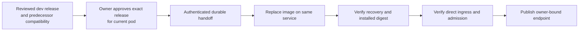

# Dev BYOC pod updates and controlled direct access

## Visual Map

## Owner-project first-light checks (2026-08-11 rehearsal)

For a new `user_gcp` bootstrap, treat API enablement as asynchronous. Verify Cloud
Resource Manager is enabled and required API operations have completed before
using them. Verify that the Cloud Storage service agent can use the bucket's KMS
key and that the deployer has `iam.serviceAccounts.actAs` on the **exact** pod
service account. Read back the rendered service identity and live IAM; a correct
helper without a production caller does not establish custody. Keep opaque
billing identifiers separate from the owner's selected space name, and verify
the pod's machine-route wall before publishing direct readiness. These are
dated rehearsal findings to recheck per project, not fleet-wide acceptance.
Placement is explicit: no current placement or setup intent is `unplaced`, and Shared requires
the owner's recorded choice. Pending setup, failed placement reads and assigned
owner-cloud pods never receive a Shared fallback (`personal_agent_hosting.py`).
The [recovery guide](./pod-backup-and-recovery.md) owns the pod's conditional
first-boot key creation and encrypted recovery contract.

## Shared dev hub request capacity

The shared dev hub's deployment default is 40 concurrent requests per instance,
with at most three instances, one worker and the existing database pools. This
does not change any owner pod's selected resources. The October 12 incident
exhausted 20 request slots while CPU stayed below 3% and memory near 35%; a
Messages response stream could survive route departure. Close the response
reader and late response body explicitly: an aborted fetch controller alone
does not close a stream after headers have arrived.

After deployment, compare account-verification latency, platform “no available
instance” failures, request concurrency, DB acquisition failures, CPU and memory
with the recorded incident window. Request headroom is not a database-capacity
increase. Preserve the canonical DB ceiling before changing instance, worker or
pool counts; roll back the serving revision if additional concurrency degrades
admission or database latency.

## Maintaining an existing owner's software release

This section governs upgrades; the dated first-light checks above and legacy
bootstrap exception below are historical.
Dev's control plane is `hushh-pda-dev`. A user-cloud deployment can live in a
different project: resolve the named owner's registry entry before inspecting its
service. Shared-project service inventory does not prove an owner has no pod.

Build `consent-protocol/Dockerfile.pod` for the deployment platform with generated
contracts staged by the existing build recipe. Set `POD_IMAGE_TAG=dev-<full-source-sha>`.
The pod recipe bakes the pinned local embedding model and this image's action
catalog vectors through the existing hub build helpers. A failed offline bake
blocks the build; an owner command must not depend on a first-use model download.
Measure image pull and first-turn latency separately before claiming a cold-start
improvement: these assets increase the image size. Only the hub schedules action
retrieval warmup. Pods load the packaged model lazily on an actual semantic search;
model loading must not delay their required recovery and admission startup.
Record source commit, immutable source digest, copied owner-project digest,
Cloud Run revision and `/pod/info` imageTag separately. Never treat `latest`, an
image version variable, or Cloud Run Ready as proof of the serving application.
Keep the tombstone-compatible ancestry check and owner-local encrypted state.

Normal updates use the existing status, Feed approval, registry operation and
upgrade service. Publishing a release must not install it. Bind each approval to
the owner, service incarnation and immutable image digest. Later snoozes the Feed
reminder for 72 hours; Settings can still install a compatible release with no
active upgrade lease. Deferral does not approve or start an installation.
Wait for the authenticated handoff's durable idle receipt before replacement.
Verify the running release, readiness and memory/authority continuity before
reporting success. Keep the automatic sweep disabled until the deployed hub
enforces owner approval (`PERSONAL_AGENT_UPGRADE_APPROVAL_REQUIRED=true`).

### Release metadata and compatibility

For private Browser/connector reviews, also inspect the installed action-ledger
constraints after canonical replay. Dev's parked migration receipts are pending-
only; 945/966 parity alone did not prevent an older base CHECK from rejecting
`pod_chat`. The forward 971 correction and its pinned replay preservation are
owned by [migration governance](./migration-governance.md#private-action-replay-continuity).
Apply through the governed dev migration path; never patch constraints by hand or
replay accepted parked history to make a review pass.

The web and hub can advance before independently installed owner pods. Negotiate
new client tools through authenticated pod capabilities before sending them.
Older pods retain ordinary chat; a continuation requiring unsupported tools asks
for an update. Never replay an ambiguous turn or reroute private work to Shared
to mask a compatibility failure.

Managed app announcements and pod installation receipts are separate. The authored
frontend catalog identifies the built app release, its environment, publication
date and reviewed public changes. Dev has an announcement; UAT and production
remain inactive until their own rollout is approved and dated. Never reuse a dev
announcement as a production release or use a hub SHA to identify a frontend build.

After normal unlock and completed setup, existing accounts receive the concise
release dialog; new accounts baseline that release without a catch-up notice.
Unknown account dates suppress the notice. Canonical bootstrap dates establish
the cohort; native restored Firebase metadata does not. Cosmetic acknowledgement
is scoped to owner, environment and release on that installation, persists through
ordinary sign-out and is erased on account deletion. Web Locks serialize tabs
where supported; cross-device acknowledgement is not a server guarantee.

Pod completion uses `completedUpdate`, retained independently of later offers.
It requires the exact successful owner operation, current incarnation and
provider-recorded installed digest. Only validated installed metadata supplies
its notes. Available releases, matching tags and unverified restarts cannot
announce successful installation. Both notices share one dialog; neither chooses
hosting, grants access or starts an update.

Before production, preserve the actual completed legacy Shared cohort, rather than
assuming the branch's `cloud` marker exists. Read-only UAT/production checks on
October 8 found that marker absent. Parked 958 qualifies a one-time continuity
snapshot; it excludes assigned, pending, detached and malformed placement, and
replay cannot admit later accounts. Its PostgreSQL fixtures pass, but it has not
run on those environments. New accounts still choose Shared explicitly.

Graduate additive placement-reader foundations and the corrected backfill before
application traffic, using the current migration ledger and schema head. Do not
replay 955's substring backfill on production, relocate applied parked files, or
reintroduce old constraints that exclude Azure. Include the setup cancellation
reader's `authorization_attempts` column. Capture excluded cohorts privately and
verify unchanged assignments and pending jobs. The dev minimum contract now checks
these reader columns. Missing placement alone is not Shared, and the release dialog
cannot perform this migration.

Cross-cloud moves follow [the migration contract](../architecture/pod-migration.md).
Do not offer a record-only export as a complete library move. Source draining needs
the existing authenticated lifecycle receipt; unknown routing, incomplete recovery
or cleanup retains its ticket until reconciled. Private keys never enter hub custody.

The dev build reads the reviewed version, summary, changelog and supported
predecessor digests from `deploy/pod-release.json`. The existing build recipe
resolves the executable image digest and assembles metadata with the exact source
revision and workflow run through `scripts/deploy/assemble-pod-release.py`. It
archives that metadata with the build and configures `HUSSH_ONE_POD_RELEASE_B64`
alongside `HUSSH_ONE_POD_IMAGE`. This is governed deployment provenance, not an
independent cryptographic signature.

An application-only shared-dev backend deployment preserves those two fields
from the single revision serving all traffic, after validating the immutable
image and dev release metadata. It retains the original publication provenance;
unreadable, incomplete or ambiguous offers stop deployment. A new pod build
replaces the offer with its recorded artifacts. Preview and other environments
never inherit a dev offer. Preservation keeps discovery available; it does not
approve or install an owner update.

When exact-image Browser qualification has passed for an already published dev image, the optional JSON
pin accepted by [the reuse verifier](../../../scripts/deploy/reuse-pod-release.py)
records its image, original source revision, original workflow run and
archived-release SHA-256. Create that reviewed pin only for the qualification
change; the existing build recipe owns its location. The normal Dev workflow
compares the pinned source with the candidate's complete `consent-protocol` and
`contracts` trees and `.gcloudignore` before upload. Any difference refuses reuse, including
conservative differences outside executable modules. Remove the pin to build
the changed image; do not relabel old bytes with the new source revision.
Direct Cloud Build reuse is not a supported release entrypoint. Dispatch the existing
main-owned workflow with `build_pod_image=true`; the candidate-owned build recipe
validates the archive and executable manifest, then publishes the new descriptor
without rebuilding the pod. `sourceRevision` retains the image's original source;
build provenance separately records the descriptor commit and new publisher run.
The governed dev deploy derives the Browser **review** flag from the validated
immutable release. Without qualified receipts it is false; a qualified metadata
publication exposes the exact owner review. This flag never installs an image or
activates Browser. The plan still checks live host configuration, schema, owner
approval and installed readback. UAT/production do not inherit this dev flag.

A reused publication is archived under that image source and the new publisher
run, so a later reviewed pin can resolve it without changing image provenance.
A mismatch aborts publication. Remove the reuse pin before the next pod
image build. Also retire the active Browser qualification pins and reset
`supportedUpgradeDigests` until the new image's own qualification and predecessor
recovery pass. Keep historical receipt files; their evidence still describes the
older image. This path neither proves compatibility nor approves installation.

An empty `supportedUpgradeDigests` list offers no installation path for existing
pods. Add a predecessor only after proving its migration, encrypted recovery and
update continuity. Missing, mismatched or incompatible metadata refuses a new
upgrade before cloud access. A durable operation already in progress retains
its original approval and recovery path when a newer release is published.

Settings and Feed use the same status and approval contracts. Installed release
metadata follows the provider's recorded digest; publishing a new offer does not
erase the previous installation's verification. Shared accounts see their managed
service version without pod installation controls. The authored dev release and
its source tests do not establish a completed live update rehearsal or authorize
publication through the production stable channel.

Verified completion projects into the existing Feed only after registry
publication succeeds, using the approved operation ID as the Feed source key.
The synchronous and reconciliation paths share this projection; a retry cannot
create another notice. Failed, pending, unchanged-image and lost-publication
results do not emit completion. A Feed failure cannot undo an installation;
status remains a pure reader and the registry remains authoritative.
If a deployed defect omitted a notice, repair only that verified operation's
presentation through the existing Feed writer after checking its owner,
incarnation, installed digest and ready acknowledgement. Read back one source-key
row and unchanged registry state; never reinstall to manufacture a notice.

### Request concurrency and responsive controls

Verify Cloud Run request concurrency separately from the pod's one-instance,
one-worker contract. A Cloud Tasks worker or open relay occupies a request slot.
With maximum instances one and request concurrency one, status and cancellation
requests can wait behind that work. The September 28 reviewer rehearsal observed
organization completing before its queued cancellation could execute.

New on-demand Files provisioning configures concurrency eight in
`pod_files/provisioning.py`. Existing image updates intentionally preserve the
owner's current concurrency through `pod_upgrade_configuration.py`; installing
a newer image does not select a new capacity configuration. Record an explicit
choice before changing an existing owner's setting. Preserve one instance, one
worker, the selected CPU/memory, encrypted storage and keys. A configuration
revision still needs the existing authenticated maintenance handoff, incarnation
checks, recovery readback and renewed direct admission. Do not add workers or
instances to work around a request-slot limit.

After an authorized change, verify concurrent status/cancellation during bounded
work before the two- and four-operation stages. Observe memory and idle behavior;
configuration alone is not capacity acceptance. Cloud Run documents
[per-instance concurrency](https://docs.cloud.google.com/run/docs/about-concurrency)
and [WebSocket request behavior](https://docs.cloud.google.com/run/docs/triggering/websockets).

The HTTP startup probe allows up to 240 seconds for encrypted recovery before
accepting requests. Image-only BYOC updates preserve the observed HTTP health and
liveness probes; a TCP startup probe requires reconciliation before replacement.
A longer startup allowance does not qualify cold latency. Capture recovery phases
and replay work separately; the existing 150-second update observation window can
leave slower starts unconfirmed until reconciliation verifies the installed digest.

Startup recovers configuration, model selection, connector credentials and trust
from one verified log scan before admission. The bounded in-memory projection
retains original records and falls back to the existing full loaders on overflow;
it does not bound total historical scan work. Memory replay retains only sealed
records, binds owner/incarnation/storage, resolves custody afresh and verifies the
new tail and erasure on each request. Do not remove those fences to reduce latency.

### Puppy admission and idle verification

Keep four receipts separate: the owner's enabled device grant, verified signed
endpoint/binding, sealed WSS admission to that same pod, and a completed browser
inference response. Registration or a heartbeat establishes none of the later
receipts. Independent loopback model generation is a diagnostic, not the browser
response receipt. Use the existing Hermes identity; a device session cannot approve another
device or initiate an app-role turn. Normal browser approval cannot be replaced by
a review-minted session or by importing the device's token into the browser.

After work settles, verify the direct socket closes after its configured grace and
stays closed without another owner activation. Observe local sockets and provider
replicas through their control planes; probing the pod would wake it and invalidate
the idle measurement. A running device process, minimum-zero configuration, socket
closure and an actual zero-replica observation are distinct facts. Record the
platform scale-down tail separately from the ten-minute relay grace. Restart only
the identified relay process, preserving its profile, grants and local model.

Use the existing Hermes virtual environment for owner/device rehearsals. A different
Python application can stall at native Keychain authorization even when the login
Keychain is unlocked. Bound the rehearsal, stop only its process, and retain the
failed receipt; never copy stored credentials or reset enrollment. Redacted relay
logs separate admission, sealed transport setup and local-model first content.
An admission-stage timeout does not identify the particular HTTP hop or prove a
slow model. Correlate provider-zero evidence with owner activation before calling
a reconnect cold; do not discard the first timeout when a retry succeeds.

Keep failure classes separate: `PUPPY_TIMEOUT` is a device inference deadline;
`POD_TURN_TIMEOUT` is the agent or route deadline. Unconfirmed source cleanup is
not an ordinary settled timeout. The answer's model label requires the device's
actual report, including a terminal-only report; a requested model or heartbeat
cannot substitute for it. Keep model metadata out of answer text and preserve
the single executable ADK aggregate.

The first-data repair uses a fixed 90-second Hermes prefill allowance and a
95-second pod first-frame allowance, followed by the existing 60/65-second
inactivity limits. The pod's absolute 120-second request bound remains. These
are coordinated image/client requirements: changing only the device cannot
extend an older pod's 65-second first-frame limit. Empty deltas and heartbeats
must not extend either deadline. Keep Gemma 12B as the selected default for the
current owner rehearsal; do not repeat an unrelated model qualification sweep.
First-data repair acceptance requires the qualified new image and a completed
browser response, not merely passing deadline tests. Keep engine termination
separate from confirmed relay/HTTP cancellation.

### Isolated image recovery rehearsal safeguards

When constructing a fixture `PodSpec`, retain its registry `billing_space_id`
explicitly. Normal owner update flow already carries that field. An omitted
fixture field can clear billing attribution during image replacement; it is not
permission to reconcile a real owner assignment implicitly. Compare runtime
settings by environment name and provider fields rather than provider ordering.

A failed candidate startup is a failed receipt even if the previous revision
continues serving. One bounded unchanged-configuration retry may distinguish a
transient failure, but does not establish its cause. Verify serving digest,
durable key/cursor, private IAM and unchanged service identity before recording
recovery. Isolated maintenance never substitutes for Settings owner approval.

For native recovery Jobs, read the exact execution receipt from either structured
`jsonPayload` or JSON `textPayload`. Bound log queries to that Job and execution.
A logging-read quota refusal is control-plane evidence, not a model 429 or a
reason to rerun completed work. Reconcile the existing terminal execution; require
the original byte-integrity receipt before qualifying recovery. Verify temporary
Job deletion independently. Native storage recovery alone does not prove direct
admission or an authenticated image-update handoff.

Compare approved CPU and RAM independently of server-computed scratch storage.
Azure changes read-only `resources.ephemeralStorage` with the CPU allocation
([provider contract](https://learn.microsoft.com/en-us/azure/container-apps/storage-mounts#ephemeral-storage)).
Retain the original requested fingerprint, record the exact documented adjustment,
and require every other carried field to match. Reconcile the accepted revision;
do not submit another replacement to correct a readback-only mismatch. GCP may
report one vCPU as `1000m`; preserve the provider value when comparing equivalent
CPU units.

For rehearsal controllers, a released idle fence cannot authorize replacement.
Immediately before dispatch,
re-read authenticated lifecycle status and require the same operation/incarnation,
zero active work and original durable idle receipt. Clear local replacement
eligibility after confirmed release. After an uncertain provider write, reconcile
its recorded revision and identity without replaying the mutation.

Cancelling an Azure update fences further worker writes and joins the actual
thread before releasing local lifecycle authority. Handoff polling and optional
image pruning recheck that fence. A completed local thread does not prove a lost
ARM request settled: retain its provider receipt and upgrade lease for observed
reconciliation. Registry pruning reports only effects it actually confirmed.

### Provider revocation during account erasure

Inventory sealed credential history, including cleared and superseded logins:
a failed disconnect may have stopped local use without revoking Google access.
Group Google grants by verified OAuth project and account. HTTP 200 confirms
revocation; `invalid_token` confirms only that candidate is absent. Continue
other candidates before reporting the grant settled. Provider failures and
inventory overflow remain explicit unconfirmed outcomes. Keep tokens in memory;
retain only bounded counts and hashed grant receipts. These source checks do not
establish live provider revocation or complete cloud-resource deletion.

The authenticated full-cleanup route requires confirmed revocation before key
destruction. An outage leaves encrypted credentials behind the same closed fence
for retry. Tombstone version 4 identifies historical-credential coverage; older
tombstones remain readable but report provider coverage as unavailable. Never
mint a new key or convert a legacy zero counter into a cleanup success. If an old
operation already destroyed its credential key, external provider recovery needs
separate evidence. Internal local-only erasure is not full-account completion.
With the original key intact, requalify only the same fenced inventory and
replace provider metadata conditionally against the observed object generation.
A changed inventory or a competing tombstone refuses key destruction.

### Azure Files activation on an existing pod

Use the existing Files setup offer and exact release approval. Azure capability
plan version 2 binds the current service identity, setup nonce, template, managed
identity, storage, key, model and immutable image. Dev migration 957 must pass its
admission check before the offer is available; it preserves the GCP receipt format.

Fresh owner Microsoft authorization performs a read-only custody preflight before
draining the agent. A preflight refusal makes no cloud changes and permits a fresh
offer. Each approved queue or grant addition then records intent and verified
readback through the same update operation. An uncertain write holds the operation
for reconciliation; never clear its lease to make the interface retry.

The replacement preserves selected CPU, memory, ingress and encrypted recovery.
Completion requires the installed Files environment, exact queue scaler, managed
identity and single-instance configuration to match approval. Record same-image
activation as a configuration restart. The separate `azureFilesInventory` retains
cleanup obligations; it is not a Google substrate receipt or proof of live erasure.

Managed-identity queue scaling requires the Container Apps `2025-01-01` API;
`2024-03-01` rejects the scaler's identity field. Verify the scaler and worker use
the same approved identity after deployment. Files settings and transfer custody
checks must use the same cloud-specific key reference; an Azure library must not
be checked against an empty Google KMS reference.

### Reconciling Azure Files role readback

Azure may return a subscription-canonical custom-role ID for an approved
resource-group-scoped request. Qualify only the same subscription and role GUID,
exact custom-role permissions, and exact approved assignable scope. Other resource
IDs retain strict equality; a matching suffix alone is insufficient.

For the specific failed role readback, the original queue success and uncertain
role receipt remain authoritative. A fresh owner Microsoft authorization can
continue the existing Settings-approved operation only after its setup worker has
settled as failed, current resources qualify through read-only checks, pod identity
and template are unchanged, and the full metadata/lease comparison succeeds.
Preserve the failed receipt in `filesUpgradeReconciliation`; retain the same
operation, attempt and lease. Re-read the qualified prefix, then execute only the
remaining assignments and approved image/configuration installation. Never replay
an uncertain role creation or reset approval to make a retry pass.

The role continuation handles the confirmed first-role failure once. A separate,
bounded continuation covers the legacy explicit `scale.rules: null` failure after
all four resource readbacks. Both legacy Files writers necessarily stopped before
Container App replacement on that exact approved template. Require the terminated
owner/group/time-bound setup job, unchanged identity and template, fresh owner
Microsoft authorization, all four resource readbacks and a confirmed 404 for the
exact attempt revision. Retain the same operation, attempt, approval and lease;
preserve the prior failed role receipt and record `filesConfigurationReconciliation`
through full-metadata CAS. Do not replay resource writes.

Current writers normalize only absent/null scaler rules and persist
`replacement_intent` synchronously before the Container App PUT. An unreadable
revision, changed resource, prior reconciliation or replacement intent keeps the
operation held for read-only investigation. This is not generic crash recovery.
Verify installed digest, recovery, Files custody and byte-exact transfer before
reporting success; source qualification alone does not establish live completion.

The existing authorization completion response carries the approved operation
and release IDs beside its job ID. Popup and standalone update views follow
that frozen identity. Completion requires `installedReleaseVerified` and the
matching `completedUpdate` receipt, installed digest, incarnation and verified
timestamp. A matching version label, recorded job or later available release
cannot establish completion. Older responses without operation identity remain
unconfirmed and offer the existing Settings path.

### Recovering a denied Files queue creation

For a blocked Files activation, retain its existing approval, lease, successful
resource receipts and failed observation. A prior update's acknowledgement cannot
prove this operation. The maintenance-only `upgrade_pod` argument
`resume_files_queue_operation` admits one continuation of the exact recorded
queue-create HTTP 403 after fresh permission, queue-absence, worker-identity and
unchanged-service checks. Use the already approved immutable target and operation;
do not publish another approval, clear the lease or reset owner resources.

The registry claims continuation by strict comparison with the observed metadata.
Only the unfinished resource suffix runs, followed by the normal authenticated
drain and approved image/configuration installation. If the approved digest is
already installed, record this as a configuration restart, not an image upgrade. Configuration refusal remains visibly blocked and
retains the reservation. Unknown provider outcomes or a second denial require
investigation; they do not authorize replay. Queue permission checks allow a
bounded propagation wait before the durable pre-write authority checkpoint.
Verify installed digest, encrypted continuity and the exact completion receipt
before recording acceptance. This source recovery path does not itself prove a
successful live continuation. On 2026-10-01 the personal dev operation completed
this continuation on the same service and digest; that receipt does not qualify
other owners or production.

### Reconciling a legacy Files resource receipt

An untyped legacy bucket/key receipt requires original successful creation
records, the original bootstrap principal and current resource identities.
Current IAM alone does not prove creation ownership. Reconcile only the receipt
through a full-snapshot conditional write; preserve approvals, leases and unrelated
metadata. Missing creation evidence stops reconciliation.

Use the internal `byoc_inventory_reconciliation.reconcile_legacy_gcp_inventory`
operator boundary; it has no public route and performs no provider mutation.
Qualify the original typed plan digest, exact owner/service incarnation, complete
Admin Activity history covering the original provisioning window, current bucket
generation/CMEK and KMS creation identity. Verify the read identities independently;
keep credentials in memory. Retain the original receipt and bounded audit references
separately from the two normalized creation observations. Other resources remain
unqualified.

Publication uses one read-committed transaction, owner locks 171 then 198, live
provision/erasure/identity/custody guards and a full host-snapshot comparison.
Unsettled authorization, setup, migration or update work refuses. An exact committed
acknowledgement can be read back after its original evidence expires; changed terms
cannot overwrite it. Preserve sanitized evidence in the restricted operator record
before temporary-file cleanup, then read back inventory and unchanged identity,
image, configuration and history. Never invent a `provisionAttempt` for an old pod.
Legacy erasure qualification remains separate, including the current completion
predicate and archive-retention boundary.

If Files requires public-access prevention to be enforced, snapshot and read back
the bucket's retention, encryption, IAM and object inventory around that precise
change. Preserve recovery and PKM prefixes. Receipt correction grants no deletion
authority and does not replace the owner's exact Files-plan approval.

### Owner-direct access (dev source wiring; verify the serving revision)

The dev source wires widening and admission through the existing heartbeat.
The checks below describe what the deployed revision must prove. Do not widen
ingress or write readiness by hand to manufacture acceptance.

**A new Google own-cloud agent** (`user_gcp`) is created with Cloud Run ingress
`all` and an `allUsers` invoker behind the in-pod machine-route wall, and records
`ingress: external` (`owner_direct_ingress`). Azure Container Apps agents record
`external` from the start. The managed `gcp` tier stays dev-only.

**An existing hub-only Google agent** (`ingress: internal`) is widened by the hub on
the dev lane when its pod beats (`owner_direct_widen.schedule_widen_if_due`), using
the owner's bootstrap identity the hub already holds. Only a pod whose heartbeat
reports the `aiSelection` advert is widened: that image postdates the in-pod wall, and
an older image stays hub-only until an approved update. In order: the service UID must
match the row; the public invoker is granted **first**; only then is the service's
ingress annotation set to `all` with a revision nonce (a replace on the same service,
so the URL survives); the new revision must be Ready; the pod key is re-pulled; and
one compare-and-set (`promote_internal_to_external`) moves the row from `internal` to
`external` for that exact owner, HushhID, service UID and URL. It never writes
`direct`. Each attempt is claimed per row with a `directIngressWiden` marker and
backs off from 5 minutes to 6 hours. An approved update of such an agent also renders
ingress `all` but keeps recording `internal` until the widening promotes it. The
update does not grant the invoker first, so it can open ingress before a later grant
is refused; the service then stays IAM-gated (no `allUsers` invoker) and reachable by
the hub alone. `pod_heartbeat.py` now calls `schedule_widen_if_due`; source wiring
does not prove that the serving hub or pod has that implementation.

**Admission** (`pod_external_ingress_admission`) then promotes `external` to
`direct` together with the readiness receipt, on a live beat, only when all of
these hold: the key was recorded from that URL; anonymous `/pod/info` answers 404
with exactly the pod wall's body (`consent-protocol/hushh_mcp/services/pod_wall.py`), so a Cloud Run
IAM 403 or a provider 404 page is not mistaken for the wall; anonymous `/health`
answers 200; the app origin's CORS preflight is allowed with that origin echoed;
and, for Google, the live service read with the bootstrap identity is the same
incarnation, has ingress `all` and lists `allUsers` under `roles/run.invoker`. Any
failure leaves the row unchanged and the next beat retries. While a Google row is
`external` and not yet admitted, each live beat mints a bootstrap token and makes two
Cloud Run reads. In plan mode (localhost with no live Google access) the IAM check
reports `iam_unverifiable`, so a localhost Google row is never admitted to `direct`;
that is by design. The hub then publishes
the signed endpoint; the browser pins it only after its own admission succeeds.
Puppy access still requires the owner's explicit per-device choice in Trusted
devices.

**Changing the app domain.** Read the exact owner's registry assignment and
installed image before touching its origin policy. For an existing service,
use authenticated maintenance prepare/idle handoff and capture recovery and
service identity. Append only the approved app origin to the existing CORS list;
preserve the image, keys, storage, worker count and selected resource/scale
configuration. Verify the replacement revision, recovered public key, approved
and foreign-origin preflights, anonymous machine-route refusal and renewed
signed admission. Remove any bounded operator impersonation grant afterward.
This is same-image configuration maintenance, not software-update approval.
Record its receipt separately from the owner's durable update operation.

For a standalone Hermes relay, an HTTPS admission success does not prove WSS
trust configuration. Use the relay's verified CA context (configured trust store
or its pinned certificate bundle); never disable certificate or hostname checks.
Run the existing Hermes profile with its own dependency-complete environment.
Keep admission, sealed connection and local-model completion timings separate.

Direct setup must bind the authenticated owner to this exact pod before issuing
its local app session. Connector/AI setup then uses that owner session with the
required scope and held incarnation; hub consent alone cannot open a credential
envelope (`pod_owner_door.py`). Test a foreign owner and an unwalled provider
response as negative controls before claiming direct setup accepted.

**Organisation policy.** If a policy refuses `allUsers` (for example Domain
Restricted Sharing), the row keeps `internal` and records
`directIngressBlocker.code = ORG_POLICY_REFUSES_PUBLIC_INVOKER`. On the widening
path ingress is not changed, because the grant comes first; an approved update may
already have set ingress `all` (see above), which stays IAM-gated. The blocker
survives heals, provisions and upgrades. Adoption of an existing service rewrites the
metadata whole and drops it, and the next widening attempt records it again. The
owner sees it in `GET /api/one/personal-agent/status` (`directIngressBlocker`). On
dev it is `retryable`, and after the policy is changed Retry calls
`POST /api/one/personal-agent/direct-ingress/retry` to clear the blocker and start
one attempt. On uat and production, where nothing widens, it is not `retryable` and
Retry keeps the blocker and does nothing. Never work around the policy.

**Outside dev** (uat, production) existing hub-only agents are not widened and an
update keeps `internal`; that waits for the dev proof. `record_direct_ingress_observed`
and `record_direct_readiness` remain for recovery only and are not part of setup.

### Google connector and notification acceptance

Private native authorization uses public-client PKCE and an owner-direct sealed
code/verifier envelope. A web QR carries connector intent only and must not carry
an owner, endpoint or credential. Confirm the signed-in provider account and
granted scopes at the pod, then read back owner-authenticated status. Google
revocation is project/account-wide. The source legacy-to-private transition now
fences existing credential rows, confirms the owner's choice and provider revocation
before opening fresh native authorization. The pod requires current transition
admission, drops affected token caches and validates the exact credential ID and
generation through provider refresh before redemption. Only `invalid_grant`
retires an old grant; provider outages block fresh redemption, and credential
timestamps are not revocation evidence. Completion clears unchanged legacy custody.
Verify provider refusal, changed snapshot/placement and incomplete cleanup with
the owning transition tests; live provider/native acceptance remains unproved.
Do not revoke an old project token after issuing a fresh sibling grant.

For notifications, verify the topic in `GOOGLE_CONNECTOR_OAUTH_PROJECT`, the
owner-project direct subscription and OIDC account, exact pod audience/endpoint,
DLQ forwarding IAM and retained DLQ subscription. An Azure pod additionally needs
an explicit Google notification-project adapter; Azure authority alone is insufficient.
The OAuth-project topic remains operator-owned and is outside automatic owner
resource erasure. Owner resources and grants require qualified retained receipts.

Dev-only migration 956 is applied in the verified October 7 dev release. Recheck
the target environment's ledger and existing-operation checkpoint port before
accepting notification mutations; UAT and production graduation is separate.
Without that port or the
other prerequisites, notifications remain unavailable while core chat/recovery
retain their independent status. Verify bounded retries/retention and operator
recovery status, failed listener retry with unchanged history cursor, and daily
authenticated HTTP maintenance renewal. No resident poller or per-ring model
invocation is an acceptance substitute. These are source-level contracts until
the exact deployed resource and serving revision have live receipts.

The checkpoint uses the existing owner registry operation, not another table or
job ledger. Its bounded metadata contains public resource coordinates,
configuration and qualified receipts; credentials and private content are
excluded. Current placement, standby and detached custody retain the exact
checkpoint and resource inventory until the owning cleanup contract permits
removal. Each subscription has its own qualified erasure receipt. A receipt for
one subscription cannot release a sibling, the topic or the encryption key.
Rollback must refuse retained obligations it cannot represent.

**Historical provider-managed sandbox probes:** the disposable Azure native
sandbox retry on 2026-10-06 reached the provider,
created the sandbox and then returned `AZURE_PROBE_EGRESS_REFUSED`. Sandbox and
outer resource-group deletion were confirmed. That retry did not qualify Browser,
owner-information execution or a private bridge.
On October 7, the `2026-09-01-preview` API returned Deny/Full/Enforced policy in a
bounded control. A later sandbox read returned 403 after creation; worker identity,
Chromium and broker execution still lacked qualification. Exact sandbox, role and
resource-group cleanup was confirmed. Later protected in-pod Chromium and ADK
component probes passed on GCP and a disposable Azure VM; those receipts do not
qualify an installed owner journey. Use the current
[Browser runtime evidence](../../../consent-protocol/docs/reference/private-browser-runtime.md)
for execution and hosting gates rather than treating these historical failures
as the current implementation.

### Model project ownership

The production default is Vertex in the owner's cloud project through the pod's
native runtime identity. Dev also permits the explicitly approved personal Gemini
bridge. Bind that exception to the exact dev model project and runtime identity;
do not infer authorization from the hub configuration. Memory Bank, storage and
encryption remain owner-local. Files setup includes the selected processing
project in its frozen approval and shows the provider boundary before opt-in.

The dev hub's model project is selected by the governed build's
`_GENAI_PROJECT_ID` setting in `deploy/backend.cloudbuild.yaml`, which must match
the checked-in environment profile in `consent-protocol/config/managed-ai-runtime.json`.
The current dev profile names `hushh-gemini-bridge`. The separately approved
personal bridge, `hushh-vertex-personal54`, is not that managed default. Native
organization AI restrictions are intentional; do not repeat native billing/IAM
repairs as a prerequisite for dev acceptance.

The pod's explicit exception is `HUSSH_POD_DEV_INFERENCE_BRIDGE_JSON`, containing
only `project` and `serviceAccount`. The governed backend configuration can supply
the same JSON through `pod_dev_inference_bridge_json`. Rendering applies it only
to the named owner's derived pod service account. Runtime validation requires
dev, matching owner/KMS topology and actual attached metadata identity. Wrong
identity, project, environment or partial configuration refuses without fallback.
No user ADC file or shared API key is substituted.

Chat, its specialists, Browser, recorded commands and the cloud-default connection
check share this inference binding. Sealed owner BYOK selections still win. Files
retains its separate frozen processing approval; Live, embeddings, Memory Bank,
storage and encryption retain their existing boundaries. Image-only updates
preserve the observed bridge policy, including absence. For an existing GCP pod,
the exact Browser configuration offer can include the configured dev bridge only
when its named account matches the observed, owner-derived runtime identity. The
offer discloses the processing project and commits the tuple in its approval
digest. Authenticated drain and replacement apply it after image preservation;
serving readback verifies the exact value. Conflicting installed policies refuse
for reconciliation. Publishing an image or approving an image-only update never
adds this exception. The configured identity still needs verified access on the
bridge project; an approved configuration does not grant IAM.

Verify the installed revision, exact project/identity, provider permission and
owner response separately. Describe this as approved dev bridge processing, not
native owner-project Vertex. The local implementation and synthetic checks do not
establish installed owner acceptance.

### Hosted private-pod pilot

The October 26 pilot keeps two synthetic hosted owners in separate Hussh-funded
projects. Shared and BYOC remain separate choices. Use the existing image build,
release catalog and upgrade approval contracts. Copy the same immutable digest
into each project; do not rebuild per owner or claim an older digest contains new
runtime changes.

`PrivateGcpDeployment` is the common rendering/readback contract. The hosted
adapter currently supports pure planning through the existing spec resolver and
refuses resource creation, updates and erasure. Dev migration 973 adds two fixed
project assignments and retained cost-reservation references around the existing
provision journal, without seeding a policy. Each owner holds US$200 for work and
US$50 for cleanup. A lost journal or retry cannot replenish that allocation.
Project IDs can be reserved before creation; capture Resource Manager's actual
project number in the provision evidence before accepting numeric readback.
The candidate `retain_hosted_pod_project_observation` port records an ACTIVE
Resource Manager readback on the same reserved attempt. Repeated matching reads
are idempotent; changed numbers, owners or attempts refuse. It preserves the
original assignment and spend slot. A fresh admission check compares that exact
record before worker-side provider operations, without holding SQL connections
across cloud work. This port is not yet connected to a live project creator.
The optional hosted `bootstrapContract` retains the full authored plan and exact
executor order on the original assignment. Its checkpoint uses the existing
`provisionAttempt`: one generation CAS admits intent, then retains sanitized
observations. A duplicate intent grants no second mutation. Missing acknowledgment
or a failed step requires reconciliation; it never terminates a concurrent winner.
Only successful observed prefixes can resume. A fully observed plan needs a fresh
SQL acknowledgment to settle, with no cloud token mint or provider mutation.
Hosted notification work requires both general and notification-specific intent
acknowledgments; its specialized observation must persist before general progress
can be reused. Existing notification SQL remains BYOC-only, so this composition
alone does not enable hosted Gmail or establish live connector acceptance.
These ceilings are not usage metering or provider spending enforcement.
Completing live operations still needs exact image/model admission, bounded cost
checks, retained project creation outcomes, per-owner custody and verified cleanup. A deployment marker,
an environment flag or a successful model request supplies none of that authority.

The current shared UAT text runtime explicitly selects Azure OpenAI. Its keyless
bridge trusts the shared Google workload subject; a new pod needs its own Entra
federation rather than copying or impersonating that identity. Cached operator
Azure sessions did not cover that bridge tenant at the October 26 inspection.
The owner authorized the existing Gemini bridge as the dev-pilot fallback when
the Azure connection cannot be reused with separate pod identities. This is an
explicit pilot processing choice, not a claim that shared One currently uses Vertex.

For this authorized dev fallback, pin `inferenceProject` to the dev Vertex profile.
Runtime mode `hosted_pod_adc` uses the hosted pod's own attached
service account and verifies the metadata principal before releasing a token to
Vertex. Grant that exact account only the reviewed inference permissions in the
selected model project; do not copy hub credentials. Compute, storage, KMS and
Memory Bank keep their assigned owner-project coordinates. BYOC retains its native
project and separately approved exact-owner dev bridge. Neither policy is an
automatic fallback for the other. Live, Files and connector acceptance remain
independent of text inference. Version 2 deployment markers also bind the exact
model and profile hash: both ADK and recorded-command transports reject another
model before constructing a client, and resolve fleet aliases before admission.
Hosted private chat and memory require verified owner sessions; this does not
reclassify managed hosting as BYOC or enable the BYOC-only Contacts capability.

Read-only administrative checks on October 26 verified ADC for `kushal@hushh.ai`,
an active consent-platform folder, project-create authority and one visible open
billing account with association authority. A synthetic dev-project Vertex request
returned HTTP 403 with a billing-related refusal. After the owner authorized use
of the existing shared AI route, one synthetic request to the dev profile's
`hushh-gemini-bridge`, model `gemini-3.7-flash`, returned HTTP 200 and a nonempty
reply. Its reported usage was 4 prompt tokens, 1 output token and 58 thinking
tokens. This was an operator request, not a pod-identity proof or settled charge.
It qualifies endpoint availability only. No hosted project was created by these
checks.

Reserve US$100 for cleanup and uncertainty; permit at most US$400 of conservatively
projected implementation/verification work under the US$500 total ceiling. Count
models, memory services, compute, storage, KMS, builds, logs and networking. Budget
notifications do not enforce this ceiling. Require current tariffs, retained
reservations and conservative accrued usage before each billable operation.

Before enabling the cohort, prove sibling invoke/read/decrypt/memory refusal,
exact pod model identity, restart and interrupted-create recovery, single-writer
fencing, owner-approved update/rollback and complete erasure. Record source SHA,
image digest, serving incarnation, configuration, usage and cleanup receipts.
Until then, keep enrollment disabled and report each unmet acceptance separately.

### One-time legacy bootstrap exception

An installed release may predate the handoff protocol. Check with the configured
hub machine identity and a pod-audience ID token: the ingress wall returns 404
for an unauthorized human token even if the route exists. Require a successful
protected `/pod/info` control before interpreting upgrade-status 404 as absence.

A bootstrap requires explicit authorization for the named existing pod. It is a
maintenance transition and does not count as proof of the normal Feed upgrade.
Do not add a permanent bypass flag or silently bootstrap other owners.

1. Pause the dev upgrade sweep to avoid competing updates. Record service UID,
   traffic, image, configuration fingerprints, storage identity and recovery
   prerequisites without persisting credentials or decrypted information.
   Verify the flag on every serving revision, not only the service template:
   an environment update can create a retired revision while pinned traffic
   still serves the old revision with its sweep enabled. Explicitly promote the
   verified hold revision and confirm worker shutdown before image replacement.
2. Build and verify a versioned image with the handoff routes and their actual
   hub-to-pod authorization path. Preserve service identity, storage, KMS,
   secret bindings and single-writer settings. Do not recreate the service.
3. Use a deliberate maintenance handoff for this legacy image. Do not infer an
   authoritative drain receipt from quiet logs. Record any interruption and
   verify durable state before replacing the image.
4. Verify image/revision, protected route authentication, admission behavior,
   encrypted-state recovery and health after the transition. Reconcile registry
   provenance before enabling normal updates; never fabricate owner approval.
5. Re-enable the normal channel only after the deployed hub and Feed support
   owner approval and the next update can obtain a genuine handoff receipt.
   Preserve rollback ancestry and tombstones; unknown compatibility is a stop.

Record bootstrap results separately from the subsequent owner-approved update
acceptance. Do not repeat a bootstrap merely because later authentication fails.
