# Drive Search Regression Coverage

Status: implemented candidate-verification regression map. The latest reported local core run passed in 268 seconds; date-intent model corrections and their live acceptance remain separate work. UAT deployment has not been established by this document. Baseline 1ec87ff9f9f5ff0c1986b33a2a974fbed997abbf. A valid story is a valid requirement, **not** a claim that a model, provider, deployment or all 269 cases passed.

Incident evidence established 50 raw provider rows, 50 filename exclusions and zero retained matches. It did not establish a 50-file search cap, a provider outage, or absence of relevant documents.

## Incident flow and root cause

The failed person/content request scanned 16 provider file pages containing 50 raw rows. Both compiled discovery queries made the framing word consist mandatory. The downstream filename gate then excluded all 50 rows, leaving zero retained matches. This was over-constrained discovery followed by metadata-only rejection of content candidates; the zero result was not an empty provider response. Exact historical raw provider JSON and file IDs were not retained, so the incident cannot establish which originals would have passed a content assessment. Synthetic regression sources reproduce the failure boundary rather than impersonating those historical files.

A separate meeting-notes request returned 35 files. All recorded Google permission outcomes were preexisting access. The delivery count included those already-accessible files; 35 sent so far did not mean 35 new Google grants. Provider candidates, retained results, content-verified matches, existing access and newly created permissions are separate quantities.

The failed request's payment was fully refunded. Its terminal state is restored on refresh; refresh does not re-run that search or revive refunded authority. A new explicit request is required. A transient failed search that remains active has its own bounded same-request retry contract.

## Visual Context

Canonical visual owner: [Operations Index](README.md). The narrower request flow
below locates the evidence and delivery boundaries covered by this regression map.

```mermaid
flowchart LR
    Request[Original request and selected dates] --> Planner[Documents semantic plan]
    Planner --> Drive[Drive files.list candidates]
    Drive --> Queue[Encrypted pending queue]
    Queue --> Verify[Bounded read and cited assessment]
    Verify --> Results[Verified result rows]
    Results --> Grant[Current authority and payment checks]
    Grant --> Permission[Strict source version and Google permission]
```

Provider candidates are discovery evidence. They enter delivery only after the
complete request is verified; unavailable coverage remains distinct from no match.

Selected delivery and search coverage are independent. A terminal `partial`
request can have every selected permission confirmed while other candidates
remain unverified. Feed and request detail distinguish those outcomes using
recorded aggregate receipts, including preexisting access, without changing the
request's durable status, payout or retry authority. Missing delivery proof uses
neutral copy; unknown permissions remain pending.

Each consumed semantic candidate records a bounded `decision:reason` count in
`semantic_outcome_counts` inside the existing encrypted search checkpoint.
Operational candidate telemetry contains only closed decision/reason labels,
position and the existing opaque correlation tag. It contains no names, file
identifiers, extracted text or assessment prose. Transient unavailable reads keep
the candidate pending and do not increment final counts. Older checkpoints
without these counters cannot reconstruct historical per-candidate reasons.

## Attachment reconciliation

Four supplied inputs were reviewed: original numbered stories (269), native-parity plan, eleven-conflict audit, and proposed 269-test implementation. Every original ID is classified below. The proposed implementation is not imported: its planner copies expected anchors and Boolean mode from the oracle, its evaluator searches a mock text blob, its timezone conversion hardcodes dates, and it exercises no provider pages, encrypted store, consent gate, payment, refund or permission executor.

The later proposal labels a creation/modification-date union as “keep current dates.” That differs from the accepted title-date → created-date → modified-date fallback. Preserve the current default until explicitly changed; created-only, modified-only and content-date intent stay distinct.

Google's [query-term reference](https://developers.google.com/workspace/drive/api/guides/ref-search-terms) documents name prefix matching, fullText token matching, phrases and created/modified timestamps. It does not list sharedWithMeTime as a valid q term. REST behavior is not a promise of identical native Drive ranking, arbitrary infix matches, fuzzy identity resolution or immediate OCR indexing.

Live source already includes bounded PDF/image OCR in drive_document_pages.py and DriveLiveReader.read_request_visual_pages. Compatibility text parsing alone does not establish the live reader lacks OCR. OCR requires runtime availability, quality and complete evidence. Unsupported or encrypted content cannot become verified by supplying mock body text.

## Classification and corrected oracles

- valid: useful requirement; supported readers, evidence and authority remain mandatory.
- contradictory: supplied unconditional result or mechanism conflicts with current contract, evidence or distinct intent; corrected oracle applies.
- unsupported: guaranteed outcome exceeds provider/reader boundary. Explicit unavailable/incomplete/input-needed is acceptable; false success is not.

Totals: 236 valid, 27 contradictory, 6 unsupported; 269 unique IDs.

| Story | Classification | Corrected acceptance oracle | Pack |
| --- | --- | --- | --- |
| US-001 | valid | Interpret framing; retain subject and requested record type. | P |
| US-002 | valid | Interpret framing; retain subject and requested record type. | P |
| US-003 | valid | Interpret framing; retain subject and requested record type. | P |
| US-004 | valid | Interpret framing; retain subject and requested record type. | P |
| US-005 | valid | Interpret framing; retain subject and requested record type. | P |
| US-006 | valid | Interpret framing; retain subject and requested record type. | P |
| US-007 | valid | Interpret framing; retain subject and requested record type. | P |
| US-008 | valid | Interpret framing; retain subject and requested record type. | P |
| US-009 | valid | Interpret framing; retain subject and requested record type. | P |
| US-010 | valid | Interpret framing; retain subject and requested record type. | P |
| US-011 | valid | Interpret framing; retain subject and requested record type. | P |
| US-012 | valid | Interpret framing; retain subject and requested record type. | P |
| US-013 | valid | Interpret framing; retain subject and requested record type. | P |
| US-014 | valid | Interpret framing; retain subject and requested record type. | P |
| US-015 | valid | Interpret framing; retain subject and requested record type. | P |
| US-016 | valid | Interpret framing; retain subject and requested record type. | P |
| US-017 | valid | Interpret framing; retain subject and requested record type. | P |
| US-018 | valid | Interpret framing; retain subject and requested record type. | P |
| US-019 | valid | Interpret framing; retain subject and requested record type. | P |
| US-020 | valid | Bounded folder discovery may expand children; folder context alone cannot authorize unrelated files. | D |
| US-021 | valid | Interpret framing; retain subject and requested record type. | P |
| US-022 | valid | Interpret framing; retain subject and requested record type. | P |
| US-023 | valid | Interpret framing; retain subject and requested record type. | P |
| US-024 | valid | Alternative formats remain intent; unsupported saved-email extraction stays explicit. | P |
| US-025 | valid | Interpret framing; retain subject and requested record type. | P |
| US-026 | valid | Interpret framing; retain subject and requested record type. | P |
| US-027 | valid | Interpret framing; retain subject and requested record type. | P |
| US-028 | valid | Interpret framing; retain subject and requested record type. | P |
| US-029 | valid | Interpret framing; retain subject and requested record type. | P |
| US-030 | valid | Interpret framing; retain subject and requested record type. | P |
| US-031 | valid | Interpret framing; retain subject and requested record type. | P |
| US-032 | valid | Interpret framing; retain subject and requested record type. | P |
| US-033 | valid | Interpret framing; retain subject and requested record type. | P |
| US-034 | valid | Interpret framing; retain subject and requested record type. | P |
| US-035 | valid | Interpret framing; retain subject and requested record type. | P |
| US-036 | valid | Interpret topical meaning without requiring framing in filename. | P |
| US-037 | valid | Interpret topical meaning without requiring framing in filename. | P |
| US-038 | valid | Interpret topical meaning without requiring framing in filename. | P |
| US-039 | valid | Interpret topical meaning without requiring framing in filename. | P |
| US-040 | valid | Interpret topical meaning without requiring framing in filename. | P |
| US-041 | valid | Interpret topical meaning without requiring framing in filename. | P |
| US-042 | valid | Interpret topical meaning without requiring framing in filename. | P |
| US-043 | valid | Interpret topical meaning without requiring framing in filename. | P |
| US-044 | valid | Interpret topical meaning without requiring framing in filename. | P |
| US-045 | valid | Interpret topical meaning without requiring framing in filename. | P |
| US-046 | valid | Interpret topical meaning without requiring framing in filename. | P |
| US-047 | valid | Interpret topical meaning without requiring framing in filename. | P |
| US-048 | valid | Interpret topical meaning without requiring framing in filename. | P |
| US-049 | valid | Interpret topical meaning without requiring framing in filename. | P |
| US-050 | valid | Interpret topical meaning without requiring framing in filename. | P |
| US-051 | valid | Interpret topical meaning without requiring framing in filename. | P |
| US-052 | valid | Interpret topical meaning without requiring framing in filename. | P |
| US-053 | valid | Interpret topical meaning without requiring framing in filename. | P |
| US-054 | valid | Interpret topical meaning without requiring framing in filename. | P |
| US-055 | valid | Interpret topical meaning without requiring framing in filename. | P |
| US-056 | contradictory | Owner, creator, author, uploader and sharing actor differ; resolve identity or ask, never infer one from another. | I |
| US-057 | contradictory | Owner, creator, author, uploader and sharing actor differ; resolve identity or ask, never infer one from another. | I |
| US-058 | contradictory | Owner, creator, author, uploader and sharing actor differ; resolve identity or ask, never infer one from another. | I |
| US-059 | contradictory | Owner, creator, author, uploader and sharing actor differ; resolve identity or ask, never infer one from another. | I |
| US-060 | contradictory | Owner, creator, author, uploader and sharing actor differ; resolve identity or ask, never infer one from another. | I |
| US-061 | contradictory | Owner, creator, author, uploader and sharing actor differ; resolve identity or ask, never infer one from another. | I |
| US-062 | contradictory | Owner, creator, author, uploader and sharing actor differ; resolve identity or ask, never infer one from another. | I |
| US-063 | contradictory | Owner, creator, author, uploader and sharing actor differ; resolve identity or ask, never infer one from another. | I |
| US-064 | valid | Signature/addressee requires content evidence, not ownership metadata. | A |
| US-065 | valid | Signature/addressee requires content evidence, not ownership metadata. | A |
| US-066 | valid | Interpret command framing; sending still needs existing authority. | P |
| US-067 | valid | Interpret command framing; sending still needs existing authority. | P |
| US-068 | valid | Interpret command framing; sending still needs existing authority. | P |
| US-069 | valid | Interpret command framing; sending still needs existing authority. | P |
| US-070 | valid | Interpret command framing; sending still needs existing authority. | P |
| US-071 | valid | Interpret command framing; sending still needs existing authority. | P |
| US-072 | valid | Interpret command framing; sending still needs existing authority. | P |
| US-073 | valid | Interpret command framing; sending still needs existing authority. | P |
| US-074 | valid | Interpret command framing; sending still needs existing authority. | P |
| US-075 | valid | Interpret command framing; sending still needs existing authority. | P |
| US-076 | valid | Interpret command framing; sending still needs existing authority. | P |
| US-077 | valid | Interpret command framing; sending still needs existing authority. | P |
| US-078 | valid | Interpret command framing; sending still needs existing authority. | P |
| US-079 | valid | Interpret command framing; sending still needs existing authority. | P |
| US-080 | valid | Interpret command framing; sending still needs existing authority. | P |
| US-081 | valid | Interpret command framing; sending still needs existing authority. | P |
| US-082 | valid | Interpret command framing; sending still needs existing authority. | P |
| US-083 | valid | Interpret command framing; sending still needs existing authority. | P |
| US-084 | valid | Interpret command framing; sending still needs existing authority. | P |
| US-085 | valid | Interpret command framing; sending still needs existing authority. | P |
| US-086 | valid | Interpret command framing; sending still needs existing authority. | P |
| US-087 | valid | Interpret command framing; sending still needs existing authority. | P |
| US-088 | valid | Interpret command framing; sending still needs existing authority. | P |
| US-089 | valid | Interpret command framing; sending still needs existing authority. | P |
| US-090 | valid | Interpret command framing; sending still needs existing authority. | P |
| US-091 | valid | Interpret command framing; sending still needs existing authority. | P |
| US-092 | valid | Interpret command framing; sending still needs existing authority. | P |
| US-093 | valid | Interpret command framing; sending still needs existing authority. | P |
| US-094 | valid | Interpret command framing; sending still needs existing authority. | P |
| US-095 | valid | Interpret command framing; sending still needs existing authority. | P |
| US-096 | valid | Interpret command framing; sending still needs existing authority. | P |
| US-097 | valid | Interpret command framing; sending still needs existing authority. | P |
| US-098 | valid | Interpret command framing; sending still needs existing authority. | P |
| US-099 | valid | Interpret command framing; sending still needs existing authority. | P |
| US-100 | valid | Interpret command framing; sending still needs existing authority. | P |
| US-101 | valid | Generic title may match verified source content; title absence is not rejection. | A |
| US-102 | valid | Generic title may match verified source content; title absence is not rejection. | A |
| US-103 | valid | Generic title may match verified source content; title absence is not rejection. | A |
| US-104 | valid | Generic title may match verified source content; title absence is not rejection. | A |
| US-105 | valid | Generic title may match verified source content; title absence is not rejection. | A |
| US-106 | valid | Generic title may match verified source content; title absence is not rejection. | A |
| US-107 | valid | Generic title may match verified source content; title absence is not rejection. | A |
| US-108 | valid | Generic title may match verified source content; title absence is not rejection. | A |
| US-109 | valid | Respect actual live MIME reader and complete evidence; unsupported presentation extraction stays unavailable. | A |
| US-110 | valid | Generic title may match verified source content; title absence is not rejection. | A |
| US-111 | valid | Generic title may match verified source content; title absence is not rejection. | A |
| US-112 | valid | Generic title may match verified source content; title absence is not rejection. | A |
| US-113 | valid | Generic title may match verified source content; title absence is not rejection. | A |
| US-114 | valid | Generic title may match verified source content; title absence is not rejection. | A |
| US-115 | valid | Generic title may match verified source content; title absence is not rejection. | A |
| US-116 | valid | Generic title may match verified source content; title absence is not rejection. | A |
| US-117 | valid | Use bounded original PDF/image OCR; weak, partial or unavailable OCR is not verified evidence. | O |
| US-118 | valid | Use bounded original PDF/image OCR; weak, partial or unavailable OCR is not verified evidence. | O |
| US-119 | valid | Use bounded original PDF/image OCR; weak, partial or unavailable OCR is not verified evidence. | O |
| US-120 | valid | Use bounded original PDF/image OCR; weak, partial or unavailable OCR is not verified evidence. | O |
| US-121 | valid | Use bounded original PDF/image OCR; weak, partial or unavailable OCR is not verified evidence. | O |
| US-122 | valid | Use bounded original PDF/image OCR; weak, partial or unavailable OCR is not verified evidence. | O |
| US-123 | valid | Use bounded original PDF/image OCR; weak, partial or unavailable OCR is not verified evidence. | O |
| US-124 | valid | Use bounded original PDF/image OCR; weak, partial or unavailable OCR is not verified evidence. | O |
| US-125 | valid | Generic title may match verified source content; title absence is not rejection. | A |
| US-126 | valid | Generic title may match verified source content; title absence is not rejection. | A |
| US-127 | valid | Generic title may match verified source content; title absence is not rejection. | A |
| US-128 | valid | Generic title may match verified source content; title absence is not rejection. | A |
| US-129 | valid | Generic title may match verified source content; title absence is not rejection. | A |
| US-130 | valid | Generic title may match verified source content; title absence is not rejection. | A |
| US-131 | valid | Generic title may match verified source content; title absence is not rejection. | A |
| US-132 | valid | Generic title may match verified source content; title absence is not rejection. | A |
| US-133 | valid | Generic title may match verified source content; title absence is not rejection. | A |
| US-134 | valid | Generic title may match verified source content; title absence is not rejection. | A |
| US-135 | valid | Generic title may match verified source content; title absence is not rejection. | A |
| US-136 | valid | Generic title may match verified source content; title absence is not rejection. | A |
| US-137 | valid | Generic title may match verified source content; title absence is not rejection. | A |
| US-138 | valid | Generic title may match verified source content; title absence is not rejection. | A |
| US-139 | valid | Generic title may match verified source content; title absence is not rejection. | A |
| US-140 | valid | Generic title may match verified source content; title absence is not rejection. | A |
| US-141 | valid | Verify subject and category from source; discovery vocabulary is not the verdict. | A |
| US-142 | valid | Verify subject and category from source; discovery vocabulary is not the verdict. | A |
| US-143 | valid | Verify subject and category from source; discovery vocabulary is not the verdict. | A |
| US-144 | valid | Verify subject and category from source; discovery vocabulary is not the verdict. | A |
| US-145 | valid | Verify subject and category from source; discovery vocabulary is not the verdict. | A |
| US-146 | valid | Verify subject and category from source; discovery vocabulary is not the verdict. | A |
| US-147 | valid | Verify subject and category from source; discovery vocabulary is not the verdict. | A |
| US-148 | valid | Verify subject and category from source; discovery vocabulary is not the verdict. | A |
| US-149 | valid | Verify subject and category from source; discovery vocabulary is not the verdict. | A |
| US-150 | valid | Respect actual live MIME reader and complete evidence; unsupported presentation extraction stays unavailable. | A |
| US-151 | valid | Verify subject and category from source; discovery vocabulary is not the verdict. | A |
| US-152 | valid | Verify subject and category from source; discovery vocabulary is not the verdict. | A |
| US-153 | valid | Verify subject and category from source; discovery vocabulary is not the verdict. | A |
| US-154 | valid | Verify subject and category from source; discovery vocabulary is not the verdict. | A |
| US-155 | valid | Verify subject and category from source; discovery vocabulary is not the verdict. | A |
| US-156 | valid | Verify subject and category from source; discovery vocabulary is not the verdict. | A |
| US-157 | valid | Verify subject and category from source; discovery vocabulary is not the verdict. | A |
| US-158 | valid | Verify subject and category from source; discovery vocabulary is not the verdict. | A |
| US-159 | valid | Verify subject and category from source; discovery vocabulary is not the verdict. | A |
| US-160 | contradictory | Original query is corrupted; seek clarification/source-grounded correction, not unconditional relieving-letter success. | I |
| US-161 | valid | Verify subject and category from source; discovery vocabulary is not the verdict. | A |
| US-162 | valid | Verify subject and category from source; discovery vocabulary is not the verdict. | A |
| US-163 | valid | Verify subject and category from source; discovery vocabulary is not the verdict. | A |
| US-164 | valid | Verify subject and category from source; discovery vocabulary is not the verdict. | A |
| US-165 | valid | Verify subject and category from source; discovery vocabulary is not the verdict. | A |
| US-166 | contradictory | Ambiguous coordination is not unconditionally OR; preserve explicit intent or ask. | B |
| US-167 | valid | Preserve complete alternatives and common constraints; do not erase category or identity. | B |
| US-168 | contradictory | Ambiguous coordination is not unconditionally OR; preserve explicit intent or ask. | B |
| US-169 | contradictory | Ambiguous coordination is not unconditionally OR; preserve explicit intent or ask. | B |
| US-170 | valid | Preserve complete alternatives and common constraints; do not erase category or identity. | B |
| US-171 | valid | Preserve complete alternatives and common constraints; do not erase category or identity. | B |
| US-172 | valid | Preserve complete alternatives and common constraints; do not erase category or identity. | B |
| US-173 | valid | Preserve complete alternatives and common constraints; do not erase category or identity. | B |
| US-174 | valid | Preserve complete alternatives and common constraints; do not erase category or identity. | B |
| US-175 | valid | Preserve complete alternatives and common constraints; do not erase category or identity. | B |
| US-176 | valid | Preserve negation for source assessment; index absence cannot prove semantic exclusion. | B |
| US-177 | valid | Preserve negation for source assessment; index absence cannot prove semantic exclusion. | B |
| US-178 | valid | Preserve negation for source assessment; index absence cannot prove semantic exclusion. | B |
| US-179 | valid | Preserve negation for source assessment; index absence cannot prove semantic exclusion. | B |
| US-180 | valid | Preserve negation for source assessment; index absence cannot prove semantic exclusion. | B |
| US-181 | valid | Preserve complete alternatives and common constraints; do not erase category or identity. | B |
| US-182 | valid | Explicit BOTH requires same-document co-occurrence; reject either-person-only controls. | B |
| US-183 | contradictory | Ambiguous coordination is not unconditionally OR; preserve explicit intent or ask. | B |
| US-184 | contradictory | Ambiguous coordination is not unconditionally OR; preserve explicit intent or ask. | B |
| US-185 | contradictory | Ambiguous coordination is not unconditionally OR; preserve explicit intent or ask. | B |
| US-186 | valid | Preserve relation and legal-record meaning; do not drop them as stopwords. | B |
| US-187 | contradictory | Ambiguous coordination is not unconditionally OR; preserve explicit intent or ask. | B |
| US-188 | valid | Preserve complete alternatives and common constraints; do not erase category or identity. | B |
| US-189 | valid | Preserve complete alternatives and common constraints; do not erase category or identity. | B |
| US-190 | valid | Preserve complete alternatives and common constraints; do not erase category or identity. | B |
| US-191 | valid | Preserve complete alternatives and common constraints; do not erase category or identity. | B |
| US-192 | valid | Preserve complete alternatives and common constraints; do not erase category or identity. | B |
| US-193 | valid | Respect actual live MIME reader and complete evidence; unsupported presentation extraction stays unavailable. | A |
| US-194 | valid | Preserve complete alternatives and common constraints; do not erase category or identity. | B |
| US-195 | valid | Preserve complete alternatives and common constraints; do not erase category or identity. | B |
| US-196 | valid | Preserve requested format semantically; generic nouns are not subject keywords. | P |
| US-197 | valid | Preserve requested format semantically; generic nouns are not subject keywords. | P |
| US-198 | valid | Images need supported bounded OCR and source verification; provider hit is not extracted text. | O |
| US-199 | valid | Images need supported bounded OCR and source verification; provider hit is not extracted text. | O |
| US-200 | valid | Images need supported bounded OCR and source verification; provider hit is not extracted text. | O |
| US-201 | contradictory | Explicit PDF is a format constraint; Google Docs need not satisfy it. | P |
| US-202 | valid | Preserve requested format semantically; generic nouns are not subject keywords. | P |
| US-203 | valid | Preserve requested format semantically; generic nouns are not subject keywords. | P |
| US-204 | valid | Preserve requested format semantically; generic nouns are not subject keywords. | P |
| US-205 | valid | Preserve requested format semantically; generic nouns are not subject keywords. | P |
| US-206 | valid | Preserve requested format semantically; generic nouns are not subject keywords. | P |
| US-207 | valid | Preserve requested format semantically; generic nouns are not subject keywords. | P |
| US-208 | valid | Respect actual live MIME reader and complete evidence; unsupported presentation extraction stays unavailable. | A |
| US-209 | valid | Respect actual live MIME reader and complete evidence; unsupported presentation extraction stays unavailable. | A |
| US-210 | valid | Preserve requested format semantically; generic nouns are not subject keywords. | P |
| US-211 | valid | Preserve requested format semantically; generic nouns are not subject keywords. | P |
| US-212 | valid | Preserve requested format semantically; generic nouns are not subject keywords. | P |
| US-213 | valid | Preserve requested format semantically; generic nouns are not subject keywords. | P |
| US-214 | valid | Preserve requested format semantically; generic nouns are not subject keywords. | P |
| US-215 | valid | Preserve requested format semantically; generic nouns are not subject keywords. | P |
| US-216 | valid | Preserve requested format semantically; generic nouns are not subject keywords. | P |
| US-217 | valid | Preserve requested format semantically; generic nouns are not subject keywords. | P |
| US-218 | valid | Preserve requested format semantically; generic nouns are not subject keywords. | P |
| US-219 | valid | Images need supported bounded OCR and source verification; provider hit is not extracted text. | O |
| US-220 | valid | Images need supported bounded OCR and source verification; provider hit is not extracted text. | O |
| US-221 | unsupported | Drive prefix/token search cannot guarantee arbitrary infix discovery or an exhaustive corpus scan. | D |
| US-222 | unsupported | Drive prefix/token search cannot guarantee arbitrary infix discovery or an exhaustive corpus scan. | D |
| US-223 | valid | Preserve intended literal identity and escape it; no substring or alias guarantees. | P |
| US-224 | valid | Preserve intended literal identity and escape it; no substring or alias guarantees. | P |
| US-225 | valid | Preserve intended literal identity and escape it; no substring or alias guarantees. | P |
| US-226 | valid | Preserve intended literal identity and escape it; no substring or alias guarantees. | P |
| US-227 | contradictory | Email and middle initial can disambiguate people; do not silently strip identity evidence. | I |
| US-228 | valid | Preserve intended literal identity and escape it; no substring or alias guarantees. | P |
| US-229 | valid | Preserve intended literal identity and escape it; no substring or alias guarantees. | P |
| US-230 | contradictory | Email and middle initial can disambiguate people; do not silently strip identity evidence. | I |
| US-231 | valid | Preserve intended literal identity and escape it; no substring or alias guarantees. | P |
| US-232 | valid | Preserve intended literal identity and escape it; no substring or alias guarantees. | P |
| US-233 | contradictory | Possible typo can need owner-scoped hints or clarification; never silently substitute another person. | I |
| US-234 | contradictory | Possible typo can need owner-scoped hints or clarification; never silently substitute another person. | I |
| US-235 | valid | Resolve shortcut target and recheck original MIME/version/access; deduplicate original identity. | D |
| US-236 | contradictory | Owner, creator, author, uploader and sharing actor differ; resolve identity or ask, never infer one from another. | I |
| US-237 | valid | Folder expansion may discover a candidate; folder name alone is insufficient content evidence. | D |
| US-238 | valid | Preserve date, amount and percentage meaning; variants need source evidence. | A |
| US-239 | valid | Preserve date, amount and percentage meaning; variants need source evidence. | A |
| US-240 | valid | Preserve date, amount and percentage meaning; variants need source evidence. | A |
| US-241 | valid | Preserve date, amount and percentage meaning; variants need source evidence. | A |
| US-242 | valid | Preserve date, amount and percentage meaning; variants need source evidence. | A |
| US-243 | unsupported | Unreadable encrypted content cannot prove body relevance; report unavailable, not verified match or complete no-match. | O |
| US-244 | unsupported | ZIP/EML/MSG content extraction exceeds current bounded-reader contract; expose unsupported outcome. | O |
| US-245 | unsupported | ZIP/EML/MSG content extraction exceeds current bounded-reader contract; expose unsupported outcome. | O |
| US-246 | contradictory | 50 raw rows was observed work, not a fixed cap; follow nextPageToken within limits and mark incomplete coverage. | D |
| US-247 | valid | Interpret temporal intent with frozen dates; do not erase explicit new/old/updated requirements. | T |
| US-248 | valid | Interpret temporal intent with frozen dates; do not erase explicit new/old/updated requirements. | T |
| US-249 | valid | Interpret temporal intent with frozen dates; do not erase explicit new/old/updated requirements. | T |
| US-250 | valid | Interpret temporal intent with frozen dates; do not erase explicit new/old/updated requirements. | T |
| US-251 | valid | Interpret temporal intent with frozen dates; do not erase explicit new/old/updated requirements. | T |
| US-252 | valid | Interpret temporal intent with frozen dates; do not erase explicit new/old/updated requirements. | T |
| US-253 | valid | Interpret temporal intent with frozen dates; do not erase explicit new/old/updated requirements. | T |
| US-254 | valid | Interpret temporal intent with frozen dates; do not erase explicit new/old/updated requirements. | T |
| US-255 | contradictory | Shared-at time is neither current default date policy nor a supported files.list q term. | T |
| US-256 | valid | Timezone-correct inclusive days use next-day exclusive bounds; no hardcoded IST dates. | T |
| US-257 | valid | Timezone-correct inclusive days use next-day exclusive bounds; no hardcoded IST dates. | T |
| US-258 | contradictory | Deduplicate retained original IDs; providerRowsScanned remains raw provider-work telemetry. | D |
| US-259 | unsupported | Provider index freshness is not guaranteed; a title clue cannot prove unreadable content. | D |
| US-260 | contradictory | Refresh reads terminal state; refunded/expired authority needs a fresh explicit request. | L |
| US-261 | contradictory | Refresh reads terminal state; refunded/expired authority needs a fresh explicit request. | L |
| US-262 | valid | Require affirmative current canShare; expose restrictions and issue no permission POST. | L |
| US-263 | valid | Require affirmative current canShare; expose restrictions and issue no permission POST. | L |
| US-264 | valid | Separate candidates, verified matches, new grants and already-accessible files; do not imply 35 new grants. | L |
| US-265 | valid | Keep person constraint when assessing generic-titled notes; dates/types still need evidence. | A |
| US-266 | valid | Keep person constraint when assessing generic-titled notes; dates/types still need evidence. | A |
| US-267 | valid | Interpret corpus framing without requiring Drive words or enlarging authority. | P |
| US-268 | valid | Interpret corpus framing without requiring Drive words or enlarging authority. | P |
| US-269 | valid | Interpret corpus framing without requiring Drive words or enlarging authority. | P |

## Production test packs

| Pack | Production path | Executable acceptance |
| --- | --- | --- |
| P | Documents manifest → semantic planner → typed compiler | test_drive_live_search_parity.py: arbitrary identities, framing, escaping, format, phrases; real model accuracy needs independent labelled evaluation. |
| B | Semantic clauses → source-bound assessment | Compiler and assessment tests: OR, BOTH, scoped NOT and wrong-person controls; a score never authorizes sharing. |
| A | Bounded reader → cited assessment → encrypted checkpoint → verified result | Assessment and request-flow tests: generic titles, category, fabricated citations, injection, changed source, truncation and unavailable readers. |
| I | Typed input-needed identity resolution | No model-authored email as trusted identity binding, aliases or automatic identity substitution. |
| O | Original-byte page extractor and extraction profile | test_drive_document_pages_postgres.py plus reader/processor tests: OCR gaps, unavailable engine, MIME/size limits, encrypted PDF and source-version fence. |
| D | REST adapter → durable paginated search → unique encrypted results | test_drive_request_search_unit.py and test_drive_owner_search_postgres.py: 50 generic titles, continuation/empty pages, repeated IDs, shared drives, shortcut targets and coverage limits. |
| T | Frozen calendar-date contract | Timezone/DST, inclusive selected days, content versus activity intent and preserved default fallback. |
| L | Existing request/payment/batch/Feed/erasure authority | test_drive_request_bulk_postgres.py, test_drive_sharing_retention.py, test_connector_feature_admission.py and test_feed_account_session_postgres.py. |

A request-flow test calls production service/store code. Synthetic Google/model responses replace external I/O only; they must not replace the selection, binding, persistence or authority being tested. Keep raw rows, retained candidates, verified matches, new grants and preexisting access separate. Pending/unavailable assessment cannot finalize complete no_match.

The request-search regression extends the existing REST integration helper. Three arbitrary identities (including an apostrophe and a Unicode name) use 50 generic filenames across two 25-row pages and a third continuation with one duplicate and one new candidate. Production code retains 51 unique candidates, excludes 49 using validated source-bound model answers, and returns two verified results. Raw provider work remains 52 rows. A JSON round trip between slices checks the checkpoint representation; it does not replace the PostgreSQL encrypted-store tests. Separate cases retain transient failures for retry, account for unsupported content as partial coverage while later candidates continue, yield pending work without a retry error when a slice is too short, and reject a candidate when connection authority changes during its read.

Production commit_page transaction callbacks reject unverified or evidence-free files before any SQL write and reject changing a saved search between legacy and semantic modes. A paired control accepts an observation produced by the real candidate assessment and citation validator. SQL and encryption I/O are replaced in these callback tests; PostgreSQL transaction isolation and ciphertext durability remain separate acceptance.

The source search can finish while semantic coverage remains partial. The semantic_coverage_incomplete checkpoint marker keeps verified matches eligible for streaming and prevents the request finalizer from claiming complete coverage. Production finalizer tests assert partial for both zero-result and delivered-file requests when the marker is set; paired controls preserve no_match and completed respectively when coverage is complete. This marker is distinct from the existing incomplete_search state, which blocks later batches.

These tests supply a frozen semantic plan and pre-labelled model responses. They prove the worker, pagination, deduplication, citation validation and authority wiring, not natural-language model accuracy, provider index completeness or OCR quality. Those require the independent planner/assessment/extraction evaluations, not assertions copied from the supplied 269-case oracle.

## Existing durable Feed removal

History removal already persists on the server. Migration 331_feed_dismissal.sql adds owner-scoped feed_events.dismissed_at and dismissal_token. FeedService.dismiss/restore/clear also dismiss older folded Drive rows. Clear is a snapshot; later meaningful events remain visible. Firebase UID is server-derived.

test_feed_account_session_postgres.py::test_removed_items_stay_gone_per_account_and_leave_with_the_account runs production SQL across fresh pools/sessions, checks other-owner isolation, stale Undo after Clear, deletion and same-email/new-UID isolation. Frontend feed-service.test.ts, feed-page-clear.test.tsx, use-document-feed-stream.test.tsx and document-feed-stream-manager.test.ts cover cache epochs, acknowledged mutations, grouped rows and stale streams.

History Remove/Clear is presentation-only. Chat Drive Close is a separate device preference (40 hashed entries, at most seven days). Stop remaining cancels unfinished sharing. Access/trust revocation have distinct confirmed contracts. Clear does not silently cancel active requests; no parallel hide ledger is introduced.

AccountService and erase_drive_account_in_transaction erase search authority/results and participant identities, preserve minimal anonymized settlement evidence and fence late writes. Feature admission controls new effects; reconciliation/refund/removal remain available.

## Rollout and policy identity

The approved rollout keeps continuous collection and global package processing disabled. DRIVE_AGENT_PACKAGES_ENABLED remains the existing worker composition boundary; request-local assessment does not enable that subsystem. The compact agent_documents_request_assessment gene belongs to the existing Documents manifest, runs through the existing tool-less single-turn ADK adapter and reuses DocumentBatchAssessment plus exact source validation. Existing document/package interpreters keep agent_documents_suggestions as their default. The compact instruction reduces unrelated package instructions; it does not grant file, permission, payment or routing authority.

Periodic records requested for a reporting interval require evidence of their actual content coverage. An earlier-period statement edited during the picked interval is not a current-period statement. This is semantic date intent, not a new metadata-date union: unrelated person/topic requests retain title_created_modified, and explicit creation/modification intent remains distinct.

facts_policy_version hashes the entire Documents manifest, packet contract, citation references, resolved model, facts schema identifier and extraction profile. assessment_policy_version also hashes the manifest and resolved model. Editing this manifest therefore changes both profiles, even when the edited gene is request-local. Update the intentional manifest pin once after the final prompt edits and record the affected/re-queued facts count in release evidence; do not guess that count or remove the pin gate. An unchanged facts schema needs no artificial schema identifier bump or migration merely to acknowledge this hash change.

Facts enqueue creates a new profile/version rather than overwriting old facts. Current index completeness and reusable evidence require the current policy, so existing records can remain stored while becoming policy-stale until authorized reprocessing. Disabling global processing prevents automatic recovery from being assumed; it does not make the policy change harmless or establish an affected count of zero. Existing frozen semantic checkpoints also retain their assessment policy: a changed policy fails closed with source_changed instead of silently changing the meaning of an in-flight request. Existing access receipts are not new assessment authority.

### Two-pass UAT rollout

Use the canonical Deploy to UAT workflow with its explicit sha input; record the exact landed, verified main SHA rather than relying on a moving branch default. The workflow variable DRIVE_REQUEST_SEMANTIC_SEARCH_UAT_ENABLED supplies the runtime DRIVE_REQUEST_SEMANTIC_SEARCH_ENABLED value. An absent workflow variable defaults to true, so an absent setting does not establish the first-pass false posture.

1. Set effective semantic enrollment false and deploy scope auto at the exact landed SHA. Attest that the UAT API and private Drive worker run that same SHA and image digest before enabling new requests. Keep continuous collection and global package processing disabled.
2. Set enrollment true and dispatch explicit scope backend at the identical SHA. This second pass is a configuration-only rollout; explicit backend scope is required even when the source delta is zero. Re-attest the API and worker SHA/image and effective setting. Complete the approved automated acceptance and runtime checks before reporting success.

For rollback, set new-request enrollment false and redeploy the same semantic-aware SHA through explicit backend scope. Retain and honor already sealed semantic requests and their policy/authority bindings; do not reinterpret them as legacy requests. Never deploy older code that cannot understand those requests while any remain active. Disabling creation is the compatible rollback; removing existing authority requires its existing stop/revoke lifecycle.

The first pass ran as recorded below. This record does not establish completed enrollment activation or a rollback rehearsal.

### Initial deployed canary and pending remediation

[PR #8217](https://github.com/hushh-labs/hushh-research/pull/8217) landed as f7b77b6781325d94ed1ce1161758f531cf6d62e2 after passing CI. [UAT run 39177524405](https://github.com/hushh-labs/hushh-research/actions/runs/39177524405) completed healthy with scope all. The serving frontend, API and private Drive worker reported that SHA; the API and worker used the same immutable image. Both API and worker had DRIVE_REQUEST_SEMANTIC_SEARCH_ENABLED=false. Evidence is retained under ignored tmp/drive-semantic-release/ in uat-first-release/uat-release-status.json, uat-first-runtime-evidence.json and uat-first-semantic-flags.json. Release health and the workflow's existing semantic checks did not establish acceptance of the new request planner and assessor.

The separate hosted canary used that same backend image and runtime service account with synthetic inputs, no mounted secrets or SQL connection, and no live Drive, permission or payment operations. Its 16 trials produced 11 passes and five unresolved results: one planner trial exhausted schema validation, another exhausted two 30-second planner attempts, two assessment trials encountered provider 429 failures confirmed by the release investigation, and one assessment trial returned invalid evidence. The report records zero false positives and zero decisive semantic failures, but also two trial errors and five unresolved trials; this is a failed acceptance run, not a semantic success claim. Source hashes matched the frozen release, and the temporary job was deleted. The retained report is tmp/drive-semantic-release/hosted-model-eval.json.

Follow-up work is implementing transport-identical prompt retries and bounded schema/evidence feedback, with at most one repair attempt under unchanged time and authority budgets. It has not yet passed a replacement hosted canary. A source change requires its own exact green landed SHA, canonical UAT deployment with enrollment disabled, and a complete same-image/runtime-identity canary before the identical-SHA backend activation pass. Keep enrollment false while acceptance remains unresolved. Neither this canary nor the pending repair establishes all 269 stories passed, native Google search parity, discovery recall, OCR quality, real consent, payment settlement or delivery.

## Verification record

This is classification, not a 269/269 pass claim. Earlier focused checks below ran against the worktree based on 1ec87ff9f9f5ff0c1986b33a2a974fbed997abbf with uncommitted semantic integration changes. The initial release and hosted canary above bind to f7b77b6781325d94ed1ce1161758f531cf6d62e2; their evidence does not cover the pending remediation.

An earlier integration report at the subsequent 6fbd6257725a3b6abfe3aeaa10a0c05fec2df0fc worktree reported 13,538 backend passes, 568 skips and one facts-policy pin failure. That intermediate result predates later corrections and the initial release's reported passing 275-second core run. Earlier live model runs failed acceptance, including one false positive in a 16-trial evaluation involving periodic-record date intent; subsequent corrections do not erase that historical result. The initial hosted canary still failed strict acceptance as recorded above. None of these reports establishes all 269 stories passed or local verification of skipped PostgreSQL cases.

| Check | Result | Scope |
| --- | --- | --- |
| pytest tests/services/test_drive_request_search_unit.py -q | 154 passed | Existing request search plus ten new parameterized worker/store cases. |
| pytest tests/services/test_drive_request_bulk_postgres.py -q -k 'semantic_terminal_coverage or terminal_outcome_fence' | 8 passed | Four semantic finalizer cases and four existing binding controls; these cases use synthetic SQL I/O without PostgreSQL fixtures. |
| Intermediate candidate assessment, package service and packet intelligence review | 150 passed; facts-policy pin failed separately | Historical compact-gene review before the later reported passing core run; not the current aggregate gate result. |
| Initial PR #8217 local core integration report | Passed in 275 seconds | Reported in tmp/drive-semantic-release/release-progress.json; not a result for the pending remediation. |
| Initial canonical UAT deployment | Healthy; scope all; semantic enrollment false | Run 39177524405 at f7b77b6781325d94ed1ce1161758f531cf6d62e2; serving API/worker SHA and image matched. |
| Initial hosted synthetic semantic canary | Failed acceptance: 11/16 passed, five unresolved, zero false positives | Same deployed image/runtime identity; source hashes matched and temporary job deleted. No enrollment activation established. |
| Follow-up retry/schema/evidence repair | Pending verification | No replacement hosted canary or activation result is claimed. |
| pytest tests/services/test_connector_feature_admission.py -q | 35 passed | Existing connector admission/reconciliation boundary. |
| Vitest feed-service, feed-page-clear, use-document-feed-stream, document-feed-stream-manager | 4 files, 81 passed | Existing server acknowledgment, cache epochs, grouped removal and owner-fenced stream behavior. |
| PostgreSQL Feed/account lifecycle and encrypted search store | Not run by this lane | Requires the existing isolated local PostgreSQL harness; no skipped result is represented as a pass. |

The hosted model calls above use synthetic records. This record does not establish a manual browser rehearsal, native build, live Google discovery, payment operation or provider permission mutation.
