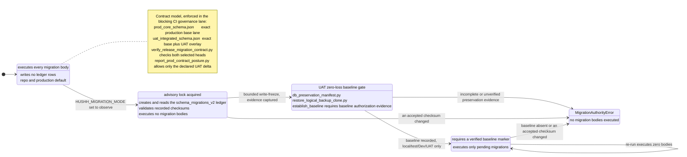

# Migration Governance

## Visual Context

### Dev-only migration promotion

Promotion is separate release work, not part of a private-pod dev rollout. Inspect the current release and dev manifests, migration authority and environment contracts before choosing migration identifiers. Reconcile already-applied dev migrations and checksums; do not assume renumbered SQL is safe to replay. Update affected dev-manifest entries in the same change so moved files cannot break dev deployment; retain the lane while other dev-only migrations remain. Update table-family lifecycle declarations and regenerate their projections. Rehearse against a disposable restoration and run the existing release-migration contract gates before an authorized rollout. Historical migration numbers and blanket idempotence claims are not instructions.

Canonical visual owner: [Operations Index](README.md). Use that map for the top-down operations view; this page defines the database migration authority and the environment contract model.

## Visual Map

Execution mode is a fail-closed state machine in `migration_authority.py`. The
contract model is a separate, always-exact parity check.



## One Authority

The only canonical release lane is:

- `consent-protocol/db/migrations/`
- `consent-protocol/db/release_migration_manifest.json`

Everything else is supporting material, not release authority.

Migration execution authority is implemented by:

- `consent-protocol/db/migration_authority.py`
- `consent-protocol/db/foundations/schema_migrations_v2.sql`

The SQL migration files remain the authored schema history. The ledger records
which immutable checksums an environment has accepted; it is not a second
authored manifest.

## Shared-dev compatibility deferral — 2026-10-09

Main's canonical migration 249 is destructive chat-history cleanup. This branch
previously used that number for a public-profile bridge, now registered as 298.
Shared-dev runs **replay**, which ignores ledger/baseline coverage and records no
release receipts. Synchronizing the canonical SQL must not trigger another
history cutover during an ordinary application deployment.

The existing dev manifest pins 249's filename and checksum as deferred. Only an
explicit `hushh-pda-dev` / `shared-dev` / `postgres` target using the production
base lane excludes it from replay execution. Observe still inspects canonical
history; ledger refuses until the deferral is resolved. Production, UAT and the
isolated commerce preview retain their canonical selectors and baselines.
Changed SQL or invalid deferral metadata refuses before migration execution.

A release schema check proves shape and the minimum head, not execution of every
canonical migration. Record this deferral in deployment evidence. The prior
parked 944 receipt is separate and cannot stand in for canonical 249. Removing
the deferral requires the approved history-cutover recovery, writer drain and
command-settlement evidence; do not change a baseline or mark 249 applied.

## Private-action replay continuity

Shared dev replays canonical migrations but applies parked migrations only once.
Consequently, matching 945/966 ledger checksums did not prove that their action
channel checks were still installed: canonical 212/231/248 restored older checks
and the first installed Browser review returned 503. Dev-only 971 repairs those
two checks after validating the exact private-action restriction under a table
lock. It changes no accepted migration body or checksum.

The existing replay authority uses a narrowly pinned adapter for those three
historical files. It preserves only the qualified 971 successor's two checks;
all document, command and ADK DDL still runs. Full validated definitions and
lineage markers must agree. Missing or altered successor evidence refuses replay.
Without that successor, historical behavior remains unchanged. Ledger and observe
modes retain their original authority.

Verify affected installed constraints and a real review across repeated canonical
replay, not only manifest parity. Application rollback may disable the capability
while preserving compatible review history. The 971 SQL down path refuses while
private reviews remain; never delete history to force it. Restoring its earlier
schema requires the separately reviewed forward qualification before re-enablement.

## Canonical private-agent graduation and cleanup replay

Canonical 418–421 graduate private-agent authority through forward SQL; the
current release head is 422. Applied 900–972 files and checksums remain immutable.
Canonical 420 installs the final schema and accepts only reviewed predecessor and
successor definitions. It does not repeat historical Shared cohort inference or
destructive chat cleanup. Recovery is 421. Channel constraints carry
`private-action-channel.v1/420`; a qualified 971 marker is preserved, never fabricated.

Live dev also contains the consumer-memory consent guards authored on the separate
consumer-MCP branch (938 at `253e89abe8`, 939 at `ac86743508`). The single
`db/private_agent_adoption.py` execution adapter qualifies exact functions and
trigger bindings before and after immutable 420 in replay and pending-ledger mode.
Any retained consumer footprint requires the complete pair; unknown drift refuses.
A bounded relation lock preserves ordinary row writes while fencing trigger DDL.
Fresh schemas introduce no consumer objects or API. Observe and already-applied
ledger entries remain unchanged. Historical SQL and checksums remain immutable.

Permanent account cleanup additionally erases retained owner-scoped consumer
connections before ordinary OAuth/app cleanup. The shared client and neighboring
owners remain. This compatibility does not publish the consumer-MCP feature.

The pinned `db/account_cleanup_replay.py` adapter preserves 418/419 cleanup and
generation function/trigger successors during replay. Historical owner bootstrap
statements exclude captured tombstoned identities; Gmail backfills exclude pending
provider cleanup. The ordinary database guards remain the final concurrency fence.
Referral filtering composes with the existing policy-successor verifier and retains
the unresolved-genealogy refusal. Changed source, missing successor or changed
function/trigger definitions refuse replay rather than restoring old authority.

The checksum-pinned `db/private_agent_adoption.py` execution adapter preserves
420's historical SQL and ledger checksum in replay and pending ledger execution;
observe and already-applied ledger entries remain unchanged. Before 420's column
inventory, it recognizes only the existing `byoc_setup_jobs.authorization_attempts`
`jsonb` column with no default, nullable, and no identity or generated expression.
This is the upgrade shape authored by 404's `ADD COLUMN IF NOT EXISTS`; 928's
same clause does not tighten an already-present column. A missing column follows
ordinary 420 DDL. Other shapes refuse adoption. Under the existing migration
timeouts and table locks, SQL NULL becomes JSON literal `null`, never `{}`.
The row's JSON representation remains unchanged and every non-null journal stays
unchanged. Installed row guards remain authoritative: if they reject this update,
adoption aborts rather than rewriting the table or disabling a guard.

The adapter atomically sets the canonical empty-object default and `NOT NULL`,
and installs the exact unvalidated `byoc_setup_authorization_history_object`
check requiring an object on every future insert or update. Historical unknown
journals remain unknown and retained. A retry cannot overwrite their job,
project or stages; the canonical authorization guard also refuses deletion or
replacement with an empty history. Replay verifies this check's exact definition,
unvalidated state and column binding. A retained JSON-null journal without that
check refuses adoption. The representation change and schema changes roll back
if any later qualification fails; no authorization or cleanup receipt is created.

The same preparation recognizes only the exact 906 deployment/credential checks,
907 status check, and 904 receipt uniqueness/index predecessors. It qualifies
their definitions, relation and column bindings, validation/deferral attributes,
and supporting index definitions and validity before retiring them. The unchanged
420 body then installs the 948/916/913 successors in the same transaction. Existing
`anypoint` placements still refuse the deployment-target transition. Noncanonical
constraints or indexes refuse; receipt rows and their hashes are never rewritten.
Canonical successors are retained without replacing their objects.

Qualification covers canonical-417 and rich-dev-972 upgrades, retained review,
resource, consent, referral and encrypted credential records, backend/client roles,
and unknown authority objects. SQL rollback of 418–421 deliberately refuses with
forward-recovery guidance. Application rollback must retain these additive guards
and receipts; once replacement generations are activated, an old generation-unaware
binary cannot serve those accounts. Local qualification is not a live schema receipt.

## Execution Modes

Canonical 399 supplies the eight service-only public-profile tables required by
the already-selected 403 bridge. Historical 240, 341 and 403 remain immutable.
The additive foundation preserves current Feed constraints and PWM events; it
does not enable profile discovery or its separately gated drain. Their later
activation still requires the documented schema, provider, cohort and Feed
compatibility verification. Existing public evidence and encrypted handoff
receipts survive application rollback. Inserting a prerequisite changes the
manifest checksum: a covered ledger baseline must refuse until its preservation
contract is reconciled; never mark the missing dependency applied or change modes
to avoid that refusal.

- `replay` preserves the historical replay-all behavior. It remains the repo
  and production default until a separately approved production cutover.
- `observe` acquires the migration advisory lock, creates/reads the additive
  ledger authority, and validates any recorded checksums. It executes no
  migration bodies.
- `ledger` requires a verified baseline marker and executes only pending
  migrations. It fails closed when the baseline is absent or an accepted
  checksum changes.

UAT mode is controlled independently from production. Turning on `ledger` is
not a normal deploy flag change: it requires the zero-loss baseline procedure
below.

A migration whose first line is `-- migration: transactional=false` opts out of
the ledger transaction wrapper. Use this only for a single statement that requires
top-level execution, such as `CREATE INDEX CONCURRENTLY`; include no `BEGIN` or
`COMMIT`. The header is part of the immutable checksum. Replay already runs each
file without an explicit wrapper, and observe still executes no migration bodies.
Concurrent builds may leave an invalid index after interruption, so dependent
migrations must check index validity and document explicit rebuild instructions.
The Feed 203–204 sequence and its recovery are documented in
[Feed notification model](../one/feed-notification-model.md).

### Replay and table locks

Because `replay` re-runs every file on every deploy, a statement that is a no-op
on an applied database still takes its lock. `ALTER TABLE ... SET DEFAULT`,
`ADD COLUMN IF NOT EXISTS`, `ALTER COLUMN ... TYPE`, `DROP/ADD CONSTRAINT` and
`DROP TRIGGER` take ACCESS EXCLUSIVE before they discover there is nothing to
do; `CREATE INDEX IF NOT EXISTS` takes SHARE. On a busy table that lock waits
behind live traffic until the runner's 5s `lock_timeout` fires (SQLSTATE 55P03).
Across 21 backend UAT deploy attempts, 6 failed this way, in migrations 025
(five times) and 039 (once).

For a statement on a busy table, wrap it in a `DO` block that checks the catalog
(`pg_attrdef`, `pg_attribute`, `pg_constraint` with `pg_get_constraintdef`,
`pg_trigger`, `pg_class`) and skips only when the effect is already exactly in
place. Otherwise the original statement runs unchanged. Migrations 025, 039,
046, 093, 117 (the `consent_audit` trigger) and 172 follow this pattern. Replay
writes no ledger rows, so editing a file this way leaves nothing to re-verify.
In `ledger` mode, any checksum a baseline recorded would need the baseline
procedure again.

When a lock times out, the runner logs the relation and lock mode it waited for.
It also logs each blocking session's pid, `application_name`, state, wait event,
and transaction and query ages. It samples these from a second pool connection
while the statement waits. It never reads another session's query text.

Migration 329's checksum-pinned replay adapter recognizes the exact validated
368 no-charge quote and waiver checks, with the nullable timestamp marker and
no generated/default waiver. This preserves completed no-charge quotes during
later deploys without restoring the older payment-required-only check. Boolean
grouping, all other cent-price checks and immutable ledger checksums remain
enforced; an unknown or unvalidated successor cannot use this exception.

Migration 360's replay adapter preserves the exact validated 411 period-packet
successor. Before that successor exists, the historical retirement still runs.
After verifying its five typed columns, defaults and complete CHECK, replay
retires only legacy `content_facts` listings and versions. Collection/document
retirement remains unchanged. Partial or drifted successor definitions refuse
the transaction. Existing unavailable versions and withdrawn listings remain
OFF; their prior approval or source availability cannot be reconstructed from
those flags. Historical SQL, ledger checksums and observe/ledger behavior remain
unchanged. Repeated real PostgreSQL replay must preserve both provider ON and
OFF states while continuing legacy retirement.

Migration 420 adoption qualifies two retained external consumer-consent guards
on `consent_audit` before admitting them alongside the canonical lifecycle
triggers. The compatibility adapter pins the immutable migration source and the
exact enabled trigger and called-function definitions, including security and
search-path settings. Both guards must be present together or both absent;
partial, altered or additional unknown objects still refuse adoption. Neither
guard is invoked, replaced, disabled or removed by qualification. This applies
to replay and a pending ledger application; observe and already-applied ledger
entries remain unchanged. Historical SQL and recorded checksums stay immutable.

## UAT Zero-Loss Baseline Gate

The same preservation authority supports an explicitly authorized Dev cutover.
Verify the complete canonical release history before recording its baseline;
parked migration receipts do not prove a release prefix. Preserve divergent
preview SQL and receipts without relabeling accepted history. A Dev baseline
requires the same backup, restored-clone, source-preservation and readback proof.
The CLI admits qualified nonproduction targets, including explicitly bound Dev.
Shared Dev must resolve its release deferrals before baseline establishment;
target flags and an earlier clone comparison do not replace fresh authorization
or permit production use.

Canonical migration 249 and parked cleanup 944 have different refusal guards.
Do not use 944's tests as proof that 249 executed. Qualify the unchanged canonical
SQL against the disposable restored schema, including marked command checkpoints,
directive receipts and capability runs. For the actual Dev cutover, independently
verify the connected database identity, public relation bindings and
`search_path=pg_catalog,public,pg_temp` (explicitly keeping temporary relations last), drain
incompatible revisions, tagged endpoints, jobs and workers, and resolve command
effects. Expiry alone does not prove settlement. Under the bounded freeze, verify
zero targets using 249's actual predicates, including conversations after unmarked
messages would be removed; retain fresh backup, restore and preservation evidence
before establishing and reading back the baseline.

Before establishing a UAT baseline:

1. capture the read-only preservation manifest with
   `scripts/ops/db_preservation_manifest.py`;
2. create and independently checksum a fresh immutable logical backup;
3. restore that exact checksum into a named isolated clone using
   `scripts/ops/restore_logical_backup_clone.py`;
4. prove exact clone parity, then run the additive preservation comparison;
5. complete the PKM zero-loss and reviewer readback gates;
6. enter the approved bounded UAT write-freeze and capture final evidence;
7. establish the baseline marker against the same database identity;
8. switch UAT to `ledger`, re-enable writes, and verify a second run executes
   zero migration bodies.

Evidence is accepted only when the source identity, clone comparison, backup
checksum, catalog digest, information digests, and freshness window all match.
The dump and restore clients must use the source PostgreSQL major version;
operators set `PG_RESTORE_BIN` explicitly when the host default differs.
Reports remain under ignored `tmp/` and never contain plaintext protected
information.

Capture runs within one repeatable-read, read-only transaction, including the
catalog, table digests, null counts and ciphertext aggregates. For a logical
backup, keep an exporting transaction open and pass its `pg_export_snapshot()`
identifier to both the capture tool's `--snapshot-id` and `pg_dump --snapshot`.
Close the exporter only after both operations finish. Keep the identifier in
process memory. The final source-preservation check still requires current
state under the bounded write-freeze; an earlier shared snapshot cannot prove
that subsequent writes preserved the source.

Row digests order collatable primary-key components with explicit `C` collation;
numeric and UUID keys retain their native comparisons. Every component reverses
for the maximum composite-key bound. This prevents libc/ICU ordering differences
from masquerading as changed information. Capture both comparison reports with
the current ordering contract and the same snapshot/backup; retain historical
reports unchanged. Exact catalog and full-information comparison still apply.

Pin extension namespaces and versions before restoring into the empty clone.
PostgreSQL client-major parity alone does not prevent `CREATE EXTENSION` from
selecting a newer default version. A restore that differs in extension version
or catalog representation is not accepted evidence. Reconstruct a deparsed
object only in the disposable clone, from its exact authored migration DDL,
after independently checking its column types, constraint/index flags and
bindings. Retain the repair recipe and source hashes, then rerun the unchanged
exact catalog and information comparison. Do not normalize away differences or
omit changing operational tables to obtain a pass.

This logical dump/restore procedure is a **nonproduction baseline tool**. It is not the
production recovery path: production recovery is Cloud SQL automated backups plus
PITR, described in
[production-db-backup-and-recovery.md](./production-db-backup-and-recovery.md).

## Environment Contract Model

The release manifest has a production-safe base lane and explicit environment
overlays. Production never inherits an overlay by default:

- `prod_core_schema.json`
  - exact policy
  - tracks `ordered_migrations` only
  - validated read-only
- `uat_integrated_schema.json`
  - exact policy
  - tracks the numeric-order union of `ordered_migrations` and `environment_overlays.uat`
- `dev_minimum_schema.json`
  - minimum policy
  - remains on the production base lane unless a separate dev overlay is added

The parser defaults to `production`. Selecting `uat` requires an explicit
`--release-environment uat` argument and the canonical UAT project and Cloud SQL
instance markers. The contract verifier rejects duplicate base/overlay entries,
missing files, an unaccounted repository head, or a contract that does not match
its selected lane.

## Surface Taxonomy

### Authoritative release migrations

- `consent-protocol/db/migrations/*.sql`
- `consent-protocol/db/release_migration_manifest.json`

Use for:

- numbered schema evolution
- release-lane verification
- UAT integrated contract checks

### Bootstrap / legacy initialization

- `consent-protocol/db/legacy/init_legacy_schema.sql`
- `consent-protocol/db/legacy/COMBINED_MIGRATION.sql`

Use for:

- controlled maintenance/bootstrap cases only

Do not use as:

- normal contributor migration flow
- release authority

### Repair / one-off scripts

Examples:

- `consent-protocol/db/repair/add_onboarding_column.py`
- `consent-protocol/scripts/apply_consent_notify_trigger.py`
- `consent-protocol/scripts/migrate_financial_v2.py`

Use for:

- scoped repair or historical maintenance

Do not use as:

- first-run setup
- release-lane truth

### Read-only verification

- `scripts/ops/db_migration_release_guard.py`
- `scripts/ops/verify_release_migration_contract.py`
- `scripts/ops/report_prod_contract_posture.py`

Use for:

- contract alignment
- UAT exact verification
- production/integrated contract parity reporting

### Data migration / seed utilities

- `consent-protocol/db/seeds/seed_investors.py`
- `consent-protocol/scripts/reset_dev_user_data.py`
- `consent-protocol/scripts/setup_kai_test_marketplace_profiles.py`

Use for:

- disposable local/UAT data setup

Do not use as:

- release migrations

## Canonical Commands

```bash
./bin/hushh db verify-release-contract
./bin/hushh db verify-uat-schema
./bin/hushh db report-prod-posture
./bin/hushh codex data-model-audit
python3 consent-protocol/db/migrate.py --release --release-environment production --migration-mode observe
python3 consent-protocol/db/migrate.py --release --release-environment uat --migration-mode observe
```

Meaning:

- `verify-release-contract`
  - verifies manifest head and contract-file alignment locally
- `verify-uat-schema`
  - runs the exact UAT contract against live UAT runtime DB settings, read-only
- `report-prod-posture`
  - permits only the exact declared UAT-only table delta and exits non-zero on
    any other production/UAT contract drift
- `data-model-audit`
  - verifies migration-created tables are classified under the runtime DB data-plane contract
  - blocks unclassified tables and canonical writes into legacy memory tables

## Contributor Rule

Do not require contributors to run ad hoc SQL files just to start development.

If a disposable seed path is needed, keep it:

- named
- idempotent
- separate from release migrations

## Maintainer Rule

When a new numbered migration lands:

1. add the SQL file under `db/migrations/`
2. add a production migration to `ordered_migrations`, or a UAT-only migration
   to `environment_overlays.uat`; never add the same file to both
3. update the schema contract for every lane that selects the migration
4. keep production and dev on the base head when a change is explicitly UAT-only
5. follow the maintainer SOP in [data-model-governance.md](../architecture/data-model-governance.md)
6. update [runtime-db-data-plane-contract.json](../architecture/runtime-db-data-plane-contract.json) when the migration creates or renames tables
7. run `./bin/hushh codex data-model-audit` before claiming the migration is production-ready

Every new table must have a declared owner, data class, primary access path, expected row-growth posture, retention policy, deletion behavior, and plaintext/ciphertext posture. Prefer adding the table to an existing family. Create a new family only when the table cannot honestly fit an existing bounded context.

### Infrastructure integration lineage (2026-10-09)

Main migrations 284–288 retain their canonical identities. The infrastructure
branch's earlier commerce and explicit Shared-choice SQL was registered as 289
and 290 at that integration stage; the current manifest owns the later IDs.
Original branch-only 284/287 files and rollbacks remain in `db/legacy/`
as historical preview evidence, outside the release manifest. Never relabel an
applied ledger row or replay this lineage on a preview that recorded the old IDs.
The shared dev ledger readback contained neither old ID; recheck the target ledger
and recovery immediately before any governed deployment.

### Infrastructure integration lineage (2026-10-10)

Main 299–305 retain their canonical identities. Infrastructure 299–304 moved to
306–311 with byte-identical SQL and rollbacks; the exact prior `f0517d5f` manifest
and original files remain under `db/legacy/scope-commerce-infrastructure-f0517d5f/`.
The current release manifest owns the combined head. Shared Dev's 59 parked
receipts and absent canonical baseline permit source registration; they do not
prove canonical application or authorize receipt relabeling. Revalidate the target
ledger, existing deferral, recovery and schema gates before deployment.

### Infrastructure integration lineage (2026-10-11)

Frozen main `f74922bf` retains Business Profile 306, Feed 313 and Magic 314.
The pending infrastructure suffix now occupies 315–320; the intermediate
312–317 mapping is superseded before any recorded deployment. SQL and rollback
bodies match both parent branches; numbering comments may change.
The prior `6fee7dba` manifest and original files remain under
`db/legacy/scope-commerce-infrastructure-6fee7dba/`; the earlier f051 archive
remains unchanged. Shared Dev readback at 14:10:29Z shows 59 historical
receipts, no baseline and no accepted 306–317 receipts. This permits source
registration, not receipt relabeling. Refresh target-specific lineage, recovery
and schema evidence before rollout. No UAT or production deployment is implied.
