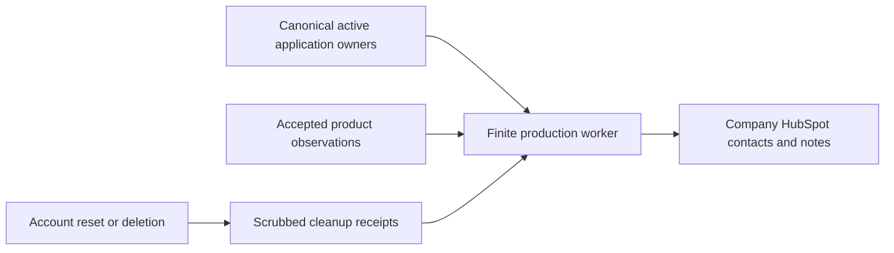

# One company HubSpot sync

## Visual Map

The company integration runs independently of the private agent's personal
Connectors panel. The production Cloud Run Job `one-hubspot-company-sync` uses
portal `247569195`. It traverses active application owners in pages of 25 and
maps each captured owner to its exact Firebase identity, including replacement
accounts. It never resolves an old identity to the latest account generation.

This company roster intentionally includes all registered accounts, including
internal accounts. Customer-only PLG reporting exclusions do not define this
roster. Anonymous, disabled, deprovisioned, deleted and unavailable identities
cannot create or refresh contacts. Canonical verified email permits matching
an existing business contact; an unverified email is never sent to HubSpot.
Accounts without a verified email still receive a pseudonymous contact.

| Contact property | Source |
| --- | --- |
| `one_user_id` | SHA-256 hash of the immutable application owner, with `sha256:` prefix; unique |
| `one_signup_at` | Firebase authentication account creation timestamp |
| `one_last_login_at` | Firebase authentication last sign-in timestamp |

Last login is eventual polling of the authentication source, not page activity,
token refresh or vault unlock. Invalid/missing timestamps remain unknown.
Verified email is written only for a new company-sync contact. Existing CRM
identity and unrelated properties are preserved. The worker does not enroll
contacts in marketing or grant permission to send messages.

Activity and summary notes contain only catalog identifiers, observation source,
phase, timestamp, onboarding completion and retained observation counts. A
returned call does not prove a successful business action. Collection remains
the existing bounded, best-effort product ledger (500 observations/owner/day),
not every browser click. The worker copies up to 100 still-retained source
observations per pass. Source history is seven days; it cannot reconstruct
older events. CRM activity expires 90 days after the observation timestamp.

The one-minute Scheduler uses OAuth to invoke the finite Job. Runs process at
most 50 due rows within a 100-second work budget; an advisory session lock
prevents overlapping drains. Backlog and provider limits can delay freshness.
Postgres owns receipts and deduplication. A future queue can replace wake-ups,
but must preserve these transactional epoch, owner and erasure boundaries.

## Release and rollback

Use the governed production backend release, with
`enable_company_crm_sync=true` for initial activation. Migration 433 must be
applied before the new backend/worker runs. The post-health deployment helper
uses the qualified immutable backend image. Subsequent backend releases update
an existing worker even when initial activation is not requested again.

The dedicated runtime identity has Cloud SQL connectivity, Firebase read-only
access and access to the exact backend credential secrets, active runtime bundle and
`HUBSPOT_COMPANY_SYNC_SERVICE_KEY`. An authorized operator pre-provisions these grants and release actAs on the two dedicated identities. Canonical lifecycle/identity imports require
the existing runtime security settings, so the backend bundle remains a trusted
worker dependency. The API does not receive the company HubSpot key. Scheduler
has `roles/run.invoker` on this Job only. No project-wide secret accessor is used.

To stop new exports, set the Job's `ONE_HUBSPOT_SYNC_ENABLED=false`; keep the
schedule running so expiry/deletion cleanup continues. Do not delete receipts
or disable the cleanup worker as a rollback. The SQL rollback refuses to drop
nonempty receipts. A rollback to an API image predating this feature preserves
the cleanup-capable worker and migration until obligations are reconciled.

Reset scrubs old-epoch summaries/activity and queues their remote removal.
Full deletion atomically removes raw owner/payload/epoch information and queues
all One-owned remote information for removal. Shared business contacts survive;
only One properties, One-authored unchanged email and One notes are cleared.
Pseudonymous hashes and provider receipt IDs survive temporarily until remote
cleanup is confirmed. The company key is never revoked for one person's deletion.

Inspect Job execution results and sanitized `failure_codes`; monitor pending
counts, oldest due age and unknown outcomes. An uncertain note creation is
reconciled by its unique marker and is never blindly repeated. An empty search
result is not cleanup proof because provider search indexing can lag. A mapping
outage blocks exports and defers contact cleanup; known-note cleanup continues.
