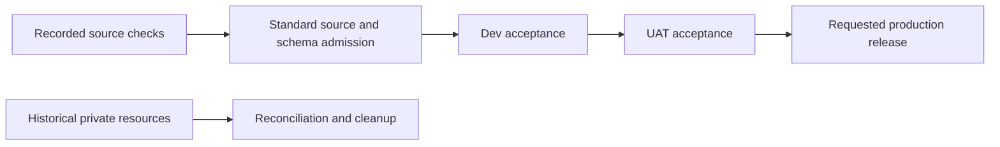

# Retired isolated PLG qualification lane

## Visual Map

Source checks alone do not satisfy the standard source and schema admission.

## Current release path

Deploy to Dev and Deploy to UAT no longer expose a separate PLG isolated job,
target or initialization input. The standard deployment jobs retain their
existing source, CI, schema, capacity, health, provenance, predecessor and
rollback gates.

Source validation remains separate from environment acceptance. The fixed
PLG source records and their Main-owned validation workflows verify content
and tests; they do not authorize a deployment. An older PLG-only source still
needs real source and installed-schema compatibility admission before the
standard pipeline may promote it. Do not deploy unrelated Main application
changes to work around that requirement.

Follow the [Admin merge and release SOP](../../../.agents/skills/repo-operations/references/admin-release-sop.md)
and [branch governance](./branch-governance.md). Do not relabel private
qualification artifacts as shared Dev, UAT or production acceptance.

## Retained temporary resources

Historical qualification used the plg_qualification database,
plg-qualification-runtime service identity, PLG_QUALIFICATION_ secret prefix
and consent-protocol-plg-qual service in the dedicated Dev/UAT projects.
Their continued presence is not permission to initialize, redeploy or replay
migrations. No new private fixture is required by the dispatch interface.

Keep historical helpers and capacity readers until retained resources and
uncertain operations are reconciled. Cleanup must verify the actual project,
resource UID, owned marker, source/image, runtime configuration, traffic and
current operation state. Preserve the original journal and independently
confirm native absence before retrying a delete or same-name operation.

Database cleanup additionally requires verified ownership, absence of owner
records and active work, and settled runtime connections. Do not remove shared
databases, unrelated services, account generations or customer information.
Historical tests, synthetic reports and an absent service name do not prove
that a database or credential is safe to delete.

Existing isolated receipts always retain their original boundaries:
sharedEnvironmentAccepted=false and productionTrafficAuthorized=false.
Their presence grants no customer enrollment, sending or capability activation.
