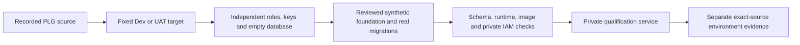

# Isolated PLG qualification resources

## Visual Map



## Purpose and fixed boundaries

Use the existing `uat-scoped-deploy` / `repo-operations` owner and Admin Release
SOP. The namespace helper provisions only the resource namespace for the exact
recorded PLG source. A separate fixed initializer installs its synthetic schema.
Neither helper deploys an application, installs a guessed schema, creates
environment acceptance, dispatches email, or promotes production traffic.

| Resource | Dev | UAT |
| --- | --- | --- |
| Project | `hushh-pda-dev` | `hushh-pda-uat` |
| Instance | `hushh-pda-dev:us-central1:plg-qualification-pg` | `hushh-pda-uat:us-central1:hushh-uat-pg` |
| Service | `consent-protocol-plg-qual` | `consent-protocol-plg-qual` |
| Database | `plg_qualification` | `plg_qualification` |
| Owned proxy port | 6546 | 6547 |

Both environments use the dedicated `plg-qualification-runtime` service account,
`plg_qualification_runtime` database role, `plg_qualification_migrator` database
owner, and `PLG_QUALIFICATION_` secret prefix within their own project. There are
no arbitrary project, instance, service, database, SQL file or secret-name inputs.
The roles have no superuser, role creation, database creation, replication,
bypass-RLS or inherited-role authority. Runtime connections are capped at eight;
migration connections at two. Runtime receives no migration credential mount.
The single worker uses asyncpg maximum four and SQLAlchemy size one with zero
overflow: five declared pooled connections. S starts two persistent listeners
that acquire from the asyncpg pool; a maximum of two could leave no request
connection available. These listeners are included in the four, not additional
dedicated consumers. The role ceiling remains eight.

The fixed source is `5de6ee29abe3b00642bd6b745c608279091810b3`, based on
`d8a5fa4858741e611d39fd4f1f28b1ab930d057c`. Source admission, provider cleanup
contract 2, account authority policy 1, no replacement accounts and the four
absent phone relations remain separate required checks. The current shared
Dev/UAT schema cannot be substituted for this boundary.

## Namespace setup

Run from reviewed main-owned tooling after source validation and normal
environment authority/capacity review. The parent release workflow owns the
workload identity, concurrency lock, credentials, network access and execution.
The namespace helper first accepts the caller-verified
`CLOUDSDK_AUTH_ACCESS_TOKEN` from its protected process environment. It never
prints or persists that token and accepts no token CLI argument. Without that
standard SDK input it resolves the installed `gcloud` executable explicitly
(including `gcloud.cmd` on Windows). Missing CLI or Cloud SQL proxy binaries fail
closed; the proxy must be on the caller's process `PATH`. The token does not
replace the separate verified ADC/GHA identity needed by the owned SQL proxy.
An isolated service also consumes database capacity; it is not outside the
existing budget merely because it has another name.

The default is a read-only plan:

```bash
python deploy/plg/qualification_bootstrap.py --environment dev --output /tmp/plg-dev-plan.json
python deploy/plg/qualification_bootstrap.py --environment uat --output /tmp/plg-uat-plan.json
```

For namespace setup, supply genuine environment-local administrator material
through `PLG_QUALIFICATION_ADMIN_USER` and `PLG_QUALIFICATION_ADMIN_PASSWORD` in
the caller's protected process environment. Never put their values in arguments,
files, reports or logs. No fallback to shared `DB_USER` / `DB_PASSWORD` occurs.

```bash
python deploy/plg/qualification_bootstrap.py --environment dev --phase namespace --output /tmp/plg-dev-namespace.json
```

This creates the dedicated runtime identity, seven namespace-owned secrets and
the empty dedicated database/roles. It generates fresh signing/vault keys and
database passwords; it does not copy customer keys, owner rows, OAuth grants or
production provider credentials. Runtime secret access is granted per secret;
cloud project roles are not granted by this helper. Existing enabled secret
versions are reused, never rotated. Disabled, unowned, public or incompatible
existing material fails closed. Only an actual HTTP 404 admits resource creation;
403, transient failures and ambiguous writes do not.

Provisioning records `requested` before mutations. On interruption or
`needs-reconciliation`, inspect the exact fixed resources first. A database
creation interrupted before its ownership comment is deliberately refused on
retry. Do not delete or adopt an unowned object by its familiar name. No cleanup
or shared-resource deletion is implemented here.

## Reviewed foundation and preflight

The release owner must supply the tracked, committed canonical
`deploy/plg/qualification-foundation.json`. It binds `schemaVersion: 1`,
`kind: plg-synthetic-foundation-v1`, the exact source and baseline above,
`authorityPolicySha256` from the source record, `providerContractVersion: 2`,
the exact `requiredAbsentTables` from that record, and
`foundationRelations: [consent_audit]` and `legacyUsersRequired: false`. Reviewed metadata describing
their actual column/constraint contract can accompany those binding fields.
There is no caller-selected contract path or arbitrary dump/SQL loader.

Foundation installation uses `deploy/plg/qualification_schema.py` under release-owner
control. The committed foundation record also pins the exact source initializer
through migration 370, the source schema verifier, and compatible SQL from
`34401b86f3eb51816a58a55d93c5ae64670e09be`: 407, 408, 418, 419 and 423, in that order.
Every admitted SQL blob is verified against its recorded SHA-256; no SQL path or
additional overlay is accepted from the caller. The real initializer remains
`python db/migrate.py --init --release-environment production`.
Here `production` selects the source's production-compatible migration lane;
the connection remains pinned to the dedicated nonproduction database.
After the existing fresh-database admission, the fixed `qualification_base.py`
seam first invokes S's canonical `--table vault_keys`. It verifies the immutable
legacy source blob and all three statement hashes before any DDL, then executes
only its `CREATE TABLE` definitions for `kai_gmail_connections`,
`kai_gmail_sync_runs` and `kai_gmail_receipts`, in that order. No legacy indexes,
rows, extensions, full legacy script or local bootstrap are included.
S's `--init` then creates the remaining base tables and runs the real release
migrations. Its migration 039 assumes the Gmail connection table exists, and
046 reads the receipt table; `--init` alone does not supply these foundations.
Source `prod_core_schema.json` does not require legacy `public.users`, and that
table is absent in the reviewed UAT metadata. Do not invent it as a prerequisite.
The source initializer's `request_id VARCHAR(32)` is changed to `TEXT` by actual
canonical migration 093. Preserve source semantics for the nullable metadata
default rather than copying the observed UAT default as DDL.
Do not run `db/local/bootstrap_base_schema.sql` against a deployed environment:
that source explicitly restricts itself to local development. Do not invent
schema-migration receipts, run the current phone-era manifest, downgrade a
shared schema, or copy production owner rows. Source-controlled or reviewed
schema-only metadata is permitted; it is not customer information.

The caller supplies an already-owned exact-instance proxy and canonical
administrator credentials in `PLG_QUALIFICATION_ADMIN_USER` and
`PLG_QUALIFICATION_ADMIN_PASSWORD`. The administrator must already hold
`cloudsqlsuperuser` for source migration 201's event trigger. The release owner
also manages temporary membership in this new database's dedicated owner role
and restores it afterward. The initializer grants neither role membership nor
cloud IAM privileges. Never add `cloudsqlsuperuser` to the runtime or migrator.
S's initializer does not switch roles: its tables, routines and event trigger
remain owned by the executing canonical administrator, while the database
remains owned by the dedicated migrator. Defaults configured for the migrator
therefore do not grant runtime access to administrator-created objects. The
fixed helper applies and verifies the required direct runtime object grants;
it does not transfer object ownership or elevate the migrator. Any later DDL
must account for that ownership rather than assume DB ownership equals table
ownership.

Before DDL, the initializer checks the fixed socket, server-derived cluster
identifier and major version, database owner/marker, existing administrator
authority and owner membership, and empty public relations/routines, event
triggers, extensions and user schemas. An unrecorded cluster identity refuses
initialization. The source checkout must be exactly S, unchanged and free of
untracked source. Its child process receives only fixed DB/project routing and
necessary operating-system variables; dotenv and inherited runtime/provider
configuration are disabled. Install the source's pinned Python dependencies,
including `python-dotenv==1.2.2`, before execution.
The isolated child verifies its own installed dotenv version and disabled flag
before importing source, so a different parent/user-site package cannot admit
inherited `.env` or `.env.local` values. The canonical foundation record binds
the server-derived cluster identifiers and their read-only evidence. The new
dedicated DEV instance requires its own actual identifier; evidence for the
retained `hushh-dev-pg` instance remains historical provenance. Runtime admission
requires the recorded cluster identifier and major version; the observed minor
version remains provenance rather than a routing override.

```bash
# The release owner has already started the selected fixed proxy and admitted
# the canonical credentials and temporary database-owner membership in memory.
python deploy/plg/qualification_schema.py --environment dev --action initialize --source-root /exact/S/checkout --output /tmp/plg-dev-schema-attempt.json
python deploy/plg/qualification_schema.py --environment dev --action preflight --source-root /exact/S/checkout --output /tmp/plg-dev-schema-check.json
```

Initialization acquires the dedicated schema advisory lock and records exclusive
intent before mutations. It installs the fixed base seam, runs S's real initializer and only the five pinned
overlays. Migration 407 runs with autocommit outside a transaction; the remaining
SQL retains its authored transactions. No overlay migration-ledger rows are
invented. Existing tables or an existing attempt file refuse replay. Any failed
or uncertain operation leaves `needs-reconciliation`; inspect the actual fixed
resources before another reviewed attempt. No retry, reset or deletion is built
into this helper.

Runtime receives explicit DML on the resulting source tables, read access to
source views, sequence usage,
and the source's explicit `service_role` routine permissions through direct
object grants. It receives no shared-role membership, DDL, or migration-ledger
write grant. The existing source schema verifier checks S's required relations,
columns and functions. Provider contract 2, the four absent phone tables, empty
owner/event/credential/outbox state, generation zero and the exact Memory index
are independently checked. Initialization executes pinned 408's parser comparison.
Standalone preflight uses read-only catalog checks for the index's exact keys,
operator classes, collations, ordering, readiness and complete expression/predicate
tokens against pinned 407. It creates no temporary objects: source migration
201's DDL event trigger can perform guard maintenance even on temporary DDL.

```bash
python deploy/plg/qualification_bootstrap.py --environment dev --phase preflight --output /tmp/plg-dev-boundary.json
```

This uses a fresh read-only connection and checks the database ownership marker,
provider contract/trigger, absent phone relations, foundational Memory tables
and empty owner/event/credential/outbox relations. Only `schema_migrations`,
three pinned source-seeded global catalogs and one public discovery catalog are exempt. Catalog identity rows
must exactly match `qualification_foundation.py`: the three authored consent
templates, referral policy versions 1–2 and program settings versions 1–5.
Source migrations 056 and 057 author 24 public SEC discovery profiles. These
are separately classified as public source catalog information, with exact CIK,
name, firm, normalized name and admission/quality values checked; they are not
owner rows or copied UAT profiles. Unknown identities, duplicates or changed
stable values refuse. All other owner/event/credential/outbox tables remain
subject to the empty-state requirement.
The initializer, schema contract, manifest and seed/transition SQL hashes are
bound in the canonical foundation record. No arbitrary catalog list is accepted.
It is deliberately a
structural boundary check, not the full source schema verifier, index-definition
check, migration provenance, runtime or journey acceptance. Unknown catalog
identities or populated owner/event/outbox tables still fail closed. Never
delete records or report zero to make the guard pass. The canonical initializer
alone does not establish provider contract 2 or the compatible Memory index.
The separate fixed schema initializer supplies and verifies those dependencies
on the synthetic database. Its result is schema evidence only; it sets no
environment, image, journey or deployment acceptance.

Shared Firebase authentication is permitted by the product's existing boundary;
it is not a reason to reuse shared backend state or production app/vault keys.
Any genuine UAT authentication/provider material needed for a later test is a
separate reviewed environment binding. This initial namespace mounts none of it.

## Candidate document and remaining release work

After the namespace exists, a nonsecret candidate manifest can be generated
with the immutable image digest accepted for the exact source and the actual
governed workflow run ID:

```bash
python deploy/plg/qualification_bootstrap.py --environment dev --phase candidate-document --namespace-report /tmp/plg-dev-namespace.json --image-reference "${PLG_ACCEPTED_IMAGE_REFERENCE}" --run-id "${GITHUB_RUN_ID}" --output /tmp/plg-dev-service.json
```

The manifest permits one bounded private service, one worker, max one instance,
explicit database target, pinned secret versions and no migrator credentials.
PLG export, enrollment, activity/subscription projection, independent email
authentication delivery, scheduled mail and Drive ingestion are disabled.
There are no scheduler, Pub/Sub, mailbox, OAuth or sending-key bindings.
Some unchanged D8 startup listeners and cleanup/push loops have no global off
switch; they remain bounded by the isolated empty database, no copied grants or
tokens, no delivery material and the fixed process/connection limits. Do not
describe them as disabled. Owner scenarios must be separately bounded before
introducing any synthetic credentials or delivery capability.

The generated JSON is not an authorization receipt. Before applying it, the
release workflow must independently verify actual IAM (including inherited
public invoker grants), runtime SQL permissions, pinned enabled secret versions,
complete source schema/index compatibility, image/source provenance and
capacity. Use the normal exact-image build/provenance/candidate-probe primitives;
the manifest does not prove an operator-supplied digest belongs to the source.

After deployment, collect separate typed isolated Dev and UAT receipts with the
actual image/revision, exact run/attempt, schema proof and previous environment
evidence. A private isolated service is not the existing shared service at 100%
traffic. Do not relabel it as `shared-dev` or ordinary `uat` acceptance, reuse
another source's receipts, or reuse D8's production-restoration identity.
`deploy/plg/qualification_acceptance.py` exposes `verify(environment, run_id)`
for the exact latest hosted attempt and its digest-bound isolated artifact;
it accepts no local receipt path. Its exported `GATES`, `STEPS` and `IMAGE_STEPS`
bind the required producer execution, while `qualification_acceptance_contract.py`
checks source-build, schema, private IAM, capacity and authenticated health evidence.
The producer definitions must match the reviewed committed Git blobs, and source
checks reuse `deploy/plg/validation.py`. UAT requires the exact verified isolated
Dev artifact and executable digest. The consumer refuses until the deployment
workflow implements the required isolated gate; synthetic contract tests confer
no environment acceptance. Its typed pin always sets `sharedEnvironmentAccepted`
and `productionTrafficAuthorized` to false.
Capacity keeps the canonical declared-pool report intact. The consumer also
requires headroom for the verified runtime role's aggregate connection ceiling
of eight, without reducing any larger retained-revision reservation or claiming
a fixed number of separate lock connections.
Production promotion, rollback and each business journey/email-to-metrics
proof remain the release owner's separate governed operations.
