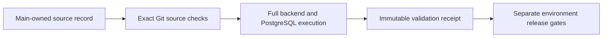

# Validate the isolated PLG source

## Visual Map

## Procedure

Use this procedure only for the exact baseline and successor recorded in
`deploy/plg/production-source.json`. The fixed admission contract permits only
the Memory outcome query, its real PostgreSQL regression and the existing
backend test manifest. It preserves all outcome predicates,
deduplication, limits, frontend/native code, dependencies and migration bytes.

`deploy/plg/production-source.json` is the main-owned source record.
`release_source.py` verifies its fixed boundary and exact Git blobs. A caller
cannot supply another record, additional allowed paths, phone authority,
migrations or a different production target.

Dispatch **Validate PLG Source** from `main`, supplying the exact recorded
`sha`. This read-only GitHub job checks the governed actor, DCO and secrets,
then runs the source's complete canonical backend manifest. The PostgreSQL
regression must execute exactly once and pass. Collection or a skipped database
case cannot produce an acceptance receipt. Source and main authority stay in
separate checkouts and are checked again after execution.

`deploy/plg/validation.py --sha <recorded-sha> --run-id <run-id> --output <path>`
verifies the main workflow definition, both actors, every required step, the
current run attempt and the immutable artifact digest. A subsequent failed or
running rerun invalidates the earlier result.

This receipt grants no deployment, schema, email or traffic authority. It is
not shared Dev/UAT acceptance. Those environments currently use newer phone
and account-deletion authority, so the old source must not be deployed there
by relabeling an existing receipt or dropping schema protections. The isolated
source still needs compatible environment-specific qualification, exact image
provenance and rollback checks through the release SOP before production use.

Production traffic and journey-readiness controls remain separate decisions.
Do not force a campaign cycle or create duplicate messages to test a release.
