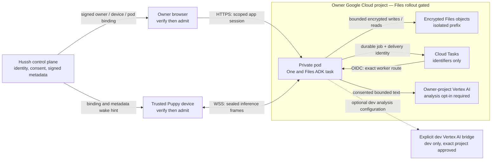
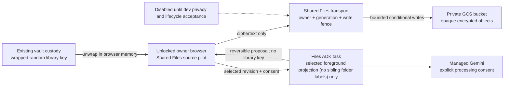

# Private Files library

**Dev status — 2026-10-12:** the personal Azure owner completed the exact Settings-approved
Dev 17 update during active chat, with authenticated drain, encrypted recovery and
installed-digest verification. Post-update transfer resume retained one file identity;
byte-exact downloads, folders, inline rename/undo, move/undo and trash/restore passed.
The download rehearsal used a memory-backed save adapter, not an OS-disk proof.
Both disposable cloud fixtures completed current-image automatic organization and
preserved original bytes. Personal Dev 17 synthetic organization also reached its terminal outcome and
preserved original bytes. Semantic move/undo has separate dated Dev 15 evidence. Normal-owner Google provisioning and
production acceptance are not established by isolated fixtures. Read the
[readiness memo](../quality/adk-orchestration-docs-audit.md#what-works--what-must-change)
and [private-agent north star](../architecture/private-agent-north-star.md) together.

## Visual Map

Files uses encrypted objects in an isolated `files/v1` prefix beneath the owner's
existing pod bucket prefix. It does not mount GCS as a filesystem. Recovery logs
and PKM keep their existing prefixes and authority. The storage adapter verifies
bucket ownership, default KMS encryption, uniform access and public-access prevention;
its observed retention settings are shown in Files.

Each file has an opaque stable identifier, an encrypted manifest, immutable encrypted
4 MiB chunks, and a rolling content digest. Names, folders, revisions, undo and
analysis preferences are encrypted. Folder indexes contain opaque identifiers and
are rebuildable hints; readers validate the authoritative manifest. Directory and
repair requests process at most 100 entries, with no whole-library startup replay.

The browser sends content directly through its admitted owner-pod session. The hub
publishes public verification keys and signed endpoint/binding metadata. Both the
browser and Puppy verify signatures before contacting the pod or signing a challenge.
An endpoint becomes pinned only after admission. An existing valid admission may
reconnect during a hub outage; new or expired grants require the control plane.

## Shared Files — dev pilot, partial live acceptance

Shared reuses this explorer and `agent_files`, with encryption in the unlocked
browser. A random library key is wrapped under the existing vault key; the user
identifier binds ownership and authenticated context, never supplies key material.
Contents, names, folders, settings and index hints are encrypted. The hub transports
bounded ciphertext under opaque names; it receives neither the library key nor a
standing decryption grant. Authorization is checked independently of encryption.

The pilot requires `HUSSH_SHARED_FILES_ENABLED`, an explicitly configured private
`HUSSH_SHARED_FILES_BUCKET`, and dev-only migration 959. Flags default off. Verify
uniform bucket access, public-access prevention and actual retention before use.
Do not modify recovery/PKM prefixes or broad lifecycle rules. SQL stores only the
owner resource inventory, library generation, mutation lease and opaque write
receipts; large encrypted objects remain in object storage.

Enrollment records the immutable bucket generation, project number and creation
time in the existing inventory before accepting a write. A same-name replacement
or legacy unbound record is refused; checking its current name is not recovery.
Erasure reads the retained incarnation before and after bounded prefix cleanup.
An unchanged, creation-time disabled soft-delete policy is a narrowly qualified
no-history inference only for that recorded incarnation. Other buckets require a
successful retained-object listing and expiration; an unsupported listing is not
an empty result. A receipt establishes provider-visible object absence, not media
sanitization. See [bucket identity and metageneration](https://docs.cloud.google.com/storage/docs/bucket-metadata)
and [soft-delete retention](https://docs.cloud.google.com/storage/docs/disable-soft-delete).

A durable exclusive lease serializes hierarchy mutations across browser tabs.
Conditional writes protect immutable chunks and metadata revisions. Shared uploads
persist a purpose-bound encrypted GCS session receipt before dispatching bytes.
The existing credential-encryption key protects this provider bearer; it is not a
library key. The dev pilot binds independently provisioned dev custody material;
no UAT/production credential key is copied. Existing configured references remain
unchanged, and preflight verifies custody material and its runtime grant. Serving startup
and a live upload must prove use.
Exact per-operation SQL transitions fence stale writers and competing
recovery. Completion requires exact ciphertext; cancellation requires the provider's
terminal receipt and observed absence, unchanged predecessor, or exact completed bytes.
An inconclusive status may be followed by an exact-session cancellation attempt;
a positive JSON HTTP 499 cancellation receipt or HTTP 410 invalidation from the
validated original session must be saved before further object/bucket verification.
Recovery reuses that durable proof after a failed check; it still requires exact
object bytes or the unchanged predecessor and the recorded bucket incarnation.
Generic HTTP 404, HTTP 412 and lost cancellation replies remain fenced. A validated
successful upload settles its exact permit before the final access check; that check
still controls whether information may be returned. The terminal-proof correction
is source-qualified, not deployed acceptance.
See [GCS resumable cancellation](https://docs.cloud.google.com/storage/docs/performing-resumable-uploads#cancel_an_upload). Legacy one-shot
uncertainty is not automatically cleared. Account reset/deletion cannot claim erasure
while a write might still complete. Cleanup validates the exact owner prefix, deletes
bounded version batches and waits for soft-deletion/retention to complete. Trash is
reversible metadata, not physical deletion. Never drop inventory to bypass cleanup.

Private Gemini and Azure keys are sealed directly to the admitted pod for validation
and use; encrypted vault backup follows acceptance. A backup failure does not
silently replace the accepted private connection.

Returning to a private cloud AI default uses the owner-config action with a verified
provider/model receipt; old images refuse PATCH without clearing a working key.

Selected foreground organization requires explicit analysis consent. Only the
selected UTF-8 file (at most 256 KiB) and its explicitly selected metadata reach
managed Gemini. Sibling folder names are excluded, including from older-client
requests; the server rejects a nonempty folder projection. The authored specialist proposes reversible changes; the browser rechecks
consent, exclusions, revision and cancellation under the mutation lease before
committing. Original bytes remain immutable. Closing/locking the browser interrupts
foreground work; it does not become a background service. Automatic organization,
scheduled private work, Computer Use and Puppy are unavailable in Shared.

Passphrase changes rewrap the same vault key, so the existing library remains
readable. A genuine vault-key replacement needs a separately qualified library-key
rewrapping transition. Shared library enrollment and placement changes share an owner-scoped transactional
lock. An active or unresolved Shared library blocks cloud setup and provisioning,
even when the Files feature flag is disabled. No placement is silently changed.
Shared-to-pod, reverse and cross-cloud Files moves remain
unavailable until destination readability, identities, revisions, tombstones and
byte integrity are proven before cutover; source cleanup is a separate receipt.

Local SQL/crypto fixtures do not prove cloud IAM, retention or owner acceptance.
The dev deploy binds optional `HUSSH_SHARED_FILES_ENABLED` and
`HUSSH_SHARED_FILES_BUCKET` runtime secrets only to its new revision; existing
revisions and UAT/production do not inherit these bindings. Explicit secret environment
values take precedence over structured runtime defaults. Do not enable canonical
`:latest` on an older one-shot writer. Structured configuration retains an explicit
dev pilot; other environments remain off.

Bucket IAM edits change metadata generation. The qualified dev pilot uses exact-bucket
conditional project grants (`storage.objectUser` and `storage.bucketViewer`) so its
creation-time disabled soft-delete metadata remains independently checkable. These
conditions do not grant access to sibling buckets. If metadata changes, retained-object
listing is mandatory; an unsupported listing is never proof of absence.

Account deletion processes bounded object batches. A settled batch with remaining
generations returns `409 FILES_ERASURE_IN_PROGRESS`; the account keys and write
fence remain. After confirming the same account is still active, the UI preserves
the session and offers deliberate retry. An uncertain upload instead returns
`409 FILES_ERASURE_WAITING_FOR_WRITES`, retains its encrypted provider-session
receipt and calls for reconciliation before another deletion attempt. This safe
refusal response is locally verified; the deployed generic 500 failure remains
recorded. Neither outcome authorizes automatic resubmission. Unknown delivery,
retention or identity failures do not establish completed erasure.

Enable only after workload-identity storage checks, exact-SHA CI and governed deployment.
The existing readiness memo records live Shared transfers, foreground consent,
reversible management and cold unlock. The fresh 18 October Move/Undo passed,
but normal deletion remains fenced on an uncertain upload. Admin probes alone
do not qualify the application or ordinary provider onboarding.

## Upload, download and retention

Uploads resume against the same immutable file identity after the browser verifies
that the selected original file matches the accepted prefix. Completed uploads are
idempotent. Downloads stream into a user-selected local file in supporting browsers;
a network interruption can resume while the page and its in-memory handle remain
open. The saved prefix is hashed before resuming, and the complete digest is verified.
Other browsers use a bounded in-memory download limited to 32 MiB.

Move and rename retain identity. Undo retains the last 20 reversible metadata changes.
Trash is reversible and **does not physically delete objects or reduce billing**.
This version has no per-file permanent-delete control. Bucket retention, soft deletion,
versioning and account teardown determine when retained bytes can actually disappear.
Account erasure must prove queue quiescence, worker identity, writer shutdown, resource
removal and recovery barriers through the existing erasure ledger; uncertain provider
results remain unresolved. Never apply a bucket-wide cleanup rule to remove Files.

## Files Agent and background organization

Files is a development-only agent in One's `/one` roster and shared navigation catalog;
its dedicated `/one/files` explorer owns the library. File settings holds storage,
retention and analysis preferences; Activity holds organization history. The local
explorer uses the shared Files top-bar title and reading-width container. Rename
and folder creation are inline; Move uses a bounded destination picker. Back
closes the active editor or overlay, then Trash or the current folder, then
returns to One. Activity identifies files on demand through the admitted pod.
Vault lock closes private settings and activity rather than retaining an open pane.
Storage usage is an owner-requested scan, not a billing total. Retention is a
provider observation; there is no unsaved warning or cost-calculator setting.
Analysis withdrawal and stricter exclusions remain available after model-provider
loss. A committed upload reports organization failure separately. These local
corrections are included in the recorded dev serving source; deployed responsive
acceptance remains separate from their local layout measurements.
Hosting contains hosting controls, not a Files launcher or embedded explorer.
Discovery does not establish installed capability or consent; the workspace
checks the owner's admitted pod and Files setup before enabling library tools.

`agent_files` is authored in the canonical product manifest and invoked by One in
ADK task mode. System instructions own naming and folder decisions. Tools enforce
current consent, ancestor exclusions, revisions, containment and idempotency. File
contents are untrusted input; they cannot authorize tools or alter the grant.

The current content reader accepts UTF-8 text up to 256 KiB. Other formats can be
stored and downloaded, but are reported unsupported for content analysis. Uploaded
code is never executed and archives are never expanded. The specialist has no delete,
external-share or permission-changing tool.

Analysis requires opt-in. Pausing or excluding a folder applies to its descendants.
Automatic organization applies only to uploads created under the current opt-in;
existing files require an explicit request. Interactive analysis uses the selected
model provider. Background jobs disclose and use Vertex AI in the owner's project.
Dev may use the explicitly configured Vertex AI bridge when its exact project is
included in the owner-approved Files activation. Production cannot use this exception.
Model failure preserves the original upload and records a failed or pending outcome.

An encrypted outbox precedes a named Cloud Task. Only job and delivery identifiers
enter the queue. The exact worker route verifies OIDC identity and audience, then
rechecks consent and file revision. Duplicate delivery is safe, retries and model
calls are bounded, cancellation persists, and an expired uncertain execution requires
review. History is paginated. A lost queue-delivery response leaves a recoverable
pending-delivery record with an explicit retry; no autonomous outbox sweep is claimed.

### Scheduled tasks — local source, not deployed acceptance

One's **Scheduled tasks** view exposes approved work without keeping a pod awake.
The first customer action is **Schedule organization** on a ready file. It reviews
a one-time run in the owner's timezone against the existing Files analysis opt-in.
The existing `agent_files` task specialist remains the semantic decision-maker.
General goals and scheduled browser tasks are not registered execution templates.

Each authored adapter now declares its required scopes. Creation freezes them
before preparing private information; resume checks both the original grant and
the calling app's current capability scopes. Old schedules retain their Files-only
requirements. A claim-bound invocation port checks the current subject, exact
terms, occurrence and original deadline on every access. Its memory-only handle
is neither a browser session nor an action approval and is removed at scope exit.
The specialist owner-read port accepts this explicit admission without a fabricated
session token.

The local native ADK continuation adapter stores a bounded session projection and
private pending connector calls inside the same sealed schedule. It retains the
original invocation and native confirmation markers; request credentials, raw
connector payloads and unsupported SDK channels are excluded. The existing hub
ledger still requires the owner's exact confirmation. Dispatch intent is sealed
before approval consumption; a lost reply cannot replay the call. Snapshot CAS
precedes publication into the live session. Generic schedule Resume refuses a
retained checkpoint, and parked reads refuse uncertain dispatch. Controlled native
ADK/PostgreSQL tests cover these boundaries; this is not installed acceptance.
The authored One constructor now supplies a native task head with the same roster
and callbacks; client-only receipt tools stay in chat. Its schema-checked terminal
requires the matching root `finish_task` call and successful response. It cannot
supersede a pending review or uncertain dispatch. The read barrier permits only
that native terminal control alongside its existing reviewed connector calls.
Controlled acceptance now covers the actual One catalog and callback stack through
review, fresh Runner, one connector effect and recovered terminal output. The
model transport and MCP server are synthetic; the approval ledger is real local
PostgreSQL. These are not installed-cloud receipts.

The scheduled model port reopens the sealed owner choice and freezes its durable
floor, selection ID, provider/model and non-secret destination. It refuses changed,
cleared or unreadable selections; a process-local cache counter is only an in-flight
fence. Keyless defaults retain verified owner Vertex/approved dev bridge or Azure
workload identity, without managed fallback. Saved metadata does not prove provider
availability. A parked review can now reclaim the exact occurrence under update
admission: current caller and original scopes, native marker, terms, expiry and
model are checked before rotating the claim. Parked time does not consume the
original active-work budget; resume cannot extend its authorization or enlarge
that budget. Expiry is rechecked after awaited admission. Lost running claims
and uncertain dispatch remain non-resumable. Shielded cleanup retains the update
permit until quiescence and durable settlement; failed reconciliation retains
bounded repair identity, not a finished task's private traceback. Focused local
tests cover these races.

The local One segment now composes the native Runner, claim admission, frozen
model, specialist dependencies, server-custody MCP and encrypted checkpoints.
`/api/one/pod/tasks/review` authenticates the owner and exposes only the exact
parked call for existing ledger confirmation; `/continue` resumes that occurrence,
not its original goal. A cold pod epoch replaces an unconsumed review with a fresh
directive at the original expiry. Even a previously confirmed receipt cannot
authorize the replacement. Uncertain dispatch cannot rebind or replay.

Custody OAuth access-token refresh retains the credential ID/generation binding;
rotation, account lineage or configuration changes invalidate it. Browser-supplied
records retain full credential binding. Reviews discard request credentials on
every exit. Provider clients and streams close on completion and cancellation;
cleanup is joined through repeated cancellation. Debug content capture is refused
before custody hydration. These are controlled local SDK/PostgreSQL receipts,
with scripted model/MCP transport. The active registry still exposes Files only;
general tool adapters, owner UI, Azure timers and installed acceptance remain open.

The sealed pod log owns the schedule, occurrence claim, cancellation and settlement.
The due-time delivery contains identifiers only; an exact authenticated worker route
checks current owner, pod incarnation, signed grant version and expiry. Exact file,
analysis and agent revisions are rechecked inside Files mutation before creating work.
A competing Files job is not adopted. Lost queue acknowledgements repair the same
durable outbox; interrupted effects are not automatically repeated. Cancellation
remains **Stopping current work** until execution settles. The update admission
permit remains held through settlement.

Active occurrences now carry a random claim identity and an immutable deadline,
bounded by the signed grant and the trusted capability's limit (at most fifteen
minutes). Their sixty-second execution lease renews every twenty seconds only
while authority remains valid. Files retains its existing three-minute limit;
these mechanics do not register general One or Browser schedules. The GCP delivery
deadline allows bounded task cleanup and does not extend processing authority.

Cancellation remains pending while a worker stops. If the response cleanup budget
expires, an owned finalizer waits for actual task exit, durably settles the
uncertain outcome, then releases update admission. Failed settlement retains the
admission fence and requires recovery; neither a timeout nor an expired lease is
proof of idle or permission to replay an effect. Legacy running receipts still
require review rather than being adopted by a new worker.

The GCP adapter reuses the owner-project Cloud Tasks queue and dedicated Files worker
identity. Long-horizon delivery uses bounded metadata checkpoints, not inference or
polling. Azure's queue does not yet provide a qualified due-time wake adapter; scheduling
there returns unavailable. This source does not provision an always-running timer.
Both clouds still need live queue/wake/idle acceptance for this slice.

Scheduling cannot outlive the exact signed authorization or survive a replacement
pod through an old grant. The UI shows the verified access deadline. Changes to the
file, permission, binding or pod require review; this is not a standing unlimited
agent permission. Existing settings, Files jobs and owner resources are preserved.

## Provisioning and on-demand operation

New owner-selected Files setup requires the dev Files erasure contract (migration
941, composed with 940), the rollout gate, signed setup selection and a current
project/bootstrap-bound setup job. The fleet flag alone cannot enable an owner's
library. Queue and worker resources join the existing recovery and teardown inventory.

Existing owners review and approve Files setup in the `/one/files` activation
panel. Hosting remains limited to hosting controls; Software updates shows the
installed version and durable update operation. Files setup is a distinct
approval bound to the owner, pod incarnation, observed configuration, immutable image
and resource plan; approving an image alone cannot activate Files. The existing update
operation records each cloud step before and after execution, preserves compute and
custody settings, and verifies installed configuration before reporting completion.
Its dev recovery contract additionally requires migration 943. No queue payload,
file content or provider credential belongs in these update receipts.

A lost replacement response can be recovered by observing the exact attempt marker,
pod identity, image and Files configuration after all resource checkpoints completed.
An incomplete or uncertain cloud step stays reserved for reconciliation. The worker
does not replay whole-pod bootstrap or clear its reservation on a timeout. Partial
resource reconciliation and retry acceptance still require broader evidence. The
personal dev rehearsal completed one denied queue-create continuation under its
original operation; that receipt does not qualify other uncertain provider outcomes.

The new economy qualification configuration uses 1 vCPU, 2 GiB, minimum zero, maximum one
and one worker. Google caps concurrent container requests at eight. Azure's Files
configuration uses an HTTP scaling threshold of eight; it does not cap requests at
eight. Both runtimes guard eight active chat threads. Existing owners retain their
chosen shape. Qualify total HTTP capacity and overload separately on each cloud.
Puppy's direct socket closes after ten minutes without active work; heartbeats do not
extend this grace. The trusted device then polls the existing hub metadata control
lane every 15 seconds. An owner-requested, two-minute, incarnation-bound wake hint
can reconnect an already approved device. It grants no new permission and cannot
wake a sleeping operating system.

[Cloud Run WebSockets](https://docs.cloud.google.com/run/docs/triggering/websockets)
keep an instance active, so active time includes sockets, background jobs and grace
periods. Scale-to-zero must be observed live rather than inferred from minimum zero.

## Usage and illustrative economics

Files reports uploaded bytes in paginated metadata scans, including Trash. Retained
versions, orphan chunks and other pod prefixes are additional. The UI lets the owner
adjust active-hour assumptions and a warning threshold for that view; it is not a
cloud billing alert or a quota. Crossing it never stops service.

| Partial monthly subtotal | 25 GiB | 50 GiB |
|---|---:|---:|
| Regional Standard storage | $0.50 | $1.00 |
| Storage + 10 active hours + one software KMS key version | $1.60 | $2.10 |
| Storage + 60 active hours + one software KMS key version | $6.82 | $7.32 |

Illustration: $0.02/GiB-month; request-based compute at 1 vCPU/2 GiB costs
`3600 × (0.000024 + 2 × 0.0000025) = $0.1044` per active hour; one software KMS key
version is $0.06/month. Regional rates and free allowances vary. These subtotals
exclude model inference, Memory Bank, network egress, operations, retained versions,
Cloud Tasks, builds/images, logging and the shared hub. 25–50 GiB is an example,
not a configured cap. See [Storage pricing](https://cloud.google.com/storage/pricing),
[Cloud Run pricing](https://cloud.google.com/run/pricing) and
[KMS pricing](https://cloud.google.com/kms/pricing).

### Separate pod hours from model calls — October 7, 2026

The infrastructure subtotal is not the complete cost of an AI agent. Report compute,
stored bytes and persistent services separately from model calls and billed input,
cached input, output/reasoning, retries and provider-memory usage. Do not infer request
capacity or a monthly bundle from CPU or model-deployment quota.

For an equal-resource illustration, 1 vCPU / 2 GiB costs approximately $0.1044 per
Google request-based active hour or $0.108 per Azure Consumption running-replica hour
(Iowa / East US, before allowances). At 50 GiB, modeled storage, keys/secrets and image
custody produce these partial monthly subtotals:

| Billable hours / month | Google | Azure |
| --- | ---: | ---: |
| 10 | $2.52 | $7.30 |
| 30 | $4.61 | $9.46 |
| 60 | $7.74 | $12.70 |

Google assumes a 2 GiB image, one key/secret version, 10k operations in each modeled
category and one schedule. Azure assumes Basic image registry (about $5 per 30 days),
10k RSA-3072 operations and 10k ordinary vault operations. These comparisons exclude
AI, downloads, request charges, provider memory, queues, logs, builds and extra versions.
They do not resize existing owners or qualify Azure background organization.

Unused compute grants can lower these subtotals: Google's pool is shared by billing
account, Azure's by subscription. Both cover 180k vCPU-seconds and 360k GiB-seconds;
startup boost and other apps consume that pool too. Google's modeled 25 GiB floor
is about $0.98 when compute is covered, before additional services and model usage.
Never advertise that conditional figure as an all-inclusive agent price.

Gmail push has no CPU minimum. Cloud Run below 1 vCPU requires concurrency one,
request-based billing and the first-generation execution environment. That shape
cannot serve an open Puppy socket plus concurrent browser requests on the same single
instance. Azure Consumption pairs 1 vCPU with 2 GiB; qualify that option with measured
cold startup and overlapping work before offering a change.

**October 7 sizing evidence:** local encrypted upload/download probes at 1, 2, 4 and
8 concurrent 64 MiB files, using 4 MiB chunks, preserved exact bytes and peaked at
601.8 MiB RSS. These are unconstrained local-adapter measurements, not cloud storage
or combined chat/Puppy load. The selected Azure 0.5 vCPU / 1 GiB pod reached 369.6 MiB
in low-load observations; no resource change was made. A smaller 1 vCPU / 1 GiB Google
option requires its own constrained overlap evidence. The approved cross-cloud
qualification target is 1 vCPU / 2 GiB, minimum zero, maximum one and one worker;
this does not resize existing owners. Moving to 2 GiB adds about $0.27
at 30 billable hours before allowances; it buys headroom, not proven capacity.
The pod coordinates provider inference or the trusted device's local model; these
figures do not include running model weights in pod RAM. A 50 GiB object library
also does not require 50 GiB of RAM: transfers and indexes stay bounded. Computer
Use needs its own measured browser envelope and remains disabled; do not infer
that Chromium fits this Files economy configuration.

Idle admission and status must not repeatedly wake an owner pod. The current hub status
reader and Hermes activation wait use control-plane metadata; relay heartbeats do not
extend idle grace. Count open sockets and jobs separately from brief notification wakes.
Azure's minimum-zero replicas remain billed until actually scaled down; Google's
request-based idle non-minimum instances are not charged. Compare measured billable
windows, not equal screen time. Verify coalesced delivery, bounded retries, recovery,
idle closure and scale-to-zero on each selected configuration before claiming savings.

Pricing references: [Cloud Run CPU contract](https://docs.cloud.google.com/run/docs/configuring/services/cpu),
[Azure supported resource pairs](https://learn.microsoft.com/en-us/azure/container-apps/containers),
[Azure billing](https://learn.microsoft.com/en-us/azure/container-apps/billing),
[Azure retail rates](https://prices.azure.com/api/retail/prices), and
[Gmail push](https://developers.google.com/workspace/gmail/api/guides/push).

### Whole-package planning budget

October 7, 2026 estimates, 30 days, USD list rates, no free allowances. Model calls
assume 20,000 uncached input and 1,000 billed output/reasoning tokens; call counts
are illustrative, not completed tasks or a quota. Current Gemini 3.8 Flash
introductory credits and Azure GPT-6 Luna Global Standard prices are used;
equivalent task quality and owner-pod model access remain unqualified.

| Monthly use | GCP request-based + Flash | Azure Consumption + Luna |
| --- | ---: | ---: |
| 10 billable hours, 25 GiB, 300 model calls | $13.60 | $13.05 |
| 30 billable hours, 50 GiB, 1,500 model calls | $38.69 | $18.74 |
| 60 billable hours, 50 GiB, 3,000 model calls | $69.96 | $25.73 |

Each package adds 5 GiB internet egress, ten HTTP requests per model call,
10,000 object reads and writes each, and a **$5 planning reserve**, alongside
the compute, storage, image and key custody above. Google also includes 1 GiB
provider-memory storage and two reads/one write per call. The reserve covers
unmeasured memory-model usage, queues, logs, builds and retained versions; it is
not a measured tariff, guarantee or shutdown cap. Hussh fees, taxes, premium
voice/search, Computer Use and local hardware/electricity remain outside the
estimate. Reconcile actual billing before quoting a customer price.

At the middle scenario, stopped/deallocated VM packages are approximately
$42.84 Google / $23.92 Azure; continuously running VMs are $70.74 / $52.45.
They retain the same object storage, image custody, keys and AI assumptions,
plus a 32 GiB boot disk, retained IPv4 and, when stopped, an authenticated wake
broker estimate. The broker assumes one 30-second 1 CPU/0.5 GiB request per model
call, costing $1.13685 for 1,500 calls. This is a conservative workload proxy,
not an implemented or qualified VM path. Self-managed TLS is assumed, without
a dedicated load balancer or high availability; VM administration is additional.
N1 custom and A1 v2 have different CPU and disk characteristics; equal nominal
resources do not establish performance parity.

Google instance billing is $0.0792/hour at 1 CPU/2 GiB, but charges the entire
instance lifetime. Its lifetime must remain below about 1.318 times the
request-billed duration to beat the $0.1044 request rate before request fees.
Keep model usage fixed when comparing hosting curves. Measure wake, useful
work, socket grace and platform tail independently; never replace those
measurements with foreground screen time.

Sources: [Cloud Run billing](https://docs.cloud.google.com/run/docs/configuring/billing-settings),
[provider memory](https://cloud.google.com/products/gemini-enterprise-agent-platform/pricing),
[Gemini prices](https://cloud.google.com/gemini-enterprise-agent-platform/generative-ai/pricing),
[Azure model prices](https://azure.microsoft.com/en-us/blog/gpt-6-astra-sol-and-luna-for-production-agents-in-microsoft-foundry/),
[Google disks](https://cloud.google.com/products/block-storage),
[Google IP and transfer](https://cloud.google.com/vpc/network-pricing), and
[Azure retail meters](https://prices.azure.com/api/retail/prices).

### Azure Files source qualification

The October 7 local candidate adds bounded encrypted Blob operations, custody
readback, managed-identity model binding and identifier-only Storage Queue delivery.
One consumer retains visibility leases during work, fences future mutations when
a lease expires and acknowledges only durable terminal outcomes. The KEDA rule
counts visible and leased messages; standby pods refuse work. Optional setup grants
belong to the pod identity, and erasure addresses those grants before hub grants.

The local candidate now composes new-setup selection, rebuild/adoption checks and
an exact owner-approved capability plan for existing pods. Azure plan version 2
uses the existing update operation and durable checkpoints; GCP version 1 stays
unchanged. Dev-only migration 957 retains the queue and grant inventory across an
erasure race. Fresh Microsoft authorization verifies custody before mutation;
unverified provider results retain their reservation. Success requires readback of
the exact queue, managed identity, storage binding and single-instance rule.

The October 7 source review alone did not establish live acceptance. The current
status above and revision-bound readiness audit distinguish subsequent isolated
recovery, normal owner installation, and dated queue/model results. Fresh setup,
production schema and release-channel qualification remain separate gates.
Do not activate Files with a manual flag.

## Implementation owners

- Backend: `consent-protocol/hushh_mcp/services/pod_files/` and exact pod Files routes.
- Agent: `consent-protocol/hushh_mcp/agents/files/agent.yaml` and bounded ADK tools.
- Browser: `hushh-webapp/lib/files/`, `components/files/`, and `/one/files`.
- Device: companion Hermes direct-pod client; release its compatible changes together.
- Verification: encrypted storage, transfer, setup/erasure, consent, relay and command
  suites; canonical CI; then governed dev deployment and owner-approved pod update.

Drive remains its connector. Files is neither a unified Drive filesystem nor a PKM
replacement. GCP and Azure BYOC have distinct capability gates; Azure background organization
requires the qualified queue and model binding. The separate CRM connector remains supported after Anypoint
pod deployment removal.
