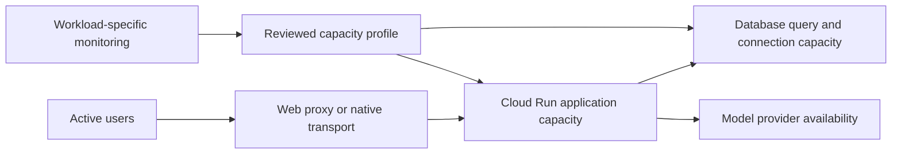

# Runtime Capacity and Qualification

## Visual Map



Cloud Run application capacity, database capacity and model availability are
separate dependencies. The adoption target is 10,000 simultaneously active users,
including a separate application transport scenario with 10,000 open streams.
That target remains **unqualified** until dated workload and release evidence
exists. It does not introduce an AI spending or entitlement cap. Dedicated model
throughput is a separate provider allocation decision.

## Configuration and admission

[`config/runtime-capacity.json`](../../../config/runtime-capacity.json) owns the
reviewed database connection budget. The
[capacity checker](../../../scripts/ci/runtime-capacity-budget.py) inventories
retained revisions, workers, deployment candidates, job overlap and administrative
reserve. Run it with the approved project identity:

```bash
python3 scripts/ci/runtime-capacity-budget.py --environment production --phase post-release
```

The calculation uses the larger of asyncpg maximum and minimum (default minimum
two), plus the SQLAlchemy pool and overflow, per worker and replica. Secret-backed
pool modifiers and enabled `DB_SQLALCHEMY_USE_NULL_POOL` fail closed: they cannot
establish the reviewed finite pool ceiling. A passing connection check does not
establish adequate database CPU, IO, query latency or lock headroom.

Retained revisions with a direct `gunicorn` launcher and different finite `WEB_CONCURRENCY` and CLI
worker counts reserves the larger declaration and reports both values. This is
a conservative connection bound while historical candidates drain. Unknown
launchers, shell wrappers, secret-backed values, malformed counts and conflicting
CLI counts still block admission. Normal backend deploys clear inherited command
and argument overrides, restoring the selected image's launcher and reviewed
worker environment. Retained revisions, reserve and the admission limit remain
part of every budget calculation.
Fixed bridge qualification and inherited-candidate checks still require
consistent declarations; conservative retained accounting does not qualify a
new launcher configuration.

The checker currently counts pooled connections. Session-scoped advisory work
uses `dedicated_connection()` outside those pools; its connections are not yet
included in that calculation or bounded by a shared dedicated-session budget.
Account for and bound that demand before qualifying larger replica limits.

Maximum replicas times request concurrency describes nominal in-flight request
slots. It is neither a user count nor a qualified request rate. Estimate required
slots from measured mean request duration and arrival rate, plus long-lived
streams. Keep headroom for short control requests, background work and rollout
overlap. Verify regional quota and available capacity before raising maxima.

The production release workflow configures a 300-second frontend platform timeout, leaving room for
the existing 200-second private-agent execution budget. Short operations retain
route-specific timeouts. Increasing the platform timeout does not grant a longer
agent execution budget. Backend infrastructure timeouts alone cannot protect a
stream traversing a shorter-lived proxy.

## Runtime resource lifecycle

Kai model-stream admission waits consume the same monotonic operation deadline
as provider work. An expired admission never initiates a provider call; acquired
slots are released on completion, failure or cancellation.

The analyze manager preserves its full six-hour replay contract and terminal
handoff. One lazy expiry worker reclaims expired completed runs even when no new
request arrives; running workers are preserved. Completion releases the consent
token and authorized package context while retaining public provenance and replay
frames. Shutdown stops the expiry worker. This is **not a hard active replay byte
limit**: a replay-window change must preserve cursor, terminal and client recovery
semantics rather than silently dropping frames.

The outbound email worker accepts at most 1,024 pending jobs by default, in
addition to its active send. Saturation or shutdown raises
`EmailDeliveryQueueUnavailable`; callers must not report rejection as queued.
RIA invite delivery records the failure through its existing metadata owner.
Shutdown allows up to five seconds for accepted work to drain, then one second
for bounded failure callbacks on jobs that never started. The active send is
reported separately as uncertain; callback failures remain observable. The queue remains
process-local and is **not restart-safe durable delivery**. A timed-out
thread-offloaded send has an uncertain outcome and must not be blindly retried.
A durable outbox requires typed reconstructible jobs, encrypted payload ownership,
leases and the existing effect owner's idempotency contract; Python callbacks
cannot be serialized into a safe job authority.

## Managed observability

The existing [provisioner](../../../deploy/observability/reconcile_capacity.py)
plans by default. Review its output before applying:

```bash
python3 deploy/observability/reconcile_capacity.py --project hushh-pda --sql-instance hushh-vault-db
python3 deploy/observability/reconcile_capacity.py --project hushh-gemini-bridge --provider-only
```

Add `--apply` only for an authorized change. Provider-only mode manages provider
availability alerts and its own dashboard without SQL or application log-metric
changes. Ordinary application mode still requires a reviewed SQL instance.

SQL CPU saturation uses the selected instance's mean CPU above 90% for ten
minutes. Investigate query/lock/pool wait and user impact before adding application
replicas. Provider 429/5xx alerts observe availability, not usage entitlements.
Diagnostic-only policies remain distinct from actionable notifications.

Chat first-answer and first-visible timing exclude missing marks. Compare answer samples with terminal-turn coverage; missing answers include approval-only turns and remain diagnostic. The actionable stream-failure policy counts any unexpected terminal failure in five minutes, including low traffic. Azure call logs separately measure authentication, first output, total time and reasoning-token usage without prompts or owner identifiers. One UAT text chat uses Azure only, cached credential suppliers and minimal default reasoning; its native public-search child uses low reasoning. The SDK read-idle budget is 60 seconds, separate from the 10-second first-output budget. No failed One turn changes to Gemini.

Chat first-visible timing excludes missing marks. Its sample-rate panel makes
sparse observations visible; it is not an active-stream gauge. Keep provider
errors, terminal stream outcomes, request latency and expected security refusals
separate. Use bounded route/model labels without owner identifiers, prompts,
keys, credentials or decrypted records. Notification configuration does not prove
notification delivery; record that proof separately.

## Qualification and remaining work

Extend the existing [UAT capacity driver](../../../scripts/ops/uat_capacity_load.py)
and [chat latency driver](../../../consent-protocol/scripts/measure_agent_chat_latency.py).
Do not present the current single-reviewer, bounded-read test as 10,000-user proof.

1. Measure representative read/write/chat/voice demand with owner-isolated,
   authorized synthetic fixtures. Preserve auth, consent and vault boundaries.
2. Correct unbounded waiting and retained-work lifecycle before raising limits.
3. Qualify larger regional-HA SQL capacity, query/pool behavior and concurrency
   candidates against latency, memory, database and event-loop objectives.
4. Ramp application scenarios through 100, 1,000, 5,000 and 10,000 active users;
   include concurrent streams, burst, soak, disconnect/reconnect, instance churn
   and saturation recovery. Use controlled model substitutes for large transport
   tests and keep real-provider checks paced and separately attributed.
5. Bind achieved throughput, latency, terminal success, queue age, memory and
   recovery evidence to the exact image, revision, schema and capacity profile.
6. Use the existing governed release and drained-retention workflow. Preserve
   rollback anchors, paused Drive processing and ciphertext-only persistence.

A transaction pooler is not a drop-in replacement for direct session connections:
PostgreSQL `LISTEN`, session advisory locks and asyncpg prepared statements need
explicit compatibility paths. Regional HA and an isolated restore drill are
separate from backup/PITR configuration. See
[production recovery](./production-db-backup-and-recovery.md),
[Google autoscaling](https://docs.cloud.google.com/run/docs/about-instance-autoscaling),
[connection pooling limitations](https://docs.cloud.google.com/sql/docs/postgres/managed-connection-pooling)
and [capacity planning](https://docs.cloud.google.com/architecture/framework/performance-optimization/plan-resource-allocation).
