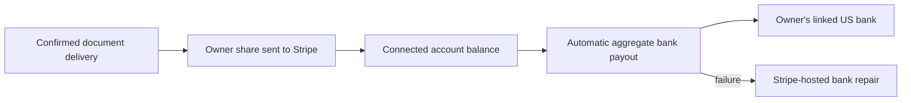

# Connected-account bank payout status

This surface is for the **owner's aggregate bank deposits**, not for one
document request. A confirmed document delivery may produce one Stripe
Transfer to the owner's connected Stripe balance. Stripe's automatic bank
Payout can combine that transfer with other earnings and adjustments. A
Transfer must never be labeled “bank paid.”

## Visual Map

## Hussh Coins cash-out

New Hussh Coins-settled document orders earn without bank setup. Legacy direct
transfers continue under their recorded payment mode.

UAT runs live Checkout (`STRIPE_UAT_MODE=live`), live Connect
(`STRIPE_CONNECT_UAT_MODE=live`) and live cash-out
(`DRIVE_REQUEST_HASHCOINS_LIVE_UAT_ENABLED=true`). Profile → Payouts links a real
bank and cashes out real coins. The sandbox balance appears only while Connect
runs in test mode, and it never spends real coins.

To stop cash-out, set `DRIVE_REQUEST_HASHCOINS_LIVE_UAT_ENABLED=false` and run the
governed UAT release, which redeploys the API and Drive worker. New withdrawals
stop and reserved ones wait; accepted transfers and refund reversals keep
reconciling. This is the only rollback. Never switch Connect back to test while
live redemptions exist: the worker reconciles only the current Connect mode, so
live transfers and refunds would go unreconciled. The deploy check refuses test
Checkout with live Connect.

`STRIPE_MODE` and `STRIPE_SECRET_KEY` continue to own Checkout, refunds and actual
fee retrieval. `STRIPE_CONNECT_MODE` and `STRIPE_CONNECT_SECRET_KEY` independently
select the document bank setup and redemption client. Never set the payment key
to test to enable sandbox bank linking. Account mappings remain isolated by
`(user_id,stripe_mode)`.

While the answers lane is off, answer payout setup refuses a Stripe mode that
differs from Connect. Before enabling answers in UAT, set
`PKM_ANSWER_STRIPE_UAT_MODE=live` so they share the owner's live Connect account.

The existing `/api/one/payouts/connect/webhook` and signing secret retain legacy
payment-mode event handling. `/api/one/payouts/connect/sandbox-webhook` accepts
only test events verified with `STRIPE_CONNECT_TEST_WEBHOOK_SECRET`. Live/test
account identifiers, signatures and payment sources cannot cross this boundary.
Both API and Drive worker receive the Connect key for durable redemption retry.

### Live Dashboard settings

Cash-out depends on these live Stripe settings. Record any change here.

- **Connect → Payouts → External accounts:** bank accounts only, with debit cards
  off. The app recognizes only a default US bank account, so a card default
  blocks cash-out. Whether owners may keep several banks is set by **Collect
  multiple external accounts per currency** (see Bank management).
- **Settings → Payment methods** for document Checkout: card-based methods only
  (cards, Apple Pay, Google Pay, Link with a card). Checkout offers the methods
  enabled there, and cash-out can only draw on earnings paid through a card
  charge (`ch_`). Coins from any other method cannot be cashed out.

## UAT and production setup

Use the owner's US Express connected account for the configured Stripe mode.
UAT defaults to test mode and can explicitly select live through
`STRIPE_UAT_MODE`; production requires live. The backend rejects keys that do
not match `STRIPE_MODE`. Live UAT uses its own secret bindings and webhook
destinations. Stripe object IDs, hosted onboarding links, bank accounts, and
webhook signing secrets do not cross modes. Migration 298 adds
`stripe_owner_payout_accounts`, keyed by owner and mode, while preserving the
legacy mapping for rolling compatibility. Test onboarding never satisfies live
payout readiness. UAT and production retain separate Cloud SQL instances; do not
copy payout mappings between them. See the [live UAT rollout](./drive-request-stripe-paywall.md).

A live API key does not prove Connect is activated. Before offering live bank
setup, finish Stripe Dashboard → Connect → Set up, including any required
identity verification and final-details review. Stripe can reject account
creation with “complete your platform profile” even after the platform
questionnaire is marked complete. The app returns
`PAYOUT_PLATFORM_SETUP_REQUIRED` and explains that Hussh must activate payouts;
the owner should not be sent into a repeated bank-setup retry loop. This provider
prerequisite cannot be repaired by replacing an owner's bank or changing keys.

Legacy sandbox account recovery accepts only Stripe's explicit, account-specific
test-mode verdict or missing-resource response. Stripe's Python SDK decodes the
test-mode HTTP 400 as `InvalidRequestError`; transport-level tests cover that
actual decoding. Authentication, network, and unrelated provider failures must
never authorize a replacement connected account.

In each Stripe environment, create a **Connected accounts** event destination
pointing to `POST /api/one/payouts/connect/webhook`. Select `account.updated`,
`account.external_account.created`, `account.external_account.updated`,
`account.external_account.deleted`, `payout.created`, `payout.updated`,
`payout.paid`, `payout.failed`, `payout.canceled`,
`payout.reconciliation_completed`, and `balance.available`. The sandbox
destination (`/api/one/payouts/connect/sandbox-webhook`) uses the same list.
The live and Sandbox1 Connect destinations already include the last two.
Store the `/connect/webhook` destination's signing secret as
`STRIPE_CONNECT_WEBHOOK_SECRET` in the backend Secret Manager project. It must differ from the platform Checkout endpoint's
`STRIPE_WEBHOOK_SECRET`. Bind both secrets only to the backend runtime, never
the webapp. The private worker also needs the Connect webhook secret to
reconcile an accepted live redemption after a retry. Production Connect destinations may deliver test and live events;
the handler checks `event.livemode`, top-level `event.account`, the mapped
connected account, and a provider read under the matching Stripe API key.

The webhook validates Stripe's signature over raw bytes, fetches the latest
connected-account Payout or Account, and records each event ID once. A stale
`payout.created` event cannot downgrade `paid`; `payout.failed` can supersede
`paid` if the bank later rejects the deposit. Provider reads are ordered by the
time they were taken. A later read with the same status still updates the
arrival date, failure code, bank trace and reconciliation status; an older read
is ignored. The owner's doorbell rings only when the stored deposit changed.
Provider failures return a retryable error.

`balance.available` marks the owner's balance snapshot for refresh and rings the
`balance` doorbell. `payout.reconciliation_completed`, and `payout.paid` once
Stripe reports reconciliation complete, store the deposit and queue its
itemisation (see below). Both are safe to process more than once, and neither
is needed to show bank status.

To see why Stripe's delivery failed, search the backend logs for
`connect_webhook.rejected route=… status=… code=…`. `route` is `live` or
`sandbox`, `status` is the HTTP status returned to Stripe, and `code` is a
closed code such as `invalid_signature`, `invalid_event`, `provider_mismatch`,
`storage_unavailable`, `payload_too_large` or `sandbox_disabled` (`other` for
anything unexpected). The line never carries the event, account or provider
text.

The account owner reads deposits newest first, 20 per page with an opaque
cursor, through `GET /api/one/payouts/account/bank-payouts`. Each deposit
keeps a write-once masked snapshot of the bank it was sent to (bank name and
last four), plus Stripe's bank trace reference once Stripe has one. Removing
or replacing that bank later does not change the snapshot. A deposit first seen after its bank was
deleted keeps no name or last four, and the receipt says "Bank not recorded".
The response has no account or routing number and no document request ID.

The private worker also scans bounded pages of connected-account payouts using
a durable cursor. A missed webhook can therefore update deposit status without
an owner refresh; the scan never attributes a bank deposit to a single request.

## Bank management

Profile → Payouts → **Manage bank** issues a fresh, owner-scoped Express login
link. Stripe verifies the owner and handles adding, replacing, and removing
eligible payout banks. Hussh never accepts account numbers or routing numbers.
Deleted, non-US, or non-Express accounts cannot receive a management link.
Restricted Express accounts remain manageable so the owner can fix a failed
bank or finish verification.

Express login links use either `https://stripe.com/express/...` or
`https://connect.stripe.com/express/...`. Both backend and frontend accept these
documented forms while rejecting unrelated hosts, paths, credentials, and
ports. The link is short-lived; request a fresh link for every visit. Successful
navigation or a return URL alone does not prove that bank setup is complete.

The platform's Stripe **Connect → Payouts → External accounts** setting controls
whether owners may keep several banks in one currency (up to ten). Enable
**Collect multiple external accounts per currency** to offer that capability.
Do not promise that the final/default bank can be removed: Stripe can require
a replacement before removal. Changing a bank does not redirect a deposit
already in transit, delete transactions, reverse an earning, or start another
transfer. Those remain separate provider-backed records.

`GET /api/one/payouts/account` returns the default US dollar bank's display name,
last four digits, and status when Stripe exposes them, along with
`canManageBank`. `bankStatus` is `linked`, `missing`, `needs_attention`, or
`unavailable`. A truncated or omitted bank preview is `unavailable`, never
evidence that a bank was removed. A missing, failed, or unverified default bank
blocks new paid requests even if Stripe's general payouts flag remains enabled. Returning from Stripe refreshes account state; signed external-account
events also recompute readiness from the current Stripe Account and publish the
owner's existing state notification. Event payloads never replace authoritative
account state, and duplicate events do not create duplicate deposits.

Provider references: [Express account settings](https://docs.stripe.com/connect/express-dashboard),
[external bank collection settings](https://docs.stripe.com/connect/payouts-bank-accounts),
[bank replacement and deposits in transit](https://support.stripe.com/questions/update-existing-bank-account-information).

## Product status language

Per document request: **Earning pending** → **Sent to Stripe** when its Transfer
is confirmed. In the owner's payout summary: **Bank payout scheduled**
(`pending`), **On the way** (`in_transit`), **Bank payout completed** (`paid`),
or **Bank payout failed** (`failed`). A failed external account requires the
owner to repair their bank details in Stripe-hosted account management.
`expectedArrivalAt` is an estimate, not a promise.

Profile → Payouts → Your money:

- **In Stripe** is money in the owner's live Stripe balance that is not in
  their bank yet (`GET /api/one/payouts/account/balance`). It is hidden in test
  mode, with no linked live account, and when it is $0 or less.
- **Settling · available Oct 14** means some of it is still pending at Stripe.
  The day is Stripe's UTC day, so it reads the same in every time zone.
- **Available** money goes to the bank on the owner's Stripe payout schedule.
- **Redeem** moves one paid request's earning at a time from Hussh Coins to the
  owner's Stripe balance. The bank deposit then follows the payout schedule.

Deposit contents come only from Stripe's reconciliation, never from timing or
amounts. Each deposit's bank is its own snapshot, not the owner's current bank.

An **automatic** deposit is itemised after Stripe reports its reconciliation
complete. The webhook queues it in `stripe_connect_payout_reconciliations`; a
worker backstop also queues recently changed deposits the webhook missed. Each
private worker tick itemises at most one deposit: it lists that deposit's
connected-account balance transactions (`payout=po_…`), 100 per page and at
most 3 pages per tick, and saves a durable cursor so the next tick resumes
where it stopped. A transaction is attributed only through a link Stripe
reports:

- a payment's `source_transfer`: the owner's cash-out or document transfer on
  the same account;
- a refund's refunded payment, then that payment's `source_transfer`;
- a `payout_failure` or `payout_cancel` row: an earlier returned deposit sent
  again.

Anything else counts in the deposit's unattributed `otherCents`, so the items
plus `otherCents` equal the deposit. Manual payouts are `not_applicable`:
Stripe's payout balance-transaction filter does not support them. Never infer
a one-to-one document-to-bank relationship. Bank status never waits for
itemisation.

Each Drive worker tick reports these Connect ledger counts in its drain
outcomes: `balance_accounts_checked`, `balance_snapshots_changed`,
`balance_refresh_deferred`, `payout_reconciliations_queued`,
`payout_reconciliations_checked`, `payout_reconciliations_completed` and
`payout_reconciliation_deferred`. A tick refreshes at most two due balance
snapshots.

Test-mode acceptance uses Stripe's test US bank numbers: routing `110000000`,
account `000123456789` for success and `000111111116` for a `no_account`
failure. These simulate a bank deposit; they do not move real money or prove
live identity verification. Launch still requires live onboarding, live
webhook registration, and a controlled live smoke transaction.

References: [Express onboarding](https://docs.stripe.com/connect/express-accounts),
[Connect webhooks](https://docs.stripe.com/connect/webhooks.md),
[connected-account payouts](https://docs.stripe.com/connect/payouts-connected-accounts.md),
[test bank accounts](https://docs.stripe.com/connect/testing.md),
[balance transactions by automatic payout](https://docs.stripe.com/api/balance_transactions/list).
