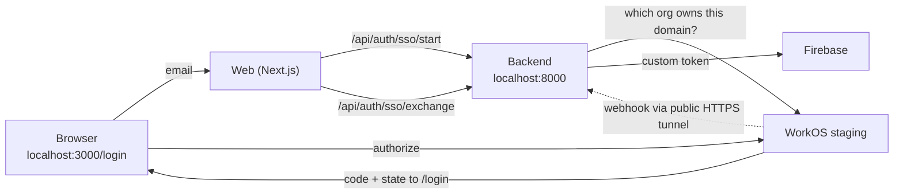

# WorkOS SSO: local sandbox run

How to exercise enterprise SSO end to end against a WorkOS **staging** environment from a developer machine. Design and decisions: [enterprise-sso-workos-adr.md](../architecture/enterprise-sso-workos-adr.md). The feature is off unless both flags below are set. It needs **no database change and no per-organization setup on the Hussh side**: WorkOS decides which organizations and domains are valid.

## Visual Context

Canonical visual owner: [Operations Index](README.md). This diagram shows only the local sandbox path.



## Prerequisites

1. Firebase Admin credentials working for the backend (the exchange creates the account and mints a real custom token).
2. A public HTTPS tunnel to the backend for the webhook (WorkOS rejects `localhost`). Any tunnel works, for example `cloudflared tunnel --url http://127.0.0.1:8000` or `ngrok http 8000`.

## WorkOS dashboard (staging environment)

Use the **Staging** environment. Menu labels can shift; the names below are the ones WorkOS documents.

1. **API key and Client ID.** Create a key named for this work under API Keys. If an existing key shows recent use by another app, create a new one so the two can be rotated independently. Copy the **Client ID** from the Overview or API Keys page.
2. **Redirect.** Under **Redirects**, add `http://localhost:3000/login`. It must match `WORKOS_REDIRECT_URI` exactly.
3. **Test organization.** Staging ships a default **Test Organization** whose SSO connection uses WorkOS's Test Identity Provider and whose verified domain is `example.com`. Its id looks like `org_01...` and is shown on its page under **Organizations** (in this environment it is `org_01KYNNAGSP2Y5ZAK3T2PN8NQ3T`; other environments differ, so copy yours). The **Test SSO** page lists the scenarios and the test profile to use. WorkOS keeps this built-in connection out of its connection API listing, which the backend allows for; sign-in sends you to a test page on the WorkOS dashboard, so be signed into the dashboard in that browser. The Test IdP is documented only for that default organization, so use it instead of creating one. Real IdP setup (Okta, Entra) is done later through the Admin Portal. For a real organization, its admin also verifies the company's domain there by a DNS record.
4. **Webhook.** Under **Webhooks**, add an endpoint at `https://<your-tunnel>/api/webhooks/workos`. Subscribe to the Directory Sync user events (`dsync.user.deleted` and `dsync.user.updated`); everything else is acknowledged and ignored. Copy the signing secret. On the endpoint page, **Send test event** proves the signature path through the tunnel; a sample payload matches nobody, so a healthy answer is `{"received": true, "deprovisioned": 0}`.

Do not paste keys or secrets into chat, tickets, or commits.

## Local environment

`consent-protocol/.env` (git-ignored):

```
WORKOS_SSO_ENABLED=true
WORKOS_API_KEY=<staging sk_test_ key>
WORKOS_CLIENT_ID=<client id>
WORKOS_WEBHOOK_SECRET=<webhook signing secret>
WORKOS_REDIRECT_URI=http://localhost:3000/login
```

`hushh-webapp/.env.local` (git-ignored):

```
NEXT_PUBLIC_WORKOS_SSO_ENABLED=true
```

## Run

Before the first run, build the backend environment from the lockfile (the runners refuse to start if it is out of sync): `cd consent-protocol && uv sync --frozen --group dev`. Pass `--skip-activate` to the proxy and backend runners if you merged your own env files, so they are not overwritten. The runner's doctor reads a second copy of the web env file, saved next to `hushh-webapp/.env.local` with one more .local suffix; keep the two identical.

Three separate terminals, one component each:

```bash
./bin/hushh proxy --mode local
./bin/hushh backend --mode local --reload
./bin/hushh web --mode local
```

On Windows two runner quirks (not specific to SSO) can get in the way. `run_proxy_local.sh` looks only for `.venv/bin/python`, while a Windows venv keeps its interpreter in a `Scripts` folder; and the runners' helper snippets call `python3`, which can resolve to the Microsoft Store stub ("Permission denied"). A one-line `.venv/bin/python` wrapper script that runs the venv's own Windows Python, and a `python3` wrapper of the same kind earlier on `PATH`, are enough. The proxy runner deliberately refuses your personal gcloud login and uses the service-account credential from the env file; it leaves a temporary copy in your Temp folder while it runs and removes it on a clean exit, so check for stale `hushh-cloudsql-creds.*` files after a crash.

## What to check

Use a **unique** `@example.com` address such as `ssotest-<date>@example.com`, in the sign-in form and on the Test IdP page, and fill every field the Test IdP page shows (an empty field fails with "did not contain expected attributes"). The Firebase project is shared, so common addresses such as `test@example.com` already exist there as unverified password accounts; SSO refuses to merge into those (`409 sso_email_conflict`), by design.

1. **Sign in.** On `/login`, choose Continue with SSO, enter an email on the organization's verified domain, complete the Test IdP step. Expected: you return to the app signed in, then still need your vault passphrase to unlock. SSO never replaces the passphrase.
2. **Second sign-in.** The same person gets the same account (no duplicate).
3. **Deprovision.** Directory Sync needs a real directory, so simulate the event for the person you just signed in as. From `consent-protocol`:

   ```bash
   python scripts/workos_sso_local.py webhook --org <the organization id, org_01...> --email <their email>
   ```

   Expected: `{"received": true, "deprovisioned": 1}` and the next SSO sign-in is refused. What else happens depends on how the account came to exist:
   - **Created by SSO:** the account is disabled, its sessions end within about a minute, and its consent grants are revoked.
   - **An existing personal account that SSO linked:** only its sessions end. The account, vault and grants stay, and the person can still sign in with their usual method.
4. **Refusals.** An email on a domain that is not the organization's verified domain, a free-mail address, or a callback opened in a different browser tab each fail without creating an account.
5. **Re-login after deprovision.** Signing in again as the same person must be refused with "This sign-in could not be completed". The backend logs `enterprise_sso.refused code=sso_deprovisioned status=403`; every refusal logs its code this way (no identity), which is how to tell the 409 cases apart.
6. **Clean up.** The test account is created in the real Firebase project and leaves a few rows in the database. Delete it through the app's own account deletion (`AccountService.delete_account`). While the database's account-deletion **release fence** is installed, deletion fails closed with `ACCOUNT_DELETION_PAUSED` (SQLSTATE `55000`) and rolls back cleanly; leave the account disabled and retry after a healthy release. Do not remove the fence by hand: see [account-deletion-rollout.md](./account-deletion-rollout.md).

## Refusal codes

| Code | Meaning |
|------|---------|
| `sso_not_available` | WorkOS has no organization with that email domain verified, or its connections are all switched off. Free-mail domains never qualify. |
| `sso_state_invalid`, `sso_code_invalid` | The attempt expired or was replayed. Start again. |
| `sso_unavailable` on the exchange | WorkOS rejected the backend's credentials (`invalid_client`: the API key and the Client ID belong to **different WorkOS applications**, or the key is wrong). Nothing the person can fix; the backend logs `enterprise_sso.workos_credentials_rejected`. In the dashboard, open Applications, find the application that owns the Client ID, and make sure the API key is the one associated with that same application. |
| `sso_org_mismatch`, `sso_org_not_enabled` | The profile's organization is not the one the attempt started for, or WorkOS lists connections for it and none is active. |
| `sso_domain_not_verified` | The profile email's domain is not one the organization has verified, or is a free-mail domain. |
| `sso_deprovisioned` | The person was deprovisioned. |
| `sso_email_conflict` | An unverified Hussh account already uses that email. It is never merged automatically. |
| `sso_account_conflict` | The account is already claimed by a different person or organization. |
| `sso_account_deleted` | The person deleted their account; SSO does not recreate it. |
| `webhook_invalid_signature` | Wrong secret, a changed body, or a timestamp outside the 180-second window. |

## To turn an organization off

Disable its SSO connection in the WorkOS dashboard. New sign-ins stop immediately; existing sessions continue until they expire or the person is deprovisioned.

## Not covered here

Native apps (web only in v1), a real directory through Directory Sync, reactivating a deprovisioned person, and deploy configuration (secrets and the web build flag).
