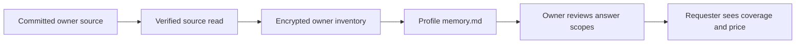

# Live Memory release UAT stories

## Visual Context

The system context follows the [architecture visual owner](../architecture/README.md).

This checklist tests the source-linked Profile memory projection described in the
[freshness ADR](../architecture/living-memory-freshness-adr.md) and the
[source admission contract](../architecture/live-memory-source-contract.md).
Run with two test accounts, A (owner) and B (requester), on separate sessions.
Use known test records and record the build, environment, source timestamps and
observed outcome for each story. A source signal only wakes a verified read; it
does not itself prove that a change reached memory.

The bridge updates while A's app is **open and vault unlocked**. A closed app,
locked vault or offline source can leave memory stale. This release does not
capture a full contact list or continuous location trail. Document earnings are
the owner's document payout records, not every receipt or transaction. Payments
and live answer composition may be feature-gated in the target environment.

## Automated and synthetic checks before deployment

These checks use controlled fixtures and mocks. Passing them is not evidence of
real provider delivery, deployed latency or closed-app capture.

| Story | Required assertion |
| --- | --- |
| Profile rename | An authoritative A rename from “Ankit Kumar Singh” to “Ankit” advances one source revision; the current projection shows “Ankit” and a late old read cannot restore the former value. |
| Connection add/remove | Both connection audiences are scanned completely. A committed add appears once; a verified removal becomes a tombstone. A partial or racing scan cannot remove it. No contact-list row or counterpart profile is copied. |
| Curated OAuth status | A verified curated OAuth connection changes status, and a verified disconnect removes or tombstones it. The projection contains provider, status and connection time only; no token, scope, account email or custom connector row. |
| Document earnings | Complete live and test keyset scans project request ID, status, gross/refund/net cents and timestamps. Duplicate IDs, a broken cursor or one failed partition mark the source incomplete without erasing prior earnings. No bank details, provider reference or document description appears. |
| Owner isolation | An A event or delayed A response cannot write to B's inventory after an account or vault-session switch. A's source values never appear in B's memory or answer scope read. |
| Incomplete read recovery | A failed, partial or mismatched source read keeps last verified records and marks the source incomplete. A subsequent matching complete scan clears the unavailable state and applies real changes exactly once. |
| Partial answer | With explicit saved sex and location but no valid age source, availability returns sex/location as available and age as missing. Rechecking before approval prevents stale terms; the requester coverage lists age as not included before any Pay control. No age is inferred. |

Run the focused living-source, bridge, connection, connector, answer-review and
answer-route tests plus `scripts/ci/live-memory-source-gate.py` in the release
checkout. Record the exact commands and results in the PR or release evidence;
this document is an acceptance checklist, not a claim that those checks ran.

## Human steps after deployment

Keep A open and unlocked for the memory steps. Allow one normal refresh cycle
for a source without an immediate change signal; record actual elapsed time and
the current, pending or failed status shown. Do not report a fixed real-time SLA from local
tests.

| Story | Action and pass condition |
| --- | --- |
| Profile rename | In A's Profile, change the display name to “Ankit”. Open Profile Memory and confirm the current name updates once, with no duplicate or old name presented as current. Lock and unlock, then confirm it persists. |
| Connection add/remove | Connect A and B through the supported flow, then remove the connection. A's Memory reflects each committed state after verification; B's unrelated connections and A's full contacts do not appear. |
| Curated OAuth status | Connect and verify one curated OAuth provider, then disconnect it. A's Memory shows the correct provider status and connection time, then the disconnected state, without credentials or provider payload. A completed redirect alone is not a connected result. |
| Document earnings | In an environment with test document payouts, complete or refund one owned document earning. Confirm A's Memory reflects the final status and amounts only after the payout source updates. Do not treat a queued share or requester payment as an earning. |
| Owner isolation | Leave A's refresh pending, switch that browser to B, and inspect B's Memory. No A profile, connection, OAuth or earning record appears. Return to A and verify A's records remain owner scoped. |
| Incomplete read recovery | In a controlled staging run, interrupt one source read or one page, then inspect freshness. The prior record remains, the source is incomplete, and no missing row is called deleted. Restore the source and refresh; the verified state returns without duplicates. |
| Partial answer and disclosure | Save an explicit sex value and a saved location for A; leave age absent. B asks A for age, sex and location. A's review shows sex/location available and age not recorded; A can approve only available scopes and set the price. Before any checkout, B sees sex/location listed as included, age as not included, and the exact price. No answer or value is released before the approved delivery/payment boundary. |

If the payment gate is off, verify the requester coverage and disabled checkout
state, then stop. If the test payment lane is on, verify that checkout is offered
only for a prepared, complete answer to the approved subset and that confirmed
payment releases that answer once. A missing age must never be guessed, sold or
silently included. If a source cannot be verified, distinguish **could not
verify** from **not recorded** and retry instead of treating it as absence.
