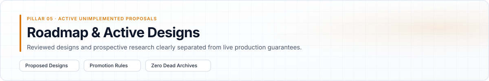
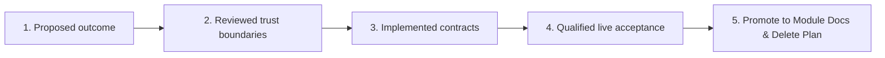

  <picture>
    <source media="(prefers-color-scheme: dark)" srcset="../assets/brand/pillar-roadmap-dark.svg" />
    <source media="(prefers-color-scheme: light)" srcset="../assets/brand/pillar-roadmap-light.svg" />
    
  </picture>

# Roadmap and active designs

[Documentation](../README.md) · [Current capabilities](../product/capabilities.md) · **Intent:** Active unimplemented proposals

> [!NOTE]
> **Proposals Are Not Guarantees:** Everything under `docs/roadmap/` represents reviewed proposals, active research, or unfinished designs. Promote a claim into live Architecture or Product docs only after source contracts and required acceptance pass, then delete the superseded plan under our Zero-Archive policy.

## Visual Map

## Active workstreams

| Workstream | Status | Focus |
| --- | --- | --- |
| [Private-agent remaining work](personal-agent/README.md) | `Proposed` | Installed acceptance, custody proofs, and multi-cloud lifecycle milestones. |
| [Active implementation plans](implementation/README.md) | `Proposed` | Retained peer plans scheduled for Wave 3 Zero-Archive distillation. |
| [On-device research](on-device/README.md) | `Proposed` | Prospective local-device capacity and packaging research. |
| [Identity assurance](identity-assurance/README.md) | `Proposed` | Proposed identity verification and assurance tiers. |
| [Infrastructure direction](hussh-one-infra/README.md) | `Proposed` | Future integration, isolation, and hosting designs. |
| [Finance roadmap](kai/README.md) | `Proposed` | Proposed Kai specialist extensions. |

## Promotion and retirement rule

Keep intended behavior, dependencies, and open decisions explicit in each proposal. Once work finishes, distill durable implementation facts into the owning Architecture module page and delete the completed narrative plan, relying on Git history for historical snapshots.

## Further reading

- [Apple a plus](apple-a-plus/README.md)
- [Email Agent: Inbox Nudges & A2A (`feat/email-a2a`)](email-agent-nudges-plan.md)
- [Independent Email OTP and Microsoft Sign-In Plan](independent-email-otp-and-microsoft-sign-in-plan.md)
- [Information Marketplace Agent: product plan](information-marketplace-agent-plan.md)
- [One DocuSign and Fund Setup Workflow Plan](one-docusign-fund-setup-plan.md)
- [One Location to Consent Center Integration Plan (Phase C backend)](one-location-consent-center-integration-plan.md)
- [One on Meta Glasses: Ambient Private Agent Plan](one-meta-glasses-ambient-agent-plan.md)
- [One on Meta Glasses: DAT Integration Execution Plan](one-meta-glasses-dat-execution-plan.md)
- [One/Kai/Nav/KYC Runtime Plan](one-nav-runtime-plan.md)
- [One Product Surface Evolution Plan](one-product-surface-evolution-plan.md)
- [Agent One Voice: Siri Handshake and Voice Handoff PRD](one-voice-siri-handshake-prd.md)
- [PKM Data-Slice Marketplace Plan](pkm-slice-marketplace-plan.md)
- [Proposals](proposals/README.md)
- [Repository organization and unified development agents](repository-organization-plan.md)
- [Strategy](strategy/README.md)

<strong>For coding agents: roadmap hygiene rules</strong>

- Never cite a `docs/roadmap/` file as proof that a feature is implemented or deployed.
- When retiring a completed plan, update inbound links and run `./bin/hushh docs verify` and `python3 .agents/skills/docs-governance/scripts/doc_inventory.py stale-candidates`.

