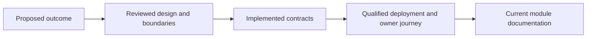

# Roadmap and active designs

[Documentation](../README.md) · [Current capabilities](../product/capabilities.md)

This section owns proposals, research and unfinished implementation plans.
A design is not a deployment guarantee. Promote a claim to current architecture
only after its source contracts and required acceptance establish the behavior.

## Visual Map

## Workstreams

- [Private-agent remaining work](personal-agent/README.md): installed acceptance and lifecycle requirements.
- [Active implementation plans](implementation/README.md): retained peer plans; reconcile status with their owner before retirement.
- [On-device research](on-device/README.md): prospective capacity and packaging, not current device guarantees.
- [Identity assurance](identity-assurance/README.md): proposed assurance capabilities.
- [Infrastructure direction](hussh-one-infra/README.md): future integration and hosting designs.
- [Finance roadmap](kai/README.md).

Current memory remains encrypted Markdown inside PKM. An independent wiki/blob
memory model requires its own design, custody and migration acceptance before it
can replace that implementation. See [current memory](../architecture/modules/memory.md).

## Promotion rule

Keep intended behavior, dependencies and unresolved decisions explicit in each
plan. Reconcile durable implementation facts into their module owner when work
finishes, then delete completed narrative copies after preserving required evidence.
Do not remove active peer work based on its date.

## Further reading

- [Apple a plus](apple-a-plus/README.md)
- [Email Agent — Inbox Nudges & A2A (`feat/email-a2a`)](email-agent-nudges-plan.md)
- [Independent Email OTP and Microsoft Sign-In Plan](independent-email-otp-and-microsoft-sign-in-plan.md)
- [Information Marketplace Agent — product plan](information-marketplace-agent-plan.md)
- [One DocuSign and Fund Setup Workflow Plan](one-docusign-fund-setup-plan.md)
- [One Location → Consent Center Integration Plan (Phase C backend)](one-location-consent-center-integration-plan.md)
- [One on Meta Glasses — Ambient Private Agent Plan](one-meta-glasses-ambient-agent-plan.md)
- [One on Meta Glasses — DAT Integration Execution Plan](one-meta-glasses-dat-execution-plan.md)
- [One/Kai/Nav/KYC Runtime Plan](one-nav-runtime-plan.md)
- [One Product Surface Evolution Plan](one-product-surface-evolution-plan.md)
- [Agent One Voice — Siri Handshake and Voice Handoff PRD](one-voice-siri-handshake-prd.md)
- [PKM Data-Slice Marketplace Plan](pkm-slice-marketplace-plan.md)
- [Proposals](proposals/README.md)
- [Repository organization and unified development agents](repository-organization-plan.md)
- [Strategy](strategy/README.md)
