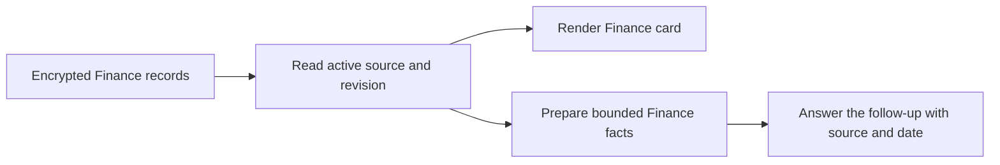

# Finance context in One chat

**Status** The first implementation for #9604 grounds holdings, allocation, and saved performance answers in the owner's vault. Market card follow-ups and persistent Personal Wiki pages are follow-ups.

Phase 1 already renders interactive cards in One chat. The parent agent's tool returns a card descriptor such as a section name. The browser reads and decrypts the portfolio when the card opens. That split explains why the agent can show holdings without having the holdings for a follow-up. UAT currently uses encrypted `one_memory` for conversational memory. The multi-page Personal Wiki is a Dev preview, so the first UAT release needs a vault-backed read that works independently of Wiki cutover. [Phase 1 PR](https://github.com/hushh-labs/hushh-research/pull/9799) · [Workstream](https://github.com/hushh-labs/hushh-research/issues/9604) · [Memory architecture](../architecture/modules/memory.md)

## Document layout

The planned Personal Wiki uses source-linked, owner-private Markdown views over the encrypted Finance records.

| View | Contents |
| --- | --- |
| `finance.md` | Saved investor persona, investment goals, horizon, risk tolerance and preferences where the owner has confirmed them. Include a short **Active portfolio** reference resolved from Manage Portfolio's saved selection. |
| `finance/statements/<snapshot-id>.md` | One page per retained statement. Include its saved filename and import time, separate statement period, holdings, allocation, and performance with currency, effective date and coverage. |
| `finance/plaid.md` | The current supported holdings, allocation and performance from the linked Plaid portfolio, with observation time and freshness. |

The encrypted `financial` domain, its statement snapshot IDs, and the linked Plaid vault records remain authoritative. The first UAT implementation projects typed facts from the vault on the browser for one answer. Existing encrypted writers persist the portfolio and saved source selection. If the Wiki later stores generated pages, they remain rebuildable views keyed to the owner, source ID and revision. Manage Portfolio owns the active selection. [Financial PKM contract](../../consent-protocol/docs/reference/personal-knowledge-model.md#financial-protected-lane) · [Financial resource](../../hushh-webapp/lib/kai/kai-financial-resource.ts) · [Statement selection](../../hushh-webapp/lib/kai/brokerage/financial-sources.ts)

## Execution

1. **Resolve the same portfolio as the card.** The browser opens cards from a fresh vault read and refreshes open cards when saved Finance records change. The card and the answer use the same observation date, saved currency, allocation, unrealized gain, and holdings order by reported market value within each known currency. “What's my biggest holding?” reads the active portfolio, even after reopening the chat. “Which of those was biggest?” can refer to a previously displayed card's source and digest during the current vault session. The browser retains that reference for 30 minutes and checks it against the saved figures before using it. If the reference is unavailable, the private agent can offer to read the active portfolio. [Portfolio card](../../hushh-webapp/components/agent/finance-portfolio-card.tsx) · [Portfolio read](../../hushh-webapp/lib/kai/portfolio-chat-context.ts)
2. **Give the private agent a scoped read.** The parent agent chooses `read_portfolio_context` with a section and source. The compatible browser handles the AG-UI tool call after owner and vault checks. The server validates the bounded result against the pending call and gives it to the model for that answer with further tool execution disabled. The encrypted transcript keeps a receipt, and general memory does not capture the private answer. Holdings are capped at 40 rows with coverage counts and can be filtered by ticker. Saved performance includes total value, unrealized gain and its coverage, and whether the chart history is available. Statement end and Plaid last-sync times describe saved observations. [Read contract](../../consent-protocol/hushh_mcp/one_adk/portfolio_context_contract.py) · [One chat admission](../../consent-protocol/api/routes/one/agent_chat.py)
3. **Keep the active selection current.** The browser reads the encrypted domain on demand. A local write that lands during the read invalidates the answer packet. Import, source switching, holding edits and Plaid refresh continue through the existing Finance owners. If materialized pages are introduced later, use verified change signals and deletion rules under the source admission contract. [Source admission](../architecture/live-memory-source-contract.md)
4. **Ground market follow-ups in quotes and mover tables in a later slice.** Use the same market read and timestamp as the card for “Which of those gainers was up the most?” Query the latest available market source when asked about current conditions. A follow-up about losers needs the corresponding read when that card is available. Market rankings stay outside the owner's Finance documents. [Market gainers card](../../hushh-webapp/components/agent/finance-top-gainers-card.tsx)

## Verification before rollout

- Rehearse with two different saved statements plus a linked Plaid portfolio. Verify “What do I own?”, “Which holding is biggest?” and “How much have I gained since I bought these?” against the card's own rows, figures and date.
- Switch the active source between turns and verify that “now” uses the new source and “that card” uses its retained revision. Check removed statements, failed saves, disconnected Plaid, stale prices, reload, a locked vault, and two different accounts.
- Verify that owner-private context is inaccessible to recipients and that restored tool receipts contain no portfolio contents. Test multiple currencies, missing cost basis, and incomplete chart history so the answer reports its limits.
- Qualify the new read on the UAT backend and frontend together with the signed-in reviewer flow. Before adopting Wiki-backed pages on UAT, prove rollback, source-switch freshness, and removal of inaccessible revisions.

## Import and sharing

The existing workstream puts import and setup in Phase 2, followed by sharing in Phase 3. In Phase 2, reuse Finance's upload, extraction, review and encrypted save. Preserve the filename across resumed import and setup using the protected draft flow. Refresh the active-source reference only after the owner confirms and the save succeeds. In Phase 3, reuse the recipient-first sharing flow for connections and verified advisors. Confirm the actual recipient and permitted slice, encrypt it client-side, hide amounts by default, and keep recipient model processing disabled. A reference to a Finance card supports follow-up questions but grants no sharing permission.
