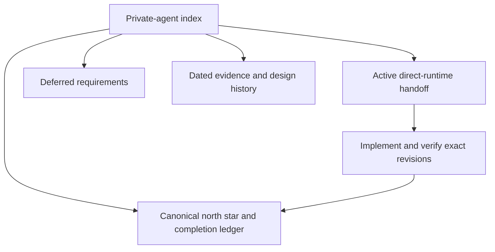

# Private-agent plans and evidence

[Roadmap](../README.md)

## Status

Reviewed against source 2026-10-21. This folder owns future direction and dated
design/evidence snapshots, not current deployment instructions.

**Start with the [owner-pod direct-runtime handoff](./owner-pod-direct-runtime-handoff-2026-09-10.md).** It records dated revisions, the proposed app ↔ owner pod ↔ Puppy
path and remaining acceptance checks. Owner-direct source contracts now exist;
general deployment, native connector acceptance and notification IAM/readiness
still require revision-bound evidence in the canonical north star.

Current requirements and qualified implementation evidence belong in the [private-agent north star](../../product/principles/private-agent-requirements.md). Completion assertions belong to [the existing pod ledger](../../../config/pod-completion-ledger.yaml); no old milestone checkmark grants current pass credit.

## Visual Map

## Active planning

| Document | Use |
| --- | --- |
| [Owner-pod direct-runtime handoff](./owner-pod-direct-runtime-handoff-2026-09-10.md) | Next execution context; reuse the fleet and memory while removing mandatory hub traffic from owner-local work. |
| [Normal release transition](./normal-release-transition.md) | Authorized, gated execution for normal release machinery, legacy Shared continuity, BYOC preservation and returning-user changelogs. Dev acceptance precedes the main transition; UAT and production remain separate. |
| [Remaining roadmap](./roadmap.md) | Deferred requirements and promotion conditions, without obsolete dates or completed implementation instructions. |
| [Computer Use implementation gates](../../../consent-protocol/docs/reference/private-browser-runtime.md) | Disabled dev pilot with locally tested authority, selected-PKM exports, encrypted remembered sessions and preview controls. Same-image public frames and shutdown have component evidence on Cloud Run and Container Apps; installed owner execution, active takeover and lifecycle acceptance remain unqualified. |
| [Browser completion plan](./browser-completion-plan.md) | Documented ADK integration, owner-cloud Gemini/Azure native models, headless execution, responsive takeover and separate cloud qualification. |
| [Owner co-signature](./owner-cosignature.md) | Design only (fifth revision, 2026-10-06), not built: locks an agent to the owner's phone so Hussh's servers cannot add devices, copy or delete it outside Azure sign-in windows; the phone checks a signed release, role content and every Hussh-app operation after each window and at least monthly, and shows no reassurance while the agent reports drift. |

## Historical provenance

These documents preserve earlier decisions, measurements and limitations. Their flags, commands, topology claims and “done” statements apply only to their recorded context. They do not override the current handoff or canonical north star.

| Documents | Retained value |
| --- | --- |
| [Architecture](./architecture.md), [BYOC design](./byoc-user-gcp.md) | Earlier backend portability, custody and attestation proposals; generalized deployment remains subject to fresh verification. |
| [Standby sync](./standby-sync.md) | Approved design (2026-10-02): one active agent plus a synced standby in a second cloud, one-tap switch; not built. |
| [Control-plane split](./control-plane-split.md), [pod–hub information path](./pod-hub-data-path.md) | Transitional hub-mediated design and its trust limitations; “hub is the only door” is not the target architecture. |
| [Autoprovision](./pod-autoprovision.md) | Earlier provisioning fixes and quota observations; not authorization to provision on app launch. |
| [Security review](./security-review.md) | Bounded Phase-0 findings, not a current security certification. |
| [M4 validation](./m4-live-validation.md), [fleet live evidence](./pod-fleet-live-2026-08-04.md) | Dated deployment and teardown receipts. |
| [Consent-log evidence](./consent-log-end-to-end.md), [multi-pod simulation](./multi-pod-dev-simulation.md) | Historical consent/parity findings and measured simulation limits. |
| [Execution log](./execution-log.md) | Historical changes and evidence pointers. |

## Maintenance and promotion

Remove superseded execution instructions after carrying forward unresolved requirements and useful operational constraints. The July dev-live execution plan was removed on 2026-09-10: image building, migration wiring and provisioning now have implementation owners; its onboarding and rollout gaps remain in the roadmap. Git history retains the old instructions.

Promote a future claim only after code, contracts and revision-bound acceptance evidence agree. Refresh affected canonical references and ledger receipts in the implementing change. Do not infer whole-pilot, production or compliance completion from historical evidence.

## Further reading

- [Puppy One device binding and direct relay: the device-side contract (2026-09-10)](puppy-device-binding-spec-2026-09-10.md)
