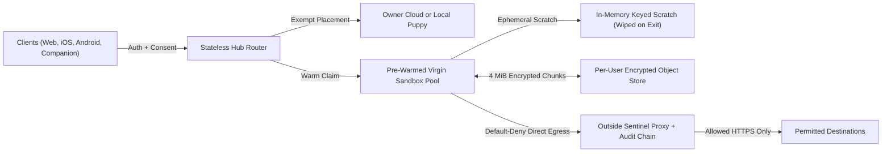

# Agent Sandbox microVM pool and standalone Terminal

[Private-agent remaining work](README.md) · [Roadmap](../README.md) · [Current hosting architecture](../../architecture/modules/hosting.md)

This active plan tracks [#9744 Stand up FedRAMP-ready Agent Sandbox microVM pool, Terminal capability, and Shared Runtime retirement](https://github.com/hushh-labs/hushh-research/issues/9744) and works alongside [#9511 Complete One's standalone Browser capability and reusable workspace split-pane UI](https://github.com/hushh-labs/hushh-research/issues/9511). Source foundations and contract tests are active in Dev; live cluster promotion, UAT verification, and Shared Runtime retirement remain gated behind phase exits.

## Visual Map

## For humans

**Owner:** [Kushal Trivedi](https://github.com/kushaltrivedi5)  
**Lead:** [Kushal Trivedi](https://github.com/kushaltrivedi5)  
**Environment:** Dev  

### Why we are moving hosted agents to pooled single-use sandboxes

Running two agent runtimes side by side (a shared server for everyday users and dedicated per-person cloud services for private pods) splits features cleanly in code yet creates operational divergence and cloud per-project service limits at scale. Monolithic workspace tarballs also block serious terminal and multi-file toolchains.

Moving hosted accounts onto a pre-warmed pool of isolated single-use Kubernetes sandboxes aligns compute cost with concurrent active sessions rather than total signups:

1. **Zero idle compute burn for dormant users:** Inactive accounts exist purely as encrypted cloud objects while active turns claim an untouched sandbox immediately.
2. **Single-use sanitization and one signed base image:** Each claimed sandbox encrypts local scratch with an ephemeral in-memory key, destroys itself permanently when a session ends, and pulls CVE updates from one signed base image on next wake.
3. **Incremental encrypted sync:** Only changed file blocks upload to per-user encrypted object storage, removing monolithic archive ceilings and standing block-disk bills.
4. **Outside network gatekeeper and tamper-evident history:** Sandbox containers cannot reach cloud metadata endpoints or direct internet sockets; an outside gatekeeper validates destinations, injects short-lived credentials at the edge, and records audit history outside sandbox write authority.
5. **Invite and weekly allowance for free cloud compute:** Hosted sandboxes enforce an invite and seven-day rolling usage quota, while owner-hosted cloud placements (BYOC) and local Puppy remain exempt and unthrottled.

### Phased rollout

- [x] **Phase 0: Architecture alignment and clean split.** Locked unified microVM runtime and narrowed #9511 to standalone Browser and reusable workspace split-pane UI.
- [ ] **Phase 1: Warm-pool sandbox baseline, incremental sync, outside gatekeeper, and standalone Terminal.** Land Wave 1 contracts, complete live Dev GKE sandbox claim and single-use teardown validation, and green every CI check.
- [ ] **Phase 2: Live Dev routing, outside proxy runtime, and Browser + Terminal composition.** Connect Hub claim allocation and proxy mediation end to end in Dev.
- [ ] **Phase 3: Unblock #9511 split-pane integration and verify 100% specialist parity in Dev.**
- [ ] **Phase 4: UAT qualification and Shared Agent Runtime retirement.**

## For coding agents

- **Portable custom resources (`extensions.agents.x-k8s.io/v1beta1`):** Rendered by `consent-protocol/hushh_mcp/operons/agent_sandbox/k8s_manifests.py` and reference YAML in `deploy/agent-sandbox/`. Enforces `envVarsInjectionPolicy: Disallowed`, `volumeClaimTemplatesPolicy: Disallowed`, `automountServiceAccountToken: false`, `readOnlyRootFilesystem: true`, non-root UID `10001`, dropped Linux capabilities (`ALL`), immutable `@sha256:` digests, `SandboxClaim` single-use `shutdownPolicy: DeleteForeground` (`ttlSecondsAfterFinished: 0`), and `NetworkPolicy` ingress/egress fencing (`hussh-consent-hub` on TCP `8080`, `sentinel-egress-proxy` on TCP `3128`).
- **Cluster portability:** Uses `gke-sandbox` (gVisor) on GKE Autopilot Dev (`hussh-one-sandbox-dev` in `hushh-pda-dev`, reconciled via `deploy/agent-sandbox/reconcile_dev_gke_sandbox.sh` without Terraform per [the deployment standard](../../architecture/deployment-standard.md)) and `kata` microVMs across Kata-enabled GKE Assured Workloads, AWS GovCloud EKS, and Azure Gov AKS, alongside `AceComputeBackend.render_k8s_agent_sandbox_bundle`.
- **Single-use lease and quota gate:** `consent-protocol/hushh_mcp/services/agent_sandbox/lease_manager.py` enforces `WeeklySandboxQuotaLedger` (exempting `puppy` and `is_owner_cloud_target`) and `VirginSandboxLeaseManager` (`SC4_SINGLE_USE_VIOLATION` on reuse attempt, in-place zeroization of `bytearray` scratch keys).
- **Incremental CAS workspace sync:** `consent-protocol/hushh_mcp/services/pod_workspace/cas_sync_store.py` reuses `WorkspaceCheckpointLibrary` HKDF-SHA256 / AES-256-GCM framing over `ObjectStore` with deduplicated `<= 4 MiB` chunks, excluding `.env*`, private keys, `node_modules`, `.venv`, and symlinks, with `WORKSPACE_REVISION_CONFLICT` fencing and `SP 800-88` key-epoch crypto-erase (`forget_workspace`).
- **Outside egress mediation and tamper-evident audit:** `consent-protocol/hushh_mcp/operons/agent_sandbox/egress_policy.py` (blocking cleartext HTTP, metadata CIDRs, RFC1918/CGNAT DNS rebinding, reverse-tunnel suffixes, and 8 default-off raw TCP ports) pairs with `consent-protocol/hushh_mcp/services/agent_sandbox/sentinel_egress_proxy.py` (`hsur_*` surrogate swap + immediate origin-mismatch revocation) and `consent-protocol/hushh_mcp/operons/agent_sandbox/tamper_evident_audit.py` (HMAC-SHA256 chained log, failing closed with `AUDIT_UNAVAILABLE` if audit writes fail).
- **Standalone ADK Terminal tools:** `consent-protocol/hushh_mcp/one_adk/terminal_tools.py` exposes `terminal_start`, `terminal_poll`, `terminal_write`, and `terminal_stop` via `ContextVar` `terminal_session_invocation`, attached in `agent_tree._one_roster_tools` strictly inside `pod_mode()` without inflating `_COMPOSED_INSTRUCTION_CHAR_BUDGET`, backed by `SandboxProcessSessionManager` (`TERMINAL_OWNER_TAKEOVER_ACTIVE`, `SANDBOX_RAW_CREDENTIAL_FORBIDDEN`).

## Operational references

- [Deployment standard](../../architecture/deployment-standard.md)
- [Dev pod first-light runbook](../../operations/hosting/dev-pod-first-light-runbook.md)
- [Browser completion plan](browser-completion-plan.md)
- [Portable Kubernetes manifests](../../../deploy/agent-sandbox/README.md)
