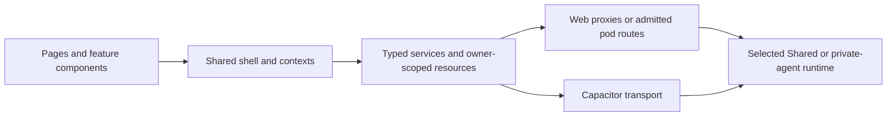

# Hussh One — Web, iOS and Android

The experience for One, your private agent: chat, specialists, connections and
consented information. This package combines Next.js, React and Capacitor.
Hussh’s [Personal Data Agent identity](../docs/vision/agent-ontology.md#personal-data-agent-founder-identity)
governs the experience; the [readiness decision](../docs/reference/quality/adk-orchestration-docs-audit.md)
distinguishes source implementation from installed acceptance.


## Visual Map




## Start here

From the repository root:

```bash
./bin/hushh bootstrap
./bin/hushh doctor --mode local
./bin/hushh web --mode local
```

Use [Getting started](../docs/guides/getting-started.md) for the backend and database
proxy. [Environment profiles](../docs/guides/environment-model.md) select local,
dev or UAT services. Follow the root [AGENTS.md](../AGENTS.md) before changing code.
The container and web CI baseline use Node 24; report tooling requires Node 22.12 or newer.

## Application map

| Route | Purpose |
| --- | --- |
| `/` | Authenticated One chat; public introduction before sign-in |
| `/one` | Agent directory and owner workspace |
| `/one/setup` | Hosting, one provider-aware AI step and account setup |
| `/one/files` | Files explorer; capabilities follow placement and installed support |
| `/one/kai` | Finance workspace; query tabs select market, portfolio or analysis |

The [route contracts](../docs/reference/architecture/route-contracts.md) own the
complete inventory, Back hierarchy and compatibility redirects. Do not create a
second route or action catalog in this README.


- Feature components use the existing service layer for network operations.
- Vault and PKM access requires the current owner, consent and unlocked context.
  Keys and decrypted information stay within their approved processing boundary.
- Shared and private-pod availability follows verified placement and capabilities.
  A saved provider selection does not establish a working AI connection.
- [Morphy UX, app-ui and feature ownership](../docs/reference/quality/design-system.md)
  define shared layout and controls. Reuse the existing shell before adding chrome.

See the [frontend documentation index](docs/README.md),
[component guide](components/README.md) and
[UI contract contributor guide](../docs/reference/architecture/ui-contract-contributor-guide.md).

## Verify the change

From this package, use the nearest existing suite:

```bash
npm run typecheck
npm test -- <existing-test-file>
```

Follow the repository [testing policy](../TESTING.md) for the completed-candidate
core mirror. Hosted [CI](../docs/reference/operations/ci.md) owns the full web and
browser layout gates. Destructive cold native audits require their explicit
approval; do not run them as an ordinary web verification step.
