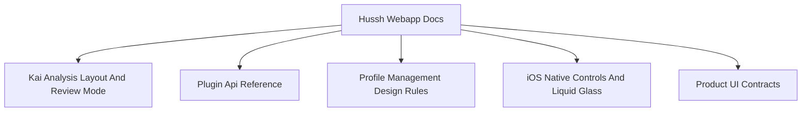

# Hussh Webapp Docs

## Visual Map

Frontend and native-client implementation references for the webapp package.

This docs home is package-local. It should stay focused on frontend/native implementation material that does not belong in cross-cutting root `docs/`.

It still follows the repo-wide founder-language contract:

- `Separation of Duties` frames the shared React shell, Next.js proxies, and native plugin boundary
- `Cryptographic Primitives` frame vault and secure-storage surfaces
- exact method names, route names, and plugin params remain implementation-primary in package-local docs

Canonical mapping: [`docs/reference/architecture/founder-language-matrix.md`](../../docs/reference/architecture/founder-language-matrix.md)
Brand contract: [`docs/reference/operations/brand-and-compatibility-contract.md`](../../docs/reference/operations/brand-and-compatibility-contract.md)

## Documents

| Document | Scope |
| -------- | ----- |
| [plugin-api-reference.md](./plugin-api-reference.md) | Capacitor plugin contracts and parameter parity |
| [kai-analysis-layout-and-review-mode.md](./kai-analysis-layout-and-review-mode.md) | Kai analysis UI layout and app-review runtime behavior |
| [one-location-now-and-map.md](./one-location-now-and-map.md) | One Location "now" surface and immersive map behavior |
| [profile-management-design-rules.md](./profile-management-design-rules.md) | Guardrails for Profile IA, page navigation, and non-analytical summary usage |
| [Connect UI contract](./ui-contracts/connect.md) | Connect pages, Connections and Circles CTAs, nested states, membership boundaries, and Back behavior |
| [Person profile UI contract](./ui-contracts/person-profile.md) | Other-person profile, exact phone/desktop sizing, fonts, every request dialog/sheet, grants, packets and history |
| [Profile UI contract](./ui-contracts/profile.md) | Profile pages/CTAs, nested Memory and Connectors contracts, account, money, preferences, security and provider boundaries |
| [Referrals UI contract](./ui-contracts/referrals.md) | Referrals, rewards, rankings, Circle Wars enrollment and nested Circle creation |
| [Feed UI contract](./ui-contracts/feed.md) | Feed rows/decisions, shared-file and price sheets, payment returns, history mutations and handoffs |
| [Mail UI contract](./ui-contracts/mail.md) | Mail setup, Overview/KYC/Receipts, exact content/CTA branches, API fields, reviewed drafts/delivery, phone/desktop geometry and fonts |
| [Calendar UI contract](./ui-contracts/calendar.md) | Calendar onboarding, Schedule/Invitations/Insights, exact content and CTA branches, API calls, attendance and meeting context, phone/desktop geometry and fonts |
| [Navigation contract](./ui-contracts/navigation.md) and [Font schema](./ui-contracts/typography.md) | Shared navigation CTAs and when to use each Profile, nav and Feed typography role |
| [Product UI contracts](./ui-contracts/README.md) | Maintained product-surface contracts and their authoring requirements |
| [ios-native-surface-adoption.md](./ios-native-surface-adoption.md) | Source-backed native-control inventory, Liquid Glass candidates, fallback boundaries and physical verification limits |

## Source Tree Indexes

- [../components/app-ui/README.md](../components/app-ui/README.md)
- [../components/consent/README.md](../components/consent/README.md)
- [../components/kai/README.md](../components/kai/README.md)
- [../components/ria/README.md](../components/ria/README.md)
- [../lib/services/README.md](../lib/services/README.md)

## Related References

- Cross-cutting docs entry: [`docs/README.md`](../../docs/README.md)
- One Voice product contract: [`docs/reference/one/one-voice-runtime-architecture.md`](../../docs/reference/one/one-voice-runtime-architecture.md)
- One Voice Kai compatibility runtime: [`docs/reference/one/one-voice-kai-compatibility-runtime.md`](../../docs/reference/one/one-voice-kai-compatibility-runtime.md)
- Documentation homes map: [`docs/reference/operations/documentation-architecture-map.md`](../../docs/reference/operations/documentation-architecture-map.md)
- Backend docs entry: [`consent-protocol/docs/README.md`](../../consent-protocol/docs/README.md)
