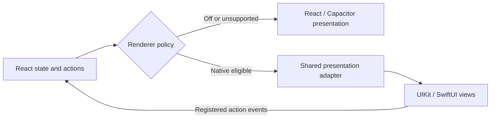
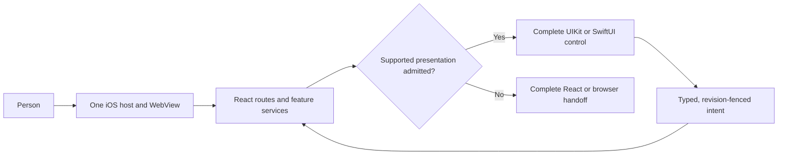

# iOS Native Surface Adoption

## Visual Map

**Status · 2026-11-11:** Whole-app conversion and acceptance remain open. Native interface is **Experimental**, Off by default, and selected once per process on supported iPhones running iOS 26+. React/services retain behavior, validation and authorization; the existing shared UIKit/SwiftUI adapters own admitted presentation. No new renderer lifecycle or persistence schema.

**Current checkpoint · 2026-11-11:** Location’s ordinary child screens now compose through one retained native workspace. Native menus, bounded text editors, Circle management, approval-scope review, invitations, duration editing and saved-place address fields reuse the existing React owners and callbacks. Native navigation and SOS’s local two-second gesture remain in SwiftUI. Maps and platform/provider flows retain their complete authored presentations.

| Boundary | Evidence | Remaining limit |
|---|---|---|
| Shared composition | One workspace host across local selection, menu/editor and return; scoped action handles, canonical text normalization and final-edit fencing. Existing lifecycle, geometry, feedback and portrait owners reused. | No whole-app motion/accessibility or Release-performance qualification. |
| Current-account Location | Actual captures reviewed for Share selection/Cancel; Ask menu, keyboard input/Cancel; Private Check-In note/return; SOS draft/Cancel; Settings approval-scope Cancel; saved-place listing; emergency-Circle members/Add people and authored return. | The root Check-In action opens its separate map journey. Current location is off; no grant, invitation, alert, standing-permission change or check-in was submitted. |
| Corrections | Review fixed open-ended → Custom duration, final-text reconciliation, Trusted rename eligibility, stale confirmation scope, request-decision latching and SMS roster-refresh guards. Runtime reproduced rename Cancel retaining a draft; reset/reopen is corrected and regression-checked. A traced keyboard-layout update was also discarding already-confirmed Cancel; same-editor cancellation now survives that update while owner/privacy/busy and successor-editor fences remain enforced. Continuous Join-code typing exposed separator-induced caret reordering; caret restoration now counts code characters, with native regression checks and field-specific autocorrection disabled. | First-touch keyboard Cancel, restored rename, Circle selection/reselection, person menus, Invite, root tabs, resume and shell return passed on the corrected candidate. Continuous invite-code typing now produces the correct canonical value at runtime. With the keyboard open, the runner still cannot reach the lower Cancel control: its measured bounds intersect the keyboard, and content drags did not expose it. Keyboard-open last-control reachability is not accepted; diagnostic keyboard dismissal is separate evidence. |
| Verification / delivery | Typecheck, affected JavaScript contracts, 515 authored Back cases, native schema test, static parity and UI-contract verification passed. Four web exports/syncs; native-only corrections reused existing assets. The receipt reports every invocation and correction rather than claiming the one-build target was met. | Full generation still rejects the existing unacknowledged `route.profile` capability migration. Local Debug `1.4.1 (69)` is not a release candidate. |

The bounded ignored receipt lives at `tmp/ios-route-closeout/location-journey-20261111/receipt.json`. It records exact artifact hashes, positive/failing guard evidence, correction builds and stage durations. Private captures and task-created packets/results are removed after review; the preexisting reusable runner is retained. Generated evidence is not committed.

**Remaining implementation order:** close the current Location correction and exact fixture limits, then Calendar’s complete account/Board/Invitations/Insights composition and chart; Finance’s charts, complete tables, imagery and value cards; Advisor/RIA and remaining setup/public/auth boundaries. Preserve accepted Memory/Wallet action and persistence evidence. Route entry alone never qualifies its nested interaction subtree.

**Acceptance reopened · 2026-11-05:** every previously accepted screen requires the same visual/interaction correction pass. Earlier callback and persistence evidence is retained; it does not qualify tabs, popovers, graphics or native feel. Review selection/reselection and rapid reversal, popup anchoring/selection/outside dismissal, tab changes while covered, keyboard/last-control clearance, and shell exit/reentry. One visible control has one presentation owner. Preserve complete graphics, tables and authored actions. The owner-requested comparison report is deleted; retain only bounded internal receipts, and remove private captures after review.

**Shared interaction correction · 2026-11-05:** programmatic pager settlement no longer issues a second navigation; Finance reversal respects the visible pane. Native finite-choice menus preserve the opening tap after confirmed failed admission, retire with an inactive retained pane, and release admission cancelled before a native lifetime exists. Immediate choices anchor to the measured trigger; UIKit's adaptive delegate is installed before presentation. Full-screen Profile's nested sheets clear the keyboard rather than its covered dock. Focused verification: 60 affected JavaScript checks, one actual UIKit popover/retirement/privacy check, eight optimized browser layout cases, typecheck, native static parity and UI contracts passed. The current 14-family interaction pass is recorded in the bounded local receipt; it does not close every nested visual state or fixture gap.

**Visual fidelity review · 2026-11-05:** prior action/path acceptance does not establish visual parity. Runtime inspection confirmed charts, value hierarchy and imagery flattened into rows, plus Location/Calendar tab strips changing size and position between renderers. Finance and Calendar retain their complete rich presentation until equivalent native views exist; Location sharing now uses the composition qualified in the current checkpoint; the native shell and supported native menus remain enabled. This is an intentional React presentation, **not completed SwiftUI conversion**. No new lifecycle or bridge method is introduced.

| Presentation scope | Correction / current decision | Still open |
|---|---|---|
| Finance Market, Stocks, News and Portfolio visuals/tables | Preserve the complete original rich body at its original navigation level; Sources may remain native. Runtime tab/return and paired captures reviewed. | Native equivalents for charts, imagery, value cards, all table columns and controls. |
| Calendar root tab family | Board, Invitations and Insights retain one complete presentation and tab-strip owner, including account controls and charts. Earlier action evidence remains reusable. | Faithful native root composition/chart mapping. Earlier native date/library evidence remains distinct. |
| Location root tab family | Idle and active Now/People/Links use one native workspace, including share clocks/audience, photos, status/switch, independent actions and native duration. Manage sharing maps each grant lane; ordinary Settings/task children retain the native host, with explicit map/provider handoffs. | Populated live-link/sharing runtime fixtures remain open; active-share clock/audience composition is implemented and fixture-rendered. Consequential actions retain their business contracts. |
| Wallet nested surfaces | Selected detail stays in one large native sheet; pinned All/Previous/position/Next/Add, collapsed QR, visitor portrait/metadata/skills and editor/confirmation isolation. Add retains and covers its selected parent. | Navigation, Add/Cancel with keyboard, preview/editor/confirmation Cancel, native feedback and return visually reviewed; payment fixtures and actual creation retain existing limits. |
| Memory reader | Ordered headings, emphasis and inline links use native attributed text and opaque action handles. Images/tables/unsupported rich content retain complete React family behavior. | Current headings/body, Saved/Add, reselection and resume reviewed. Current document lacks inline links/emphasis; those bindings and native guards are checked, not live visual fixtures. |
| Feed / Connect collections | Bounded portraits, native domain symbols and independent primary/secondary controls. Phone actions replace desktop actions; SMS expands inline; Connect filters and Options use native menus. | Photos, menus, confirmation/Cancel, tab reversal/reselection, open-menu resume and shell return reviewed. Live progress/decision and mutual-preview visuals remain fixture-limited; existing native full-page confirmation review remains. |

| Family | Reviewed scope | Remaining boundary |
|---|---|---|
| Memory / Wallet | Existing six-group closeout below; all 11 current Memory category entries/returns, recent and Location branches; Profile Memory previews/entities expanded. | Living Sources/Wallet count-versus-empty-reader discrepancy remains. Populated payment-card fixtures, actual card creation and consequential writes retain their recorded limits. |
| Consent / Profile | Bounded native menu, inputs/Cancel, connected handoffs and return. Account session entry/return and Profile Memory previews have additional evidence. | Pane evidence does not qualify every standalone URL, populated provider/connection/secret fixture or live operation. |
| Chat | Composer, keyboard, History search/clear/dismiss, draft/New and resume observed; e77 retained. | Attachment and populated saved-chat runtime remain open. |
| Referrals | Native tabs, rules, Circle chooser, draft/Cancel, return/reentry and resume observed. | Populated people/paging and creation/join/claim/invitation remain binding/fixture-limited. |
| Tasks | Native collection/detail mappings, exact draft input, Date/Time popovers, Cancel/reopen, Back and Chat return observed. | Empty task fixture; Save/completion/confirmed deletion use existing binding evidence. No real task write submitted. |
| Feed | Native sections, SMS/history detail and Back, confirmation/Cancel, clear/Cancel, feedback touch dismissal and shell return observed. | Rich pricing/file readers and payment-return reconciliation retain complete React handoffs. Strict feedback XCTest hittability remains unresolved despite touch dismissal before expiry. |
| Connect / Circles | Native directory/roster search and clear, RIA/People selection, tab selection/reselection, custom-type draft/Cancel, ideas, native connection confirmation/Cancel and shell reentry observed. | Complete React handoffs retain batch permission/contact review, nearby directories, grouped join-code review and the full Circle roster/chat/editor. Creation/people, delete/leave/type and provider operations retain binding or fixture limits; no account write submitted. |
| Mail entry `/one/email` | Native connection status, existing Connect/empty Chat action, canonical Mail destination, authored origin return and native Chat restoration observed. | Canonical `/one/gmail` remains open; live entry requires reconnection. No OAuth, message or account write submitted. |
| One launcher | Native grid/list, reselection, Scheduled tasks Close and Back touch, Wallet return with retained list, shell reentry and resume observed. | Discovery entry and populated task/control fixture absent. Glass Back touch passed; strict XCTest hittability remains false. |
| Canonical Mail `/one/gmail` and setup | Native mapping implemented through existing owners. Disconnected tabs/reselection, shell return/resume, populated unverified-history handoff/return and setup entry/return reviewed. | Connected receipts/detail and KYC request/activity fixtures remain visually unqualified. No explicit grant, reconnect, send or setup terminal action invoked. |
| Calendar | Native Board/Invitations and preserved rich Insights; earlier date selection, account Events/Free time, refresh, confirmation/Cancel, search/clear, library filters/return, shell reentry and resume observed. Booking entry/Cancel and connected setup/return passed. | Empty event/invitation/file fixture; populated reviews retain binding evidence and complete React handoffs. Dialog geometry, library entry and the final scheduling label were corrected and visually reviewed. One harness dismissal submitted an unintended internal One prompt; no booking, RSVP, disconnect or grant was submitted. |
| Finance News / Identity-check preferences | Native News populated/empty states, refresh/resume and authored Market return observed. Identity preference state, resume and Setup return observed. Connector toggle direction has both positional writer checks and retired-owner rejection. | After refresh, current News had no article to exercise its external handoff; URL/open bindings are retained. No preference/terminal/grant write invoked. Drive timing/publication fixtures, intake and other setup families remain distinct. |
| Finance Market / Portfolio / Stocks | Current rich bodies preserve graphics/tables under the native shell. Earlier native action evidence retained: tabs/reselection/resume; Stocks Tier/search/clear, company and empty History review/return; Portfolio Allocation, Performance, Holdings, Analysis and Sources; chart/report/share/advisor/history handoffs and authored returns observed. | Holdings/Allocation/Sources layout correction and connected native parent returns passed. Next/Previous and row-count selection passed. Source/sector changes retain binding evidence; addressable hardcoded analysis/connect prototypes stay open. No source choice, grant, analysis, import, deletion or financial write submitted. |
| Career | Native root, populated roles, background/resume, explicit Choose file task, real iOS picker, both Cancel paths and native restoration observed. Eight focused checks cover native Edit/Apply, draft Cancel/save outcomes, owner isolation and token/epoch guards. | Empty saved-resume/receipt fixture; populated editor/application review uses binding verification. No application or resume write submitted. File selection, complete editor and exact outgoing-content review remain intentional React handoffs. |
| Location | Idle and active Now/People/Links and Manage sharing use the native composition described above; Settings keeps its native mapping. Earlier root-tab, search/Clear, reselection/resume, duration, review/Cancel, person/Connect, Ask/Share, Map and nearby Check-In/emergency evidence retained. Existing readers/callbacks retain behavior. | Ordinary consent-scope, invitations, SOS drafts, Circle management and saved-place address editing now map natively. Maps and platform/provider presentations retain explicit authored handoffs. No active-share/request, emergency-contact or usable location fixture; no grant, public-link, check-in or alert submitted. |
| Remaining canonical families | Auth/phone/welcome, other setup/providers, public Calendar rescheduling, Advisor/RIA, Location live states and public sharing remain open. | Alias/callback return checks are distinct from new content workspaces. Rich content needs an explicit whole-presentation decision. |

**Current artifact · 2026-11-11:** local iPhone 17 Pro / iOS 26.5, **1.4.1 (69)**, candidate `location_code_final`. Native interface On on this simulator, Off by default. Public assets SHA-256 `b97c3594096b4f7854bc2efd698b7feb135b4bddef9ce211a0585ffc5761c4fc`; executable SHA-256 `97c53ccf9c885d73a3e9fb1f4a7c70efdfa44c70232f44c295f277d4729a9267`. Installed bytes and simulated signing were verified. This is a local Debug source candidate; prior accepted journeys retain their own artifact identities in the ignored receipts. No integration, distribution or whole-app acceptance is claimed.

**Remaining owner queue:** Native rich Finance charts/tables and Calendar composition remain open behind complete React bodies; continue remaining nested fixtures, then Advisor/RIA and setup/public/auth surfaces. Resolve the separate Finance prototype boundary. Current `/ria/clients` runtime reaches the authenticated **Complete Advisor onboarding** compatibility state; this is not a roster or native RIA-body acceptance. A verified advisor with settled dossier is required. Profile/onboarding routes with automatic scanning or writes were not entered. Existing private workspace admission requires validated authentication; anonymous presentation is a real capability gap. Files remains an inventory-excluded transfer/key-continuity/direct-pod gap. Neither gap is counted as accepted native UI.

**Appearance apply behavior:** the device setting remains process-latched. Both presentations distinguish active versus requested rendering and offer **Keep current interface**. Native request-Off → pending state → Undo → On and return to the unlocked route passed. A normal WebView reload cannot apply the current frozen host/bootstrap and would lose the in-memory vault. Restart-free apply remains a shared transition gap: retain the existing WebView/document/VaultProvider, retire old presentations, acknowledge the new admission and invalidate capabilities. No key persistence/transfer or pretend restart action was added.

**Location boundary corrections:** native Map controls now share the existing closed ID vocabulary; suspended dock hosts stop painting on immersive screens. Dock admission remeasures its current seat after asynchronous admission, preventing stale pre-admission coordinates from overlapping bottom tabs. The focused regression fails on old code; all 20 asynchronous-dock checks, typecheck and native static parity passed. Runtime captures confirm Map return and reselection on the exact current artifact. Earlier seat-observer-only correction did not resolve the overlap and remains recorded as a failed candidate. Nearby Check-In uses its actual map sheet, not the private-share fallback; the missing location reading and disabled submission are recorded as a fixture limit.

**Shared admission:** incoming workspaces now use the existing cross-route retirement barrier as well as their route-local owner. The connected Finance return and Wallet Add/Cancel parent continuity passed. Failures retain only a workspace name and bounded code. Uncertain-retirement presence reconciliation remains a source-reviewed recovery limit; it is not qualified by the healthy-flow pass.

**Open checks:** full UI-contract regeneration still fails on appended Profile search keywords classified as a breaking `route.profile` change. The UAT Maps browser-key origin check reports a key/project mismatch; earlier IAM-denied inventory is separate. The full docs gate separately fails on an unrelated dev-pod runbook reference to an absent lease-repair script. Neither gate nor credentials was changed to clear these findings. No whole-app percentage, release, physical-device, performance or unrestricted accessibility qualification is claimed.

**Evidence reuse:** `receipt.json`, `memory-nested-receipt.json`, `consent-receipt.json`, `preferences-receipt.json`, `profile-receipt.json` and `experimental-receipt.json` retain their bounded scopes. Preserve f178 Wallet, run39 picker and e77 Messages evidence for unchanged behavior; current installation does not automatically requalify those operations.

## Profile evidence

| Profile family | Native runtime evidence | Binding or fixture boundary |
|---|---|---|
| Account | Name edit/Cancel/reopen; Photo options/dismiss; Phone input/keyboard/Cancel; email frequency and switch restoration; Reset/Delete confirmation Cancel. | Existing writers retained. No name/phone save, OTP send, account reset or deletion submitted. Photo remains an intentional React presentation. |
| Security & trusted devices | Vault methods, synthetic password pair/Save-enabled/Cancel; devices list, verification dialog/error, Cancel/native return and read-only Refresh. | Full phone-proof dialog remains React. Verification preparation failed for the current account; no code was sent or device unlinked. Native connection/cancellation is covered; live verification/revocation is not qualified. |
| Hosting & software updates | Status checks, native feedback/return; cloud setup initial React page and authored return. | No deployment/update approval. Pod-specific controls require an active owner pod fixture. |
| Payouts & request pricing | Native pricing input/Cancel; Add funds, payout setup, payment-history selectors, Activity and return. | Financial actions retain existing binding checks; no transaction, bank setup or pricing write submitted. |
| Personal World Model | Native overview, Research and email; public-source editor/input/Cancel and return. | Research is off. No research/email permission change or invitation. Populated findings require that fixture. |
| Connectors | Search/clear; Calendar, Plaid, Gmail, Drive, Instagram, LinkedIn, Attio, HubSpot, Notion and Stripe details/return; custom editor/input/Cancel. | OAuth, connection/disconnection, trust/packet operations and credential writes are binding-verified; connected-provider fixtures limit deeper information journeys. Exact custom input, Cancel and return passed after the shared acknowledgement correction. |
| Profile Memory | Live memory, Shared with you, Drive files shared with you, Secrets collection, Access & sharing and return. | Shared/Drive/Secrets collections are empty. Existing Memory and Consent evidence is reused; no secret opened or grant changed. |
| Support, Privacy & Terms | Reversible message input, Send-enabled/Cancel, message types; both legal readers’ last section, related-document link and authored return. | Send remains binding-verified; no message delivered. |
| Invite friends; Appearance & preferences | Previously accepted Copy/Share/handle Cancel; theme/accent/haptics, Writing style inputs/Close, AI/Voice initial pages and reentry. | Reuse `consent-receipt.json` and `preferences-receipt.json`; unchanged writers, live voice and permissions were not requalified. |
| Sign out | Existing action registration verified; intentionally not invoked. | Account session preserved. Developer tools is conditional and absent in this build. |

**Denominator:** 16 visible standard Profile menu entries, including Sign out. Entry coverage is not a claim that every provider, transaction, permission or fixture-dependent nested state was executed.

**Shared corrections:** an incoming React plane may prepare beneath the native owner while remaining touch/accessibility-isolated. Its retirement receipt waits for that plane and its presenters, not the restored native parent. Device verification uses the existing admitted overlay port. The shared private-form adapter pairs accepted drafts with their acknowledged revision until React commits. Native label-only paragraphs have vertical breathing room and owned sheets use the grouped canvas through the bottom safe area. No new renderer lifecycle, bridge API or persistence schema.

**Profile acceptance artifact and evidence:** iPhone 17 Pro / iOS 26.5, **1.4.1 (69)**. Installed public-asset SHA-256: `e7922e846fc331f2cffb3c121e94134a140777f3881f5dfb231ccb9daf5820e0`. Both native binaries and public assets match the reviewed build. The final four-test connected run passed in 110.598 s; actual captures confirm exact custom text, keyboard clearance, two Photo/device review cycles, native restoration and background/resume. The ignored local `hushh-webapp/tmp/ios-route-closeout/profile-receipt.json` retains artifact/source/capture hashes, binding-versus-runtime outcomes, retry causes and cleanup. Private captures and temporary runner resources are removed after review.

**Verification and cost:** This nested correction used three successful export → sync → native test-build batches, one export stopped before compilation for an output-directory setting, and one runner-only toolbar-clearance correction. The 292 affected JavaScript checks passed; the 263 affected subset passed again after visual polish. Typecheck, four focused native checks across candidate batches, Back’s 515 behavioral cases, native static parity and UI-contract verification passed. Final polish reused the unchanged native cases and was compiled and visually reviewed. Full contract generation still reports the preexisting unacknowledged `route.profile` capability migration; the gate was not weakened. Actual captures were inspected on the artifact above, including Wallet feedback and retained Add/Cancel. Connect shell return showed the authored Find people default; this is not retained-roster proof. Prior service/persistence evidence is reused; writes and fixtures retain their recorded limits. Earlier stage costs remain in the existing receipt.

**Verification limits:** The separate browser route pack failed its reviewer-authentication prerequisite; API-key origin inventory could not be read because of IAM permission denial. Neither is a passed release gate or evidence of credential drift. This pass does not qualify release readiness, physical devices or performance.

## Memory nested-route follow-up

**Expanded navigation checked · 2026-11-05:** the original closeout proved its fixed UI/action checklist and one Shopping category → group → detail journey. The follow-up now checks **11/11 current category entries and authored returns**: one populated path per available category, including depths up to four, plus two explicit empty/unavailable terminals. This is template/journey coverage; sibling paths and every saved record were not exhaustively traversed.

| Surface | Existing presentation | Runtime result |
|---|---|---|
| Saved category branches | Native root → authored React nested browser/detail | Eight non-Location populated category paths and native returns checked, including reused Shopping evidence. One Living Sources and Wallet empty/unavailable readers and native returns also checked. |
| `/one/pkm/recent` and detail/return | Native recent list → authored rich detail | Passed list → detail → native list → Memory root. |
| `/one/pkm/location` search/list | Native Location adapter | Passed list, reversible search, no-match state and source-backed Clear search. |
| `/one/pkm/location/detail` and return | Authored React detail | Passed populated detail → native Location list → native Saved root. Location-owned records remain read-only here. |

**Open content discrepancy:** One Living Sources and Wallet display nonzero collection counts but open empty readers with sharing unavailable. Their entry, empty presentation and return are observed; populated details and a content/read-model correction are not claimed. The Wallet category here is distinct from the accepted Wallet route.

**Evidence and cost:** unchanged installed iPhone 17 Pro 1.4.1 (69) artifact identified above; native binaries/assets rechecked. No web export, sync or app build. Eleven temporary runner compilations included starting-state, unlock, locator, moving-target, timeout and resume-environment corrections; failed attempts and successful individual checkpoints remain separate. Actual captures were reviewed. A final normal restart cleared temporary document observers and the clean unlocked Memory handoff passed. The bounded sanitized receipt is `hushh-webapp/tmp/ios-route-closeout/memory-nested-receipt.json`; private runtime resources are removed after review.

## Coverage audit across accepted families

**A parent/menu pass does not qualify all descendants.** The following audit compares current source and retained receipts; only the Memory rows above gained new runtime evidence in this pass.

| Family | Coverage still missing or bounded |
|---|---|
| Wallet | Existing payment-card-dependent panels/actions have binding evidence without a populated runtime fixture. Actual card creation remains explicitly deferred. |
| Consent | Pending/Active decisions, grouped scopes/paging and document/Drive/question lanes include binding verification rather than every live runtime fixture. History/Connections runtime evidence stays accepted. |
| Profile | Account access/session and Profile Memory now have the bounded entry, preview, entity and empty-state evidence above; this is not every populated connection/entity fixture. Native panes do not qualify standalone full-page URL entry. Independent public-profile discovery/review, live OAuth/device-authorize success and active-pod/provider operations are not covered by the visible-menu pass. |
| Referrals | The independent dashboard now has native UI/runtime evidence in the current checkpoint above. Creation/join/claim and fixture limits remain explicit. |
| Chat and other app families | Attachments/To-do and populated saved-chat runtime remain queued. Other families already marked unqualified in the ledger retain that status. No whole-app percentage or completion claim. |

**Source exclusions:** legacy voice-examples/voice-changelog detail IDs normalize to Voice; standalone support-routing is a compatibility return toward Support. Local CRM connected-systems explicitly rejects Capacitor export. These do not create additional native pane acceptance units. Live grants, transactions and consequential operations retain the agreed binding-verification boundary.

## Memory and Wallet closeout result

| Checklist group | Result | Evidence and boundary |
|---|---|---|
| Memory navigation | Passed | Saved/Add and draft retention; search/clear; Shopping → Product Preferences → Saved items → leaf; authored return to native Memory. |
| Memory input/actions | Passed | Reversible document input enabled Save; editor/Cancel, detail edit/Cancel and Forget confirmation/Cancel returned correctly. Reuse the earlier executed real save/readback/edit/delete and corrected Add-field clearing. No repeat persistent write. |
| Memory connected screens | Passed | Document editor and both Sharing presentations exercised. Existing native action-registry checks assert Download and payments dispatch; four focused commerce checks verify pricing/payout bindings. Transactions and permission changes were not submitted. |
| Wallet navigation | Passed | My cards/Shared with me, reselection, Access and return, Profile → Referral, NWS, Back, shell exit/reentry and one native tab owner. Fixture-dependent payment operations are covered at the existing binding boundary. |
| Wallet input/actions | Passed | Add/Cancel, Profile keyboard/input/Cancel/reopen, native feedback, visitor preview, confirmation cancellations, Referral revoke/Keep and NWS editor/input/Cancel. Reuse the unchanged run39 picker matrix and prior Share/Cancel evidence. Actual payment-card creation remains deferred. |
| Shared behavior | Passed | Native keyboard/modal/feedback captures reviewed; both routes resumed correctly and Wallet shell reentry remained native. Seven existing renderer-off, unsupported-wrapper and feedback checks passed. Stale-owner and retirement protections passed in the existing adapter suites. |

**Memory/Wallet acceptance artifact:** web assets and native executable matched the local reviewed build at that closeout. Public-asset SHA-256: `475f2662443d74c74d601f0bc8caa7e5a7c289bcf32fbe2ba2411b84449aa88e`. The current installed continuation candidate is identified in Current artifact above; unchanged Memory/Wallet evidence is reused.

**Verification:** 106 focused contract checks, typecheck and native static parity passed. Zero app rebuilds were needed in this pass. Nine runner-only compilations supported the phased UI checks and harness corrections; failed attempts and the rejected zero-test invocation are retained with their classifications in the sanitized receipt. Passed steps were resumed rather than restarted. This is not an unrestricted feature, transaction, accessibility, performance or release qualification.

**Evidence:** `hushh-webapp/tmp/ios-route-closeout/receipt.json` is the retained ignored local receipt: candidate/source hashes, individual checkpoints, binding-versus-runtime scope, attempt results, retry causes and durations. Private captures, XCTest bundles and temporary runner resources are removed after review; the receipt is preserved.

## Cadence after closeout

Keep these six groups closed unless their implementation changes or a specific regression is reproduced. Continue with the next bounded route through the existing shared presentation owner. A comparable feature supplies content and callbacks; it does not add another renderer lifecycle. Financial writes, grant changes, physical qualification and release measurements remain separate work.

## Visual Map

Native controls own presentation, accessibility, focus, keyboard, and motion; React/services own routes, drafts, validation, information, authorization, and operations. Admit before reveal and keep one renderer per lifetime.

| Shared responsibility | Implementation boundary | Feature responsibility |
|---|---|---|
| Admission, retirement and reentry | `use-native-workspace` + `NativeWorkspacePresentationOwner` | Supply route activity, coverage, content and callbacks |
| Viewport, chrome and keyboard clearance | Existing presentation regions + native host | Supply authored gutter/width anchors; keep one scroll owner |
| Feedback lifecycle | Existing native feedback/sink + shell presenter | Supply bounded text, tone and authored actions; retain operation ownership |
| Native controls and immediate input | Existing SwiftUI collection, detail, editor and sheet views | Map validated feature state; preserve complete unsupported behavior |

Bridge only bounded, transient presentation state; vault encryption keys, owner tokens, wrappers, and deletion proofs stay with their existing owners. Back order is top overlay → route-scoped feature layer → authored route parent. Refusal returns to the complete React/browser owner.

## Acceptance KPIs

| Measure | Current | Acceptance target |
|---|---|---|
| Route scope | 119 required static route entries; inventory auth/data contracts describe entry conditions; journey and nested/query-state denominator **unmeasured** | Map every required route to its journeys and nested states, then accept on pinned candidate |
| Native UI/action closeout | **Memory, Wallet and Consent scoped UI/action parity accepted; Profile’s remaining visible settings have the bounded runtime/binding ledger above.** The six original Memory/Wallet checklist groups stay closed. Whole-app feature/release completion remains unmeasured. | Preserve these accepted groups; measure the next route against its fixed checklist |
| Inspectable evidence | Current sanitized closeout receipt retained locally; older private temporary artifacts were removed | Preserve bounded candidate-bound receipts while deleting private captures and runners |
| Visible simulator candidate | Installed 1.4.1 (69) native executable and public assets match the reviewed local build | Keep owner review and acceptance on that artifact |
| Accessibility | Public History fixture 8/8 stages; not product-wide | Admitted journeys, themes, and states pass |
| Vault keyboard | Current candidate unlocked through the visible software keyboard after correcting Device Hub hardware simulation. Recovery remains unverified. | Visible software keyboard, positive inset, reachable recovery, no unintended submit |
| Release motion | No qualifying physical Release run | Three physical iPhone Release runs; median hitch ratio ≤5 ms/s and zero frames >50 ms |
| Delivery | Local UAT simulator artifact installed and reviewed; no release delivered by this closeout | Pinned candidate passes CI and the applicable release lane before deployment |

## Current high-level route ledger

These rows retain earlier route/action and persistence evidence. Visual/interaction acceptance was reopened; the current correction scope and exceptions are above. Accepted slices do not mean the route family is complete.

| Route family | Mapping | Runtime | Build | Remaining blocker |
|---|---|---|---|---|
| Messages | Existing React actions and native composer/History; rich connected pages remain authored handoffs. | e77 retained; exact composer draft, History search/clear/open/dismiss, draft restoration/New reset and background/resume passed. | Local 1.4.1 (69); continuation receipt binds the reviewed candidate. | Empty saved-chat fixture limits populated conversation selection/rename/delete runtime; existing bindings passed. Remaining connected states stay unqualified. |
| Wallet | Native collection, tabs, Access, Profile/Referral/NWS and payment-action mappings reuse the shared workspace owner. | **Prior UI/action evidence; visual acceptance reopened:** current simulator navigation, reselection, owned Add/Cancel, Access return, Profile input/Cancel/reopen, feedback, preview/confirmation cancellations, Referral Keep, NWS input/Cancel, shell reentry and resume passed. Existing picker and Share/Cancel evidence is reused. | Same installed 1.4.1 (69) artifact as Memory; zero app builds in closeout. 54 Wallet and 7 shared renderer/feedback checks passed. | No blocking defect observed in the agreed UI/action scope. Actual payment-card creation, financial operations, grant changes and physical/release qualification are separate. |
| Wallet Add picker and cancel | Native Card network and Issuing region pickers are mapped; React owns validation and save. | Run39 `walletPickerJourney=complete`: Visa and Afghanistan retained, card fields blank, Save disabled/not tapped, and Cancel returned to Wallet. Six required screenshots were hash-bound and reviewed. Aggregate `routeEvidenceCaptured`/`executionQualified` remained false because `walletUnlockFallbackAdmission` returned `fallback_admission_predicate_conflict` despite keyboard admitted=1/fallback=0. Earlier failed unlock attempts typed/submitted nothing. | Runner-only build38 passed in 29.4 s; run39 passed 1/1 on unchanged App05. | Accepted as a partial Wallet slice. Reuse this evidence unless the current candidate reveals a specific Add regression; do not repeat the journey just to refresh counts. |
| Bottom navigation and chrome | Navigation and native route rendering share one policy and acknowledged geometry boundary. | Current native keyboard, owned sheets, feedback, tab reentry and return captures reviewed; renderer-off and older-wrapper fallback contracts passed. Earlier unchanged light/dark evidence retained. | Same reviewed 1.4.1 (69) artifact. | Physical accessibility and release motion remain separate qualifications. |
| Chat, Agent Dock, History | React owns actions; native composer and History use existing owners. | Connected warm draft/search/keyboard/resume journey passed. Connectors/One access and empty Drive sharing full-height layout/Back/native return passed actual final capture review. | Current continuation candidate; receipt records export/build/retry cost. | History touch works with positive native hit-test evidence, but strict XCTest hittability disagrees. Populated conversations and remaining attachments are not qualified; Tasks has the separate native evidence above. |
| Profile and nested settings | All 16 standard visible menu entries reuse existing native feature adapters or explicit React handoffs. | Visible-menu UI/action pass accepted within the family-level runtime/binding limits above; repeated handoff, exact input and resume passed. | 1.4.1 (69); source/artifact hashes and actual build counts in profile receipt. | Standalone session entry/return and Profile Memory domains/previews/entities now have bounded evidence; additional full-page URLs and populated descendants remain open. Full-page URLs, live callbacks, proof-success and provider/pod fixtures remain separate. No destructive or financial actions submitted. |
| Hard Vault | React `VaultFlow`; native entry bounded | Simulator unlock slice; keyboard, recovery, and physical journey unqualified | Prior simulator evidence | Qualify keyboard, recovery, and the complete journey. |
| Memory and connected views | Native Saved/Add/search and connected native lists use the shared workspace; rich details/editor/Sharing use explicit React handoffs. | **Prior UI/action evidence; visual acceptance reopened:** draft retention/clearing, search/clear, recursive category/group/leaf and native return, document input/Cancel, detail edit/Cancel and Forget/Cancel, Sharing return and resume passed. Prior real save/edit/delete and Add-clearing evidence is reused. Download/pricing/payments bindings passed existing focused checks. | Same installed 1.4.1 (69) artifact as Wallet; 41 Memory adapter and 4 commerce binding checks passed, plus typecheck/static parity. | No blocking defect observed in the agreed UI/action scope. Permission/price/payment transactions and same-document lock on device were not requalified; existing owner/privacy/retirement contracts remain. |
| Consent | Native tabs, search, directions, grouped rows and paging use the shared workspace. Inline decisions and rich details intentionally retain complete React presentation. | **Prior UI/action evidence; visual acceptance reopened:** navigation/search, History/Connections detail handoff and native return, last rows, corrected sheet geometry, resume and shell reentry passed. Pending/active/specialized lane behavior is binding-verified. | Installed 1.4.1 (69), continuation digest above; 73 Consent checks, optimized browser geometry, typecheck/static/UI contracts passed; one app build. | No blocking UI/action defect observed. Native list identity uses text rather than decorative avatar photos. Real grant changes, specialized live fixtures and release qualification were not re-exercised. |
| Referrals dashboard | Existing shared workspace and action registry; complete React fallback; native-only readers retire before fallback. | Scoped native UI/action evidence in the current checkpoint; no consequential mutation submitted. | Current reviewed candidate above. | Populated people/paging fixtures and real operations remain outside the observed slice. |
| World Model invite | React owns route | Invite marker slice retained; route outcomes missing | No route-qualified build | Verify connected outcomes and returns. |
| Connect / Circles | Native directory/roster, groups, ideas, typed creation and confirmations; existing callbacks and complete rich handoffs. | Current runtime/binding scope is recorded above and in the all-routes receipt. | Current artifact above. | Live relationship/Circle/provider writes, public-profile child coverage and unavailable custom-type/people fixtures remain bounded. |
| Canonical Mail / Calendar | Mail retains native mappings; Calendar root tabs now retain the complete rich family presentation. Existing native task/child mappings remain. | Earlier bounded action/date/library and reversible booking/setup evidence is retained. The current root-tab correction is recorded above. | Current artifact above; exact candidate receipts separate old and new presentation evidence. | Faithful native Calendar root composition, connected Mail, populated Calendar and provider success fixtures remain unqualified. |
| Drive / remaining onboarding | Profile Drive mappings already exist; connector toggle direction and timing detail corrections are in the next candidate. Identity-check preference mapping implemented. | Existing bounded Profile evidence reused; native Identity preference state and return/resume passed. Connector write directions use binding verification. | Current artifact above. | Populated groups/packets/trust, provider returns, intake/pre-vault and remaining setup families remain distinct. |
| Finance / Marketplace / RIA | Current rich Finance bodies preserve charts, tables and imagery; Sources may remain native. Existing native adapters and action evidence are retained. | Available Finance journeys are summarized in the current table above; Marketplace/RIA remain open. | Finance candidate/source hashes and captures are in the aggregate receipt. | Separate local prototype boundary, Advisor fixtures, marketplace and RIA journeys remain distinct. |
| Tasks / Feed | Native workspaces and existing feature callbacks. | Native draft/picker/Cancel and Feed nested/back/feedback/reentry evidence above. | Current artifact above. | Populated task runtime, live consequential decisions and strict feedback AX remain bounded. |
| Location | Root and ordinary child interactions use one retained native workspace; existing React behavior and complete map/provider handoffs remain. | The current checkpoint separates observed draft/navigation journeys, source/binding checks and unavailable populated fixtures. | Exact candidates and correction stages are in the bounded local receipt. | Corrected touch/return and available current-account journeys passed; final invite-code caret check pending; live grants/requests/invitations, location readiness and consequential writes retain explicit fixture limits. |
| Hosted documents | Browser handoff mapped | Browser handoff is current; native preview is optional | No native build required | Verify Save/Share cancellation. |
| Web, Android, older wrappers, iPad | Existing renderers; no adoption | iPad evidence is simulator-only | No native build qualified | Qualify separately only if in scope. |

## Reference owners

Continue with [mobile read-first](../../docs/reference/mobile/README.md), [parity report](../../docs/reference/mobile/capacitor-parity-audit-report.md), and `./bin/hushh codex route-task mobile-parity-check`. Route discovery: [inventory](../native-route-inventory.json) and [surface map](../../docs/reference/architecture/frontend-native-surface-map.md). Delivery references: [performance charter](../../docs/reference/mobile/render-performance-charter.md), [CI](../../docs/reference/operations/ci.md), [Admin SOP](../../.agents/skills/repo-operations/references/admin-release-sop.md), [Dev lane](../../docs/reference/operations/dev-fast-lane.md), and [#7824](https://github.com/hushh-labs/hushh-research/issues/7824).

Engineering evidence, active contracts, and provenance

### Route and delivery evidence

- Current route inventory: **147 total routes**; **119 required** (116 functional and 3 callbacks); **28 excluded** (25 web-only and 3 compatibility redirects). These inventory contracts describe entry conditions. Journey and nested/query-state coverage remain unmeasured; this is not a release-completion denominator.
- Canonical iOS route report generated 2026-07-20: `audit_complete=false`; 13 report rows and declared `audited_routes=91`. The report has 12 PASS rows and 1 failure; `/one/setup/connected-systems` is outside the current required inventory, leaving 11 current-scope passes, 1 fail, and 104 missing.
- Canonical Android report generated 2026-09-16: `audit_complete=false`; 57 report rows and declared `audited_routes=103`; against the current required scope, 40 pass, 12 fail, and 64 are missing. These stale, incomplete reports do not establish current platform acceptance.
- The parity-report verifier now requires exact completion metadata, one result row per required route, and valid per-route auth/data contracts; the checked-in reports remain red rather than being marked complete by the inventory fix.
- Seven fresh filtered Dev iPhone 14 Plus cold route/status checks passed for `/`, `/getting-started`, `/circle/join`, `/login`, `/world-model/invite`, `/portfolio/shared`, and `/people/[personRef]`. Public data markers were `empty-valid` or `unavailable-valid`. These are marker checks, not complete journeys, and are not added to either canonical report.
- Latest candidate bundle was built and synced locally. No Dev deployment, push, TestFlight, production delivery, full CI result, or pinned release artifact is established here.
- Earlier source/package checks reported typecheck, Capacitor/Siri parity, surface-map and package-doc checks, `cap:build`, `cap:sync:ios`, iOS simulator build, and Android `:app:testDebugUnitTest` (211 Gradle tasks). The iOS bundle reported 6,948 CSS selectors and zero missing. These are prior candidate checks, not current pinned-candidate or journey acceptance.

### Focused evidence and remaining limits

The retained Wallet notes below describe earlier candidates. Their temporary paths may have been removed during private-artifact cleanup and are not current proof. The fixed closeout table and retained `tmp/ios-route-closeout/receipt.json` are the current UI/action-parity readout.

Cleanup (2026-10-30): the candidate worktree and both task-owned DerivedData trees were removed after preserving evidence, freeing 4,788,207,616 bytes (4.79 GB; 17,514,561,536 bytes free afterward). The original `node_modules` stat and existing iPhone app identity remained unchanged; the app stayed on One. Historical `cleanup-receipt.json` (SHA-256 `3062c343f2f0785feb58f86bbfee8159f747341ea5f507cb7c19dab95562b70b`); historical `preservation-manifest.json` (SHA-256 `ba1ff7ca004de3affa8214b6d8135abd081a3dd6f108f6335850ca4c23da4e97`). These ignored local receipts are no longer present in this checkout; this paragraph records the historical report, not a fresh cleanup verification.

A focused Share attempt exposed a product defect: the standard Capacitor Share plugin rejects while the native detail sheet is presented. The corrected internal handoff validates the confirmed Wallet action and presents from its retained native detail. On the rebuilt iPhone 17 Pro simulator, Share opened and cancellation returned to the native detail and collection (1/1); both screens were visually reviewed. A later owner-change fence passed focused source tests and the rebuilt candidate passed the same simulator journey. Two runner attempts assumed a Close button or drag gesture unavailable for this sheet; an outside tap completed cancellation.

Apple Wallet handoff reached the system pass preview after dismissing Safari first-run onboarding; cancellation returned to the native Wallet detail without adding the pass. The existing success copy incorrectly claimed the pass was added merely because the URL opened. The rebuilt candidate uses neutral profile-ready copy, and the cancelled journey returned to normal actions without a false added message.

Wallet Access → Share Profile Card, access-time selection and Cancel passed 1/1 on the current account; the native screen was visually reviewed. No recipient was selected or shared with. One connection appeared with an opaque identifier rather than a human-readable name; identity-source quality remains to be investigated.

Referral revoke confirmation → Keep access and NWS editor → Cancel passed 1/1 on the installed native candidate; both screens were visually reviewed. No revoke or save was performed.

With the native flag off, React Wallet collection, tab switching and Add/Cancel passed 1/1 and were visually reviewed. The unlock helper expected native navigation and failed its final assertion despite successful unlock; two runner locator corrections preceded the passing fallback check. This does not qualify all fallback details or keyboard states.

Share cleanup now removes its temporary image and its per-share directory, including after a failed write. Focused tests passed 10/10; on the latest simulator candidate, Share/Cancel passed 1/1 and left zero per-share directories. Five previously empty directories were removed.

The isolated Wallet background/resume check passed 1/1 on the installed candidate and its resulting screen was visually reviewed. A separate light-appearance collection check passed 1/1 and restored the original appearance; the resulting screen was visually reviewed. Two prior attempts stopped before resume because the runner lacked an explicit app bundle identifier and assumed the wrong starting screen.

Connected checkpoint: card tabs, Access, Profile input/Cancel, detail returns and Connect/Feed/Chat transitions were exercised. The prior candidate's Back was enabled and responded to a coordinate tap, but XCTest reported it not hittable. On 2026-11-04, moving the existing Back host above the WebView fixed that simulator result: one enabled and hittable button returned to One, and Wallet tabs and Add/Cancel restored the native collection and hittable Back. The final collection was visually reviewed. One native-only build reused byte-identical web assets. VoiceOver and physical-device qualification remain separate. Sanitized receipt: `/private/tmp/hushh-wallet-back-fixed-20261104.json`.

Earlier candidate checks: typecheck and native static parity passed; focused Wallet/feedback **76/76**, chrome **248/248**, Back **508/508**, final notification regressions **32/32**, and refreshed UI contract validation passed. The accepted-draft regression reproduced stale text and now passes, including newer authored revision supersession. A malformed test retirement receipt and facade call-arity mismatch were corrected before building. Native feedback XCTest passed 3/3 after correcting a fixture that attempted to reuse a terminally retired notification; the replay rejection remains asserted. These counts are contract evidence, not visual acceptance or performance measurements.

- **Previous Wallet candidate (2026-11-03, Build 50):** typecheck, `verify:capacitor:static`, focused native retirement cases (7/7), `cap:build`, `cap:sync:ios` (22.20 s), and simulator `build-for-testing` (23.49 s, exit 0) passed. `cap:build` and sync were serialized; Xcode produced App, AppTests, and AppUITests products without running XCTest. The installed app launched on the booted iPhone 17 Pro (PID 57468); executable SHA-256 is `282689da9193783fb679fd33394488d50e81256a077aab8cc9aad2518fa9220c`. The temporary screenshot showed the Vault lock screen, visible software keyboard, and empty password field; it was deleted. Installation created a new data container; no earlier container was inspected or recovered. No authenticated Wallet action or visual route acceptance ran.
- Current Wallet source uses the shared workspace presentation owner, exact retirement receipts and route/active-surface admission. Native Add retains its covered parent. Native text feedback remains in the existing SwiftUI workspace/detail sink, with a shell presenter for notices without a child owner. Ordinary notices no longer block navigation or retire the workspace. The current installed candidate is 1.4.1/69; app and debug-library hashes, package parity, stage timings and runtime receipts are recorded in `/private/tmp/hushh-foundation-wallet-20261103/receipt.json`. Its 1,805 configured native-export files matched the bundle. This historical foundation checkpoint was superseded by the bounded Memory/Wallet closeout above; its receipt does not describe the current installed artifact.

- Historical UI contract receipts `91034ad2a579fcfe689e95d0012f2afaeee7fb3c04c0ebe621389696931440a3` and `e6650d34ec91b05251d39928c7e1d74d5273c84692049f5489d77c54114ad544` were accepted on an earlier candidate. For Build 50, the refresh failed 14 of 508 cases. The current foundation candidate corrected the shared feedback facade call arity, passed all 508 Back cases, and regenerated and verified the existing UI contracts. Location product code was unchanged.
- Shared scroll/press and stale-pair checks passed on fresh simulator and physical model. Standard physical bottom-scroll result: `/tmp/hushh-native-bottom-chrome-physical-20261029.xcresult`. The ordinary React dock remains the operation owner; it is not the custom native History fixture.
- Public History composition, selector, and appearance fixtures passed. With `HUSHH_AUDIT_PUBLIC_QUALIFICATION`, the final fixture audit `/tmp/hushh-sim-native-history-drawer-accessibility-fixed-20261029.xcresult` passed 8 accessibility stages across 4 appearances, with 12 total base/drawer/return receipts, 8 public screenshots, and zero reported issues. A separate iPhone 17 Pro/iOS 26.5 AppUITests run passed these three cases 3/3 ([result](/tmp/hushh-public-history-iphone17pro-20261029.xcresult)); it used the earlier App executable (`9af4…`), not the rebuilt NativeSupport artifact below. This does not cover product-wide accessibility or authenticated routes.
- The initial base and drawer audits exposed the light-theme `Exit qualification` and `Synthetic conversations` contrast failures; they are retained as `/tmp/hushh-sim-native-history-public-accessibility-20261029.xcresult` and `/tmp/hushh-sim-native-history-drawer-accessibility-20261029.xcresult`. The final fixture-only audit fixed both labels with primary foreground and left the shared palette and audit criteria unchanged.
- History motion results record signpost durations only: `/tmp/hushh-sim-public-history-motion-metrics-20261029.xcresult` (0.167445 s, 0.167861 s, 0.167536 s; mean 0.167614 s) and the iPhone 17 Pro run `/tmp/hushh-public-history-iphone17pro-20261029.xcresult` (0.166018 s, 0.166886 s, 0.166906 s; mean 0.166603 s). Neither contains rendered FPS, frame counts, hitch metrics, or compositor evidence.
- Dock visual inspection measured its bottom at 852 pt in an 844 pt viewport. The 160 pt travel assertion proves movement and restoration only; synchronized transition frames and no-clipping remain open.
- Release motion exit: three physical iPhone Release runs, median hitch ratio at or below 5 ms/s, zero frames above 50 ms. The shared render charter's 10 ms/s floor is a distinct reference and does not replace this stricter target.
- Vault gate keeps operations in `VaultFlow`; bridge schemas and owner, document, privacy, edit-revision, and action fences remain active. Password, confirmation, recovery-key input, and the user-visible recovery-key draft exist only in volatile presentation state and are scrubbed on retirement or owner rotation. Overlap and Return negative controls failed on the intended old behavior; fixes passed focused simulator tests. The Return delegate fixture is synthetic, not real keyboard input. Recovery-key vectors passed 8/8 and the creation flow showed the full formatted key in 43/43 assertions; the existing 64-bit vector remains readable.
- On unpinned local HEAD `b42fd208556189298060b79db7427069e89643d4`, the existing Debug simulator product passed a combined background AppTests pair via `test-without-building`: `testNativeVaultGateHostedViewKeepsCreateFieldsSecureAndFencesActions` and `testRegisteredNativeVaultGatePresentsAndRetiresItsFullScreenScene`, 2/2 on the booted iPhone16e ([result](/tmp/hushh-native-vault-combined-background-20261029.xcresult)). App and AppTests executables were unchanged across the run (`9af4b36bd06625d17da922c34987101f6084481bfe35c99fa3066a734cdb0bed`, `5e2ef1a86bf8bf83c90b74554d7e5aa6968cdb4d4715aff75675aff4ae18914f`). The fixtures use synthetic presentation/edit data; this is not software-keyboard, complete-journey, physical-device, Release, or delivery acceptance.
- On the existing iPhone 17 Pro/iOS 26.5 simulator, the initial 122-case `NativeSupportTests` run was 120 passed/2 failed ([result](/tmp/hushh-native-support-iphone17pro-20261029.xcresult)). Both failures were test-fixture assumptions, not confirmed product defects: the ordinary name-sheet check ignored privacy-quarantine modal locking, and the content-pane fixture lacked a real host-authorized committed document. After correcting those fixtures, the focused cases passed 2/2 and the current 125-case class passed 124, skipped 1, failed 0 (`/private/tmp/hushh-native-support-full-candidate-iphone17pro-20261029.xcresult`). The skip remains `testRegisteredNativeVaultGatePresentsAndRetiresItsFullScreenScene`: its live document did not satisfy the current privacy-generation authorization guard. This synthetic class is not an authenticated route, physical acceptance, Release performance, or Dev delivery proof.
- On the existing iPhone 17 Pro/iOS 26.5 app, the owner-authorized Vault unlock passed 1/1 with zero credential matches in the sanitized console/result scan and unchanged App identity. Under coherent-shell qualification, Wallet Back returned to One through a measured in-window pointer tap; the Profile/Consent pointer journey also passed. Strict XCTest accessibility still reports the native Back element as not hittable (`/private/tmp/hushh-owner-native-back-probe-guard-20261029/native-back-receipt.json`). Receipts: `/private/tmp/hushh-owner-vault-unlock-post-diagnostics-20261029/owner-unlock-result-receipt.json`, `/private/tmp/hushh-owner-native-back-first-window-20261029/back-center-receipt.json`, and `/private/tmp/hushh-owner-native-profile-consent-journey-20261029/profile-consent-receipt.json`. This is simulator-only journey evidence. The 2026-10-30 guarded One-tab → Wallet selector captured the DEBUG hit packet without tapping Back: active phase; layout, enabled, admitted, and allowed true; pane, hidden, touch-blocked, accessibility-hidden, and isolated false; a valid 44×44 frame; and `target>target` at all five UIKit container/window sample points. Receipt: `/private/tmp/hushh-ios-session-admission-build-20261030/wallet-entry-hit-one-tab-transition-receipt.json`. UIKit hit-testing reaches the target, but the separate strict XCTest accessibility result remains `isHittable=false`; the accessibility discrepancy is unresolved. On that candidate binary, `testLocalSessionNativeBackCenterRoutesToOneWithoutAXHit` passed 1/1 (receipt SHA-256 `f72ecedb536b2aa7236fb0ba7a1c7fe710b6cf9b6f8cb13739b18ba73cfe5b7f`) and `testLocalSessionNativeBackPointerCompletesProfileAndConsentJourney` passed 1/1 (receipt SHA-256 `04cd576cdcd64908450ac47dccc166de423ae22a0298c7343cbe944af5f7f9e4`). Both used the guarded center-pointer fallback; the separate strict XCTest accessibility acceptance was not converted to a pass.
- Vault model evidence includes focused physical model tests and secure-field projection checks on physical iPhone, iPhone simulator, and iPad simulator; these do not qualify a complete physical journey. Latest keyboard RCA: the password field was focused/editable at baseline and remained so after tap, so tap-induced focus is not established. The software keyboard stayed offscreen (`kbOpen=false`, CSS inset 0, keyboard guide equal to the bottom safe area). No field contents were read, entered, or cleared; Unlock click and accepted-action counters stayed zero. The diagnostic probe is gated by `DEBUG` / `HUSHH_NATIVE_SHELL_QUALIFICATION` and `--hushh-vault-layout-diagnostics`; generic Release proof did not include it. Result: `/tmp/hushh-vault-keyboard-rca.kR6oWz/keyboard-strict-rca.xcresult`; earlier closed-keyboard runs are `/tmp/hushh-sim-vault-public-layout-keyboard-negative-20261029-run1.xcresult` and `/tmp/hushh-sim-vault-public-layout-keyboard-restored-20261029.xcresult`. Keyboard avoidance and recovery reachability are not accepted.
- `native-chrome.test.tsx` passed 241/241; PersonProfile component tests passed 52/52; native parity-report verifier tests passed 7/7; Vault unlock verification passed 82/82. These focused source/component results do not establish route-family acceptance.
- Earlier focused UI results include simulator public History 3/3, account recovery/resume 1/1, app UI smoke 1/1, and software-keyboard viewport geometry 1/1. The last is distinct from the current Vault field-tap RCA, which shows the software keyboard hidden.
- Earlier native checks include plugin presentation 1/1 on simulator and physical device, hosted secure-field/edit fence 1/1 physical, text selection/Unicode/marked text 1/1 physical, WebView/status-bar inset 1/1 physical, and Vault model tests 2/2 physical. Secure-field projection checks passed 1/1 physical, 2/2 iPhone simulator, and 1/1 iPad simulator. These are focused tests, not complete journeys.
- Drive authorization-fence model cases passed 6/6 with synthetic identifiers; they do not exercise OAuth or browser return. The latest consent suite recorded 77/79 with two existing direct-database-import architecture failures, outside this UI adoption lane.
- A repository docs-verification run recorded 2026-10-29 also reported a pre-existing reference from `docs/reference/operations/dev-pod-first-light-runbook.md` to missing `repair_legacy_upgrade_lease.py`. That unrelated repository gate is not claimed as passing here.
- Physical CoreDevice automation timed out before test-body execution. No physical UI acceptance follows from hosted delegate tests or model tests. Xcode 27.1 (27A9275) provides Device Hub at `/Applications/Xcode.app/Contents/Applications/DeviceHub.app`; [Apple documents Device Hub as replacing Simulator](https://developer.apple.com/videos/play/wwdc2026/102/) and as the current simulated-device interface. The GUI owner confirmed the visible window showed the iPhone 17 Pro/iOS 26.5 public History fixture; this confirms simulator visibility only and does not qualify the separate iPhone 16e Vault keyboard probe or an owner-admitted journey.
- Ordinary Release compilation for both architectures and a local Capacitor build/sync are compile/package evidence only. Physical Release performance has no qualifying three-run result.

### Active design and trust contracts

- Main implementation owners: [Vault presentation](../components/vault/native-vault-gate.tsx), [Vault operations](../components/vault/vault-flow.tsx), [Vault bridge](../lib/capacitor/native-vault-gate.ts), [native Vault plugin](../ios/App/App/Plugins/NativeVaultGatePlugin.swift), [public History fixture](../ios/App/App/NativeHistoryQualification.swift), [UI qualification](../ios/App/AppUITests/AppUITests.swift), and [native test support](../ios/App/AppTests/NativeSupportTests.swift).
- Native scope is presentation parity for native chrome, controls, menus, sheets, keyboard, accessibility, and motion across required iOS journeys. Suitable rich or unsupported content may keep a complete React/browser handoff; a native viewer is not an admission requirement by itself.
- The native Profile password scene remains the unlocked change-password editor; the entry gate covers only eligible create, passphrase-unlock, and recovery states. Lost-Vault deletion stays with the proof- and inventory-gated React owner.
- iPhone is the physical acceptance target; iPad layout remains simulator evidence unless separately qualified. Continue this local simulator pass on its existing canonical reviewer/UAT configuration; server deployment, TestFlight and production promotion are out of scope.
- Native interface is a user-controlled Experimental device preference, Off by default. Its launch-latched shared policy replaces renderer-selection qualification flags. Preserve complete React fallback, one route/operation owner and explicit runtime/physical/release qualification limits.
- A route/control has one authoritative renderer for its lifetime. Select native presentation before reveal; do not overlay duplicate controls or switch renderers per frame.
- Feature services remain the only operation and data authority. Native UI sends typed, revision-fenced intent and waits for acknowledged state; refusal, stale projection, backgrounding, owner change, or dismissal must not replay an edit or mutation.
- Privacy cover spans the host window; retire native identity only after confirmed dismissal. Bridge only bounded, transient presentation state; encryption keys, owner tokens, wrappers, deletion proofs, and protected document bodies stay with their existing owners.
- Preserve focus return and keyboard/IME composition; record save, cancellation, failure, destructive-outcome, and return evidence for every nested state.
- Run mutations only on disposable Dev fixtures; keep financial activity sandboxed. Preserve the shared reviewer and do not reset it as an adoption shortcut.
- Keep 44 pt targets, Dynamic Type, accessibility labels/contrast, keyboard recovery reachability, shared geometry, and reduced-motion behavior in every admitted presentation.
- Route counts and the nested-state denominator are separate: query-controlled and feature-owned states must be enumerated before claiming full route acceptance. Never combine marker checks with canonical route-report totals.
- Candidate freshness at the 2026-10-29 local inspection: branch `claude/hushh-infrastructure-analysis-7o991c`, HEAD `b42fd208556189298060b79db7427069e89643d4`; local `origin/main` `bb9f6e8a98d6f32260bcfa8e9efcef04b8d1ce2a`; local refs are 101 ahead and 319 behind. The worktree has 49 tracked modified paths and 14 untracked paths. No fetch was performed. These local refs are not a current integration claim; revalidate before qualification.

### Retained source and artifact provenance

- Historical focused evidence is preserved in commits `5947b7b89f`, `0884291101`, `fd6cd9cc87`, `81d2078580`, `ed439cc275`, `a38cf0480a`, and `fced42dbbc` (Wallet sharing/workspace-choice regressions); use Git history for the full chronology. Pre-consolidation snapshots remain at [`6b8ec6c63e4d5556b9e44ad2e4836b3927ba22aa`](https://github.com/hushh-labs/hushh-research/blob/6b8ec6c63e4d5556b9e44ad2e4836b3927ba22aa/hushh-webapp/docs/ios-native-surface-adoption.md) and `git show 895fe02536:hushh-webapp/docs/ios-native-surface-adoption.md`.
- Physical/model source hashes recorded with prior results: app executable `2225e6085bfc3cff8cf8ee5c4daa9d879953b6f786353bbefa968ec26e4ba4c1`; embedded AppTests `352242c3bbc2e8b6ede363f315d62668aa76c447c1b4727696723ec909efd38f`; `NativeSupportTests.swift` `535cd1b49e498ad0dc747461e34da1c35cd0f879408e202d0b63226066642c95`.
- Vault retirement/Return source hashes recorded across prior negative/fixed candidates: `NativeVaultGatePlugin.swift` `801c59c3e84f3b52eec52748adabcc00481d48139e1a7035980b32844122d229` and `d8e7ea508a97daaa683f6235988036617ab47ee4830d89c233cc4f2ef5d258c0`; `NativeSupportTests.swift` `91f2ba42106ebc9fc8ba13b52e86bd02fca29580427a07ae813ebc9ee9801e46` and `edda6d7bd6d897bac9cf7b67be0d114297356a36c4ca4bd44b4b3b14a930d43c`. These are historical result provenance, not hashes of a newly pinned release candidate.
- Prior AppUITests/XCTest bundle hashes: runner `ed7a259fc942584653b854eb0cd5d257ca07ad799cfc734d12b41da8db852bec`; `com.hushh.app.tests` `387428a9a1a8072252c1955094d3a72abc2bb041ad3174584df416c12b16778a`; `com.hushh.app.uitests` `e87f4ba1490570a208155ab5d1bfacc60f0a50052ddf6b8071972ec1b44eac25`. Vault keyboard RCA Debug app executable: `9af4b36bd06625d17da922c34987101f6084481bfe35c99fa3066a734cdb0bed`.
- Additional retained results: `/tmp/hushh-native-vault-overlap-negative-inherited-20261029.xcresult`, `/tmp/hushh-native-vault-overlap-fixed-20261029.xcresult`, `/tmp/hushh-native-vault-return-negative-corrected-20261029.xcresult`, `/tmp/hushh-native-vault-return-fixed-20261029.xcresult`, `/tmp/hushh-native-ime-physical-20261029.xcresult`, `/tmp/hushh-native-statusbar-clearance-physical-20261029.xcresult`, `/tmp/hushh-keyboard-admission-sim-20261029.xcresult`.

