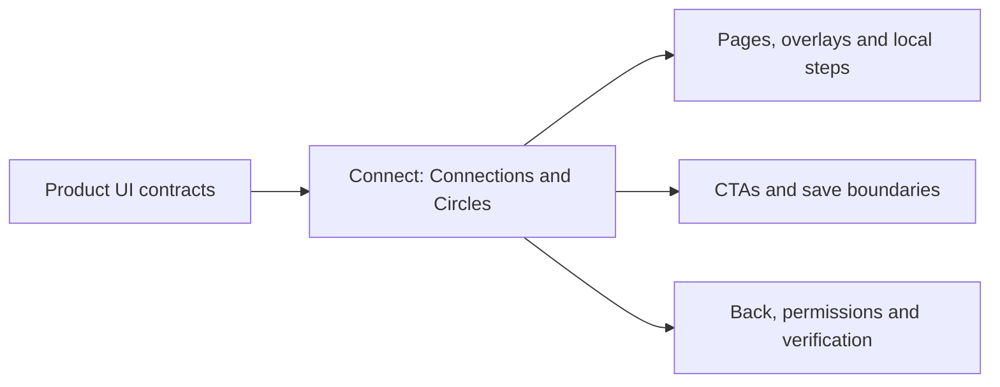

# Product UI Contracts

## Visual Map

This folder owns maintained, source-backed descriptions of the webapp's
product surfaces. Each contract explains what a person can see and do,
including nested pages, sheets, local steps, and handoffs to another feature.
Use the contract before changing that product surface and update it with the
owning implementation.

## Contracts

| Product surface | Maintained contract |
| --- | --- |
| Connect | [Connections and Circles](./connect.md): people discovery, contact sync, invitations, nearby directories, circle setup/join, members, chat, and immediate shared-feature handoffs |

Only source-verified current contracts belong in this index. An account's
counts or fixture examples do not become product limits. Future proposals
belong in the [future documentation home](../../../docs/future/README.md).

## Contract requirements

Every maintained product contract includes:

1. Scope, owning product surface, source revision, and evidence date.
2. A visual map and the entry routes, query states, overlays, and local steps.
3. Visible CTAs, their destinations, guards, and exact mutation/save boundaries.
4. Back, cancel, close, busy, loading, empty, failure, and retry behavior.
5. Auth, vault, consent, membership, and platform boundaries that affect the UI.
6. Links to current production owners and the nearest authoritative tests.
7. Existing behavior gaps and a clear distinction between source review,
   automated verification, and live browser/device proof.

Keep one maintained contract per cohesive product surface. Add a row here and
link the contract from its existing contributor entrypoint. Preserve source
links when moving a contract; do not copy it into a second docs home.

## Authority and adjacent owners

These references describe the UI; they do not create a parallel executable
route, action, permissions, or generated-contract registry. Existing owners
remain authoritative:

- [UI contract contributor scaffold](../../../docs/reference/architecture/ui-contract-contributor-guide.md)
  for authored Back and Search/action changes and generation order.
- [Route layout contract](../../lib/navigation/app-route-layout.contract.json)
  and [route builders](../../lib/navigation/routes.ts) for routing.
- [Design system](../../../docs/reference/quality/design-system.md) for shared
  typography, visual primitives, layout, and interaction rules.
- [Documentation homes](../../../docs/reference/operations/documentation-architecture-map.md)
  for placement, and [webapp docs index](../README.md) for other package references.

Documentation-only updates run `./bin/hushh docs verify` from the repository
root. Changes to executable UI follow the contributor scaffold and the owning
behavior pack as well.
