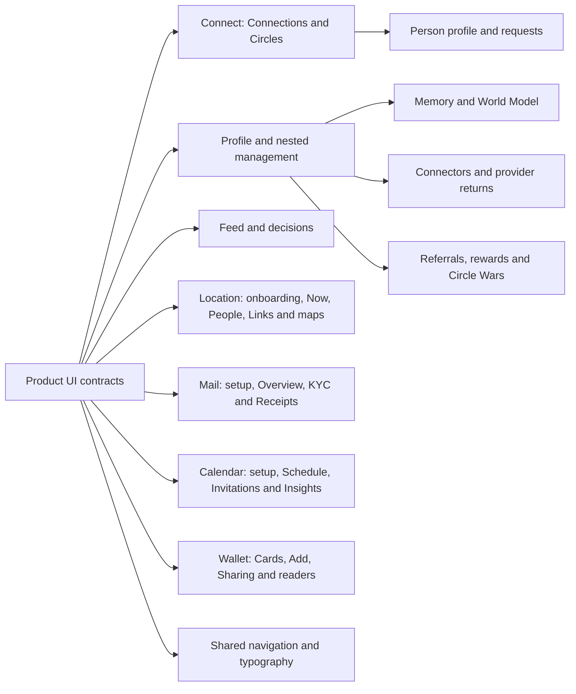

# Product UI Contracts

## Visual Map

This folder owns maintained, source-backed descriptions of the webapp's
product surfaces. Each contract explains what a person can see and do,
including nested pages, sheets, local steps, and handoffs to another feature.
Use the contract before changing that product surface and update it with the
owning implementation.

## Contracts

| Product surface | Maintained contract |
| --- | --- |
| Finance | [Portfolio and Stocks](./finance.md): value/history charts, holdings, allocation, performance, sources, stock facts and saved analysis |
| Connect | [Connections and Circles](./connect.md): people discovery, contact sync, invitations, nearby directories, circle setup/join, members, chat, and immediate shared-feature handoffs |
| Person profile | [Person profile and requests](./person-profile.md): another person's identity, phone/desktop geometry, fonts, relationship, grants, catalog, every request dialog, verbatim English copy/CTAs, packets and history |
| Profile | [Profile](./profile.md): home, account, phone, payouts/receipts, pricing, preferences, security/devices, support, invitations, Legal and compatibility entries |
| Profile Memory | [Memory and World Model](./profile-memory.md): categories, live memory, sharing, received information, Secrets, memory workspace, research facts and invitations |
| Profile Connectors | [Connectors](./profile-connectors.md): provider details, Drive files/packets/trust, custom tools, OAuth returns and legacy Mail/local CRM boundaries |
| Referrals | [Referrals](./referrals.md): You, individual/Circle rankings, reward claims, every Circle Wars enrollment/create step, rules, native differences |
| Feed | [Feed](./feed.md): history, every actionable family, payment/file-access sheets, briefing, notification controls and downstream destinations |
| Location | [Location](./location.md): actual mounted onboarding, Now/People/Links, sharing/Ask/review, SOS, Circles, maps, nearby/private check-in, public routes, every text/CTA and effective typography |
| Mail | [Mail subagent](./mail.md): setup and OAuth, Overview/KYC/Receipts, exact copy and every CTA branch, private drafts and reviewed Send, mailbox/voice handoffs, API and response-field provenance, encrypted device snapshots, phone/desktop geometry and typography |
| Calendar | [Calendar subagent](./calendar.md): onboarding and OAuth, Schedule/Invitations/Insights, every authored CTA and response branch, API fields and authority, conversation and recipient handoffs, phone/desktop geometry and fonts |
| Wallet | [Wallet](./wallet.md): mounted Cards/Add/Sharing, Profile/NWS/referral, temporary grants, requests, public/anonymous readers and One chat widgets, with presentation and authority boundaries |
| Drive | [Drive connector and private-agent tools](./drive.md): first connection and OAuth, every mounted connector/nested page and CTA, selected files, preparation, packets, trust, conversations, sharing and payment handoffs, exact copy, API fields, phone/desktop geometry and fonts |
| Navigation | [Shared navigation](./navigation.md): top bar, bottom tabs, contextual rails, Profile entry, Back and native admission |
| Font schema | [Typography](./typography.md): when to use each semantic role, Profile home/detail scale, nav and Feed differences, CSS precedence and native limits |

Only source-verified current contracts belong in this index. An account's
counts or fixture examples do not become product limits. Future proposals
belong in the [future documentation home](../../../docs/future/README.md).

## Contract requirements

Every maintained product contract includes the following detail for each
rendered page, row, card, menu, nested step and CTA. A feature list alone is
not a complete contract:

1. Scope, owning product surface, source revision, and evidence date.
2. A visual map and the entry routes, query states, overlays, and local steps.
3. Visible CTAs, their destinations, guards, and exact mutation/save boundaries.
4. Back, cancel, close, busy, loading, empty, failure, and retry behavior.
5. Auth, vault, consent, membership, and platform boundaries that affect the UI.
6. Links to current production owners and the nearest authoritative tests.
7. Existing behavior gaps and a clear distinction between source review,
   automated verification, and live browser/device proof.
8. Exact authored English titles, body/help/error/success text, labels,
   placeholders, options, CTA variants and icon-only accessible names.
   Dynamic names, dates, prices, provider messages and server text are explicit
   templates/projections; do not invent finite literals for dynamic content.
9. Per-row read provenance: owning component/hook/service, HTTP method/path,
   query/body/auth type, response fields, and exactly which fields feed each
   label, count, value, status, eligibility or next step. Shared list reads are
   identified as shared, rather than a fictional request per row.
10. Per-action wire: method, endpoint, query/body field names, frontend proxy
    and backend owner, response projection, acknowledgement boundary, cache
    invalidation, durable/local effects and downstream destination.
11. Every affirmative/negative branch: Yes/No, Save/Cancel, Allow/Deny,
    retry/Undo, outside/Escape/Back/X, busy rejection, and whether the operation
    already committed before the next step. Explicitly say **no API call** for
    local choices; OS/provider UI has its own captions and outcomes.
12. Failure/race semantics: required auth/vault/role/consent, input bounds,
    conflict/version checks, current-owner/session fences, idempotency or its
    absence, unknown outcomes, retries, partially completed multi-step writes,
    and read-side audit/provisioning effects.
13. Spatial rules: containing surface, row/grid slot, anchor/alignment, sizes,
    gaps/padding, responsive breakpoints, scroll ownership, portals/collisions,
    keyboard/safe-area constraints and CSS/native layer order. X/Y are formulas
    or anchors when content is dynamic; source-derived layout is distinguished
    from runtime measurements. No invented screenshot coordinates.

The completeness unit is an **interaction path**, not a component filename.
For example, three dots→menu→Remove→Cancel and three dots→menu→Remove→confirm
must each have a documented result and call boundary. Unused service methods,
unmounted compatibility components and future proposals do not become current
product controls. Trace the actual import/caller path before including them.

Full executable schemas, legal prose, vault credentials and shared domain
engines keep their existing authority. Link their exact owner and document
the caller-specific projection and handoff; do not create a competing schema,
copy secrets, duplicate legal text or imply that all writes are idempotent.

Keep one maintained contract per cohesive product surface. Add a row here and
link the contract from its existing contributor entrypoint. Preserve source
links when moving a contract; do not copy it into a second docs home.

## Authority and adjacent owners

These references describe the UI; they do not create a parallel executable
route, action, permissions, or generated-contract registry. Existing owners
remain authoritative:

- [UI contract contributor scaffold](../../../docs/reference/architecture/ui-contract-contributor-guide.md)
  for authored Back and Search/action changes and generation order.
- [Route layout contract](../../lib/navigation/app-route-layout.contract.json)
  and [route builders](../../lib/navigation/routes.ts) for routing.
- [Design system](../../../docs/reference/quality/design-system.md) for shared
  typography, visual primitives, layout, and interaction rules.
- [Documentation homes](../../../docs/reference/operations/documentation-architecture-map.md)
  for placement, and [webapp docs index](../README.md) for other package references.

Documentation-only updates run `./bin/hushh docs verify` from the repository
root. Changes to executable UI follow the contributor scaffold and the owning
behavior pack as well.

## Evidence for this revision

This source expansion is pinned to
`3ff2620b48567177dce5c667e77a70203e4a8c35` (20 October 2026), with Feed/SMS
and its typography refreshed against296d7769c before publication. Read-only
specialist review checked frontend callers, service wires, backend routes,
response projections, authored copy, spatial rules and source links. Person
Profile records the separately executed UI doctor and 22 synthetic layout
fixture cases with their scope limits. Source review does not certify a live
account, provider flow, physical device or full-app computed geometry.

Local link/fence checks and the documentation inventory completed. The full
`./bin/hushh docs verify` passed runtime parity, integrity, governance, brand
and setup smoke, then failed shareable-links on unrelated temporary PostgreSQL
HTML under `tmp/pwm-vault-proof-2026-10-20/` containing local absolute paths.
Those files were left unchanged. The clean publication worktree subsequently
passed the **full** documentation verification, including shareable-links and
encryption compliance preflight/smoke.
No implementation, API schema, permission, deployment or account was changed.

The Mail contract is independently inspected at
`5a894a2adf3e80b5a6d20acb46a4d97eccf54b75` on 21 October 2026. Its coverage and
verification limits are recorded in that contract; it does not restamp the
other contracts or certify live provider/device behavior.

The Calendar contract is independently inspected at
`49b175bdc4bf636ede1b2353f4c493496a94c9cc` on 21 October 2026. Its entry,
CTA/copy, API/authority, responsive-layout and typography evidence has its own
verification section; this addition does not restamp the other contracts.

The Drive contract is independently inspected at
`477864ae8d2925a7cdc5b21d8ca6e91b3f22955e` on 21 October 2026. It follows the
connector, Documents specialist, packet/trust and sharing/payment interaction
paths, with its own exact-copy inventory, API fields, spatial/type tables and
QA/evidence ledger. It does not introduce a Drive route or restamp the other
contracts. Its verification section distinguishes source review, clean publication
checks and unverified live acceptance.
