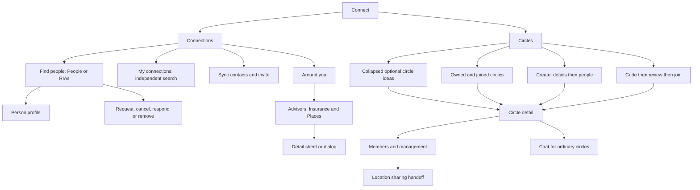

# Connect UI Contract

Status: current product and UI reference, checked against source revision
`3ff2620b48567177dce5c667e77a70203e4a8c35` on 20 October 2026. Owner: frontend architecture. Classification:
`canonical`, package-local. This contract describes the reachable Connect
experience: what each surface shows, what each CTA does, and how a person
returns. It records existing behavior; it does not introduce new service permissions or change mutation semantics.

Connect has two top-level tabs: **Connections** and **Circles**. Connections
finds and manages relationships. Circles groups people, manages membership,
and hosts eligible group conversations. The six optional circle ideas are templates;
saved circles and joined memberships come from the current account.

## Visual Map

## Product facts and scope

| Claim | Classification | Current contract |
| --- | --- | --- |
| Connect has Connections and Circles | `already_exists` | Two route-backed tabs; tapping or swiping selects the same surface. |
| There are six circles | `already_exists` for the starter catalog | The catalog contains six templates; owned/joined counts describe actual saved circles. Neither number is a maximum. |
| A person has joined three circles | `needs_verification` | Valid as an account example only. The joined list is dynamic; it can contain zero, three, or another count. |
| A circle name defines a permission | `wrong_direction` | Names and decorative icons do not grant access. Membership and separate sharing decisions retain their own authority. |
| Creating or joining starts location sharing | `wrong_direction` | Circle management belongs to Connect. Location and SMS actions have separate flows and guards. |

A **page** has an authored route. A **route state** changes a query on that
page. A **local step** changes the current form without a new route. A
**sheet/dialog** is an overlay. A **handoff** enters another feature's owner.
These distinctions matter for Back, cancellation, and whether anything has
already been saved.

This inventory follows Connect into its own nested steps, sheets, and detail
views. Person profiles, private messages, consent requests, onboarding, and
Location are named handoff boundaries; their complete downstream products
retain their existing owners. Controls reachable only through those products
are not invented as additional Connect pages.

## Pages and route states

| Surface | Entry or URL | Presentation and return |
| --- | --- | --- |
| Connections | `/one/connect` or `/one/connect?tab=all` | Find people by default; `view=connections` is the shared contact-results entry to My connections. Shell Back follows the authored section origin, with `/one` as its default parent. |
| Circles | `/one/connect?tab=circles` | Saved lists first, collapsed optional circle ideas below. |
| Create a Circle | Circles plus `action=create-circle` | Focused full-page form; shell Back returns to the Circles list. |
| Join a Circle | Circles plus `action=join-circle` | Full-page code/review flow; optional `code` prefills and reviews, never auto-joins. |
| Circle detail | Circles plus `action=circle-detail&circleId=<id>` | Saved circle; `circleSetup=1` requests first-member setup, `circleChat=1` requests Chat. |
| Exact person review | `/one/connect?reviewPerson=<id>` | Opens the current person's capability review, without automatically sending. Incoming requests can redirect to Consent Center. |
| Person profile | `/people/<personRef>?from=<return>` | Shared profile page, entered only with a public person reference. |
| Private messages | `/one/messages` through the shared route builder | Opens a permitted conversation or draft with the selected person. |
| Shared circle invitation | `/circle/join?code=<code>` | Guest or authenticated preview, then protected Connect handoff. |
| Old Connect settings link | `/one/connect/settings` | Redirects to canonical Gemini preferences in Profile. |

My connections is the first local tab and Find people is the second. Find people
remains the default selected view. The accepted count uses a vertically centered, compact rounded badge: neutral grey when inactive and an accent tint when active. The local tab row has no grey baseline and keeps its blue active indicator. Each keeps
its own search. Accepted-roster search uses the existing paged service, with the existing People/all or verified-RIA audience, and never overwrites the cached browse page.
People, RIAs, and Around you are local directory modes inside Find people;
they are not three additional top-level tabs. Search uses `q` plus the
existing query/session restoration. Unknown outer tabs resolve to Connections.
Unknown circle actions, or detail without a circle ID, render the list.

Authority stays in [route constants and builders](../../lib/navigation/routes.ts),
[Connect route helpers](../../lib/navigation/connect-routes.ts),
[tab registry](../../lib/navigation/top-shell-tabs.ts), and the authored
[route layout contract](../../lib/navigation/app-route-layout.contract.json).
This document is not a second executable route or action catalog. Voice navigation follows the split: Find people opens discovery; My connections opens the accepted roster. The exact-revision capability evolution entry rejects an unfinished navigation step authored against the old combined People view, so it is reassessed against the visible view. Relationship and consent actions retain their existing semantics.

## Connections

### Find people and My connections

Circle detail uses the same transparent, person-plus Add people action as Location SMS Circle.
The action opens the existing picker; its final confirmation retains its primary-button treatment.

| Control or state | Result and product boundary |
| --- | --- |
| **My connections N / Find people** | Tabs appear in that order; discovery remains selected by default. My connections shows accepted relationships, grouped From contacts / Other connections, with its own paged search. Selecting RIAs retains the existing verified-adviser scope, My RIAs count and fail-closed empty state. Switching views does not change relationships or write history. |
| **Refresh** in My connections (accessible label Refresh contacts) | Refreshes the accepted-connections list. This is distinct from address-book **Sync contacts**. Busy disables duplicate refresh. |
| Accepted person's identity row | Opens the shared person profile when a public reference exists. |
| Message icon on an accepted connection | Enters private messages through the shared navigation owner. |
| **Options → Remove connection** in My connections | Opens **Remove connection?**; **Cancel** keeps it, **Remove** commits removal. |
| **Load more connections** | Reads another accepted-connections page; preserves the current list. |
| **Could not refresh connections** | Retains useful rows and offers tap-to-retry. Initial pending load uses placeholder rows. |
| Directory selector **People / RIAs / Around you** | Changes the local discovery mode. RIAs filters the person directory to verified investment-adviser profiles. Around you opens the nearby directory subtree. |
| **Search people / Clear search** | Updates the directory query after 300 ms; searches the directory, not My connections. Query survives remount in session storage. Searching does not send requests. |
| Person name/avatar | Profile handoff when a public reference exists; the trailing relationship action remains separate. |
| Directory identity information | Names in person rows, matched-contact results, Circle people pickers/rosters/invitations, chat identity labels and voice result/confirmation cards; no email, phone number or masked contact caption. Contact values used as missing-name fallbacks become “Hussh member”. Existing pending-request status and connected-date context remain. Search by email or phone remains supported. Mutual counts/previews remain a separate inline supplement. Authored circle names, search input and message content are not rewritten. |
| **Connect** | Sends a no-scope connection request for that exact directory person. Ordinary directory taps do not first open a scope-selection dialog. |
| **Cancel** on outgoing request | Withdraws the still-pending request; busy feedback remains in the same action slot. |
| **Respond** on incoming request | Opens pending Consent Center review; does not accept merely by navigating. |
| **Connected** | Relationship status, not a second connection mutation. |
| Mutual connection preview | Opens that mutual person's profile when a public reference exists; otherwise informational. |
| **Load more people / Retry loading people** | Automatic scroll loading with manual fallback, 20 per page; preserves rows during retry. |
| **Invite them to One** | Empty People search only, with a usable invite URL: native/Web Share or clipboard fallback. Cancellation is silent. Not offered in RIAs; an empty search does not prove someone lacks an account. |
| Loading, empty and unavailable directory | Finding people, no people/RIAs yet, or no query matches. A genuine unavailable state offers **Try again**; rate-limit copy explains the delay without a retry button. |

The visible list and exact-person review are different entry paths. An
ordinary Connect tap requests a relationship without scopes. The explicit
review path can select requested/offered capabilities and then commit the
reviewed request. Neither path implicitly authorizes all the person's
information. Source: [Connect page](../../app/connect/page-client.tsx) and
[relationship labels](../../lib/connections/relationship-label.ts).

Both lists use [ConnectPersonRow](../../components/connect/connect-person-row.tsx)
in one column at every width. Identity buttons and actions are siblings; names
and supporting text wrap. Avatars are 36px; rows are 72px on desktop and 70px on phones; relationship
actions use 44px targets, including Message and Options icon controls.

The special **Send connection requests** sheet exposes selected people and
Remove, **Ask from them** capability checkboxes per person, and the caller's
**Offer now** handles. Catalog loading blocks **Send requests**. **Cancel**
closes without sending; sending blocks close. Partial failure retains failed
people for retry. Incoming-request races redirect to the exact pending review.
Cancel removes `reviewPerson` from the URL. Bulk-selection branches exist,
but the ordinary UI has no control that enables selection mode.

### Circle task surfaces

Circle Add people, Rename and Invite code use the shared task surface anatomy.
Bottom Sheets become centered at 768px through CSS, preserving the mounted
form, selection and existing callbacks. Create keeps its existing Dialog and
page variants; Join remains its existing page flow. Circle member actions
retain the phone Drawer with same-surface removal confirmation and the desktop
menu/AlertDialog behavior. Existing permission, pending-invitation, capacity,
retry, owner/session invalidation and Back contracts remain authoritative.

| QA story | Expected behavior and evidence |
| --- | --- |
| Open a task | Opaque foreground, shared blurred/dimmed background; optimized-CSS light/dark checks in `e2e/circle-invite-picker.layout.spec.ts`. Android keeps its platform scrim fallback. |
| Add people | All connections and Selected views share the current controlled query. Selected reads the existing selection map across pages; unchecking a saved off-page selection changes no relationship until the existing Add action succeeds. Covered in named-circle-flows tests. |
| Search, clear, resize | Clear restores search focus; selection and the input node survive the 768px boundary. Page and sheet searches share phone keyboard defaults: no autocorrect/capitalization/spellcheck, Search Return dismisses the keyboard, and focus scrolls after its animation. DOM tests cover both controls; the picker height stays stable across All/Selected, loading and empty states. |
| Keyboard or enlarged text | Normal frames keep search/footer outside the scrolling results. Constrained frames scroll completely, leaving the final action reachable. Optimized WebKit fixture covers keyboard/safe-top seats and long confirmation text. |
| Cancel, Escape, retry or confirm | Existing callbacks, busy locks, nested Back layers, validation, mutation and failure recovery remain in the owning flow tests. |

### Contact sync and invitations

Sources: [sync hook](../../lib/contacts/use-contact-sync.ts),
[privacy dialog](../../components/connections/contact-discoverability-consent-dialog.tsx),
[sync results](../../components/one-location/contact-sync-results-sheet.tsx), and
[invitation sheet](../../components/connections/contact-invitation-sheet.tsx).

**Sync contacts** is available in People when the source probe finds a native
or web picker, or configured Google fallback; it is absent in RIAs. Source
permission, discoverability preference, contact matching, and external
invitations are separate decisions. A completed scan can automatically form
eligible connections through exact verified-phone matching; opt-outs and
prior disconnects remain protected. It does not send invitation messages.

| Surface or CTA | State and effect |
| --- | --- |
| **Sync contacts / Syncing…** | Starts the shared contact flow; busy prevents another sync. It differs from roster Refresh contacts. |
| **Choose your contact privacy** | Unknown preference opens **Keep private / Allow contact matching**. Either saves the choice; the person must tap Sync contacts again. Keeping private still allows checking their own contacts. |
| Privacy load/save failure | **Try again** reloads; saving blocks dismissal and controls. |
| Contact permission denied | Toast **Open Settings**; return watcher can resume after permission is granted. Restricted/unavailable access retains its own recovery. |
| Google fallback | **Connect Google Contacts → Waiting for Google… → Checking your Google contacts**; Close/Cancel dismiss; failed/cancelled authorization offers **Choose Google account**. |
| **Contact sync results** | Dynamic Checked, Matched, Connected, No match totals; Connected combines newly automatic and already-connected outcomes. Partial/unknown/unchecked/overflow states explain their actual scope. |
| Matched person **Request** | Eligible request-required match only; closes results and sends the ordinary no-scope connection request. |
| **Show more (N)** | Expands results locally. **Check Google Contacts** is a provider link when applicable. |
| **Choose Google account / Check more / Sync again** | Outcome-dependent retry or continuation, rather than asserting a full successful scan. |
| **Proceed to connections** | Closes results and enters Connections. |
| **Invite contacts** | Opens invitation selection for eligible candidates; disabled during sync or with none. Feature-flag-off fallback uses the prepared share invitation. |
| Results Close / outside / Escape | Dismisses results; no drag dismissal. Completed matching is not undone. |

Invitation flow, including every nested step:

| Step | Controls and completion boundary |
| --- | --- |
| **Invite your contacts** | Search names/destinations; No match found / Not checked groups; recipient checkboxes; explicit destination choice for contacts with several. Up to 15 unique recipients. Native uses phone destinations; web uses email. **Show more contacts** adds 50; **Review N invitations** requires a selection. |
| **Review invitations** | Shows common message and chosen recipients; per-person **Remove**, **Copy invitation**, **Share link instead**. **Open Messages · N contacts** on native or **Open email · N contacts** on web opens an external draft, not an automatic send. Native warns about group visibility; web uses BCC. Unsupported native SMS keeps copy fallback. |
| **Your invitation** | Shows external-composer handoff outcome; **Done** clears completed session, **Back to review** retains picks, and composer retry stays available when not handed off. |
| Back, Close and recovery | Review's **Back to selection** preserves picks; Escape unwinds nested steps. Busy blocks outside/Escape dismissal and duplicate composer launch, but explicit Close still clears the session. **Retry invitation link** recovers preparation failure. Empty selection sources keep copy/share fallback. |

Preparation can retry without resyncing contacts. Recipient choices remain
account/route-scoped in memory. Opening an OS mail/SMS composer is not proof
that invitations were sent.

### Person profile handoff

The complete [Person profile UI contract](./person-profile.md) owns viewport
and phone/desktop sizing, effective fonts, every local request dialog/sheet,
catalog, grants, and history. The table here preserves Connect's immediate
handoff boundary.

The shared [person profile](../../components/connections/person-profile-page.tsx)
can display relationship state, public details, capabilities, shared records,
and request controls. Availability depends on that person's published catalog,
relationship, grants, feature flags, and vault state. The profile is not a
static list of capabilities every person possesses.

| Profile surface or CTA | Immediate flow and boundary |
| --- | --- |
| Guest **Share / Sign in** | Share copies the profile URL; Sign in enters authentication. Loading/unavailable profile has its own state. |
| Relationship **Connect / Cancel request** | Sends the social request or withdraws the outgoing one. Connected email/phone links use mail/phone handlers. |
| **Request / Manage access** | Request scrolls Available to request; Manage access enters Consent Center. |
| **Available to request** | Nested categories/branches with local parent Back, checkboxes, **Select all in category**, search, **Filter categories → All categories / category**. Granted scopes are disabled. **Load more information / Try loading more again** reads another catalog page; revision changes clear stale selection/review. |
| **Review request (N)** | Requires chosen scopes and ready vault. **Request information from NAME** shows labels/sensitivity, Access duration 1/3/7/30 days, Purpose of 8–500 characters, maximum 50 scopes. **Send request / Cancel**; failure keeps review; success clears the draft and reloads history. |
| **Shared with you** | Empty or secure granted-information card: **Unlock to view / Try again**, sensitive-item **Show / Hide**, visible-field **Copy**. Decrypted values remain client-memory information. Ended or unavailable grants do not become ordinary profile fields. |
| **Request history** | **Details / Withdraw pending**, busy variants, status and purpose. **Previous / Next** pages history; failure can retain recent activity. Withdrawal is a mutation. |
| Viewer relationship read failure | Public identity remains; **Try again** reloads viewer state. |
| **Request files** | Connected, unlocked, feature-gated. What do you need, required date period; package variant also shows requesting identity, reason and access period 7/30/90 days. Quote failure offers Retry. **Send request / Add Google account / Cancel**; success **View request / Request more files**. Request does not itself grant file access. |
| **Ask about files** | Ask about their Drive dialog, question up to 2,000 characters, **Send / Cancel**. Success **View question / Ask another question**. Creates an owner-reviewed question, not an immediate Drive read. |
| **Request scope** | Feature-checking/blocked state offers Close or **Try again / Close**. Otherwise question up to 2,000 characters, **Send request / Cancel**; success **View request / Ask another question**. Owner reviews required information and price. |
| **Request cards** | Locked vault first opens wallet unlock; person taps again after unlock. **Request a card → Send request / Cancel**, then Card request sent. Creates the existing encrypted card-access request. |
| **Available packets** | Gated catalog: **Retry / Load more**, packet row opens adaptive detail, local **Back / Close** restores list. **Buy for [price] / Add Google account** creates a request; payment follows approval. Success **View request / View files** enters Consent Center. |

Immediate request owners:
[information review](../../components/consent/information-request-review-fields.tsx),
[files](../../components/consent/document-file-request.tsx),
[Drive questions](../../components/consent/document-request-button.tsx),
[scope questions](../../components/consent/request-scope-button.tsx),
[cards](../../components/wallet/request-cards-button.tsx), and
[packets](../../components/consent/drive-packet-catalog.tsx).

The Connections row owns its direct-message icon. The current profile does
not render a separate general-purpose Message CTA. Its relationship menu's
Remove action currently commits directly; it does not reuse the Connections
list's removal confirmation. This difference is recorded below as a gap.

## Around you

Source owners: [directory switcher](../../components/connect/nearby-directories.tsx),
[shared directory UI](../../components/connect/nearby-directory-ui.tsx),
[advisors](../../components/connect/advisors-nearby.tsx),
[insurance](../../components/connect/insurance-agents-nearby.tsx), and
[places](../../components/connect/places-nearby.tsx).

| Surface or CTA | Behavior |
| --- | --- |
| **Advisors / Insurance / Places** | Three directory chips, initially Advisors. Visited chips keep state while this subtree remains mounted. Leaving Around you unmounts it. |
| **Use location** | Requests permission/current position after a gesture; becomes **Locating…**. Already-granted permission can resolve without another prompt. |
| **Use a ZIP** | Reveals manual search. Advisors/Insurance use **ZIP**; Places uses **Area or postcode**. |
| **Search** in manual form | Searches the trimmed nonempty place/ZIP; missing sign-in token produces the corresponding sign-in message. |
| Location denied/unavailable | Shows **Location is off** and manual form. This branch does not offer a device-settings link. |
| Radius selection | Advisors/Insurance: 5, 10, 25 miles, default 10. Places: 1, 5, 15 miles, default 5. Changes read a new result set. |
| Directory search / **Clear search** | Filters already loaded rows after a debounce; does not run a fresh remote name search. No-match state also offers Clear search. |
| **Try again** | Repeats a failed cold read with the current anchor/radius. Error/empty states also expose manual-location recovery. |
| **Search within N mi** | Empty-state expansion, only when a larger configured radius exists. |
| **Show more** | Advisors/Insurance paging; becomes Loading, and failed paging offers Try again. Places has no paging CTA. |
| Places categories | All, Hotels, Food & drink, Health, Banking, Shops, Fitness & beauty, Auto, Transit, Education, Outdoors. Filters loaded category buckets. |
| Source attribution, optional Terms / Report an error | External source links. Places can show partial streamed results and **Finding more nearby…** before completion. |

All four detail surfaces are a mobile sheet or desktop dialog, with shared
Close behavior. Closing preserves the list/filter/radius; opening a detail
does not author a new URL.

| Detail | Visible information and CTAs |
| --- | --- |
| [Advisor](../../components/connect/advisor-detail-surface.tsx) | Loads profile by CRD; experience, firms, states, disclosures and office details. **Call** when phone exists; **BrokerCheck report** when returned. No inline detail retry. |
| [Office](../../components/connect/office-detail-surface.tsx) | Name, location, advisor count and sample names; **Call** when phone exists. Sample names and “and N more” are not drill-in CTAs. |
| [Insurance agency](../../components/connect/insurance-agent-detail-surface.tsx) | Products, standing, address, posted hours; **Call / Visit agency** when available. |
| [Place](../../components/connect/place-detail-surface.tsx) | Keeps the selected row while fetching hours/contact details; **Call / Visit website / Open in Google Maps** when returned. Failure retains row details; close/reopen retries. |

## Circles

### Optional circle ideas

Ideas are collapsed below actual circles and hidden while the circle list is
being searched. Hide/Restore hidden affects templates only, never a circle or
membership. The existing starter catalog and mutation owner are retained. Source:
[starter definitions](../../components/connect/circle-discovery.ts),
[discovery card](../../components/connect/circle-discovery-card.tsx), and
[starter actions](../../components/connect/living-connections.tsx).

| Template | Default saved identity | Setup effect |
| --- | --- | --- |
| SMS | Product-managed SMS Circle | Ensures the SMS system roster. A custom circle with the same name is not that roster. |
| Location | Location Circle, kind `other` | Creates a named group; location sharing still requires a later action. |
| Family | Family Circle, kind `family` | Creates a named group. |
| Finance | Finance Circle, kind `other` | Creates a named group; no financial access is granted by its name. |
| Investor | Investor Circle, kind `other` | Creates a named group; no investment permission is granted. |
| Business | Business Circle, kind `other` | Creates a named group; no company-information permission is granted. |

Selecting an idea creates only after a tap, then opens the saved detail;
non-SMS setup carries first-member intent. Ideas already matched to an owned
circle are omitted because the actual circle is listed above. Matching uses the current name/kind for
ordinary starters and system identity for SMS. Joined circles do not satisfy
an owned starter; renamed/custom circles stay in the saved list even when they
no longer match a starter.

| Discovery control/state | Result |
| --- | --- |
| **Create circle** in Your circles | Opens the existing full-page creation flow. |
| Idea row | Creates the corresponding missing owned circle. Disabled while loading, failed, or another idea is creating; the existing in-flight guard prevents duplicate rapid creates. |
| **Hide / Restore hidden** | Changes only the optional template list in the current owner session. |
| **Retry circles** | Reloads failed circle summary. |
| **Finish setting up One** | Enters account setup when no vault exists. |

### Owned and joined lists

[ConnectCirclesTab](../../components/connect/circles/connect-circles-tab.tsx)
loads the current account's saved summaries. Owned system circles appear
before owned named circles; Trusted precedes SMS. All owned circles stay under
**Your circles**, followed by their populated Family, Friends, and custom type
subheadings. Circles without a saved type label remain under Your circles
without a generic Other heading. **Joined circles** follows every owned type and precedes
**Circle ideas**. It contains
eligible circles created by others and is absent when empty. Foreign SMS
system circles are filtered out of these lists. Three visible joined circles
is a sample account state, not a required fixture or product limit.

| List control/state | Result |
| --- | --- |
| **Create circle** | Opens the full-page creation route state. |
| **Join with code** | Opens code entry. Transparent text action with 6px between the key and label. |
| **Circle name** search | Filters the already-authorized owned and joined summaries. |
| Circle name/chevron | Opens that saved circle. Rows show the actual count and product description without avatar clusters. |
| Left swipe → **Delete / Leave circle** | Swipe reveals only. The same shared confirmation precedes the existing mutation, with a fresh server-capability read. System/Trusted circles never expose Delete. Missing authority fails closed. |
| **Circles are unavailable** | Tappable retry row; **Loading circles…** is a disabled status row. |
| No vault | **Finish setting up One**, rather than an unusable unlock action. |

Counts include the owner. Named circles with only their owner can say **No
members yet**. Trusted explains **People you add yourself**; SMS explains its
delivery relationship. Rendering may ensure the owner's empty
Trusted container once per unlock session; it does not copy all connections
into Trusted. Account/vault changes must not display the previous account's
summary. Mutation events and visible-pane repair reads refresh the list.

### Create a circle

The details form reuses Connect's scoped typography in both its page and modal:
form labels 15px/550/22px, inputs 14px/400/22px, and supporting or validation text
12px/400/18px. Field geometry and validation behavior stay unchanged.

The dialog and full-page flow reuse
[CreateCircleFlow](../../components/one-location/redesign/circles/named-circle-flows.tsx)
and [its people step](../../components/one-location/redesign/circles/create-circle-people-step.tsx).

| Step or CTA | State and effect |
| --- | --- |
| Details: **Circle name** | Required trimmed name, 1–80 characters. |
| **Circle type** | Family, Friends and up to three reusable custom types; Other accepts an optional type name of 1–32 normalized characters. Default Family. These are independent from Circle names and the six starter ideas. Custom choices are shown only when the backend advertises `customTypePolicy.version=1,maxTypes=3`. |
| Circle hierarchy | Your circles contains product-managed rows first, then populated Family, Friends, and custom type subgroups, followed by untyped rows without an Other heading. Joined circles follows all owned groups and precedes Circle ideas. |
| Custom type groups | Owned ordinary Circles with the same normalized type label appear inside Your circles under that label: for example, `hussh` contains `US` and `india`. Joined and system Circles do not populate the owner's reusable choices. Deleting a type requires confirmation and leaves its Circles untyped without removing members or Circles. A type disappears once no active owned Circle uses it. |
| **Next / Saving…** | Persists the circle, then opens the people step. Failure keeps the form available for retry. |
| People: **Search people** | Searches eligible existing connections; selection survives paging. |
| Person **Add / selected toggle** | Changes the local batch, bounded by remaining capacity and at most 20 per mutation. |
| **Add N person/people** | Commits membership changes, then opens saved detail. Failed addition preserves the selection. |
| **Try again / Load more contacts** | Recovers or pages the eligible-person list. |
| **Add people later** | Opens saved detail without adding anyone; remains usable when contact loading fails. |
| **Back** from people | Returns to details with saved circle ID and selection retained. Next updates that ID rather than creating a duplicate. |
| Modal Close / dismissal | Blocked while saving. Escape first unwinds the people step; a later close dismisses the dialog. |

**Save boundary:** Next has already created the circle. Closing, Back, or Add
people later does not roll it back or delete it. Modal completion pushes detail;
full-page completion replaces the creation state. Explicit Delete circle is
the separate removal action.

### Join and preview

Source: [JoinCircleFlow](../../components/one-location/redesign/circles/named-circle-flows.tsx)
and [invitation landing](../../app/circle/join/page.tsx).

| Step or CTA | State and effect |
| --- | --- |
| **Enter invite code** | Three groups of four unambiguous characters; auto-uppercase/focus advance; Backspace returns to the previous empty group. |
| **Paste from clipboard** | Explicit clipboard read; raw/formatted code can fill all groups. Denied access leaves manual paste/type recovery. |
| **Review Circle / Reviewing…** | Requires 12 valid characters; resolves a preview without joining. Enter also reviews. URL-prefilled code can auto-review once. |
| Preview | Circle name, owner, member count; explains that Location and SMS stay private until chosen. Changing input invalidates the previous preview. |
| **Join Circle / Joining…** | Commits membership, then replaces the flow with detail. |
| **Open Circle / Opening…** | Already-member variant; feedback distinguishes opening from a new join. |
| **Use Another Code** | Confirmation **Use another code?**; **No** retains the preview, **Yes** clears it and refocuses entry. |
| Invalid/expired/unavailable code or join failure | Error remains with a recoverable form; busy locks prevent duplicate review/join. Shell Back returns to list. |
| Guest shared-link landing | Loads only public preview metadata. **Create your One**, carousel Next/previous, **Try again**, and final **Join this Circle** lead through introduction/sign-in, retaining the code. Definitively invalid preview disables the final join continuation. No private roster read or membership write occurs here. |
| Authenticated landing **Join this Circle / Open One** | Resolves sign-in/setup continuation into protected Connect review; the landing button itself does not join. |
| Conflicting/duplicate invitation identity | **Invitation unavailable**, with **Explore One** recovery. Token invitations keep their existing invitation-page owner. |

Joining a named circle also creates source-aware connection origins with its
active members. It does not create a trusted edge, SMS selection, live-location
grant, capability token, or encrypted envelope. Adding eligible existing
connections uses the current server's direct-add behavior, rather than claiming
a pending invitation is active membership. These boundaries are owned by the
[circle service](../../../consent-protocol/hushh_mcp/services/one_location_circle_service.py)
and [route](../../../consent-protocol/api/routes/one/location.py).

### Circle detail and membership

Source: [CircleDetailFlow and roster](../../components/one-location/redesign/circles/named-circle-flows.tsx),
[member picker](../../components/connect/circles/living-circle-panel.tsx),
[member action menu](../../components/one-location/redesign/circles/circle-member-actions-menu.tsx),
and [Connect service adapter](../../components/connect/circles/connect-circle-actions.ts).

Fresh server `viewerCapabilities` determines invite, code-view/rotation,
delete, and leave eligibility. UI role fallbacks are not a substitute for
server authorization. Ordinary circles can show Chat/Members and owner photo
editing. Trusted/SMS do not show chat or photo editing; Trusted hides Edit.

| Control/state | Result and guard |
| --- | --- |
| Initial load or roster failure | Loading stays distinct from an empty roster; the visible **Retry** control reruns the owning read after failure. |
| **Chat / Members / View members** | Changes detail's local view. First-member setup can hold Chat disabled while alone; after setup **Open chat** enters it. |
| **Edit** | Owner except Trusted: rename sheet, **Circle name**, **Cancel / Save**; nonempty changed 1–80-character name, Enter saves, busy blocks dismissal. |
| **Change circle photo** | Owner ordinary circle: **Choose photo**, local **Remove photo**, **Cancel**, **Save photo**. Only Save commits the draft. |
| **Add people** | Opens the shared sheet with an immediate search and explicit connection checkboxes. Selection stays local and cannot exceed remaining capacity or 20 per mutation. |
| Picker **Add people** | Commits the same existing atomic membership batch. The sheet closes only after acknowledgment; detail-picker failures clear all choices before reloading eligibility (Create’s people-step failure retains selection). **Retry / Load more connections** recover or extend the list. No orbit or drag instructions are shown. |
| **Search members / Load more members** | Filters/pages the roster. Connect always shows member search above the roster heading. |
| Roster **Connect / Cancel / Respond** | Connect sends the existing exact no-scope request; Cancel withdraws outgoing request; Respond opens pending consent review. Existing connections do not get a dead Connect button. |
| **Actions for [name] → Message** | Only for an accepted connection with a public reference; private-message handoff. |
| **Share location** | Only for another member with `secureLocationReady`; enters Location circle detail, not immediate per-person sharing. |
| **View profile** in phone member menu | Available with public reference when an actions menu otherwise exists. Desktop menu currently lacks this item. |
| Owner **Remove from Circle** | Opens **Cancel / Remove** confirmation, then commits removal. |
| **Invite code** | Opens code sheet. No active code: **Cancel / Create code**. Active: **Copy code / Copied**, **Share invite**. Sharing uses the existing native/web share and clipboard fallback. |
| **Replace code** | Capability-gated confirmation; **Cancel / Replace code**. Successful rotation invalidates the previous code. A member who cannot rotate sees owner-help copy. |
| **Delete circle / Leave circle** | Capability-gated confirmation with Cancel and destructive commit. Success returns to list with replace; failure stays recoverable. |

Connect presents the roster and an explicit Add people sheet backed by the
existing membership-selection/save handlers. Pending-invite cancellation lists
and Proceed to SMS remain outside this caller. A membership/remote removal that invalidates
the open circle returns to the list rather than retaining a dead detail.

### Circle chat and media

Source: [chat](../../components/connect/circles/circle-chat.tsx),
[message controls](../../components/connect/circles/circle-chat-message.tsx),
[edit/delete dialog](../../components/connect/circles/circle-chat-message-action-dialog.tsx),
[media](../../components/connect/circles/circle-chat-media.tsx), and
[photo editor](../../components/connect/circles/circle-photo-editor.tsx).

| Control/state | Result and guard |
| --- | --- |
| **Alerts** switch | Changes this conversation's alert preference; busy prevents duplicate changes. |
| Notification **Turn on / Retry / Open settings** | Existing conditional notification-permission/registration flow; Open settings is native denied-permission recovery. Browser denial shows instructions. |
| **Reconnect** | Retries failed chat connection. Revoked access removes the controls rather than continuing conversation reads. |
| **Load earlier messages / Go to latest messages** | Pages history or scrolls to the latest; reply quote can jump to an available original. |
| Message field and **Send message** | Sends text or a validated attachment to this circle. Text maximum 4,000 characters; empty drafts cannot send. |
| **Attach photo, video, or document** | Opens file picker: JPEG/PNG/WebP, MP4/WebM, PDF/DOCX/TXT; nonempty file at most 5 MB. |
| **Remove attached image/file / Cancel reply** | Local draft changes; do not delete a sent message. Locked while sending or delivery is unresolved. |
| **Retry message** | Retries the same sealed pending delivery; it does not allocate a fresh message or offer a separate pending-send discard action. |
| **React to message**, reaction pills | Emoji picker with search/categories/recent/more choices; selection or pill toggle commits the reaction. |
| **Message options**, touch hold, context menu | Confirmed visible/unblocked messages open options; a stationary one-second touch hold also opens them. Movement or interrupted/hidden state cancels the hold. Options include quick reactions and **More reactions…** for the full picker; deleted messages omit reactions. |
| **Message options → Reply** | Sets reply draft; unavailable for deleted/decryption-failed content and while a send is pending. |
| Own **Edit** | **Edit message** dialog, text, **Cancel / Save changes**. Requires changed nonempty content; saving locks dismissal. |
| **Delete for me / Delete for everyone** | Confirmation **Cancel / Delete message**. Everyone variant is for own eligible message; deleting for self leaves others' copies. |
| **Open shared image / Close** | Image viewer; **Retry image / Retry full image** recover loading failures. |
| **Open video / Reload video** | Opens native video controls and retries the media when needed. |
| **Download document** | Loads the permitted shared attachment; disabled while loading. |

The Connect detail caller keeps Circle chat open and non-collapsible. The
alternate chat-lane composer's **Choose emoji** and **Talk to One** controls
are not part of this variant. Reactions use the message emoji picker.
Consecutive join activity with the same nonempty batch ID groups into one
named activity line; separate batches, legacy unbatched events, leaves, and
removals remain separate.

## Back, cancellation, and feedback

1. Back hierarchy is top overlay, active feature step, authored route parent.
   The shared shell, iOS gesture, and Android Back use those owners; application
   Back does not fall through to raw history.
2. Full-page create/join/detail Back replaces the URL with
   `/one/connect?tab=circles` before leaving Connect. Create's people step first
   returns to retained details; while that step's addition is pending, its
   feature Back callback consumes Back. This lock is not universal across
   join and detail mutations.
3. Switching Connections/Circles clears circle action, ID, and invite-code
   query state. Surface/action/circle changes reset scroll. The app scroll root
   owns the page, including the My connections roster; paging extends that
   list without adding another contained vertical scroller.
4. Selection changes, code review, photo drafts, and search are not completed
   mutations. Success follows the owning service acknowledgment. A creation
   already saved by Next remains saved when the form closes.
5. Auth, vault, permission, relationship, and membership failures keep their
   existing boundaries. Circle management needs the owner's vault; it must not
   require Location onboarding merely to name or join a group.
6. Connections and Nearby can preserve useful current-account rows during
   refresh. Circle-list read failure currently clears its summaries and shows
   retry. Counts and avatar previews are real summaries; decorative
   overflow/empty artwork is not another membership or permission claim.

Connect owns its workspace type scale through
`data-connect-type-scale="page"`; its removal dialog separately opts into Profile scale.
Use the shared compact row composition and semantic typography rather than
inventing a parallel type ladder. Plus Jakarta Sans, hierarchy, colors, touch
targets, and action sizing remain owned by the
[design system](../../../docs/reference/quality/design-system.md).
The shared top bar owns the single Connect title; the existing tab/search
bands and focused circle flow own their authored layout.
The mounted [Memory workspace](./profile-memory.md#mounted-memory-workspace-and-handoff)
consumes these row, section, form, action and header roles through its own
bounded CSS/portal markers. Connect retains ownership of its directory layout
and relationship behavior; Memory retains its Saved/Add pager and PKM writers.

## Per-row read and mutation contract

This section makes the preceding interaction inventory executable to review.
`F` means current Firebase bearer; `V` means current vault-owner bearer.
Header values, owner keys and encrypted message material stay in memory.
Paths beginning `/api/one` use the existing
[One proxy](../../app/api/one/[...path]/route.ts), or its admitted native
transport to the same backend owner. JSON bodies below are field names,
not example private account contents. List rows share their parent request;
clicking each row does not invent another list request.

### People, accepted connections and exact-person review

The [Connect page](../../app/connect/page-client.tsx) owns the current query,
selection and relationship projection. Backend owners are
[connections](../../../consent-protocol/api/routes/one/connections.py) and
[private-message route tokens](../../../consent-protocol/api/routes/one/messages.py).

| Row/control | Wire and response fields feeding the UI | Commit, failure and negative branch |
| --- | --- | --- |
| People/RIAs search/list | F GET `/api/one/connections/directory?page=1&limit=20`, optional `query` trimmed and `audience=ria`; `items[]:{userId,publicPersonRef,displayName,photoUrl,relationship,isRia,mutualConnectionCount,mutualConnectionPreview}`, `page,hasMore,totalCount` |300ms search; query-scoped session restoration. Identity/photo/relationship/mutual preview project these exact fields. Next page dedupes `userId`; sentinel root margin240px plus manual fallback. Opening mode menu alone no call; selecting a mode changes its reader. |
| My connections/My RIAs | F GET `/api/one/connections?page=1&limit=50&audience=all\|ria`, optional `query`; items `connectionId,userId,publicPersonRef,displayName,photoUrl,createdAt,isRia,connectedFromContacts`; `page,hasMore,totalCount,audience` | Separate search snapshot; browse cache retained (search rows are not written into it); dedupe `connectionId`. `connectedFromContacts` groups From contacts / Other connections; `createdAt` supplies local connected date. Refresh retries this resource, not contact sync. |
| Outgoing cancel map | F GET `/api/one/connections/requests?direction=outgoing` | `items[].counterpartUserId,id` resolve the exact pending request; failure does not block directory/roster. |
| Identity/avatar/mutual person | No API on click; authored public-person route | Requires `publicPersonRef`; absent reference is inert. Person page starts its own documented reads. |
| Message | F POST `/api/one/messages/route-token`, `{personRef}`→`token` | Navigate `/one/messages?token=<opaque>` through route builder. Failure `This conversation could not be opened. Try again.` Never put a real token in documentation. |
| Connect | F POST `/api/one/connections/requests`, `{addressee_user_id,requested_scope_handles:[],offered_scope_handles:[]}` | `message` omitted, including contact override. Require returned `{request}` to be pending; requester identity determines outgoing/incoming. Store request ID and update relationship/cache. `Connection request sent`; incoming race `This person already asked to connect. Review their request.` Invalid state `The request state changed. Refresh Connect before trying again.`; fallback `Failed to send request.` |
| Cancel outgoing | F POST `/api/one/connections/requests/<requestId>/cancel`, no body | Acknowledgement removes outgoing state, updates caches/Circles; `Connection request cancelled`; failure `Failed to cancel connection request.` Does not mean removing an accepted relationship. |
| Respond | No mutation; pending Consent Center navigation (ordinary Respond does not supply requestId) | Acceptance belongs to Consent Center. Merely opening it does not accept. |
| Options → Remove → Cancel/outside/Escape | No DELETE | Opens target-specific AlertDialog, leaves relationship unchanged. Busy removal blocks dismissal. |
| Options → Remove → Remove | F DELETE `/api/one/connections/<connectionId>` | After acknowledgement reread roster/update directory/Circle/graph caches; `Connection removed` or `Failed to remove connection`. Confirmation closes in finally even on error. Backend revokes proposal-bound access and related graph state as detailed in [Person Profile](./person-profile.md); independent grants retain their own owner. |
| Exact-person review entry | F GET `/api/one/connections/<userId>/context`→`person,request`; F GET `/api/one/connections/<userId>/scope-catalog`→`counterpartUserId,items,offerableItems` | Incoming opens consent review; connected/outgoing current-state feedback. Catalog concurrency3. Opening review does not send. |
| Ask from them / Offer now / remove selected | No API | Local scoped selections. Removing last selected person closes. Normal UI cannot enable the retained bulk-selection banner. |
| Send requests | Same POST requests per person, selected requested/offered handles, concurrency3, cap10 people | Failed people remain; successes removed. Busy blocks close; Cancel before send makes no POST and removes `reviewPerson`. Partial/incoming outcomes are reported separately; no all-or-nothing batch promise or invented client idempotency key. |
| Invite them to One | Platform share, no relationship mutation | Title `Join me on One`, text `Join me on One so we can connect.`, dialog `Invite to One`. Clipboard fallback `Invite link copied.`; cancel quiet; `This browser cannot share links.` / `Could not share the invite.` |

| People surface | Exact authored copy |
| --- | --- |
| Search/modes | `Name, email or phone`; `People`; `RIAs`; `Around you`; `Find people`; `My connections {N}`; `My RIAs {N}`; `{N} connections`; `{N} RIAs`; `From contacts`; `Other connections`; `Connected {D Mon}` |
| Discovery loading/rate delay | `Finding people…`; `People are taking a moment` / `Advisors are taking a moment`; `We'll keep trying and show everyone here as soon as they're ready.` No Retry in that delay state. |
| Unavailable | `People are unavailable` / `Advisors are unavailable`; fallback `Failed to load people`; `Try again` |
| Empty/query | `No one matches "{query}"`; `Try their full name.` / `Try People, or their full name.`; `No people yet` / `No advisors yet`; `Find by name, email or phone.`; `Invite them to One`; `Share an invite link with them.` |
| Relationship/paging | `Connect`; `Sending...`; `Cancel`; `Respond`; `Connected`; `Request sent`; `Wants to connect`; `Loading…`; `Load more people`; `Retry loading people`; `Load more connections`; fallback `Hussh member` |
| Roster error/empty | `Could not refresh connections`; `Your list may be out of date. Tap to retry.`; `No matches found`; `No RIAs yet`; `No connections yet` |
| Remove confirmation | `Remove connection?`; `Remove {name} from your connections?`; `Cancel`; `Remove`; `Removing…` |
| Exact-person review | `Send connection requests`; `Start safe. Add sharing only if you choose.`; `Selected people`; `Remove`; `Connection access`; `Checking what they can share…`; `Ask from them`; `Optional. Each person can decline.`; `Offer now`; `Offered to everyone selected. They approve first.`; `No access yet`; `These only send requests.`; `Checking…`; `Send requests`; `Sending…`; `Cancel` |
| Review result | `Sent {N} connection requests.`; incoming-count review and failed-count notices; `Couldn't send. Try again.`; `Already asked.` Dynamic counts/plurals come from the current result formatter, not additional endpoints. |

### Circles: read projection and every write boundary

Current Circle management uses [Location service](../../lib/one-location/service.ts),
[mounted detail](../../components/one-location/redesign/circles/named-circle-flows.tsx) and the backend
[Location route family](../../../consent-protocol/api/routes/one/location.py).
All calls in this table use V. The names “invite” and “eligible” alone do not
prove that a pending invitation, location share or notification was created.

| Entry/CTA | Request → response projection | Affirmative/negative, cache and failure semantics |
| --- | --- | --- |
| First unlocked Circles load | POST `/api/one/location/circles/trusted?summaryOnly=true`, then GET `/api/one/location/circles` | Ensures empty Trusted container only; does not bulk-copy connections. Lists/counts derive from current owner/membership, not the six optional ideas. |
| Open detail | GET `/circles/<id>/overview` and GET `/circles/<id>/members?page=1&limit=50`, optional `query`, under `/api/one/location` | Overview `circle` projects name/photo/count/role/system kind/active code/rotation/capabilities. Members `items,page,hasMore,totalCount` feed rows. Search250ms; current-query fences; paginate dedupe user ID. |
| Create → Next | POST `/api/one/location/circles`, `{name,kind,customTypeLabel?}`→`circle` | Custom labels use `kind=other`; at most three distinct active owned labels are enforced under the owner lock. Circle **already saved before Add people**. No caller idempotency key. Closing later does not delete it. Back then changed Next PATCHes same saved ID; unchanged details make no call. Custom-type echo failure retains the saved ID for recovery. |
| Rename → Save | PATCH `/api/one/location/circles/<id>`, `{name}`→`circle` | Valid changed name1–80; Cancel restores draft/no PATCH. Create details update can send `{name,kind}`. |
| Add people load/search/page | GET `/api/one/location/circles/<id>/eligible-connections?page=1&limit=50[&query=…]` | `eligibleConnections,pendingInvites,remainingCapacity,page,hasMore,totalCount`; controlled query and selected map retain off-page selection. All connections / Selected switches are local. Limit min20/capacity. |
| Add people → confirm | POST `/api/one/location/circle-member-invites`, `{circleId,inviteeUserIds}` | `added,skipped,skippedReasons,invites:[]`: current implementation adds direct memberships despite endpoint name. Busy blocks close; failure reconciles stale eligibility. `Added to the Circle.` / `{N} people added to the Circle.`; `Could not add them.` |
| Add later / Cancel before Add | No membership POST | Existing created Circle stays saved; no automatic rollback. |
| Create code / Replace code | POST `/api/one/location/circles/<id>/invite-code`, no body; replace adds `?rotate=true`→`inviteCode` | Replace confirmation Cancel no rotate. Confirm invalidates old code. Copy/Share use returned code locally/platform, no additional mutation. |
| Review Circle | POST `/api/one/location/circle-codes/resolve`, `{code}` | Preview `name,ownerDisplayName,memberCount,alreadyMember`; valid linked code can auto-preview but never auto-join. |
| Use Another Code → No | No API | Keeps code and preview. |
| Use Another Code → Yes | No API | Clears code/resolved preview/error, focuses first code field. Neither branch leaves or joins anything. |
| Join / Open Circle | POST `/api/one/location/circle-codes/join`, `{code}`→`circle,joined` | `You're in {name}.` / `You're already in {name}.`; route to detail. Location/SMS remain separate. |
| Pending invite → Cancel | DELETE `/api/one/location/circle-member-invites/<inviteId>` | Reload membership/eligible readers; not connection cancellation. |
| Member Remove | DELETE `/api/one/location/circles/<id>/members/<userId>`→`removed:true` | Phone confirmation within Drawer; Cancel returns actions. Desktop separate AlertDialog. Affects Circle shares, independent direct shares remain. |
| Leave Circle | DELETE `/api/one/location/circles/<id>/members/me`→`left:true` | Cancel no call. List action first GETs fresh overview and rechecks capabilities; detail uses own current capability guards. |
| Delete Circle | DELETE `/api/one/location/circles/<id>`→`deleted:true` | Same fresh list guard; owner/session changes reject action. No automatic recreation/Undo. |
| Choose/Remove photo | No API until Save photo | Local draft; native photo-picker geometry/permission remain platform-owned. |
| Save photo | PUT `/api/one/circles/<id>/photo`, `{photoUrl:<URL or null>}`→`circle` | Separate **non-Location** path. `Circle photo updated.` / `Circle photo removed.`; Cancel discards local draft. |
| Chat/Members tabs; View members | No membership mutation | Local detail view, existing chat owner initializes only as mounted/eligible. |
| Profile/Message member actions | Public-person route / F route-token POST above | Phone includes View profile; desktop menu omits it. |
| Share location | Route `/one/location?action=circle-detail&circleId=<id>&view=people` | Callback does not retain selected member ID. No location share is created by clicking. |

| Circle surface | Exact authored copy/branch |
| --- | --- |
| Lists | `Circle name`; `Search your and joined circles`; `Your circles {N}`; `Create circle`; `Joined circles {N}`; `Join with code`; `People you add yourself`; `Gets your SMS`; `You'll get their SMS`; `no one yet`; `{N} people`; `No members yet`; `1 person` |
| Loading/empty | `Finish setting up One`; `Circles need your vault, which is created during setup.`; `Circles are unavailable`; `Tap to try again.`; `Loading circles…`; `No circles found`; `Try a different name.`; `No circles created yet.`; `Make a circle`; `Bring together people you choose.` |
| List swipe/detail confirmation | No overflow menu. The row and chevron open detail; swipe reveals the existing confirmed action. `Delete circle`; `Leave circle`; `Delete {name}?` / `Leave {name}?`; `This removes the circle for everyone. This cannot be undone.` / `You will no longer be a member of this circle.`; `Cancel`; `Updating…` |
| List mutation feedback | `Your permission to change this circle has changed.`; `Circle action cancelled. Return to your current account to try again.`; `Deleting circle…`; `Leaving circle…`; `Circle updated.`; `Could not update this circle.` |
| Create details | `Create a Circle`; `Step 1 of 2 · Name your Circle, then add people now or later.`; `Circle name`; `Family, close friends, project team`; `Circle type`; `Family`; `Friends`; `Other`; `Next`; `Saving…`; `Enter a Circle name.`; `{N} / 80` |
| Create people | `Add people`; `Step 2 of 2 · Choose people for {circleName}, or add them later.`; `Search people`; `{N} selected`; ` · Choose up to {N} people`; ` · This Circle is full`; `Loading contacts…`; `Could not load your contacts.`; `Try again`; `No contacts match that name.`; `No connections to add yet. You can add people later.`; `Loading…`; `Load more contacts`; `Add people`; `Add 1 person`; `Add {N} people`; `Back`; `Add people later`; `Could not add those people. Try again or add people later.` |
| Join entry | `Join a Circle`; `Enter invite code`; placeholder `ABCD EFGH KMNP`; `Review Circle`; `Reviewing…`; `Paste from clipboard`; `You're already in this Circle.`; `Location and SMS stay private until you choose to share.` |
| Replace preview | `Use another code?`; `Are you sure you don't want to join this circle and want to check another one? The preview will be cleared.`; `No`; `Yes` |
| Join errors | `Enter a valid 12-character Circle invite code.`; `Clipboard access is unavailable. Touch and hold a code field to paste, or type the code.`; `That Circle code is invalid or no longer available.`; `Could not join this Circle.` |
| Detail/add | `Chat`; `Members`; `View members`; `All connections`; `Selected ({N})`; `Loading connections…`; `Retry`; `Load more connections`; `This circle is full.`; `No people selected.`; `No matching connections.`; `No connections available to add.`; `Select connections to add to {name}.`; `{N} selected`; `Add people`; `Adding people…`; `Search members`; `{N} people`; `{N} matches`; `No members found`; `Try a different name.`; `Load more members`; `Could not load more members.` |
| Member captions/actions | `You · Owner`; `You`; `Owner`; `Connected`; `Location setup needed`; `Actions for {name}`; `View profile`; `Message`; `Share location`; `Remove from Circle`; `Cancel` |
| Member confirmation | `Remove {name}?`; `Circle shares with {name} will stop. Direct shares stay unchanged.`; `Remove`; `Cancel`; `Could not remove this member.` |
| Detail delete/leave | `Delete “{name}”?`; `This removes the Circle for everyone. Circle shares will stop. Direct shares stay unchanged.`; `Delete Circle`; `Leave “{name}”?`; `Circle shares with you will stop. Direct shares stay unchanged.`; `Leave Circle`; `Cancel`; `Could not delete this Circle.`; `Could not leave this Circle.` |
| Invite code | `Invite`; `Invite code`; `Ready`; `Create`; `Create a code to invite someone to this Circle.`; `Cancel`; `Create code`; `Joining does not share location.`; `Copy code`; `Copied`; `Share invite`; `Replace code`; `Replace invite code?`; `The current code will stop working.`; `Invite code unavailable`; `Ask the Circle owner for a new code.` |
| Photo | `Circle photo`; `Choose a photo for your circle.`; `Choose photo`; `Opening photos…`; `Remove photo`; `Cancel`; `Save photo`; `That photo couldn’t be selected. Try again.`; `Couldn’t open your photos. Try again.`; `Circle photo wasn’t saved. Try again.` |

### Contact privacy, Google sync, results and invitation handoff

[Sync](../../lib/contacts/use-contact-sync.ts),
[Google session](../../lib/contacts/use-google-contact-sync-session.ts),
[invitation hook](../../lib/contacts/use-contact-invitations.ts),
[invitation adapter](../../lib/services/contact-invitations-service.ts),
[native invitations](../../lib/capacitor/invitations.ts) and
[invitation sheet](../../components/connections/contact-invitation-sheet.tsx)
own distinct authority boundaries. No raw address book is uploaded by this
sync contract.

| Stage/CTA | Wire/projection | Effect and opposite/unknown branch |
| --- | --- | --- |
| Privacy check | F GET `/api/iam/contact-discoverability` | `user_id,contact_discoverable,stored_contact_discoverable,contact_sync_consent_enabled_at,contact_sync_consent_rule_version,contact_sync_consent_contract_version,contact_sync_preference_state,contact_sync_match_policy_version,directory_visible,iam_schema_ready`. Validate same owner and expected `contact_directory_auto_connect_v2`; IAM proxy30s policy, not persona cache. |
| Keep private / Allow contact matching | F POST same path, `{enabled,consent_version:"contact_find_auto_connect_v1"}` with version only when true | Saves privacy only. **Tap Sync contacts again**; saving never silently opens address-book sync. Private preference still permits checking own book. Busy hides close. |
| Google contact selection | Google OAuth contacts-only token, then GET `https://people.googleapis.com/v1/people/me/connections` | `personFields` names/phone numbers and conditional email addresses, pageSize1000, `sources=READ_SOURCE_TYPE_CONTACT`, optional `pageToken`. `connections[].resourceName,names[].displayName,phoneNumbers[].canonicalForm/value,emailAddresses[].value,nextPageToken,totalPeople`. Max10pages/10,000. No persistent cache/sync token. Native/Google account screens have platform-owned copy. |
| Match batches | F POST `/api/one/connections/contact-sync`, `{lookups:[{lookup_id,hash,last4}]}` | Max1000/batch,10,000 total; **no raw names, phone or email; Connect sends no context field**. Response `matches/items` entries `lookupId,userId,displayName,photoUrl,outcome`; `checkedLookupCount` must equal submitted; `indeterminateLookupIds`, optional outcome counts. May auto-create eligible connections through backend verified IAM matching. |
| Match interruption/lost response | At most2 attempts (one retry); owner/session/abort fences | Unknown/unsubmitted people are not treated as unmatched/inviteable. Reconcile connections after uncertain outcome; local abort does not roll back completed batches. |
| Results Show more | No API | Reveal100 more already matched local rows. Proceed to connections closes and selects accepted-roster view. |
| Prepare invitation | F GET `/api/one/referrals/summary`→`link` | No recipient-send endpoint. Invitation selection is local; max15 destinations, native SMS phones or web email BCC. Reveal/search recipients locally. |
| Review / Back / remove recipient | No API | Keeps local selection; duplicate destination rejected. Queue→review→selection Back; explicit X clears session. Busy external handoff blocks outside/Escape; explicit Close still calls finish and can close. |
| Open Messages | Native `HushhInvitations` capability check SMS/max≥15, `composeSmsBatch({recipients,body})` | Opens one draft, possibly a group revealing numbers; user must send in Messages. Reopening warns about duplicates. `queued_or_sent` still does not prove delivery. |
| Open email | `mailto` BCC+subject+body via external compose | User must inspect BCC and send. Validated HTTP invitation URL; body≤2000, URL≤8000. Does not prove app opened or email sent. |
| Share link instead / Copy invitation | Platform Share / clipboard | No send endpoint. Share cancellation quiet; copied/share-sheet-open status does not mean sent. |

| Contact state | Exact authored English copy |
| --- | --- |
| Privacy dialog | `Choose your contact privacy`; `Allow verified people who already have your verified phone number to find and automatically connect with you, or keep your profile private from contact matching.`; `Checking your current choice...`; `Try again`; `Keep private`; `Allow contact matching`; `After saving, tap Sync contacts again to choose which contacts to check.` |
| Privacy saved | `Privacy preference ready. Tap Sync contacts again.`; `Contact matching is on. Tap Sync contacts again to check your contacts.`; `You will stay private. Tap Sync contacts again to check your contacts.` |
| Privacy errors | `Sign in to check contact privacy.`; `Sign in to save contact privacy.`; `Contact privacy was returned for another account.`; `Could not check contact privacy.`; `Contact privacy choice was not recorded.`; `Could not save contact privacy.` |
| OAuth/reading | `Connect Google Contacts`; `Choose the Google account where your contacts are saved. Keep One open; your results will appear here when you return.`; `Waiting for Google…`; `Checking your Google contacts`; `Reading saved contacts and checking phone numbers for matches.`; `Syncing contacts…` |
| Cancel/failure | `Contact sync cancelled`; `No contacts were read. You can choose a Google account and try again.`; `Could not sync Google contacts`; `Choose Google account`; busy `Cancel`, idle `Close`. Retry label does not promise Google always forces its chooser. |
| Partial/unknown | `A sync request may have completed even though its response was lost. We refreshed your connections; run contact sync again to confirm these results.`; `Sync paused before the next contact batch was checked.`; `{error} Remaining contacts were not checked.` |
| Results | `Contact sync results`; `Contact details stay on your device.` / `Only eligible Hushh accounts are shown.`; `Read {N} saved Google contacts.`; `Check Google Contacts`; `Checked`; `Matched`; `Connected`; `No match`; unknown/unchecked/overflow/self-skip counts retain distinct outcomes. |
| Result person | `Connected now`; `Already connected`; `Connection request required`; `Kept disconnected`; `Request sent`; `Showing {visible} of {total} matched people`; `Show more ({N})`; `Choose Google account`; `Check more`; `Sync again`; `Proceed to connections`; `Invite contacts` |
| No eligible match | `No eligible contacts matched. ONE users need an exact verified phone match and must remain visible in the Connect directory. Explicit opt-outs and previous disconnects stay protected.` |
| Empty Google book | `No saved Google contacts found`; `This Google account returned no saved contacts. Choose the account where your contacts are saved, or check Google Contacts. Contacts saved only on your phone are not included.` |
| No usable phone | `No phone numbers to match`; `Your Google contacts were read, but none had a usable phone number. One matches verified phone numbers. You can still invite contacts with a mail address, or choose another Google account.` |
| No matching account | `No matching One accounts found`; `Your Google contacts were checked using their phone numbers. A match requires a verified number and a discoverable One account. You can invite eligible contacts below or try another Google account.` |
| Invitation stages | `Invite your contacts`; `Review invitations`; `Your invitation`; `Choose up to 15. Contact details stay on your device.`; `One message for all selected contacts.`; `Search contacts…`; `No match found`; `Not checked—mail only`; `No match does not necessarily mean they are not on One.`; `This destination is already selected.` |
| Invitation controls | `Review {N} invitation(s)` with source pluralization; `Remove`; `Back to selection`; `Back to review`; `Done`; `Show more contacts`; `Share link instead`; `Copy invitation`; `Preparing invitation…`; `Retry invitation link`; `Message preview`; `Invitation message`; `Open Messages · {N} contacts`; `Open email · {N} contacts` |
| Native disclosure | `Opens one Messages draft from your device’s messaging account. This may create a group: recipients can see each other’s numbers. Check recipients and tap Send there. Carrier charges may apply.` |
| Web disclosure | `Opens one email draft with the selected addresses in BCC. Check BCC and send from your email account. Your email app must support BCC links.` |
| Handoff outcomes | `Handed to Messages. Delivery is not confirmed.`; `Messages opened. Check all recipients and tap Send there. One cannot confirm sending or delivery.`; `Email draft requested. Check that all selected addresses are in BCC, then send in your email app. If nothing opened, copy the invitation.`; `Cancelled. Your selection is saved here; you can try again.`; `The message could not be handed off. Try again or copy the invitation.`; `Messages is unavailable or this app version does not support batch invitations. Update One or copy the invitation.` |
| Share/copy/repeat | `Share sheet opened. Choose recipients there; sending and delivery are not confirmed.`; `Invitation copied. Paste it into your chosen conversation or email.`; `Before opening again, check your app to avoid sending the same invitation twice.` |

### Nearby directories: every reader and detail handoff

F reads use [advisors](../../../consent-protocol/api/routes/one/advisors.py),
[insurance](../../../consent-protocol/api/routes/one/insurance_agents.py) and
[places](../../../consent-protocol/api/routes/one/places.py). Shared location is
obtained automatically only when already allowed; **Use location** is the
explicit permission prompt. A postal search retains its own anchor. A hidden
visited directory branch may stay mounted; hiding alone is not another read.

| Control | Wire and response-to-row projection | No-call/retry boundary |
| --- | --- | --- |
| Advisors / Insurance search | POST `/api/one/advisors/search` or `/api/one/insurance-agents/search`, `{limit:10,offset:0 or nextOffset,radiusMi,lat,lng}` or `postalCode` instead of coordinates; lat/lng rounded6 decimals | `items,meta,attribution`; advisor `kind,id,crd,name,firmName,yearsExperience,hasDisclosures,advisorCount,advisorNames,distanceMiles,city,state,phone`; insurance also `products,website,address,hours,agencyType,tier`. `meta.grouped,hasMore,nextOffset,radiusAdjusted,radiusMi,cache` govern groups/pagination/radius/cached label. Radii5/10/25mi, default10. |
| Advisor detail | GET `/api/one/advisors/<crd>` | `yearsExperience,firmCount,states,disclosureCount,office,reportUrl`; not exams/isBarred. Office/agency rows use existing fields, no invented profile endpoint. |
| Places first sweep | POST `/api/one/places/stream`, Accept SSE, `{categories:[hotels_stays,food_drink,health,banking,shops,fitness_beauty,auto,transit,education,outdoors],radiusMi,limit:8,lat,lng}` or `postalCode` | `meta`→categories/radius/limit/attribution; `results:{category,items}`; `category_error:{category,message}`; heartbeat/done ignored. Fallback POST `/api/one/places/search` same body→`groups[{category,items}],failed[],meta`. Default5mi, choices1/5/15. |
| Places detail | POST `/api/one/places/details`, `{placeId}` | `name,address,categoryLabel,phone,website,mapsUrl,weekdayDescriptions`; businessStatus not rendered here. |
| Text search / Clear / category chips | No API,200ms local filtering | All local fields; Places one8/category sweep, interleaved by bucket rank with place-ID dedupe, no global distance sort or paging. Chips `All`, `Hotels`, `Food & drink`, `Health`, `Banking`, `Shops`, `Fitness & beauty`, `Auto`, `Transit`, `Education`, `Outdoors`. |
| Show more / Try again | Advisors/Insurance nextOffset or failed reader; Places current sweep retry | Preserves useful rows; changing radius/location launches corresponding new reader. |
| Call / website / Google Maps / BrokerCheck | `tel:` or external URL (`noopener`) | No One mutation. Provider/OS screen copy and size are not authored product geometry. |

| Nearby surface | Exact authored copy |
| --- | --- |
| Admission/search | `Advisors near you`; `Agents near you`; `Places near you`; `See who's close by.`; `Use location`; `Locating…`; `Use a ZIP`; `Location is off`; `Search by zip instead.` / `Search by area or postcode instead.`; `ZIP` / `Area or postcode`; `Search` |
| Local search/empty | `Search advisors or firms`; `Search agencies`; `Search places`; `No matches`; `Try a different name or firm.` / `Try a different name.` / `Try a different name or category.`; `Clear search`; `Nothing nearby`; `Try a US ZIP, or search a wider radius.` / `Try a wider radius, or another postcode.`; `Search within {N} mi` |
| Refresh/paging | `Updating nearby…`; `Show more`; `Loading…`; `Try again`; Places `Finding more nearby…` |
| Group/identity/detail | `Advisors`; `Offices`; `Agencies`; `Nearby`; fallbacks `Advisor`, `Office`, `Agency`; `Has disclosures`; `Experience`; `Firms`; `States`; `{N} disclosures on record`; `BrokerCheck report`; `Call`; `Advisors at this office`; `and {N} more`; `Visit agency`; `Visit website`; `Open in Google Maps` |
| Errors | `Profile unavailable.`; `Could not load more details.` (no detail Retry); `Not available yet.`; `Advisors are unavailable right now.` / `Agents are unavailable right now.` / `Places are unavailable right now.`; `That location could not be read. Try an area or postcode.`; `Sign in to see advisors.`; `Sign in to see agents.`; `Sign in to see places nearby.`; `A location or a postal code is required.`; `That postal code could not be located.` |

### Circle chat: encrypted requests, options and all negative branches

[Chat](../../components/connect/circles/circle-chat.tsx),
[message](../../components/connect/circles/circle-chat-message.tsx),
[action Dialog](../../components/connect/circles/circle-chat-message-action-dialog.tsx),
[media](../../components/connect/circles/circle-chat-media.tsx),
[service](../../lib/services/circle-chat-service.ts) and backend
[chat routes](../../../consent-protocol/api/routes/one/circle_chat.py) own this
subsystem. V root `C=/api/one/circles/<id>/chat`; every suffix below is relative
to C. Existing recipient-key bootstrap precedes encrypted communication.
Backend ciphertext/envelopes remain encrypted; local decrypted render state
and object URLs are not durable plaintext caches.

| Control/read | Wire → response projection | Positive, negative and unknown behavior |
| --- | --- | --- |
| Initialize | GET C→`members,rosterVersion,unreadCount,latestSequence,muted,notificationDevices` | Circle detail renders static `Circle chat`, initially open/noncollapsible. No separate chat-lane toggle. |
| Wait updates | GET `/wait?after=<sequence>` | `latestSequence,changed,readChanged,receiptsChanged,reactionsChanged,membershipChanged,photoChanged` trigger appropriate refresh.401/403/423 clears protected state/unavailable; reconnect retries current owner only. |
| Current/earlier/window | GET `/messages`, only needed `before,after,receiptAfter,receiptThrough` query fields | `items,hasMore,receipts,replyTargets,reactionUpdates,events,senders`; Load earlier before first sequence. Go to latest scrolls locally unless viewing older window then reads latest. |
| Send/Retry message | GET state, local seal, POST `/messages` with `SealedChatMessage` encrypted content/recipient envelopes, optional encrypted attachment/notificationPreviews→ChatMessage | Successful acknowledgement clears draft/reply/file. Unconfirmed retry reuses **same sealed message**, not another semantic send. Definite413/422/roster failure unlocks draft. Limits30/min,1000/day. |
| Reply / Cancel reply | No API | Local composer target only. Quote View original scrolls loaded message or fetches window before sequence+1. |
| Resolve selected originals | POST `/messages/resolve`, `{messageIds}`→`items` | Does not change message content. |
| Refresh mutation state | POST `/messages/updates`, `{messageIds}`→`states[{id,revision,hidden,deletedForEveryoneAt}],unavailableIds` | Version/unavailable status determines options/current editor. |
| Edit → Cancel | No PATCH | Dialog closes retaining original message; attachments are not separately removed. Busy blocks close. |
| Edit → Save changes | PATCH `/messages/<id>`, `{ciphertext,iv,expectedRevision}` | Locally resealed edited text preserves attachment; revision guard.30/min edits/deletes. |
| Delete → Cancel | No DELETE | Original/visibility unchanged; no automatic retry. |
| Delete for me/everyone → Delete message | DELETE `/messages/<id>`, `{scope:"me" or "everyone",tombstone?:{ciphertext,iv,expectedRevision}}`→`items?`/`hiddenId?` | Hides for caller or tombstones for everyone. Recipients may have saved copies.404/409 `This message changed. Close and open it again.`; other `Couldn’t save this change. Check your connection and try again.` |
| Reaction toggle | PUT or DELETE `/messages/<id>/reactions/<encodedEmoji>`→`messageId,reactions` | Optimistic UI rolls back on error `Reaction could not be saved. Try again.`;60/min. Opening reaction menu no call. |
| Image/file open/retry | GET `/messages/<id>/image`→`ciphertext,iv`, local decrypt/Blob | Same encrypted attachment fetch for supported media; auto near-visible foreground images max2, Blob cleanup.120/min image reads. Viewer Close local/revokes resources, not server deletion. |
| Old-key recovery | GET `/keys/<recipientKeyId>` | Encrypted backup; in-memory WeakMap cap8. No secret in route beyond declared public key ID. |
| Mark read | POST `/read`, `{sequence}`→optional `chatBadgeCount,chatBadgeVersion` | Only foreground/visible/bottom with no feature/media overlay; cannot jump over undecryptable incoming. Clears matching Feed/notification attention through shared owner. |
| Alerts switch | PUT `/preferences`, `{muted}`→`muted` | UI alerts inverse of muted;20/min. Permission/registration separately follows push owner. |
| Attach/replace/remove local draft | No chat API until Send | JPEG/PNG/WebP/MP4/WebM/PDF/DOCX/text≤5MiB; text message≤4000. Native picker retains OS captions. Next proxy body bound9,000,000 bytes does not replace validation. |

| Chat surface | Exact English copy/accessible control |
| --- | --- |
| Status/transcript | `Circle chat`; `Connecting chat…`; `You no longer have access to this circle chat.`; `Reconnect`; `Load earlier messages`; `Loading messages…`; `Start the conversation. Say hello or share a file.`; `Go to latest messages` |
| Composer | `Message…`; `Attach photo, video, or document`; `Choose a file up to 5 MB.`; `Send message`; `Retry message`; `Reply`; `Cancel reply`; `View original message from {name}` |
| Delivery/body | `Delivery is unconfirmed. Retry sends the same message safely.`; `This message was deleted.`; `This message could not be opened on this device.`; `Original message unavailable`; `Edited`; `Sending…`; `Delivery unconfirmed`; `Sent`; `Sent · Read by {N} of {M}`; `Seen by everyone` |
| Options | Accessible `Message options`, **ChevronDown**, not three dots; quick `❤️ 😂 😮 😢 👍 🙏`; `More reactions…`; `Reply`; own `Edit`; `Delete for me`; own `Delete for everyone` |
| Edit | `Edit message`; `Update the text. Attachments stay with the message.`; `Edit message text`; `Cancel`; `Save changes`; `Saving…` |
| Delete | `Delete for everyone?`; `This removes the message from this chat for all members. Members may have already saved a copy.`; `Delete for you?`; `This removes the message from your chat. Other members will still see it.`; `Cancel`; `Delete message`; `Deleting…` |
| Image | `Open shared image`; `Image couldn’t load`; `Retry image`; `Loading image…`; `Retry full image`; `Shared image`; `Close`; `Loading full image…`; `Full image couldn’t load. Retry from the chat.` |
| Draft/media | `Attached image preview`; `Image ready to send`; `Choose another image`; `Remove attached image`; `Video ready to send`; `Document ready to send`; `Remove attached file`; `Open video`; `Reload video`; `Download document`; `File couldn’t load. Try again.` |
| Device notifications | `Allow device notifications to hear new messages when you leave this chat.` / `Turn on`; granted `Reconnect notifications to receive message alerts.` / `Retry`; native denied `Allow notifications in device settings to get message alerts.` / `Open settings`; browser denied instructions have no dead permission CTA; quiet native `Device alerts or sounds are off. Enable them in notification settings to hear alerts.` |
| System events | Actor/subject names project added/joined/left/removed/batch-membership events; display only, no request on render. Message text, names, dates, grouped names and provider errors are dynamic values, not a finite English enum. |

## Spatial canvas: axes, anchors, breakpoints and layer order

The origin `(0,0)` is each containing surface's content box, not the screenshot.
For centered content `x=(viewport−effectiveWidth)/2`; a subsequent row's Y is
previous row bottom+authored gap. Variable names/messages/text wrapping change
Y. Browser zoom changes the CSS viewport; the 50% screenshot is not a new
product breakpoint. All dimensions below are CSS pixels/source formulas,
not a live measurement of that account.

| Surface | X/Y/size/scroll | Z/anchor/responsiveness |
| --- | --- | --- |
| Connect workspace | `AppPageShell` and workspace are the same element. Reading shell consumes local `--app-shell-reading:728px`; workspace also max728 (the generic utility says720 but is not final CSS). Inner side24,20 at≤620,16 at≤350. Focused Create/Join cap560. | Current root `data-connect-type-scale="page"`, not Profile opt-in. Local roles resolve row14/21/550, description12/18, group14/22. |
| Sticky hierarchy | Hub top shell mask; tabs top hub measured height; section +48; search +92 | z20/12/11/10. Disabled height≤560 or width≤280. These are measured layout dependencies, not fixed screen Y. |
| Directory, Connections and Circles search | Height48, radius12; font14/22/400,16px≤620. One 1px primary-label border stays visible at rest, on hover and during focus. | No second outline, shadow or accent ring. Dark appearance uses the light primary label. Connect search groups apply the border to their outer shell. |
| Person row | One column; min72,70≤620; avatar36,32≤350; identity flexible then action siblings | Relationship target44high/min-width88→78≤620→72≤350. Message/Options44, glyph22/20. Long names wrap; buttons do not overlap identity. |
| People/accepted Options |224wide/p4 | Portal aligned end, offset4, z10100; item anchors own trigger; opening no API. |
| Directory selector | Web184wide,max viewport−24,radius18,p6 | Bottom/start offset6,collision16; native/local absolute left0/top100%+4,z30,radius14,p4. |
| Circle row | grid `minmax(0,1fr) 44px`; min84→82≤620; inline-start/end22/12→16/8≤620; vertical12 | No Options control. Swipe horizontally after>14px and1.4×vertical; clamp−92..0; release<−36 reveals92px action. Reveal does not delete. |
| Circle member row | avatar40/flexible identity/actions,gap12,px8phone/16desktop; menu target44/glyph24 | Desktop menu side right,aligncenter,offset22,collision12,width280,max viewport−24,radius14,p4,item min52,px16/py12. Phone Drawer actions and in-place confirm replace menu. |
| Add people / Rename / Invite | Real `AdaptiveSheetContent` on all sizes: phone fullwidth,bottom keyboard. ≥768 width viewport−48/cap variable; centered Y50%−keyboard/2,maxheight `max(96,min(760,100dvh−64−safeTop−safeBottom)−keyboard)` | Maintains mounted input/selection through breakpoint. This differs from AdaptiveDetailSurface's desktop TaskDialog. |
| Add people fixed frame | Phone85dvh−keyboard; desktop min720/viewport−64−keyboard | Header/search/footer outside results scroller; All/Selected preserve frame. Constrained layout allows full frame scroll. |
| Nearby detail | Phone Sheet fullwidth/max85dvh−keyboard; desktop TaskDialog max720/effective width viewport−32 | Authored viewport−24 utility loses to task module width. Shared task close top12/right task-pad−6; desktop sidepad24. |
| Contact results/invites | Fullwidth/max2xl,radius24,cap `min(88dvh,viewport−keyboard−safeTop−16)` | Header/search/footer fixed; list inner scroll; result rows64/action max244; invite rows56 and controls48; footer includes safe bottom. |
| Chat bubbles | Incoming left/avatar32,own right; max76%/36rem;≤959 min(84%,100%−actionSpace,36rem);≤767/no-hover removes action space | Desktop reactions44 at right+4/options44 right+48; own mirrors left. Hover/focus/menu show controls. ≤767/no-hover use1s nonmouse hold, cancel move>8px; contextmenu also opens. |
| Chat options | Portal top; own alignend/peerstart; collision12,min13rem; emoji grid264 | z10100. Edit/delete shared Dialog content801/scrim800. |
| Chat transcript/composer | Transcript min(36rem,max(10rem,50dvh−keyboard−preview)); sm48dvh. Composer p12,sm px20/py16,border-top | Latest local absolute above composer,z10. Shared image viewer max3xl/image70dvh. |
| Global overlays | Sheet scrim711/content712; Dialog800/801; menu10100 | Replace-code explicit nested scrim713/content714. Local header/close layers sit within own stacking context, not arbitrary global3D coordinates. |

Source dimensions come from the linked components, [workspace](../../app/connect/page-client.tsx),
[task CSS](../../lib/morphy-ux/ui/task-surfaces.module.css) and their adjacent
modules. UIKit/provider dialogs retain native measurements; browser CSS does
not establish those frames.

## Current gaps and differences

These are existing behavior or contract differences, not newly implemented
features:

| Finding | Consequence for future changes |
| --- | --- |
| Multi-select directory UI is present, but selection mode is never enabled by the ordinary current UI. | Do not promise a tappable Select-many flow. Explicit person/capability review remains reachable. |
| My connections and circle roster removal confirm; profile removal currently commits directly. | A future consistency fix must preserve server authority and separately review destructive confirmation behavior. |
| Phone roster profile menu returns with Location context. Desktop roster menu lacks View profile. | Do not claim symmetric profile navigation across these controls. |
| Profile scope-tree parent Back is local; the inspected profile/tree does not register a corresponding feature Back layer. | Do not claim shell/system Back unwinds that tree; prove that behavior before changing its navigation contract. |
| Share location enters Location circle detail and does not retain a member-specific target. | Do not describe the CTA as immediately sharing with the selected person. |
| Places initially says Use a ZIP although its field accepts an area/postcode. | This is current copy; the provider supports the wider field contract. |
| Successful Nearby results have no general Change location control. Advisor/insurance warm refresh can retain rows while losing the visible error/retry host. | Do not promise those recovery controls without changing the owning UI. |

## Verification and maintenance

This reference is source-verified, not a live-account circle inventory or a
claim of browser/device acceptance. No invitations, joins, contact syncs,
messages, grants, or deletions were executed while writing it. The UI doctor
and documentation gates validate existing authored contracts and this doc's
integrity; they do not prove every interaction below at runtime.
The linked feature suites are proof owners for their behavior; source review
of those suites is distinct from executing them or running a live walkthrough.

| Contract to preserve | Existing proof owner |
| --- | --- |
| Two tabs, entry state and navigation | [Connect page tests](../../__tests__/app/connect/page-client.test.tsx), [Connect navigation](../../__tests__/navigation/connect-nav.test.ts) |
| Circle flow Back and breadcrumbs | [Back cases](../../__tests__/navigation/connect-circle-back.test.ts), [breadcrumbs](../../__tests__/navigation/connect-circle-breadcrumbs.test.ts) |
| Six starters, owner matching and duplicate prevention | [Discovery tests](../../components/connect/__tests__/circle-discovery.test.tsx) |
| Dynamic circles, modal/full-page flow and refresh | [Circles tab tests](../../components/connect/circles/__tests__/connect-circles-tab.test.tsx) |
| Contact privacy, matching and invitation steps | [Sync results](../../__tests__/components/contact-sync-results-sheet.test.tsx), [invitations](../../__tests__/components/contact-invitation-sheet.test.tsx) |
| Person catalog, grants and request reviews | [Profile tests](../../__tests__/components/person-profile-page.test.tsx) |
| Retained creation and code review/join | [Named-circle tests](../../components/one-location/redesign/circles/__tests__/named-circle-flows.test.tsx), [code-input tests](../../components/one-location/redesign/circles/__tests__/join-circle-input.test.tsx) |
| Current account's own SMS system roster | [System-circle tests](../../__tests__/lib/one-location-system-circles.test.ts) |
| Inline member controls and chat mutation boundaries | [Member panel](../../components/connect/circles/__tests__/living-circle-panel.test.tsx), [chat](../../components/connect/circles/__tests__/circle-chat.test.tsx) |
| Nearby permission/filter/paging/detail | [Directory switcher](../../components/connect/__tests__/nearby-directories.test.tsx), [advisors](../../components/connect/__tests__/advisors-nearby.test.tsx), [Places integration](../../components/connect/__tests__/places-nearby.integration.test.tsx) |
| Phone/desktop composition | [Connect grid](../../e2e/connect-page-grid.layout.spec.ts), [Circles layout](../../e2e/connect-living-circles.layout.spec.ts), [join layout](../../e2e/circle-join-responsive-contract.spec.ts) |

When changing Connect, update the relevant rows in this one reference and the
existing route/action owners, rather than creating another parallel contract.
Follow the [UI contributor scaffold](../../../docs/reference/architecture/ui-contract-contributor-guide.md)
for authored Back cases and Search/actions. UI edits require `ui:doctor`, then
`build:ui-contracts`, `verify:ui-contracts`, and the affected behavior pack.
Documentation-only changes require `./bin/hushh docs verify` from the repo root.
Protected live rehearsal uses the existing reviewer workflow and same-session
client navigation; fixture counts never establish the current person's circle
memberships.

## Direct Messages handoff

The Messages subagent retains its existing theme and viewport-centered composer
and dock. Its name/photo opens the existing
[person profile](./person-profile.md), whose Back returns to the selected conversation.
The conversation menu retains Contact info and message search.
The existing call capability remains gated.

Message timestamps and delivery ticks occupy a separate row below the message
text, aligned to the right inside the bubble, including for short messages.

The message-options menu contains Reply, eligible Edit, and the existing delete
choices. Reactions use the separate smiley picker, including after a touch hold;
there is no duplicate React menu row. Reaction chips occupy their own row below
the bubble and do not move the received-message avatar away from its bubble.
Selected JPEG/PNG/WebP photos show a local image preview in the composer. Sent
photos render edge-to-edge without an outer bubble fill, border, padding or
document filename, size or MIME metadata; tap
opens the shared dialog and Escape/overlay Back closes it. Document cards retain
their filename/download behavior. Photo reads remain authenticated and lazy;
failed loads can retry, retired visits cannot project bytes, and blob URLs are
released on replacement, removal or unmount. A delayed photo retains an existing
bottom pin when layout grows; a reader who has scrolled up keeps that position.
Inline photos decode before display and reserve their bounded dimensions before
paint, including in WebKit. Failed decoding remains retryable; retiring the
conversation releases pending preview URLs immediately.

Finishing a validated voice recording sends it through the existing send owner
without a second attachment-approval step. Cancel/background/retired capture
still discards it. While delivery is pending or uncertain, the draft, reply and
attachment are frozen; Retry reuses the same file and client message ID, even
when the text is empty. Remote edits update a selected reply quote; deletion
clears that quote without inferring deletion merely from an unloaded history page.

Source: [Messages](../../components/direct-messages/direct-messages-page.tsx),
[voice recorder](../../components/direct-messages/direct-message-voice-recorder.tsx),
[layout](../../components/direct-messages/direct-messages-page.module.css).
