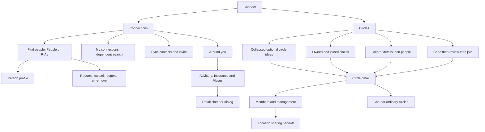

# Connect UI Contract

Status: current product and UI reference, updated for the v14 presentation
integration on 20 October 2026. Owner: frontend architecture. Classification:
`canonical`, package-local. This contract describes the reachable Connect
experience: what each surface shows, what each CTA does, and how a person
returns. It records existing behavior; it does not introduce new service permissions or change mutation semantics.

Connect has two top-level tabs: **Connections** and **Circles**. Connections
finds and manages relationships. Circles groups people, manages membership,
and hosts eligible group conversations. The six optional circle ideas are templates;
saved circles and joined memberships come from the current account.

## Visual Map

## Product facts and scope

| Claim | Classification | Current contract |
| --- | --- | --- |
| Connect has Connections and Circles | `already_exists` | Two route-backed tabs; tapping or swiping selects the same surface. |
| There are six circles | `already_exists` for the starter catalog | The catalog contains six templates; owned/joined counts describe actual saved circles. Neither number is a maximum. |
| A person has joined three circles | `needs_verification` | Valid as an account example only. The joined list is dynamic; it can contain zero, three, or another count. |
| A circle name defines a permission | `wrong_direction` | Names and decorative icons do not grant access. Membership and separate sharing decisions retain their own authority. |
| Creating or joining starts location sharing | `wrong_direction` | Circle management belongs to Connect. Location and SMS actions have separate flows and guards. |

A **page** has an authored route. A **route state** changes a query on that
page. A **local step** changes the current form without a new route. A
**sheet/dialog** is an overlay. A **handoff** enters another feature's owner.
These distinctions matter for Back, cancellation, and whether anything has
already been saved.

This inventory follows Connect into its own nested steps, sheets, and detail
views. Person profiles, private messages, consent requests, onboarding, and
Location are named handoff boundaries; their complete downstream products
retain their existing owners. Controls reachable only through those products
are not invented as additional Connect pages.

## Pages and route states

| Surface | Entry or URL | Presentation and return |
| --- | --- | --- |
| Connections | `/one/connect` or `/one/connect?tab=all` | Find people by default; `view=connections` is the shared contact-results entry to My connections. Shell Back follows the authored section origin, with `/one` as its default parent. |
| Circles | `/one/connect?tab=circles` | Saved lists first, collapsed optional circle ideas below. |
| Create a Circle | Circles plus `action=create-circle` | Focused full-page form; shell Back returns to the Circles list. |
| Join a Circle | Circles plus `action=join-circle` | Full-page code/review flow; optional `code` prefills and reviews, never auto-joins. |
| Circle detail | Circles plus `action=circle-detail&circleId=<id>` | Saved circle; `circleSetup=1` requests first-member setup, `circleChat=1` requests Chat. |
| Exact person review | `/one/connect?reviewPerson=<id>` | Opens the current person's capability review, without automatically sending. Incoming requests can redirect to Consent Center. |
| Person profile | `/people/<personRef>?from=<return>` | Shared profile page, entered only with a public person reference. |
| Private messages | `/one/messages` through the shared route builder | Opens a permitted conversation or draft with the selected person. |
| Shared circle invitation | `/circle/join?code=<code>` | Guest or authenticated preview, then protected Connect handoff. |
| Old Connect settings link | `/one/connect/settings` | Redirects to canonical Gemini preferences in Profile. |

Find people is the default local view, with My connections adjacent. Each keeps
its own search. Accepted-roster search uses the existing paged service, with the existing People/all or verified-RIA audience, and never overwrites the cached browse page.
People, RIAs, and Around you are local directory modes inside Find people;
they are not three additional top-level tabs. Search uses `q` plus the
existing query/session restoration. Unknown outer tabs resolve to Connections.
Unknown circle actions, or detail without a circle ID, render the list.

Authority stays in [route constants and builders](../../lib/navigation/routes.ts),
[Connect route helpers](../../lib/navigation/connect-routes.ts),
[tab registry](../../lib/navigation/top-shell-tabs.ts), and the authored
[route layout contract](../../lib/navigation/app-route-layout.contract.json).
This document is not a second executable route or action catalog. Voice navigation follows the split: Find people opens discovery; My connections opens the accepted roster. The exact-revision capability evolution entry rejects an unfinished navigation step authored against the old combined People view, so it is reassessed against the visible view. Relationship and consent actions retain their existing semantics.

## Connections

### Find people and My connections

| Control or state | Result and product boundary |
| --- | --- |
| **Find people / My connections N** | Adjacent local views; discovery opens first. My connections shows accepted relationships, grouped From contacts / Other connections, with its own paged search. Selecting RIAs retains the existing verified-adviser scope, My RIAs count and fail-closed empty state. Switching views does not change relationships or write history. |
| **Refresh** in My connections (accessible label Refresh contacts) | Refreshes the accepted-connections list. This is distinct from address-book **Sync contacts**. Busy disables duplicate refresh. |
| Accepted person's identity row | Opens the shared person profile when a public reference exists. |
| Message icon on an accepted connection | Enters private messages through the shared navigation owner. |
| **Options → Remove connection** in My connections | Opens **Remove connection?**; **Cancel** keeps it, **Remove** commits removal. |
| **Load more connections** | Reads another accepted-connections page; preserves the current list. |
| **Could not refresh connections** | Retains useful rows and offers tap-to-retry. Initial pending load uses placeholder rows. |
| Directory selector **People / RIAs / Around you** | Changes the local discovery mode. RIAs filters the person directory to verified investment-adviser profiles. Around you opens the nearby directory subtree. |
| **Search people / Clear search** | Updates the directory query after 300 ms; searches the directory, not My connections. Query survives remount in session storage. Searching does not send requests. |
| Person name/avatar | Profile handoff when a public reference exists; the trailing relationship action remains separate. |
| Directory identity information | Names in person rows, matched-contact results, Circle people pickers/rosters/invitations, chat identity labels and voice result/confirmation cards; no email, phone number or masked contact caption. Contact values used as missing-name fallbacks become “Hussh member”. Existing pending-request status and connected-date context remain. Search by email or phone remains supported. Mutual counts/previews remain a separate inline supplement. Authored circle names, search input and message content are not rewritten. |
| **Connect** | Sends a no-scope connection request for that exact directory person. Ordinary directory taps do not first open a scope-selection dialog. |
| **Cancel** on outgoing request | Withdraws the still-pending request; busy feedback remains in the same action slot. |
| **Respond** on incoming request | Opens pending Consent Center review; does not accept merely by navigating. |
| **Connected** | Relationship status, not a second connection mutation. |
| Mutual connection preview | Opens that mutual person's profile when a public reference exists; otherwise informational. |
| **Load more people / Retry loading people** | Automatic scroll loading with manual fallback, 20 per page; preserves rows during retry. |
| **Invite them to One** | Empty People search only, with a usable invite URL: native/Web Share or clipboard fallback. Cancellation is silent. Not offered in RIAs; an empty search does not prove someone lacks an account. |
| Loading, empty and unavailable directory | Finding people, no people/RIAs yet, or no query matches. A genuine unavailable state offers **Try again**; rate-limit copy explains the delay without a retry button. |

The visible list and exact-person review are different entry paths. An
ordinary Connect tap requests a relationship without scopes. The explicit
review path can select requested/offered capabilities and then commit the
reviewed request. Neither path implicitly authorizes all the person's
information. Source: [Connect page](../../app/connect/page-client.tsx) and
[relationship labels](../../lib/connections/relationship-label.ts).

Both lists use [ConnectPersonRow](../../components/connect/connect-person-row.tsx)
in one column at every width. Identity buttons and actions are siblings; names
and supporting text wrap. Avatars are 36px; rows are 72px on desktop and 70px on phones; relationship
actions use 44px targets, including Message and Options icon controls.

The special **Send connection requests** sheet exposes selected people and
Remove, **Ask from them** capability checkboxes per person, and the caller's
**Offer now** handles. Catalog loading blocks **Send requests**. **Cancel**
closes without sending; sending blocks close. Partial failure retains failed
people for retry. Incoming-request races redirect to the exact pending review.
Cancel removes `reviewPerson` from the URL. Bulk-selection branches exist,
but the ordinary UI has no control that enables selection mode.

### Circle task surfaces

Circle Add people, Rename and Invite code use the shared task surface anatomy.
Bottom Sheets become centered at 768px through CSS, preserving the mounted
form, selection and existing callbacks. Create keeps its existing Dialog and
page variants; Join remains its existing page flow. Circle member actions
retain the phone Drawer with same-surface removal confirmation and the desktop
menu/AlertDialog behavior. Existing permission, pending-invitation, capacity,
retry, owner/session invalidation and Back contracts remain authoritative.

| QA story | Expected behavior and evidence |
| --- | --- |
| Open a task | Opaque foreground, shared blurred/dimmed background; optimized-CSS light/dark checks in `e2e/circle-invite-picker.layout.spec.ts`. Android keeps its platform scrim fallback. |
| Add people | All connections and Selected views share the current controlled query. Selected reads the existing selection map across pages; unchecking a saved off-page selection changes no relationship until the existing Add action succeeds. Covered in named-circle-flows tests. |
| Search, clear, resize | Clear restores search focus; selection and the input node survive the 768px boundary. Page and sheet searches share phone keyboard defaults: no autocorrect/capitalization/spellcheck, Search Return dismisses the keyboard, and focus scrolls after its animation. DOM tests cover both controls; the picker height stays stable across All/Selected, loading and empty states. |
| Keyboard or enlarged text | Normal frames keep search/footer outside the scrolling results. Constrained frames scroll completely, leaving the final action reachable. Optimized WebKit fixture covers keyboard/safe-top seats and long confirmation text. |
| Cancel, Escape, retry or confirm | Existing callbacks, busy locks, nested Back layers, validation, mutation and failure recovery remain in the owning flow tests. |

### Contact sync and invitations

Sources: [sync hook](../../lib/contacts/use-contact-sync.ts),
[privacy dialog](../../components/connections/contact-discoverability-consent-dialog.tsx),
[sync results](../../components/one-location/contact-sync-results-sheet.tsx), and
[invitation sheet](../../components/connections/contact-invitation-sheet.tsx).

**Sync contacts** is available in People when the source probe finds a native
or web picker, or configured Google fallback; it is absent in RIAs. Source
permission, discoverability preference, contact matching, and external
invitations are separate decisions. A completed scan can automatically form
eligible connections through exact verified-phone matching; opt-outs and
prior disconnects remain protected. It does not send invitation messages.

| Surface or CTA | State and effect |
| --- | --- |
| **Sync contacts / Syncing…** | Starts the shared contact flow; busy prevents another sync. It differs from roster Refresh contacts. |
| **Choose your contact privacy** | Unknown preference opens **Keep private / Allow contact matching**. Either saves the choice; the person must tap Sync contacts again. Keeping private still allows checking their own contacts. |
| Privacy load/save failure | **Try again** reloads; saving blocks dismissal and controls. |
| Contact permission denied | Toast **Open Settings**; return watcher can resume after permission is granted. Restricted/unavailable access retains its own recovery. |
| Google fallback | **Connect Google Contacts → Waiting for Google… → Checking your Google contacts**; Close/Cancel dismiss; failed/cancelled authorization offers **Choose Google account**. |
| **Contact sync results** | Dynamic Checked, Matched, Connected, No match totals; Connected combines newly automatic and already-connected outcomes. Partial/unknown/unchecked/overflow states explain their actual scope. |
| Matched person **Request** | Eligible request-required match only; closes results and sends the ordinary no-scope connection request. |
| **Show more (N)** | Expands results locally. **Check Google Contacts** is a provider link when applicable. |
| **Choose Google account / Check more / Sync again** | Outcome-dependent retry or continuation, rather than asserting a full successful scan. |
| **Proceed to connections** | Closes results and enters Connections. |
| **Invite contacts** | Opens invitation selection for eligible candidates; disabled during sync or with none. Feature-flag-off fallback uses the prepared share invitation. |
| Results Close / outside / Escape | Dismisses results; no drag dismissal. Completed matching is not undone. |

Invitation flow, including every nested step:

| Step | Controls and completion boundary |
| --- | --- |
| **Invite your contacts** | Search names/destinations; No match found / Not checked groups; recipient checkboxes; explicit destination choice for contacts with several. Up to 15 unique recipients. Native uses phone destinations; web uses email. **Show more contacts** adds 50; **Review N invitations** requires a selection. |
| **Review invitations** | Shows common message and chosen recipients; per-person **Remove**, **Copy invitation**, **Share link instead**. **Open Messages · N contacts** on native or **Open email · N contacts** on web opens an external draft, not an automatic send. Native warns about group visibility; web uses BCC. Unsupported native SMS keeps copy fallback. |
| **Your invitation** | Shows external-composer handoff outcome; **Done** clears completed session, **Back to review** retains picks, and composer retry stays available when not handed off. |
| Back, Close and recovery | Review's **Back to selection** preserves picks; Escape unwinds nested steps. Busy blocks outside/Escape dismissal and duplicate composer launch, but explicit Close still clears the session. **Retry invitation link** recovers preparation failure. Empty selection sources keep copy/share fallback. |

Preparation can retry without resyncing contacts. Recipient choices remain
account/route-scoped in memory. Opening an OS mail/SMS composer is not proof
that invitations were sent.

### Person profile handoff

The shared [person profile](../../components/connections/person-profile-page.tsx)
can display relationship state, public details, capabilities, shared records,
and request controls. Availability depends on that person's published catalog,
relationship, grants, feature flags, and vault state. The profile is not a
static list of capabilities every person possesses.

| Profile surface or CTA | Immediate flow and boundary |
| --- | --- |
| Guest **Share / Sign in** | Share copies the profile URL; Sign in enters authentication. Loading/unavailable profile has its own state. |
| Relationship **Connect / Cancel request** | Sends the social request or withdraws the outgoing one. Connected email/phone links use mail/phone handlers. |
| **Request / Manage access** | Request scrolls Available to request; Manage access enters Consent Center. |
| **Available to request** | Nested categories/branches with local parent Back, checkboxes, **Select all in category**, search, **Filter categories → All categories / category**. Granted scopes are disabled. **Load more information / Try loading more again** reads another catalog page; revision changes clear stale selection/review. |
| **Review request (N)** | Requires chosen scopes and ready vault. **Request information from NAME** shows labels/sensitivity, Access duration 1/3/7/30 days, Purpose of 8–500 characters, maximum 50 scopes. **Send request / Cancel**; failure keeps review; success clears the draft and reloads history. |
| **Shared with you** | Empty or secure granted-information card: **Unlock to view / Try again**, sensitive-item **Show / Hide**, visible-field **Copy**. Decrypted values remain client-memory information. Ended or unavailable grants do not become ordinary profile fields. |
| **Request history** | **Details / Withdraw pending**, busy variants, status and purpose. **Previous / Next** pages history; failure can retain recent activity. Withdrawal is a mutation. |
| Viewer relationship read failure | Public identity remains; **Try again** reloads viewer state. |
| **Request files** | Connected, unlocked, feature-gated. What do you need, required date period; package variant also shows requesting identity, reason and access period 7/30/90 days. Quote failure offers Retry. **Send request / Add Google account / Cancel**; success **View request / Request more files**. Request does not itself grant file access. |
| **Ask about files** | Ask about their Drive dialog, question up to 2,000 characters, **Send / Cancel**. Success **View question / Ask another question**. Creates an owner-reviewed question, not an immediate Drive read. |
| **Request scope** | Feature-checking/blocked state offers Close or **Try again / Close**. Otherwise question up to 2,000 characters, **Send request / Cancel**; success **View request / Ask another question**. Owner reviews required information and price. |
| **Request cards** | Locked vault first opens wallet unlock; person taps again after unlock. **Request a card → Send request / Cancel**, then Card request sent. Creates the existing encrypted card-access request. |
| **Available packets** | Gated catalog: **Retry / Load more**, packet row opens adaptive detail, local **Back / Close** restores list. **Buy for [price] / Add Google account** creates a request; payment follows approval. Success **View request / View files** enters Consent Center. |

Immediate request owners:
[information review](../../components/consent/information-request-review-fields.tsx),
[files](../../components/consent/document-file-request.tsx),
[Drive questions](../../components/consent/document-request-button.tsx),
[scope questions](../../components/consent/request-scope-button.tsx),
[cards](../../components/wallet/request-cards-button.tsx), and
[packets](../../components/consent/drive-packet-catalog.tsx).

The Connections row owns its direct-message icon. The current profile does
not render a separate general-purpose Message CTA. Its relationship menu's
Remove action currently commits directly; it does not reuse the Connections
list's removal confirmation. This difference is recorded below as a gap.

## Around you

Source owners: [directory switcher](../../components/connect/nearby-directories.tsx),
[shared directory UI](../../components/connect/nearby-directory-ui.tsx),
[advisors](../../components/connect/advisors-nearby.tsx),
[insurance](../../components/connect/insurance-agents-nearby.tsx), and
[places](../../components/connect/places-nearby.tsx).

| Surface or CTA | Behavior |
| --- | --- |
| **Advisors / Insurance / Places** | Three directory chips, initially Advisors. Visited chips keep state while this subtree remains mounted. Leaving Around you unmounts it. |
| **Use location** | Requests permission/current position after a gesture; becomes **Locating…**. Already-granted permission can resolve without another prompt. |
| **Use a ZIP** | Reveals manual search. Advisors/Insurance use **ZIP**; Places uses **Area or postcode**. |
| **Search** in manual form | Searches the trimmed nonempty place/ZIP; missing sign-in token produces the corresponding sign-in message. |
| Location denied/unavailable | Shows **Location is off** and manual form. This branch does not offer a device-settings link. |
| Radius selection | Advisors/Insurance: 5, 10, 25 miles, default 10. Places: 1, 5, 15 miles, default 5. Changes read a new result set. |
| Directory search / **Clear search** | Filters already loaded rows after a debounce; does not run a fresh remote name search. No-match state also offers Clear search. |
| **Try again** | Repeats a failed cold read with the current anchor/radius. Error/empty states also expose manual-location recovery. |
| **Search within N mi** | Empty-state expansion, only when a larger configured radius exists. |
| **Show more** | Advisors/Insurance paging; becomes Loading, and failed paging offers Try again. Places has no paging CTA. |
| Places categories | All, Hotels, Food & drink, Health, Banking, Shops, Fitness & beauty, Auto, Transit, Education, Outdoors. Filters loaded category buckets. |
| Source attribution, optional Terms / Report an error | External source links. Places can show partial streamed results and **Finding more nearby…** before completion. |

All four detail surfaces are a mobile sheet or desktop dialog, with shared
Close behavior. Closing preserves the list/filter/radius; opening a detail
does not author a new URL.

| Detail | Visible information and CTAs |
| --- | --- |
| [Advisor](../../components/connect/advisor-detail-surface.tsx) | Loads profile by CRD; experience, firms, states, disclosures and office details. **Call** when phone exists; **BrokerCheck report** when returned. No inline detail retry. |
| [Office](../../components/connect/office-detail-surface.tsx) | Name, location, advisor count and sample names; **Call** when phone exists. Sample names and “and N more” are not drill-in CTAs. |
| [Insurance agency](../../components/connect/insurance-agent-detail-surface.tsx) | Products, standing, address, posted hours; **Call / Visit agency** when available. |
| [Place](../../components/connect/place-detail-surface.tsx) | Keeps the selected row while fetching hours/contact details; **Call / Visit website / Open in Google Maps** when returned. Failure retains row details; close/reopen retries. |

## Circles

### Optional circle ideas

Ideas are collapsed below actual circles and hidden while the circle list is
being searched. Hide/Restore hidden affects templates only, never a circle or
membership. The existing starter catalog and mutation owner are retained. Source:
[starter definitions](../../components/connect/circle-discovery.ts),
[discovery card](../../components/connect/circle-discovery-card.tsx), and
[starter actions](../../components/connect/living-connections.tsx).

| Template | Default saved identity | Setup effect |
| --- | --- | --- |
| SMS | Product-managed SMS Circle | Ensures the SMS system roster. A custom circle with the same name is not that roster. |
| Location | Location Circle, kind `other` | Creates a named group; location sharing still requires a later action. |
| Family | Family Circle, kind `family` | Creates a named group. |
| Finance | Finance Circle, kind `other` | Creates a named group; no financial access is granted by its name. |
| Investor | Investor Circle, kind `other` | Creates a named group; no investment permission is granted. |
| Business | Business Circle, kind `other` | Creates a named group; no company-information permission is granted. |

Selecting an idea creates only after a tap, then opens the saved detail;
non-SMS setup carries first-member intent. Ideas already matched to an owned
circle are omitted because the actual circle is listed above. Matching uses the current name/kind for
ordinary starters and system identity for SMS. Joined circles do not satisfy
an owned starter; renamed/custom circles stay in the saved list even when they
no longer match a starter.

| Discovery control/state | Result |
| --- | --- |
| **Create circle** in Your circles | Opens the existing full-page creation flow. |
| Idea row | Creates the corresponding missing owned circle. Disabled while loading, failed, or another idea is creating; the existing in-flight guard prevents duplicate rapid creates. |
| **Hide / Restore hidden** | Changes only the optional template list in the current owner session. |
| **Retry circles** | Reloads failed circle summary. |
| **Finish setting up One** | Enters account setup when no vault exists. |

### Owned and joined lists

[ConnectCirclesTab](../../components/connect/circles/connect-circles-tab.tsx)
loads the current account's saved summaries. Owned system circles appear
before owned named circles; Trusted precedes SMS. **Joined circles** contains
eligible circles created by others and is absent when empty. Foreign SMS
system circles are filtered out of these lists. Three visible joined circles
is a sample account state, not a required fixture or product limit.

| List control/state | Result |
| --- | --- |
| **Create circle** | Opens the full-page creation route state. |
| **Join with code** | Opens code entry. |
| **Circle name** search | Filters the already-authorized owned and joined summaries. |
| Circle name/chevron | Opens that saved circle. Rows show the actual count and product description without avatar clusters. |
| **Options → Delete / Leave circle**, or left swipe | Swipe reveals only. The same shared confirmation precedes the existing mutation, with a fresh server-capability read. System/Trusted circles never expose Delete. Missing authority fails closed. |
| **Circles are unavailable** | Tappable retry row; **Loading circles…** is a disabled status row. |
| No vault | **Finish setting up One**, rather than an unusable unlock action. |

Counts include the owner. Named circles with only their owner can say **No
members yet**. Trusted explains **People you add yourself**; SMS explains its
delivery relationship. Rendering may ensure the owner's empty
Trusted container once per unlock session; it does not copy all connections
into Trusted. Account/vault changes must not display the previous account's
summary. Mutation events and visible-pane repair reads refresh the list.

### Create a circle

The dialog and full-page flow reuse
[CreateCircleFlow](../../components/one-location/redesign/circles/named-circle-flows.tsx)
and [its people step](../../components/one-location/redesign/circles/create-circle-people-step.tsx).

| Step or CTA | State and effect |
| --- | --- |
| Details: **Circle name** | Required trimmed name, 1–80 characters. |
| **Circle type** | Family, Friends, Other; default Family. These are not the six starter labels. |
| **Next / Saving…** | Persists the circle, then opens the people step. Failure keeps the form available for retry. |
| People: **Search contacts** | Searches eligible existing connections; selection survives paging. |
| Person **Add / selected toggle** | Changes the local batch, bounded by remaining capacity and at most 20 per mutation. |
| **Add N person/people** | Commits membership changes, then opens saved detail. Failed addition preserves the selection. |
| **Try again / Load more contacts** | Recovers or pages the eligible-person list. |
| **Add people later** | Opens saved detail without adding anyone; remains usable when contact loading fails. |
| **Back** from people | Returns to details with saved circle ID and selection retained. Next updates that ID rather than creating a duplicate. |
| Modal Close / dismissal | Blocked while saving. Escape first unwinds the people step; a later close dismisses the dialog. |

**Save boundary:** Next has already created the circle. Closing, Back, or Add
people later does not roll it back or delete it. Modal completion pushes detail;
full-page completion replaces the creation state. Explicit Delete circle is
the separate removal action.

### Join and preview

Source: [JoinCircleFlow](../../components/one-location/redesign/circles/named-circle-flows.tsx)
and [invitation landing](../../app/circle/join/page.tsx).

| Step or CTA | State and effect |
| --- | --- |
| **Enter invite code** | Three groups of four unambiguous characters; auto-uppercase/focus advance; Backspace returns to the previous empty group. |
| **Paste from clipboard** | Explicit clipboard read; raw/formatted code can fill all groups. Denied access leaves manual paste/type recovery. |
| **Review Circle / Reviewing…** | Requires 12 valid characters; resolves a preview without joining. Enter also reviews. URL-prefilled code can auto-review once. |
| Preview | Circle name, owner, member count; explains that Location and SMS stay private until chosen. Changing input invalidates the previous preview. |
| **Join Circle / Joining…** | Commits membership, then replaces the flow with detail. |
| **Open Circle / Opening…** | Already-member variant; feedback distinguishes opening from a new join. |
| **Use Another Code** | Confirmation **Use another code?**; **No** retains the preview, **Yes** clears it and refocuses entry. |
| Invalid/expired/unavailable code or join failure | Error remains with a recoverable form; busy locks prevent duplicate review/join. Shell Back returns to list. |
| Guest shared-link landing | Loads only public preview metadata. **Create your One**, carousel Next/previous, **Try again**, and final **Join this Circle** lead through introduction/sign-in, retaining the code. Definitively invalid preview disables the final join continuation. No private roster read or membership write occurs here. |
| Authenticated landing **Join this Circle / Open One** | Resolves sign-in/setup continuation into protected Connect review; the landing button itself does not join. |
| Conflicting/duplicate invitation identity | **Invitation unavailable**, with **Explore One** recovery. Token invitations keep their existing invitation-page owner. |

Joining a named circle also creates source-aware connection origins with its
active members. It does not create a trusted edge, SMS selection, live-location
grant, capability token, or encrypted envelope. Adding eligible existing
connections uses the current server's direct-add behavior, rather than claiming
a pending invitation is active membership. These boundaries are owned by the
[circle service](../../../consent-protocol/hushh_mcp/services/one_location_circle_service.py)
and [route](../../../consent-protocol/api/routes/one/location.py).

### Circle detail and membership

Source: [CircleDetailFlow and roster](../../components/one-location/redesign/circles/named-circle-flows.tsx),
[member picker](../../components/connect/circles/living-circle-panel.tsx),
[member action menu](../../components/one-location/redesign/circles/circle-member-actions-menu.tsx),
and [Connect service adapter](../../components/connect/circles/connect-circle-actions.ts).

Fresh server `viewerCapabilities` determines invite, code-view/rotation,
delete, and leave eligibility. UI role fallbacks are not a substitute for
server authorization. Ordinary circles can show Chat/Members and owner photo
editing. Trusted/SMS do not show chat or photo editing; Trusted hides Edit.

| Control/state | Result and guard |
| --- | --- |
| Initial load or roster failure | Loading stays distinct from an empty roster; the visible **Retry** control reruns the owning read after failure. |
| **Chat / Members / View members** | Changes detail's local view. First-member setup can hold Chat disabled while alone; after setup **Open chat** enters it. |
| **Edit** | Owner except Trusted: rename sheet, **Circle name**, **Cancel / Save**; nonempty changed 1–80-character name, Enter saves, busy blocks dismissal. |
| **Change circle photo** | Owner ordinary circle: **Choose photo**, local **Remove photo**, **Cancel**, **Save photo**. Only Save commits the draft. |
| **Add people** | Opens the shared sheet with an immediate search and explicit connection checkboxes. Selection stays local and cannot exceed remaining capacity or 20 per mutation. |
| Picker **Add people** | Commits the same existing atomic membership batch. The sheet closes only after acknowledgment; failures retain valid choices. **Retry / Load more connections** recover or extend the list. No orbit or drag instructions are shown. |
| **Search members / Load more members** | Filters/pages the roster. Connect always shows member search above the roster heading. |
| Roster **Connect / Cancel / Respond** | Connect sends the existing exact no-scope request; Cancel withdraws outgoing request; Respond opens pending consent review. Existing connections do not get a dead Connect button. |
| **Actions for [name] → Message** | Only for an accepted connection with a public reference; private-message handoff. |
| **Share location** | Only for a verified/location-ready other member; enters Location circle detail, not immediate per-person sharing. |
| **View profile** in phone member menu | Available with public reference when an actions menu otherwise exists. Desktop menu currently lacks this item. |
| Owner **Remove from Circle** | Opens **Cancel / Remove** confirmation, then commits removal. |
| **Invite code** | Opens code sheet. No active code: **Cancel / Create code**. Active: **Copy code / Copied**, **Share invite**. Sharing uses the existing native/web share and clipboard fallback. |
| **Replace code** | Capability-gated confirmation; **Cancel / Replace code**. Successful rotation invalidates the previous code. A member who cannot rotate sees owner-help copy. |
| **Delete circle / Leave circle** | Capability-gated confirmation with Cancel and destructive commit. Success returns to list with replace; failure stays recoverable. |

Connect presents the roster and an explicit Add people sheet backed by the
existing membership-selection/save handlers. Pending-invite cancellation lists
and Proceed to SMS remain outside this caller. A membership/remote removal that invalidates
the open circle returns to the list rather than retaining a dead detail.

### Circle chat and media

Source: [chat](../../components/connect/circles/circle-chat.tsx),
[message controls](../../components/connect/circles/circle-chat-message.tsx),
[edit/delete dialog](../../components/connect/circles/circle-chat-message-action-dialog.tsx),
[media](../../components/connect/circles/circle-chat-media.tsx), and
[photo editor](../../components/connect/circles/circle-photo-editor.tsx).

| Control/state | Result and guard |
| --- | --- |
| **Alerts** switch | Changes this conversation's alert preference; busy prevents duplicate changes. |
| Notification **Turn on / Retry / Open settings** | Existing conditional notification-permission/registration flow; Open settings is native denied-permission recovery. Browser denial shows instructions. |
| **Reconnect** | Retries failed chat connection. Revoked access removes the controls rather than continuing conversation reads. |
| **Load earlier messages / Go to latest messages** | Pages history or scrolls to the latest; reply quote can jump to an available original. |
| Message field and **Send message** | Sends text or a validated attachment to this circle. Text maximum 4,000 characters; empty drafts cannot send. |
| **Attach photo, video, or document** | Opens file picker: JPEG/PNG/WebP, MP4/WebM, PDF/DOCX/TXT; nonempty file at most 5 MB. |
| **Remove attached image/file / Cancel reply** | Local draft changes; do not delete a sent message. Locked while sending or delivery is unresolved. |
| **Retry message** | Retries the same sealed pending delivery; it does not allocate a fresh message or offer a separate pending-send discard action. |
| **React to message**, reaction pills | Emoji picker with search/categories/recent/more choices; selection or pill toggle commits the reaction. |
| **Message options**, touch hold, context menu | Confirmed visible/unblocked messages open options; a stationary one-second touch hold also opens them. Movement or interrupted/hidden state cancels the hold. Options include quick reactions and **More reactions…** for the full picker; deleted messages omit reactions. |
| **Message options → Reply** | Sets reply draft; unavailable for deleted/decryption-failed content and while a send is pending. |
| Own **Edit** | **Edit message** dialog, text, **Cancel / Save changes**. Requires changed nonempty content; saving locks dismissal. |
| **Delete for me / Delete for everyone** | Confirmation **Cancel / Delete message**. Everyone variant is for own eligible message; deleting for self leaves others' copies. |
| **Open shared image / Close** | Image viewer; **Retry image / Retry full image** recover loading failures. |
| **Open video / Reload video** | Opens native video controls and retries the media when needed. |
| **Download document** | Loads the permitted shared attachment; disabled while loading. |

The Connect detail caller keeps Circle chat open and non-collapsible. The
alternate chat-lane composer's **Choose emoji** and **Talk to One** controls
are not part of this variant. Reactions use the message emoji picker.
Consecutive join activity with the same nonempty batch ID groups into one
named activity line; separate batches, legacy unbatched events, leaves, and
removals remain separate.

## Back, cancellation, and feedback

1. Back hierarchy is top overlay, active feature step, authored route parent.
   The shared shell, iOS gesture, and Android Back use those owners; application
   Back does not fall through to raw history.
2. Full-page create/join/detail Back replaces the URL with
   `/one/connect?tab=circles` before leaving Connect. Create's people step first
   returns to retained details; while that step's addition is pending, its
   feature Back callback consumes Back. This lock is not universal across
   join and detail mutations.
3. Switching Connections/Circles clears circle action, ID, and invite-code
   query state. Surface/action/circle changes reset scroll. The app scroll root
   owns the page, including the My connections roster; paging extends that
   list without adding another contained vertical scroller.
4. Selection changes, code review, photo drafts, and search are not completed
   mutations. Success follows the owning service acknowledgment. A creation
   already saved by Next remains saved when the form closes.
5. Auth, vault, permission, relationship, and membership failures keep their
   existing boundaries. Circle management needs the owner's vault; it must not
   require Location onboarding merely to name or join a group.
6. Connections and Nearby can preserve useful current-account rows during
   refresh. Circle-list read failure currently clears its summaries and shows
   retry. Counts and avatar previews are real summaries; decorative
   overflow/empty artwork is not another membership or permission claim.

Connect explicitly opts into the shared Profile type scale through
`data-profile-type-scale="page"`; its removal dialog opts into the same scale.
Use the shared compact row composition and semantic typography rather than
inventing a parallel type ladder. Plus Jakarta Sans, hierarchy, colors, touch
targets, and action sizing remain owned by the
[design system](../../../docs/reference/quality/design-system.md).
The shared top bar owns the single Connect title; the existing tab/search
bands and focused circle flow own their authored layout.

## Current gaps and differences

These are existing behavior or contract differences, not newly implemented
features:

| Finding | Consequence for future changes |
| --- | --- |
| Multi-select directory UI is present, but selection mode is never enabled by the ordinary current UI. | Do not promise a tappable Select-many flow. Explicit person/capability review remains reachable. |
| My connections and circle roster removal confirm; profile removal currently commits directly. | A future consistency fix must preserve server authority and separately review destructive confirmation behavior. |
| Phone roster profile menu returns with Location context. Desktop roster menu lacks View profile. | Do not claim symmetric profile navigation across these controls. |
| Profile scope-tree parent Back is local; the inspected profile/tree does not register a corresponding feature Back layer. | Do not claim shell/system Back unwinds that tree; prove that behavior before changing its navigation contract. |
| Share location enters Location circle detail and does not retain a member-specific target. | Do not describe the CTA as immediately sharing with the selected person. |
| Places initially says Use a ZIP although its field accepts an area/postcode. | This is current copy; the provider supports the wider field contract. |
| Successful Nearby results have no general Change location control. Advisor/insurance warm refresh can retain rows while losing the visible error/retry host. | Do not promise those recovery controls without changing the owning UI. |

## Verification and maintenance

This reference is source-verified, not a live-account circle inventory or a
claim of browser/device acceptance. No invitations, joins, contact syncs,
messages, grants, or deletions were executed while writing it. The UI doctor
and documentation gates validate existing authored contracts and this doc's
integrity; they do not prove every interaction below at runtime.
The linked feature suites are proof owners for their behavior; source review
of those suites is distinct from executing them or running a live walkthrough.

| Contract to preserve | Existing proof owner |
| --- | --- |
| Two tabs, entry state and navigation | [Connect page tests](../../__tests__/app/connect/page-client.test.tsx), [Connect navigation](../../__tests__/navigation/connect-nav.test.ts) |
| Circle flow Back and breadcrumbs | [Back cases](../../__tests__/navigation/connect-circle-back.test.ts), [breadcrumbs](../../__tests__/navigation/connect-circle-breadcrumbs.test.ts) |
| Six starters, owner matching and duplicate prevention | [Discovery tests](../../components/connect/__tests__/circle-discovery.test.tsx) |
| Dynamic circles, modal/full-page flow and refresh | [Circles tab tests](../../components/connect/circles/__tests__/connect-circles-tab.test.tsx) |
| Contact privacy, matching and invitation steps | [Sync results](../../__tests__/components/contact-sync-results-sheet.test.tsx), [invitations](../../__tests__/components/contact-invitation-sheet.test.tsx) |
| Person catalog, grants and request reviews | [Profile tests](../../__tests__/components/person-profile-page.test.tsx) |
| Retained creation and code review/join | [Named-circle tests](../../components/one-location/redesign/circles/__tests__/named-circle-flows.test.tsx), [code-input tests](../../components/one-location/redesign/circles/__tests__/join-circle-input.test.tsx) |
| Current account's own SMS system roster | [System-circle tests](../../__tests__/lib/one-location-system-circles.test.ts) |
| Inline member controls and chat mutation boundaries | [Member panel](../../components/connect/circles/__tests__/living-circle-panel.test.tsx), [chat](../../components/connect/circles/__tests__/circle-chat.test.tsx) |
| Nearby permission/filter/paging/detail | [Directory switcher](../../components/connect/__tests__/nearby-directories.test.tsx), [advisors](../../components/connect/__tests__/advisors-nearby.test.tsx), [Places integration](../../components/connect/__tests__/places-nearby.integration.test.tsx) |
| Phone/desktop composition | [Connect grid](../../e2e/connect-page-grid.layout.spec.ts), [Circles layout](../../e2e/connect-living-circles.layout.spec.ts), [join layout](../../e2e/circle-join-responsive-contract.spec.ts) |

When changing Connect, update the relevant rows in this one reference and the
existing route/action owners, rather than creating another parallel contract.
Follow the [UI contributor scaffold](../../../docs/reference/architecture/ui-contract-contributor-guide.md)
for authored Back cases and Search/actions. UI edits require `ui:doctor`, then
`build:ui-contracts`, `verify:ui-contracts`, and the affected behavior pack.
Documentation-only changes require `./bin/hushh docs verify` from the repo root.
Protected live rehearsal uses the existing reviewer workflow and same-session
client navigation; fixture counts never establish the current person's circle
memberships.
