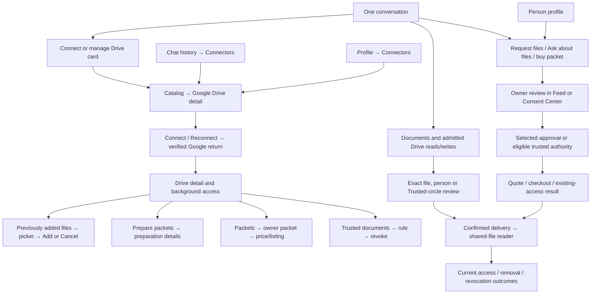

# Drive UI Contract

## Data packets amendment — 22 October 2026

The shared-runtime Google Drive detail places **Data packets** immediately after
Trusted documents and before Disconnect Drive. The server's fixed catalog owns
the four names: Financial Assets, Insurance, Non-Financial Records and Personal
Documents. Empty categories remain visible with a zero count. “Not sorted yet”
is a separate count and file list; uncertain files are never forced into a group.

Opening a folder requests its first 50 indexed files, across fiscal periods.
Each row shows its title and deciding date and opens its original Google Drive
link. Load more fetches the next page. Empty, loading and retry states are
explicit. Web feature Back and the connector's own Back close the file list
before leaving Drive. Native `connector-group-files` has `connector-detail` as
its only parent; native Back uses the retained model's same close command.

An unlocked owner with an admitted live Drive connection can explicitly prepare
or pause packets. The first opt-in shows the bounded-read/retention disclosure;
opening this screen never opts in. Processing needs Background Drive access.
All reads use the existing connector proxy with no-store and owner checks before
and after response bytes. File titles live only in the mounted owner/connection
session and are retired on close, lock, account change or reconnection. Existing
sharing Packets and Trusted documents keep their separate authority.

This amendment describes source behavior. UAT admission, serving revision,
authenticated acceptance and physical-device verification require separate proof.

Status: current source-backed product reference inspected at revision
`477864ae8d2925a7cdc5b21d8ca6e91b3f22955e` on 21 October 2026.
Owner: frontend architecture with the connector, Documents specialist, sharing,
consent and payment service owners. Classification: `canonical`, package-local.

Presentation amendment, 21 October 2026: the Profile v18 request dialogs use
the shared [illustrated request composition](../../components/app-ui/illustrated-request-dialog.tsx)
and its [local styles](../../components/app-ui/illustrated-request-dialog.module.css).
The affected requester copy, geometry and typography below reflect that change.
Service, consent, pricing, retry and delivery contracts retain the inspected
source boundary above. Executed verification is scoped in the fixture section.

This is the Drive counterpart to the [Mail](./mail.md) and
[Calendar](./calendar.md) contracts. It follows the actual reachable interaction
paths from first connection through selected files, background preparation,
packets, trust, private-agent tools, requests, owner review, payment and delivery.
For every mounted surface the reference records its content, read provenance,
action/cancellation boundary and spatial rules. **No dedicated Drive route,
Drive onboarding wizard or Calendar-style tab bar is mounted at this revision.**
Drive's first-use experience is its connector connection/recovery flow. One
uses the Documents specialist and admitted Drive tools inside the shared
conversation; the product name does not create another workspace.

Exact authored English is quoted. `{placeholders}` indicate values from a
person, provider, response, locale, amount or model. A model-written answer,
provider consent screen, Google Picker or Stripe Checkout has dynamic or
externally owned copy; it cannot be represented by invented fixed app strings.
The source files linked below remain the complete executable schema and text
owners. Credentials, one-use authorization values, private filenames, account
records and actual capability values are excluded from this reference.
Shorthand `components/`, `lib/`, `app/`, `hooks/`, `e2e/` and native paths are
relative to the webapp package. A literal catalog's source-line column belongs
to the component named immediately above that table; it is not a screen
coordinate or an additional request.

The [Connectors contract](./profile-connectors.md),
[Person profile](./person-profile.md), [Feed](./feed.md),
[shared navigation](./navigation.md), [typography](./typography.md),
[route/Back declarations](../../lib/navigation/app-route-layout.contract.json),
[One product manifest](../../../consent-protocol/hushh_mcp/agents/one/agent.yaml)
and [Documents manifest](../../../consent-protocol/hushh_mcp/agents/documents/agent.yaml)
retain their owning roles. This document describes their current Drive
projection; it creates no second route, tool, permission, token or price authority.

## Visual Map

## Contract map

| Review area | Detailed reference |
| --- | --- |
| First use and connector | [Entry, catalog, connection, OAuth, background setting and selected files](#first-connection-connector-catalog-and-selected-files) |
| Preparation and owner catalog | [Preparation, packets, price/listing and document trust](#preparation-owner-packets-and-trusted-documents) |
| Private agent | [Documents tools, reads, Memory review, exact-file actions and sharing cards](#private-agent-conversation-documents-tools-and-inline-cards) |
| Requests and recipients | [File/question creation, buyer packets, owner review, payment, Feed and received files](#file-requests-questions-buyers-recipients-and-payments) |
| Exact English | [Human-facing literal catalog by component and state](#exact-human-facing-copy-by-component-and-rendered-state), followed by [dynamic templates](#dynamic-values-dates-and-composed-lines) |
| Dimensions | [Phone/desktop hosts, row/control geometry, portals and native differences](#phone-and-desktop-sizing-typography-and-spatial-qa) |
| Font schema | [Family, role, size, line height, weight and cascade](#typography-resolution-source-truth-not-jsx-guesses) |
| Every wire boundary | [Endpoint inventory](#endpoint-inventory), [payloads](#bounded-payload-projection), [consumed response fields](#response-fields-consumed-by-the-ui), [effects](#storage-provider-effects-and-replay-semantics), [timeouts/recovery](#timeouts-cache-continuation-and-failure-boundaries) and [server error copy](#closed-api-errors-and-authored-details) |
| Redesign review | [State and pixel QA ledger, evidence and remaining gaps](#redesign-qa-ledger-and-verification-boundary) |

## How to read and redesign this contract

| Unit | Meaning |
| --- | --- |
| Page or layer | A real mounted route, Profile/native child, portal, card or local disclosure. A filename or backend endpoint alone does not establish a screen. |
| CTA | Visible label and icon-only accessible name, admission/disabled condition, handler, request or explicit **no API call**, acknowledgement, next state, and failure/retry. |
| Negative action | Cancel, Back, X, Escape, outside click, swipe, No/deny or Undo is recorded separately from the affirmative branch. Do not assume every close mechanism cancels durable work. |
| Row | Shared list response and exact fields feeding name, status, description, count, price or eligibility. Opening a locally retained row does not imply a new details GET. |
| Coordinates | X/Y are relative to the containing pane/card/viewport and cumulative content height. Popover anchoring, portals, scroll and CSS layers determine placement; fixed screenshot coordinates would be false for dynamic content. |
| Dimensions | CSS pixels at a default 16px root size unless stated. A 50% browser zoom changes the CSS viewport; it does not halve the authored font, padding or breakpoint. Native points and Dynamic Type are a separate renderer. |
| Verification | Source-resolved geometry and inspected test assertions are distinguished from executed fixtures, live provider acceptance and physical-device measurements. The QA ledger at the end records that distinction. |

`C` means `/api/connectors`; `D` means `C/google_drive`. `F` means the current
Firebase ID token; `V` means the same owner's unlocked vault-owner authority.
`Authorization: Bearer V`, `Authorization: Bearer F` and dual
`Authorization: Bearer F` + `X-Hushh-Consent: V` are distinct request
contracts. Each API table identifies its actual authority. Connected status,
a saved row, a Trusted Circle label or a successful read is not itself
permission for a different write.

An approval, search start, listing change, request creation and Google permission
result have different acknowledgement boundaries. In particular, a queued
share is not confirmed Google access; a selected-file record is not a processed
file; a prepared packet is not automatically listed; and a browser Checkout
return is not a signed payment confirmation. Each corresponding section states
the exact effect and recovery owner.

## First connection, connector catalog and selected files

### Entry routes and available screens

| Claim / surface | Classification and current truth | Source |
|---|---|---|
| Dedicated Drive product tab / standalone Drive onboarding | `missing`: no Drive entry in ONE_CAPABILITIES, no Drive setup ID, no Drive app route. Do not invent a Drive dashboard, Drive setup wizard, or tab strip. Backend specialist identity is separate from frontend route ownership. | [hushh-webapp/lib/onboarding/one-capabilities.ts:145](../../lib/onboarding/one-capabilities.ts#L145) (complete catalog ends :323); [lib/onboarding/setup-capability-ids.ts:8](../../lib/onboarding/setup-capability-ids.ts#L8); [lib/navigation/routes.ts:149](../../lib/navigation/routes.ts#L149) |
| Profile → `Connectors` | `already_exists`: settings menu row opens vault-backed Connectors pane; list→Drive detail changes `profile_detail=connector:google_drive`. Pane title owns Back, inner panel hides header. | [components/profile/profile-menu-model.ts:23](../../components/profile/profile-menu-model.ts#L23); [components/profile/profile-workspace-page.tsx:4617](../../components/profile/profile-workspace-page.tsx#L4617); [components/profile/profile-connectors-section.tsx:25](../../components/profile/profile-connectors-section.tsx#L25), :88 |
| Legacy `/one/profile/connectors?connector=google_drive` | Compatibility address redirects to Profile pane over `/one`, normalizing connector detail; native static export uses client redirect. OAuth return below it remains a distinct real page. | [app/one/profile/connectors/page.tsx:12](../../app/one/profile/connectors/page.tsx#L12); [lib/navigation/profile-pane.ts:75](../../lib/navigation/profile-pane.ts#L75), :87 |
| Chat inline access/reconnect entry | Opens Profile pane over current route, closes history first, carries return focus; `drive` maps to `google_drive`. One modal surface; chat workspace remains underneath. | [components/agent/agent-chat-workspace.tsx:2789](../../components/agent/agent-chat-workspace.tsx#L2789), :2794 |
| Chat history footer `Connectors` | Separate reachable presentation: sidebar button `aria-label="Open Connectors"`, native footer label `Connectors`; `openHistoryConnectors` chooses `drawerMode="connections"`. HistoryConnectorsPage uses same ProfileConnectorsSection owner, local connector state, and its own header. | [components/agent/agent-history-sidebar.tsx:734](../../components/agent/agent-history-sidebar.tsx#L734); [components/agent/native-history-presentation.tsx:71](../../components/agent/native-history-presentation.tsx#L71); [components/agent/agent-chat-workspace.tsx:2777](../../components/agent/agent-chat-workspace.tsx#L2777), :8940; [components/agent/history-connectors-page.tsx:12](../../components/agent/history-connectors-page.tsx#L12) |
| ProfileConnectorsLink | Plain click opens pane over originating screen, returns there on Back and restores trigger focus. Modified click retains real href into pane over `/one`. Used by consent/feed reconnect CTAs. | [components/profile/profile-connectors-link.tsx:29](../../components/profile/profile-connectors-link.tsx#L29); [lib/navigation/profile-pane.ts:70](../../lib/navigation/profile-pane.ts#L70) |
| Drawer default in ConnectorsPanel | Compatibility/default component presentation, **not a separate current mount**: production `<ConnectorsPanel>` usage found only in ProfileConnectorsSection with `surface="profile"`. Default drawer header/search exist in implementation and tests; do not present those as Profile chrome. History has its own header. | [components/agent/connectors-panel.tsx:441](../../components/agent/connectors-panel.tsx#L441), :2525; [components/profile/profile-connectors-section.tsx:88](../../components/profile/profile-connectors-section.tsx#L88) |
| Upload a local file / manually write Memory inside connector | `missing` in ConnectorsPanel: no upload input or manually-written memory CTA. Google-selected documents are not uploaded local files. Drive chat read/Memory review and generic Memory are separate surfaces. | complete [components/agent/connectors-panel.tsx](../../components/agent/connectors-panel.tsx); chat lane owns [drive-read-memory-action.tsx](../../components/agent/drive-read-memory-action.tsx) |

### Connector catalog: every Drive-facing control and state

| Element / exact copy | Visibility, operation, yes/no/busy/outcome | Source |
|---|---|---|
| Headings `Connected`, `Available` | Membership uses `driveConnected = connected OR verifying` (so a verifying grant sits in Connected despite detail showing unverified). `needs_reauth` is in Available. List disconnect pins old section until next list arrival. | [connectors-panel.tsx:2083](../../components/agent/connectors-panel.tsx#L2083), :2302–2313, :2489 |
| Drive row `Google Drive` | Row opens detail only, no provider access. Independent trailing button behavior below. Profile supporting line priority: pending/failure → account → detail → `Connected`/`Not connected`. | [connectors-panel.tsx:338](../../components/agent/connectors-panel.tsx#L338), :2145 |
| Account supporting strings | `Connected as {provider account}`; `Account details unavailable`; `Sign-in needed · {provider account or account details unavailable}`; `Authorized · {provider account or account details unavailable}`. Only after checked nonloading state and connected/verifying/needs_reauth; never use app-login identity as Google account fallback. | [connectors-panel.tsx:202](../../components/agent/connectors-panel.tsx#L202), :2093 |
| Detail cue `Sign-in needed` / `Selected files only` | needs_reauth takes priority; selected files cue when available and live flag off. Profile displays line; drawer row may put cue in sr-only text. | [connectors-panel.tsx:2149](../../components/agent/connectors-panel.tsx#L2149); :303; :338 |
| Trailing visible `Review`, aria `Review Google Drive access` | Available live-access path: opens Drive detail only. **No OAuth until `Connect Drive`.** Disabled while drive busy/loading/unavailable. | [connectors-panel.tsx:228](../../components/agent/connectors-panel.tsx#L228), :2163–2168 |
| Trailing visible `Connect`, aria `Connect Google Drive` | Available selected-file path: opens detail AND starts selected OAuth. Same disabled conditions. | [connectors-panel.tsx:2163](../../components/agent/connectors-panel.tsx#L2163) |
| Trailing visible `Disconnect`, aria `Disconnect Google Drive` | Connected/verifying grant opens same destructive confirmation in place; no immediate mutation. Disabled driveBusy or row pending. | [connectors-panel.tsx:2158](../../components/agent/connectors-panel.tsx#L2158); :1766 |
| `Connecting…` / `Disconnecting…` | Row supporting text during web popup or actual disconnect. Spinner replaces verb, aria-busy; disabled action, row still opens detail. Native OAuth uses general detail busy, not web-popup row pending. | [connectors-panel.tsx:218](../../components/agent/connectors-panel.tsx#L218), :228, :2156 |
| `Couldn't disconnect. Try again.` | Persistent row disconnect failure until next disconnect begins (also general Drive detail message). | [connectors-panel.tsx:1743](../../components/agent/connectors-panel.tsx#L1743), :2034 |
| `Checking…` / `Unavailable` / `Check connection` | No Connect action if unavailable: loading / checked-unavailable / unchecked respectively; opening row still possible. | [connectors-panel.tsx:2170](../../components/agent/connectors-panel.tsx#L2170) |
| `Unlock your vault to manage connectors.` | No owner token: protected body unavailable; no connector management. Profile also owns contextual vault unlock prerequisite. | [connectors-panel.tsx:2563](../../components/agent/connectors-panel.tsx#L2563); [profile-workspace-page.tsx:533](../../components/profile/profile-workspace-page.tsx#L533), :4467 |
| `Loading connector catalog…` | Initial web catalog load, polite status. | [connectors-panel.tsx:2493](../../components/agent/connectors-panel.tsx#L2493) |
| `Connector catalog unavailable. Try again.` + `Retry connector catalog` | Failed GET catalog: retry reads catalog (not a new authorization), disabled while loading. | [connectors-panel.tsx:2497](../../components/agent/connectors-panel.tsx#L2497) |
| Search placeholder/aria `Search connectors` | Default drawer text input max 256; trimmed case-insensitive match against connector name, detail, account. Profile web list currently has no search input. Native scene has memorySearch port max 256 and same filter owner. | [connectors-panel.tsx:2302](../../components/agent/connectors-panel.tsx#L2302), :2586; [use-native-connectors.tsx:102](../../components/profile/use-native-connectors.tsx#L102) |
| `No connected connectors`, `No available connectors`, `No connectors found` | Default drawer empty section/search strings; do not claim Profile web shows these (its empty groups are omitted). | [connectors-panel.tsx:2570](../../components/agent/connectors-panel.tsx#L2570), :2605 |

### Main Drive detail (web and retained native feature facts)

| Copy/control | Conditional rendering and effect / all branches | Source |
|---|---|---|
| `Google Drive` | Detail heading (web sr-only), Profile pane/native title names connector. | [connectors-panel.tsx:2733](../../components/agent/connectors-panel.tsx#L2733); [lib/navigation/profile-routes.ts:101](../../lib/navigation/profile-routes.ts#L101) |
| `Search and read files` | Nonconnected account placeholder; connected compact account row uses `Connected as …` or Google Drive fallback. Native account is raw provider account or this fallback. | [connectors-panel.tsx:2402](../../components/agent/connectors-panel.tsx#L2402), :2736 |
| `Checking Drive…` | loading catalog. | :2403; :2747 |
| `Connection status unavailable` | status has not successfully checked; never reports unchecked as disconnected. | :2403; :2749 |
| `Not connected` | no grant; status `not_connected` or `revoked`. | :127–146; :2755 |
| `Connected` | connection status connected; compact account strip only if statusChecked and not loading. | :2736 |
| `Authorized · choose files to verify` | status verifying and profile selected. | :131; :2752 |
| `Authorized · connection check needed` | status verifying and profile live; authorizing is not proof of usable Drive. | :2404; :2752 |
| `Sign-in needed` / `Connection unavailable` / `Status unavailable` | status needs_reauth / error / unknown value. | :127–146; :2754 |
| `Agent One prepares packets from your Drive automatically.` | live feature on, not live+connected, packages feature on. | :2759 |
| `Full Drive access lets One find and share matching files for approved document requests. You can turn background access off anytime.` | same live setup condition, packages feature off. | :2759 |
| `Connect Drive` | checked available, and no grant OR needs_reauth OR error. Starts live profile if google_drive_live true, else selected profile. Disabled driveBusy/loading. Reconnect is this same label (no separate `Reconnect Drive` in this panel). | :2768; start :1169 |
| `Enable full Drive access` | existing connected selected-file profile and connector available; calls startDrive("live"); disabled busy/loading. **Guard does not explicitly require google_drive_live flag**; backend remains authority. | :2780; :2416 |
| `Retry Drive` | unchecked; or unavailable and not connected; or error; or live verifying. Disabled driveBusy/loading. Reloads status; if live verifying attempts existing `live/verify`, then status reload regardless verification failure, then selected-document reload. Does not exchange Google code or start new OAuth. | :2800; :2333; :685 |
| `Disconnect Drive` | any stored grant (status neither not_connected nor revoked). Disconnected-like error/needs_reauth/verifying near connection buttons; connected after trust section. Asks first, disabled driveBusy. | :2790; :2842; :892 |
| `Cancel sign-in` | only web popup pending; abort popup/start operation, not provider revocation. Can tap while Drive busy. | :2811; :1363 |
| Selected access helper | `You can choose files after connecting. One cannot search your entire Drive with this access.` when selected default, connectable, no existing grant. | :2812 |
| Unconfigured helper | `Drive sign-in is not configured here. Try again later.` after checked unavailable and no grant. | :2846 |
| Live busy message | `Preparing secure Google sign-in…` if popup pending; otherwise `Updating Drive…` while runDrive; otherwise result/error message. Polite status. | :2851 |
| `Background Drive access` | Connected live profile only. Switch aria identical, checked only server-read boolean; disabled while driveBusy. Unread has no switch. Toggle sends confirmed POST and waits for exact matching enabled result, no optimistic success. | :2817; :2337 |
| Background read/write subcopy | `Checking background access…`; `Couldn’t check background access.`; `Saving…`; `Couldn’t turn on. Try again.` / `Couldn’t turn off. Try again.`; on `Agent One works while you’re away.`; off `Paused while you’re away.` | :2398 |
| `Retry setting` | only null background state plus read error; re-runs GET, no toggle replay. | :2824 |
| Background success status | `Background Drive access is on.` / `Background Drive access is off.`. Toggle does not disconnect Google or revoke existing sharing. Failed write uses general Drive action error, with failed direction kept in setting row. | :2345 |
| Preparation/packets handoff | DriveCollectionView only packagesEnabled AND indexing feature AND live+connected; same retained owner for native and web. The preparation, packet and trust sections below inventory these children. | :864–871; :2827 |
| Disclosure `Sharing and approval` | Live+connected HTML details summary expands/collapses local explanatory copy; no API. Exact body: `Sharing a file needs your approval, document trust, or an accepted connection in your Trusted Circle while background Drive access is on. Google Drive confirms each file’s access before the requester can open it.` | :2830 |
| Trust handoff | TrustedDocumentRulesView mounts whenever vaultOwnerToken on Drive detail, not only connected; the trusted-document section below inventories rule children. Native uses `Trusted documents` navigation. | :2841; [use-native-connectors.tsx:126](../../components/profile/use-native-connectors.tsx#L126) |

### OAuth and return: complete user-visible branches

| Trigger/stage | Exact authored output and behavior | Source |
|---|---|---|
| Entry not prepared | `Drive is still preparing. Try again.` No start if no token/synchronous drive lock. | [connectors-panel.tsx:1169](../../components/agent/connectors-panel.tsx#L1169) |
| Trusted web click | Opens popup/new tab before asynchronous start; blank page title `Connecting Drive`, body `Opening secure Google sign-in…`. Auth URL must be official Google HTTPS OAuth path with allowed return origin. | [lib/profile/drive-oauth-popup.ts:69](../../lib/profile/drive-oauth-popup.ts#L69) |
| Start request deadline | 30 seconds including JSON body. Low-level error `OAuth sign-in took too long. Check the connection and try again.` is caught by panel; web visible start error is `Drive sign-in could not start. Check the connection and try again.` | [external-connector-service.ts:208](../../lib/services/external-connector-service.ts#L208); [connectors-panel.tsx:1348](../../components/agent/connectors-panel.tsx#L1348) |
| Popup start cancel | `Drive connection cancelled.` Explicit cancel aborts start, closes blank popup, releases busy. | [connectors-panel.tsx:1348](../../components/agent/connectors-panel.tsx#L1348) |
| Popup settlement/cancel/timeout | Redacted callback message or storage hint → owner-authenticated refresh; no direct success from popup claim. Explicit panel cancel → `Drive connection cancelled.` Waiting has maximum 9m30s local correlation lifetime, then status reconciliation. No popup.closed polling because Google COOP may sever proxy; manually closing popup can wait until bounded expiry or explicit Cancel sign-in. | [drive-oauth-popup.ts:8](../../lib/profile/drive-oauth-popup.ts#L8), :190; [connectors-panel.tsx:1362](../../components/agent/connectors-panel.tsx#L1362) |
| Popup live success | If refreshed status connected: `Live Drive access connected. Ask One to find files.` Otherwise `Drive sign-in was not confirmed. Retry Drive to check the connection.` | [connectors-panel.tsx:1367](../../components/agent/connectors-panel.tsx#L1367) |
| Popup selected settlement | `Connection checked. Ask One to find a file.` after successful status refresh; this is authored wording, **not a guarantee connection is connected**. | :1373 |
| Popup refresh error | `Could not check Drive. Retry before starting another connection.` | :727 |
| Popup callback initial | `Finishing Drive authorization…`; no vault key transferred; uses Firebase identity to complete existing owner-authorized attempt. Scrubs URL query immediately. | [app/one/profile/connectors/oauth/return/page.tsx:33](../../app/one/profile/connectors/oauth/return/page.tsx#L33) |
| Popup callback success | `Authorization saved. Return to chat.` + attempts window.close(); if browser refuses, `Close window` button remains. | return/page.tsx:69 |
| Popup callback failure / cancelled / missing attempt / unauthenticated | `Authorization was not completed. Return to chat and try again.` + attempts close, same `Close window` fallback. Provider raw errors are not displayed. | return/page.tsx:81 |
| Both popup and new tab blocked | Full-page Google navigation fallback after recovery callback, not the generic blocked-copy behavior used by some other connectors. Native path is separate. | [connectors-panel.tsx:1269](../../components/agent/connectors-panel.tsx#L1269) |
| Full-page recovery not ready | busy: `Finish the current chat action or allow popups before connecting Drive.` unavailable: `Your draft could not be saved safely. Allow popups or try again.` No navigation. | :1294 |
| Native recovery not ready | busy `Finish the current chat action before connecting Drive.`; unavailable `Your draft could not be saved safely. Try again.` No system-browser launch. | :1207 |
| Native start | Owner-authenticated start with flow native, correct HTTPS backend callback, expected user and attempt ID; opens system browser via HushhAuth.connectDrive. Opaque result cannot itself authorize final credentials. | :1175 |
| Native ready → finalize | Pending GET, exact-attempt match, finalize POST, status refresh + live readiness verification. Success live `Live Drive access connected. Ask One to find files.`; selected `Drive connected. Choose files for One to read.`; false finalize `Drive authorization is still settling. Reopen Connectors to check it.` | :984; :1252 |
| Native mismatched/failed result | `Drive could not finish connecting. Try again.` Queues reconciliation of exact attempt; never trusts stale custom scheme. | :1229 |
| Native cancelled result/event | `Drive connection was cancelled. Your chat and draft stay here.` Queues pending reconciliation to tolerate Custom Tabs cancellation race; a later exact ready grant can override. | :1237; :1387 |
| Native startup/recovery | On open+owner token+native, pending recovery attempted. Confirmed recovery result `Drive connected. Ask One to find a file.`; no staged credential just refreshes status, no success claim. | :1021; :1387 |
| Generic action error | `Drive could not finish this action. Check the connection and try again.` runDrive catches internal/provider exceptions. Includes native start/finalize errors and popup validation errors. | :943 |
| Full-page callback initial/fallback | `Finishing connection…`; waits for VaultLockGuard if necessary. Queries scrubbed before unlock; no provider codes retained in URL. | return/page.tsx:217, :385, :459 |
| Full-page callback cancelled | `That connection was not completed.` → after 1500ms replace return pane. | return/page.tsx:400 |
| Full-page callback missing details/wrong expected owner | `Missing authorization details. Please try again.` → 1500ms replace. | return/page.tsx:405 |
| Full-page callback success | `Connected. Taking you back…` → 1500ms replace return pane. Existing full-page completion does not independently require connected status for Drive. | return/page.tsx:428 |
| Full-page callback failure | Error.message from service/backend when Error, else `That connection could not be completed.` → 1500ms replace. Low-level HTTP fallback `Request failed ({status}).` Service may pass server detail.message/string. | return/page.tsx:435; external service :180 |
| Full-page return destination | buildConnectorSignInReturnHref chooses pane over `/one` for connector_settings marker; otherwise pane over chat `/`. **Current built-in Profile prepare handler with no active chat returns ready without creating marker**; therefore popup-blocked built-in Drive fallback from ordinary Profile can take default chat return. Treat as source-derived discrepancy, not runtime proven. | [profile-connectors-section.tsx:46–57](../../components/profile/profile-connectors-section.tsx#L46); [profile-pane.ts:104](../../lib/navigation/profile-pane.ts#L104); return/page.tsx:396 |

### Disconnect and removal confirmation

| Control/state | Exact copy and semantics | Source |
|---|---|---|
| Drive question | Title `Disconnect Google Drive?`; body `This removes its selected files from One. Existing Google sharing stays active until you revoke it. Mail stays connected.`; destructive `Disconnect`; `Cancel`. No extra request on Cancel. | [components/agent/connector-confirm.tsx:41](../../components/agent/connector-confirm.tsx#L41) |
| File question | `Remove this file from One?`; `The original in Google Drive is unchanged.`; `Remove`; `Cancel`. | connector-confirm.tsx:66 |
| Browser/native default | Web AlertDialog, native bottom sheet. Native adopted scene instead projects same copy into `connector-confirm` page. Confirm disabled while owning feature busy; web/native React Cancel available even when busy, adopted native Cancel disabled busy. | connector-confirm.tsx:79, :119; [use-native-connectors.tsx:210](../../components/profile/use-native-connectors.tsx#L210) |
| Confirm start | Closes question immediately, synchronous per-target guard; Drive disconnect uses runDrive lock, marks row Disconnecting. No duplicate request on double tap. | [connectors-panel.tsx:1880](../../components/agent/connectors-panel.tsx#L1880); :2030 |
| Confirm disconnect success | Clears selected documents locally, refreshes status and documents. If revocationOutcome revoked: `Drive disconnected. Mail is unchanged.` Else `Drive is disabled in One. Google revocation was not confirmed; remove access in your Google account if needed.` Existing Google sharing not revoked automatically. | :2034–2054 |
| Disconnect failure | Row `Couldn't disconnect. Try again.`; detail generic `Drive could not finish this action. Check the connection and try again.` Can retry through question. | :2041; :961 |
| Cancel/close/back | setConfirm(null), no provider mutation. Connector change clears question so another connector never inherits it. | :831; :3141 |

### Selected-file compatibility/live coexistence: complete controls

Selected-file management is **still mounted and reachable**, not orphaned legacy code. `Choose files` is only for non-live profiles; existing selected rows may remain visible after full access. Default selected OAuth chosen only when live feature is off. This is local One document selection, not Google sharing to a recipient and not manual Memory save.

| Control/copy | Gate, operation, confirm/cancel/busy/error branches | Source |
|---|---|---|
| `Previously added files` | HTML details shown if any saved documents OR canPick. Opens/closes local disclosure; existing docs shown even if new connection unavailable. Native separate child appears only if files.length > 0; native Choose files action is on main detail. | [connectors-panel.tsx:2912](../../components/agent/connectors-panel.tsx#L2912); [use-native-connectors.tsx:127](../../components/profile/use-native-connectors.tsx#L127) |
| `Choose files` | canPick = profile not live, available not explicitly false, google_drive_picker true, status connected/verifying. Disabled Drive busy or pending selection. | :1738; :2916 |
| Web Google picker | Fetch short-lived session with origin, release app focus trap, Google in-page multiselect picker (no folders) supports Google Docs, Slides, PDF, DOCX, plain text, Markdown. 1–25 unique files, id 1–200 chars, name max1024. Provider owns picker labels; no repo English Select/Cancel copy to claim. Cancel returns empty, no pending selection/no write. Abort disposes. Token scrubbed and app modal restored in finally. | [google-drive-picker-service.ts:87](../../lib/services/google-drive-picker-service.ts#L87), :109; connectors-panel.tsx:1503 |
| Web picker errors | Service errors (`Picker could not load. Try again.`, `Choose between 1 and 25 files.`, `Invalid file selection.`, `Selection expired. Try again.`, `Selection could not finish. Try again.`) are swallowed by runDrive and surfaced as generic Drive action error, not literal panel text. | picker-service.ts:61, :87, :128; connectors-panel.tsx:943 |
| Native picker start | Server start → HushhAuth.pickDriveFiles system browser using expected owner, attempt, expiry; no provider token enters JS. Recovery busy `Finish the current chat action before choosing Drive files.`; unavailable `Your draft could not be saved safely. Try again.` | :1434 |
| Native picker cancel / failure | `Choosing Drive files was cancelled. Your chat and draft stay here.` / `Drive could not finish choosing files. Try again.` Exact attempt still reconciles for Android cancellation-return race. | :1480; :1405 |
| Native candidates | Pending endpoint fetch only; validates valid nonempty unique filenames/IDs, future expiry. Invalid `Drive could not verify the selected files. Choose them again.`. Successful recovery `Review the selected files, then add them to your One file list.` **No document write before Add.** Duplicate return retains explicit background choice. | :1067–1148 |
| Review region aria `Confirm selected files` | `Add these files to your One file list? Google access is not the same as sharing with another person.` plus provider filenames. Pending selection forces Drive detail and resets allowBackground false on initial pending object; expiry clears it with `Selection expired. Choose files again.` | :916; :2862 |
| Review checkbox | `Agent One prepares these files while you’re away.` only indexing feature; default false, disabled driveBusy; changes memory-only choice, no write until Add. Native label `Prepare while you’re away`, On/Off. | :2879; [use-native-connectors.tsx:151](../../components/profile/use-native-connectors.tsx#L151) |
| `Add selected files` | Disabled driveBusy. Web POST select(sessionId,fileIds,confirmed:true, optional processingConsent), native POST picker/native/confirm(attemptId, optional consent); clears pending and refreshes docs on success. No separate success toast authored. Failure generic Drive error; pending remains available for retry unless expiry, which can clear it. | :2366; :2893 |
| `Cancel selection` | Disabled driveBusy. Web clears pending locally, no POST. Native cancel POST must succeed before clear; failure generic Drive error, selection retained. Focus restored to review button/Choose files. Does not disconnect Drive. | :2377; :2901 |
| `Refresh files` | only docs.length > 0; disabled driveBusy. GET documents, no provider reauth; explicit error `Could not refresh files. Try again.` | :2386; :2926 |
| Initial documents load error | `Could not load selected files. Try again.` | :908 |
| File name and status | Name from provider. queued without processing: `Background processing is off`; otherwise queued `Waiting to process`, fetching `Reading`, parsing `Processing`, indexing `Indexing`, ready `Ready`, stale `Update needed`, unsupported `Unsupported format`, failed_retryable `Retry needed`, unknown `Status unavailable`. | :127; :2937 |
| Per-file checkbox | Copy `Agent One prepares this file while you’re away.`; aria `Background processing for {file name}`. Shows if indexing enabled OR already background true. Disabled driveBusy. Confirmed setting POST, enabled includes disclosure selected-files-background-v1, then documents GET. Success no extra copy; failure generic Drive action error. | :2390; :2943 |
| `Sync now` | aria `Sync {file name} now`; only backgroundProcessing true AND indexing feature; disabled driveBusy; POST document sync then GET docs; statuses show processing result; generic error on failure. | :2394; :2957 |
| `Remove` | aria `Remove {file name}`, disabled busy; opens file removal question above. Confirm DELETE confirmed:true then refresh overview/docs; leaves original Google file unchanged; generic error on failure. No explicit success toast. | :2969; :2062 |

The selected-document list has the exact accessible name **Selected Drive files**. It is the list inside **Previously added files**, not another tab or request endpoint. Source: [selected list](../../components/agent/connectors-panel.tsx#L2931).

### Navigation, native scenes, ownership

| Surface | Contract / exact names | Source |
|---|---|---|
| Profile list/detail | Same instance retained across connector details, so OAuth may continue while moving list/detail. List→new detail pushes; detail→list/other detail replaces through host. Detail title Google Drive; Back to catalog then Profile parent. | [profile-connectors-section.tsx:25](../../components/profile/profile-connectors-section.tsx#L25), :134; [profile-workspace-page.tsx:5182](../../components/profile/profile-workspace-page.tsx#L5182) |
| History header | `Back to connectors` on detail; `Back to chats` on catalog; `Close connectors` closes whole history presentation. Web Escape calls same local back. While external Google picker active, header body inert and back no-op. Native History feature page uses same labels and owner. | [history-connectors-page.tsx:19–56](../../components/agent/history-connectors-page.tsx#L19) |
| Default drawer-only header | `Back to connectors` clears active detail and confirmation; `Close connectors` closes host. `Connectors`/connector title. Compatibility/default code; current production mounts use profile surface instead. | [connectors-panel.tsx:2525](../../components/agent/connectors-panel.tsx#L2525) |
| Native Profile activation | Only when native-page presentation, menu open, plugin reports capability, panel connectors, unlocked mutable vault, retained model present and adapter not failed. Otherwise web body fallback remains available. Model is private in-process facts/actions, no provider success authority. | [profile-workspace-page.tsx:1014](../../components/profile/profile-workspace-page.tsx#L1014); [connectors-panel.tsx:153](../../components/agent/connectors-panel.tsx#L153) |
| Native catalog | title `Connectors`; groups Connected/Available; row Google Drive opens detail; max40 rows per page, `More`/`Previous`; state copy `Unlock your vault to manage connectors.`, `Connector catalog unavailable.`, `Loading connectors…`, retry `Retry`. Search same owner max256. | [use-native-connectors.tsx:73–105](../../components/profile/use-native-connectors.tsx#L73) |
| Native Drive main | title `Google Drive`; uses same DriveDetail facts and action labels. Background title `Background Drive access`; toggle options `On`, `Off`; note/body strings same source. Navigation `Prepare packets`, `Packets`, `Trusted documents`, `Previously added files` as appropriate. Unlike web, `Sharing and approval` is plain note, not a details disclosure. | [use-native-connectors.tsx:118–131](../../components/profile/use-native-connectors.tsx#L118); connectors-panel.tsx:2401 |
| Native previous files / review | Separate scene title `Previously added files`; file name/status, toggle `Prepare while you’re away`, actions `Sync now`, `Remove`. Selection scene title `Confirm selected files`, same exact review body, filenames, toggle `Prepare while you’re away`, `Add selected files`, `Cancel selection`; pagination More/Previous if >40. | [use-native-connectors.tsx:147–156](../../components/profile/use-native-connectors.tsx#L147) |
| Native Back | While any owning mutation pending, consumes Back and refuses navigation. Then confirmation Cancel; packet price cancel (corresponding contract section); selected files cancel via same native server cancel; rule revocation/detail; packet close; child scene clears; then host pops Profile connector/detail parent. | [use-native-connectors.tsx:220–238](../../components/profile/use-native-connectors.tsx#L220); [profile-workspace-page.tsx:5030](../../components/profile/profile-workspace-page.tsx#L5030) |
| Native ancestor/root | Blocked during mutations; ancestor navigation additionally refuses pending selection. Go to connectors clears local children and confirmation; main connector ancestor closes nested page; files ancestor cancels confirmation. Root returns Profile root after clearing editor/confirmation and never invents provider mutation. | [use-native-connectors.tsx:240–250](../../components/profile/use-native-connectors.tsx#L240); [profile-workspace-page.tsx:5033](../../components/profile/profile-workspace-page.tsx#L5033) |
| Owner/session lifecycle | runDrive synchronous lock, AbortController per open/unlock owner, read revisions retire stale status/docs, old owner results rejected. Closing clears search/confirmation and own active detail; requests need source guards. A background setting write may have reached server when UI closes: retained lock/readback reconciles, never replays toggle to infer cancellation. | [connectors-panel.tsx:763](../../components/agent/connectors-panel.tsx#L763), :812, :943, :2337` |
| Cancel is not rollback | OAuth popup cancel only stops local flow; submitted API writes may already have occurred. Disconnect reply distinguishes local disable/provider revocation; Google shares remain until explicitly revoked. | :2034; :2349; connector-confirm.tsx:41 |

### API contract for controls in this lane

All `/api/connectors` methods below use `Authorization: Bearer {vaultOwnerToken}`, except popup complete/web uses Firebase ID token. Components use ExternalConnectorService → ApiService; browser proxy/native transport routing stays centralized. No credentials should appear in documentation, screenshots, URLs, or state logs. Opaque attempt markers are the deliberate localStorage exception; no vault key/provider credential crosses popup boundary.

| Operation | Method/path and authored request body | Owner/source |
|---|---|---|
| Catalog/status | GET `/api/connectors` → connectors/features/driveAgentPackagesEnabled | external-connector-service.ts:424 |
| OAuth start | POST `/api/connectors/google_drive/connect/oauth/start` `{redirectUri,flow:"web"\|"native",profile:"selected"\|"live"}` | :470 |
| Popup completion | POST `/api/connectors/oauth/complete/web` `{state,code,attemptId}` with Firebase Bearer; server binds existing owner attempt | :689 |
| Legacy/full-page completion | POST `/api/connectors/oauth/complete` `{state,code}`; callback chooses complete/web instead if Drive recovery attempt exists | :636; return/page.tsx:416 |
| Existing live readiness | POST `/api/connectors/google_drive/live/verify`, no body | :655 |
| Native credential pending/finalize | GET `/api/connectors/oauth/native/pending` no-store; POST `/api/connectors/oauth/native/finalize` `{attemptId}` | :506 |
| Native credential callback | Google redirects to validated HTTPS BACKEND_URL `/api/connectors/oauth/native/callback`; app receives only opaque attempt/outcome | :131 |
| Disconnect | POST `/api/connectors/google_drive/disconnect`, no body; checks revocationOutcome | :671 |
| Background read/write | GET no-store `/api/connectors/google_drive/live/background`; POST same `{enabled,confirmed:true}` must return exact enabled boolean | :766 |
| Picker web session | POST `/api/connectors/google_drive/picker/session` `{origin}` | :711 |
| Select web files | POST `/api/connectors/google_drive/documents/select` `{sessionId,fileIds,confirmed:true,processingConsent?:"selected-files-background-v1"}` | :727 |
| Native picker start/pending | POST `/api/connectors/google_drive/picker/native/start` `{redirectUri}`; GET `/api/connectors/google_drive/picker/native/pending` no-store | :543 |
| Native picker confirm/cancel | POST `/api/connectors/google_drive/picker/native/confirm` `{attemptId,processingConsent?:"selected-files-background-v1"}`; POST `/api/connectors/google_drive/picker/native/cancel` `{attemptId}` | :588 |
| Native picker callback | HTTPS BACKEND_URL `/api/connectors/google_drive/picker/native/callback`; candidate review follows owner-only pending read | :156 |
| Documents refresh | GET `/api/connectors/google_drive/documents` | :756 |
| Processing toggle | POST `/api/connectors/google_drive/documents/{documentId}/processing` `{enabled,confirmed:true,disclosure?:"selected-files-background-v1"}` | :817 |
| Sync selected document | POST `/api/connectors/google_drive/documents/{documentId}/sync`, no body | :841 |
| Remove selected document | DELETE `/api/connectors/google_drive/documents/{documentId}` `{confirmed:true}` | :798 |

## Preparation, owner packets and trusted documents

### Reachability and ownership

- Mounted web owner path is [components/agent/connectors-panel.tsx:858–871,2827–2841](../../components/agent/connectors-panel.tsx#L858): the retained Connectors owner creates preparation, packet-list, packet-listing/price, and document-trust models once, then injects their pure views. `drivePageActive = open && activeConnector === "google_drive" && !!vaultOwnerToken`. Preparation/packet reads additionally require overview `driveAgentPackagesEnabled === true`, `features.drive_document_indexing === true`, Drive `profile === "live"`, and Drive `status === "connected"`; packet loading starts only after collection status exists. Thus merely connecting Drive does not prove packets appear.
- Web `DriveCollectionView` is mounted at [connectors-panel.tsx:2829](../../components/agent/connectors-panel.tsx#L2829); `DrivePacketCatalogView` receives the retained `ownerPacket` model. The fallback `DriveCollectionPanel` wrapper ([drive-collection-panel.tsx:91–94](../../components/agent/drive-collection-panel.tsx#L91)) and fallback model-owning collection/catalog bodies (`:114`, [drive-packet-catalog.tsx:109–112,131–132](../../components/consent/drive-packet-catalog.tsx#L109)) exist but the actual Connectors call site uses retained models. Search of production TS/TSX found no production caller of `DriveCollectionPanel` or `TrustedDocumentRules` wrapper; their exported hooks/views are the mounted path. Do not present those compatibility wrappers as additional screens.
- Trust model is active whenever the unlocked Drive detail is open, independent of live/selected profile, connection status, package flag, or indexing flag ([connectors-panel.tsx:863,871](../../components/agent/connectors-panel.tsx#L863)). Its web section is rendered when a vault token exists (`:2841`). Existing trust can therefore be visible on a disconnected/selected Drive detail, with readiness copy supplied by the rule response.
- Native Profile adoption is real source reachability, not an unmounted helper: [components/profile/profile-workspace-page.tsx:1014–1019,5029–5036](../../components/profile/profile-workspace-page.tsx#L1014) calls `useNativeConnectors`, requires native-page presentation, open native menu, capability availability, active `connectors` panel, `vaultAccess.canMutateSecureData`, and retained Connectors model; registers a route-scoped Back layer at depth 3 and hands pages/rows/editor/Back/ancestors to the native workspace. Native adapter calls the same retained collection/listing/trust commands; it creates no parallel service or credential authority ([use-native-connectors.tsx:33–40,118–128,137–194](../../components/profile/use-native-connectors.tsx#L33)). Native capability/fallback/actual device behavior was not exercised.
- Buyer handoff is separate: [components/connections/person-profile-page.tsx:920](../../components/connections/person-profile-page.tsx#L920) mounts `DrivePacketCatalog ownerPersonRef={resolvedPersonRef} ownerName={profile.displayName || "this person"}` when relationship is connected, vault unlocked, and packet catalog available. In the catalog, `ownerPersonRef` selects `BuyerPacketRows`/`BuyerPacketPage`, buyer parsing drops owner file contents, and packet requesting uses the shared exact-file request workflow ([drive-packet-catalog.tsx:124,133–134](../../components/consent/drive-packet-catalog.tsx#L124); [drive-packet-service.ts:97–117,179–201](../../lib/services/drive-packet-service.ts#L97); [consent-protocol/hushh_mcp/services/drive_packet_catalog_service.py:36–74](../../../consent-protocol/hushh_mcp/services/drive_packet_catalog_service.py#L36)). Buyer/payment UI is the request and payment sections below.

### Web preparation: complete copy and interactions

[components/agent/drive-collection-panel.tsx:12–31,97–115](../../components/agent/drive-collection-panel.tsx#L12):

- Section accessible name: "Drive document preparation". One compact settings row titled "Prepare packets"; same switch accessible name. No tab strip or menu.
- Caption priority: pending write → "Saving…"; last read error → "Couldn’t check preparation."; failed on/off write → "Couldn’t turn {on|off}. Try again."; no status → "Checking preparation…"; status disabled or `state === "not_enabled"` → if background is exactly false, "Turn on Background Drive access first.", otherwise "Agent One won’t prepare new packets."; enabled → when background false, "Paused while Background Drive access is off.", otherwise state mapping: paused → same paused sentence; unable_to_verify → "Can’t check Drive right now."; indexing → "Agent One is preparing your packets."; incomplete → "Some files need another attempt."; ready → "Your packets are up to date.".
- No switch until a status response exists. Checked is exactly `status.enabled` and is never optimistically flipped. Switch enabled only with status, no collection write busy, and either already enabled (off remains available) or background exactly true (on is allowed). An unknown background value does not authorize enabling. Background false preserves a saved On switch while saying preparation is paused.
- Toggle does not open confirmation. It calls `setProcessing` for the opposite saved value; repeated clicks are blocked by synchronous lease lock. Read failure renders "Retry preparation" button, disabled during write. Toggle failure uses the switch itself for retry; there is no extra retry-write button. Read and toggle network outcomes below.
- Native HTML disclosure "View details" appears only with status; ordinary `
` expand/collapse, no service call. Four counts in this exact web order: `discovered`, `indexed`, `pending`, `failed` (visually capitalized through CSS), each `toLocaleString()`.
- Timing text is assembled exactly: `Last indexed {new Date(lastIndexedAt).toLocaleString()}` or "No files indexed yet."; append ` · Initial indexing {duration(initialIndexingDurationMs)}` when non-null, otherwise append " · Initial indexing in progress" only when initialStartedAt exists and state is indexing.
- Next paragraph: `Discovery work: {duration(syncDurationMs)}. Last sync: {new Date(lastSyncedAt).toLocaleString() | "Not completed"}.` Next: `Text extracted: {counts.extracted.toLocaleString()} files{initialExtractionDurationMs !== null ? " · Initial extraction " + duration : ""}. Indexed files have completed document understanding.` Paused paragraph: "Saved packets were last verified before preparation paused.".
- Duration helper rounds upward to whole seconds (`Math.ceil(ms/1000)`), outputs `{seconds}s` below 60 sec and `{floor(seconds/60)}m {seconds%60}s` otherwise. There is no hour formatting. Dates/counts use local browser locale here, distinct from packet en-US formatting.
- Once status exists, packet catalog remains mounted even when preparation is disabled/paused; child receives paused when `backgroundEnabled === false || status.state === "paused" || !status.enabled`. Saved packets are not erased by the switch.

### Preparation model, polling, unknown outcomes

[drive-collection-panel.tsx:33–87](../../components/agent/drive-collection-panel.tsx#L33):

- State `{status:null,busy:false,error:null,revision:0}` is tagged with a lease. Lease changes with session key, token, guard, or active flag; old state is not reused by a new lease. Layout effect makes only active token-bearing lease live; cleanup marks it dead and advances serial.
- Read runs on activation/background changes and on a 15-second interval only while document visibility is visible and no write lock. No browser visibility event forces an immediate read; next visible interval is sufficient in source. No explicit abort controller is installed here.
- Each read advances serial; only latest live serial may store status/error. Reads return early while a write lock exists. Successful read sets status, clears error, increments local revision even if backend status is identical. That revision reloads the packet catalog, normally every successful visible 15-second preparation poll. Failure retains previous status, sets error `read`; retired/superseded failures are suppressed.
- Toggle requires known status, token, no lock, and (if enabling) background true. It advances serial, synchronously locks, sets busy and clears error, writes, then stores the follow-up status and increments revision. Errors retain prior saved switch/status and identify intended direction. Finally only matching attempt unlocks its own lease; old writes cannot unlock a replacement.
- `DrivePacketService.setProcessing` POSTs the change and then separately GETs collection status ([lib/services/drive-packet-service.ts:170–177](../../lib/services/drive-packet-service.ts#L170)). A successful POST followed by failed read is therefore shown as a failed toggle while the remote saved preference may already have changed. No optimistic success receipt or automatic replay is manufactured. Poll/retry is the readback path. Leaving/locking retires UI authority and suppresses late private output; it does not prove a submitted server mutation was cancelled.

### Web packet catalog, rows, status language

[components/consent/drive-packet-catalog.tsx:113–145](../../components/consent/drive-packet-catalog.tsx#L113); [components/consent/packets/packet-rows.tsx:15–62](../../components/consent/packets/packet-rows.tsx#L15); [packet-copy.ts:11–111](../../components/consent/packets/packet-copy.ts#L11):

- Owner section accessible name "Your document packets" and group title "Packets". Owner has one history-style row per packet, not a transaction/history tab. Whole row opens the local packet detail; no action buttons, overflow menu, checkbox selection, bulk-selection, or per-row publishing control. Row shows status icon, title, one supporting status line, optional trailing USD price, and chevron.
- Owner sorting is stable by derived status order, then original API index: Ready to list (0), Listed (1), Not listed (2), all attention statuses (3), Checking (4), Paused (5).
- Title normally is response `packet.title`. Exact server placeholder "Packet being checked" is not displayed: use first owner document after oldest-start-date/name sorting; if no file then "New packet"; one file → its name; multiple → `{first.name} and {(documentCount-1).toLocaleString("en-US")} more`. File dates missing sort after dated documents using sentinel `"9999"` ([packet-copy.ts:42–60](../../components/consent/packets/packet-copy.ts#L42)).
- Supporting line joins with ` · `: derived status word, `{count.toLocaleString("en-US")} document|documents`, optional packet contents period. Period label is UTC, en-US short month: same month/year → "Mar 2026"; distinct month/same year → "Jan–Jun 2026"; cross year → "Dec 2025–Feb 2026". Missing/invalid dates omit period.
- Price shown when `listingEnabled || canList`, otherwise absent. Format `$` + en-US dollars, no decimals for whole-dollar amounts, two decimals otherwise (e.g. `$10`, `$12.34`), from actual saved `priceCents`; suggested price, importance, assessment score and raw version/revision are not row copy. Icons: ready → receipt; listed → success; waiting → progress; attention → warning; paused → pause ([packet-rows.tsx:18–24](../../components/consent/packets/packet-rows.tsx#L18)).
- Exact derived statuses in precedence order ([packet-copy.ts:81–96](../../components/consent/packets/packet-copy.ts#L81)):
  1. freshness paused → "Paused"; if listing enabled detail "Preparation is paused. Connections can see it but can’t buy it.", else "Preparation is paused.".
  2. unable_to_verify and not placeholder → "Couldn’t check", detail "Agent One couldn’t confirm what’s in it.".
  3. incomplete, not placeholder, and non-status gaps exist → "Needs attention", detail "It can’t be listed yet.".
  4. stale or state not ready → "Checking"; listed detail "Agent One is checking its files. Buyers can’t buy it until then.", otherwise "Agent One is checking its files.".
  5. listing enabled → "Listed", detail "Connections can see it and ask to buy. You approve each buyer.".
  6. cannot list → "Too large to list", detail "A packet over 120 documents can’t be listed.".
  7. listing revision > 0 → "Not listed", detail "Only you can see it.".
  8. otherwise "Ready to list", detail "Only you can see it until you list it.".
- Empty branch only when loaded, no packets, no error: "Preparation paused" if paused prop, else "Agent One is preparing your packets.". Error row "Couldn’t load packets." with "Retry", disabled busy. Initial loading row "Loading packets…" only while busy and not loaded. "Load more" present whenever cursor exists, disabled busy. On refresh/error existing rows remain, so existing rows and error can coexist. No completion toast.
- Buyer branch reuses reader but group "Available packets", accessible section "Available document packets", empty "No packets yet". It mounts BuyerPacketRows and BuyerPacketPage; catalog default ownerName "the owner". This is a precise handoff, not owner packet-management UI.

### Web owner packet detail and price/listing operations

[drive-packet-catalog.tsx:152–266](../../components/consent/drive-packet-catalog.tsx#L152), [packets/packet-page.tsx:18–118](../../components/consent/packets/packet-page.tsx#L18):

- Opens a local modal detail page, never its own route. Mobile uses bottom sheet; desktop dialog max width 520px. Title is derived owner title; header description is owner status line. Sections in order:
  - "What’s inside": each owner document name; description joins capitalized type, `{n} page|pages` (en-US count), and document period with ` · `. Sorted oldest-start-date first, then name, undated last. If server lists fewer owner files than documentCount, final `{remaining.toLocaleString("en-US")} more document|documents`. With no document names, one count row and optional packet period description.
  - "What buyers see" only if buyerSummary exists: title is actual packet.title, description is coverageSummary, then zero or one plain note. Omit summary for placeholder title or exact stand-ins "Coverage is being checked." and "Evidence is being prepared.". If raw description includes exact lower-case fragment "this is not a complete inventory of matching records.", note is "It may not include every matching file.". Raw description is otherwise not rendered.
  - "Price" only when ownerPacketPrice is non-null. Row title "Price", value formatted from draft amount if valid, otherwise saved price. When price editor open, same group additionally holds label "New price", visual `$`, inputMode decimal, disabled busy; invalid draft sets aria-invalid and helper "Enter $0.50–$500, up to two decimal places.".
  - "Status": derived status word/detail with tone icon; one attention row per gap except exact status-only gaps "The private agent is checking current evidence." and "Processing is paused." (filtered, not shown); optional "Checked" row value `new Date(verifiedAt).toLocaleDateString("en-US", {month:"short",day:"numeric",year:"numeric"})`.
- Original file rows can open their validated Google Drive links under the current owner-session guard. No file selection, rename, content editing, direct Google share, packet create/delete/revoke CTA, change history screen, version picker, or menu is authored in this owner detail.

Provider-discovery owner detail also uses the shared catalog model on web and native:

- Opening a period explicitly starts/resumes its bounded own-account Azure/Drive search. Category navigation does not POST an interactive search slice; the existing authorized background scheduler can independently prepare eligible periods. No payment, counterparty Allow, content extraction or per-file assessor is needed for this preview; current OAuth/background/placement authority remains enforced.
- Before a measured count, show `Not searched`/`Queued`/`Searching` and omit a numeric zero. Partial results say `Results so far`; a completed zero search says `No matching files`. Provider failure retains saved originals with a retry message. Final sale readiness stays separate from preview status.
- Detail includes owner originals even when new sharing requires the file's owner. `Load more files` reads the next saved page; `Refresh files` explicitly restarts an unfrozen preview. Background polling uses only GET, preserves loaded pages and cannot initiate purchases or sharing.
- Last-search freshness is visible. Cached results remain visible during refresh; a limited expired snapshot identifies its remaining uncached files. Closed historical ranges never say they are waiting for their period to close.
- Close/Back and owner/vault changes fence late responses and file actions. The existing dialog → category → connector Back hierarchy is unchanged. No new voice or Search action authority is exposed.
- Actions built in order, displayed as primary/secondary/tertiary:
  1. `List for {formatDocumentRequestPrice(amount ?? packet.priceCents)}` when canList and (not already listed OR valid draft amount differs from saved price). Disabled busy or invalid draft. This includes initial listing and re-pricing an existing listing.
  2. "Don’t list" when currently listingEnabled OR canList and listingRevision === 0. Disabled busy. A first unseen ready packet thus has explicit not-list decision; already denied/revision>0 unlisted packet does not show another deny button.
  3. "Change price" whenever canList; disabled busy; aria-expanded reflects editor. Toggling reveals/hides the price input; there is no web Done/Save/Cancel-price button. Hiding via another Change price click retains draft; it is not cancelPrice. Action labels do not become Saving while busy.
- Price parsing is shared [lib/consent/document-request-price.ts:1–36](../../lib/consent/document-request-price.ts#L1): integer USD cents bounds 50–50,000 inclusive ($0.50–$500), up to two decimals, 1–3 whole-dollar digits; trims spaces and optional leading `$` plus spaces; rejects negative, exponent, comma, empty, leading-dot, more than two decimal places. Saved draft starts `(packet.priceCents/100).toFixed(2)`. `finishPrice` (native) accepts a valid current editor draft and closes editor without service write. `cancelPrice` (native) restores baseline at editor entry and increments input revision.
- Listing mutation requires packet/token/current session, no synchronous lock, and rendered price equals authoritative input price; allow also requires valid amount. Lock is acquired before await. `allow` sends draft amount; `deny` sends saved packet price even if draft is invalid. Successful call hides editor, restores saved price only on deny, and triggers catalog reload; it does not directly replace packet facts or display success copy. All action buttons and price input disabled during write.
- `packet_changed`, `listing_changed`, `price_changed`, `packet_unavailable` errors → status message "This packet changed. Check it and try again." and reload. Other errors → "Couldn’t finish. Retry to check the latest status." with no immediate reload. No raw server/provider message displayed. Unknown POST outcome stays unknown; no success is inferred and no automatic listing replay occurs. Existing actions remain available again after finally releases lock.
- Lease revision is `{packetId}:{version}:{listingRevision}:{priceCents}` plus token/guard/saved price (`:158–165`), so updated packet version, listing revision, saved price, session or closure retires old writer and resets editor/message. Input has its own monotonically increasing revision; native final edits require matching expected revision; editor gets per-opening object identity. Deny intentionally restores saved draft. A retained closed page passes packet null and retires its old lease.

### Closing, Back, outside, Escape, and focus: web versus native

- Web PacketPage passes `open` and unconditional `onOpenChange(false) => onClose()` ([drive-packet-catalog.tsx:264–265](../../components/consent/drive-packet-catalog.tsx#L264)). Adaptive detail ([components/app-ui/settings-ui.tsx:972–1088,1153–1204](../../components/app-ui/settings-ui.tsx#L972)) waits for client media-query decision, then uses modal Sheet on mobile / modal Dialog desktop, focuses content on opening, and defaults X controls enabled. Desktop X has accessible label "Close detail panel" (`:1017–1031`); mobile TaskSheet uses shared X with screen-reader text "Close" ([components/ui/sheet.tsx:311–327](../../components/ui/sheet.tsx#L311)) and drag handle. Default Radix outside/Escape behavior is not overridden by packet page. **There is no packet-specific busy-close fence or unsaved-price confirmation in web.** Close clears selected packet; no deny/unlist is sent. In-flight HTTP may still commit remotely; old writer may no longer render results. Do not claim closing cancels the effect.
- Bottom-sheet body drag is disabled by `contentDragDismiss={false}` ([settings-ui.tsx:1040](../../components/app-ui/settings-ui.tsx#L1040)); shared handle can dismiss. Shared sheet handle label "Drag down to close"; Escape/Enter/Space calls `onOpenChange(false)` ([components/ui/sheet.tsx:269–284](../../components/ui/sheet.tsx#L269)). Shared Dialog/Sheet wraps Radix and registers DOM overlay isolation of native navigation ([ui/dialog.tsx:12–17,37–55,80–104](../../components/ui/dialog.tsx#L12); [ui/sheet.tsx:19–49,71–84](../../components/ui/sheet.tsx#L19)). Packet itself registers no useBackLayer; shared Back dismisses top open dialog through Escape ([lib/navigation/back-layers.ts:48–56](../../lib/navigation/back-layers.ts#L48)). This is source wiring; no keyboard/gesture/platform execution was run.
- Catalog captures button opener on click; on selected packet becoming null it restores the surviving opener after animation frame and zero-ms timer using `focus({preventScroll:true})` ([drive-packet-catalog.tsx:115–120](../../components/consent/drive-packet-catalog.tsx#L115); [payouts/receipts/receipt-ui.tsx:19–44](../../components/consent/payouts/receipts/receipt-ui.tsx#L19)). If opener disconnected, no focus is attempted.
- Native navigation is deliberately more fenced: [use-native-connectors.tsx:220–249](../../components/profile/use-native-connectors.tsx#L220) computes navigation locks from current collection/listing/trust/global connector/custom pending state; model functions synchronously expose mutationPending so native Back/ancestor cannot race React busy render. Back consumes a mutation without navigating. Otherwise priority relevant here: price editor cancel → selected file cancellation (corresponding contract section) → revoke confirmation cancel → rule detail close → packet detail close → collection/packets/trust/files submenu close → parent handling. Ancestor to connector-detail closes packet and resets drive/rule/revoke; ancestor to connector-trust clears rule/revoke; ancestor to connector-packets closes packet; mutation/selection guards reject ancestor jumps. Parent root/Back additionally checks navigationBlocked ([profile-workspace-page.tsx:5030–5036](../../components/profile/profile-workspace-page.tsx#L5030)).

### Packet reader and private session/race fences

[drive-packet-catalog.tsx:23–105](../../components/consent/drive-packet-catalog.tsx#L23):

- Shared session derives user uid, unlocked vault owner token, subscribed vault-session epoch, and scope key `{uid}:{epoch}:{scope}`. It snapshots validated auth owner. Every guard checks component alive, uid, unlocked/token, committed identity key/token, epoch current, auth snapshot user matches uid, and snapshot remains current. Collection uses scope "collection"; owner list "owner-packets"; buyer uses ownerPersonRef. Results are component/retained-owner memory only; no localStorage/sessionStorage/query cache is introduced.
- Reader lease is keyed by session key/token/guard/ownerPersonRef, contains live/serial/pages; enabled is a ref rather than a new lease. Initial value empty packets/cursor, busy false, loaded/error false, no opened packet. Deactivation advances serial and prevents load/result commit; same retained lease can keep in-memory rows while inactive. A session/owner lease replacement presents empty state, suppressing old private results.
- Each load advances serial and sets busy/error false. A next-cursor request fetches one page; refresh fetches as many pages as previously loaded (`lease.pages`), until cursor exhausted. Fetched pages dedupe by packetId; appended pages replace matching existing ids and append new ones. Refreshed list preserves a selected matching latest packet; missing selected record temporarily retains old opened object until authoritative absence is established. There is no abort, debounce, or persistent cache here.
- If selected packet is absent from current loaded segment but cursor remains, model auto-loads more pages until found or exhausted. Owner selection closes only after enabled, loaded, complete (no cursor), non-busy, non-error authoritative list confirms absence. On errors it retains selected data rather than treating failure as deletion. Owner view mounts detail only while opened and (live packet or cursor) exists. Buyer missing packet after exhaustion gets canRequest false rather than owner auto-close. Stable UI list absence is not evidence a packet-delete button exists.
- `refreshKey` changes rerun load, with cleanup advancing serial so older reads cannot overwrite newer ones. After allow/deny/reprice, catalog refresh drives canonical saved facts. Read and error finally only touch live latest serial. Button Load more/Retry disables busy, but model has serial authority even for overlapping programmatic reads.

### Native preparation/packets/trust: all additional authored child scenes

[components/profile/use-native-connectors.tsx:13–77,118–128,137–194,220–274](../../components/profile/use-native-connectors.tsx#L13):

- Each native visit is keyed by owner and active; actions require live visit and app privacy observation active/unshielded. Stable opaque row handles are UUIDs, retired on visit end. Read/body text is projected through `nativeMemoryText`, title up to 256, body chunks up to 4096, fallback title "Connector" / body "Details". No model/provider call is inferred from read rows.
- Drive detail has navigation rows "Prepare packets" with same current caption when collection exists; "Packets" when collection status exists; always "Trusted documents"; these open native child scenes rather than rendering the web disclosures. Toggle options authored "On" and "Off". `pageRows` shows at most 40 source objects per local page with "Previous" and "More" navigation; independent of backend cursor "Load more".
- `connector-preparation`, title "Prepare packets": read row "Prepare packets" with caption; same toggle with same canToggle guard; **all five** Object.entries counts as first-letter capitalized labels (Discovered, Extracted, Indexed, Failed, Pending in parsed-object order), localized count; last-index sentence or "No files indexed yet."; paused sentence; "Retry preparation" when read error, disabled collection busy. It does **not** project web initial extraction/indexing duration, discovery duration, last-sync, or extraction explanatory paragraphs. Do not describe native detail as copy-identical to web.
- `connector-packets`, title "Packets": source `catalog.packets` iteration, rows titled ownerPacketTitle with ownerStatusLine and chevron; **native list does not apply OwnerPacketRows status sort or trailing price/tone icon**. It preserves API order. Same empty/error/loading/Retry/Load more copy and gates as owner web list; local 40-item Previous/More applies on top. Packet row key includes packetId/version/listingRevision. Native packet detail `connector-packet` title derived owner title, reuses all ownerPacketSections facts, joins row description and value with newline, then packet action labels and message. It does not add a web header status description. No native packet create/delete/share/revoke/history control.
- "Change price" opens private scene `connector-packet-price` through the same owner model (`:265–272`). Native iOS text is [ios/App/App/Plugins/NativeProfileConnectorScene.swift:95–117](../../ios/App/App/Plugins/NativeProfileConnectorScene.swift#L95): title "Packet price", X accessibility "Cancel", checkmark accessibility "Done", field "New price (USD)", decimal keyboard, max 64 characters, footer "Enter $0.50–$500, up to two decimal places. Done updates this draft. Use List on the packet page to publish it.". Error copy is same short validation sentence; shared native form also has conditional busy ProgressView copy "Checking connector…" ([NativeProfileConnectorScene.swift:137–138](../../ios/App/App/Plugins/NativeProfileConnectorScene.swift#L137)). Done validates current editor and amount; finishPrice closes draft editor only, no HTTP. Cancel restores entry baseline. Native editor fallback marks adapter failed and permits host web fallback (native presentation adoption subsequently false).
- `connector-trust`, title "Trusted documents": same intro/None yet/message; 40-rule local paging; each rule is a navigation row with recipient email, chevron, detail "Any requested Drive file" for broad scope or raw purpose otherwise. No rule creation/edit control.
- `connector-trust-rule`, title recipient email: broad scope full sentence "Any requested Drive file, including future files."; exact scope purpose/date/exact-file explanation/list (same web literals below), 40-file local paging; readiness copy; destructive "Revoke document trust", disabled trust busy.
- Native revoke opens **additional confirmation** `connector-trust-confirm`, title "Revoke document trust?", body "Future requests will need approval. Existing Google access must be removed separately.", "Cancel" and destructive "Revoke document trust", both disabled busy. Confirm calls same hook revoke and clears revoke flag only on success. Success removes rule, so detail/confirmation disappear from page projection; base trust message remains. Failure keeps rule/confirmation and message is in trust base page; no special inline confirmation error is added by adapter. Back first clears revoke confirmation, then rule detail, then trust submenu.
- Private editor mechanics ([components/profile/native-private-profile-form.tsx:33–67,69–140](../../components/profile/native-private-profile-form.tsx#L33)) gate commands by current model/controller/owner/destination/vault epoch/native identity/privacy generation/app-active-unshielded. Projection and final edit inputs have draft revisions. Refused authoritative draft causes replica retirement/fallback, not save replay. Save marks final input discarded only on successful model.save; confirmed cancel discards. Retirement may keep only original draft's final-input readback receiver when withdrawal uncertain; it retains no action receiver/operation. Late final input reconciles only same live draft and matching revision and never operation. Route Back at depth 100 retires editor before invoking cancel, refuses during mutation. iOS scene ([NativeProfileConnectorScene.swift:152–158](../../ios/App/App/Plugins/NativeProfileConnectorScene.swift#L152)) allows sheet dismissal only model.canCancel; no packet-specific outside/Escape experiment was run. Android native editor UI parity was not established.

### Trusted document rules: full web screen and service semantics

[components/consent/trusted-document-rules.tsx:8–72](../../components/consent/trusted-document-rules.tsx#L8); [lib/services/drive-sharing-service.ts:402–411,1389–1435](../../lib/services/drive-sharing-service.ts#L402):

- Accessible section/title "Trusted documents". Initial and empty with no message shows "None yet". There is no loading indicator and no loaded flag, so "None yet" can appear during initial request. When rules nonempty, intro "Matching files may be shared without asking again while their original Drive connection is active.". Error with no rules omits None yet.
- Each bordered rule block shows recipientEmail. Broad scope `any_requested_drive_file`: "Any requested Drive file, including future files."; exact `exact_files_same_request_purpose`: `Purpose: {rule.purpose.purpose}`; optional `{periodStart} to {periodEnd}` only when both strings exist; "Same request purpose and these exact files while their contents stay unchanged:"; each fileName as bullet, original order. No fileName click/open/download. Readiness background_off → "Enable background preparation to handle requests while away."; reconnect_required → "Reconnect Drive to resume."; ready → no readiness sentence. Internal status "Trusted for documents" is parsed but not rendered here.
- Single action per block "Revoke document trust". **Web has no confirmation, Cancel, X, details sheet, context menu or editable trust control.** Click immediately invokes revocation. All rule revoke buttons disabled while any revoke pending. No rule create/edit/enable/disable, folder-picker, trusted-folder scope, file-selection or broad/exact trust grant UI exists in these surfaces. Creation/trust consent is a handoff from request approval flow, outside this read/revoke view.
- Hook lease keyed by token + enabled; captures vault epoch; live only enabled/token-bearing. Guard checks live/token/epoch; unlike packet-session guard it does not itself snapshot validated auth owner (caller supplies token). Activation runs one list read; retirement suppresses late output. Initial list failure message "Trusted documents unavailable.". No poll, Retry button, or refresh command in this hook/view. Reopening Drive detail toggles enabled and triggers new lease/read; token change does so too. A user-facing suggestion to Refresh is prose, not a rendered refresh CTA.
- Revoke requires token, no global lock, not already revoked this lease, and exact rule object still in current rules. It locks synchronously, clears message, POSTs, rechecks guard, records revoked id and removes rule. Success message: "Document trust revoked. Existing Google access must be removed separately.". Failure: "Could not revoke this rule. Refresh and try again.". Finally unlocks only lease; guarded state writes suppress retired output. A failed/unknown revocation is not automatically replayed or treated as success; rule stays until new read. Rule's existing Google Viewer grant is not removed by this rule revocation endpoint. Message has role=status.
- `TrustedDocumentRule` fields: ruleId UUID, version nonnegative integer, recipientEmail up to 320, purpose text plus nullable period strings max10, fileNames string list up to1024 each, scope union above, readiness union ready/background_off/reconnect_required, constant status. List response `{items}` capped 50. Missing scope defaults exact; missing readiness defaults reconnect_required; unknown values reject whole list. Non-array fileNames becomes empty. No pagination UI or cursor accepted; >50 fails. Period strings here are not parsed as calendar dates by listRules, only length-checked.

### HTTP call map and backend contract corroboration

All same-origin client endpoints below go through [app/api/connectors/[...path]/route.ts:9–27](../../app/api/connectors/[...path]/route.ts#L9) and [_proxy.ts:101–122](../../app/api/connectors/_proxy.ts#L101): exact query retained; connector path segments encoded; Authorization and X-Hushh-Consent forwarded to same `/api/connectors/...` backend path. Client service guard runs before request and after response bytes; requests use `cache:"no-store"`; these operations do not write client persistent caches. Standard `ApiService.getAuthHeaders(token)` yields `Authorization: Bearer {vaultOwnerToken}` ([lib/services/api-service.ts:1483–1486](../../lib/services/api-service.ts#L1483)), not a Google access token.

| UI operation | Request | Body/query | Auth/result |
| --- | --- | --- | --- |
| Preparation activation/poll/Retry | GET `/api/connectors/google_drive/collection/status` | none | vault owner bearer; parsed DriveCollectionStatus |
| Prepare packets switch | POST `/api/connectors/google_drive/collection/processing`, then GET status | `{enabled,confirmed:true,...(enabled?{disclosure:"live-drive-collection-v1"}:{})}` | validates response enabled equals intended and revision nonnegative, then fresh status; no direct optimistic success |
| Owner packet initial/refresh/load more | GET `/api/connectors/google_drive/sharing/packets` | optional `cursor`; refresh starts without cursor and rereads previously loaded pages | vault owner bearer; `{packets,nextCursor}` |
| Buyer handoff packet list | same GET | `ownerPersonRef` UUID plus optional cursor | buyer parser drops contents even if server sends them |
| List/reprice/Don’t list | POST `/api/connectors/google_drive/sharing/packets/{packetId}/listing` | `{version,decision:"allow"\|"deny",priceCents,expectedRevision:listingRevision,disclosure:"drive-packet-listing-connections-v1"}` | vault owner bearer; response only checked as valid JSON object/HTTP success; page reloads catalog |
| Trust initial read | GET `/api/connectors/google_drive/sharing/rules` | none | vault owner bearer; `{items}` |
| Revoke document trust | POST `/api/connectors/google_drive/sharing/rules/{ruleId}/revoke` | `{version:rule.version,confirmed:true}` | vault owner bearer; HTTP success, no response-body receipt parsed |
| Buyer packet request handoff | POST `/api/connectors/google_drive/sharing/packets/{packetId}/requests` | `{version,clientRequestId}` | Firebase bearer plus `X-Hushh-Consent: vaultOwnerToken`; returns validated `{requestId,existingAccess}`; no generic owner-list action invokes this |

- Client packet service source: [lib/services/drive-packet-service.ts:145–202](../../lib/services/drive-packet-service.ts#L145). Every response must be JSON object max 262144 serialized characters; non-OK code accepted only lowercase/underscore 1–80 chars else request_failed, user Error text "Document packets are unavailable."; no arbitrary provider text exposed. UUID validation covers packetId/ownerPersonRef/request/clientRequest ids. Query cursor client limit is 2048 chars; backend packets cursor max is 256 ([drive_sharing.py:475–488](../../../consent-protocol/api/routes/drive_sharing.py#L475)), so server can reject a client-accepted long cursor.
- Packet parser [drive-packet-service.ts:18–32,37–141](../../lib/services/drive-packet-service.ts#L18): version integer≥1; listingRevision/documentCount/counts safe nonnegative integers; title nonempty max250, description/coverageSummary nonempty max2000, gaps≤100 nonempty max1000; state ready/incomplete/unable_to_verify; freshness current/stale/paused; assessmentScore 0–100; importance1–500; price/suggested price cents50–50000; availability booleans required; verifiedAt nullable valid timestamp. Reject canRequest/canList unless ready/current; ready/current must have no gaps. Owner contents optional, period dates YYYY-MM-DD ordered, documents≤120, name max255, nullable type max255, nullable pages positive integer, nullable document period. Buyer contents always omitted. Packet page max50 and duplicate packet ids reject page. nextCursor must be null or nonempty max2048 string. Counts identity indexed+failed+pending=discovered and indexed≤extracted≤discovered. Collection all dates/durations required nullable where specified; syncDurationMs integer nonnegative; raw response backgroundEnabled parsed but UI model caption uses separately read parent liveBackground.
- Backend independently corroborates route auth and body: [consent-protocol/api/routes/external_connectors.py:1282–1320](../../../consent-protocol/api/routes/external_connectors.py#L1282) collection routes require vault owner; status requires package flag and indexing feature; enabling processing requires same gates, disabling remains possible at route level; response no-store. `DriveCollectionProcessingRequest` at `:586–597` forbids extras, strict boolean enabled/confirmed, confirmation must true, disclosure literal or null. Store [hushh_mcp/services/drive_collection_store.py:149–195](../../../consent-protocol/hushh_mcp/services/drive_collection_store.py#L149) independently requires disclosure on enable, background-current authority, indexing feature, then updates stored preference/revision and live-document processing.
- Backend packets [consent-protocol/api/routes/drive_sharing.py:88–114,181–191,469–531](../../../consent-protocol/api/routes/drive_sharing.py#L88): no-store private route owner auth; ownerPersonRef resolves target; listing allow gated package flag, deny allowed when commerce off; schema exact version/decision/price/revision/disclosure. This is a withdrawal route, not permission revocation of already granted files. Buyer request returns 202 and requires verified recipient+owner auth. Backend rules `:1111–1126` call owner list_rules/revoke_rule with exact id/version/confirmed. No create/update/delete packet HTTP route exists in this Drive catalog service. The unrelated `/api/one/packets` CRUD routes ([consent-protocol/api/routes/one/pkm_packets.py:1–6,28](../../../consent-protocol/api/routes/one/pkm_packets.py#L1)) concern PKM named bundles; do not substitute them for Drive packets.

### Available controls and exclusions

- Drive auto-preparation and listing exist in this source. Manual Drive packet creation, packet title/content editing, folder rules, packet deletion, packet access revocation and packet-version transaction history are not exposed by these owner surfaces. A listing change is not a Google share; Don’t list is not withdrawal of existing Viewer access. Row styling named history and an owner packet list do not implement a history detail/timeline.
- Exact/broad trust scopes exist, but trust reader/revoker never mints consent, changes request purpose, grants Google permission, or selects folders. Trusted Circle relationship authority is separate from document trust rule authority. Sharing explanatory web disclosure literal: "Sharing and approval" → "Sharing a file needs your approval, document trust, or an accepted connection in your Trusted Circle while background Drive access is on. Google Drive confirms each file’s access before the requester can open it." ([connectors-panel.tsx:2831–2838](../../components/agent/connectors-panel.tsx#L2831)).
- Existing selected-file controls, picker selection and general Drive OAuth/background controls are separate entry-lane ownership. Their handoff is exact `ConnectorDetailPresentation` fields, `collection`, `packets`, `packet`, `trust` retained models ([connectors-panel.tsx:166–171,2423–2441](../../components/agent/connectors-panel.tsx#L166)). They do not share collection/listing lock automatically; native navigation combines locks while web body exposes independently disabled controls.
- Auth/session fences protect rendering and admission; they are not evidence of remote cancellation, global idempotency for every write, or rollback. No browser/provider result was observed. No live environment flag was inspected. No high-confidence claim about actual document availability, preparation throughput, collection completeness, freshness, effective Google grant, or successful revocation follows from source alone.

### Verification evidence read, not executed

The existing test definitions corroborate these contracts and were inspected, not run: [__tests__/components/drive-collection-panel.test.tsx:64–152](../../__tests__/components/drive-collection-panel.test.tsx#L64) (caption/switch/off/background/error branches); [drive-packet-catalog.test.tsx:34–87](../../__tests__/components/drive-packet-catalog.test.tsx#L34) (late-owner response, pause visibility, background change during write); [__tests__/components/packets/owner-packets.test.tsx:61–280](../../__tests__/components/packets/owner-packets.test.tsx#L61) (native draft Done/cancel/retired visits; rows/detail copy; list/reprice/unlist; later-page selection; loaded-page preservation; changed-packet message); [__tests__/services/drive-packet-service.test.ts:15–96](../../__tests__/services/drive-packet-service.test.ts#L15) (exact listing body, invalid readiness/prices/version, owner fences, request idempotency key, separated extraction/indexing, owner-contents privacy). General connector tests mock trust hook/view ([__tests__/components/connectors-panel.test.tsx:71–73](../../__tests__/components/connectors-panel.test.tsx#L71)), so they do not prove trust presentation or revocation behavior.

## Private-agent conversation, Documents tools and inline cards

### Mounted conversation surfaces and compatibility boundaries

| Claim/surface | Classification and source truth | Evidence |
|---|---|---|
| Drive setup/read cards exist in One | `already_exists`: `AgentStructuredExperienceView` dispatches `one.workspace_connector_setup.v1` and `one.connector_read.v1`; workspace passes `openConnectorSurface` to transcript renderers. | [hushh-webapp/components/agent/agent-structured-experience.tsx:137](../../components/agent/agent-structured-experience.tsx#L137); [hushh-webapp/components/agent/agent-chat-workspace.tsx:9699](../../components/agent/agent-chat-workspace.tsx#L9699) |
| Drive is a selected connector that constrains every chat turn | `missing` for that generic UI/wire claim: stream input has custom connector configurations and optional saved-result selection, but no generic selected Drive connector field. Opening a provider pane does not select a semantic router. | [hushh-webapp/lib/services/agent-chat-client.ts:1251](../../lib/services/agent-chat-client.ts#L1251); [hushh-webapp/lib/services/agent-chat-client.ts:2174](../../lib/services/agent-chat-client.ts#L2174); workspace `:2794` |
| Continue in background / Recent Drive searches / Use in chat are currently mounted Chat controls | `partially_exists`: exported implementations remain, but current app source has no import/caller of `ContinueDriveSearch` or `DriveBackgroundSearches`. Workspace imports only `DriveRecentSharing` plus a selection type. All `setPendingDriveSearchSelection` calls clear to null; all ref assignments clear to null. Thus authored compatibility source cannot be presented as a currently reachable current Chat UI. | [hushh-webapp/components/agent/drive-background-search.tsx:59](../../components/agent/drive-background-search.tsx#L59), `:107`, `:319`; workspace `:375`, `:2675`, `:8087`, `:10935`; repo `rg` caller sweep |
| Background search metadata automatically offers a continuation CTA | `missing` in mounted receipt: parser accepts `background_search_available/query`; `ConnectorReadReceipt` does not read these fields or mount `ContinueDriveSearch`. | [hushh-webapp/lib/agent/connector-read-receipt.ts:179](../../lib/agent/connector-read-receipt.ts#L179); [hushh-webapp/components/agent/connector-read-receipt.tsx:55](../../components/agent/connector-read-receipt.tsx#L55) |
| Bulk share from a saved search is mounted | `already_exists`: structured `one.drive_bulk_share_review.v1` mounts `DriveBulkShareCard`, which auto-prepares review only. Recent progress is mounted in Chat History on web and native. This does not prove current UI can create a standalone owner search or choose between several saved searches. | structured renderer `:187`; workspace `:8912`, `:9241`; background-search `:51` |
| Every Drive mutation waits for a review card | `wrong_direction`: arbitrary-email share and trash require review; create/copy/move/rename/comment are immediate tools after the user's requested change, gated by typed Chat live Drive authority. | One manifest [consent-protocol/hushh_mcp/agents/one/agent.yaml:137](../../../consent-protocol/hushh_mcp/agents/one/agent.yaml#L137); [consent-protocol/hushh_mcp/one_adk/drive_write_tools.py:140](../../../consent-protocol/hushh_mcp/one_adk/drive_write_tools.py#L140) |
| All Drive sharing is Viewer-only | `wrong_direction`: connected-person/circle/query-answer cards use Viewer; exact single-file email share supports Viewer, Commenter, Editor. | owner card `:311`; circle `:426`; [drive-review-directive-runtime.ts:47](../../lib/agent/drive-review-directive-runtime.ts#L47); [drive_write_tools.py:396](../../../consent-protocol/hushh_mcp/one_adk/drive_write_tools.py#L396) |
| Documents works through voice exactly as typed Chat | `wrong_direction` as a source assertion: Documents manifest explicitly supports `[typed]`, `actions: []`, `tools: []`, and says no voice execution. Generated gateway has no Drive mutation/read action IDs. Typed tools exist separately; do not claim voice parity or executable action coverage from a discovery label. | [consent-protocol/hushh_mcp/agents/documents/agent.yaml:6](../../../consent-protocol/hushh_mcp/agents/documents/agent.yaml#L6), `:25`, `:36`; [contracts/agents/product-agent-registry.v2.json:658](../../../contracts/agents/product-agent-registry.v2.json#L658); [contracts/kai/kai-action-gateway.vnext.json](../../../contracts/kai/kai-action-gateway.vnext.json); local One voice contract |

### Mounted Chat setup, reads, compilation and recovery

| Entry/state | Exact fixed copy / fields / CTA | Activation and terminal behavior | Evidence |
|---|---|---|---|
| `discover_workspace_tools` / `read_workspace_tool` missing permission | Parsed `permission_required` + provider=drive -> setup card `status=connect_required`. Discovery `ok`/`api_available` -> manage card. Provider mismatch or unknown provider -> no card. | No OAuth, sharing or Drive source-content read is triggered by rendering setup (a status overview read is performed). Model is instructed to ask the person to tap. | [lib/agent/connector-read-receipt.ts:68](../../lib/agent/connector-read-receipt.ts#L68); One manifest `:119` |
| Setup live-status read | `Drive · Connected`; `Reconnect Drive to continue`; `Connect Drive to continue`. Detail when not connected: `One will use only the access you approve. Connecting does not share information with anyone.` CTA `Manage Drive` / `Reconnect Drive` / `Connect Drive`; aria `Drive connection`. | On mount GET overview with current owner token; connected/reconnect/not_connected based on google_drive connector status. While checking, CTA disabled; unknown status preserves original prompt/manage-available fallback. Click opens Profile Connectors detail (`google_drive`), leaves History first, preserves Chat/draft, records return focus. It does not itself start Google OAuth. | [components/agent/connector-read-receipt.tsx:181](../../components/agent/connector-read-receipt.tsx#L181), `:227`; workspace `:2794` |
| Read receipt success | Aria `Drive read details`; status `Drive files checked`; `Drive file matches · {n} cited source(s)` (metadata) / `Drive excerpts · {n} cited source(s)` (content). Source list aria `Document sources`; rows `File {i}` / `Document excerpt {i}` + ` · page {p}` if present. | Receipt is authored metadata, not a provider filename/URL control. Source list omitted when ownerCompileAvailable. No direct source-open action inside this receipt. | receipt component `:34`, `:66` |
| Read truncation | Metadata: `Some matches or metadata were omitted.` Content: `Some document content was omitted.` | Partial content cannot prove absence elsewhere in Drive. | receipt component `:81` |
| Read error/status complete set | `input_required` → `Drive needs more detail`; `connect_required` → `Connect Drive to continue`; `reconnect_required` → `Reconnect Drive to continue`; `connection_changed` → `Drive connection changed. Try again.`; `permission_denied` → `Google did not allow this read`; `source_changed` → `A file or its access changed. Try again.`; `response_too_large` → `Try a narrower Drive search`; `invalid_argument` → `Ask a brief question about your Drive files`; `unavailable` → `Drive is temporarily unavailable`. | Connect-required CTA `Connect Drive`; reconnect/permission-denied CTA `Review Drive access`; both open existing connector pane. No CTA for the other errors. | receipt component `:34`, `:84` |
| Compile original notes | `Compile original notes` -> `Compiling original notes…`; retry error CTA `Try compiling again`. Success/partial `Compiled {included} of {matched} matching files.` plus partial ` Some notes were unavailable or omitted.`; `Download Markdown notes`. | Only drive+ok+metadataOnly receipt with validated canonical query and bounded fixed window, and done-message callback. Compile aborts prior compile, clears all prior in-memory Markdown/download state, streams stages and counts. On terminal result stores Markdown only in memory. Download exports `drive-notes-YYYY-MM-DD.md`. Ready/partial CTA disabled if current memory no longer has export callback; restored text is not proof export is available. | receipt `:91`; workspace `:4250`, `:4338`, `:9700`; compile service `:7`, `:50` |
| Compilation errors | `connect_required`: `Connect Drive, then try again.`; `reconnect_required`: `Reconnect Drive, then try again.`; `input_required`: `This search is out of date or needs a more specific title. Search again in chat.`; `source_changed`: `Drive changed during compilation. Try again.`; `interrupted`: `Compilation stopped before it finished. Try again.`; fallback `Drive could not finish the compilation. Try again.` | No partial plaintext download is published before a complete ordered terminal stream. Aborts/owner changes do not publish stale results. No local Cancel button belongs to the compilation action. | receipt `:46`; compile service `:49`; workspace `:4317` |
| Compilation activity | `Finding matching Drive files.`; `Reading matching Drive files.` if total=0 / `Checked {completed} of {total} files.{unreadableNote}`; `Summarized {completed} of {total} readable files.{unreadableNote}`; `Putting the checked notes into a Markdown file.`; `Document batch complete.{unreadableNote}`; `Document batch finished with some files unavailable.{unreadableNote}`; `Document batch stopped before completion.{unreadableNote}`; label `Google Drive`. | Activity phase→running/done/blocked/error. Counts only, not names or content. | [components/agent/agent-turn-stream-panel.tsx:321](../../components/agent/agent-turn-stream-panel.tsx#L321); suffix definition `:315`: empty when zero, otherwise ` {n} file/files could not be read or processed.` |
| OAuth return/draft preservation | No fixed Chat success sentence is injected by this recovery code. | Recovery host offers ready/busy/unavailable. Busy if ongoing turn/history/memory/action/review/directive/email draft/handoff. Saves sealed draft state incl conversation,input,pasted attachment,expanded state,scroll,drawer. After return/unlock restores only if current draft empty/no attachment. Loads actual history, falling back to greeting on failed history; restores draft but clears saved-search selection. Legacy connectors drawer becomes chat list. Never sends a new Chat turn automatically. | workspace `:4979`, `:5067`, `:5138`; [lib/agent/drive-oauth-chat-recovery.ts](../../lib/agent/drive-oauth-chat-recovery.ts) |

### Save read answer to Memory

Rendered only on assistant done message with nonempty answer, successful nonmetadata Drive receipt with sources, no Mail receipt, and current unlocked owner/key/token/chat scope; hidden for receiptPrivate. This operates on the answer's proposed notes, not original whole documents. ([drive-read-memory-action.tsx:16](../../components/agent/drive-read-memory-action.tsx#L16); workspace `:9155`.)

| State/action | Exact authored copy | Outcome/guard | Evidence |
|---|---|---|---|
| Initial | aria `Drive notes for memory`; CTA `Save to memory` | Explicit tap prepares semantic preview; no write. | [components/agent/drive-read-memory-action.tsx:108](../../components/agent/drive-read-memory-action.tsx#L108) |
| Preparing | `Preparing notes for your review…`; `Cancel` | Cancel aborts current preview guard, resets review/ack state, allows later fresh preparation. | `:111`; `:100` |
| Review | `Save selected notes from this answer. Original documents stay in Drive.`; partial preparation `Some notes could not be prepared. Only the notes you review here can be saved.` | All review cards initially selected; individual `Keep: {source text<=80 or destination}` checkboxes. Source notes visible, grouped by Memory destination. Toggle clears any pending shared-memory acknowledgement. | `:116`; [components/agent/agent-pkm-review-panel.tsx:212](../../components/agent/agent-pkm-review-panel.tsx#L212) |
| Review shell | `Save this memory?`; `One needs your review before this is stored.`; `Skip`; `Save all {n}` / `Save {selected} of {n}`; possible duplicate `Looks similar to something already in Memory.`; default privacy `Private to your private agent. Consent required to share.`; sensitivity model label title-cased (default `Confidential`); sharing impact summary from preview. | No Edit button (callback absent); no group toggle (`onToggleGroup` absent). Skip resets/aborts review. Save, Skip and individual checkboxes disabled while saving; save disabled at zero selected. Label does not change to “Saving…”; spinner appears. | panel `:127`, `:147`, `:158`, `:238` |
| Existing shared memory impact | `Update shared memory?`; `These notes would also update memory you already share. Save only if you want existing recipients to receive these updates.`; `Cancel`; `Save and update sharing`. | First Save with impact>0 opens alert, does not write. Cancel/dismiss clears acknowledgement, preserves review. Confirm calls same save with sharingImpactAcknowledged=true. | read-memory action `:139`; [lib/agent/connector-memory-review.ts:104](../../lib/agent/connector-memory-review.ts#L104), `:112` |
| Terminal | `{n} note(s) saved to memory.`; partial `{n} notes saved. Some notes still need review; check Memory before retrying.`; error `Saving could not finish. Check Memory, then review again before retrying.`; empty `Nothing new to save from this answer.`; retry CTA `Review notes again`. | Saved/empty hide initial CTA. Partial/error allow fresh review; no blind resend. All errors and results guard owner, epoch, token, thread scope. | read-memory action `:128` |

### Exact single-file share/trash review (arbitrary email)

Tools `propose_drive_file_share` and `propose_drive_file_trash` produce a validated `drive.execute_review` directive with delegate `agent_documents`. Only these tool names can open this pending specialist card. This is independent of `one.drive_share_review.v1` connected-person cards. ([lib/agent/drive-review-directive-runtime.ts:43](../../lib/agent/drive-review-directive-runtime.ts#L43), `:99`; workspace `:6555`, `:10453`.)

| State/control | Exact copy and source fields | Behavior / request distinction | Evidence |
|---|---|---|---|
| Proposal summary | Share file `Share “{sanitized live title}”`; folder `Share the folder “{title}” and everything in it`; trash `Move “{title}” to trash` / `Move the folder “{title}” and everything in it to trash`. Confirm `Share` / `Move to trash`. | Server reads live metadata first; sanitizes quotes/control chars/whitespace, max80. Issues one-use owner+conversation+connection-generation review, TTL300sec. This proposal tool changes no Drive permission/trash. | [consent-protocol/hushh_mcp/one_adk/drive_write_tools.py:319](../../../consent-protocol/hushh_mcp/one_adk/drive_write_tools.py#L319) |
| Review detail lines | `File` / `Folder (and everything in it)` with title fallback `this file`; share-only `Share with` email, `Access` Viewer/Commenter/Editor, `Google email` → `Not sent` if notify=false, else `Sent to them`. | Values derive exact reviewed arguments; title not used to authorize email/role. The optional provider notification message is an argument but is not displayed as a separate detail row by this component. | runtime `:71` |
| Confirm | Fallback `Confirm` for absent label; busy `Working…`; `Cancel`. | Confirm needs current owner/token, else transcript error `Vault access expired. Unlock again to continue.` Appends user selection message whose text is confirmLabel. Removes pending card, POST executes exact payload. This tap is HTTP mutation + local transcript entries, not a model chat message or new agent turn. | [components/agent/specialist-directive-card.tsx:32](../../components/agent/specialist-directive-card.tsx#L32); workspace `:10480` |
| Success/error | `Shared in Google Drive.` / `Moved to trash in Google Drive.`; invalid payload `Drive confirmation is invalid.`; HTTP fallback `Unable to apply the Drive change.`. | Success is local assistant plain transcript message after OK, not model-created prose. Error may use backend detail string or detail.message. Card is cleared before call and not automatically restored on failure. No retry button is authored here. | runtime `:128`, `:144`; workspace `:10502` |
| Negative | `Cancel`; toast `Drive change cancelled. Nothing was changed.` | Clears pending card only; no execute HTTP or model request. Inline div has no authored Escape, outside-click, or Back cancellation handler. Do not describe these gestures as equivalent to Cancel. Busy buttons disabled in card; pending card already removed on execution. | workspace `:10527`; specialist card `:45`, `:77` |

### Connected-person owner share card

Mounted from `one.drive_share_review.v1` with personRef+personName; trusted_circle or absent person fields selects circle branch instead. Wrapper label `Drive sharing`, title `Share Drive files with {personName}`, summary `Find the files, choose, then share.` ([agent-structured-experience.tsx:173](../../components/agent/agent-structured-experience.tsx#L173).)

| State/control | Exact authored text | Transition/effect | Evidence |
|---|---|---|---|
| Locked/missing token | `Unlock your vault to share Drive files.` | No card mutation/read; keyed current owner/client request/epoch. | [components/consent/drive-owner-share-card.tsx:89](../../components/consent/drive-owner-share-card.tsx#L89), `:145` |
| Initial | aria `Share Drive files`; heading `Share Drive files with {personName}`; quoted `“{filesRequest}”`; `Review the files, then tap Share.`; `Find files` | Tap POST prepares live bounded owner search; no search on mount. | owner `:185`, `:236` |
| Searching | `Searching your Drive…`; button `Searching…` | Buttons/fieldset disabled when phase!=idle. | `:221`, `:262` |
| No match | `No file candidates in this search.` + server `view.message` (no_match only); `Search again` | Fresh prepare with same bound request id; no mutation. | `:230`, `:254` |
| Ready | `Choose the files to share.`; legend `Files to share with {personName}`; `Select all` if >1; list aria `Files you can share`; names and optional localized ` · {day month year}`. Helper `{personName} gets Viewer access. Google emails new access links. You can remove access anytime.`; CTA `Share 1 file` / `Share {n} files`. | All found files initially selected; f1..f8 max8. Unticking changes local selection only. Share disabled at zero. First attempt reserves exact refs in memory; server selectedFileRefs takes precedence, freezes file selection for safe identical retry. | `:196`, `:267` |
| Sharing/shared | `Sharing…`; on success `Sharing requested for {personName}.` | POST chosen refs; broadcasts consent-cache reconciliation. Shared view embeds `DocumentShareReview(shareRequestId)`; queued request is not proof completed Google access. | `:209`, `:226`, `:323` |
| Retry/expired | `Retry sharing the selected files.`; `This sharing attempt expired. Ask One to start a new share.` | selectionExpired disables share+fieldset. owner_share_expired/request_changed clears view for new Find. Other errors preserve selection and show mapped notice. | `:169`, `:196`, `:228` |
| Errors (all) | recipient_google_identity_required → `{name}'s Google sign-in needs attention in One.`; recipient_verified_email_required → `{name} needs a verified email in One.`; connection_required → `You're not connected with {name}.`; reconnect_required/connection_changed → `Reconnect Google Drive, then try again.`; owner_share_expired → `This search expired. Find the files again.`; drive_query_unavailable → `Drive didn't answer. Try again.`; request_already_decided → `These files were already shared.`; request_changed → `Your Drive changed. Find the files again.`; sharing_unavailable → `Sharing Drive files isn't available right now.`; drive_share_in_progress → `Sharing is in progress. Try again to check its status.`; other → `Couldn't finish that. Try again.` | Notice role alert; reconnect notice adds `Reconnect Google Drive` link to existing connector pane. No local Cancel/dismiss/Escape/outside/Back action; leaving card does not undo grant/request. | `:36`, `:248` |

### Trusted-circle owner share card

Wrapper title `Share Drive files with your Trusted circle`, label `Drive sharing`, empty summary. Initial search is not automatic; only accepted-by-request eligible members receive individual Viewer shares. Circle membership does not silently include contacts/imported/nonrequest connections. No recipients means no file search by this UI's contract comment. ([drive-circle-share-card.tsx:77](../../components/consent/drive-circle-share-card.tsx#L77).)

| State/control | Exact authored copy | Transition/effect | Evidence |
|---|---|---|---|
| Initial/locked | Locked `Unlock your vault to share Drive files.`; aria `Share Drive files with your Trusted circle`; quoted `“{filesRequest}”`; `Review the matches and recipients. Nothing is shared until you tap Share.`; `Find files`. | POST prepare audience trusted_circle; keyed owner/client request/epoch. | circle `:83`, `:300`, `:339` |
| Search/no result | `Searching your Drive…`; button `Searching…`; `No file candidates in this search.`; `Search again`. Server message shown if present. | Successful prepare resets local unticked files/people, clears needsRefresh; recipient success receipts retained in results map. | `:165`, `:283` |
| No eligible people | `No eligible people yet.`; if excluded: `See why below. Connect by request or ask them to verify their email.` otherwise `Connect with someone by request, then check again.`; `Check people again` / busy `Checking…`. | Explicit retry checks people via prepare; no sharing. | `:290`, `:327` |
| Timing | active `Search time: {s.1}s` / `Share time: {s.1}s`; settled `Search took {s.1}s.` / `Share took {s.1}s.` / no_recipients `People check took {s.1}s.` | One-second local monotonic elapsed timer. Tagged operation/outcome duration metadata. | `:140`, `:306` |
| Ready selection | `Choose the files and people.`; legends `Files`, `People`; lists aria `Files you can share`, `People who can receive`; fallback `A connection`. Helper `Each person gets Viewer access. Google emails new access links. You can remove access anytime.` CTA `Share {1 file/n files} with {1 person/n people}`. | All initial files and eligible people checked. No Select-all control. Files max8, recipients max10. Disabled during action/needsRefresh/reserved selections. Share disabled at zero files/people or conflicting reserved refs. | `:200`, `:349`, `:424` |
| Active/results | `Sharing with {min(completed+1,total)} of {total} people…`; button `Sharing…`; `Sharing requested for {n} person/people.`; fallback final `Sharing results`; per-person ` · sharing requested`; ` · This sharing attempt expired. Ask One to start a new share.`. Link `View sharing status and links`, aria `Sharing status and links for {name/this person}`. | One POST per chosen person sequentially, each its own request and receipt. Done/expired recipient selection disabled; done forced checked. Link opens consent pending request `document_share_request:{shareRequestId}`. | `:212`, `:283`, `:375` |
| Partial/stale/retry | `Couldn't start sharing with everyone. Retry the people marked below.`; expired with prior receipt `Some remaining shares need a fresh review.` + `Review remaining shares`; expired without receipt `This search expired. Find the files again.` resets card; reserved refs `Retry sharing the selected files.`; conflict `These attempts use different files. Ask One to start a new share.` | Successful people never re-enqueued. Failed people remain eligible for exact-selection retry. Different per-recipient reserved ref sets block new share. NeedsRefresh keeps successes but requires new review. Session change stops loop and publishes nothing stale. No Cancel/Back/Escape/outside handler authored here. | `:243`, `:318` |
| Excluded reason list | heading `Not included:` aria `Not included`; `{name/Someone} — {reason}`; not_connected `not connected with you`; contacts `connected through contacts, not a request`; circle `connected through a circle, not a request`; imported `an imported connection, not a request`; unavailable `can't receive Drive files yet`; no_google_account `can't verify their Google sign-in`; no_verified_email `needs a verified email in One`; limit `more than 10 people; share with them by name`. | Exclusion is server closed enum. Each reason reported instead of silently widening audience. | `:31`, `:412` |
| Errors complete set | reconnect_required/connection_changed `Reconnect Google Drive, then try again.`; drive_query_unavailable `Drive didn't answer. Try again.`; sharing_unavailable `Sharing Drive files isn't available right now.`; drive_share_in_progress `Sharing is in progress. Try again to check its status.`; connection_required `Connect with this person, then try again.`; recipient_google_identity_required `Their Google sign-in needs attention in One.`; recipient_verified_email_required `They need a verified email in One.`; fallback `Couldn't finish that. Try again.`. | Global/per-person notices; unlike one-person owner-share this component does not add reconnect link from the notice. | `:46` |

### Chat document request draft and one-question path

Wrapper label `Drive question`; title `Ask {personName} about their Drive`; summary `Check the question, then send it.`. `propose_document_request` produces a review only; it never sends. Person selection is shared `Who do you mean?` / `Choose the right person to continue.` with candidate buttons, `View profile` links and incomplete-list warning `There are more matches than shown. Narrow the name or provide an email address to continue safely.` ([agent-structured-experience.tsx:145](../../components/agent/agent-structured-experience.tsx#L145), `:232`.)

| State/control | Exact authored copy and fields | Outcome | Evidence |
|---|---|---|---|
| Draft feature checking/off | `Drive questions are unavailable here.` | Until overview returns drive_document_sharing=true, draft shows this helper; no automatic send. On mount lookupClient may restore already-sent file request into DocumentShareReview. | [components/consent/document-request-button.tsx:158](../../components/consent/document-request-button.tsx#L158), `:275` |
| Draft body | `Ask {personName}: “{purpose} ({periodStart} to {periodEnd})”` (dates appended only when both); `Request files: You get original Drive links for the files they share with you.`; `Ask as a question: They see your question and decide. Nothing in their Drive is read unless they allow it. If they share files, you get Viewer access through the Google account linked to your One sign-in.` | Terms displayed read-only in this inline branch; no date input/editor in this card. Exact period/user meaning comes from model-backed period assessor before proposal. Identity/quote components owned downstream requester/payment lane. | button `:54`, `:58`, `:294` |
| Dates invalid/absent | `Choose exact start and end dates with your private agent before sending this request.`; oversize `This question is too long to send.` | Both Ask-as-question and Request-files buttons disabled when exact dates absent; question character/UTF8 validity also required. Do not assume questions universally need Google sign-in: this path does not. | `:303`, `:315` |
| Ask as question | `Ask as a question` -> `Sending…` | Explicit POST pending question with ownerPersonRef,clientRequestId,query. Reuses same id for unchanged retry. On success replaces inline draft with outgoing DriveQueryRequestCard; dispatches consent refresh. No Drive read occurs until owner allows. | `:205`, `:286`, `:324` |
| Send errors | sharing_unavailable/connector_unavailable `Drive questions aren't available for this connection yet.`; connection_required `You need an active connection with this person.`; request_changed `This question was already sent with different words. Start a new question.`; invalid_argument `Check your question and try again.`; fallback `Couldn't confirm it was sent. Send again. It won't be sent twice.` | Shows role alert, preserves same id for unchanged retry. Draft card has no Cancel button or outside/Escape dismissal of its own. | `:246` |
| Non-draft manual question dialog (same component, launched on person surfaces) | Trigger/title `Ask about files`; recipient `To {personName}`; label `Your question`; textarea placeholder `Which file has your latest project update?`; maxLength2000; error `Shorten your question.`; submit `Send request` / `Sending…`; negative `Cancel`; acknowledged title `Question sent`; post-send `View question`, `Ask another question`. Disclosure remains below the textarea. | Close while sending ignored; close otherwise does not cancel server request. The shared illustrated modal presents this branch; the inline draft remains separate. The request and payment sections below describe the file, identity, quote and checkout paths. | `:197`, `:344–453` |

#### Date clarification is an assistant message, not a date picker

`propose_document_request` invokes independent one_document_period assessor on authenticated user messages. It accepts model-supported exact dates; relative dates require host clock receipt; older candidate dates must match assessment. The host can finish a validated missing-dimension question without another model/tool loop, bound to owner/session/invocation/user-text hash. There is no local fuzzy regex date-answer UI. [consent-protocol/hushh_mcp/one_adk/action_tools.py:3264](../../../consent-protocol/hushh_mcp/one_adk/action_tools.py#L3264), `:3303`, `:3328`.

| Missing dimension/result | Exact authored tool/host copy | Next step |
|---|---|---|
| year | `Which year should I use?` | User replies in ordinary next Chat message. |
| day_month_order | `Do these dates use day/month or month/day?` | Model reassesses next authenticated reply with immediately preceding host clarification. |
| requested_period | `What date range should the documents cover?` | Same. |
| owner_timezone | `Which timezone should I use?` | Same. |
| relative_anchor | `What dates should this period cover?` | Clock missing: tool status clock_required and `Call get_current_time, then retry this document request once.` |
| relative_window | `Do you mean complete calendar periods or a range ending today?` | Same ordinary Chat reply. |
| complete_period | `What complete start and end dates should I use?` | Bounded context exhaustion falls back to complete-period question. |
| candidate mismatch | `The proposed dates do not match the requested period.` | No card; retry once with both candidate date arguments empty. |
| unverifiable | `I couldn't verify the requested dates. Please try again.` | No card or mutation. |
| invalid person/terms | `Choose one connected person and a valid purpose or date range.` | No card. |
| preparation exception | `The document request cannot be prepared right now.` | No card. |
| not connected | `Connect with this person before requesting documents.` | No request. |

Source: [action_tools.py:160](../../../consent-protocol/hushh_mcp/one_adk/action_tools.py#L160), `:3379`, `:3421`, `:3454`, `:3482`. Model prose outside these explicitly latched strings is dynamic; do not catalog it as authored constant copy.

### Drive question card, owner and asker variants

Mounted within sent inline draft or consent center; not a separate automatic `one.drive_query` structured renderer. Component explicitly does not prepare/review files until answer/share subflow. It refreshes current owner-scoped view on mount, polls pending/running every5sec for36 iterations per state (~3min), then manual Refresh; decisions supersede in-flight reads, never overlap decisions. ([drive-query-request-card.tsx:103](../../components/consent/drive-query-request-card.tsx#L103), `:180`, `:257`.)

| State | Exact copy / CTA | Outcome | Evidence |
|---|---|---|---|
| Locked/load | `Unlock your vault to see this question.`; generic `Drive question`; `Loading…`; aria `Drive question`, aria-busy when phase not idle | Failed read clears stale question so it cannot remain decidable. | query `:117`, `:219`, `:360`, `:413` |
| Incoming heading/status | `{name/Someone} asked about your Drive`; `Searching your Drive…`; `Declining…`; `This question expired.`; `You allowed this question.`; `You declined this question.`; `{name/They} cancelled this question.` | Owner can decide only pending, canDecide, unexpired, phase idle. | `:360` |
| Outgoing heading/status | `Your question for {name}` / `Your question`; `Cancelling…`; `Cancelled`; `Allowed — finding the answer`; `Answered`; `Declined`; `Expired`; `Waiting for {name/them} to allow`. | Outgoing Cancel question only pending/running/unexpired idle; no owner Allow/Deny. | `:268`, `:388` |
| Question/answer | `“{view.query}”`; answer.text; `This answer may be incomplete.`; `From these files:` and answer.titles | Requester receives answer/text/titles, not Drive ids. Owner-only answer.files use f1..f8 refs; outgoing lastError is stripped. | `:430`, `:442`; sharing service `:600`, `:621` |
| Owner authorization | `If you allow, your private agent searches your Drive once and shares the answer and file names. Your files aren't shared.`; `Allow`; `Deny` | POST current revision /allow or /deny. Allow can lead running/answered; answer and filenames shared, no file permission yet. Failure rereads server state; error notice only if still pending. | query `:281`, `:538` |
| Recovery actions | `Reconnect Google Drive`; `Refresh`; `Cancel question` | Reconnect only incoming pending lastError reconnect_required; opens connector pane. Refresh only idle no-view/running/outgoing-pending-unexpired. Cancel sends revision to /cancel, not equivalent to dismissing card. | `:401`, `:567` |
| Answer-file sharing | legend `Share files with {name/them}`; `Select all` if>1; aria `Files you can share`; names plus localized modified date; helper `{name} gets/They get Viewer access. Google emails new access links. You can remove access anytime.`; `Share 1 file` / `Share {n} files` -> `Sharing…`. | Only incoming answered without shareRequestId. Initially all checked; first attempted/server selected refs freeze checkboxes across failed reload. POST /share fileRefs then reread on failure. Existing shareRequestId embeds DocumentShareReview. No direct cancel of issued Google sharing from this card. | `:320`, `:467` |
| Load error complete set | request_unavailable `This question isn't available.`; sharing_unavailable `Drive questions aren't available right now.`; fallback `Couldn't load this question. Try again.` | Refresh when cleared. | `:96` |
| Decision error complete set | reconnect_required `Reconnect Google Drive, then allow again.`; drive_query_unavailable `Drive didn't answer. Try again.`; request_expired `This question expired.`; request_changed `This question changed. Check it and try again.`; connection_required `You're no longer connected with this person.`; sharing_unavailable `Drive questions aren't available right now.`; fallback `Something went wrong. Try again.` | Current state reread determines whether error stays visible. | `:39`, `:78`, `:296` |
| Share error complete set | recipient_google_identity_required `{name} needs to add a Google account to One before you can share files.` / `They need to add a Google account to One before you can share files.`; request_already_decided `These files were already shared.`; reconnect_required/connection_changed `Reconnect Google Drive, then share again.`; connection_required `You're no longer connected with this person.`; request_changed `This sharing attempt changed. Ask One to start a new share.`; drive_share_in_progress `Sharing is in progress. Try again to check its status.`; fallback `Couldn't share these files. Try again.` | Share request may have committed despite failed response; reread checks shareRequestId and avoids claiming failure if receipt exists. No local Back/Escape/outside handlers; inline card remains part of message/page. | `:44`, `:342` |

### Saved-search bulk share and Chat History activity

A semantic proposal auto-prepares review, never grants permission on mount. Direct history detail shows current saved progress. Owner guard closes off stale owner/token/epoch work. Bulk sharing statuses: review_ready, queued, running, completed, partial, stopped, failed (service contract is strict). [components/agent/drive-background-search.tsx:51](../../components/agent/drive-background-search.tsx#L51), `:465`.

| State/control | Exact authored copy | Outcome / controls | Evidence |
|---|---|---|---|
| Locked/loading/absent | `Unlock One to review Drive sharing.`; `Checking sharing…`; `Review sharing` / `Preparing review…` | No direct grant; autoPrepare runs once if no live unexpired review. | background `:51`, `:490`, `:581` |
| Failed status/mutation | `Couldn’t load sharing status. Try again.`; `Sharing details changed. Load the review again.` on review/source/recipient changed; otherwise `Couldn’t finish that. Check sharing status and try again.`; `Try again`. | Failure clears stale view+page, so former recipient/count review cannot remain approvable. Retry loads status; does not blind-reissue mutation. | `:514`, `:556`, `:581` |
| Review heading | `Review Drive sharing`; `Review {fileCount} files with {recipientCount} person/people`; `Viewer access to these files. New matches are not included.` | Exact saved set; future matches excluded. | `:597` |
| Review files | aria `Files in this share`, aria-busy previewLoading; names; `Couldn’t load the file preview.`; `Previous`; `Next 25`. | Page cursor read; preview required to approve, buttons disabled during preview/bounds. | `:615` |
| Recipients/exclusions | `People who will receive access`; `{name/A connection} · {email}`; `Not included`; exclusion reason mapping not_connected `not connected with you`; contacts `connected through contacts`; circle `connected through a circle`; imported `an imported connection`; unavailable `unavailable`; no_google_account/no_verified_email `needs a verified email`; limit `outside this share's recipient limit`. | Server current exact recipients; unknown reason fallback unavailable. | `:456`, `:629` |
| Approve | `Share {fileCount} files with {recipientCount} person/people` -> `Starting share…` | Requires review_ready+canApprove+preview page/no error/not loading; POST revision+digest+confirmed. | `:538`, `:637` |
| Active/final title | `Files are ready` iff complete available==total>0; otherwise `Sharing stopped`; `Sharing failed`; `Sharing incomplete` (settled); `Sharing files` (active). Summary `{available} of {total} files available` (one person) / `file shares complete` (multiple). | available=shared+alreadyShared, not processed count. Progress aria `Drive sharing progress` values processed,total. Region aria `Drive sharing`. | `:592`, `:641` |
| Count rows/details | `{n} newly shared`; `{n} already had access`; `{n} remaining`; `{n} file needs/files need/share needs/shares need attention`; fallback `{n} not shared`, `{n} failed`; `{n} need a new review before sharing`; `{n} outcomes are still being checked. Check access in Drive before retrying.`; issue rows `{count} · {issue copy}`. | Attention=sum skipped+failed+needsReview+unknown. Details default-open for stopped or retryable. Unknown is not a safe retry. | `:647` |
| Retry/stop | `Retry {n} unshared file/files` -> `Retrying…`; `You can close this card. Sharing continues.`; `Stop remaining` -> `Stopping…`; tooltip `Stop remaining files. Files already shared stay available.`; stopped helper `Files already shared stay available.` | Retry only canRetry+retryableCount+partial/failed exact reviewed effects; stop only canStop+active. Hiding/dismissing is separate; no revocation. | `:668` |
| History rows | section `Drive sharing`; aria `Drive sharing activity`, `Recent Drive sharing`; titles `Review files` / `Sharing files` / `Sharing stopped` / `Sharing failed` / `Needs attention` / `Files are ready` / `Sharing incomplete`; summary `{fileCount} files to review` or `{available} of {total} available`; aria `{title}. {summary}. View details`; `Show fewer updates` / `Show all {n} updates`. | Prioritizes review_ready; initially top3, show-all local. Click row opens detail only. Counts only actionable review_ready+canApprove for pending attention. No fetch/poll while History inactive. | `:213` |
| History failure/empty | `Couldn’t load Drive activity.`; `Try again`; native page `Loading Drive sharing…` / `Nothing to review.` | Retry status read; stale list cleared on failed read. Sidebar if unseen empty omitted. | `:236`, `:260` |
| Detail dismissal | Title `Drive sharing`; sr description `Google Drive sharing progress and available actions.`; aria `Back to Chats`; `Close Drive sharing`; `Hide this update`; title `Hide this update without changing file access`. Generic card close aria `Close Drive sharing card`, title `Hide this card without changing file access.` | Back/close returns from detail and reloads list as configured. Hide marks preference until share expires; does not stop or revoke sharing. Restores focus to source row or sidebar/search fallback. Native Back from detail returns activity, then next Back returns origin. Web modal sheet passes no Escape/outside override to Radix Dialog; close reaches onOpenChange(false), clearing detail and refreshing list. NativeFeaturePage explicitly maps Escape to onBack and blocks pointer-down-outside; do not claim outside dismissal parity. Content drag dismissal explicitly false on web detail. | `:217`, `:262`, `:311`; NativeFeaturePage `:95` |

Complete bulk issue-copy map ([drive-background-search.tsx:676](../../components/agent/drive-background-search.tsx#L676)):

| reasonCode | Exact copy |
|---|---|
| source_changed | The file changed. Review it again before sharing. |
| source_not_shareable | Your Google account cannot share this file. Check its permissions in Drive. |
| recipient_changed | The recipient’s Google account changed. Verify their account before a new request. |
| connection_changed | Your Drive connection changed. Reconnect before a new request. |
| stopped | Stopped before sharing. |
| sharing_unavailable | Drive sharing is disabled. |
| date_range_required | This request needs exact start and end dates. Make a new request before sharing. |
| retry_limit | Google Drive could not finish after several attempts. Make a new request to try again. |
| provider_unavailable | Google Drive was unavailable. Retry the unshared files. |
| permission_rejected | Google Drive denied sharing. Check the file’s permissions in Drive. |
| permission_outcome_unknown | Access has not been confirmed. Check it in Drive before retrying. |
| permission_catalog_incomplete | Google Drive could not confirm existing access. Check it before retrying. |
| sharing_rate_limited | Google Drive limited how many files you could share at once. Try again later. |
| recipient_needs_google_account | The recipient’s email isn’t a Google account. They need to link one first. |
| drive_policy_blocked | Your Google Workspace settings block sharing this file with them. |
| unavailable | Sharing could not finish. Check the file in Drive. |

### Compatibility-only background search controls

These literal controls exist in source but current Chat does not mount their exported entrypoints. They must be marked compatibility/source-only, not advertised as reachable UI. Date/semantic relevance options belong to downstream owner document review and backend assessment; standalone search display here does not expose confidence or date controls even though service response supports them.

| Control/state | Exact copy | Behavior | Evidence |
|---|---|---|---|
| Continue | `Matches keep loading after you leave. Stop anytime.`; `Continue in background` -> `Starting search…` -> `Search started`; success `Searching in the background. See Drive searches.` | POST create query/client id/backgroundConsent=true/timezone; retries same key after lost response, dispatch changed event to recover list. | background `:59` |
| Failure | connect/reconnect/connection_changed `Review your Drive connection, then search again.`; active-search conflicts `A Drive search is already running. See Drive searches.`; fallback `Couldn’t load this search. Try again.` | No duplicate search by automatic retry; explicit action only. | `:41` |
| Recent list | aria `Drive searches`; summary `Recent Drive searches · {n}` (count omitted empty); `Couldn’t load your searches.`; `Try again`; detached error `Couldn’t load sharing progress.`. | Restores owner jobs from server, excludes expired; each job mounts background card. | `:290` |
| Background status | aria `Background Drive search`; status `Searching` / `Search complete` / `Stopped` / `Search limit reached` / `Search interrupted` / `Search unavailable` + ` · {matched} found`; `{s}s` or `{m}m {s}s elapsed · Expires in {m}m/{h}h`; `Stop` / `Stopping…`. | Poll2sec exponential failures to10sec; stops on expiry/blocked read/stopped receipt. Expired card disappears. | `:319`, `:419` |
| Results | `Some matches may be missing.`; failed `Couldn’t finish searching. Try the search again in chat.`; aria `Found Drive files`; filenames optional Google-safe links new tab; `Use in chat` aria `Use {name} in chat`; `Previous`; `Next 25`; `Try again`; read-after-stop failed `Couldn’t load saved results.` | Stop supersedes poll, persists known stop receipt, clears files on failed read, reloads saved results only. Pagination25. Use hands opaque jobId/position/name to owner-guarded callback; no current workspace callback assignment. Complete+not incomplete+positive+page mounts bulk review. | `:383`, `:432` |
| Saved-result composer chip | aria `Selected Drive file`; filename; aria `Remove selected Drive file`; default generated draft `Show me this file`. | Conditional UI/transport exists but no reachable current nonnull setter. If externally supplied, removal clears only untouched generated default; typing preserves edited text. Sending separates jobId/position from human prompt, clears selection. | workspace `:8087`, `:10935`; [lib/agent/drive-search-draft.ts:1](../../lib/agent/drive-search-draft.ts#L1) |

### HTTP and chat-message source map

All paths shown are frontend same-origin paths. Connectors proxy forwards to backend; provider Google transport endpoints are separate backend surface. `DriveSharingService.send` uses GET absent body, POST otherwise, no-store, JSON, vault owner auth (`ApiService.getAuthHeaders(token)`), guard before/after fetch/body. It reads code from error detail, never displays arbitrary provider text. Reviewed direct-action executor instead renders server `detail`/`detail.message` on error. ([lib/services/drive-sharing-service.ts:1190](../../lib/services/drive-sharing-service.ts#L1190); direct runtime `:128`.)

| User action | Wire contract | Response fields actually drive this UI | Source |
|---|---|---|---|
| Ordinary typed request / clarification answer / person selection | AG-UI HttpAgent POST `/api/one/agent-chat`; Authorization Bearer vaultOwnerToken + derived chat-key header; initialMessages user id/role/content; threadId existing/new. forwardedProps includes timezone, turnLocation, pkmContext, communicationPreferences, custom mcpConfigurations, personSelectionHandle, optional driveSearchSelection `{jobId,position}`, screenContext. | streamed text, tool events, structured experience, specialist directive, batch progress; no provider action permission inferred from assistant text. | [agent-chat-client.ts:1251](../../lib/services/agent-chat-client.ts#L1251), `:1428`, `:2174` |
| Setup status | GET `/api/connectors` via overview ([lib/services/external-connector-service.ts:424](../../lib/services/external-connector-service.ts#L424)), owner token | connectors[].connectorId google_drive and status; drive_document_sharing feature | [connector-read-receipt.tsx:193](../../components/agent/connector-read-receipt.tsx#L193); document-request-button `:164` |
| Compile | POST `/api/connectors/google_drive/sharing/owner/compile/stream`; body `{message,window:{start_date,end_date,timezone}}`; Accept SSE, owner auth, no-store | stage phase; file counts; ordered markdown index/text; complete status,matched,included,failed,truncated; error.code. Limits validated; no Markdown exposed until complete. | [drive-owner-compilation-service.ts:7](../../lib/services/drive-owner-compilation-service.ts#L7), `:65`, `:128` |
| Owner Find files | POST `/api/connectors/google_drive/sharing/owner-shares`; `{recipientPersonRef,clientRequestId,query,timeZone?}` | status ready/shared/no_match, requestId,files(ref,name,modifiedTime),shareRequestId,message,selectedFileRefs,selectionExpired | sharing service `:2145`; parser `:721` |
| Circle Find/check people/review remaining | POST same owner-shares path; `{audience:'trusted_circle',clientRequestId,query,timeZone?}` | status ready/shared/no_match/no_recipients,files,recipients(requestId,name,status,shareRequestId,selectedFileRefs,selectionExpired),excluded(name,reason),message | service `:2172`; parser `:786` |
| Owner/circle Share chosen | POST `/api/connectors/google_drive/sharing/owner-shares/{requestId}/share`; `{fileRefs:[f1..f8]}` | owner share view incl downstream shareRequestId; UI records queued receipt not final delivery | service `:2190` |
| Ask as question | POST `/api/connectors/google_drive/sharing/queries`; `{ownerPersonRef,clientRequestId,query}` (service compatibility allows ownerUserId instead, mutually exclusive) | requestId,direction,status,revision,query,counterpartName,createdAt,expiresAt,decidedAt,answer?,canDecide,lastError(owner-only) | service `:2029`; parser `:621` |
| Read/Refresh question | GET `/api/connectors/google_drive/sharing/queries/{requestId}` | same validated question view; matching request id required | service `:2099`, `:2339` |
| Allow/Deny/Cancel question | POST same question path suffix `/allow`, `/deny`, `/cancel`; `{revision,timeZone?}` (timeZone only allow) | same question view. On failed response rereads GET before deciding failure. | service `:2107`; query-card `:281` |
| Share answer files | POST same question path `/share`; `{fileRefs}` | same question view; answer.shareRequestId embeds downstream delivery/revocation review | service `:2323` |
| Bulk prepare/discover | POST `/api/connectors/google_drive/sharing/bulk`; `{searchJobId,clientRequestId,audience:'trusted_circle'}`; GET same path optionally `?searchJobId=` | shares[], or single bulk view; valid IDs/expires/status/recipients/counts/actions/digest/fileCount | service `:2215` |
| Bulk status / files | GET `/api/connectors/google_drive/sharing/bulk/{shareId}`; GET `/files?cursor=` (optional cursor) | current bulk view; page.files names,position,nextCursor; share id match | service `:2243` |
| Bulk approve | POST bulk `/{shareId}/approve`; `{revision,reviewDigest,confirmed:true}`; optional accessDays supported by service but this chat card does not supply it | bulk view preserving source/search identity | service `:2258` |
| Bulk retry / stop | POST bulk `/{shareId}/retry` `{revision,reviewDigest,confirmed:true}`; POST `/stop` `{}` | retry constrained file/recipient count, current view. Stop does not revoke completed shares. | service `:2272` |
| Exact email share / trash confirm | POST `/api/one/drive/reviewed-actions/execute`; Authorization Bearer owner token; `{user_id,conversation_id,directive_id,action:'share'/'trash',arguments,confirmed:true}` | OK -> local fixed success detail; !OK detail/error fallback. No agent-chat request and no provider tool naming on wire. | [drive-review-directive-runtime.ts:144](../../lib/agent/drive-review-directive-runtime.ts#L144) |
| Background create/list (source-only entry) | POST `/api/connectors/google_drive/searches` `{clientRequestId,query,backgroundConsent:true,timezone}`; GET same path | jobs[] status; status fields jobId,status,revision,matched,pagesScanned,incompleteSearch,canStop,createdAt,expiresAt,updatedAt,errorCode, optional coverage/evaluation | [drive-search-service.ts:302](../../lib/services/drive-search-service.ts#L302); PATH confirmed [drive-search-service.ts:6](../../lib/services/drive-search-service.ts#L6) |
| Background get/results/stop | GET searches `/{jobId}`, GET `/{jobId}/results?cursor=`, POST `/{jobId}/stop` `{}`; optional SSE GET `/{jobId}/stream` service exists but source-only card uses polling | results jobId/revision/files(position,id,name,mimeType,modifiedTime,openUrl)/matched/nextCursor; only HTTPS drive.google.com/docs.google.com links; validates status revision and no stale result publication | search service `:315`, `:320`, `:396` |
| Save memory | Semantic prepareNaturalLanguagePkm then addToPKM under existing owner vault guard | review cards+sharing_impact; saved/failed counts. Preparing never persists; encryption/write stays existing Memory subsystem | [connector-memory-review.ts:25](../../lib/agent/connector-memory-review.ts#L25), `:112` |

### Documents specialist, model decisions, and action/voice boundary

| Layer | Current contract / semantic versus deterministic boundary | Evidence |
|---|---|---|
| One orchestration | One owns top-level meaning and must preserve requested operation. Locate/list/open calls ask_documents_agent directly; status uses inspect_selected_drive_files; exact discovered workspace schemas only for read_workspace_tool. Provider failure is not evidence file absent. One's full system instruction is authored YAML, generated registry stores hash. | One `agent.yaml:99`, `:133`; registry `agent_one` |
| Documents authoring | `agent_documents`: typed-only, task mode, in_process/chat transport, no tool actions, no Memory write, approved context only, dev/uat availability and GOOGLE_DRIVE_CHAT_READS kill switch. Live access searches/read without indexing; limited grant covers selected files. | Documents `agent.yaml:1` |
| Live search planner | `agent_documents_live_search`: model decides mode find/read, exact title/subject concepts/entities/discovery clues/file kind/time intent. Named title words Explain/Read/Summary never themselves imply read. File activity dates and document content coverage differ; filenames/timestamps ranking hints are not proof content period. Host validates bounded typed result and refusal/retry feedback; no keyword rerouter should replace successful model assessment. | Documents `agent.yaml:49`, `:62`, `:112`, `:145` |
| Model subagents enumerated in registry | agent_documents_live_search; agent_documents_request_search; agent_documents_request_assessment; agent_documents_suggestions; agent_documents_interpreter; agent_documents_live_select. One has separate `one_document_period`. These are internal model stages, not six independently selectable user-facing Chat tabs. | Documents `agent.yaml:48`; generated [contracts/agents/product-agent-registry.v2.json:658](../../../contracts/agents/product-agent-registry.v2.json#L658) (parsed ids compared) |
| Internal Documents output | Metadata find can return numbered filenames/dates/Drive links even recording/folder; content read only supported formats. Bounded excerpts do not prove whole Drive absence. ask_documents_agent delegates via existing `_specialist_turn` then read receipt; content cannot instruct new sharing/send/navigation. | [one_adk/agent_tree.py:2134](../../../consent-protocol/hushh_mcp/one_adk/agent_tree.py#L2134); manifest `:17`; One manifest `:133` |
| Read boundary | Client special-cases external-read results as display-only, discards attempted parked navigation/send directive. Only parsed safe structured metadata is handed to receipt. Source/type mismatch fails closed. | [agent-chat-client.ts:1813](../../lib/services/agent-chat-client.ts#L1813); [agui-structured-experiences.ts:814](../../lib/agent/agui-structured-experiences.ts#L814); receipt parser `:179` |
| Bulk proposal | At most one complete saved search; latest running/incomplete -> no proposal. >1 complete -> `Choose which recent Drive search to share.`; none -> `Start a Drive search, then choose its results to share.`; empty -> `That search found no files to share.`. Proposal idempotency key stable=jobId. Current choose-panel gap must remain explicit. | [action_tools.py:3593](../../../consent-protocol/hushh_mcp/one_adk/action_tools.py#L3593) |
| Immediate writes | create(name,kind document/spreadsheet/folder,content,format,folder), copy(fileId,name?,folder?), move(fileId,folder?,new_name?) and comment(fileId,text) call transport immediately, only typed Chat live Drive. Exact IDs from observed file/link; destination must be private. `destination_shared` returns blocked, cannot silently share by filing there. Outcome unknown requires check Drive, never automatic repeat. | [drive_write_tools.py:140](../../../consent-protocol/hushh_mcp/one_adk/drive_write_tools.py#L140), `:174`; One manifest `:137` |
| Write failure copy | `Drive did not confirm the change. Check Drive before trying again.` (outcome_unknown); `Live Drive is unavailable in this session.`; shared destination `Other people can see that folder, so putting a file there would share it. Choose a folder only the person can see, or share the file for review.`; `Check the file, folder, name or text and try again.`; `That file or folder is unavailable, or this Google account cannot change it.`; `Google Drive refused that change.`; `Reconnect Google Drive, then try again.`; `Drive could not make that change right now.`; owner change `The Drive session changed. Check Drive.`. | drive_write_tools `:109`, `:140` |
| Email-one-file handoff | Explicit request only after live exact Drive ID. open_gmail_email_draft carries drive_file_id; review one bounded ordinary blob, no Google-native Docs export/folders/arbitrary links/multiple files. Draft is editable and separately Send email confirmed; read/draft-open is not email sent. | One manifest `:139`; workspace `:903`, `:4218`; downstream Mail lane owns all draft copy |
| Generated action gateway | Local `.voice-action-contract.json` authors semantic actions, gateway projects them. Static parsed gateway has no Drive read/write/share/trash actions. Related entries only route.profile_request_pricing, route.profile_payouts, payouts redeem, people.profile.browse_packets. Browse packet summaries is not Drive access, request/send/share authority. Do not invent action IDs for inline Chat CTAs or advertise all typed tools as voice actions. | [contracts/kai/kai-action-gateway.vnext.json](../../../contracts/kai/kai-action-gateway.vnext.json); local One/Profile voice contracts; [one-voice-governance/SKILL.md](../../../.agents/skills/one-voice-governance/SKILL.md) |

### Current-state-versus-manifest wording drift (must not be copied as universal API truth)

| Authored wording | Verified execution/UI distinction | Classification and correction boundary |
|---|---|---|
| One `agent.yaml:135` / `:169` says Google access lasts until revoked and is not a time-limited vault grant. | Direct connected-owner/circle share helper says Viewer + remove anytime and service caller sends no accessDays. Exact arbitrary-email share schema carries fileId,email,role,notify,message (no accessDays). **Request-based** current UI independently accepts accessDays1–90 ([document-file-request.tsx:66](../../components/consent/document-file-request.tsx#L66)), offers7/30/90days (`:523`), and owner review explicitly renders `Viewer for {approvedAccessDays ?? requestedAccessDays} days`, falling back only when duration absent to `Viewer, until removed` ([document-share-review.tsx:1564](../../components/consent/document-share-review.tsx#L1564)). The API section below records the request enforcement and expiration boundaries. | `current_state_vs_north_star_drift`: universal manifest prose is stale for expiring V1/request access; distinguish direct owner share, paid/request Viewer access, and separate encrypted vault grant expiration. Do not remove real expiration from contract based on manifest wording. No source changes authorized in this read-only lane. |
| One `agent.yaml:133` says B never connects Drive to request files. | Correct for **owner-file-read** Drive OAuth: requester never needs owner's Drive access. Receiving original links still uses verified linked Google identity; `DocumentRequestButton` mounts recipient identity preview and file request label is `Add Google account` when missing ([document-file-request.tsx:317](../../components/consent/document-file-request.tsx#L317)). Ask-as-question path does not need Google identity to get an answer/titles. | `partially_exists` / wording ambiguity: distinguish Google identity linking/sign-in for receiving grants from Drive owner search/read connection. Do not describe Add Google account as authorizing requester to read owner's Drive. |
| One `agent.yaml:63` tells ambiguous bulk-sharing person to choose in Recent Drive searches. | Current Chat mounts only sharing-only History branch, which skips standalone search list. Exported search panel/selection controls have no current caller. | `current_state_vs_north_star_drift`: capability prose implies a current selection UI the import/caller graph does not mount. Record gap; do not fabricate a choose CTA. |

Additional reachability clarification: `DriveSearchService.streamStatus` **is reachable** in mounted request-bound `DocumentShareReview` (`:952`), despite the standalone background-search panel being unmounted. That owner-review component also calls bulkShareFiles (`:1009`), retryBulkShare (`:1447`) and approveBulkShare with selectedAccessDays (`:2077`). The current Chat inline bulk card does not supply accessDays, while the downstream request review may. These are different callers and authority paths.

### Static parity validation performed

- `git rev-parse HEAD` equals supplied `477864ae8d2925a7cdc5b21d8ca6e91b3f22955e`.
- JSON-decoded generated product registry: Documents six subagent IDs exactly match authored YAML list; One nine subagent IDs exactly match authored YAML list (using bounded plain-text block extraction rather than YAML runtime).
- SHA-256 of literal authored `system_instruction: |` blocks for Documents and One matches generated `system_instruction_sha256` for both. This proves source projection freshness for those instructions, not instruction correctness; stale until-revoked prose is present consistently.
- JSON-decoded generated action gateway: zero `action_id` values containing `drive` or `documents`; related browse-packets and profile pricing/payout actions were inspected separately.
- First optional PyYAML-based check could not run because ambient python3 has no PyYAML. No dependency installed; bounded stdlib extraction above completed the specific hash/list comparison.
- Current `DriveSearchService.streamStatus` caller verified in request-bound DocumentShareReview; no claim that all search HTTP/SSE paths are unmounted.

## File requests, questions, buyers, recipients and payments

### Reachability and adjacent boundaries

- [app/people/[personRef]/page.tsx:19](../../app/people/[personRef]/page.tsx#L19) mounts PersonProfilePage. [components/connections/person-profile-page.tsx:849-854](../../components/connections/person-profile-page.tsx#L849) mounts DocumentRequestButton only for connected relationship (component itself also requires authenticated user + unlocked vault at [document-request-button.tsx:82-94](../../components/consent/document-request-button.tsx#L82)). Trigger content chooses Request files or Ask about files. Hero Request ([person-profile-page.tsx:823-826](../../components/connections/person-profile-page.tsx#L823)) scrolls to requestable information; it is not the file POST. Share profile (`835-838`) copies profile URL with “Profile link copied”; Manage access (`881-884`) navigates existing Consent Center.
- Profile also mounts RequestScopeButton (`856-864`) and RequestCardsButton (`865-872`); [components/consent/request-scope-button.tsx](../../components/consent/request-scope-button.tsx) and [components/wallet/request-cards-button.tsx](../../components/wallet/request-cards-button.tsx) contain no Drive calls/imports. They are separate information/Wallet ceremonies; do not claim they access Drive because they are siblings.
- Connected + unlocked + packetCatalogAvailable gates “Available packets” scroll and buyer catalog ([person-profile-page.tsx:876-878,920](../../components/connections/person-profile-page.tsx#L876)). Rollout probe [document-request-button.tsx:164-173](../../components/consent/document-request-button.tsx#L164) reads ExternalConnectorService.overview; file/question action enabled only `features.drive_document_sharing === true`; extra role/reason/access UI only `driveAgentPackagesEnabled === true`.
- [app/one/consent/page.tsx:17](../../app/one/consent/page.tsx#L17) mounts ConsentCenterPage. Special ID parsers decide question/document/answer lanes before generic PKM grant logic ([consent-center-page.tsx:3352-3386](../../components/consent/consent-center-page.tsx#L3352)). Mounted panel `4008-4112`: titles “Drive question”/“Document request”, descriptions “A question about Google Drive.”/“Google Drive”; invalid IDs render “Invalid Drive question” + “Open this question from the list again.” or “Invalid document request” + “Open this request from the list again.”. DriveQueryRequestCard and DocumentShareReview are actual mounted children, not dead components.
- [app/one/feed/page.tsx:9](../../app/one/feed/page.tsx#L9) mounts FeedPage. [feed-page.tsx:803-811](../../components/feed/feed-page.tsx#L803) intercepts only owner `document_share_files_sent` and opens FeedSharedFilesSheet in place using request_id, counterpart_label and shared_count; all other activity follows presentFeedItem.href. Sheet and price sheet mounted at `1261-1290`.
- Profile memory mounts SharedWithYouGroup ([profile-workspace-page.tsx:3529](../../components/profile/profile-workspace-page.tsx#L3529)); Drive received group is its own child ([shared-with-you-group.tsx:162](../../components/profile/shared-with-you-group.tsx#L162)). General SharedWithYouCard handles consented memory and is not a Drive-file reader. Request-pricing mounted [profile-workspace-page.tsx:4325](../../components/profile/profile-workspace-page.tsx#L4325); native pricing/memory adapters use the same underlying models.

### File and question creation, copy and actions

File wizard ([components/consent/document-file-request.tsx:314](../../components/consent/document-file-request.tsx#L314)): trigger/initial title “Request files”; SR context “Request files from {personName}.”; subtitle “To {personName}”. Inputs: “Which files do you need?” / placeholder “Bank statements” (required, max 2000), gated “Requesting as” options “Myself” / “Verified RIA”, “Reason” or “Reason (optional)” / “Why do you need these documents?” (max 500; RIA required), “Dates covered”, “Start date”, “End date”, gated “Access period” options “7 days”, “30 days”, “90 days” (default30). Accessible date guidance always says “Start and end dates are required.”; after a partial range, visible guidance says “Choose a start and end date.” Invalid range: “The end date must be on or after the start date.” Submit: “Send request” / “Add Google account” / “Sending…”, requires valid terms and quote and idle. Cancel and X are available while identity verification; Cancel is disabled and X hidden during actual request POST. Close/outside/Escape uses the same close() refusing only sending (351–356). Cancelling verifying fences late result; cannot guarantee provider popup cancellation. Acknowledged title “Request sent” retains the “Request sent.” status, packet row “Waiting for {personName} · {dateRange}”, “View request” link to pending sent document request, and “Request more files” reset of created state/hook only. Form fields reset after success.

Identity preview (`91-158`) silently hides unavailable checks; ready “Files will be shared with {email}”, missing “Add a Google account to receive the files.”. Sending re-verifies rather than trusting preview. It uses AuthService.documentRequestIdentityToken or after explicit Add Google account AuthService.linkGoogleIdentity, then service POST. Identity error catalog in [file-request-errors.ts:5-46](../../components/consent/file-request-errors.ts#L5) contains exact cancellation/busy/timeout/mismatch/popup/duplicate-account/web-required/update-app/connection/price/changed errors (full literal appendix).

Idempotency (`useFileRequest`, `166-298`): memory-only attempt keyed by normalized person+purpose+dates+optional access/role/reason fingerprint and quoteVersion. Same retry reuses clientRequestId; changed terms or nonnull changed quote version gets fresh UUID. Sending success clears attempt and dispatches CacheSyncService.onConsentMutated + CONSENT_ACTION_COMPLETE_EVENT reconcile. Lock/unmount/operation serial/token/epoch guards suppress late results. “price_changed” refreshes quote and asks review before retry. Dialog close reset fences result but does not clear retry attempt.

Mobile dates ([mobile-document-date-range.tsx:63-85,88-197](../../components/consent/mobile-document-date-range.tsx#L63)): “Choose date”; buttons “Start date: {date}”/“End date: {date}”; picker group “Choose {start|end} date”; announcement “Choose a start date.” / “Choose an end date on or after the start date.”; “Previous month”, “Month”, “Year”, “Next month”; Sunday–Saturday abbreviated header; full localized day aria labels; choosing start clears earlier end and advances to end; choosing end collapses. Deferred month disables stale grid. No local useBackLayer: shared overlay Back can close the full wizard while calendar expanded.

Question ([document-request-button.tsx:344](../../components/consent/document-request-button.tsx#L344)): “Ask about files” opens the same title with “To {personName}” in the shared illustrated modal. Helper below the textarea: “They see your question and decide. Nothing in their Drive is read unless they allow it. If they share files, you get Viewer access through the Google account linked to your One sign-in.” Form “Your question”, “Which file has your latest project update?”, max2000 characters and2048 UTF-8 bytes ([drive-sharing-service.ts:456-465](../../lib/services/drive-sharing-service.ts#L456)); “Shorten your question.”; “Send request”/“Sending…” and “Cancel”. close/outside/X/Escape refuses sending, otherwise preserves question. Acknowledged title “Question sent” retains the success card + “View question” sent query link; “Ask another question” resets created/error. Unknown send outcome copy explicitly says repeat is not duplicated. Query fingerprint person+trimmed question reuses retry UUID. No Google identity needed to create question.

Chat draft boundary ([document-request-button.tsx:275-334](../../components/consent/document-request-button.tsx#L275)): draft file success switches to DocumentShareReview; question success to DriveQueryRequestCard. Draft question “Ask {personName}: “{question}””; helper “Request files: You get original Drive links for the files they share with you.” and “Ask as a question: {ASK_HELPER}”; exact dates required “Choose exact start and end dates with your private agent before sending this request.”; too-long “This question is too long to send.” Primary “Request files”/“Add Google account”/“Sending…” vs secondary “Ask as a question”/“Sending…”. Both cannot send concurrently; by-client lookup restores existing file request for draft key.

Quote ([document-request-quote.tsx:84-107](../../components/consent/document-request-quote.tsx#L84)): “Checking price…”, “Unlock your vault to check this price.”, “Couldn't check the price.” + Retry; SR group “Document request quote”. Paid ready “About {$amount}. You pay only if files are found.”, unpaid “No payment needed.”, unset “{Owner} sets the price. You see it before you pay.”; missing payouts “We'll ask the owner to set up payouts.”; unavailable “Payments are unavailable. You can still send your request.”. CAUTION: this “pay only if files are found” differs from explicit autoshare payment-before-search presenter at [document-request-payment-view.ts:287-298](../../lib/consent/document-request-payment-view.ts#L287).

### Buyer packets

[drive-packet-catalog.tsx:113-135](../../components/consent/drive-packet-catalog.tsx#L113): group “Available packets”, aria “Available document packets”; “No packets yet” / “Couldn’t load packets.”+Retry / “Loading packets…” / Load more. Packet title and description come from backend; buyer must not get owner file names via contents. Reader sorts canRequest first, preserves seller order ([packets/buyer-packets.tsx:56-67](../../components/consent/packets/buyer-packets.tsx#L56)). [packet-copy.ts:118-130](../../components/consent/packets/packet-copy.ts#L118): “You have these files”; “Requested · Waiting for {ownerName}”; “Not available right now”; “{N} documents · {coverageSummary}”; incomplete-inventory disclosure “It may not include every matching file.”.

Buyer page ([buyer-packets.tsx:114-127](../../components/consent/packets/buyer-packets.tsx#L114)): title packet.title; status description above. “What’s included”, document count, safe coverageSummary + buyer notes; price section “Price” / formatted price / “You pay after {ownerName} approves.”; “Buy for {$price}” / “Sending…” / “Add Google account”. Success “Request sent.” or “You already have these files. Nothing was charged.”; then “View request” or “View files” links pending sent document request. Request only, no Checkout call here. Error: packet/listing/price changed “This packet changed. Check the new details.”; unavailable “This packet isn’t available right now.”; fallback “Couldn’t confirm your request. Try again. It won’t be sent twice.”; identity errors shared with file request.

List owns per packetId:version:listingRevision retry keys/results for its mounted account/vault session (`31-43`), so closing page retains outcome and unchanged retry key; new catalog mount loses them. Buy ref lock prevents overlap; guard fences stale output. PacketPage onOpenChange(false) closes even while buy busy; no busy dismissal guard (`126-127`), late accepted POST can exist without local receipt. Reader uses AdaptiveDetailSurface, close restores opener focus (`catalog:117-120`), list position retained. Packet list paginates up to50/page and reloads previously seen number of pages, merges by packetId; stale opened buyer snapshot falls back canRequest=false once absent and pagination exhausted (`catalog:75-100,133`).

### DocumentShareReview branch and action matrix

Authoritative owner file [components/consent/document-share-review.tsx](../../components/consent/document-share-review.tsx) has 2633 lines. Exact copy including every status/activity/issue template is in literal appendix. Main predicates `307-418,883-936`: request setup order Drive→payouts→price→unavailable; owner decision outside Trusted; packet-marked decisions bind package revision+digest; live v1 package never enters legacy owner Allow; durable manual vs automatic; legacy no-durable fallback. Do not collapse these into one unconditional screen.

Loads (`553-734`): GET status always; outgoing gets optional delivery (specific recipient identity errors hide delivery) and requester context once/revision; incoming terminal GET delivery, optional review for bulk/payout; undecided GET review. Agent-package preparation server-owned. Setup/owner-decision blocks Drive search. Eligible durable review starts/recover request-bound search; older preparation uses SSE then at most one plain POST fallback per revision, re-reading status before fallback/recovery. No HTTP acknowledgement is treated as delivery.

Actions and labels:
- Initial locked “Unlock your vault to review.”; fixed live status node with all status/activity/queue labels (140-172,1237-1426). Refresh status calls re-read, no broad retry of side effects (`2614-2629`). Slow search15s “This can take a minute.”,120s “Still finding files”/“You can come back later.”; queue “Waiting to start” or “Taking longer than usual · {N min|hr}” without working spinner.
- Setup `1487-1501`: Drive “Needed to find the requested files.” + Connect Google Drive to Profile connector pane; payouts “Link your bank before this request can continue.” + Link payouts; price “Choose your default document request price.” + Set price; unavailable “This request will resume when payments are available.”. Setup href preserves origin.
- v1 package `1557-1596`: exact purpose, Share with, optional RIA requester, Period, Viewer for approved/requested days; Enable background Drive access; View details; candidate/evaluation/provisional file counts and model score disclaimer; only armed Deny when not trusted. It never displays manual selection for this branch.
- older agent package `1598-1682`: exact purpose, Share with, Period, Access “Viewer, until removed”, Package Nfiles, Coverage Complete/Partial/Not established, Suggested price/Agreed price; View details; evaluated/candidate counts; Agent assessment/Importance/priceReason; Included files, Weightage/Model assessment scores, truncated preview count; summary/gaps. Existing access / unverifiable access pauses Checkout. Background enable; Allow direct at suggested/current price only if ready+canAllow+digest+nonempty; Deny armed; Edit price sheet. Package changes close open price sheet/reset allow error (1067-1079).
- legacy owner decision `1684-1750`: purpose/recipient/period/access; price row if quickAllow; “You get this minus a 3% fee and Stripe's fee.”; explanatory allow/search/autoshare copy; Allow one tap free or valid autoshare quote, otherwise opens price sheet. Trusted price-only Set price calls /price (does not grant ownerAllowed). Deny armed unless priceOnly; Edit price; busy Allow blocks price dismissal.
- automatic `1752-1801`: exact request terms and price, date/background error, files sent in batches after payment; “You can close this.”; candidates count and source-only-owner count; Decline armed only before relevant paid/first batch boundary; aggregate outcomes/latest original links. Automatic recovery error falls to manual path (`1803-1813`).
- durable manual `1814-2092`: request terms, optional RIA Firm/CRD/Reason, requested/shorter approved Viewer period; Search coverage details, scanned counts, exclusions/date/topic limitations; verified-match-only v1 vs owner-review-required unverified dates. Each candidate row checkbox aria=file.name; no shareability false/unknown progressive, claimed positions, or currently frozen batch selection. Default all eligible for ordinary candidates, ownerReviewRequired and recoverable files require affirmative tick. Search selections keyed job; legacy invalid sharing check cannot be selected.
- Review {N} file(s) freezes selected positions (progressive≤25 current page) or entire ready search minus exclusions. Must have loaded nonerror page, nonzero selection, complete/verified search constraints; explicit “Search again” only failed/limited/stopped or stale-sharing-check branch. Previous / Next25 page controls, loading/error Try again. No batch+no search: Earlier suggestions, disabled Share files, Decline, optional Search again.
- bulk review `2040-2082`: “{N} files selected for this batch. Review the originals, then share.”; optional “The requester pays after you approve these files.”; v1 Access period select only ≤ requested [7,30,90 plus exact requested]. “Original files” / “Originals stay in Drive. The recipient sees later edits.”; original links; Share Nfiles or Approve Nfiles. “New request needed” disables old stale permission review. Decline here is immediate, not armed. Busy/page-loading/page-error blocks approve. After approve show outcome counts, Latest batch, issue explanations, Retry Nfiles only server canRetry; sharing runs after leaving; Sharing batches rows newest first.
- legacy nondurable `2096-2403`: Files skeleton while finding; otherwise all initially selected including Select all, no unchecked file shared; review key revision:digest resets all selection on new review. Coverage Partial/Looks complete/Unknown + summary/gaps + “Files were only partly read.”; zero candidates/readability errors; Refresh suggestions restarts revision; Share all or Share N of Mfiles. Trust future requests only if server allows, all selected, review live+valid; grants broad `any_requested_drive_file` with exact versioned disclosure (“including future files…”). Decline in finding/empty/ready is immediate. No implicit approval on refresh.
- owner delivery `2405-2543`: Files with outcome/revocation statuses, Open in Google Drive external links, Manage in Google Drive; Review removal if managed access; Stop access if pending; terminal Stopping access/Sharing stopped/Check remaining access or Access removed/Some access needs review; “Disconnecting Drive doesn't remove Google access. Other access may remain after removal.”. Only recorded Viewer grants removed; preexisting/other access may remain.
- removal `2545-2611`: prepares separate exact signed review; list Exact access to remove names+recipient; or stop/check affected permissions text, pending settling count; Stop access requires unexpired review and idle; Cancel performs refresh and returns normal snapshot, no revoke. Confirm sends revision/directiveId/reviewDigest/grantIds/confirmed. No extra confirmation beyond this review.

State/races (`738-870,938-1064`): no overlapping decision; explicit click supersedes quiet poll; AbortController stops stream; guard binds alive+serial+epoch+same token. failed read clears snapshot (cannot leave stale approval). mutation first onChanged/acknowledged, then read; error after accepted mutation clears view and says refresh. 5s poll only active states;15s after long search; status stream invalidates authority GET and carries no content. Page guards+cursor reset on job/share ID avoid wrong-page stale data. Requester terms memory cached revision/null result, transient failures retry. Outer Consent Center SettingsDetailPanel closes without reading child activity; closing can unmount/fence local result while accepted server work continues. Do not equate close with cancellation.

### Requester details, payment and recovery

[document-request-requester-panel.tsx:347-527](../../components/consent/document-request-requester-panel.tsx#L347): Your request purpose, Period, Access (`Requested {N} days`/`Viewer for {N} days · until {dateTime}`), Requested date, Files shared with sealed server email, Estimate/Price/Final price rows; awaiting_owner “Set by the owner”. Selected dates override prose-period conflict. Nonbulk delivery Files + Open original (aria Open in Google Drive, authuser=server sealed recipientEmail), nothing shared terminal, Cancel request only free undecided request and loaded delivery (immediate no confirmation). Bulk Sharing outcomes “{available} of {total} files available” with newly shared/already had access/not shared/failed/needs review/checking the outcome/waiting to share + issue count/reason; “Only confirmed available files appear here.”; pending “Sharing continues after you leave.”; Available files / “These links open the originals in Google Drive.”; no shared yet “Files appear as sharing finishes.”; Loading files…, Couldn't load shared files.+Try again; Previous/Next25. “Shared with {email}. Open while signed in to that Google account.” or linked-account fallback.

Recovery ([document-request-requester-view.ts:199-232](../../lib/consent/document-request-requester-view.ts#L199), panel317-344,497-525): title “{N} file(s) not shared” + “· {$refund} refunded” only succeeded; line Review requested / Owner retrying / Refund of {$} pending / taking longer than usual. Request review only server ownerRetry.available; POST is informational, grants nothing and holds no refund. Max-three “You've already asked three times.”; not-available “There's nothing to review right now. Refresh to see the latest.”; fallback “Couldn't send your request. Try again.”. Always reload after attempted review. Owner notice “Review requested” plus retry/refund facts; retry permission remains bulk view.

[requester-payment-section.tsx:135-242](../../components/consent/requester-payment-section.tsx#L135): renders nothing null/none; current response money states outrank cached withdrawal reply; explicit current packageDisclosure:null revokes fallback. Marked package Pay blocked without valid sealed disclosure. Approved documents: Documents ready/Incomplete documents/Unable to verify documents; Ndocument(s) · Complete coverage/Partial coverage/Coverage not verified; Document periods; Date coverage could not be verified.; Document limitations; “Document details are unavailable. Refresh before paying.”. Payment group displays shared presenter and Pay {$}. Withdraw request uses 3.5s armed Sure? confirmation, aria “Withdraw request (tap again to confirm)” then “Confirm Withdraw request”; no separate dialog. Pay uses fresh Firebase token→POST checkout→validated Stripe HTTPS URL→full window.location.assign; account/request/revision/package scope+vault epoch fence prevents late navigation or errors. Withdraw calls revision cancel and uses server payment reply to immediately distinguish withdrawn vs payment-won/refund pending. Errors “Payment or sharing already started. Refresh to see it.”, “This request changed. Refresh it.”, “Couldn't withdraw. Try again.”. No refund mutation in requester UI; refunds displayed only server facts.

Presenter exact ([document-request-payment-view.ts:193-205,257-321](../../lib/consent/document-request-payment-view.ts#L193)): Waiting for owner setup / You can pay once they finish setup.; No payment due yet / You pay only if files are found.; autoshare Getting your payment ready or No payment due yet / You pay before files are sent. If nothing matches, you get a full refund.; Payment due / Sharing starts after payment. or Files start arriving right after you pay. If nothing matches, you get a full refund.; {Ns|Nm|Nh} left; Payment link expired / Document request expired + Ask {owner|the owner} again from their profile.; Paid {$}; Refund of {$} pending; Payment received after you withdrew; This is taking longer than usual.; For files not sent./No files were sent.; Refunded {$}; {$} refunded for files not sent.; Request withdrawn / Request closed / Nothing to pay. Request deadline wins over Checkout; no replacement Checkout for expired link, new request required. Payment timer only1s payable,30s open deadline, none settled. Live announcement contains only changed state/title/line, not countdown/buttons, so no repetitive speech.

Payment return ([feed-payment-return-notice.tsx:35-141](../../components/feed/feed-payment-return-notice.tsx#L35)): parses paymentRequestId UUID + checkout=success|cancel from URL (answerPaymentRequestId or historical paid/cancelled chooses separate answer return component); no optimistic success from query. Reads status then requester view; paid/refunded/expired/refund pending dispatch reconciliation. At most40 checks at3s after success while unsettled, then Feed channel future updates. Exact status copy in the catalog includes “Payment confirmed. Sharing will continue shortly.”; “Payment received. We're checking this request and will update you.”; “Payment received after you withdrew · Refund of {$} pending”; “Your payment was refunded because this request could not be completed.”; expired send-new-request; closed Nothing to pay.; cancel “Payment wasn't completed. Your request is still waiting for payment.”; unavailable “We couldn't check payment yet. Your request will update when confirmation arrives.”; processing; “Checking payment status…”. A success query with closed state does not claim no charge while payment may settle.

### Feed projections and access-management reader

Actionables ([lib/feed/use-feed-actionables.ts:967-1280,1530-1650,1833-1903](../../lib/feed/use-feed-actionables.ts#L967)): server metadata owner_decision_available/owner_price_available with valid direction/revision/request UUID permits inline Allow/Set price and armed Deny, excludes agent_package. Row opens review; inline Allow loads full vault-protected review before enabling price approval. If package returned, reroutes existing Consent Center. If already allowed, closes and toast Already allowed [at{$}].; if changed, closes/refetches. Submit /allow or /price bound read revision; accept marks settled/invalidate before forced summary/list/overflow GET; toast “Price set at {$}.” / “Allowed. Files are shared as they're found.” / “Allowed at {$}. Files are shared after payment.”. Read error keeps submit disabled. Cancel increments priceLoadRef so late read cannot reopen. Price busy refuses cancel/Back/Escape. Server setup rows use one necessary step; “Requested a document” and Connect Google Drive/Link payouts/Set price. Payment action uses Pay {$}, unless marked disclosure then Review packet navigates details; state validated current row/action/account+epoch before Checkout request/navigation; error toast and forced refresh. Expired rows passive links. No stale historical activity creates Pay.

Progress ([drive-request-progress.ts:37-134](../../lib/feed/drive-request-progress.ts#L37)): pending/active automatic projections yield passive link row with static dot while queued/delayed, pulse only running. Titles Finding documents/Checking documents/Sharing documents/Taking longer than usual/Waiting to start/Documents unavailable/Document request sent; descriptions ownerAllowed vs Trusted Circle, private price line and fallback Awaiting review. No autoprogress when setup, awaiting_payment/checkout_open/expired, payments reconciliation or owner payouts absent. Price presenter Estimate {$}, Price {$} · estimate was {$}, Final price {$}, The owner sets the price. [drive-request-payment.ts:228-304](../../lib/feed/drive-request-payment.ts#L228) builds Pay {$} · {72-character purpose}, From {owner}, selected date range, Requested {date}, time left; unset context falls to metadata-only title.

History ([feed-item-renderers.tsx:197-437,1682-1742](../../lib/feed/feed-item-renderers.tsx#L197)): lifecycle labels and current state reconcile old events; context copy full literal appendix. Owner file-sent card “One sent {N} file(s) [to {who}]” + Tap to review opens in place. Metadata contains identifiers/counts/status, not private question/file names. Drive question/answer/declined and request/review/decided/outcome/revoke events open Consent Center selection; payment events return Feed; payout missing routes Payouts. Current paid/refund/closed/expired/accessStopped states override historical payment-ready invitation. [feed-drive-grouping.ts](../../lib/feed/feed-drive-grouping.ts) collapses lifecycle duplicates per request. `useDocumentFeedStream` shares one stream/user and cross-tab leader; frames invalidate Feed/consent caches and force authenticated reread (40-99), no event is delivery authority. `useFeedPaymentContext` keeps private requester terms only mount memory, two reads max concurrently, silently retains metadata-only copy on context failure, synchronously drops wrong token/account (9-79).

Owner shared-files sheet ([components/feed/feed-shared-files-sheet.tsx](../../components/feed/feed-shared-files-sheet.tsx)): title same One sent Nfiles[to recipient], description “Swipe left to remove access. Swipe right to keep.”. Loading files / Unlock One to see these files. / Couldn't load files.+Retry / No files yet. / Shared files / Load more or Loading. Rows file.name with Shared/Kept/Already had access/Removing access/Access removed/Couldn't remove access. Only removable&&shared actionable. Tap, Enter/Space/Delete/Backspace/context menu or600ms hold opens AlertDialog “Remove access?” with filename, Keep vs Remove access. Swipe threshold84px removes directly left (no dialog) or keeps right; first28px touch excluded for iOS edge; vertical scroll untouched. Screenreader hint “Tap for options. Swipe left to remove access, swipe right to keep.”; row aria “{name}. {status}”, keyshortcuts Delete Backspace; Undo aria “Undo removing access to {file.name}”. Alert Keep explicitly writes kept preference; Escape closes alert without Keep/server mutation. Outside alert dismissal follows Radix AlertDialog behavior; not custom-fired Keep.

Keep = no API, localStorage `one.feed.shared-files.kept.{requestId}`, stores last500 opaque refs only, not names. Remove optimistic removing/nonremovable→POST; on success toast Removing access with5s Undo if allowed; server's undoable flag keeps row Undo beyond toast until future read. Undo restore mutation, error “Couldn't undo. Access is being removed.”; remove failure rolls old status/removable back and “Couldn't remove access. Try again.”; no vault toast “Unlock One to remove access.”; paging failure “Couldn't load more files. Try again.”. No polling refreshes removal outcomes while sheet stays mounted. Server page.undoSeconds parsed(default8), UI toast is hardcoded5s. Count from initial/latest list page, not decremented on remove/restore, title describes sent count.

SOURCE RISK: sheet main loadEpoch only rejects later overlapping load(), not close/unmount or vault/account epoch; effect has no cleanup. loadMore/remove/undo callbacks do not fence account/request/token/epoch/unmount and no per-file in-flight ref lock. Rapid close/reopen/change request can admit stale page append/patch/toast; stale first load can show after lock if surrounding shell retains mount. This is source-level risk, not demonstrated live leak. Compare [shared-with-you-group.tsx:168-234](../../components/profile/shared-with-you-group.tsx#L168) and requester models' explicit guards. The shared-files service itself has no effect-current guard.

Profile recipient reader ([shared-with-you-group.tsx:168-264](../../components/profile/shared-with-you-group.tsx#L168), native [use-native-memory.ts:238-255](../../components/profile/use-native-memory.ts#L238)): “Drive files shared with you”, Couldn’t load Drive files.+Try again / Checking Drive shares… / No Drive files shared yet. Each confirmed share row Nfile(s) · local created date, toggles expanded Shared Drive files; queued/running More files may arrive as sharing continues.; couldn't load these files +Try again; names original external links; Previous/Next25. It does not require a Drive connector. No owner names appear in these share summaries. Web expanded reader has aria-busy but no explicit Loading shared files… text; native adapter does show it and “This collection is no longer available.”. Share list max50 (no list cursor UI), files pages max25. Scoped token+epoch+share+cursor fences clear on lock/account change; no automatic polling. Native presents separate pages/rows but same services/model, external URL via openExternalUrl. Recipient reader does not revoke/accept/pay; confirmed grant appears without a separate recipient acceptance step.

### Price and inline payout setup

Default pricing [document-request-pricing-card.tsx:30-78](../../components/consent/document-request-pricing-card.tsx#L30): aria Request pricing; Google Drive / Price per request / Loading price… / {$} per request / Ask each time / Price unavailable; Default price (USD), Amount, $0.50–$500, including cents.; Save/Saving…/Ask each time/Retry; “Trusted requests use this price automatically. Other requests need your approval.” or “Set each request's price in Feed.”; Fees / From your earnings / `3% Hushh fee + Stripe fees.`. Hook [use-document-request-pricing-model.ts:26-102](../../components/consent/use-document-request-pricing-model.ts#L26): expectedVersion optimistic PUT; busy guard; stale account/epoch fencing; success Default price saved. or You'll set a price for each request.; conflict refetch preserves draft, “Changed elsewhere to {price|Ask each time}. Review your amount and save again.”; errors load/save/refresh. Native adapter [native-request-pricing.tsx:20-39](../../components/profile/native-request-pricing.tsx#L20) same read/status/actions; editor Back refuses saving, retires scene before close (96-101); same model validation, not separate price authority.

Price sheet [document-request-price-sheet.tsx:132-385](../../components/consent/document-request-price-sheet.tsx#L132): initial amount reseeded each opening/current draft; “Allow request”/“Set price”; purpose, Share with, Period, Access Viewer, until removed; Loading request… while full terms pending; paid description “{requester} pays this once matching files are found. Nothing is shared before payment.”, free “Your private agent finds the matching files and shares them.”; package branch overrides exact-package language. Price, Requester saw an estimate of {$}; presets from document-request-price.ts, Custom, Custom price, $ prefix, placeholder Amount in USD/Whole dollars; $0.50–$500 cents or legacy whole-dollar$1–$500 rule. CTA Allow/Save [·{$}], Cancel; Enter submits only valid ready. Busy blocks submit/cancel/dismiss. No close X. Settlement `Your net earnings are calculated after delivery, minus Hushh's 3% commission and the actual Stripe fee. Undelivered files are refunded to the requester.` and inline payout card.

Payout boundary: DocumentPayoutAccountCard compatibility facade [document-payout-account.tsx:5-9](../../components/consent/document-payout-account.tsx#L5) → [payouts/payout-bank-row.tsx:201-243](../../components/consent/payouts/payout-bank-row.tsx#L201). Compact card mounted price sheet and some delivery statuses. “Payout bank”/“Bank linked”, Bank status unavailable / Update your bank / Bank needed / Bank check unavailable / Verification needed / masked bank · Default for deposits / Test payouts / US payouts; Link bank/Finish setup/Manage bank, Checking…/Opening…/Retry; Verify details + Finish setup to receive payouts.; errors bank check/setup. Service methods account(fresh on own actions/return), onboard, manage; no actual bank/payment actions run. Payout labels in document-payout-status.ts include waiting delivery/refund/fee/account, sending/checking/review, Sent to Stripe, Hussh Coins credited/under review/reversed, Transfer reversed, No payout due; net earnings shown only server numeric projection. Payout own page/receipts outside this recipient lane.

### Network contracts (frontend relative paths)

Base S=`/api/connectors/google_drive/sharing`. Every DriveSharingService call has no-store, JSON Content-Type, guarded `ApiService.apiFetch`; ordinary Authorization Bearer vaultOwnerToken ([api-service.ts:1483-1486](../../lib/services/api-service.ts#L1483)); identity-linked create uses Firebase Bearer + X-Hushh-Consent:vault. Only lowercase closed error codes reach UI; provider/HTTP text not rendered. Proxy and backend owners are mapped in the API section below. Source service names/lines below make method/body explicit; GET if no body, POST if object ([drive-sharing-service.ts:1171-1243](../../lib/services/drive-sharing-service.ts#L1171)).

| Caller / method | Method path and input | Important response fields / source |
|---|---|---|
| identity preview recipientIdentity | GET S/recipient-identity; Firebase Bearer + X-Hushh-Consent vault | provider google.com,email; [drive-request-requester-service.ts:81-117](../../lib/services/drive-request-requester-service.ts#L81) |
| quote | GET S/quote?ownerPersonRef={UUID}; vault Bearer | amountCents\|null,version,paymentRequired,priceReady,payoutReady,paymentsReady; [drive-request-pricing-service.ts:87-109](../../lib/services/drive-request-pricing-service.ts#L87) |
| create file | POST S/requests; dual auth; `{ownerPersonRef,clientRequestId,expectedQuoteVersion,purpose:{purpose,periodStart,periodEnd},accessDays?,requesterActorType?,reason?,timeZone?}` | requestId,status,revision; sharing-service1246-1285 |
| draft restore | GET S/requests/by-client/{clientUUID} | status=draft→null, otherwise requestId;1338-1347 |
| request status | GET S/requests/{requestId} | status,direction,revision,setup/queue/delay/autoshare flags,approved/requested days/accessExpiresAt,payment,price;1288-1335 |
| owner review | GET S/requests/{id}/review | SharingReview: recipientEmail,purpose,revision,files(documentId,name),coverage,digest,expiresAt,canApprove,trust,preparationError,setup,search,bulk/batches/counts,agentPackage,v1 flags,payout;1438-1629 |
| requester context | GET S/requests/{id}/context | purpose,recipientEmail,requestedAt,timeZone,requestRevision,packageDisclosure;1350-1386 |
| Allow / price | POST S/requests/{id}/allow `{revision,amountCents? (omit null),packageRevision?,packageDigest?,confirmed:true}`; price-only /price `{revision,amountCents,confirmed:true}` | requestId,status,revision;1939-1977 |
| decline/cancel/refresh | POST S/requests/{id}/decline or /cancel or /review/refresh `{revision}` | cancel optional parsed payment reply;1922-1934 |
| legacy prepare | POST S/requests/{id}/prepare `{}`; POST /prepare/stream `{}` supports bounded stages and fallback | stages starting/searching/choosing/checking;1744-1881 |
| request search | POST S/requests/{id}/search `{timeZone}` or{} | DriveSearchStatus;1631-1636 |
| request candidates | GET S/requests/{id}/search/files[?cursor={opaque}] | DriveSearchResults {jobId,files(position,name,shareable,unavailableReason,confidenceScore?,weightageOutOf10?),nextCursor,...};1640-1645 |
| freeze subset | POST S/requests/{id}/bulk `{excludedPositions:sorted[]}` entire ready set or `{positions:sorted[1..25]}` progressive | share/search identity,fileCount,recipientCount=1,exact positions validated;1649-1687 |
| bulk file preview | GET S/bulk/{shareId}/files[?cursor] | shareId,files(position,name,openUrl,outcomes),nextCursor;2250-2255 |
| bulk approve/retry | POST S/bulk/{shareId}/approve `{revision,reviewDigest,confirmed:true,accessDays?}`; /retry same without days | DriveBulkShareView {status,counts,issues,canRetry,retryableCount,...};2258-2279 |
| delivery | GET S/requests/{id}/delivery | status,accessStopStatus,canStopAccess,files(name,status,revocationStatus,grantId,managed,openUrl,manageInGoogle),bulkShareId,fileCount,sharedCount,bulkStatus,counts,issues,price,recovery,reviewRequest;1690-1728 |
| delivered page | GET S/requests/{id}/delivery/files[?cursor] | files,nextCursor;1731-1741 |
| review ask | POST S/requests/{id}/review-request `{}` vault Bearer | requestId,reviewRequestedAt,ownerRetry{state,retryableCount},refund{state,amountCents}; requester-service123+ |
| revoke prepare/confirm | POST S/requests/{id}/revocation/prepare `{}` → revision,directiveId,digest,expiresAt,files(grantId,name,recipientEmail),affectedCount,pendingCount; POST /revocation/confirm `{revision,directiveId,reviewDigest,grantIds,confirmed:true}` | exact recorded access;1980-2022 |
| question create/get/list | POST S/queries `{ownerPersonRef OR ownerUserId,clientRequestId,query}`; GET /queries/{id}; GET /queries?direction=incoming\|outgoing&limit(default20 max50)&offset | DriveQueryView direction,revision,status,query,counterpartName,canDecide,expiresAt,lastError,answer{text,titles,truncated,files?,selectedFileRefs?,shareRequestId?};2029-2104 |
| question allow/deny/cancel | POST S/queries/{id}/allow `{revision,timeZone?}`; /deny or /cancel `{revision}` | updated DriveQueryView;2108-2141 |
| question share | POST S/queries/{id}/share `{fileRefs}` nonempty distinct max8 | updated query with optional shareRequestId→DocumentShareReview;2323-2363 |
| received share index | GET S/bulk/received | shares≤50 distinct {shareId,status,sharedCount,createdAt,updatedAt};2291-2303 |
| received files | GET S/bulk/received/{shareId}/files[?cursor] | shareId,sharedCount,files≤25 {name,openUrl,modifiedTime},nextCursor;2306-2319 |
| owner shared-files management | GET S/requests/{id}/shared-files[?cursor={UUID:position}]; POST /shared-files/remove or /restore `{fileRef}` vault Bearer | list requestId,recipientLabel,sharedCount,files{fileRef,name,modifiedTime,status,removable,undoable},nextCursor,undoSeconds; change fileRef,status,undoable. Owner-only server404 requester; [drive-shared-files-service.ts:1-196](../../lib/services/drive-shared-files-service.ts#L1) |
| payment | GET S/requests/{id}/payment; POST /payment/checkout (no body); Firebase Bearer only, no-store | status,amountCents,currency=usd,ownerPriceRequired,ownerPayoutAccountReady,paymentsReady,reconciliationRequired,paymentLinkExpired,checkoutExpiresAt,packageDisclosureRequired,packageDisclosure. Checkout URL https checkout.stripe.com or checkout.stripe.dev only; [drive-request-payment-service.ts:44-143](../../lib/services/drive-request-payment-service.ts#L44) |
| default pricing | GET S/pricing no-store; PUT S/pricing `{enabled,amountCents,expectedVersion}` vault Bearer | enabled,amountCents,version; pricing-service52-85 |
| buyer packets | GET S/packets?ownerPersonRef={UUID}[&cursor]; POST S/packets/{packetId}/requests `{version,clientRequestId}` with dual auth | packet list≤50 with safe buyer shape; request requestId,existingAccess; [drive-packet-service.ts:179-201](../../lib/services/drive-packet-service.ts#L179) |

Counts: `DriveBulkShareCounts`: total,processed,shared,alreadyShared,skipped,failed,needsReview,unknown,pending; request delivery validates shared+alreadyShared===sharedCount (`sharing-service1698-1702`). Unknown is never counted as access or refund. Bulk status review_ready/queued/running/completed/partial/stopped/failed; per-file queued/dispatching/unknown/succeeded/preexisting/present_unattributed/rejected/not_dispatched/needs_review/removed/absent. Requester additive payment/price/recovery invalid blocks parse null (no Pay/review/refund claim) while delivery remains usable; owner core invalid response clears review.

### Close, outside, Back and confirmation contracts

[lib/navigation/back-layers.ts:48-56](../../lib/navigation/back-layers.ts#L48) topmost open role dialog/alertdialog receives Escape; owning controlled onOpenChange determines refusal, then route features/parent. Primitives do not globally cancel server work. [components/app-ui/settings-ui.tsx:1017-1047](../../components/app-ui/settings-ui.tsx#L1017) Close detail panel calls false; mobile sheet uses modal TaskSheetContent; body drag dismissal false; shared drag handle path available per underlying sheet ([sheet.tsx:269-284](../../components/ui/sheet.tsx#L269), aria Drag down to close). Desktop Dialog too. Source-defined dismissal is not live iOS/Android/browser validation.

- Question creation: Cancel/Close/outside/Back closes except sending. No request cancellation after sent; Cancel question is separate revision POST.
- File wizard: Cancel/outside/Back closes except sending; Add Google verifying may dismiss and fence result. Created X closes receipt only. Expanded date selection has no local Back layer.
- Buyer packet: Close/outside/Back closes reader; list retains result only if returned before page close, otherwise retry same mount key can reconcile. Buy busy doesn't block close.
- Consent Center request outer panel: close clears only requestId,selected,bundleId,notificationAction while keeping current tab/page/q; immediate local close then router.replace using current URL (`consent-center-page:3599-3665`). It is not a decline/cancel/revoke. Child async side effect may still land server-side.
- Price sheet: Cancel/outside/Back uses onCancel only when !busy, hides X; reads are fenced on cancel; busy refusal same control path.
- Free requester Cancel request: immediate revision cancel, no confirmation. Paid requester Withdraw request: first tap Sure?; second within3.5s sends, no tap timeout disarms; cannot withdraw paid/refund states; server race may return refund pending.
- Owner current Deny/autoshare Decline: armed Sure?; legacy manual/durable Decline buttons call decide immediately. Scope differs; do not describe uniform yes/no modal.
- Request removal review Cancel: refresh away, no revoke; Stop access exact digest, no further dialog.
- Feed file row: left swipe sends removal immediately; Tap/hold/keyboard opens Remove access?; Keep writes local marker, Remove access sends queue; Escape alert closes without marker; Undo separate restore. Closing owner sheet leaves accepted removal queued.
- Profile received row: collapse hides page state; Back at enclosing Profile/native feature layer belongs Profile owner, no server side effect. Original external links open provider, not internal reader.

### Existing verification evidence (read, not run)

- [__tests__/components/requester-payment-section.test.tsx:128-329](../../__tests__/components/requester-payment-section.test.tsx#L128): approved disclosure/pay blocking, explicit null disclosure, stale-account token, late checkout suppression, countdown, expiry, changed-only live region, conditional clock, armed withdraw, payment-won refund race, paid refusal.
- [__tests__/components/feed-shared-files-sheet.test.tsx:77-358](../../__tests__/components/feed-shared-files-sheet.test.tsx#L77): title/in-place reader, swipe directions, keyboard/SR, hold/click suppression, row Undo, nonremovable controls, queued removal/Undo, Keep no mutation, rollback, locked view. Does not establish live provider removal or session race safety.
- [__tests__/components/shared-with-you-drive-bulk.test.tsx:46](../../__tests__/components/shared-with-you-drive-bulk.test.tsx#L46): confirmed links with no recipient connector, clear on vault change.
- [__tests__/components/drive-query-request-card.test.tsx:114-552](../../__tests__/components/drive-query-request-card.test.tsx#L114): Allow/Deny/cancel, expiration, answered plain titles, failed refresh clear, stale locks, sharing subset/reserved retries/missing Google identity/requester safe view.
- [__tests__/components/feed-payment-return-notice.test.tsx:35-109](../../__tests__/components/feed-payment-return-notice.test.tsx#L35): real status confirmation, reconciliation, after-withdraw refund, unsettled payment wording, link expiry.
- [__tests__/components/feed-drive-progress-row.test.tsx:7-24](../../__tests__/components/feed-drive-progress-row.test.tsx#L7): passive request detail link and static queued dot.

### Exact human-facing copy by component and rendered state

Strings below retain authored wording, punctuation, errors and accessible names; duplicates within each component are listed once with source references. `{…}` denotes an interpolation (prices use the existing formatter, counts retain authored singular/plural branches, dates retain the component’s locale). A human caption describes the state; it is not replacement product copy. Provider/model-supplied text is identified separately. Technical enums, CSS, imports, identifiers and date-format code are omitted. All sources are under `hushh-webapp/`.

#### components/consent/document-file-request.tsx

**File-request helper and validation**

| Exact text/template | Source line(s) |
|---|---|
| You get original Drive links for the files they share with you. | 52 |

**Recipient account preview**

| Exact text/template | Source line(s) |
|---|---|
| Files will be shared with {preview.email} | 141 |
| Add a Google account to receive the files. | 145 |

**Submit status**

| Exact text/template | Source line(s) |
|---|---|
| Sending… | 309, 541 |
| Add Google account | 310, 543 |
| Request files | 310, 379, 383 |

**Wizard header and sent receipt**

| Exact text/template | Source line(s) |
|---|---|
| Request files from {personName}. | 388 |
| To {personName} | 384 |
| Request sent | 383 |
| Request sent. | 393 |
| Waiting for {personName} | 398 |
| View request | 415 |
| Request more files | 429 |

**Wizard fields, date validation and actions**

| Exact text/template | Source line(s) |
|---|---|
| Which files do you need? | 445 |
| Bank statements | 454 |
| Requesting as | 459 |
| Myself | 464 |
| Verified RIA | 465 |
| Reason{ /  (optional)} | 469 |
| Why do you need these documents? | 473 |
| Dates covered | 477 |
| Start and end dates are required. | 478 |
| Start date | 487 |
| End date | 497 |
| Access period | 509 |
| 7 days | 514 |
| 30 days | 515 |
| 90 days | 516 |
| Choose a start and end date. | 520 |
| The end date must be on or after the start date. | 524 |
| Send request | 544 |
| Cancel | 555 |

#### components/consent/mobile-document-date-range.tsx

**Mobile date chooser, announcements and accessible controls**

| Exact text/template | Source line(s) |
|---|---|
| Sun | 17 |
| Mon | 17 |
| Tue | 17 |
| Wed | 17 |
| Thu | 17 |
| Fri | 17 |
| Sat | 17 |
| Choose date | 20 |
| {Start / End} date: {displayDate(field === "start" ? start : end)} | 96 |
| Start date | 108 |
| End date | 108 |
| Choose {editing} date | 117 |
| Choose a start date. | 119 |
| Choose an end date on or after the start date. | 119 |
| Previous month | 124 |
| Month | 131 |
| Year | 143 |
| Next month | 156 |

#### components/consent/document-request-button.tsx

**Question disclosure and send errors**

| Exact text/template | Source line(s) |
|---|---|
| They see your question and decide. Nothing in their Drive is read unless they allow it. If they share files, you get Viewer access through the Google account linked to your One sign-in. | 52 |
| {purpose} ({draft.periodStart} to {draft.periodEnd}) | 58 |
| Drive questions aren't available for this connection yet. | 250 |
| You need an active connection with this person. | 252 |
| This question was already sent with different words. Start a new question. | 254 |
| Check your question and try again. | 256 |
| Couldn't confirm it was sent. Send again. It won't be sent twice. | 257 |

**Chat-draft question/file alternative**

| Exact text/template | Source line(s) |
|---|---|
| Drive questions are unavailable here. | 282 |
| Ask {personName}: “{question}” | 293 |
| Request files: {FILE_REQUEST_HELPER} | 296 |
| Ask as a question: {ASK_HELPER} | 300 |
| Choose exact start and end dates with your private agent before sending this request. | 303 |
| This question is too long to send. | 307 |
| Sending… | 327, 435 |
| Ask as a question | 327 |

**Question dialog and sent receipt**

| Exact text/template | Source line(s) |
|---|---|
| Ask about files | 345, 357 |
| To {personName} | 358 |
| Question sent | 357 |
| View question | 382 |
| Ask another question | 394 |
| Your question | 406 |
| Which file has your latest project update? | 414 |
| Shorten your question. | 419 |
| Send request | 435 |
| Cancel | 446 |

#### components/consent/file-request-errors.ts

**File/packet creation and Google identity errors**

| Exact text/template | Source line(s) |
|---|---|
| Couldn't confirm it was sent. Send again. It won't be sent twice. | 13 |
| Add a Google account once to receive original files. | 16 |
| Open One on the web to add your Google account once. | 19 |
| That Google account belongs to another One account. Choose another. | 21 |
| Google verification was cancelled. No new request was sent. | 23 |
| Finish the verification already open, then retry. | 25 |
| Google verification timed out. Close any open verification window, then retry. | 27 |
| Use the Google account linked to your One account. | 29 |
| Update the app to verify your Google account, then retry. | 31 |
| Allow the Google verification popup, then retry. | 33 |
| File requests aren't available for this connection yet. | 36 |
| You need an active connection with this person. | 38 |
| This request was already sent with different details. Start a new request. | 40 |
| The owner changed the price. Review the updated quote before sending. | 42 |
| Choose a start and end date. | 44 |

#### components/consent/document-request-quote.tsx

**Quote loading, estimate, unset price and unavailable payments**

| Exact text/template | Source line(s) |
|---|---|
| Unlock your vault to check this price. | 43 |
| Couldn't check the price. | 58 |
| Checking price… | 84 |
| Retry | 88 |
| The owner | 93 |
| Document request quote | 95 |
| No payment needed. | 99 |
| About {formatDocumentRequestPrice(quote.amountCents)}. You pay only if files are found. | 101 |
| {setter} sets the price. You see it before you pay. | 102 |
| We'll ask the owner to set up payouts. | 104 |
| Payments are unavailable. You can still send your request. | 106 |

#### components/consent/drive-query-request-card.tsx

**Question load, decision and file-share errors**

| Exact text/template | Source line(s) |
|---|---|
| Reconnect Google Drive, then allow again. | 40 |
| Drive didn't answer. Try again. | 41 |
| {name} needs to add a Google account to One before you can share files. | 48 |
| They need to add a Google account to One before you can share files. | 49 |
| These files were already shared. | 51 |
| Reconnect Google Drive, then share again. | 54 |
| You're no longer connected with this person. | 56, 88 |
| This sharing attempt changed. Ask One to start a new share. | 58 |
| Sharing is in progress. Try again to check its status. | 60 |
| Couldn't share these files. Try again. | 62 |
| This question expired. | 84, 380 |
| This question changed. Check it and try again. | 86 |
| Drive questions aren't available right now. | 90, 99 |
| Something went wrong. Try again. | 92 |
| This question isn't available. | 97 |
| Couldn't load this question. Try again. | 100 |

**Locked state**

| Exact text/template | Source line(s) |
|---|---|
| Unlock your vault to see this question. | 121 |

**Owner/requester heading, running and terminal states**

| Exact text/template | Source line(s) |
|---|---|
| Drive question | 363, 415 |
| {Someone} asked about your Drive | 365 |
| Your question for {name} | 367 |
| Loading… | 371 |
| Searching your Drive… | 376 |
| Declining… | 378 |
| You allowed this question. | 382 |
| You declined this question. | 384 |
| {They} cancelled this question. | 386 |
| Cancelling… | 389 |
| Cancelled | 391 |
| Allowed — finding the answer | 393 |
| Answered | 395 |
| Declined | 397 |
| Expired | 399 |
| Waiting for {them} to allow | 400 |
| Reconnect Google Drive | 439 |

**Answer, selected file sharing and disclosure**

| Exact text/template | Source line(s) |
|---|---|
| This answer may be incomplete. | 448 |
| From these files: | 452 |
| Share files with {them} | 470 |
| Select all | 485 |
| Files you can share | 488 |
| {They get} Viewer access. Google emails new access links. You can remove access anytime. | 515 |
| {name} gets | 516 |
| Sharing… | 525 |
| Share 1 file | 527 |
| Share {selectedRefs.length} files | 528 |

**Question Allow, Deny, refresh and cancellation**

| Exact text/template | Source line(s) |
|---|---|
| If you allow, your private agent searches your Drive once and shares the answer and file names. Your files aren't shared. | 541 |
| Allow | 551 |
| Deny | 561 |
| Refresh | 571 |
| Cancel question | 576 |

#### components/consent/document-share-review.tsx

**Request, file outcome, activity and preparation status**

| Exact text/template | Source line(s) |
|---|---|
| Waiting to share | 128, 1281 |
| Sharing pending | 129, 144 |
| Checking the outcome | 130 |
| Shared | 131 |
| Access already existed | 132 |
| Access exists outside your private agent | 133 |
| Could not share | 134 |
| Not shared | 135, 251 |
| Review needed | 136, 252, 253 |
| Recorded access removed | 137 |
| Recorded access is absent | 138 |
| Request pending | 141 |
| Finding files | 142, 1346, 1362 |
| Ready for review | 143, 189 |
| Request declined | 145 |
| Request cancelled | 146 |
| Request expired | 147 |
| Sharing results | 148 |
| Review sharing and search results | 149, 1257 |
| No file candidates in this search | 150, 1265 |
| No files were shared | 151 |
| Manage recorded access | 152 |
| Loading request… | 155 |
| Sharing… | 156 |
| Retrying sharing… | 157 |
| Allowing… | 158 |
| Declining… | 159 |
| Cancelling… | 160 |
| Starting a new search… | 161 |
| Preparing review… | 162 |
| Preparing removal… | 163 |
| Enabling background Drive access… | 164 |
| Removing access… | 165 |
| Finding files… | 168 |
| Searching Drive… | 169 |
| Choosing files… | 170 |
| Checking coverage… | 171 |

**Future-trust disclosure, sharing issues and unavailable files**

| Exact text/template | Source line(s) |
|---|---|
| Your private agent shares any Drive file they request, including future files, without asking. This can happen while you’re away if background preparation is on. You can stop future sharing anytime. | 174 |
| Shortcut target unavailable | 184 |
| Your Google account cannot share this file | 185 |
| Sharing permission could not be verified | 186 |
| Sharing in progress | 189 |
| Sharing complete | 190 |
| Sharing incomplete | 190, 1256 |
| Sharing stopped | 190, 2499 |
| Sharing failed | 190, 251 |
| The file changed after review. | 193 |
| Your Google account cannot share this file. | 194 |
| The recipient's Google account changed. | 195 |
| The Drive connection changed. | 196 |
| Sharing was stopped. | 197 |
| Sharing is disabled. | 198 |
| This request needs exact dates. | 199 |
| Google Drive could not finish after several attempts. | 200 |
| Google Drive could not finish sharing. | 201 |
| Google Drive denied sharing. | 202 |
| The sharing result has not been confirmed. | 203 |
| Google Drive could not confirm existing access. | 204 |
| Google Drive limited how many files you could share at once. | 205 |
| The recipient's email isn't a Google account. | 206 |
| Your Google Workspace settings block sharing this file with them. | 207 |
| Sharing could not be completed. | 208 |
| newly shared | 220 |
| already had access | 220 |
| not shared | 221 |
| needs review | 221 |
| checking the outcome | 222 |
| waiting to share | 222 |
| Sharing outcomes | 224 |
| {(counts.shared + counts.alreadyShared).toLocaleString()} of {counts.total.toLocaleString()} files available | 225 |
| Sharing issues | 230 |
| Open in Google Drive | 242, 2442 |
| Open original | 243 |
| Denied by Google Drive | 250 |

**Review/Allow errors**

| Exact text/template | Source line(s) |
|---|---|
| This review changed. Refresh and review it again. | 275 |
| Verify your Google identity to continue. | 277 |
| Connect with this person first, then retry. | 279 |
| Reconnect Drive in Connections, then retry. | 281 |
| Ask the requester to send a new request with exact start and end dates. | 283 |
| This document request is no longer available. | 285 |
| This document request expired. | 286 |
| Payment or sharing already started. Refresh to see it. | 288 |
| Link payouts to continue. | 289 |
| Set your request price to continue. | 290 |
| Payments are unavailable. Try again later. | 291 |
| This document search expired. Start a new request. | 293 |
| Refresh to try again. | 294 |
| Choose a whole-dollar price from $1 to $500. | 301 |
| This request changed. Check it and try again. | 303 |

**Queue, sharing progress and owner-only matches**

| Exact text/template | Source line(s) |
|---|---|
| Waiting to start | 369 |
| Taking longer than usual · {waited} min / Taking longer than usual · {floor(waited / 60)} hr | 372 |
| Sharing files · {(counts.shared + counts.alreadyShared).toLocaleString()} shared so far | 378 |
| 1 of these can only be shared by its owner. | 388 |
| {count.toLocaleString()} of these can only be shared by their owners. | 389 |

**Locked state and search-start errors**

| Exact text/template | Source line(s) |
|---|---|
| Unlock your vault to review. | 459, 753 |
| Couldn't start the full search. Try again. | 660 |

**Owner/requester status, delay, price and progress templates**

| Exact text/template | Source line(s) |
|---|---|
| Files shared · Request incomplete | 1252 |
| Checking file access | 1253 |
| Exact dates needed | 1268 |
| Background Drive access needed | 1270, 1360 |
| Searching Drive · {search.matched.toLocaleString()} file candidates | 1276, 1302 |
| Waiting for payment | 1278 |
| Sharing finished | 1280 |
| Searching Drive · {matched} file candidates / Searching Drive · {matched} file candidates · {batchCount} batch started / Searching Drive · {matched} file candidates · {batchCount} batches started | 1284 |
| {bulkShare.fileCount.toLocaleString()} files selected for sharing | 1287 |
| Updating file access checks | 1290 |
| Search unavailable | 1292 |
| {search.matched.toLocaleString()} file candidates to review | 1294 |
| Search failed | 1296 |
| Search incomplete | 1298, 1992 |
| Search stopped | 1300 |
| Document request | 1311 |
| the owner | 1312 |
| {sentCount.toLocaleString()} sent so far | 1314 |
| Waiting for {ownerName} to allow | 1322 |
| Pay {formatDocumentRequestPrice(requesterPayment.amountCents)} to get the files | 1324 |
| All files sent · {sentCount.toLocaleString()} {file / files} | 1330 |
| Files sent · {sentCount.toLocaleString()} | 1333 |
| No matching files | 1335, 1363 |
| {queueLabel({ queuedAt: outgoingStatus.workDelayedSince, queueDelayed: true }, now)}{} | 1338 |
| Sending files · {sentSoFar} | 1344 |
| Couldn't load request | 1357 |
| Request prepared | 1362, 1364 |
| Couldn't check this request | 1363 |
| Checking request | 1364 |
| Preparing your file package | 1366 |
| Incomplete package | 1366 |
| Unable to verify | 1367 |
| Package ready for your decision | 1368 |
| Packet not ready to allow | 1368 |
| No packet prepared for this request | 1369 |
| Package preparation unavailable | 1369 |
| Package needs a fresh assessment | 1370 |
| Package allowed | 1370 |
| Set price | 1374, 1716 |
| Needs your decision | 1374 |
| {snapshot.delivery!.sharedCount!.toLocaleString()} files available; more may arrive | 1387 |
| Still finding files | 1395 |
| Search didn't finish | 1399 |
| Check request status | 1401 |
| This request is saved and continues automatically. | 1407, 1416 |
| Request allowed. The Drive search starts soon. | 1409 |
| The Drive search starts soon. | 1410, 1414 |
| Your request is saved and continues automatically. | 1413, 1418 |
| You can come back later. | 1420 |
| This can take a minute. | 1425 |
| Retry | 1448 |

**Setup, payout and requested-review notices**

| Exact text/template | Source line(s) |
|---|---|
| Document sharing review | 1459 |
| Needed to find the requested files. | 1489 |
| Link your bank before this request can continue. | 1490 |
| Choose your default document request price. | 1491 |
| This request will resume when payments are available. | 1492 |
| Document earnings | 1505 |
| `{ownerPayout.earnings} after Hushh's commission and the actual processing fee.` | 1508 |
| Review request | 1513 |
| Review requested | 1515 |

**Live evaluation details**

| Exact text/template | Source line(s) |
|---|---|
| Share with | 1560, 1601, 1687, 1755, 1818, 2102 |
| Requester | 1561, 1820 |
| {Advisor} · Verified RIA | 1562, 1820 |
| Period | 1563, 1602, 1689, 1757, 1826, 2105 |
| Viewer for {review.approvedAccessDays ?? review.requestedAccessDays} days | 1565, 1831 |
| Viewer, until removed | 1566, 1603, 1691, 1759, 1832, 2109 |
| Turn on background Drive access to continue. | 1569 |
| Enable background Drive access | 1570, 1640, 1768 |
| View details | 1573, 1609 |
| Firm | 1575, 1821 |
| Reason | 1577, 1824 |
| {evaluatedCount} of {candidateCount} candidates checked / {evaluatedCount} of {candidateCount} candidates checked · {pendingCount} remaining | 1579–1580 |
|  · {agentPackage.pendingCount.toLocaleString()} remaining | 1580 |
| Files checked so far | 1581 |
| Agent match {file.confidenceScore}/100 · Value {file.weightageOutOf10}/10 | 1584, 1911 |
| Scores are Agent One assessments, not measured accuracy. | 1588 |
| Deny | 1592, 1594, 1659, 1660, 1722, 1724 |

**Agent packet details, assessment, checkout blocking and decisions**

| Exact text/template | Source line(s) |
|---|---|
| Access | 1603, 1691, 1759, 2109 |
| Package | 1604 |
| Coverage | 1605, 2213, 2216 |
| Complete | 1605 |
| Partial | 1605, 2220 |
| Not established | 1605 |
| Suggested price | 1606 |
| Agreed price | 1607 |
| Evaluated | 1611 |
| {agentPackage.evaluatedCount.toLocaleString()} of {agentPackage.candidateCount.toLocaleString()} candidates | 1611 |
| Agent assessment | 1612 |
| Importance | 1613 |
| Agent One's assessment is not a measured probability of correctness. | 1615 |
| Included files | 1618, 1619 |
| Weightage {file.weightageOutOf10}/10 · Model assessment {file.confidenceScore}/100 | 1622 |
| Showing {agentPackage.selectedFiles.length} of {agentPackage.selectedCount} files. | 1625 |
| Package coverage gaps | 1631 |
| The requester already has access to part of this packet. Checkout is paused. | 1635 |
| Current access could not be verified. Checkout is paused. | 1637 |
| Turn on background access so Agent One can prepare this packet. | 1639 |
| Agent One is preparing this packet. | 1642 |
| The requester pays before this approved package is shared. | 1644 |
| Your approved package is being shared. | 1644 |
| Allow this packet at the suggested price, or edit it. | 1646 |
| Coverage is incomplete. | 1647 |
| Coverage could not be verified. | 1648 |
| This packet needs a fresh assessment before Allow. | 1649 |
| Agent One could not prepare a packet for this request. | 1651 |
| This packet needs a fresh assessment. | 1653 |
| Agent One couldn’t finish checking this request. | 1654 |
| Allow | 1656, 1716 |
| Edit price | 1662, 1729 |
| Allow this exact package at your chosen price. Files are shared after the requester pays. | 1674 |
| Allow your private agent to share this exact package. | 1674 |

**Legacy Allow, price, automatic sharing and latest files**

| Exact text/template | Source line(s) |
|---|---|
| Price | 1693, 1761 |
| You get this minus a 3% fee and Stripe's fee. | 1697 |
| Set a price for this request. Files are shared after payment. | 1700 |
| Allow and Agent One sends every matching file you can share once they pay. | 1702 |
| Allow and Agent One sends every matching file you can share. | 1703 |
| Allow to set a price and search Drive. You may need to choose the exact files before payment and sharing. | 1705 |
| Allow Agent One to search Drive. You may need to choose the exact files before sharing. | 1706 |
| This request needs exact start and end dates. Ask the requester to send a new request with both dates. | 1765 |
| Turn on background access so Agent One can resume this request. | 1767 |
| {After payment,  / }Agent One sends every matching file you can share, in batches. You can close this. | 1771 |
| Agent One searches Drive and shares selected files. You can close this window; the requester sees each original only after Google Drive confirms access. | 1772 |
| {search.matched.toLocaleString()} file candidates{ /  so far} { · search continues / } | 1775 |
| Decline | 1788, 1790, 1995, 2018, 2081, 2319, 2341, 2387 |
| Latest files | 1795 |

**Manual takeover, request facts and search coverage**

| Exact text/template | Source line(s) |
|---|---|
| This request needs a manual review before sharing. | 1808 |
| Trusted Circle changed. Review this request manually before sharing. | 1809 |
| Automatic sharing could not finish. Review and share the files yourself. | 1811 |
| Automatic sharing stopped because the Drive search didn't finish. Review and share the files yourself. | 1813 |
| Search coverage | 1835 |
| {review?.verifiedCount?.toLocaleString() ?? 0} files checked against the request. Select the exact files to share. | 1837 |
| Search finished; file contents and dates not checked. | 1840 |
| Selected candidates available; more files may exist. | 1841 |
| Earlier results need a new sharing permission check. | 1843 |
| Drive is still finding files. You can share a reviewed batch while it continues. | 1845 |
| Search is not complete. Additional matching files may exist. | 1846 |
| {Your files and shared drives / Your files} {` · ${search.coverage.providerRowsScanned.toLocaleString()} Drive results scanned`} | 1847 |
|  · {search.coverage.providerRowsScanned.toLocaleString()} Drive results scanned | 1848 |
| {search.coverage.excludedByDateCount.toLocaleString()} excluded by file dates | 1850 |
| {search.coverage.deduplicatedCount.toLocaleString()} duplicate matches omitted | 1851 |
| {search.coverage.excludedByTopicCount?.toLocaleString()} files in matching folders were excluded because their names did not match this request. Review Drive if a document is missing. | 1853 |
| Only Agent One's verified matches can be selected. | 1857 |
| Dates inside files haven't been checked. Select the exact files before sharing. | 1859 |
| Dates match file names first, then creation or modification dates. Dates inside file contents were not checked. | 1861 |
| {review?.verifiedCount?.toLocaleString() ?? 0} verified files · {batchCount.toLocaleString()} {batch / batches} started | 1866 |
| {search.matched.toLocaleString()} file candidates{ /  so far} · {batchCount.toLocaleString()} {batch / batches} started | 1868 |
| {search.matched.toLocaleString()} file candidates · {bulkShare.fileCount.toLocaleString()} selected for sharing | 1869 |
| {search.unshareableCount?.toLocaleString()} unavailable file candidates were not included. | 1870 |
| {review?.verifiedCount?.toLocaleString() ?? 0} verified {file / files}. Select from this page. | 1878 |
| {search.matched.toLocaleString()} file candidates{ /  so far}. Review and share up to 25 files from this page{. / ; more can arrive while you work.} | 1880 |
| {search.matched.toLocaleString()} file candidates. Select the files to share. | 1882 |
| Checking this request's Drive files again before sharing. | 1884 |
| {search.matched.toLocaleString()} file candidates. More files may exist. | 1886 |
| {search.matched.toLocaleString()} file candidates so far. Search continues after you leave. | 1887 |
| {search.unshareableCount?.toLocaleString()} files have no confirmed sharing permission and won't be included. | 1888 |
| Earlier files cannot be selected while the new check runs. | 1891 |

**Candidate list, selection, paging and batch review**

| Exact text/template | Source line(s) |
|---|---|
| Drive file candidates | 1892 |
| Verified files | 1893 |
| Files to review | 1893 |
| File candidates so far | 1893 |
| File candidates | 1893 |
| Choose from this page. Shared and queued files cannot be selected again. / Choose from this page. Shared and queued files cannot be selected again. Files skipped by automatic sharing need your selection. | 1894 |
| Can't share this file | 1905 |
| Automatic sharing stopped before this file was sent. Select it to review and share. | 1907 |
| Already in a sharing batch | 1909 |
| Loading files… | 1955, 2063 |
| Couldn't load files. | 1956, 2064 |
| Try again | 1957, 2065 |
| Previous | 1962, 2069 |
| Next 25 | 1966, 2071 |
| New pages appear here as Drive finds more files. You can leave and return. | 1971 |
| All available files on this page are already in a batch or were deselected. | 1973 |
| Finish this batch | 1989 |
| Review {selectedCount.toLocaleString()} {file / files} | 1990 |
| Review {selectedCount.toLocaleString()} files | 1991 |
| Updating file access | 1991 |
| Search in progress | 1992 |
| Search again | 2000, 2021 |

**Frozen batch approval, latest outcomes and batch history**

| Exact text/template | Source line(s) |
|---|---|
| Earlier suggestions | 2009 |
| Full search needed before sharing. | 2014 |
| Search continues after you leave. | 2015 |
| Share files | 2017, 2309, 2376 |
| Latest batch · {bulkShare.fileCount.toLocaleString()} files | 2028 |
| Review the newly shared originals below. Remove any unintended access in Google Drive. | 2031 |
| Files are shared after payment. | 2034 |
| Sharing continues after you leave. | 2035 |
| This selection predates the sharing permission check. Ask for a new document request before sharing. | 2043 |
| {bulkShare.fileCount.toLocaleString()} files selected for this batch. Review the originals, then share. | 2044 |
| The requester pays after you approve these files. | 2046 |
| Access period | 2048 |
| {days} days | 2053 |
| Files selected for sharing | 2056 |
| Original file outcomes | 2056 |
| Original files | 2057 |
| Originals stay in Drive. The recipient sees later edits. | 2057, 2119 |
| New request needed | 2079 |
| Sharing batches | 2086 |
| {batchCount} batches prepared. / {batchCount} batches prepared. Showing the latest {batches.length}. | 2087 |
| Batch {(batchCount - index).toLocaleString()} · {batch.fileCount.toLocaleString()} {file / files} | 2090 |
| {BULK_STATUS_LABELS[batch.status]} · {(batch.counts.shared + batch.counts.alreadyShared).toLocaleString()} available | 2091 |

**Legacy suggestions, coverage and trust-future choice**

| Exact text/template | Source line(s) |
|---|---|
| Files | 2116, 2408 |
| Select all | 2152, 2156 |
| Looks complete | 2222 |
| Unknown | 2223 |
| Missing coverage | 2230 |
| Files were only partly read. | 2242 |
| This search found no file candidates. | 2253 |
| Try a broader request or add files to Drive. | 2254 |
| Matching files couldn't be read, for example password-protected or scanned PDFs. | 2258 |
| Couldn't prepare suggestions. | 2262 |
| Suggestions are not ready yet. | 2264 |
| Trust {review.recipientEmail} for future requests | 2274 |
| Refresh suggestions before sharing. | 2302 |
| Refresh suggestions | 2331, 2397 |
| Share {selectedIds.length} of {review.files.length} files | 2377 |

**Owner delivery and existing-access management**

| Exact text/template | Source line(s) |
|---|---|
| Check status | 2416 |
| Removal: pending | 2422 |
| Removal: check status | 2423 |
| Open | 2444 |
| Nothing was shared. | 2454 |
| Manage in Google Drive | 2460, 2530 |
| Review removal | 2479, 2536 |
| Stop access | 2487, 2488, 2597 |
| Prevent pending files from being shared. | 2489 |
| Stopping access | 2497, 2515 |
| Check remaining access | 2500 |
| Disconnecting Drive doesn't remove Google access. Other access may remain after removal. | 2505 |
| Shared files | 2512 |
| Access removed | 2517 |
| Some access needs review | 2519 |
| {(delivery.sharedCount ?? 0).toLocaleString()} files shared | 2520 |
| Checking Google Drive permissions… | 2522 |
| One's Viewer access was removed. | 2524 |
| Check remaining access in Google Drive. | 2526 |
| You can stop access anytime. | 2527 |

**Exact removal review, Stop access and cancel**

| Exact text/template | Source line(s) |
|---|---|
| Exact access to remove | 2548 |
| Stop this request and check {removal.affectedCount.toLocaleString()} file permissions. | 2563 |
| Stop this request and check pending file permissions. | 2565 |
| Stop this request before files are shared. | 2566 |
| {removal.pendingCount?.toLocaleString()} {grant is / grants are} still settling. | 2570 |
| Removes only the recorded Viewer access. Other permissions may still give access. | 2575 |
| Cancel | 2607 |
| Refresh status | 2628 |

#### components/consent/document-request-requester-panel.tsx

**Requester issues, price/access facts, outcomes and original links**

| Exact text/template | Source line(s) |
|---|---|
| This request needs exact dates. Make a new request with a start and end date. | 50 |
| The owner's Google account lacks sharing permission. Ask them to contact the file owner or shared drive manager. | 52 |
| Google Drive denied sharing. The owner can check the file's sharing permissions. | 54 |
| The result has not been confirmed. The owner can check access in Google Drive. | 56 |
| Link a Google account to receive files. | 58 |
| The owner's Google Workspace settings don't allow sharing these files with you. | 60 |
| Google Drive limited how many files the owner could share at once. | 62 |
| The owner stopped sharing these files. | 63 |
| Google Drive could not finish sharing these files. | 65 |
| These files were not shared. | 66 |
| Estimate | 88, 99 |
| Price | 91, 101 |
| Set by the owner | 91 |
| Final price | 94 |
| Viewer for | 118 |
| Requested | 118, 378 |
| {prefix} {term} · until {until} | 126 |
| Open in Google Drive | 140 |
| Open original | 142 |
| newly shared | 157 |
| already had access | 158 |
| not shared | 159 |
| needs review | 161 |
| checking the outcome | 162 |
| waiting to share | 163 |
| Sharing outcomes | 166 |
| {available.toLocaleString()} of {counts.total.toLocaleString()} files available | 167 |
| Only confirmed available files appear here. | 180 |
| Sharing issues | 183 |

**Recovery errors**

| Exact text/template | Source line(s) |
|---|---|
| You've already asked three times. | 336 |
| There's nothing to review right now. Refresh to see the latest. | 338 |
| Couldn't send your request. Try again. | 339 |

**Requester details, available files, paging, recovery and free cancellation**

| Exact text/template | Source line(s) |
|---|---|
| Shared with {googleEmail}. Open while signed in to that Google account. | 362 |
| Open while signed in to your linked Google account. | 363 |
| Your request | 369 |
| Period | 376 |
| Access | 377 |
| Files shared with | 379 |
| Files | 398 |
| Nothing was shared. | 412 |
| Cancel request | 417 |
| {sharedCount.toLocaleString()} of {(delivery.fileCount ?? 0).toLocaleString()} files available | 428 |
| Sharing continues after you leave. | 434 |
| Available files | 439 |
| These links open the originals in Google Drive. | 440 |
| Files appear as sharing finishes. | 456 |
| Loading files… | 458 |
| Couldn't load shared files. | 461 |
| Try again | 463 |
| Previous | 478 |
| Next 25 | 489 |
| Request review | 512 |

#### components/consent/requester-payment-section.tsx

**Payment/withdrawal states and actions**

| Exact text/template | Source line(s) |
|---|---|
| Payment or sharing already started. Refresh to see it. | 42 |
| This request changed. Refresh it. | 44 |
| Couldn't withdraw. Try again. | 45 |
| Request withdrawn | 86 |
| Payment | 97 |
| Pay {formatPaymentMoney(view.amountCents)} | 107 |
| Withdraw request | 114, 115 |

**Approved-document disclosure and checkout blocking**

| Exact text/template | Source line(s) |
|---|---|
| Sign in to continue | 178 |
| Approved documents | 216 |
| Documents ready | 217 |
| Incomplete documents | 217 |
| Unable to verify documents | 217 |
| Complete coverage | 218 |
| Partial coverage | 218 |
| Coverage not verified | 218 |
| Document periods | 219 |
| Date coverage could not be verified. | 221 |
| Document limitations | 222 |
| Document details are unavailable. Refresh before paying. | 225 |

#### components/consent/document-request-price-sheet.tsx

**Price validation and fallback requester name**

| Exact text/template | Source line(s) |
|---|---|
| Choose a price from $0.50 to $500. | 85 |
| Choose a whole-dollar price from $1 to $500. | 86 |
| document request | 100 |
| The requester | 110 |

**Allow/Set price sheet and submit/cancel**

| Exact text/template | Source line(s) |
|---|---|
| Set price | 218 |
| Allow request | 218 |
| {payerLabel(requesterLabel)} pays this once matching files are found. Nothing is shared before payment. | 222 |
| Your private agent finds the matching files and shares them. | 223 |
| sm:!max-w-[520px] | 229 |
| Save | 241 |
| Allow | 242 |
| Cancel | 253 |

**Request terms, preset/custom price and earnings disclosure**

| Exact text/template | Source line(s) |
|---|---|
| Loading request… | 262 |
| Share with | 275 |
| Period | 278 |
| Access | 280 |
| Viewer, until removed | 280 |
| Price | 290 |
| Requester saw an estimate of  {formatDocumentRequestPrice(estimateCents)} | 293 |
| Custom | 329 |
| Custom price | 334 |
| Amount in USD | 346 |
| Whole dollars | 346 |
| Enter | 353 |
| `Your net earnings are calculated after delivery, minus Hushh's 3% commission and the actual Stripe fee. Undelivered files are refunded to the requester.` | 369 |

#### components/consent/document-request-pricing-card.tsx

**Default-price settings, validation, save and fees**

| Exact text/template | Source line(s) |
|---|---|
| Request pricing | 36 |
| Google Drive | 37 |
| Price per request | 40 |
| Loading price… | 41 |
| {formatDocumentRequestPrice(saved.amountCents)} per request | 42 |
| Ask each time | 43, 60 |
| Price unavailable | 43 |
| Default price (USD) | 47 |
| Amount | 49 |
| {priceId}-help | 51 |
| $0.50–$500, including cents. | 52 |
| Saving… | 56 |
| Save | 56 |
| Retry | 66 |
| Trusted requests use this price automatically. Other requests need your approval. | 70 |
| Set each request's price in Feed. | 71 |
| Fees | 72 |
| From your earnings | 73 |
| `3% Hushh fee + Stripe fees.` | 74 |

#### components/consent/use-document-request-pricing-model.ts

**Default-price load/save/conflict outcomes**

| Exact text/template | Source line(s) |
|---|---|
| Couldn't load your price. Try again. | 45 |
| Default price saved. | 77 |
| You'll set a price for each request. | 77 |
| Ask each time | 87 |
| Changed elsewhere to {currentPrice}. Review your amount and save again. | 89 |
| Couldn't refresh your price. Try again. | 91 |
| Couldn't save your price. Try again. | 94 |

#### components/consent/packets/buyer-packets.tsx

**Buyer packet request errors**

| Exact text/template | Source line(s) |
|---|---|
| This packet changed. Check the new details. | 50 |
| This packet isn’t available right now. | 51 |
| Couldn’t confirm your request. Try again. It won’t be sent twice. | 52 |

**Buyer packet detail, request and receipt**

| Exact text/template | Source line(s) |
|---|---|
| You already have these files. Nothing was charged. | 103 |
| Request sent. | 103 |
| What’s included | 115 |
| Price | 119, 120 |
| You pay after {ownerName} approves. | 120 |
| View files | 122 |
| View request | 122 |
| Sending… | 124 |
| Add Google account | 124 |
| Buy for {price} | 124 |

#### components/consent/packets/packet-copy.ts

**Document counts**

| Exact text/template | Source line(s) |
|---|---|
| Packet being checked | 12 |
| Coverage is being checked. | 13 |
| Evidence is being prepared. | 13 |
| The private agent is checking current evidence. | 14 |
| Processing is paused. | 14 |

**Buyer status and incomplete-inventory disclosure**

| Exact text/template | Source line(s) |
|---|---|
| You have these files | 119 |
| Requested · Waiting for {ownerName} | 120 |
| Not available right now | 121 |
| this is not a complete inventory of matching records. | 126 |
| It may not include every matching file. | 130 |
| {start}T00:00:00Z | 139 |
| {end}T00:00:00Z | 139 |

#### components/consent/drive-packet-catalog.tsx

**Mounted buyer packet catalog states**

| Exact text/template | Source line(s) |
|---|---|
| Available document packets | 122 |
| Your document packets | 122 |
| Available packets | 123 |
| Packets | 123 |
| No packets yet | 126 |
| Preparation paused | 126 |
| Agent One is preparing your packets. | 126 |
| Couldn’t load packets. | 127 |
| Retry | 127 |
| Loading packets… | 128 |
| Load more | 129 |

#### components/feed/feed-payment-return-notice.tsx

**Checkout return and refund status**

| Exact text/template | Source line(s) |
|---|---|
| Refund of {formatPaymentMoney(view.refund.amountCents)} pending | 30 |
| Refund pending | 30 |
| Payment confirmed. Sharing will continue shortly. | 119 |
| Payment received. We're checking this request and will update you. | 121 |
| Payment received · Refund pending | 123 |
| Your payment was refunded because this request could not be completed. | 125 |
| This payment link expired. Send a new document request if you still need the files. | 127 |
| This request is closed. Nothing to pay. | 129 |
| Payment wasn't completed. Your request is still waiting for payment. | 131 |
| We couldn't check payment yet. Your request will update when confirmation arrives. | 133 |
| Payment is processing. We'll update your request when it's confirmed. | 135 |
| Checking payment status… | 136 |

#### components/feed/feed-shared-files-sheet.tsx

**Owner sent-files title, hint and row statuses**

| Exact text/template | Source line(s) |
|---|---|
| Swipe left to remove access. Swipe right to keep. | 35 |
| One sent {files} to {recipientLabel} | 59 |
| Removing access | 65, 460 |
| Access removed | 67 |
| Already had access | 69 |
| Couldn't remove access | 71 |
| Kept | 73 |
| Shared | 73 |
| one.feed.shared-files.kept.{requestId} | 78 |

**File options confirmation, keep/remove and Undo accessibility**

| Exact text/template | Source line(s) |
|---|---|
| translate3d({offset}px,0,0) | 146 |
| Keep | 238, 320 |
| Remove access | 247, 327 |
| Delete Backspace | 257 |
| Delete | 273 |
| Backspace | 273 |
| Enter | 273 |
| translate3d(0px,0,0) | 283 |
| Undo removing access to {file.name} | 298 |
| Undo | 302 |
| Tap for options. Swipe left to remove access, swipe right to keep. | 308 |
| Remove access? | 315 |

**List loading, locked/error/empty states and mutation toasts**

| Exact text/template | Source line(s) |
|---|---|
| Couldn't load more files. Try again. | 421 |
| Couldn't undo. Access is being removed. | 445 |
| Unlock One to remove access. | 452 |
| Couldn't remove access. Try again. | 468 |
| Loading files | 485 |
| Unlock One to see these files. | 489 |
| Couldn't load files. | 493 |
| Retry | 495 |
| No files yet. | 500 |
| Shared files | 505 |
| Loading | 527 |
| Load more | 527 |

#### components/profile/shared-with-you-group.tsx

**Received Drive list and expanded confirmed-file reader**

| Exact text/template | Source line(s) |
|---|---|
| Drive files shared with you | 198 |
| Couldn’t load Drive files. | 199 |
| Try again | 200, 250 |
| Checking Drive shares… | 201 |
| No Drive files shared yet | 202 |
| Shared Drive files | 247 |
| More files may arrive as sharing continues. | 248 |
| Couldn’t load these files. | 249 |
| Previous | 258 |
| Next 25 | 260 |

#### components/profile/native-request-pricing.tsx

**Native default-pricing adapter**

| Exact text/template | Source line(s) |
|---|---|
| Request pricing | 21 |
| Google Drive | 22 |
| Price per request | 23 |
| Loading price… | 24 |
| {formatDocumentRequestPrice(model.saved.amountCents)} per request | 24 |
| Ask each time | 24, 27 |
| Price unavailable | 24 |
| Default price (USD) | 26 |
| Retry | 28 |
| Fees | 30 |
| From your earnings | 31 |
| `3% Hushh fee + Stripe fees.` | 31 |

#### lib/consent/document-request-payment-view.ts

**Payment titles, new-request recovery, countdown and money**

| Exact text/template | Source line(s) |
|---|---|
| Waiting for owner setup | 194 |
| Payment link expired | 195 |
| Document request expired | 196 |
| Ask {owner} again from their profile. | 205 |
| Ask the owner again from their profile. | 205 |
| {seconds}s left | 211 |
| {minutes}m left | 213 |
| {hours}h left | 215 |

**Requester payment/refund/autoshare states**

| Exact text/template | Source line(s) |
|---|---|
| If nothing matches, you get a full refund. | 258 |
| For files not sent. | 280 |
| No files were sent. | 281 |
| You can pay once they finish setup. | 286 |
| Getting your payment ready | 290 |
| No payment due yet | 291, 292 |
| You pay before files are sent. {AUTOSHARE_REFUND_LINE} | 291 |
| You pay only if files are found. | 292 |
| Payment due | 296 |
| Files start arriving right after you pay. {AUTOSHARE_REFUND_LINE} | 297 |
| Sharing starts after payment. | 297 |
| Paid {price} | 307, 312, 317 |
| Refund of {refund} pending | 309 |
| Refund pending | 309 |
| Payment received after you withdrew | 310 |
| This is taking longer than usual. | 312 |
| Refunded {refund} | 315 |
| {refund} refunded for files not sent. | 318 |
| Request withdrawn | 320 |
| Request closed | 320 |
| Nothing to pay. | 320 |

#### lib/consent/document-request-requester-view.ts

**Delivery recovery, owner review notice and requester price line**

| Exact text/template | Source line(s) |
|---|---|
| {files(unshared(recovery))} not shared · {amount} refunded | 208 |
| Review requested | 212 |
| Owner retrying | 214 |
| Refund of {amount} pending | 216 |
| Refund of {amount} is taking longer than usual | 218 |
| They asked you to retry the files that weren't shared. | 225 |
| Nothing to retry; the requester was refunded {amount} for {files(notice.unsharedCount)}. | 229 |
| Nothing to retry; a {amount} refund for {files(notice.unsharedCount)} is on its way to the requester. | 231 |
| Nothing to retry. | 232 |
| Final price {formatDocumentRequestPrice(final)} | 243 |
| The owner sets the price | 244 |
| Estimate {formatDocumentRequestPrice(current)} | 246 |
| Price {formatDocumentRequestPrice(current)} · estimate was {formatDocumentRequestPrice(estimate)} | 248 |

#### lib/consent/document-payout-status.ts

**Document payout and net-earnings status**

| Exact text/template | Source line(s) |
|---|---|
| Payout pending · Waiting for delivery | 4 |
| Payout pending · Finalizing refund | 5 |
| Payout pending · Calculating processing fee | 6 |
| Payout pending · Set up US payouts | 7 |
| Payout pending | 8 |
| Payout pending · Sending to Stripe | 9 |
| Payout pending · Checking transfer | 10 |
| Payout needs review | 11, 16, 17 |
| Sent to Stripe | 12 |
| Hussh Coins credited | 13 |
| Hussh Coins under review | 14 |
| Hussh Coins reversed | 15 |
| Transfer reversed | 18 |
| No payout due | 19 |
| Your net earnings: {documentPayoutNetEarnings(payout.ownerEarningCents)} | 42 |

#### lib/consent/document-request-setup.ts

**Owner prerequisites and requester waiting state**

| Exact text/template | Source line(s) |
|---|---|
| Payments unavailable | 67 |
| Connect Google Drive | 68 |
| Link payouts | 68 |
| Set price | 68 |
| Waiting for price | 70 |
| Waiting for owner setup | 70 |

#### lib/consent/document-request-flow.ts

**Period-conflict note**

| Exact text/template | Source line(s) |
|---|---|
| [--type-row-label-size:13px] [--type-row-label-line:1.25] | 16 |
| [--type-row-description-size:11px] [--type-row-description-line:1.35] | 17 |
| max-[360px]:[--type-row-label-size:12.5px] max-[360px]:[--type-row-description-size:10px] | 18 |
| [--type-navigation-title-size:15px] [--type-navigation-title-line:20px] [--type-navigation-title-weight:600] | 35 |
| [--foundation-title3-size:15px] [--foundation-title3-line:20px] [--foundation-title3-weight:600] | 36, 46 |
| [--type-row-description-size:11px] [--type-row-description-line:1.35] max-[360px]:[--type-row-description-size:10px] | 38 |
| {periodEnd}T00:00:00Z | 60 |
| {periodStart}T00:00:00Z | 60 |
| Jan | 71 |
| Feb | 71 |
| Mar | 71 |
| Apr | 71 |
| May | 71 |
| Jun | 71 |
| Jul | 71 |
| Aug | 71 |
| Sep | 71 |
| Oct | 71 |
| Nov | 71 |
| Dec | 71 |
| Your note says {span}. We used your dates: {dates}. | 98 |
| The note says {span}. We used the picked dates: {dates}. | 99 |

#### lib/feed/drive-request-payment.ts

**Feed payment title, owner, purpose, request date and expired-link states**

| Exact text/template | Source line(s) |
|---|---|
| Pay {price} · {subject} | 246 |
| Quote {price} | 249, 263 |
| From {owner} | 250, 264 |
| Pay {price} for files from {owner} | 262, 298 |
| Pay {price} for your document request | 262, 302 |
| Your request for files from {owner} expired before payment. | 272 |
| This request expired before payment. | 276 |
| The {price} link for files from {owner} expired. | 283 |
| The {price} link expired. | 287 |
| Quote {price} · {owner} is setting up payouts. | 293 |
| Quote {price} · Owner payout setup pending. | 293 |
| {deadline} to pay. | 299, 303 |
| You requested files from {owner}. Pay to continue. | 299 |
| Sharing starts after payment. | 303 |

#### lib/feed/drive-request-progress.ts

**Automatic-progress title and owner-allowed/Trusted description**

| Exact text/template | Source line(s) |
|---|---|
| Finding documents | 38 |
| Checking documents | 39 |
| Sharing documents | 40 |
| Taking longer than usual | 42 |
| Waiting to start | 42 |
| One is checking the documents for this request. | 47 |
| Saved · continues automatically | 49 |
| Request allowed. The Drive search starts soon. | 53 |
| Trusted Circle request. The Drive search starts soon. | 54 |
| Request allowed. One is handling it for you. Sharing is automatic. | 58 |
| Request allowed. One is handling it. Files appear after access is confirmed. | 59 |
| One is handling a Trusted Circle request for you. Sharing is automatic. | 62 |
| One is handling your Trusted Circle request. Files appear after access is confirmed. | 63 |

**Setup and request-progress fallbacks**

| Exact text/template | Source line(s) |
|---|---|
| Document request | 86 |
| Documents from {owner} | 86 |
| Document request pending | 86 |
| Documents unavailable | 116 |
| Document request sent | 116 |
| Couldn't verify documents | 120 |
| Awaiting review | 123 |

#### lib/ui/use-armed-action.ts

**Destructive confirming-tap text**

| Exact text/template | Source line(s) |
|---|---|
| Sure? | 19 |

**Confirming-tap accessible names**

| Exact text/template | Source line(s) |
|---|---|
| Confirm {restingLabel} | 81 |
| {restingLabel} (tap again to confirm) | 82 |

#### components/consent/payouts/payout-copy.ts

**Inline payout errors**

| Exact text/template | Source line(s) |
|---|---|
| Bank setup is unavailable. Hussh needs to turn on payouts. | 8 |
| Your payout account needs support. | 9 |

#### components/consent/consent-center-page.tsx

**Mounted Drive request/question panel**

| Exact text/template | Source line(s) |
|---|---|
| Request scope | 4017 |
| Drive question | 4019 |
| Document request | 4021 |
| Consent details | 4024 |
| Memory | 4028 |
| A question about Google Drive. | 4030 |
| Google Drive | 4032 |
| Connection details | 4035 |
| Active access | 4037 |
| {formatStatus(selectedEntry.status)} access | 4039 |
| Request awaiting your decision | 4041 |
| {formatStatus(selectedEntry.status)} request | 4042 |
| Resolving the selected consent request. | 4044 |
| Choose a consent entry from the list to review details and next actions. | 4045 |

**Invalid request/question detail**

| Exact text/template | Source line(s) |
|---|---|
| Invalid Drive question | 4095 |
| Open this question from the list again. | 4096 |
| Invalid document request | 4109 |
| Open this request from the list again. | 4110 |

#### lib/feed/feed-item-renderers.tsx

**Drive lifecycle history lines**

| Exact text/template | Source line(s) |
|---|---|
| Request sent | 205 |
| Document request received | 207 |
| Files ready for your review | 209 |
| Asked you to review unshared files | 211 |
| Declined your file request | 221 |
| Files are available; more may arrive | 223 |
| Approved your document request | 224 |
| Withdrew their file request | 227 |
| Some shared files are available | 229 |
| Document request approved | 230 |
| No files were shared | 232, 235 |
| No file candidates in this search; nothing was shared | 236 |
| Drive sharing finished; check file results | 238 |
| Removed your access to shared files | 241 |
| No longer has your shared files | 242 |
| Changed your access to shared files | 245 |
| Some access couldn't be removed | 246 |
| Asked a question about your Drive | 248 |
| Answered your Drive question | 250 |
| Declined your Drive question | 252 |
| Files shared; request incomplete | 264 |
| Sharing is still being checked | 265 |
| Some selected files could not be shared | 266 |
| Check sharing and search results | 267 |

**Current payment/refund and payout history lines**

| Exact text/template | Source line(s) |
|---|---|
| Payment refunded for your document request | 280, 284 |
| Refunded {amount} for undelivered files | 285 |
| Set up US payouts | 307 |
| Sent to Stripe | 310 |
| Payout needs review | 318 |
| Transfer reversed | 320 |
| No payout due | 322 |
| Payout pending setup | 324 |
| Payout pending | 325 |
| {label} · Net {net} | 333 |
| Payment confirmed | 344, 407 |
| Payment refunded | 346, 408 |
| Refund pending | 348, 390 |
| Document access stopped | 351, 406 |
| Document request closed | 352, 413 |
| Check document request | 358, 434 |
| Payment confirmed for your document request | 371 |
| after you withdrew | 374 |
| after the request closed | 375 |
| Refunded {amount} | 386 |
| Refund of {amount} pending | 389 |
| Payment received {when} · {refund} | 391 |
| Waiting for owner payout setup | 436 |
| Payment due for your document request | 437 |

**Owner sent-files card and Drive activity row**

| Exact text/template | Source line(s) |
|---|---|
| Google Drive | 1690, 1718, 1719 |
| Someone | 1691, 1711 |
| One sent {filesLabel} to {who} | 1691 |
| Tap to review | 1693 |

#### lib/feed/use-feed-actionables.ts

**Feed document decision errors**

| Exact text/template | Source line(s) |
|---|---|
| Choose a whole-dollar price from $1 to $500. | 309 |
| Link payouts to continue. | 319 |
| Set your request price to continue. | 321 |
| Payments are unavailable. Try again later. | 323 |
| Choose a price from $0.50 to $500. | 325 |
| This request changed. Check it and try again. | 331 |
| This request is no longer available. | 333 |
| This request expired. | 335 |
| Ask them to send a new request with exact start and end dates. | 337 |
| You're no longer connected with this person. | 339 |
| Reconnect Google Drive, then try again. | 342 |
| Verify your Google identity to continue. | 344 |
| Document sharing isn't available right now. | 347 |
| Unlock your vault, then try again. | 349 |
| That didn't go through. Try again. | 351 |

**Already allowed/changed request**

| Exact text/template | Source line(s) |
|---|---|
| Already allowed at {formatDocumentRequestPrice(review.priceCents)}. | 1117 |
| Already allowed. | 1118 |

**Confirmed Allow/price toast**

| Exact text/template | Source line(s) |
|---|---|
| Price set at {formatDocumentRequestPrice(price!)}. | 1223 |
| Allowed. Files are shared as they're found. | 1225 |
| Allowed at {formatDocumentRequestPrice(price)}. Files are shared after payment. | 1226 |

**Prerequisite actions**

| Exact text/template | Source line(s) |
|---|---|
| Requested a document | 1575 |

**Payment actions**

| Exact text/template | Source line(s) |
|---|---|
| Review packet | 1598 |
| Pay {formatDocumentRequestPrice(payment.amountCents)} | 1606, 1610 |

**Owner request actions**

| Exact text/template | Source line(s) |
|---|---|
| Review request from {requesterLabel} | 1845 |
| Deny | 1872 |
| Set price | 1883 |
| Allow | 1883 |

#### components/profile/use-native-memory.ts

**Native confirmed-file reader**

| Exact text/template | Source line(s) |
|---|---|
| Drive files shared with you | 239 |
| Couldn’t load Drive files. | 240 |
| Try again | 240, 247 |
| Checking Drive shares… | 241 |
| No Drive files shared yet | 244 |
| This collection is no longer available. | 246 |
| Couldn’t load these files. | 247 |
| Loading shared files… | 248 |
| More files may arrive as sharing continues. | 252 |
| Previous | 253 |
| Next 25 | 254 |
| Shared Drive files | 255 |

#### components/profile/profile-workspace-page.tsx

**Request-pricing origin return**

| Exact text/template | Source line(s) |
|---|---|
| Request pricing | 4316 |
| Price saved | 4330 |

#### components/consent/payouts/payout-bank-row.tsx

**Payout verification status**

| Exact text/template | Source line(s) |
|---|---|
| Overdue · payouts paused | 82 |
| In review | 83 |
| Payouts paused | 84 |
| Due {shortDate(verification.deadline)} | 85 |
| Stripe needs more information | 85 |

**Payout action failure**

| Exact text/template | Source line(s) |
|---|---|
| Couldn't open bank setup. Try again. | 167 |

**Payout bank action names**

| Exact text/template | Source line(s) |
|---|---|
| Manage bank | 192 |
| Finish setup | 192 |
| Link bank | 192 |
| Bank | 194 |

**Compact payout setup/status rows**

| Exact text/template | Source line(s) |
|---|---|
| Bank status unavailable | 213 |
| Update your bank | 214 |
| Bank needed | 215 |
| Bank check unavailable | 216 |
| Verification needed | 217 |
| {bankLabel} · Default for deposits | 218 |
| Test payouts | 219 |
| US payouts | 219 |
| Document payouts | 221 |
| Test bank account | 222 |
| Bank account | 222 |
| Bank linked | 224 |
| Payout bank | 224 |
| Retry bank check | 225 |
| Checking… | 228 |
| Opening… | 228 |
| Retry | 228, 237, 240 |
| Verify details | 231 |
| Finish setup to receive payouts. | 232 |
| Change your bank in Stripe. Deposits go to the bank shown here. | 238 |
| Couldn't check your bank. Try again. | 239 |

### Dynamic values, dates and composed lines

These rows complete the dynamic content portions of the catalog. They identify the source field rather than inventing example account or file information.

| Mounted state | Exact rendered template/value | Source |
|---|---|---|
| File request recipient and target | Files will be shared with {server email}; To {personName} | components/consent/document-file-request.tsx:152,406 |
| Draft question | Ask {personName}: “{question}” | components/consent/document-request-button.tsx:295–297 |
| Question answer | {view.answer.text}; From these files: followed by each {title}; optional file row {file.name} · {shortDate(file.modifiedTime)} | components/consent/drive-query-request-card.tsx:442–465,505–509 |
| Question selected-file disclosure | {name} gets Viewer access. Google emails new access links. You can remove access anytime. / They get Viewer access. Google emails new access links. You can remove access anytime. | components/consent/drive-query-request-card.tsx:515–518 |
| Question sharing heading | Share files with {name or “them”} | components/consent/drive-query-request-card.tsx:470 |
| Request purpose | “{review.purpose.purpose}” / “{context.purpose.purpose}” | components/consent/document-share-review.tsx:1558,1599,1685,1753,1814,2098; components/consent/document-request-requester-panel.tsx:371–373 |
| Period rows | {periodStart} – {periodEnd}; requester selected period uses the same exact days | components/consent/document-share-review.tsx:1563,1602,1689,1757,1826,2106; components/consent/document-request-requester-panel.tsx:347–350 |
| Requester access | Requested {days} day/days; Viewer for {days} day/days; either may append · until {localized medium date + short time} | components/consent/document-request-requester-panel.tsx:114–126 |
| Request timestamps | Requested date uses Intl dateStyle medium; received collection uses local toLocaleDateString; mobile day aria uses full weekday/month/day/year | components/consent/document-request-requester-panel.tsx:106–111; components/profile/shared-with-you-group.tsx:242–245; components/consent/mobile-document-date-range.tsx:178 |
| Mobile date title | Start date: {MMM d, yyyy or “Choose date”}; End date: {MMM d, yyyy or “Choose date”} | components/consent/mobile-document-date-range.tsx:19–20,96 |
| RIA identity | {legalName or displayName or “Advisor”} · Verified RIA; Firm {firmName}; CRD {crd}; Reason {reason} | components/consent/document-share-review.tsx:1561–1577,1819–1824 |
| Model assessments | Agent match {confidenceScore}/100 · Value {weightageOutOf10}/10; Weightage {weightageOutOf10}/10 · Model assessment {confidenceScore}/100 | components/consent/document-share-review.tsx:1584,1622,1911 |
| Package preview | Showing {selectedFiles.length} of {selectedCount} files. | components/consent/document-share-review.tsx:1625–1627 |
| Assessment narratives | {agentPackage.summary}; {agentPackage.priceReason}; each {agentPackage.gaps[i]}; each {file.name}; legacy {review.coverage.summary} and {gap} | components/consent/document-share-review.tsx:1616–1632,2227–2237 |
| Sharing outcomes | {shared + alreadyShared} of {total} files available; each nonzero {count} newly shared / already had access / not shared / failed / needs review / checking the outcome / waiting to share | components/consent/document-share-review.tsx:219–233; components/consent/document-request-requester-panel.tsx:155–190 |
| Issue row | {count} file: {reason + next step} / {count} files: {reason + next step} | components/consent/document-share-review.tsx:230–233; components/consent/document-request-requester-panel.tsx:183–190 |
| Reviewed candidate counts | {verifiedCount} files checked against the request. Select the exact files to share.; {verifiedCount} verified file/files. Select from this page. | components/consent/document-share-review.tsx:1837,1878 |
| Progressive selection count | {matched} file candidates so far. Review and share up to 25 files from this page; more can arrive while you work. / {matched} file candidates. Review and share up to 25 files from this page. | components/consent/document-share-review.tsx:1880 |
| Search/batch progress | {matched} file candidates so far · {batchCount} batch/batches started / {matched} file candidates · {batchCount} batch/batches started; {verifiedCount} verified files · {batchCount} batch/batches started | components/consent/document-share-review.tsx:1866–1869 |
| Prepare review | Review {selectedCount} file/files; nonprogressive Review {selectedCount} files; Finish this batch | components/consent/document-share-review.tsx:1988–1992 |
| Final batch confirm | Share {fileCount} file/files / Approve {fileCount} file/files; unavailable New request needed | components/consent/document-share-review.tsx:2079 |
| Batch history | Batch {batchCount − index} · {fileCount} file/files; {bulkStatusLabel} · {shared + alreadyShared} available | components/consent/document-share-review.tsx:2089–2091 |
| Retry | Retry {retryableCount} file/files | components/consent/document-share-review.tsx:1448 |
| Legacy selected subset | Share {selectedIds.length} of {review.files.length} files | components/consent/document-share-review.tsx:2377 |
| Owner-only matches | {unshareableCount} file candidates were not included / files have no confirmed sharing permission and won't be included (the exact full sentences appear in the catalog) | components/consent/document-share-review.tsx:1871,1889 |
| Received collection summary | {sharedCount} file/files · {localized createdAt date}; native uses file count as title and date as detail | components/profile/shared-with-you-group.tsx:242–245; components/profile/use-native-memory.ts:242–244 |
| Shared file/name accessibility | {file.name}. {Shared/Kept/Removing access/Access removed/Already had access/Couldn't remove access}; Undo removing access to {file.name} | components/feed/feed-shared-files-sheet.tsx:255,298 |
| Withdrawal/Deny/Decline accessibility | {action} (tap again to confirm) → Confirm {action}; visual Sure? while armed | lib/ui/use-armed-action.ts:19,78–82 |
| Price/money | $wholeDollars when divisible by100; $dollars.cents otherwise. No private/example amount is synthesized. Preset choices are $10, $20, $30, plus Custom. | lib/consent/document-request-price.ts; lib/consent/document-request-payment-view.ts:218–222 |
| Feed payment context | Pay {price} · {purpose collapsed whitespace, at most72 characters}; description joins From {owner}, selected period, Requested {localized short date} and {Ns/Nm/Nh left} where relevant | lib/feed/drive-request-payment.ts:207–265 |
| Owner payout | `{status label}; Your net earnings: {$amount} after Hushh's commission and the actual processing fee.` | lib/consent/document-payout-status.ts:3–19,40–42; components/consent/document-share-review.tsx:1506–1508 |

Current-variant source risks remain: quote/price-sheet wording says payment follows finding files while the autoshare presenter explicitly says payment precedes delivery/search; Feed owner shared-files callbacks lack session/epoch retirement fences; legacy immediate Decline differs from armed Deny/Decline; closing an outer reader does not cancel accepted work; some frontend branches and native adapters require rollout/account flags and are not live-proven here.

## Phone and desktop sizing, typography and spatial QA

### Coordinate conventions

All numeric examples are CSS px, not physical screen pixels. Browser zoom50% does not halve an authored13px CSS font into6.5 CSS px; it changes CSS viewport/physical-pixel mapping. DevTools device emulation scale and DPR are separate again. Exact coordinates require viewport height, safe-area variables, scroll positions, font completion and rendered state. For dynamic stacks, `Y(next)=Y(previous)+rendered outer height+authored gap`; never claim a fixed Y for rows whose copy or loading state changes.

### Actual host hierarchy and anchors

| Host | Reachable DOM/presentation chain | Geometry/scroll and state ownership | Source |
|---|---|---|---|
| Profile connector list/detail | `ProfilePane`→right Sheet portal→header/close + `.profile-pane-scroll-root`→Profile workspace/AppPageShell→stack body→`ProfileConnectorsSection` `.connectors`→retained `ConnectorsPanel(surface=profile)`→list or `[data-connector-detail]` | Profile owns pane header/query detail (`profile_detail=connector:<id>`), not another panel header. Controller remains mounted list↔detail/OAuth. Profile outer scroll owns connector body. Panel `flex min-w-0 flex-col`; inner `min-w-0 space-y-5`, no nested overflow. | components/app-ui/profile-pane.tsx:173,349,382,449; components/profile/profile-connectors-section.tsx:25–31,87–101,124–145; components/agent/connectors-panel.tsx:2513–2561 |
| History Connectors | `AgentConnectionsDrawer` body portal→left `[data-agent-history-drawer][data-app-side-pane]`→stable connector-host portal→`HistoryConnectorsPage`→header + `[data-history-connectors-scroll]`→`px(page-gutter) py16`→same ProfileConnectorsSection | Drawer stable host survives external picker/modal handoff and breakpoint changes. History content header min56, padding16 inline/12 block/gap8; title flex/min0/truncate; 44 controls. Scroll is history child `overflow-y:auto; overscroll:contain`. History-only does not automatically supply `.profile-pane-scroll-root .app-page-shell` context, so do not assume Profile compact overrides. | components/agent/agent-connections-drawer.tsx:80–90,204–307; history-connectors-page.tsx:22–55 |
| Legacy standalone panel branch | ConnectorsPanel `surface!=profile`→own header+scroll | Header inline16/top16/bottom12; 44 Back/Close; glyph32; title18 class but generic heading locks can apply. Body inline16, bottom=max24,Sb, vertical20 stack, flex1/min0, x hidden/y auto. Its list row min56, inline16,gap12,border bottom; icon24/22. | connectors-panel.tsx:250–328,2525–2560 |
| Conditional native Profile | NativeProfilePane→native-profile-menu→acknowledged connector pages/scenes; React models retained behind private port | No HTML/CSS coordinates or Jakarta claim for admitted native controls. iOS only; bootstrap contract1+enabled+coherentShell and full capability chain. Unsupported/failed paths retain web owner. | profile-pane.tsx:173–184; lib/capacitor/native-presentation-policy.ts:7–12; native-drawers.ts:516–519; components/profile/native-profile-menu.tsx:144–193 |

#### Profile/History side-frame source formula

Desktop bounded-pane recipe ([globals.css:2260–2312](../../app/globals.css#L2260)): `g=clamp(12,0.025V,18)`; `T=max(g,St)`, `B=max(g,Sb)`, `L=max(g,Sl)`, `R=max(g,Sr)`; `A=H−T−B`, `h=min(820,A)`; `Y=T+(A−h)/2`; `W=min(430,V−L−R)`; Profile `X=V−R−W`; leading History/Drive-detail uses `X=L` ([globals.css:2367–2384](../../app/globals.css#L2367)). Border1, radius25, solid Profile canvas, shared pane shadow + inset1px highlights, blur34/saturate175%. Theme tokens differ; reduced-transparency removes blur; phone removes border/shadow/radius.

Phone `V≤639` (also coarse-pointer landscape `H≤639,V≤959`) is full viewport: `X=Y=0,W=V,h=H`, radius/border/shadow0 ([globals.css:8138–8165](../../app/globals.css#L8138)). Coarse pointer Profile additionally owns full height even at wider viewport (`8127–8136`). Native reserved chrome and full-window coverage select different seats (`8060–8119`); do not use web-card formula for native without class/capability evidence.

| V | 320 | 360 | 390 | 430 | 768 | 1024 | 1440 |
|---|---:|---:|---:|---:|---:|---:|---:|
| Typical web phone/desktop Profile W |320|360|390|430|430|430|430|
| Profile X, zero safe inset |0|0|0|0|320|576|992|
| History X, same conditions |0|0|0|0|18|18|18|
| Profile inner reading inset |12|12|12|12|28|28|28|
| Approx inner available width (frame border included) |296|336|366|406|372|372|372|

Inner Profile: root gutter28→12 at viewport≤440; inner header min79 and padding16/gutter, grid44+minmax(0,1fr)+44/gap8; Back44, Close44 at top17, title centered/wrap/balance; close remains right=max16,Sr. Stack body padding-top22→17≤440, inner page bottom28 ([globals.css:2514–2547,2828–2836,2918–2928](../../app/globals.css#L2514); profile-pane.tsx:434–449). The available-width example excludes arbitrary child padding but includes bounded frame1px borders. Content own nested borders reduce another2px.

### Drive connector body: every geometric owner

| Branch | Layout/geometry and type hooks | Source |
|---|---|---|
| Catalog Profile row | SettingsGroup/SettingsRow: card radius17,border1, inset highlight +0 8px24px rgba(35,42,51,.05). Row vars px14/py7/gap9, min58; at≤380 px10/gap8. Trailing non-switch button width88/min88/min44/radius999;≤380 min61+padding7 but width88 remains authored. Main copy min0; trailing track owns shrink. Glyph24/22 (catalog artwork). | profile-auxiliary-tabs.module.css:52–124,148–205,359–370; connectors-panel.tsx:223–258,331–378 |
| Connected Drive account | flex-wrap align-center justify-between gap8; radius16; bg foreground/5; px16/py12; account min0/break-all; Connected medium status. Unconnected account/status ordinary p and note; conditional controls flex-wrap/gap8. | connectors-panel.tsx:2729–2817 |
| Background Drive access | SettingsGroup compact→SettingsRow+ios Switch. Switch excluded from trailing-action pill rule; unknown state hides switch+shows retry rather than inventing Off. | connectors-panel.tsx:2817–2826; profile-auxiliary-tabs.module.css:113–129 |
| Preparation | outer section space12; compact SettingsGroup; SettingsRow toggle; details px16/pb8, summary min44/py12; counts2-col gap8→4-col at640; dt12, dd text14+medium/tabular; subsequent p mt12. One flow scroll via host. No dedicated modal. | drive-collection-panel.tsx:97–115 |
| Sharing disclosure | details radius16/bg foreground5%; summary min44/list-marker hidden/flex gap12/px16 py12; 16 chevron rotates90; content px16/pb16. | connectors-panel.tsx:2830–2840 |
| Trusted documents | section space8/radius16/bg foreground5%/px16 py12; heading14/500 requested; rule ul space12; li radius8/border1/p12/text14; emails break-all, purpose break-words, filename nested list-disc. Web Revoke action directly invokes model. | trusted-document-rules.tsx:55–72; connectors-panel.tsx:2841 |
| Pending file review | section space12/radius8/border1/p12; file list space8 text14 and break-all; background checkbox label min44/gap12/items-start, checkbox20+mt4; controls flex-wrap gap8. Review is inline in detail. | connectors-panel.tsx:2863–2910 |
| Previously added files | details summary py12/text14; controls wrap/gap8; files ul space12; each li border-top/p-top12/space4, name break-all/text14; status12; native file operations in separate scenes. | connectors-panel.tsx:2912–2981 |
| State messaging | status live polite, nominal14; on Drive connected compact state account/header changes but title/header ownership stable; dynamic empty/loading/errors alter stack heights. | connectors-panel.tsx:2522,2852–2861 |

SettingsRow default DOM (settings-ui.tsx:601–735,741–775): row `relative isolate overflow:hidden`→full-row action at localz1 when split→content main min0/flex (icon shrink0 + copy min0/flex1, 2px vertical copy gap) + trailing. Row grid compact min48/py8 versus comfortable min60, `minmax(0,1fr) fit-content(58%)` below640; at640 auto trailing. Wrapped row default title/desc uses overflow-wrap:anywhere; PacketRow explicitly truncates title and status. Default compact icon box28/glyph22 for capability, comfortable34/glyph24. Profile overrides min58 and selected insets; extra wrapping can grow beyond minimum.

### Packets and adaptive details

Catalog is in the preparation section only when package feature+indexing+live connected+collection status permit ([connectors-panel.tsx:863–870,2827–2829](../../components/agent/connectors-panel.tsx#L863)). Packet rows are whole-row openers; no list/deny/price actions on row. Catalog section→compact SettingsGroup→PacketRows→SettingsRow(icon, name, single status, optional tabular price, chevron). Owner rows sort decision/live/work state; exact count is dynamic. [drive-packet-catalog.tsx:113–144](../../components/consent/drive-packet-catalog.tsx#L113); packets/packet-rows.tsx:51–62.

Owner PacketPage: AdaptiveDetailSurface mobilePresentation=sheet; desktop important max520; `walletContent` explicitly crosses portal, keeping account type/card recipe without pretending ancestor Profile selectors survive ([packets/packet-page.tsx:86–116](../../components/consent/packets/packet-page.tsx#L86)). Inside compact SettingsPresentationProvider+inset separators→sections(group+rows)+optional input/messages+stacked actions. Price editor label12/600, gap6, px16/pb12/pt4, input min44/max160, $+gap8 ([drive-packet-catalog.tsx:252–265](../../components/consent/drive-packet-catalog.tsx#L252)). Both owner/buyer reuse PacketPage. Packet detail title defaults truncate, description line-clamp2; no full identity wrap prop supplied.

| Adaptive branch | Source geometry | Source |
|---|---|---|
| Mobile atV<768 | real modal bottom Sheet→TaskSheetContent; full width/inset-x0/bottomK, max-height85dvh−K; radius24 top; border-top1; frame flex/min0/overflow hidden; handle44 band→40×4 bar; header with handle pt4, bottom18, inline16, gap6; header close top44/right10/44×44 with28px neutral visual before. Body flex1/min0/y auto/overscroll contain/stable gutter and inline16/pb12 (last body pb=max16,Sb). Content dragging disabled so body scrolling cannot dismiss; handle remains drag owner. | hooks/use-mobile.ts:3–20; settings-ui.tsx:1034–1088; ui/sheet.tsx:198–209,247–248,269–291; task-surfaces.module.css:1–28,34,46–81,92–101,124–148,217 |
| Desktop atV≥768 | modal Dialog→TaskDialogContent(lg); widthV−32 (task's doubled specificity wins wrapper'sV−24), max-width720 generic or520 important packet/price override; centeredX=(V−W)/2,Y=(H−height)/2; maxH=H−32−K−St−Sb; radius24/border1; inline padding24 for header/body; title/desc gaps6; header20 top/18 bottom. custom task-close absolute top12/right18/44/localz20. | settings-ui.tsx:1153–1203; task-surfaces.module.css:30–36,46–62,154–155,208–209 |
| Header/body overflow | TaskSurfaceRegions measures surface/chrome/body. If available body room<min96,body.scrollHeight, sets `data-task-scroll=frame`: whole frame y-scroll; body visible/auto height; footer sticky bottom0 localz1. AtH≤440 same short-height fallback. This is content/measurement-dependent, not fixed viewport formula. | task-surfaces.tsx:23–103; module.css:150–152,187–191 |

| V | 320 | 360 | 390 | 430 | 768 | 1024 | 1440 |
|---|---:|---:|---:|---:|---:|---:|---:|
| Packet/price W |320|360|390|430|520|520|520|
| Packet/price X |0|0|0|0|124|252|460|
| Generic adaptive detail W (consent/shared-files) |320|360|390|430|720|720|720|
| Generic detail X |0|0|0|0|24|152|360|
| Body inline pad |16|16|16|16|24|24|24|

No numeric Y can be asserted without content height. Mobile bottom Sheet `Y=H−K−renderedHeight`. Native-reserved chrome can replace bottom/maxH. Do not confuse TaskSheetContent anchored branch above with AdaptiveSheetContent's CSS-centered at768 branch (`module.css154–180`), which is not what AdaptiveDetailSurface calls.

### Modals, provider picker and overlay ladder

| Surface | Geometry/focus/dismiss/type context | Source |
|---|---|---|
| ConnectorConfirm web | Raw AlertDialog size=sm; centered50% x/y with−50% translate; width100% with max-w-xs320 data variant over base max(V−32); p24/gap16/radius-feature/border1/feature shadow; header grid/gap6/center, footer2 columns gap8. No explicit data-profile-type-scale on content. Thus do not claim pane's12px type just because invoked from Profile. Generic title token clamp20–22/1.2/600 wins title utility18. Need computed small-viewport margin assertion because size-sm320 and base viewport cap compete. | connector-confirm.tsx:151–178; ui/alert-dialog.tsx:73–162; globals.css:326–329,5524–5529 |
| ConnectorConfirm Capacitor | Vaul Drawer (not SwiftUI) on any native platform, radius20; bottomK/max80vh−K inherited; bottom paddingmax12,envSb; content px16/pt8; title authored17/22 but base title token lock must be considered; description15/20; buttons h48/fullwidth/radius14/gap8/mt16, requested17/600. Raw Drawer handle100×8/mt16 inherited; no task normalization. | connector-confirm.tsx:81–82,112–147; ui/drawer.tsx:85–100 |
| Raw Dialog | Content body portal; center50%/translate−50%; width100%, max(V−32)→512 at640 unless caller overrides; min0/maxH=H−32−St−Sb; flex column/gap16/p24/y-scroll; border-feature/radius/shadow; close icon16+p8 (32visual), no automatic44 task replacement unless task caller. | ui/dialog.tsx:80–121 |
| Request files form | Shared IllustratedRequestContent over TaskDialogContent. Below768 full-width bottom presentation; at768+ centered max480;28px corners,20px phone/28px desktop gutters. Header/body/footer retain shared body scrolling and frame fallback, keyboard cap and negotiated native seats. Existing controlled form, role/reason/access fields and actions remain owned by RequestFilesButton. | document-file-request.tsx:370–562; app-ui/illustrated-request-dialog.tsx:93–166; illustrated-request-dialog.module.css:1–143,230–320 |
| Mobile request date calendar | inline (not portal), visible<640; date triggers2col/gap8,min56; calendar six×seven days with44×44 minimum, seven-column week label min44; month header min44/gap4; prev/next44; month select flex1,min0; year72. Current deferred grid disables stale cells. Requires308px calendar track; only calendar borrows form gutters at≤360 to leave4px inset, with select padding4px. | mobile-document-date-range.tsx:39–60,88–198; illustrated-request-dialog.module.css:345–354 |
| Ask about files | Same illustrated request family and modal owner as Request files, with recipient header, textarea/disclosure body and shared actions region. Acknowledged title and real question receipt remain controlled by DocumentRequestButton. | document-request-button.tsx:344–453; app-ui/illustrated-request-dialog.tsx:93–166 |
| Provider web Google picker | Google-owned UI requested size `max(280,min(900,V−16)) × max(300,min(600,H−32))`. Neither app DOM hierarchy/type nor exact iframe coordinate is owned here. At very shortH<332 requested300 can exceed availableH−32. Google provider callback/abort disposes picker; no CSS z peer certainty. | google-drive-picker-service.ts:130–149,151–185; connectors-panel.tsx:1503–1528 |
| OAuth popup/browser/native picker | Browser window/OS presentation, not CSS stacking peers; exact provider prompt/font/colors depend on provider/OS. App reports handoff and waits for authoritative return. | connectors-panel.tsx:1169–1379,1435–1528 |

App ladder is sheets/drawers scrim711/content712, Dialog/Alert scrim800/content801 ([globals.css:291–299](../../app/globals.css#L291)); confirms must be above pane. DialogOverlay and SheetOverlay use app scrim/filter; portalled siblings need their own type variables. A localz20/30 close is inside modal, not page-level801+20. History Drive sharing detail intentionally raises Sheet to dialog tiers via overlayClassName/content class ([drive-background-search.tsx:275–286](../../components/agent/drive-background-search.tsx#L275)).

### Chat/search/review/consent/requester/payment/shared-files geometry

| Surface | Structure and measurements derivable from source | Source |
|---|---|---|
| Structured Drive share cards | AgentStructuredExperience selects owner/circle/bulk branches. ExperienceShell section radius24/overflow hidden/gradient/0 18px55px−38px accent shadow; header flex items-start/gap12/px16 top16 bottom16→px20/top20 at640; bare icon40; copy min0; section label then h3 mt4, title class16/600/tracking−.015em; summary14/20. Body px16/py16→px20 at640/bg72%/blur. All fill transcript-provided width, not independent viewport max. | agent-structured-experience.tsx:173–191,256–272 |
| Owner share / circle share / query cards | body min0/space16/break-words; status block min0/space4; purpose BodyText whitespace-pre-wrap; fieldsets min0/space8; selected-file lists space4, labels min44/gap12/min0, filename break-all. Circle recipients same geometry and Not included list. FlowActionGroup owns wrapping/stacks. | drive-owner-share-card.tsx:237–328; drive-circle-share-card.tsx:301–430; drive-query-request-card.tsx:414–575 |
| Recent Drive searches | mx-auto/fullwidth/max896/space8; disclosure radius16/bg3.5%/px16 py8; summary min44; internal jobs max384/y-auto/space16/py8. sharingOnly adds maxH=min384,40dvh/y-scroll/p4. | drive-background-search.tsx:291–308 |
| Background search job | section space8; top flex-wrap/justify-between/gap8; elapsed helper+44 Close; file list space4/li py4/break-words; optional original-link and Use in chat compact button ml8; pagination flex gap8. | drive-background-search.tsx:425–451 |
| Recent sharing History list | section p16 when page; otherwise border-bottom/pb8/mb8; heading13.5 regular. list gap2px; row min56/fullwidth/padding10×8/gap10/radius12; copy min0/title13/20/500+description12/16 truncate; glyph16+active dot6. View details left Sheet has `.profile-pane-header--inner` and `.profile-pane-scroll-root` inner px28/pt28/space12/body y-scroll, raised Dialog tier. | drive-background-search.tsx:237–286 |
| Bulk share progress | Card compact or pane section min0/p16→20at640, body space12. top items-start/gap12; title14/600; summary14/20 opacity70%; preview max192/y-auto/text14; progress6 high/radius-pill with width processed/total%, stat row wraps gap16x4; attention summary min44; actions/continuation flex-wrap gap12. | drive-background-search.tsx:582–672 |
| Consent selected Drive request | ConsentCenter adaptive detail mobile sheet generic desktop720. title Document request or Drive question; document-only explicit DOCUMENT_FLOW_SURFACE_TYPE and grouped background body; query branch retains own title scale. Inner DocumentShareReview min0/space16/break-words +DOCUMENT_FLOW_TEXT_SCALE; fixed unkeyed status node min24/gap8 and optional16spinner; request fact rows min44/py10/gap16; body height responds to loading/preparation/review/approved/payment/removal branches. | consent-center-page.tsx:4008–4057,4087; document-share-review.tsx:1457–1542,1557–1681 |
| Owner price | adaptive sheet/desktop520, header wraps, no closeX; body space12/pt8/pb4; request dl border/divide; chips4col/gap8 at<640, content-width flexwrap at640,min44, px4→16,min72desktop, radiuspill; custom InputGroup44, decimal keyboard, autofocused; footer FlowActionGroup with busy-gated Cancel/Allow. | document-request-price-sheet.tsx:88–98,212–259,273–365 |
| Requester payment | Embedded compact SettingsGroup title Payment→SettingsRow(status, countdown tabular, optional Pay standard44 trailing); destructive Withdraw row uses armed second activation, not another generic confirmation modal. Approved-document disclosure space8/px4/pb12; payment remains inside requester detail, external checkout presentation separately owned. | requester-payment-section.tsx:82–125,214–240; document-request-requester-panel.tsx:367–390 |
| Feed shared files | AdaptiveDetailSurface mobile sheet/generic desktop720; header wraps and explicit document-flow tokens. list radius16/border1, overflow hidden; rows min52/fullwidth px12 py8/gap8→px9 at≤360; title truncate13/16.25→12.5 below360; secondary11/14.85→10 below360; real transform-only swipe±132 clamp, commit84, axislock10, hold600ms opens remove confirmation. labels/keep action independent. | feed-shared-files-sheet.tsx:35–54,227–330,473–534 |

### Typography resolution: source truth, not JSX guesses

Family default is self-hosted Plus Jakarta Sans, normal/italic400/600/700, font-display swap; body/display aliases identical, system-ui/sans fallback and platform emoji stack ([globals.css:220–265,305–312](../../app/globals.css#L220)). Requested500/550 resolves closest shipped face rules; requested650 commonly selects700. Computed CSS weight is requested weight, not proof of a separate font file. Mono only existing semantic metadata roles. Native controls use OS system fonts; do not package Apple faces.

Semantic defaults remain existing typography.md: Body/Row17/22/400; compact Row16/21; description/helper13/18/400; group15/20/600(compact14/18); Form15/20/600; Input17/22/400; buttons17/22/650(compact15/20/650); caption12/16. Semantic components emit classes/data roles, global base locks rebind slots. [globals.css:5524–5567](../../app/globals.css#L5524) sets all suffix-title slots to title3 and then restores settings-row-title/description/group from semantic vars using base-layer !important. **Important declaration order reverses cascade-layer priority**: base-important beats utilities-important and unlayered-important. Context must match actual DOM; portals lose Profile ancestors.

| Context/role | Authored/winning source resolution (computed assertion needed where noted) | Source |
|---|---|---|
| Profile header |20/23/600/tracking−.025em wins earlier unlayered700 | globals.css:9587–9597 |
| Nested Profile group/row/desc |10/14/600/.02em;13/15.86/400/tracking0;12/15.6/400/tracking0. Explicit base-important stack context wins generic slots and unlayered13/16.9 alternative. | globals.css:9650–9683 |
| Profile connector plain detail |Base-important: h3/h4/li/label/summary/input/select13/16.9; p(non-medium/non-break-all)12/16.2; p.break-all or medium13/16.9; button12/15.6. h3/h4 weight400/tracking0; label600 where not independently overridden. Rules are more specific than global nested input and generic unlayered selectors. Direct span.text-sm is13/16.9; span.text-xs or span.text-muted-foreground is12/16.2. The connected account uses the latter12px rule; the Connected status span inherits13px from its text-sm parent. Other spans retain their own matching role/context; not all text is12. | profile-auxiliary-tabs.module.css:148–205; globals.css:9722–9738 |
| Catalog trailing actions |Unlayered desired11/600 pill is overridden to12/15.6 by base-important `.profile-pane-scroll-root .app-page-shell .connectors [settings-row-trailing] button`. Target88×≥44 remains. | auxiliary CSS:120–129,148–157 |
| Portal Packet wallet |Own @layer base important card/group/rows: heading10/14/600/.02em;title13/15.86/400;description12/15.6/400 with margin-top3; trailing inherited12, Tabular raw span inherits; compact card17/min58/padding9×12/gap10. This explicitly travels with portal. | profile-your-account.module.css:27–127,171–207 |
| Generic task modal header |Task frame declares title3=20/28/600. Base-important title slot reads these final tokens. Task header letter-spacing−.025em is normal; generic base slot tracking uses foundation−.012em (not important) and unlayered task rule can win. Description Task normal14/20 versus explicit ui-text-row-description has semantic rules: verify exact computed resolver. | task-surfaces.module.css:1–14,65–80; globals.css:5524–5529 |
| **Document-flow task header caveat** |DOCUMENT_FLOW_SURFACE_TYPE authors utility variables15/20/600, but unlayered `.frame.frame` token20/28/600 wins normal layered utility custom-properties. Unchanged owner/Feed AdaptiveDetailSurface uses task frame; source-derived expected title20/28, despite15/20 comments. Needs focused computed fixture; do not publish15px as measured across those surfaces. The requester illustrated family has its own explicit scale below. | lib/consent/document-request-flow.ts:35–42; task-surfaces.module.css:1–6; task-surfaces.tsx:108–141; settings-ui.tsx:1038,1155 |
| Task actions/inputs |Frame sets standard/compact buttons13/20/600; mobile input16/22→14/22 at768. Existing mobile input16 important floor may bind; Profile direct13 important can beat it. Preserve exact context. | task-surfaces.module.css:7–14,154–155; globals.css:86–100,9722–9738 |
| Document flow inner body |Unchanged owner/detail semantic row vars13/1.25 and description11/1.35;≤360:12.5/1.25 and10/1.35. Explicit body/helper class utilities override ordinary semantic classes where they are not base-important. MediumRowLabel narrow-size below360 is not listed in the small-size utility; do not silently equate every role. Requester forms use the illustrated family scale below. | document-request-flow.ts:14–29 |
| Raw ConnectorConfirm title |No local Profile/Dialog type-scope tokens; generic title3 clamp20px→22px, line1.2, weight600. Native Vaul's authored17px similarly competes with generic base-important title-slot lock. Description/web14/20(native15/20); actions semantic standard button unless explicit caller context. | alert-dialog.tsx:143–162; connector-confirm.tsx:120–139; globals.css:326–329,5524–5529 |

The portal-local illustrated request family covers files, Drive questions,
scope questions and card requests. Existing Dialog/TaskSurface primitives own
backdrop blur, focus containment, Back and native isolation. Titles are24/32/600
at768+ and22/30/600 below768; recipient descriptions13/20; labels13/20/600;
helpers12/19; fields16/24; footer actions14/20/600 with48px targets. Retained
body actions preserve their existing size. Artwork is168×100
desktop,150×86 phone and122×64 at viewport height≤640. The frame is480px on
desktop with28px gutters and a full-width bottom presentation with20px gutters
on phone. These values are scoped to the family, independent of generic task
or opted-in Profile scales. Sources:
[composition](../../components/app-ui/illustrated-request-dialog.tsx),
[styles](../../components/app-ui/illustrated-request-dialog.module.css).

The scope trigger remains “Request scope”; its dialog is “Ask a question”,
with “Your question”, “What is the best way to contact you?” and acknowledged
“Question sent”. Card requests retain successful close and the disabled sent
trigger; they do not add a success screen. The existing controllers retain all
submission, permission, validation and retry decisions.

### Native composition differs materially

Native admission cannot be inferred from Capacitor.isNativePlatform alone. customNativePresentationEnabled requires coherentShell; nativeDrawersPlatformEligible requires iOS. native-profile-menu requires presentationCompletion+getPresentationState, supported whole presentation, menu/handoff/navigation stack/name scene, then connector pages+connector scene+scene methods. Failure retains web route. Native confirmPresentation('sheet') is a separate Vaul choice and also applies Android; do not conflate with admitted SwiftUI connector scene.

Native page hierarchy ([use-native-connectors.tsx:104–214](../../components/profile/use-native-connectors.tsx#L104)): connectors→connector-detail→preparation/files/selection/packets→packet; trust→rule→trust-confirm; confirmation is own page. 40-item page windows with Previous/More; native packet list omits web price trailing projection, packet detail projects value into body detail. Same retained service/model authority, different hierarchy. Packet price is private native form scene; web price editor is inline.

Native frames ([NativeDrawerPresentationController.swift:5–19](../../ios/App/App/Plugins/NativeDrawerPresentationController.swift#L5)): iPhone or width<640 is full bounds; non-history tablet/Profile W=min430,V−36,X=V−18−W,Y0,heightH; history W=min360,.88V,X0,Y0,heightH. Profile/frame corners25 except full-bounds0/history24. Do not substitute web430px History max for native360pt History.

Native profile body ScrollView→VStack gap24/padding16top/horizontal16/bottom24; section heading system scaled14 medium/.secondary; title-label group gap6; group radius18/secondarySystemGroupedBackground; dividers inset60 if icon else16, trailing16. NativeSettingsRowLabel uses scaled body16/medium; desc system subheadline; trailing caption; full vertical text wrap via fixedSize; HStack gap12; artwork32/glyph28; spacer min8; chevron12semibold/frame16; base frame min56 plus py8 if desc, so may be72pt with desc (not fixed56). iOS Dynamic Type grows metrics. Header uses OS title2-bold; identity19semibold and10.5footnote scale. ([NativeDrawerPresentationController.swift:897–900,1068–1097,1123–1130,1205–1246](../../ios/App/App/Plugins/NativeDrawerPresentationController.swift#L897)). This is not13px Jakarta parity.

Native Back is explicitly authored, unlike any assumption from web CSS: pending mutation consumes; then remove/confirm, packet-price cancel, selection cancel, revoke/rule, packet, Drive subpage, custom editor/detail. Native useBackLayer depth3 registered only when native active+nested; private editor depth100 ([use-native-connectors.tsx:220–238](../../components/profile/use-native-connectors.tsx#L220); profile-workspace-page.tsx:1019; native-private-profile-form.tsx:134). Web Profile header calls backProfilePane, which unwinds registered local layers before query parent; raw portals own Escape/outside dismissal. **No web-local useBackLayer was found in ConnectorsPanel, PacketPage or drive-packet-catalog.** PacketPage close onOpenChange delegates unconditionally. The native adapter does not establish web Back or pending-write behavior; those web cases remain in the QA ledger.

### Existing layout fixtures and their proof boundaries

| Fixture/spec | What it authoritatively exercises | What it does not establish |
|---|---|---|
| [e2e/profile-legal-connectors.layout.spec.ts:27–108,281–322,392–431](../../e2e/profile-legal-connectors.layout.spec.ts#L27) | Vite production-component bundle, scanned Tailwind, component CSS, product font, LightningCSS minify. Real Profile/connector entrypoints, query ownership, common gutter, Calendar row10/13/12 +detail13/12 computed sizes. Narrowest place to extend actual Drive status/selected-review/preparation/packet/trust and portal cascade. | Defaults route connector API to empty response; explicit typography test exercises Calendar, not connected Drive/packets/trust; no provider grant/native UI. Existing widths320/390/768/1440 vary by case; not every state×width matrix. |
| [e2e/document-share-review.layout.spec.ts:189–415,537–727](../../e2e/document-share-review.layout.spec.ts#L189) | Real requester form with emitted CSS modules and poster assets at320/390/768/1440; min viewport cases320×568,390×844,etc;320 keyboard K240/St44 source-driven checks; calendar308 track/44day with disjoint targets, shared scroll owner, panel no x-overflow; exact review/approval/recovery; source imports production components and product font. Cheapest matching form/price/consent inner state proof. | Does not currently assert task15-vs20 title cascade or all7 requested widths; mocked services do not prove real payment/provider/account safety/state. |
| [e2e/drive-sharing-card.layout.spec.ts:160–250](../../e2e/drive-sharing-card.layout.spec.ts#L160) | Real bulk progress/card at375/430/1440 light/dark; history sidebar390/1440; bounds/dismissibility/close contrast and Stop distinct from Close; source product font. | Not connector catalog, owner packet listing, trusted rule revocation, all chat selection cards, native scene, or actual provider traffic. Its CSS build currently lacks explicit LightningCSS transform seen in Profile fixture. |
| [e2e/profile-pane-close.layout.spec.ts:188–527,565–595](../../e2e/profile-pane-close.layout.spec.ts#L188) | Real feature-page production optimized layering, reserved seats, full-window phone/native class cases, phone390/tablet1024/desktop1440; negative control for full-height geometry; inner typography fixture320/1280. | Some later header/title assertions use handbuilt/system-font markup; cannot substitute for complete connected Drive subtree or actual UIKit transition. |
| [e2e/profile-scale-surfaces.layout.spec.ts](../../e2e/profile-scale-surfaces.layout.spec.ts) | Existing opted-in Profile/Feed/agent semantic type proof (including explicit scoped AlertDialog15/18). | That AlertDialog opt-in is not mounted in ConnectorConfirm, so its15px result does not transfer. |

The original Drive reference was a source audit; it did not execute the listed fixtures. The bounded Profile v18 amendment executed24 WebKit Profile layout cases (including40 dialog/theme/viewport combinations) and all28 existing Drive review/request cases, with CSS modules, real poster assets and optimized production CSS. It also passed92 focused component tests,94 cache cases,489 Back cases, UI contract validation and the full local core mirror including the production build. These results cover requester presentation and retained behavior; they do not certify every Drive surface, provider flow or physical device. A source stamp or test file’s existence alone establishes no executed pass or pixel measurement. Before expensive local work verification must respect the shared-host resource budget. Prefer one focused optimized fixture invocation after adding assertions only for a real contract; don't run all browser packs locally.

### Source findings and open visual QA cases

1. Document-trust confirmation differs by presentation: web [trusted-document-rules.tsx:69](../../components/consent/trusted-document-rules.tsx#L69) immediately calls revoke; the [adopted native scene](../../components/profile/use-native-connectors.tsx#L189) adds confirmation. This reference and the [Connectors supplement](./profile-connectors.md) record that difference. Uniform confirmation would require an implementation change and its own proof.
2. Existing generic Back prose exceeds inspected web local hooks: native explicitly handles selection/price/packet/busy; web does not contain equivalent local registration in these files. Verify same-session pane Back while selection/edit/listing is open and while modal is top. Distinguish raw overlay Escape from shell Back and route pop.
3. Task surface's unlayered token defaults conflict with document-flow utility variable intent15/20 in unchanged owner/Feed dialogs. Confirm computed before documenting exact final size there; never patch global token schema to conceal a local mismatch. Requester dialogs have an explicit family scale and optimized-CSS proof.
4. Packet title defaults truncate/description clamp2; owner document rows wrap, packet list rows truncate. A screenshot with short titles cannot prove full legal file identity or large text readability.
5. Small AlertDialog size-sm320px can override max(V−32) cap; keyboard maxheight treatment for raw AlertDialog differs from Dialog (`globals3373` selects dialog-content; native-reserved broad rule adds both). Need short-height/keyboard check for remove/disconnect if required; no reproduced overflow claimed.
6. Google picker requested min300px high can exceed short viewport; requested sizes aren't provider measured sizes. No app font contract for provider UI.
7. Host context differs: HistoryConnectorsPage uses Profile section but does not inherently supply Profile pane ancestor selectors; invoking same component isn't proof of same13px type. Verify full context rather than isolated row.
8. Async fences retain current truth but create geometry changes: collection serial/read lock, packets revision, picker external modal temporary inert/focus relinquish; no fixed Y or zero-layout-shift guarantee. Existing presentationReady guard in AdaptiveDetailSurface prevents desktop→mobile double portal on first frame (settings-ui.tsx:992–1005). Stable History connector host deliberately avoids remounting on modal ownership (agent-connections-drawer.tsx:80–90).

#### Late clarification after cascade cross-check

- Generic task descriptions emitted by AdaptiveDetailSurface have `.ui-text-row-description` (`settings-ui.tsx1069–1072,1184–1188`). Its **unlayered important** font/line declaration (`globals.css8834–8841`) beats task module's normal14/20 description. They read `--type-row-description-*`: default13/18; document-flow surface opts11/1.35 (10≤360) because task frame does not redeclare that description token. Therefore task title can be20/28 while its explicitly flow-scoped description remains11/14.85. This is the exact header-role asymmetry to test.
- Packet wallet rows narrow again at viewport≤380: row padding-inline10/gap7; separator left48/right10 (`profile-your-account.module.css449–478`). At other widths row padding9×12/gap10 and separator left53/right12.
- History content gutter uses responsive `--page-inline-gutter-standard`:16 below640;20 at640–1023;24 at1024–1279;28 at1280+ (`globals.css915,3050–3101`). It is distinct from Profile-inner12/28 gutter. Request dialogs retain bottom presentation through767; their date controls switch to native date inputs at640. Keep that date-control breakpoint separate from the modal breakpoint768.
- Explicit provider picker request widths forV320/360/390/430/768/1024/1440 are304/344/374/414/752/900/900, respectively; requested width, not measured iframe.

## Drive API contract projection

The following tables project the pinned source contracts into the UI. Existing executable declarations remain authoritative; these are not a parallel maintained schema. Registered compatibility and callback routes are labeled separately from mounted controls.

### Transport and authority

All connector rows use the shared browser `/api/connectors` catch-all → same FastAPI path. Native ApiService may target Python directly, so there is no per-control or per-row Next endpoint. The reviewed live-agent write uses the separate `/api/one` catch-all. FastAPI mounts the connector, sharing, requester, payment, search and shared-file routers together. [server.py:378](../../../consent-protocol/server.py#L378); [_proxy.ts:106](../../app/api/connectors/_proxy.ts#L106); [route.ts:109](../../app/api/one/[...path]/route.ts#L109); [api-service.ts:629](../../lib/services/api-service.ts#L629)

| Mark | Exact authority |
|---|---|
| V | `vault.owner` consent token in `Authorization: Bearer <token>`, or `X-Hushh-Consent` (raw or Bearer; nonblank header takes precedence). DB revocation/trusted-device/tombstone validation. |
| V+F | Firebase ID token in Authorization and V in `X-Hushh-Consent`; both owner UIDs must match. Request creation, packet purchase, recipient identity require current verified linked Google identity, not caller-supplied email. |
| F | Firebase read-only dependency for payment state/checkout; web OAuth completion uses the regular Firebase dependency. V is not required by those exceptions. |
| State | Public provider return with signed state and stored attempt binding. Possession of attempt ID does not activate native credentials. |
| Stripe | Shared server webhook verifies exact signed bytes using `Stripe-Signature` before acting. |

[middleware.py:291](../../../consent-protocol/api/middleware.py#L291); [drive_sharing.py:95](../../../consent-protocol/api/routes/drive_sharing.py#L95); [drive_request_payments.py:57](../../../consent-protocol/api/routes/drive_request_payments.py#L57)

Sharing `_call` rechecks current owner before and after service work, injects owner identity, and services recheck around external I/O. Responses are private/no-store; private validation handlers return authored errors without echoing private input. `ApiService` binds auth refresh and effect guards to the initiating owner; a late request cannot replay with a replacement account token. Sharing, search, packet and requester clients run their supplied session guard before dispatch and after response/body parsing. Shared-files/payment clients rely on ApiService plus caller handling rather than their own guard parameter. [drive_sharing.py:411](../../../consent-protocol/api/routes/drive_sharing.py#L411); [drive_searches.py:110](../../../consent-protocol/api/routes/drive_searches.py#L110); [drive-sharing-service.ts:1190](../../lib/services/drive-sharing-service.ts#L1190); [api-service.ts:750](../../lib/services/api-service.ts#L750)

### Endpoint inventory

`UI` means a reachable production UI/hook call path was found in this revision; feature flags and view state still gate visibility. Standalone search exports were traced transitively and are marked unmounted below. `Compat` means registered backend/service surface with no direct mounted-control caller found, not a new user action. `Return` is a provider callback. Source links identify every route implementation; payload/response/effect keys are expanded below. All IDs in path positions are UUIDs except connector IDs; `request_id` may refer to the shared request record rather than a file. Status is 200 unless shown.

| Method + path | Reach / auth | Inputs | UI response projection | Effect | Source |
|---|---|---|---|---|---|
| POST `/api/connectors/google_drive/picker/session` | UI / V | P.picker | R.picker-session | E.picker | [external_connectors.py:621](../../../consent-protocol/api/routes/external_connectors.py#L621) |
| POST `/api/connectors/google_drive/picker/native/start` | UI / V | P.native-picker | R.oauth-start | E.picker | [external_connectors.py:637](../../../consent-protocol/api/routes/external_connectors.py#L637) |
| GET `/api/connectors/google_drive/picker/native/pending` | UI / V | — | R.pending-picker | E.picker | [external_connectors.py:654](../../../consent-protocol/api/routes/external_connectors.py#L654) |
| POST `/api/connectors/google_drive/picker/native/confirm` | UI / V | P.picker-confirm | R.documents | E.picker | [external_connectors.py:666](../../../consent-protocol/api/routes/external_connectors.py#L666) |
| POST `/api/connectors/google_drive/picker/native/cancel` | UI / V | P.attempt | R.status | E.picker | [external_connectors.py:685](../../../consent-protocol/api/routes/external_connectors.py#L685) |
| GET `/api/connectors/google_drive/picker/native/callback` **303** | Return / State | state=Query(min_length=1, max_length=4096); code=Query(default=None, max_length=4096); scope=Query(default=None, max_length=2048); picked_file_ids=Query(default=None, max_length=6000); error=Query(default=None, max_length=200) | R.303 handoff | E.picker | [external_connectors.py:701](../../../consent-protocol/api/routes/external_connectors.py#L701) |
| POST `/api/connectors/google_drive/documents/select` | UI / V | P.select | R.documents | E.selected | [external_connectors.py:735](../../../consent-protocol/api/routes/external_connectors.py#L735) |
| GET `/api/connectors/google_drive/documents` | UI / V | — | R.documents | E.selected | [external_connectors.py:754](../../../consent-protocol/api/routes/external_connectors.py#L754) |
| DELETE `/api/connectors/google_drive/documents/{document_id}` | UI / V | P.confirmed | R.status=removed | E.selected | [external_connectors.py:765](../../../consent-protocol/api/routes/external_connectors.py#L765) |
| POST `/api/connectors/google_drive/documents/{document_id}/processing` | UI / V | P.selected-processing | R.status=enabled/paused | E.selected | [external_connectors.py:780](../../../consent-protocol/api/routes/external_connectors.py#L780) |
| POST `/api/connectors/google_drive/documents/{document_id}/sync` | UI / V | — | R.status=queued | E.selected | [external_connectors.py:800](../../../consent-protocol/api/routes/external_connectors.py#L800) |
| GET `/api/connectors` | UI / V | — | R.catalog | E.catalog | [external_connectors.py:916](../../../consent-protocol/api/routes/external_connectors.py#L916) |
| POST `/api/connectors/{connector_id}/connect/oauth/start` | UI / V | P.oauth-start | R.oauth-start | E.oauth | [external_connectors.py:1093](../../../consent-protocol/api/routes/external_connectors.py#L1093) |
| POST `/api/connectors/oauth/complete` | UI compatibility return / V | P.oauth-complete | R.connect | E.oauth | [external_connectors.py:1120](../../../consent-protocol/api/routes/external_connectors.py#L1120) |
| POST `/api/connectors/oauth/complete/web` | UI / F | P.oauth-web | R.connect | E.oauth | [external_connectors.py:1146](../../../consent-protocol/api/routes/external_connectors.py#L1146) |
| GET `/api/connectors/oauth/native/callback` **303** | Return / State | state=Query(min_length=1, max_length=4096); code=Query(default=None, max_length=4096); error=Query(default=None, max_length=200) | R.303 handoff | E.oauth | [external_connectors.py:1173](../../../consent-protocol/api/routes/external_connectors.py#L1173) |
| GET `/api/connectors/oauth/native/pending` | UI / V | — | R.pending-oauth | E.oauth | [external_connectors.py:1204](../../../consent-protocol/api/routes/external_connectors.py#L1204) |
| POST `/api/connectors/oauth/native/finalize` | UI / V | P.native-finalize | R.connect | E.oauth | [external_connectors.py:1218](../../../consent-protocol/api/routes/external_connectors.py#L1218) |
| POST `/api/connectors/google_drive/live/verify` | UI / V | — | R.connect | E.verify | [external_connectors.py:1237](../../../consent-protocol/api/routes/external_connectors.py#L1237) |
| GET `/api/connectors/google_drive/live/background` | UI / V | — | R.background | E.background | [external_connectors.py:1252](../../../consent-protocol/api/routes/external_connectors.py#L1252) |
| POST `/api/connectors/google_drive/live/background` | UI / V | P.background | R.background | E.background | [external_connectors.py:1265](../../../consent-protocol/api/routes/external_connectors.py#L1265) |
| GET `/api/connectors/google_drive/collection/status` | UI / V | — | R.collection | E.collection | [external_connectors.py:1282](../../../consent-protocol/api/routes/external_connectors.py#L1282) |
| POST `/api/connectors/google_drive/collection/processing` | UI / V | P.collection-processing | R.processing | E.collection | [external_connectors.py:1301](../../../consent-protocol/api/routes/external_connectors.py#L1301) |
| POST `/api/connectors/{connector_id}/disconnect` | UI / V | — | R.connect | E.disconnect | [external_connectors.py:1323](../../../consent-protocol/api/routes/external_connectors.py#L1323) |
| POST `/api/connectors/google_drive/searches` | Compat: standalone search controls unmounted / V | P.search-create | R.search | E.search | [drive_searches.py:131](../../../consent-protocol/api/routes/drive_searches.py#L131) |
| GET `/api/connectors/google_drive/searches` | Compat: standalone search controls unmounted / V | — | R.jobs[]:search | E.search | [drive_searches.py:183](../../../consent-protocol/api/routes/drive_searches.py#L183) |
| GET `/api/connectors/google_drive/searches/{job_id}` | Compat: standalone search controls unmounted / V | — | R.search | E.search | [drive_searches.py:188](../../../consent-protocol/api/routes/drive_searches.py#L188) |
| GET `/api/connectors/google_drive/searches/{job_id}/stream` | UI / V | — | R.search-sse | E.search | [drive_searches.py:225](../../../consent-protocol/api/routes/drive_searches.py#L225) |
| GET `/api/connectors/google_drive/searches/{job_id}/results` | Compat: standalone search controls unmounted / V | cursor=Query(default=None, max_length=2048) | R.search-page | E.search | [drive_searches.py:238](../../../consent-protocol/api/routes/drive_searches.py#L238) |
| POST `/api/connectors/google_drive/searches/{job_id}/stop` | Compat: standalone search controls unmounted / V | P.empty | R.search | E.search | [drive_searches.py:247](../../../consent-protocol/api/routes/drive_searches.py#L247) |
| GET `/api/connectors/google_drive/sharing/packets` | UI / V | ownerPersonRef=None; cursor=Query(default=None, min_length=1, max_length=256) | R.packets | E.packet | [drive_sharing.py:475](../../../consent-protocol/api/routes/drive_sharing.py#L475) |
| POST `/api/connectors/google_drive/sharing/packets/{packet_id}/listing` | UI / V | P.listing | R.packet-listing | E.packet | [drive_sharing.py:491](../../../consent-protocol/api/routes/drive_sharing.py#L491) |
| POST `/api/connectors/google_drive/sharing/packets/{packet_id}/requests` **202** | UI / V+F | P.purchase | R.packet-request | E.packet | [drive_sharing.py:514](../../../consent-protocol/api/routes/drive_sharing.py#L514) |
| POST `/api/connectors/google_drive/sharing/requests` **202** | UI / V+F | P.request-create | R.ack | E.request | [drive_sharing.py:534](../../../consent-protocol/api/routes/drive_sharing.py#L534) |
| GET `/api/connectors/google_drive/sharing/pricing` | UI via pricing hook / V | — | R.pricing | E.pricing | [drive_sharing.py:578](../../../consent-protocol/api/routes/drive_sharing.py#L578) |
| PUT `/api/connectors/google_drive/sharing/pricing` | UI via pricing hook / V | P.pricing | R.pricing | E.pricing | [drive_sharing.py:583](../../../consent-protocol/api/routes/drive_sharing.py#L583) |
| GET `/api/connectors/google_drive/sharing/quote` | UI / V | ownerPersonRef | R.quote | E.pricing | [drive_sharing.py:594](../../../consent-protocol/api/routes/drive_sharing.py#L594) |
| GET `/api/connectors/google_drive/sharing/requests` | Compat / V | direction=`incoming`; limit=Query(20, ge=1, le=50); offset=Query(0, ge=0, le=10000) | R.request-list | E.request | [drive_sharing.py:600](../../../consent-protocol/api/routes/drive_sharing.py#L600) |
| GET `/api/connectors/google_drive/sharing/requests/{request_id}` | UI / V | — | R.request-status | E.request | [drive_sharing.py:612](../../../consent-protocol/api/routes/drive_sharing.py#L612) |
| GET `/api/connectors/google_drive/sharing/requests/by-client/{client_request_id}` | UI / V | — | R.ack/draft | E.request | [drive_sharing.py:617](../../../consent-protocol/api/routes/drive_sharing.py#L617) |
| GET `/api/connectors/google_drive/sharing/requests/{request_id}/review` | UI / V | — | R.review | E.review | [drive_sharing.py:622](../../../consent-protocol/api/routes/drive_sharing.py#L622) |
| GET `/api/connectors/google_drive/sharing/requests/{request_id}/context` | UI / V | — | R.context | E.request | [drive_sharing.py:637](../../../consent-protocol/api/routes/drive_sharing.py#L637) |
| POST `/api/connectors/google_drive/sharing/requests/{request_id}/search` | UI / V | P.request-search | R.search | E.request-search | [drive_sharing.py:648](../../../consent-protocol/api/routes/drive_sharing.py#L648) |
| GET `/api/connectors/google_drive/sharing/requests/{request_id}/search` | Compat: UI reads review.search / V | — | R.search/null | E.request-search | [drive_sharing.py:665](../../../consent-protocol/api/routes/drive_sharing.py#L665) |
| GET `/api/connectors/google_drive/sharing/requests/{request_id}/search/files` | UI / V | cursor=Query(default=None, max_length=2048) | R.search-page | E.request-search | [drive_sharing.py:672](../../../consent-protocol/api/routes/drive_sharing.py#L672) |
| POST `/api/connectors/google_drive/sharing/requests/{request_id}/bulk` | UI / V | P.bulk-prepare | R.bulk | E.bulk | [drive_sharing.py:687](../../../consent-protocol/api/routes/drive_sharing.py#L687) |
| GET `/api/connectors/google_drive/sharing/requests/{request_id}/delivery` | UI / V | — | R.delivery | E.delivery | [drive_sharing.py:701](../../../consent-protocol/api/routes/drive_sharing.py#L701) |
| GET `/api/connectors/google_drive/sharing/requests/{request_id}/delivery/files` | UI / V | cursor=Query(default=None, max_length=2048) | R.delivery-page | E.delivery | [drive_sharing.py:707](../../../consent-protocol/api/routes/drive_sharing.py#L707) |
| POST `/api/connectors/google_drive/sharing/requests/{request_id}/prepare` | UI fallback / V | P.empty | R.status | E.review | [drive_sharing.py:716](../../../consent-protocol/api/routes/drive_sharing.py#L716) |
| POST `/api/connectors/google_drive/sharing/requests/{request_id}/prepare/stream` | UI / V | P.empty | R.prepare-sse | E.review | [drive_sharing.py:824](../../../consent-protocol/api/routes/drive_sharing.py#L824) |
| POST `/api/connectors/google_drive/sharing/owner/compile/stream` | UI named function / V | P.compile | R.compile-sse | E.compile | [drive_sharing.py:1063](../../../consent-protocol/api/routes/drive_sharing.py#L1063) |
| POST `/api/connectors/google_drive/sharing/requests/{request_id}/approve` **202** | UI / V | P.approve | R.ack | E.approve | [drive_sharing.py:1089](../../../consent-protocol/api/routes/drive_sharing.py#L1089) |
| GET `/api/connectors/google_drive/sharing/rules` | UI / V | — | R.rules | E.trust | [drive_sharing.py:1111](../../../consent-protocol/api/routes/drive_sharing.py#L1111) |
| POST `/api/connectors/google_drive/sharing/rules/{rule_id}/revoke` | UI / V | P.rule-revoke | R.rule-revoked | E.trust | [drive_sharing.py:1116](../../../consent-protocol/api/routes/drive_sharing.py#L1116) |
| POST `/api/connectors/google_drive/sharing/requests/{request_id}/decline` | UI / V | P.revision | R.ack | E.decision | [drive_sharing.py:1129](../../../consent-protocol/api/routes/drive_sharing.py#L1129) |
| POST `/api/connectors/google_drive/sharing/requests/{request_id}/allow` **202** | UI bound method / V | P.allow | R.ack | E.allow | [drive_sharing.py:1140](../../../consent-protocol/api/routes/drive_sharing.py#L1140) |
| POST `/api/connectors/google_drive/sharing/requests/{request_id}/price` **202** | UI bound method / V | P.price | R.ack | E.allow | [drive_sharing.py:1157](../../../consent-protocol/api/routes/drive_sharing.py#L1157) |
| POST `/api/connectors/google_drive/sharing/requests/{request_id}/review/refresh` **202** | UI decide(action) / V | P.revision | R.ack | E.review | [drive_sharing.py:1168](../../../consent-protocol/api/routes/drive_sharing.py#L1168) |
| POST `/api/connectors/google_drive/sharing/requests/{request_id}/cancel` | UI / V | P.revision | R.ack + payment? | E.decision | [drive_sharing.py:1175](../../../consent-protocol/api/routes/drive_sharing.py#L1175) |
| POST `/api/connectors/google_drive/sharing/requests/{request_id}/revocation/prepare` | UI / V | — | R.revoke-review | E.revoke | [drive_sharing.py:1194](../../../consent-protocol/api/routes/drive_sharing.py#L1194) |
| POST `/api/connectors/google_drive/sharing/requests/{request_id}/revocation/confirm` **202** | UI / V | P.revoke | R.revoke-ack | E.revoke | [drive_sharing.py:1199](../../../consent-protocol/api/routes/drive_sharing.py#L1199) |
| POST `/api/connectors/google_drive/sharing/queries` **202** | UI / V | P.query-create | R.query | E.query | [drive_sharing.py:1215](../../../consent-protocol/api/routes/drive_sharing.py#L1215) |
| GET `/api/connectors/google_drive/sharing/queries` | Compat service-only / V | direction=`incoming`; limit=Query(20, ge=1, le=50); offset=Query(0, ge=0, le=10000) | R.query-list | E.query | [drive_sharing.py:1230](../../../consent-protocol/api/routes/drive_sharing.py#L1230) |
| GET `/api/connectors/google_drive/sharing/queries/{request_id}` | UI / V | — | R.query | E.query | [drive_sharing.py:1247](../../../consent-protocol/api/routes/drive_sharing.py#L1247) |
| POST `/api/connectors/google_drive/sharing/queries/{request_id}/allow` | UI / V | P.query-allow | R.query | E.query-allow | [drive_sharing.py:1252](../../../consent-protocol/api/routes/drive_sharing.py#L1252) |
| POST `/api/connectors/google_drive/sharing/queries/{request_id}/share` **202** | UI / V | P.file-refs | R.query | E.query-share | [drive_sharing.py:1266](../../../consent-protocol/api/routes/drive_sharing.py#L1266) |
| POST `/api/connectors/google_drive/sharing/owner-shares` | UI / V | P.owner-share | R.owner-share or circle | E.owner-share | [drive_sharing.py:1280](../../../consent-protocol/api/routes/drive_sharing.py#L1280) |
| POST `/api/connectors/google_drive/sharing/owner-shares/{request_id}/share` **202** | UI / V | P.file-refs | R.owner-share or circle | E.query-share | [drive_sharing.py:1306](../../../consent-protocol/api/routes/drive_sharing.py#L1306) |
| POST `/api/connectors/google_drive/sharing/bulk` | UI / V | P.bulk-create | R.bulk | E.bulk | [drive_sharing.py:1326](../../../consent-protocol/api/routes/drive_sharing.py#L1326) |
| GET `/api/connectors/google_drive/sharing/bulk` | UI / V | searchJobId=None | R.shares[]:bulk | E.bulk | [drive_sharing.py:1338](../../../consent-protocol/api/routes/drive_sharing.py#L1338) |
| GET `/api/connectors/google_drive/sharing/bulk/received` | UI / V | — | R.received-shares | E.recipient | [drive_sharing.py:1348](../../../consent-protocol/api/routes/drive_sharing.py#L1348) |
| GET `/api/connectors/google_drive/sharing/bulk/received/{share_id}/files` | UI / V | cursor=Query(default=None, max_length=2048) | R.received-page | E.recipient | [drive_sharing.py:1354](../../../consent-protocol/api/routes/drive_sharing.py#L1354) |
| GET `/api/connectors/google_drive/sharing/bulk/{share_id}` | UI / V | — | R.bulk | E.bulk | [drive_sharing.py:1369](../../../consent-protocol/api/routes/drive_sharing.py#L1369) |
| GET `/api/connectors/google_drive/sharing/bulk/{share_id}/files` | UI / V | cursor=Query(default=None, max_length=2048) | R.bulk-page | E.bulk | [drive_sharing.py:1374](../../../consent-protocol/api/routes/drive_sharing.py#L1374) |
| POST `/api/connectors/google_drive/sharing/bulk/{share_id}/approve` **202** | UI / V | P.bulk-approve | R.bulk | E.approve | [drive_sharing.py:1389](../../../consent-protocol/api/routes/drive_sharing.py#L1389) |
| POST `/api/connectors/google_drive/sharing/bulk/{share_id}/retry` **202** | UI / V | P.bulk-approve | R.bulk | E.retry | [drive_sharing.py:1406](../../../consent-protocol/api/routes/drive_sharing.py#L1406) |
| POST `/api/connectors/google_drive/sharing/bulk/{share_id}/stop` | UI / V | P.empty | R.bulk | E.stop | [drive_sharing.py:1422](../../../consent-protocol/api/routes/drive_sharing.py#L1422) |
| POST `/api/connectors/google_drive/sharing/queries/{request_id}/deny` | UI / V | P.revision | R.query | E.query | [drive_sharing.py:1431](../../../consent-protocol/api/routes/drive_sharing.py#L1431) |
| POST `/api/connectors/google_drive/sharing/queries/{request_id}/cancel` | UI / V | P.revision | R.query | E.query | [drive_sharing.py:1442](../../../consent-protocol/api/routes/drive_sharing.py#L1442) |
| GET `/api/connectors/google_drive/sharing/recipient-identity` | UI / V+F | — | R.email,provider=google.com | E.identity | [drive_request_requester.py:76](../../../consent-protocol/api/routes/drive_request_requester.py#L76) |
| POST `/api/connectors/google_drive/sharing/requests/{request_id}/review-request` | UI / V | — | R.request-review | E.request-review | [drive_request_requester.py:95](../../../consent-protocol/api/routes/drive_request_requester.py#L95) |
| GET `/api/connectors/google_drive/sharing/requests/{request_id}/shared-files` | UI / V | cursor=Query(default=None, max_length=48) | R.shared-page | E.shared-files | [drive_shared_files.py:67](../../../consent-protocol/api/routes/drive_shared_files.py#L67) |
| POST `/api/connectors/google_drive/sharing/requests/{request_id}/shared-files/remove` **202** | UI / V | P.shared-file | R.shared-change | E.shared-remove | [drive_shared_files.py:80](../../../consent-protocol/api/routes/drive_shared_files.py#L80) |
| POST `/api/connectors/google_drive/sharing/requests/{request_id}/shared-files/restore` | UI / V | P.shared-file | R.shared-change | E.shared-restore | [drive_shared_files.py:93](../../../consent-protocol/api/routes/drive_shared_files.py#L93) |
| GET `/api/connectors/google_drive/sharing/requests/{request_id}/payment` | UI return refresh / F | — | R.payment | E.payment | [drive_request_payments.py:57](../../../consent-protocol/api/routes/drive_request_payments.py#L57) |
| POST `/api/connectors/google_drive/sharing/requests/{request_id}/payment/checkout` | UI / F | — | R.checkoutUrl | E.checkout | [drive_request_payments.py:72](../../../consent-protocol/api/routes/drive_request_payments.py#L72) |
| POST `/api/payments/stripe/webhook` | Server callback / Stripe | exact request bytes ≤128,000; Stripe-Signature | R.received:true | E.settlement | [drive_request_payments.py:87](../../../consent-protocol/api/routes/drive_request_payments.py#L87) |
| POST `/api/one/drive/reviewed-actions/execute` | UI / V | P.live-write | R.status,action,file/permission projection | E.live-write | [drive_actions.py:29](../../../consent-protocol/api/routes/one/drive_actions.py#L29) |

Query bounds common to request/query lists: direction `incoming` default or `outgoing`; limit default 20, 1–50; offset default 0, 0–10,000. Cursor bounds are exact in the row: search/bulk/delivery ≤2,048 characters (UI generally ≤1,024); packet cursor 1–256; shared-file cursor ≤48 and same fileRef syntax. Public native callbacks bound state to 4,096, optional code to 4,096 and error to 200; native picker adds optional scope ≤2,048 and picked_file_ids ≤6,000 and rejects repeated callback fields. Callback 303 is a fixed hushh:// handoff containing opaque attempt/outcome only.

### Bounded payload projection

`?` is optional; defaults are stated; unspecified fields are required. `confirmed=true` is the UI's authored confirmation, never inferred from opening a card. All P.* payloads forbid unknown keys except the generic OAuth start/complete/finalize BaseModels. Validation declarations stay canonical at the linked source.

| P key | Fields and relevant validation | Source |
|---|---|---|
| oauth-start | `redirectUri`: 1–2,048 chars; `flow?`: web(default)/native; `profile?`: selected(default)/live. Registry, exact redirect, flag and policy validated server-side. | [external_connectors.py:487](../../../consent-protocol/api/routes/external_connectors.py#L487) |
| oauth-complete / oauth-web | `state`, `code`: 1–4,096 chars. Web additionally `attemptId`: 16–128 URL-safe alphanumeric/underscore/hyphen; must equal signed state's attempt and same Firebase owner. | [external_connectors.py:500](../../../consent-protocol/api/routes/external_connectors.py#L500) |
| native-finalize | `attemptId`: same 16–128 URL-safe rule; original vault owner must finalize. | [external_connectors.py:509](../../../consent-protocol/api/routes/external_connectors.py#L509) |
| picker / native-picker | `origin` / `redirectUri`: 1–2,048 chars, checked against registered origin/redirect. | [external_connectors.py:522](../../../consent-protocol/api/routes/external_connectors.py#L522) |
| picker-confirm / attempt | `attemptId`: UUID; confirm additionally `processingConsent?`: only `selected-files-background-v1`. | [external_connectors.py:554](../../../consent-protocol/api/routes/external_connectors.py#L554) |
| select | `sessionId`: UUID; `fileIds`: 1–25; unique validated provider IDs; `confirmed`: true; `processingConsent?`: `selected-files-background-v1`. | [external_connectors.py:565](../../../consent-protocol/api/routes/external_connectors.py#L565), [google_drive_adapter.py:254](../../../consent-protocol/hushh_mcp/services/google_drive_adapter.py#L254) |
| selected-processing | `enabled`: bool; `confirmed`: true; `disclosure?`: `selected-files-background-v1`, required when enabling by store. | [external_connectors.py:573](../../../consent-protocol/api/routes/external_connectors.py#L573) |
| background / confirmed | Background: `enabled`: bool and `confirmed`: true. Removal: `confirmed`: true only. | [external_connectors.py:580](../../../consent-protocol/api/routes/external_connectors.py#L580), [external_connectors.py:600](../../../consent-protocol/api/routes/external_connectors.py#L600) |
| collection-processing | `enabled`: strict bool; `confirmed`: strict true; `disclosure?`: `live-drive-collection-v1`, required when enabling. | [external_connectors.py:586](../../../consent-protocol/api/routes/external_connectors.py#L586) |
| search-create | `clientRequestId`: UUID; `query`: 1–2,048 chars and ≤2,048 UTF-8 bytes/nonblank; `backgroundConsent`: strict true at route; `timezone?`: UTC(default), 1–64 chars valid IANA zone. Model plan must be `find`. | [drive_searches.py:61](../../../consent-protocol/api/routes/drive_searches.py#L61), [drive_searches.py:131](../../../consent-protocol/api/routes/drive_searches.py#L131) |
| request-create | Exactly one of `ownerUserId?` (1–128 chars) / `ownerPersonRef?` UUID; `clientRequestId`: UUID; `purpose`: nested `{purpose:1–2,000 chars/nonblank,periodStart?,periodEnd?}` valid YYYY-MM-DD paired dates, end≥start; `accessDays?`: strict int 1–90; `requesterActorType?`: person(default)/ria; `reason?`: default empty, ≤500 chars, required nonblank for verified RIA; `timeZone?`: valid IANA zone 1–64; `expectedQuoteVersion?`: strict int≥0. UI requires both dates for document requests; schema's paired-absent allowance is legacy compatibility, not evidence that an undated new request is payable. | [drive_sharing.py:156](../../../consent-protocol/api/routes/drive_sharing.py#L156), [drive_sharing_contract.py:149](../../../consent-protocol/hushh_mcp/services/drive_sharing_contract.py#L149), [drive-sharing-service.ts:115](../../lib/services/drive-sharing-service.ts#L115) |
| listing | `version`: strict int≥1; `decision`: allow/deny; `priceCents`: strict int 50–50,000; `expectedRevision`: strict int≥0; `disclosure`: exactly `drive-packet-listing-connections-v1`. | [drive_sharing.py:181](../../../consent-protocol/api/routes/drive_sharing.py#L181) |
| purchase | `version`: strict int≥1; `clientRequestId`: UUID. Actual packet manifest, digest, listing and price are derived on server. | [drive_sharing.py:189](../../../consent-protocol/api/routes/drive_sharing.py#L189) |
| pricing | `enabled`: strict bool; `amountCents`: strict int 50–50,000; `expectedVersion`: strict int≥0. | [drive_sharing.py:194](../../../consent-protocol/api/routes/drive_sharing.py#L194) |
| request-search | `timeZone?`: UTC(default), 1–64 chars and valid IANA zone. | [drive_sharing.py:288](../../../consent-protocol/api/routes/drive_sharing.py#L288) |
| bulk-prepare | `excludedPositions?`: default [], ≤10,000 ints; `positions?`: 1–25 ints; store validates set membership/current committed positions. Whole-set selection requires completed complete search; explicit committed batch positions can be frozen while search continues. | [drive_sharing.py:292](../../../consent-protocol/api/routes/drive_sharing.py#L292), [drive_request_bulk_service.py:647](../../../consent-protocol/hushh_mcp/services/drive_request_bulk_service.py#L647) |
| compile | `message`: strict str 1–2,048 chars (UI additionally ≤2,048 bytes); `window`: strict `{start_date,end_date}` exact YYYY-MM-DD and `timezone` 1–64; service validates dates/zone and supported compilation intent. | [drive_sharing.py:847](../../../consent-protocol/api/routes/drive_sharing.py#L847), [drive_content_compilation.py:98](../../../consent-protocol/hushh_mcp/services/drive_content_compilation.py#L98) |
| revision | `revision`: strict int≥0. | [drive_sharing.py:177](../../../consent-protocol/api/routes/drive_sharing.py#L177) |
| allow / price | revision; `confirmed`: strict true; `packageRevision?`: strict int≥1; `packageDigest?`: 64 lowercase hex; `amountCents?`: strict int 50–50,000, required for price and when locked paid request requires it. Package-marked requests require exact prepared package fields. V1 whole-dollar rules are additionally enforced by the owning store and advertised by review `wholeDollarPrice`. | [drive_sharing.py:252](../../../consent-protocol/api/routes/drive_sharing.py#L252), [drive-sharing-service.ts:1939](../../lib/services/drive-sharing-service.ts#L1939) |
| approve | revision; `reviewDigest`: 64 lowercase hex; `documentIds`: 1–25 UUIDs; `confirmed`: strict bool checked by store; `trustFutureRequests?`: strict false(default); `trustScope?`, `trustDisclosureVersion?`: ≤80 chars, authoritative values revalidated at approval. UI sends only explicit selected reviewed IDs, never implicit all-files. | [drive_sharing.py:297](../../../consent-protocol/api/routes/drive_sharing.py#L297), [drive-sharing-service.ts:1884](../../lib/services/drive-sharing-service.ts#L1884) |
| rule-revoke | `version`: strict int≥1; `confirmed`: strict bool, explicit true checked by store. | [drive_sharing.py:306](../../../consent-protocol/api/routes/drive_sharing.py#L306) |
| revoke | revision; `directiveId`: 1–128 chars; `reviewDigest`: 64 lowercase hex; `grantIds?`: default [], ≤25 UUIDs; `confirmed`: strict bool checked by store. Empty grantIds is compatible with pending bulk removal; not a broad provider-delete authority. | [drive_sharing.py:311](../../../consent-protocol/api/routes/drive_sharing.py#L311) |
| query-create | Exactly one owner target as above; `clientRequestId`: UUID; `query`: 1–2,000 chars; frontend/store additionally nonblank and ≤2,048 UTF-8 bytes. | [drive_sharing.py:200](../../../consent-protocol/api/routes/drive_sharing.py#L200), [drive-sharing-service.ts:456](../../lib/services/drive-sharing-service.ts#L456) |
| query-allow | revision; `timeZone?`: 1–64 `[A-Za-z0-9_+/-]` chars, default UTC when absent. | [drive_sharing.py:213](../../../consent-protocol/api/routes/drive_sharing.py#L213) |
| file-refs | `fileRefs`: 1–8 unique exact `f1`…`f8`, must belong to this stored answer/selection. No provider file IDs supplied by UI. | [drive_sharing.py:234](../../../consent-protocol/api/routes/drive_sharing.py#L234) |
| owner-share | `clientRequestId`: UUID; `query`: 1–2,000 chars; `audience?`: person(default)/trusted_circle; `recipientPersonRef?`: UUID required iff audience=person; `timeZone?` same bounded syntax. | [drive_sharing.py:218](../../../consent-protocol/api/routes/drive_sharing.py#L218) |
| bulk-create | `searchJobId`, `clientRequestId`: UUID; `audience`: exactly trusted_circle. | [drive_sharing.py:246](../../../consent-protocol/api/routes/drive_sharing.py#L246) |
| bulk-approve | `revision`: strict int≥1; `reviewDigest`: 64 lowercase hex; `accessDays?`: strict int 1–90; `confirmed`: strict true. Retry validates same payload but accessDays is not passed to retry service. | [drive_sharing.py:271](../../../consent-protocol/api/routes/drive_sharing.py#L271), [drive_sharing.py:1406](../../../consent-protocol/api/routes/drive_sharing.py#L1406) |
| shared-file | `fileRef`: ≤48 chars, lowercase UUID + `:` + 1–5 digits. Cursor uses same syntax; malformed cursor is rejected as invalid_argument. | [drive_shared_files.py:39](../../../consent-protocol/api/routes/drive_shared_files.py#L39) |
| live-write | `user_id`: 1–128; `conversation_id`: 1–256; `directive_id`: `dir_` +32 lowercase hex; `action`: share/trash; `arguments`: dict; `confirmed`: strict true at endpoint. Trash arguments exactly `{fileId}`. Share keys limited to `{fileId,email,role?,notify?,message?}`; role reader(default)/commenter/writer, notify true(default), message ≤1,000 and cannot accompany notify=false. Ledger matches exact reviewed owner/conversation/arguments/current connection before consuming once. | [drive_actions.py:19](../../../consent-protocol/api/routes/one/drive_actions.py#L19), [drive_write_tools.py:284](../../../consent-protocol/hushh_mcp/one_adk/drive_write_tools.py#L284) |
| empty | Required `{}` for prepare/prepare stream/search stop/bulk stop; no extra fields. Payment checkout/review-request/revocation-prepare accept no authored body; current clients may send `{}`. | [drive_sharing.py:152](../../../consent-protocol/api/routes/drive_sharing.py#L152), [drive_searches.py:69](../../../consent-protocol/api/routes/drive_searches.py#L69) |

### Response fields consumed by the UI

These are projections, not every internal server field. Optional additive fields are accepted only after validation; malformed payment/price/recovery additions are dropped to a non-actionable null rather than creating Pay/refund claims. Buyer packet projection drops owner contents even if a response erroneously carries them.

| R key | Fields or events consumed | Source |
|---|---|---|
| catalog | `connectors[]`: connectorId,displayName,description,authStyle,status,accountLabel?,connectedAt?,validationState?,profile?,revocationOutcome?,lastErrorCode?,available?,curatedOAuth?,catalogCard?,catalogState?; `features`; `driveAgentPackagesEnabled`. This is one shared catalog/status read, not one endpoint per row. | [external-connector-service.ts:24](../../lib/services/external-connector-service.ts#L24), [external_connectors.py:916](../../../consent-protocol/api/routes/external_connectors.py#L916) |
| oauth-start / connect / pending-oauth | Start: authorizeUrl,expiresAt,attemptId?,connectorId?; result: status,connectorId,revocationOutcome?; pending: `{pending:{attemptId,expiresAt} or null}`. Status may be verifying until capability proof succeeds. | [external-connector-service.ts:470](../../lib/services/external-connector-service.ts#L470), [external_connectors.py:481](../../../consent-protocol/api/routes/external_connectors.py#L481) |
| pending-picker / documents | Pending picker: attemptId,expiresAt,files[{documentId,name,mimeType}]; selected documents: documentId,name,mimeType,status,backgroundProcessing?. No UI provenance claim from Picker event alone. | [external-connector-service.ts:65](../../lib/services/external-connector-service.ts#L65) |
| picker-session | sessionId,expiresAt,accessToken,tokenExpiresAt,developerKey,appId,origin. This special owner endpoint supplies short-lived credential material only to official Picker; never place values in component state, history, storage or reports. | [drive_selection_service.py:108](../../../consent-protocol/hushh_mcp/services/drive_selection_service.py#L108) |
| background / processing | enabled,revision; collection write additionally disclosureVersion. Frontend returns only boolean for live background; collection processing re-reads status after checking ack. | [external-connector-service.ts:766](../../lib/services/external-connector-service.ts#L766), [drive-packet-service.ts:170](../../lib/services/drive-packet-service.ts#L170) |
| collection | enabled,backgroundEnabled,state,revision,counts{discovered,extracted,indexed,failed,pending}; initialStartedAt,initialCompletedAt,lastSyncedAt,lastIndexedAt,lastExtractedAt,initialExtractionCompletedAt; duration fields initialExtractionDurationMs,lastSemanticIndexingDurationMs,lastDocumentExtractionDurationMs,initialIndexingDurationMs,syncDurationMs. States not_enabled/paused/unable_to_verify/indexing/incomplete/ready. | [drive-packet-service.ts:7](../../lib/services/drive-packet-service.ts#L7) |
| search / search-page | Status: jobId,status,revision,matched,pagesScanned,incompleteSearch,canStop,createdAt,updatedAt,expiresAt,errorCode,unshareableCount?,evaluation?{status,evaluatedCount,pendingCount,verifiedCount},coverage?. Page: jobId,revision,matched,nextCursor,files[{position,id,name,mimeType,modifiedTime,openUrl,shareable?,confidenceScore?,weightageOutOf10?,unavailableReason?}]. Metadata-shaped response can arise from fullText provider retrieval; it is not title-only search proof. | [drive-search-service.ts:20](../../lib/services/drive-search-service.ts#L20), [drive_owner_search_store.py:1119](../../../consent-protocol/hushh_mcp/services/drive_owner_search_store.py#L1119) |
| search-sse | `status` with full status projection and event discriminator; heartbeat {}; authored error code only. Increasing revisions only; job identity checked. 50s backend stream, 2s observations; terminal completed waits while evaluation pending/running. Stream ending is interrupted, not completion; UI falls back to canonical review/status reads. | [drive_searches.py:193](../../../consent-protocol/api/routes/drive_searches.py#L193), [drive-search-service.ts:321](../../lib/services/drive-search-service.ts#L321) |
| packets | packets[],nextCursor; each packet: packetId,version,listingRevision,title,description,state,coverageSummary,gaps,documentCount,verifiedAt,freshness,assessmentScore,importance,suggestedPriceCents,priceCents,listingEnabled,canRequest,canList. Owner-only contents: period and documents[{name,type,pages,period}] capped at 120. Score is model assessment, not probability. | [drive-packet-service.ts:18](../../lib/services/drive-packet-service.ts#L18), [drive_packet_store.py:931](../../../consent-protocol/hushh_mcp/services/drive_packet_store.py#L931) |
| packet-listing / packet-request | Listing server ack packetId,version,listingRevision,listingEnabled,priceCents (UI ignores body). Purchase requestId,existingAccess; an existing-access result avoids a new purchase. | [drive_packet_store.py:1046](../../../consent-protocol/hushh_mcp/services/drive_packet_store.py#L1046), [drive-packet-service.ts:189](../../lib/services/drive-packet-service.ts#L189) |
| pricing / quote | Owner: enabled,amountCents,version. Quote: amountCents nullable,version,paymentRequired,priceReady,payoutReady,paymentsReady; priceReady must match nonnull amount. | [drive-request-pricing-service.ts:5](../../lib/services/drive-request-pricing-service.ts#L5) |
| ack / request-status / ack/draft | Ack: requestId,status,revision; by-client draft maps to no saved request. Participant status additionally direction; requestedAccessDays?,approvedAccessDays?,accessExpiresAt?; quotedAmountCents?,paymentRequired?,quoteVersion?,payment?,price?; setup flags ownerDriveReady?,ownerPayoutAccountReady?,ownerPriceRequired?,paymentsReady?; queuedAt?,queueDelayed?,workDelayedSince?,periodConflict?,autoshare?,awaitingOwnerAllow?. Requester suppresses owner-specific matches/failure details; server maps preparing/review_ready→pending and no_match→no_files_shared. | [drive-sharing-service.ts:28](../../lib/services/drive-sharing-service.ts#L28), [drive-sharing-service.ts:1288](../../lib/services/drive-sharing-service.ts#L1288), [drive_sharing_store.py:275](../../../consent-protocol/hushh_mcp/services/drive_sharing_store.py#L275) |
| context | requestId,requestRevision?,purpose{purpose,periodStart,periodEnd},packageDisclosure?,recipientEmail?,requestedAt?,timeZone?. Server also carries reason and access terms; service deliberately projects the listed context fields. | [drive-sharing-service.ts:1350](../../lib/services/drive-sharing-service.ts#L1350) |
| review | revision,status,recipientEmail,purpose,files[{documentId,name}],coverage{summary,status,gaps,truncated} or null,reviewDigest,expiresAt,canApprove,canTrustFutureRequests,preparationError; setup/queue flags above; requesterProfile?,reason?,access terms?,trustedAuto?,durableAvailable?,search?,bulkShare?,batches?,batchCount?,claimedPositions?,recoverablePositions?,progressiveAllowed?,aggregateCounts?,ownerAllowed?,allowAvailable?,priceOnlyAvailable?,paymentRequired?,priceCents?,estimateCents?,ownerPayout?,wholeDollarPrice?,v1LiveRequest?,v1ManualReview?,verifiedCount?,agentPackage?. Package projection: status,revision,digest,selectedCount,evaluatedCount,candidateCount,confidenceScore,confidenceBasis=model_assessment,importanceScore,suggestedPriceCents,priceReason,summary,coverageStatus,gaps,canAllow; optional selected/provisional files with position,name,weightageOutOf10,confidenceScore and counts. | [drive-sharing-service.ts:129](../../lib/services/drive-sharing-service.ts#L129), [drive-sharing-service.ts:1438](../../lib/services/drive-sharing-service.ts#L1438) |
| prepare-sse | stage starting/searching/choosing/checking; heartbeat; complete{status}; error{code,message}. Files, coverage and IDs remain behind GET review. Incomplete stream yields interrupted and client re-reads status. | [drive_sharing.py:757](../../../consent-protocol/api/routes/drive_sharing.py#L757), [drive-sharing-service.ts:1753](../../lib/services/drive-sharing-service.ts#L1753) |
| compile-sse | stage phase starting/searching/fetching/finalizing; file progress phase,completed,total,failed; ordered markdown{index,text}; complete{status complete/partial,matched,included,failed,truncated}; heartbeat; error{code,message}. Plaintext is returned by frontend only after valid terminal result, ordered chunks and owner fences. | [drive-owner-compilation-service.ts:16](../../lib/services/drive-owner-compilation-service.ts#L16), [drive_sharing.py:938](../../../consent-protocol/api/routes/drive_sharing.py#L938) |
| bulk / bulk-page | Bulk: shareId,searchJobId,status,revision,reviewDigest,fileCount,positions?,recipientCount,recipients[{name,email}],excluded[{name,reason}],counts{total,processed,shared,alreadyShared,skipped,failed,needsReview,unknown,pending},issues?[{reasonCode,count}],notifications{settled,pending,unavailable},canApprove,canStop,canRetry?,retryableCount?,createdAt,updatedAt,expiresAt. Page: shareId,nextCursor,files[{position,name,mimeType,modifiedTime,openUrl,outcomes?[{status,reasonCode}]}]. Counts count file-recipient effects, not distinct files. | [drive-sharing-service.ts:831](../../lib/services/drive-sharing-service.ts#L831), [drive_bulk_share_store.py:182](../../../consent-protocol/hushh_mcp/services/drive_bulk_share_store.py#L182) |
| delivery / delivery-page | status; accessStopStatus? pending/removed/needs_attention; canStopAccess?; files[{name,status,revocationStatus,grantId,managed,openUrl,manageInGoogle}]; bulkShareId?,fileCount?,sharedCount?,bulkStatus?,counts?,issues?; requester price?/recovery?; owner reviewRequest?. Page: files,nextCursor (server requestId checked). | [drive-sharing-service.ts:354](../../lib/services/drive-sharing-service.ts#L354), [drive-sharing-service.ts:1690](../../lib/services/drive-sharing-service.ts#L1690) |
| rules / rule-revoked | items[{ruleId,version,recipientEmail,purpose,fileNames,scope,readiness,status}]; scope exact_files_same_request_purpose or any_requested_drive_file; readiness ready/background_off/reconnect_required; status UI `Trusted for documents`. Revoke server ack ruleId,status,version (UI void). | [drive-sharing-service.ts:402](../../lib/services/drive-sharing-service.ts#L402), [drive-sharing-service.ts:1389](../../lib/services/drive-sharing-service.ts#L1389) |
| revoke-review / revoke-ack | Review consumed: revision,directiveId,reviewDigest,expiresAt,files[{grantId,name,recipientEmail}],affectedCount?,pendingCount?. Server additionally requestId,generation,disclosure,otherAccessMayRemain. Ack requestId,revocationStatus,operationIds,bulkPending,otherAccessMayRemain. | [drive-sharing-service.ts:1980](../../lib/services/drive-sharing-service.ts#L1980), [drive_revocation_store.py:195](../../../consent-protocol/hushh_mcp/services/drive_revocation_store.py#L195) |
| query / query-list | requestId,direction,status pending/running/answered/denied/cancelled/expired,revision,query,counterpartName,createdAt,expiresAt,decidedAt,canDecide,lastError; answer nullable{text,titles,truncated,files[{ref,name,modifiedTime}],shareRequestId,selectedFileRefs?}. Owner sees file refs; requester answer is sanitized, no raw provider IDs. List items,hasMore is compatibility. | [drive-sharing-service.ts:413](../../lib/services/drive-sharing-service.ts#L413), [drive_live_query_service.py:76](../../../consent-protocol/hushh_mcp/services/drive_live_query_service.py#L76) |
| owner-share / circle | Owner: requestId nullable,status ready/shared/no_match,recipientName,files,shareRequestId,message,selectedFileRefs?,selectionExpired?. Circle: status ready/shared/no_match/no_recipients,files,recipients[{requestId,name,status,shareRequestId,selectedFileRefs?,selectionExpired?}],excluded[{name,reason}],message. | [drive-sharing-service.ts:693](../../lib/services/drive-sharing-service.ts#L693), [drive-sharing-service.ts:771](../../lib/services/drive-sharing-service.ts#L771) |
| received-shares / received-page | Inbox shares[{shareId,status,sharedCount,createdAt,updatedAt}]; page shareId,sharedCount,nextCursor,files[{name,openUrl,modifiedTime}]. Only confirmed grants for currently verified recipient. Recipient need not connect Drive. | [drive-sharing-service.ts:889](../../lib/services/drive-sharing-service.ts#L889) |
| request-review | requestId,reviewRequestedAt,ownerRetry{state available/requested/retrying/unavailable,retryableCount},refund{state,amountCents}. Repeated pending ask is idempotent; grants no access and holds no refund. | [document-request-requester-view.ts:23](../../lib/consent/document-request-requester-view.ts#L23), [drive_request_requester_store.py:247](../../../consent-protocol/hushh_mcp/services/drive_request_requester_store.py#L247) |
| shared-page / shared-change | Page requestId,recipientLabel,sharedCount,files[{fileRef,name,modifiedTime,status shared/had_access/removing/removed/needs_attention,removable,undoable}],nextCursor,undoSeconds. Change fileRef,status,undoable; server also returns undoSeconds. | [drive-shared-files-service.ts:24](../../lib/services/drive-shared-files-service.ts#L24) |
| payment / checkoutUrl | status not_required/preparing/awaiting_payment/checkout_open/paid/refunded/expired; amountCents nullable (or 0 for not_required),currency=usd; ownerPriceRequired?,ownerPayoutAccountReady?,paymentsReady?,reconciliationRequired?,paymentLinkExpired?,checkoutExpiresAt?,packageDisclosureRequired?,packageDisclosure?. Checkout returns only checkoutUrl, validated HTTPS Stripe host without credentials/port. Internal underscore payout/owner fields are stripped before API output. | [drive-request-payment-service.ts:6](../../lib/services/drive-request-payment-service.ts#L6), [drive_request_payment_service.py:216](../../../consent-protocol/hushh_mcp/services/drive_request_payment_service.py#L216) |
| request-list / status / received:true | Compatibility list items,hasMore; simple status acks are consumed only where listed; webhook success `received:true` is server acknowledgement, never proof files were delivered. | [drive_sharing_projection_store.py:154](../../../consent-protocol/hushh_mcp/services/drive_sharing_projection_store.py#L154), [drive_request_payments.py:87](../../../consent-protocol/api/routes/drive_request_payments.py#L87) |

### Storage, provider effects and replay semantics

| E key(s) | Source-backed behavior | Source |
|---|---|---|
| catalog | Reads curated registry + owner credential statuses; feature/admission flags and package switch shape cards. Deactivated owner's stored Drive grant remains visible for Disconnect recovery. Custom definitions are browser-decrypted vault records, not part of this registry projection. No Google read per row. | [external_connectors.py:916](../../../consent-protocol/api/routes/external_connectors.py#L916) |
| oauth | OAuth state/PKCE/OIDC nonce and credential envelopes bind owner, connector, attempt, client/redirect/profile and generation. Attempt claim is one-use and unexpired; token exchange is fixed Google endpoint. Web completion validates the stored owner; Firebase popup exception only accepts reviewed Drive/curated attempts created under V. Native callback seals pending credentials, then owner-finalize activates. Refresh token reuse only under same verified account/client/profile/generation. | [external_connector_google_oauth.py:143](../../../consent-protocol/hushh_mcp/services/external_connector_google_oauth.py#L143), [external_connector_google_oauth.py:309](../../../consent-protocol/hushh_mcp/services/external_connector_google_oauth.py#L309), [external_connectors.py:1146](../../../consent-protocol/api/routes/external_connectors.py#L1146) |
| verify | Google `/about` identity + bounded live REST search probe must succeed before lifecycle `mark_verified` against exact generation/credential version/policy hash. Then best-effort bounded collection preparation and waiting-request resume. Failed follow-up does not roll back already committed verified connection; scheduler recovers. | [external_connector_google_oauth.py:577](../../../consent-protocol/hushh_mcp/services/external_connector_google_oauth.py#L577) |
| disconnect | Durable local disconnect/generation fence first, invalidating old attempts/reads; then bounded best-effort Google revoke and recorded revocationOutcome. Local status revoked can coexist with provider revocation failed. Legacy unverified identity envelope is not used to revoke an unknown project's grant. | [external_connector_google_oauth.py:630](../../../consent-protocol/hushh_mcp/services/external_connector_google_oauth.py#L630) |
| picker | Web session is one current owner/generation session; creating a new one deletes prior sessions. Selection checks unconsumed/unexpired ownership, verifies Google metadata serially, rechecks generation, atomically consumes and admits the whole set. Native callback stages encrypted candidates; confirm leases original owner attempt, re-fetches same metadata, compares exact reviewed values and generation/subject, commits once or releases confirmation on error. | [drive_document_store.py:130](../../../consent-protocol/hushh_mcp/services/drive_document_store.py#L130), [drive_native_picker_service.py:465](../../../consent-protocol/hushh_mcp/services/drive_native_picker_service.py#L465) |
| selected | Catalog/processing in connected_documents; original provider IDs and metadata protected by document cipher; no partial ingestion if one selected file fails. Documents list/remove/processing are management operations, not Google content reads/deletes. Remove deletes One's selected catalog/derived records, not original file. Sync queues re-ingestion; optional background consent enables only selected-file worker processing. | [drive_selection_service.py:121](../../../consent-protocol/hushh_mcp/services/drive_selection_service.py#L121), [drive_document_store.py:169](../../../consent-protocol/hushh_mcp/services/drive_document_store.py#L169), [drive_document_store.py:375](../../../consent-protocol/hushh_mcp/services/drive_document_store.py#L375) |
| background | Account-level drive_live_preferences is independent of OAuth; absent preference defaults on for verified live connection; explicit OFF survives reconnect. Toggle updates collection/document leases/revisions and scheduling. Enable resumes eligible trusted queued work without inventing new consent or overriding separate saved collection pause. | [drive_live_preferences.py:57](../../../consent-protocol/hushh_mcp/services/drive_live_preferences.py#L57), [drive_live_preferences.py:96](../../../consent-protocol/hushh_mcp/services/drive_live_preferences.py#L96) |
| collection | Package/indexing admission required for status and enable (disable remains management). drive_collection_sync stores checkpoint/revision/lease; connected_documents stores source profile/processing revision; downstream encrypted extraction/facts/packet versions are derived from originals. Status read may adopt default and mark semantic completion: it is not strictly mutation-free. Stale sync >900s projects unable_to_verify; counts distinguish extracted vs semantically indexed. | [external_connectors.py:1282](../../../consent-protocol/api/routes/external_connectors.py#L1282), [drive_collection_store.py:149](../../../consent-protocol/hushh_mcp/services/drive_collection_store.py#L149), [drive_collection_store.py:296](../../../consent-protocol/hushh_mcp/services/drive_collection_store.py#L296) |
| search | Explicit per-search metadata consent does not borrow/toggle background preference. Encrypted drive_owner_search_jobs checkpoints and drive_owner_search_results bind owner/job/generation. clientRequestId+same request is replayed; conflicting/active search refused. Creation first checks existing before model planning, then commits and performs one small initial page, continuing through durable scheduler. UI standalone controls are currently unmounted, while internal/request-bound search services are active. Saved metadata is rechecked live before a selected result read. | [drive_searches.py:131](../../../consent-protocol/api/routes/drive_searches.py#L131), [drive_owner_search_service.py:1704](../../../consent-protocol/hushh_mcp/services/drive_owner_search_service.py#L1704), [drive_owner_search_store.py:295](../../../consent-protocol/hushh_mcp/services/drive_owner_search_store.py#L295), [drive_owner_search_store.py:409](../../../consent-protocol/hushh_mcp/services/drive_owner_search_store.py#L409) |
| request / identity / pricing | Relationship and current verified identity enforced independently of public person ref. drive_share_requests seals purpose/recipient/request context and idempotent client request identity; request records/events/quote are authoritative, not model prose. Pricing uses expectedVersion optimistic concurrency; quote is request-time versioned estimate, later price/final/payment are distinct projections. RIA path verifies RIA and reason server-side. | [drive_sharing_store.py:145](../../../consent-protocol/hushh_mcp/services/drive_sharing_store.py#L145), [drive_sharing_store.py:1485](../../../consent-protocol/hushh_mcp/services/drive_sharing_store.py#L1485), [drive_sharing_store.py:622](../../../consent-protocol/hushh_mcp/services/drive_sharing_store.py#L622) |
| packet | drive_packet_heads/members/versions/listings hold derived, versioned sealed source membership and assessment. Buyer requires connection/current allowed listing/policy; owner-only contents withheld. Listing writes expected revision. Purchase reuses shared exact-file request flow from server manifest/digest/listing revision/price, never a client file set. Package switch off blocks new commerce; withdraw remains possible. | [drive_packet_store.py:846](../../../consent-protocol/hushh_mcp/services/drive_packet_store.py#L846), [drive_packet_store.py:983](../../../consent-protocol/hushh_mcp/services/drive_packet_store.py#L983), [drive_packet_catalog_service.py:36](../../../consent-protocol/hushh_mcp/services/drive_packet_catalog_service.py#L36) |
| review / request-search | Preparation records exact source/review authority and digest behind request revision/generation; no sharing. GET review adds durable search and batch context when available; it can reconcile completed legacy search/batch projections, so is not guaranteed side-effect-free. Request search uses request ID as durable client identity and owning policy; UI accesses files via request-bound page, not a fictional per-request copied search corpus. | [drive_sharing.py:622](../../../consent-protocol/api/routes/drive_sharing.py#L622), [drive_request_bulk_service.py:601](../../../consent-protocol/hushh_mcp/services/drive_request_bulk_service.py#L601), [drive_request_bulk_service.py:617](../../../consent-protocol/hushh_mcp/services/drive_request_bulk_service.py#L617) |
| allow / approve / trust | Allow records owner approval/package revision/digest/price, starts scheduled search/payment work; price-only on trusted request does not create independent allow authority. Exact-file approve validates source/version/revision/digest/current recipient and can record trusted rule only with explicit disclosed scope. HTTP approved/202 means queued. No permission call in request process; worker creates reader grants on originals after payment/authority checks. Rule revoke disables future authority, separate from removal of existing provider grants. | [drive_sharing_service.py:1](../../../consent-protocol/hushh_mcp/services/drive_sharing_service.py#L1), [drive_sharing_service.py:172](../../../consent-protocol/hushh_mcp/services/drive_sharing_service.py#L172), [drive_sharing_service.py:198](../../../consent-protocol/hushh_mcp/services/drive_sharing_service.py#L198), [drive_sharing_store.py:2471](../../../consent-protocol/hushh_mcp/services/drive_sharing_store.py#L2471) |
| bulk | Freeze saved complete search or explicit committed batch positions into drive_bulk_shares/files/recipient effects. Trusted circle is resolved and verified server-side; excluded recipients remain visible reasons. Search incompleteness/source unshareability blocks whole-set approval. create/review/read alone grants nothing. For request batches recipient count is one; circle effects can be files×recipients. | [drive_bulk_share_service.py:64](../../../consent-protocol/hushh_mcp/services/drive_bulk_share_service.py#L64), [drive_request_bulk_service.py:647](../../../consent-protocol/hushh_mcp/services/drive_request_bulk_service.py#L647), [drive_bulk_share_store.py:879](../../../consent-protocol/hushh_mcp/services/drive_bulk_share_store.py#L879) |
| retry / stop | Retry only eligible skipped provider-unavailable effects, same current review/generation/origin/payment and current recipient, not successful or uncertain effects. Retryable passing failures reschedule within attempt budget; possible POST outcomes go to GET-only reconciliation, never automatic blind POST replay. Stop stops queued/running effects; it does not claim to erase permissions already granted. | [drive_bulk_share_store.py:2959](../../../consent-protocol/hushh_mcp/services/drive_bulk_share_store.py#L2959), [drive_bulk_share_store.py:3088](../../../consent-protocol/hushh_mcp/services/drive_bulk_share_store.py#L3088), [drive_bulk_share_store.py:4082](../../../consent-protocol/hushh_mcp/services/drive_bulk_share_store.py#L4082) |
| delivery / recipient | Current verified Google/email identity and participant projection only. Delivery re-reads after external identity check so concurrent revocation suppresses stale links; page rechecks access-stop after loading. Return only confirmed grant links and recorded preexisting access; no recipient Drive OAuth needed. Partial results/counts/issues remain distinct from all delivered. | [drive_sharing_service.py:119](../../../consent-protocol/hushh_mcp/services/drive_sharing_service.py#L119), [drive_bulk_share_service.py:191](../../../consent-protocol/hushh_mcp/services/drive_bulk_share_service.py#L191) |
| query / query-allow / owner-share / query-share | Question create stores sealed query and relationship only. Allow claims exact revision and runs once under owner's token/current claim; failure releases with authored code. Requester answer is sanitized. Owner share searches only their Drive; chosen f1…f8 refs feed existing exact-file request/review/approval lane; worker grants original Viewer access. Share receipt recovers already-committed approval on status read without preparing/approving new files. Circle reuses the same found set with per-recipient outcomes, not a separate authority. | [drive_live_query_service.py:137](../../../consent-protocol/hushh_mcp/services/drive_live_query_service.py#L137), [drive_live_query_service.py:194](../../../consent-protocol/hushh_mcp/services/drive_live_query_service.py#L194), [drive_live_query_service.py:254](../../../consent-protocol/hushh_mcp/services/drive_live_query_service.py#L254) |
| decision / request-review | Decline/cancel lock request revision; paid/already shared withdrawal refused request_paid. Commit precedes best-effort checkout retirement, which can report refund pending if settlement won race. Requester review ask is max three; repeat before owner acts returns same result, queues notification only, grants nothing/holds no refund. | [drive_sharing.py:1175](../../../consent-protocol/api/routes/drive_sharing.py#L1175), [drive_request_requester_store.py:247](../../../consent-protocol/hushh_mcp/services/drive_request_requester_store.py#L247) |
| revoke | Preparing removal creates exact recorded direct-permission review/disclosure; confirmation queues durable removal. Works under management generation without requiring live token; Google removal waits for original issuer reconnect. Removes recorded managed direct grants, never promises loss of all inherited/other access. Management context can survive erasure of private request contents. | [drive_revocation_store.py:195](../../../consent-protocol/hushh_mcp/services/drive_revocation_store.py#L195), [drive_sharing_service.py:36](../../../consent-protocol/hushh_mcp/services/drive_sharing_service.py#L36) |
| shared-files / shared-remove / shared-restore | Owner-only confirmed progressive request effects page, not arbitrary Drive file inventory. Remove idempotently queues recorded successful permission into drive_request_bulk_removals with 8s undo; never deletes preexisting ACL. No provider call/wake in API process. Restore cancels only unclaimed owner one-file removal, not a worker-completed delete, stop, or expiry. | [drive_owner_shared_files.py:211](../../../consent-protocol/hushh_mcp/services/drive_owner_shared_files.py#L211), [drive_owner_shared_files.py:363](../../../consent-protocol/hushh_mcp/services/drive_owner_shared_files.py#L363), [drive_owner_shared_files.py:442](../../../consent-protocol/hushh_mcp/services/drive_owner_shared_files.py#L442) |
| payment / checkout / settlement | Requester-scoped orders/payment obligations separate payment from delivery. Checkout rechecks exact request/package/recipient/quote/payout/mode/access before reserving an attempt+31-minute expiration; Stripe Session uses request+attempt idempotency key. Existing bound URL reused; expired exposed checkout does not rotate. After Stripe result exact session amount/currency/mode/metadata/expiry/URL checked then request/attempt rechecked before binding. Shared signed webhook deduplicates event IDs, validates mode/environment/payer/request/attempt and records settlement; late races preserve obligations/refund/reconciliation rather than inventing delivery. UI return success alone is not settlement; status is reread. | [drive_request_payment_service.py:481](../../../consent-protocol/hushh_mcp/services/drive_request_payment_service.py#L481), [drive_request_payment_service.py:662](../../../consent-protocol/hushh_mcp/services/drive_request_payment_service.py#L662), [drive_request_payment_service.py:800](../../../consent-protocol/hushh_mcp/services/drive_request_payment_service.py#L800), [drive_request_payment_service.py:941](../../../consent-protocol/hushh_mcp/services/drive_request_payment_service.py#L941) |
| compile | Read-only bounded owner batch: max 100 discovered candidates/40 files/4 parallel reads,128KB per file,1.6MB text total,2MB Markdown. No durable lease or provider mutation. Per-source/generation/owner checks before result and each plaintext publication. Partial file failures produce partial status/counts; disconnect cancels task rather than continuing unseen. | [drive_content_compilation.py:28](../../../consent-protocol/hushh_mcp/services/drive_content_compilation.py#L28), [drive_sharing.py:938](../../../consent-protocol/api/routes/drive_sharing.py#L938) |
| live-write | Separate exact one-use action-directive ledger. Rebuild terms from current connection and submitted reviewed arguments; confirm+consume before dispatch. Direct review share supports reader/commenter/writer to reviewed email; request sharing remains original Viewer. Outcome unknown is recorded and surfaced with check-Drive instruction; never auto replay. Direct create/copy/move/comment are separate tools below. | [drive_write_tools.py:420](../../../consent-protocol/hushh_mcp/one_adk/drive_write_tools.py#L420) |

### Timeouts, cache, continuation and failure boundaries

| Boundary | Exact source budget / behavior | Source |
|---|---|---|
| Connector proxy | General 45s via slow-timeout resolver (development/env overrides); OAuth start 25s; long POST searches/bulk/prepare/query allow-share/owner-shares 170s; prepare SSE 200s; status SSE 60s; compile SSE 360s. No generic proxy retry. General/error JSON no-store. Abort returns499; upstream exception502 with authored connector-unavailable copy. | [connectors/_proxy.ts:12](../../app/api/connectors/_proxy.ts#L12), [connectors/_proxy.ts:168](../../app/api/connectors/_proxy.ts#L168) |
| Client | ApiService web default 60s; long Drive calls 180s. OAuth launch has independent 30s deadline covering response body, closes on caller abort and uses current effect guard. One-proxy direct reviewed write general 45s. | [api-service.ts:494](../../lib/services/api-service.ts#L494), [external-connector-service.ts:208](../../lib/services/external-connector-service.ts#L208), [one catch-all:14](../../app/api/one/[...path]/route.ts#L14) |
| Owner auth/storage | Uncached owner revalidation after I/O; lifecycle transactions statement_timeout 5s and lock_timeout 2s. DB failure sanitized connector_storage_unavailable. | [drive_sharing.py:100](../../../consent-protocol/api/routes/drive_sharing.py#L100), [external_connector_lifecycle_store.py:30](../../../consent-protocol/hushh_mcp/services/external_connector_lifecycle_store.py#L30) |
| OAuth/provider reads | OAuth exchange 20s total/http 15s; disconnect revoke 10s; metadata/content adapter 20s total/http 15s, fixed Google URLs/no redirects, bounded bytes and resource-key handling. Selection metadata all-or-nothing 20s for ≤25 files; verified recipient/profile lookups 6s. Error retryable classification is not immediate HTTP retry. | [external_connector_google_oauth.py:207](../../../consent-protocol/hushh_mcp/services/external_connector_google_oauth.py#L207), [drive_selection_service.py:136](../../../consent-protocol/hushh_mcp/services/drive_selection_service.py#L136), [google_drive_adapter.py:585](../../../consent-protocol/hushh_mcp/services/google_drive_adapter.py#L585) |
| Search | Semantic initial plan 65s; initial durable page 15s; normal scanner slice 90s/up to 4 pages. Standalone status stream 50s, polls 2s, can reconnect without cancelling durable job. Failed/incomplete/limited results never mean exhaustive provider/native parity. | [drive_searches.py:154](../../../consent-protocol/api/routes/drive_searches.py#L154), [drive_owner_search_service.py:55](../../../consent-protocol/hushh_mcp/services/drive_owner_search_service.py#L55), [drive_owner_search_service.py:1758](../../../consent-protocol/hushh_mcp/services/drive_owner_search_service.py#L1758) |
| Preparation SSE | 160s service preparation,190s stream deadline,15s heartbeat,max32 pending streams. Disconnect stops forwarding but backend preparation remains alive to release/commit lease correctly; Next drains upstream. At stream capacity UI falls back to plain POST; missing stream route/content type similarly falls back. | [drive_sharing.py:734](../../../consent-protocol/api/routes/drive_sharing.py#L734), [drive_sharing.py:801](../../../consent-protocol/api/routes/drive_sharing.py#L801), [drive-sharing-service.ts:1753](../../lib/services/drive-sharing-service.ts#L1753) |
| Compilation SSE | Service 300s,stream 330s,heartbeat 15s,max 4 active. Browser abort propagates through proxy; backend cancels task and releases slot. Client 2MB Markdown/16MB wire/131,072-char frame/8,192-codepoint chunks; no plaintext success until complete. | [drive_sharing.py:862](../../../consent-protocol/api/routes/drive_sharing.py#L862), [drive-owner-compilation-service.ts:8](../../lib/services/drive-owner-compilation-service.ts#L8) |
| Permission continuation | Worker max 400 effects/slice and 8 concurrent; provider/refresh passing errors retry durably within policy. Possible POST reconciles GET-only; unknown persists if reconciliation read fails. Known refusal/rate-limit may retry only after full absence checks/current authority. Per-effect counts distinguish succeeded,preexisting,failed,skipped,present_unattributed,absent,unknown. | [drive_bulk_share_worker.py:41](../../../consent-protocol/hushh_mcp/services/drive_bulk_share_worker.py#L41), [drive_bulk_share_store.py:4082](../../../consent-protocol/hushh_mcp/services/drive_bulk_share_store.py#L4082) |
| Checkout | 31-minute reserved provider window; retirement 4s; access checks 4s or 25s by lane. Session.create is `asyncio.to_thread` without an enclosing explicit async deadline at call site; HTTP proxy timeout does not prove provider call cancelled. Same reserved attempt/idempotency payload is recovery authority. Limited compatibility recovery for Stripe method-parameter rejection has explicit alternate idempotency key; no broad random fresh checkout retries. | [drive_request_payment_service.py:58](../../../consent-protocol/hushh_mcp/services/drive_request_payment_service.py#L58), [drive_request_payment_service.py:800](../../../consent-protocol/hushh_mcp/services/drive_request_payment_service.py#L800) |
| Client response caps | Sharing 64KiB; shared-files 64KiB; requester 16KiB; search/packet 256KiB serialized; search SSE 1MiB/16,384-char frames. Some APIs enforce identity and enum values, not merely TypeScript casts. External connector basic readJsonOrThrow surfaces only authored message/detail or Request failed(status). | [drive-sharing-service.ts:587](../../lib/services/drive-sharing-service.ts#L587), [drive-search-service.ts:281](../../lib/services/drive-search-service.ts#L281), [drive-request-requester-service.ts:36](../../lib/services/drive-request-requester-service.ts#L36) |

### Closed API errors and authored details

The tables below are exact server-facing details at this revision. Sharing/search clients consume the closed code and apply view-owned copy; they do not display arbitrary provider/HTTP exception text. Payment client keeps only the two structured access-conflict codes; all other unsuccessful payment responses become `Payment is unavailable. Try again.` UI error wording on individual cards is owned by those views.

**drive_sharing** — [drive_sharing.py:331](../../../consent-protocol/api/routes/drive_sharing.py#L331)

| Code | HTTP | Exact detail/message |
|---|---|---|
| `request_unavailable` | 404 | This request is unavailable. |
| `verify_google_identity_required` | 409 | Sign in again with your Google account to request files. |
| `review_changed` | 409 | Refresh and review the exact files again. |
| `source_changed` | 409 | The files changed. Prepare a new review. |
| `recipient_changed` | 409 | The recipient's Google identity changed. |
| `reconnect_required` | 409 | Reconnect the original Drive account. |
| `connection_changed` | 409 | The Drive connection changed. Refresh this review. |
| `connection_required` | 409 | An active connection with this person is required. |
| `explicit_approval_required` | 409 | Review and explicitly approve these files. |
| `confirmation_required` | 409 | Review and explicitly confirm this removal. |
| `request_already_decided` | 409 | This request already has a decision. |
| `request_paid` | 409 | This request was paid or files were shared. Refresh it. |
| `request_changed` | 409 | This request changed. Refresh its status. |
| `package_changed` | 409 | The document package changed. Review it again. |
| `package_not_ready` | 409 | AgentOne is still preparing the document package. |
| `package_not_allowed` | 409 | Allow the prepared document package before sharing. |
| `package_review_required` | 409 | Review the prepared document package. |
| `package_incomplete` | 409 | The document package is incomplete. Refresh its status. |
| `price_changed` | 409 | The price changed. Review it again. |
| `payout_unavailable` | 503 | Document payments are temporarily unavailable. |
| `revocation_pending` | 409 | Removal is pending. Refresh its status. |
| `no_revocable_permissions` | 409 | There are no recorded permissions available to remove. |
| `sharing_unavailable` | 503 | Document sharing is not available yet. |
| `rule_not_covered` | 409 | Review the complete exact files before trusting future requests. |
| `rule_changed` | 409 | This document trust rule changed. Refresh it. |
| `connector_unavailable` | 503 | Document sharing is not available yet. |
| `request_expired` | 409 | This question expired. |
| `owner_share_expired` | 409 | This search expired. Search your Drive again. |
| `drive_query_unavailable` | 503 | Drive didn't answer. Try again. |
| `recipient_google_identity_required` | 409 | Their Google sign-in needs attention in One before files can be shared. |
| `recipient_verified_email_required` | 409 | They need a verified email in One before files can be shared with them. |
| `recipient_verification_unavailable` | 503 | Couldn't check their Google account. Try again. |
| `drive_share_unavailable` | 503 | Couldn't prepare these files. Try again. |
| `drive_share_in_progress` | 409 | Sharing is already in progress. |
| `bulk_not_found` | 404 | This share review is unavailable. |
| `bulk_expired` | 410 | This share review expired. Start a new one. |
| `bulk_conflict` | 409 | This share review changed. Refresh it. |
| `source_not_shareable` | 409 | Google Drive cannot share one of these files. Refresh the results. |
| `bulk_changed` | 409 | This share review changed. Refresh it. |
| `search_in_progress` | 409 | Wait for the complete Drive search before sharing all files. |
| `search_incomplete` | 409 | This Drive search is incomplete. Narrow or restart it. |
| `search_not_found` | 404 | This Drive search is unavailable. |
| `no_recipients` | 409 | No one in your Trusted circle can receive these files yet. |
| `date_range_required` | 422 | Choose exact start and end dates before requesting files. |
| `invalid_payment_amount` | 422 | Choose a price from $0.50 to $500. |
| `owner_price_required` | 409 | Set your request price to continue. |
| `owner_payout_required` | 409 | Set up payouts to continue. |
| `invalid_argument` | 422 | Check the document-sharing request. |
| `packet_unavailable` | 404 | This packet is unavailable. |
| `packet_changed` | 409 | This packet changed. Refresh it before continuing. |
| `packet_not_ready` | 409 | This packet is still being verified. |

Unexpected/unrecognized errors collapse to 503 sharing_unavailable; validation handler returns 422 invalid_argument with the same authored document-sharing message.

**drive_searches** — [drive_searches.py:79](../../../consent-protocol/api/routes/drive_searches.py#L79)

| Code | HTTP | Exact detail/message |
|---|---|---|
| `invalid_argument` | 400 | Check the search request. |
| `narrow_selection_required` | 400 | Use a filename, topic, or date. |
| `connect_required` | 409 | Connect Google Drive to search. |
| `reconnect_required` | 409 | Reconnect Google Drive to search. |
| `connection_changed` | 409 | Drive access changed. Start a new search. |
| `permission_denied` | 403 | This search is no longer authorized. |
| `not_found` | 404 | This search is no longer available. |
| `search_not_found` | 404 | This search is no longer available. |
| `search_expired` | 410 | This search expired. Start a new search. |
| `search_active` | 409 | Stop the current search before starting another. |
| `search_conflict` | 409 | Stop the current search before starting another. |
| `search_in_progress` | 409 | Stop the current search before starting another. |

Any unrecognized code collapses to 503 search_unavailable / Drive search is temporarily unavailable. Pydantic validation is 422 invalid_argument / Check the search request.; explicit request validation is 400.

**drive_request_payments** — [drive_request_payments.py:38](../../../consent-protocol/api/routes/drive_request_payments.py#L38)

| Code | HTTP | Exact detail/message |
|---|---|---|
| `request_unavailable` | 404 | This request is unavailable. |
| `invalid_argument` | 422 | Check the request ID. |
| `payment_not_ready` | 409 | Payment is not ready for this request. |
| `payment_already_paid` | 409 | This request has already been paid. |
| `payment_checkout_expired` | 409 | This checkout expired. Refresh the request. |
| `payment_invalid_signature` | 400 | Invalid payment signature. |
| `payment_invalid_event` | 409 | Payment event could not be matched. |

`request_already_accessible` and `package_existing_access_requires_review`:409 `{detail:{code}}` with no message; default503 `Payment is temporarily unavailable.` Signature/body errors do not echo payload. Event body >128,000 bytes:413 `Payment event is too large.`

**Requester-specific additions** — [drive_request_requester.py:41](../../../consent-protocol/api/routes/drive_request_requester.py#L41)

| Code | HTTP | Exact message |
|---|---|---|
| review_not_available | 409 | There's nothing to review on this request right now. |
| review_limit_reached | 409 | You've already asked for a review three times. |
| identity_verification_unavailable | 503 | Couldn't check your Google account. Try again. |

**Compilation errors** — [drive_sharing.py:922](../../../consent-protocol/api/routes/drive_sharing.py#L922)

| Stream code / admission | Exact authored detail |
|---|---|
| input_required | CompilationInputError's authored input explanation. |
| connect_required | Connect live Drive access to compile these notes. |
| reconnect_required | Reconnect Drive to compile these notes. |
| connection_changed | A Drive file or connection changed. Try again. |
| response_too_large | These notes exceed the download limit. Narrow the period. |
| unavailable | Drive could not complete the compilation right now. |
| HTTP403 admission | Drive chat reads are unavailable |
| HTTP503 capacity | Drive compilation is busy |

**Reviewed live write errors** — [drive_actions.py:29](../../../consent-protocol/api/routes/one/drive_actions.py#L29)

| HTTP / condition | Exact detail |
|---|---|
| 400 not confirmed | Confirm the exact change before continuing. |
| 409 changed ledger review | This review changed or expired. Ask One to prepare it again. |
| 502 outcome unknown | Drive did not confirm the change. Check Drive before trying again. |
| 422 invalid_argument | This change is invalid. |
| 409 refused/source unavailable | Drive refused this change or the file is unavailable. |
| 401/403 DriveOAuthError | Reconnect Google Drive, then ask One again. |
| 503 unexpected | Drive is unavailable. No automatic retry was made. |

**Connector/auth transport boundary** — [external_connectors.py:102](../../../consent-protocol/api/routes/external_connectors.py#L102), [external_connectors.py:605](../../../consent-protocol/api/routes/external_connectors.py#L605), [connectors/_proxy.ts:230](../../app/api/connectors/_proxy.ts#L230)

| Condition | Exact detail/copy |
|---|---|
| Connector payload validation422 | Invalid connector request. |
| Drive collection admission403 | Drive collection unavailable |
| Owner missing identity401 / mismatch403 | Owner authorization required / Owner identity mismatch |
| Selection/read error | Authored code string as detail;503 if retryable or code suffix unavailable, otherwise409. OAuth/lifecycle/credential error uses its authored status (default503) and redacted str(error); do not invent one fixed human message for these varied codes. |
| Native picker repeated callback400 | invalid_callback |
| Connector proxy unreadable body | Connector request could not be read. |
| Connector proxy502 | error: External connectors temporarily unavailable; message: The connector service could not be reached right now. |
| OAuth client 30s deadline | OAuth sign-in took too long. Check the connection and try again. |
| Payment conflict 409 request_already_accessible (client) | You already have access. No payment was taken. |
| Payment conflict 409 package_existing_access_requires_review (client) | You already have access to part of this packet. Checkout is paused. |
| Payment open generic helper | Checkout couldn't open. Try again. |

### Live tool and selected-read authority

These execute inside the authenticated private-agent turn, not separate fictional REST routes for each tool. Tool discovery uses GoogleDriveMcpService for schemas; execution uses GoogleDriveRestTransport. This distinction is present in code and is not a deployed/native-search parity claim.

| Surface | Arguments / results / effect | Source |
|---|---|---|
| discover_google_drive_tools / read_google_drive | Tool context must be non-pod, Drive chat admission=true, same runtime/user ID and DB-active first-party owner token. Recheck owner after read. Discovery returns only REST_TOOLS names; read accepts tool_name + arguments object ≤8,192 serialized bytes, live verified connection/policy/generation fenced. Result source=google_drive_mcp,status,operation,result,truncated. Failures blocked/permission_required/unavailable with authored messages. | [drive_tools.py:35](../../../consent-protocol/hushh_mcp/one_adk/drive_tools.py#L35), [google_drive_rest_transport.py:325](../../../consent-protocol/hushh_mcp/services/google_drive_rest_transport.py#L325) |
| search_files | query?1–4,096 or typed text?≤200,mimeType?,owner?me/shared_with_me/any,modifiedAfter?,modifiedBefore?,folderId?,driveId?,resourceKey?; at least one query/filter; orderBy?modifiedTime desc(default)/createdTime desc; pageSize?8(default),1–25 for agent reads; pageToken?≤1,024. FullText suppresses orderBy; name/fullText can search more than titles. File metadata page includes nextPageToken/incompleteSearch rather than a completeness promise. | [google_drive_rest_transport.py:128](../../../consent-protocol/hushh_mcp/services/google_drive_rest_transport.py#L128), [google_drive_rest_transport.py:476](../../../consent-protocol/hushh_mcp/services/google_drive_rest_transport.py#L476) |
| list_recent_files / list_shared_drives | pageSize/pageToken bounds above; recent uses trashed=false and recency desc. Shared drives returns id,name and nextPageToken. No writes. | [google_drive_rest_transport.py:465](../../../consent-protocol/hushh_mcp/services/google_drive_rest_transport.py#L465), [google_drive_rest_transport.py:598](../../../consent-protocol/hushh_mcp/services/google_drive_rest_transport.py#L598) |
| read_file_content / get_file_metadata | fileId and optional validated resourceKey; current metadata rechecked, bounded bytes/parser. Content returns fileContent,contentTruncated? or textFormattingNotSupported,reason?; actionable reasons encrypted_document/no_extractable_text/file_too_large/invalid_document. Metadata returns file facts. Raw source content stays owner-scoped. | [google_drive_rest_transport.py:391](../../../consent-protocol/hushh_mcp/services/google_drive_rest_transport.py#L391), [google_drive_rest_transport.py:448](../../../consent-protocol/hushh_mcp/services/google_drive_rest_transport.py#L448) |
| create_drive_file | name≤255,kind document/spreadsheet/folder; content?≤1MiB; content_format?markdown(default)/text/csv; folder_id?; destination must be private folder, avoids sharing through placement. Direct owner tool calls writer once. | [drive_write_tools.py:174](../../../consent-protocol/hushh_mcp/one_adk/drive_write_tools.py#L174), [google_drive_rest_transport.py:626](../../../consent-protocol/hushh_mcp/services/google_drive_rest_transport.py#L626) |
| copy_drive_file / move_drive_file / comment_on_drive_file | Exact file_id; optional name/folder_id for copy; optional new_name/folder_id for move; comment text≤4,000. Private destination guard for copy/move. Direct owner actions, no per-tool UI endpoint. No automatic write retry; dispatched unknown outcomes surfaced as such. | [drive_write_tools.py:193](../../../consent-protocol/hushh_mcp/one_adk/drive_write_tools.py#L193), [google_drive_write_adapter.py:36](../../../consent-protocol/hushh_mcp/services/google_drive_write_adapter.py#L36) |
| propose_drive_file_share / propose_drive_file_trash | Exact reviewed share/trash terms create action-directive UI review; only the confirmed reviewed-actions endpoint consumes and executes. No mutation at proposal creation. | [drive_write_tools.py:319](../../../consent-protocol/hushh_mcp/one_adk/drive_write_tools.py#L319), [drive_write_tools.py:396](../../../consent-protocol/hushh_mcp/one_adk/drive_write_tools.py#L396) |
| Selected saved-search read | Saved jobId+position is a lead, not lasting provider authority. DriveOwnerSearchService resolves current exact source, verifies owner/job/generation and then reads content. UI selection producer is currently unmounted; do not describe it as an available mounted user control. Model/tool path and request-bound review search still reuse same service. | [drive_owner_search_service.py:2114](../../../consent-protocol/hushh_mcp/services/drive_owner_search_service.py#L2114), [workspace_mcp_tools.py:802](../../../consent-protocol/hushh_mcp/one_adk/workspace_mcp_tools.py#L802) |

### Reachability corrections and verification limits

The standalone ContinueDriveSearch, DriveBackgroundSearches and standalone search card exports have service calls but no reachable production parent. Mounted DriveRecentSharing passes sharingOnly=true; RecentSearches skips standalone job loading and rendering. GET/POST standalone searches and get/results/stop therefore remain registered compatibility/internal surfaces, not an available standalone search panel. Request-bound search SSE is reachable from document-share-review. Bulk controls remain reachable through History detail and structured DriveBulkShareCard. [drive-background-search.tsx:107](../../components/agent/drive-background-search.tsx#L107), [drive-background-search.tsx:196](../../components/agent/drive-background-search.tsx#L196), [agent-structured-experience.tsx:191](../../components/agent/agent-structured-experience.tsx#L191), [document-share-review.tsx:952](../../components/consent/document-share-review.tsx#L952)

DriveSharingService.allow and setRequestPrice are reachable via `.bind` in document-share-review and feed-actionables, not unused methods. Pricing owner/save are called by a .ts hook, and owner compilation is a named function imported by workspace. GET requests list, GET query list and GET request search status have no dedicated mounted-control caller found; shared feed/review projections are used instead. [document-share-review.tsx:1158](../../components/consent/document-share-review.tsx#L1158), [use-document-request-pricing-model.ts:38](../../components/consent/use-document-request-pricing-model.ts#L38), [agent-chat-workspace.tsx:4274](../../components/agent/agent-chat-workspace.tsx#L4274)

No tests executed and no feature-flag/config values read from deployment. This proves registered source contracts and traced source reachability at the pinned revision only. Provider grants, live Stripe settlement, schema rollout, installed native bridge behavior, endpoint availability and provider/native search parity remain unverified. The checkout call-site deadline observation is a source limitation, not evidence of an observed hang. Frontend links/copy can differ by the exact active feature/view state; use the corresponding interaction and exact-copy sections above for the mounted-state details.

## Redesign QA ledger and verification boundary

The unit of coverage is the interaction path. Use the sections and exact-copy
catalog above together: a table of literals does not mean every conditional
message renders at once. The source remains authoritative for predicates,
schemas, provider eligibility and generated actions. The following ledger is
an acceptance checklist for changing Drive; it is not a claim that an account,
provider or physical device was exercised for this documentation change.

### Required review states

| Path | States and negative branch to inspect | Spatial/copy/wire acceptance |
| --- | --- | --- |
| First use | Locked/unchecked/loading/unavailable/not connected; Review versus Connect; Retry | Same owner and correct catalog group; no authorization from row opening; Profile and History header/context remain distinct. |
| OAuth | Popup, blocked popup/full-page, native ready/cancel/late return, verification, wrong owner, expiry | URL scrub and one-use attempt owner; status readback; focus/draft restoration; Cancel does not falsely promise provider rollback. |
| Drive detail | Selected versus live, connected/verifying/needs reauth, background unknown/on/off/failed save | Correct conditional controls and copy; confirmed setting rather than optimistic success; variable-height sections retain host scroll. |
| Picker | Empty/cancel/1–25 files, invalid/expired selection, explicit background checkbox, Add versus Cancel | Provider labels stay provider-owned; pending review stays local until Add; native Cancel has its own server call. |
| Previous files | Every processing status, wrapping long filename, switch/sync/remove, Cancel removal | No deletion of Google original; selected documents and processed content remain separate; disable/readback rules match current handler. |
| Preparation | Unknown, indexing, incomplete, unable to verify, ready, paused, failed toggle/read, details disclosure | Four web counts versus five native counts; dates/durations/count formatting; background-off guard; no fabricated completion time. |
| Owner packets | Empty/error/later page/placeholder title/all statuses, detail, price valid/invalid/changed, list/deny/reprice, close during write | Row sorting, truncation versus full owner contents, exact version/revision and listing acknowledgement; unlisting does not revoke prior Google access. |
| Trust | Empty/loading/error, exact versus broad/future scope, stale rule, web Revoke versus native confirmation/Cancel | Readiness is not standing Google access; web immediate call and native page are different paths; no folder-selection UI is invented. |
| One reads and Memory | Connect/manage/reconnect, metadata/content/partial/error, compile/download, reviewed Memory save/skip/shared-impact Cancel/confirm | Receipt privacy, source count, ordered terminal stream, memory-only plaintext and explicit encrypted save; no implicit original-file upload. |
| One changes Drive | Requested immediate create/copy/move/comment; exact email share/trash review, Cancel, unknown outcome | Exact observed file identity, correct Viewer/Commenter/Editor role, private destination guard; no automatic write replay. |
| Person/circle/bulk cards | Proposal/Find/selection/review/share/partial/no recipients/stop/retry/close | Every person/file checkbox and excluded reason; whole saved search versus current page; queued acknowledgements remain separate from delivery. |
| File request and question | Identity absent/cancel, quote unavailable/changed, exact/relative dates, RIA reason, send/Cancel/retry, created/another request | Linked Google identity differs from broad Drive authorization; question sends no original-file grant; date validation, retry key and fields match variant. |
| Owner request review | Setup, trusted authority, nontrusted owner decision, V1/manual/legacy/packet branches, paging, new/stale batch, approve/decline/refresh/stop access | Exact selected set, coverage/partial/outcome text, request/package/review revisions, shorter access duration where allowed, immediate versus armed decline. |
| Requester and payment | Pending/declined/no match/terms changed, payable/Checkout open/expired/withdrawn/paid/refund/unknown return, review request | Server facts outrank URL success; fresh scope before navigation; no fictional refund CTA, replacement expired checkout or payment-independent share. |
| Shared files | Owner versus recipient reader, empty/error/paging/wrapping, keep/remove/undo, swipe/keyboard/hold, access already existed | Opaque references and recorded permissions only; Keep is local; removal/undo timing and source race limits remain visible; no assumed polling. |
| Native and web navigation | Back/X/Escape/outside/swipe/ancestor, editor/selection/confirmation, busy and external picker | Use the actual presentation's callback and explicit Back registrations; no inferred web/native parity or close-as-cancel guarantee. |

### Pixel and typography review grid

| Dimension | Source-backed expectation / case |
| --- | --- |
| Viewport widths | Compare 320, 360, 390, 430, 768, 1024 and 1440 CSS px using the width tables. Include 639/640 and 767/768 on either side of the two different breakpoint families. |
| Short viewport and keyboard | Include 320×568, landscape, top/bottom safe areas and keyboard offset. Check the task-frame scroll fallback, raw Dialog/AlertDialog constraints and provider minimum requested height separately. |
| X/Y alignment | Check pane/frame/padding anchors, shared row start lines, trailing track, packet price and cumulative Y after wrapped copy. Native points and provider-window coordinates are separate systems. |
| Layer order | Pane and sheet 711/712 versus dialog/alert 800/801, local close/header layers, raised History sharing sheet, provider modal focus handoff. Confirm backdrop and focus owner, not just a visually high z-index. |
| Type | Load the shipped product font; inspect family, size, line height, weight and tracking in the actual portal/ancestor context. Check the task title 20/28 versus authored flow 15/20 caveat and its separately resolved description. |
| Long content | Long provider account, filename, purpose, rule scope, packet title, amount/status and translated/localized date; distinguish authored wrap, ellipsis and two-line clamp. |
| Interaction geometry | Verify each actual minimum/target in the tables, including narrower raw close visuals. Do not turn a source-authored 32px close into a claimed 44px target. |
| Contrast and theme | Light/dark/reduced transparency with the real token background; checked/disabled/focus/hover/destructive states and muted captions. Existing bulk-card fixture measures contrast only for its own rendered states. |
| Accessible operation | Keyboard focus entry/return, switch/checkbox names, price invalid state, calendar announcements, armed-action accessible names, shared-file Delete/Backspace/swipe alternatives, changing payment live regions. |
| Zoom and native scale | Browser 50%/100% and enlarged text change viewport/line wrapping; CSS values remain their authored units. Separately test native Dynamic Type, safe areas, OS controls and screen readers on admitted devices. |

### Verification recorded for this documentation change

The source review covers the production import/caller graph, fixed and dynamic
English copy, response fields, route/proxy/service/backend pairs, owner/session
fences, native admission, CSS cascade and existing fixture definitions. The
linked fixtures above were inspected, not executed for this change. No server,
Google sign-in, file read/write/share, paid transaction, listing, trust mutation,
provider search-parity experiment, live model, physical-device or deployed
acceptance run was performed.

Source findings are documented as findings and QA gaps; they were not silently
fixed by this contract. In particular, payment timing copy varies by branch,
Feed shared-file callbacks have weaker retirement fences, web/native dismissal
is not uniform, callback success wording can outrun status verification, and
standalone background-search selection controls are unmounted. These require
separately scoped implementation and behavioral evidence before claiming the
corresponding experience is uniform or visually verified.

Local verification passed documentation/runtime parity, link integrity,
documentation governance, brand checks, workspace setup smoke, skill lint and
encryption compliance preflight/smoke. A separate check resolved local links,
heading anchors, source-line references and Markdown tables across all five
changed documents; linked executable sources were unchanged from the pinned
revision. A TypeScript AST cross-check covered 329 static JSX text/accessible
label nodes across 14 bounded owner files; HTML entities and adjacent non-Drive
branches were reviewed explicitly. This is additional copy coverage, not a
replacement for the interaction and dynamic-template review.

The original development checkout stopped at 16 pre-existing shareable-link
failures in temporary PostgreSQL HTML beneath
`tmp/pwm-vault-proof-2026-10-20/`; those unrelated files were preserved. A clean
publication worktree subsequently passed the **full**
`./bin/hushh docs verify`, including shareable-link hygiene and encryption
compliance preflight/smoke. No runtime implementation, API schema, generated
contract, account or provider permission changed. This change adds only
documentation.
