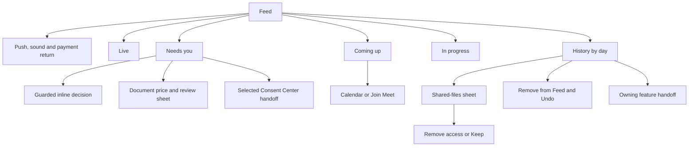

# Feed UI Contract

Status: current product and UI reference, checked against source revision
`fd22c14a9` on 20 October 2026. Owner: frontend architecture. Classification:
`canonical`, package-local. This contract covers `/one/feed`, every mounted
Feed detail/decision, and the immediate destinations of its rows. Full Mail,
Calendar, Consent Center, Location, Finance, and chat products retain their
own owners after a handoff. Shared chrome and fonts are described in
[Navigation](./navigation.md) and [Typography](./typography.md).

## Visual Map

## Route, admission, and page states

Feed is one route, `/one/feed`, within One's private auth, vault, and phone
guards. It is not an auth-only exception. Signed-out/locked branches inside
the component are defensive or transient/shared-use behavior, not an ordinary
way around route admission. Suspense initially says **Loading feed…**.

The shared top bar owns the title. Route Back goes to `/one`; overlays unwind
before route Back through the existing dialog/sheet owner. Mobile details use
a bottom sheet and desktop uses a dialog. No route-local second header or
navigation bar is introduced.

Sources: [route](../../app/one/feed/page.tsx),
[One gate](../../app/one/one-auth-gate.tsx),
[route layout](../../lib/navigation/app-route-layout.contract.json),
[page](../../components/feed/feed-page.tsx), and
[shared detail surface](../../components/app-ui/settings-ui.tsx).

Visible order is notification recovery, payment-return notice, compact bank
payout status, browser sound control, **Live**, **Needs you**, **Coming up**,
**In progress**, then history and its footer controls. Empty sections are
omitted; section counts are current account state, not product limits.

| State / CTA | Current behavior |
| --- | --- |
| Loading feed | Four-row skeleton while history/actionable/progress or legacy watermark hydration is pending. |
| Activity unavailable · Retry | Cold failure with no retained content. Retry forces history plus actionable/progress reconciliation. |
| Showing saved activity… · Retry | Retains saved rows after failed refresh; does not replace them with a cold error page. |
| No activity yet | Valid only when all rendered content families and errors are absent. Supporting copy: Your recent activity will appear here. |
| History day labels | Today, Yesterday, or local weekday/month/day; newest timestamp first. |
| Load more / Loading… / Retry | Twenty-row history paging. Older-page failure retains existing rows and says Couldn't load more. Try again. |

The session is keyed by account. Switching account retires read/clear
watermarks, pending UI, paging and Undo ownership. First/older pages
deduplicate; consent bundles and Drive lifecycle rows collapse. Opening Feed
marks the newest displayed history identity read and repeats for new arrivals;
rows that arrived unread during the visit retain their visit emphasis.
Sources: [page](../../components/feed/feed-page.tsx),
[pagination](../../lib/feed/feed-pagination.ts),
[history service](../../lib/services/feed-service.ts),
[consent grouping](../../lib/feed/feed-consent-grouping.ts), and
[Drive grouping](../../lib/feed/feed-drive-grouping.ts).

## History: open, remove, Undo, and Clear

| Entry / CTA | Mutation and return boundary |
| --- | --- |
| Row activation | Uses the event renderer's owning destination. `document_share_files_sent` with a request ID opens the local shared-files sheet instead. |
| Swipe left | Removes history after server acknowledgment. A committed swipe does not also activate the row. |
| Swipe right / Keep | Reports **Kept in Feed**; no persistence or permission mutation. |
| Hold, context menu, Delete/Backspace | Opens **Remove from feed?**, event label, **Cancel**, **Remove**. Unknown/non-navigation row tap also opens this confirmation. |
| Remove | Locks that row during dispatch. Removes the server-returned grouped identities, or the bounded compatible group if identities are omitted. Failure leaves the row visible. |
| Removed from Feed · Undo | Server restore using the dismissal token. Missing token is not confirmed removal: refresh and show Couldn't confirm removal. Try again. |
| Expired/failed Undo | This item can no longer be restored, or Couldn't restore this item. Try again. A later Clear or account change retires Undo. |
| Clear Feed → Confirm clear | First tap arms for five seconds; second tap commits. Busy reads **Clearing…**. Offered only when dismissible history or ended emergency SMS exists. Pending work remains. |
| Confirmed Clear | Saves the server watermark before resetting pagination/suppressing the snapshot. Future identities remain visible. Then clears ended SMS cards. Success says Feed cleared. |
| Failed Clear | Couldn't clear your feed. Existing content remains recoverable. Legacy device clear migrates to server and stays locally if migration fails; timestamp-only legacy clear is retired. |

Gesture thresholds: 84px commit, 132px maximum, 10px axis lock, 600ms hold;
the first 28px touch edge is reserved for native iOS Back. Vertical scroll and
pointer cancel do not remove/keep. Source: [history row](../../components/feed/feed-row.tsx).

## Actionable row grammar

Each row's sibling controls lock synchronously while one action runs. The
active action shows a spinner; unexpected failure says **That didn't go
through. Try again.** Actions marked for confirmation require a first tap
**Sure?** and a second tap within 3.5 seconds. Ordinary consent **Don't allow**
instead uses its separate delayed-denial Undo flow.

A row with inline actions navigates independently only when it explicitly
defines an `onSelect`. Location, circle, and unscoped connection decisions
must not be described as hidden whole-row links. Compact Decline/positive
pairs can use cross/check icons with accessible labels. Phone labels retain
requested duration; quiet Details becomes an icon and is hidden below 375px
where the authored row tap still opens details. Timestamps hide below 521px.
Source: [actionable row](../../components/feed/feed-actionable-row.tsx).

## Live and Needs you

All rows below come from current owner-scoped domain state, not just immutable
historical events. The [actionable hook](../../lib/feed/use-feed-actionables.ts)
owns their guards and handlers.

| Row / guard | CTA | Destination or explicit operation |
| --- | --- | --- |
| Complete ordinary owner consent bundle | Details / Don't allow / Allow | Details opens selected pending Consent Center with request/bundle and Feed origin. Allow invokes the shared on-device encrypted-export approval. Don't allow uses delayed denial with Undo. |
| Incomplete bundle | Details only | Says Still arriving. Open Details to review it; no inline grant. |
| Incoming document prerequisites | Connect Google Drive / Link payouts / Set price | Ordered Drive, payouts, price. Drive opens Profile Connectors over Feed; payout/price route carries Feed origin. |
| Payments unavailable | Inspectable row only | Selected pending Consent Center; no manufactured Pay action. |
| Authorized incoming document | Deny / Allow | Two-tap Deny sends guarded revisioned decline. Allow opens the local price/review sheet, without committing yet. Row tap opens the selected request. |
| Trusted price-only document | Set price | Same sheet; final commit sets request price without a separate consent grant. |
| Prepared document package | Review packet / review row | Selected Consent Center packet review. Feed cannot bypass that review with inline grant/payment. |
| Requester document payable | Pay $amount | Current order price, checkout service, external checkout navigation after owner/session/current-row rechecks. |
| Waiting owner setup/price, expired request/link | No Pay | Inspectable pending sent request. Request expiry wins over checkout expiry; local countdown retires Pay. |
| Owner answer request | Deny / Allow | Deny declines after confirmation. Allow opens selected answer review because scopes/price need review. |
| Requester answer payable | Pay $amount | Requires approved, staged, nonempty answer and known amount. Opens answer checkout; failure says checkout couldn't open and no charge was made. |
| Other answer state | Write answer / Review question / Review price and pay / Open, or none | Selected `answer_request:<id>` pending Consent Center. Preparing or empty staged answers do not invent a payment action. |
| Active received emergency SMS | Live row | Person-first SMS wording; selected Location grant, Shared with me section. Cannot be cleared while active. |
| Ended received emergency SMS | Needs you row | Revoked SMS status, same grant destination. Root Clear owns dismissal. |
| Incoming pending location request | Deny / duration-specific Approve | Vault-token mutation. Approval preserves the server's actual requested amount and manual approval mode; refreshes Location. |
| Incoming circle invitation | Decline / Accept | Vault-token membership decision, invalidates/reloads Location. |
| Scoped incoming connection | Review | Selected pending Consent Center; cannot inline-accept around scope review. |
| Unscoped incoming connection | Decline / Confirm | Authenticated relationship reject/accept, graph/capability invalidation and refresh. |
| Android unscoped connection | Report | Additional two-tap action; reports inappropriate request and server declines/blocks. Not offered by web/iOS or scoped-review branch. |
| Pending slice overflow | View all pending requests | Pending Consent Center with Feed origin; summary minus loaded rows is not a product cap. |
| Running Kai analysis | Open row / Cancel | Resumable analysis route; two-tap cancel requires vault owner token. Analyzing/Reconnecting/Updates paused remain distinct. |
| Ready Kai analysis | Open / Dismiss | Durable saved run identity. Until saved, says Analysis ready. Saving to history… |
| Analysis persistence failed | Retry / Dismiss | Retries saving the existing analysis, not starting a new analysis. |
| Running background task | Open, if route exists | Existing task route and passive progress. |
| Failed background task | Open, if route exists / Dismiss | Owning recovery route or dismissal in the background-task store. |

Inline document decisions require the expected incoming kind, valid prefixed
request UUID, integer revision, and explicit server availability; packages are
excluded. Location requires a vault owner token. Task stores filter account and
dismissal. Connections are excluded from the consent projection to prevent a
duplicate decision. Stale/negative reads never authorize action. Sources:
[decision guard](../../lib/consent/document-request-decision.ts),
[payment context](../../lib/feed/use-feed-payment-context.ts), and
[actionable hook](../../lib/feed/use-feed-actionables.ts).

### Consent unlock and delayed denial

Missing vault key opens the existing **Unlock to allow** / **Unlock to
decline** dialog with vault creation disabled. Cancel resolves the pending
decision without sending; success resumes that exact decision. **Don't allow**
unlocks first, hides the row and offers five-second Undo. Denial commits when
that window closes; Undo or denial failure restores the row. Allow settles
only after the shared encrypted-export handler confirms success.
Owners: [consent decision hook](../../lib/consent/use-owner-consent-decision.ts),
[unlock prompt](../../components/consent/owner-consent-unlock-prompt.tsx).

## Document price and review sheet

This sheet is mounted inside Feed. Opening it first loads protected request
terms; it does not approve. **Loading request…** prevents submission until
the current review/revision exists.

| Control | Behavior |
| --- | --- |
| Allow request / Set price | Mode-dependent title; paid/free wording explains when sharing begins. |
| Purpose, Share with, Period, Access | Review information. Viewer access is until removed; period conflicts show chosen dates. |
| Price | Optional requester estimate is informational. Presets **$10**, **$20**, **$30**, **Custom**; default $10 unless valid draft exists. |
| Custom price | Amount in USD; $0.50–$500 under cents policy, $1–$500 under legacy whole-dollar policy. Enter invokes the same submit as footer. |
| Allow / Allow · $amount / Save / Save · $amount | Reads current token and revision at tap. Normal mode calls allow; price-only calls setRequestPrice. Owner/vault-session fences prevent stale commit. |
| Cancel / Back / Escape / outside dismissal | Closes without mutation when idle and invalidates pending terms reads. No visual X. Busy disables dismissal and pricing/bank/footer controls. |
| Payout bank / Bank linked | Inline **Link bank**, **Finish setup**, **Manage bank**, conditional **Verify details**, **Retry** bank check. Shared payout owner validates URL/session. Web Manage opens a gesture-created tab; other setup/verification and native handoffs navigate to provider. |

If protected review identifies a package, close and hand off to packet review.
Already allowed/no-longer-allowable requests settle/refresh rather than being
submitted again. Failed submission retains or rereads current terms. Initial
terms failure has no dedicated Retry; Cancel/reopen retries. Success closes,
refreshes, and distinguishes price set, free sharing, and paid sharing after
payment. Earnings copy preserves commission/actual fees and undelivered-file
refunds. Owners: [price sheet](../../components/consent/document-request-price-sheet.tsx),
[price policy](../../lib/consent/document-request-price.ts),
[bank row](../../components/consent/payouts/payout-bank-row.tsx),
[handlers](../../lib/feed/use-feed-actionables.ts).

## Shared-files sheet and access removal

Owner-sent-files history opens this sheet with current count/recipient.
It has no preview, open-file, or download CTA. **Close**, overlay dismissal,
or mobile downward drag returns to Feed without changing access.

| State / CTA | Current behavior |
| --- | --- |
| Loading files / No files yet | Initial loading or valid empty list. |
| Unlock One to see these files | Locked explanation, with no local unlock CTA. |
| Couldn't load files · Retry | Repeats owner-bound list read. |
| File status | Shared, Kept, Already had access, Removing access, Access removed, Couldn't remove access. Only server-removable Shared rows offer removal. |
| Load more / Loading | Cursor paging; failure preserves rows and reports Couldn't load more files. Try again. |
| Tap / keyboard / hold / context menu | Opens **Remove access?**, file name, **Keep**, **Remove access**. |
| Swipe left | Queues access removal directly; swipe right keeps. Gesture geometry/edge exclusion matches history. |
| Keep | Per-device request-bound kept-file set, at most 500 references; no server permission change. |
| Remove access | Optimistic Removing access, then server queue. Access remains until the drain executes. Missing token reports Unlock One to remove access. |
| Undo | Toast and row offer Undo while server permits it; five-second window when returned as undoable. Restore failure says access is being removed and retires Undo. |
| Remove failure | Restores previous status/removability; Couldn't remove access. Try again. |

File names/responses stay in memory; the service uses no-store and validates
request binding, opaque references and statuses. This is owner-only; requester
reads return not found. Load-more and Undo currently return silently if token
is absent. The sheet has no independent completion polling/subscription;
later read/reopen reconciles returned queued status. Owners:
[shared-files sheet](../../components/feed/feed-shared-files-sheet.tsx),
[shared-files service](../../lib/services/drive-shared-files-service.ts).

## Coming up and In progress

| Surface / CTA | Current behavior |
| --- | --- |
| Information request ready to review · Review | Private KYC briefing; selected Mail workspace `/one/gmail?workspace=kyc`. Nothing is shared just by opening it. |
| A message needs your reply · Open Mail | Count-sensitive briefing; `/one/gmail`. |
| Calendar event row | Reads next 24 hours, sorted ascending, displays at most three. Row opens `/one/calendar`; title/date/all-day wording comes from the account. |
| Join Meet | Only with conference URL, valid times, and now between 15 minutes before start and event end. Opens external meeting URL. |
| Passive document progress | Waiting to start / Taking longer than usual / finding / checking / sharing; selected pending or active Consent Center. Sent pending preserves sent view and Feed origin. |
| Document request sent | Current estimate/quote/final price and waiting-owner status; never implied approval. |
| Documents unavailable / Waiting for price / Waiting for owner setup | Distinct server-driven states. No fabricated running-sharing claim or action. |
| View all received / sent / active requests | Corresponding Consent Center list, only when that projection reports more. |

Progress rows have no local cancel/restart/retry/approve control. Queued/delayed
dots remain still; actual work can pulse. Payable/expired/setup-blocked or
reconciliation-required requests are excluded from already-sharing progress.
Owners: [private briefing](../../lib/feed/use-feed-briefing.ts),
[progress projection](../../lib/feed/drive-request-progress.ts),
[progress row](../../components/feed/feed-drive-progress-row.tsx).

## Payment returns, bank status, push, and sound

| Surface / CTA | Current behavior |
| --- | --- |
| Drive payment return | Valid UUID `paymentRequestId` plus checkout hint. Server decides paid/processing/reconciliation/refund/expired/closed/incomplete/unavailable state. Successful return polls at three seconds up to 40 checks; no manual Retry/dismiss. |
| Answer payment return | `answerPaymentRequestId`, or compatible paid/cancelled answer return. Server decides status; **Refresh question** restarts checks, with the same bounded pending polling. |
| Compact Bank payout | Only with owner token and latest deposit. Reports actual deposit state/error; test deposits explicitly say no real money moves. No action/Retry; absence does not mean no earnings. |
| Push Turn on | Browser default permission: gesture requests permission and registers device. |
| Push Retry | Permission granted but device registration incomplete. Busy disables CTA. |
| Browser denied permission | Site-settings explanation; no dead request-permission CTA. |
| Native Open settings | Denied/quiet OS notification state; default registration can instead offer retry. Hidden when working or unsupported. |
| Feed sound off/on | Browser-only, account-local preference with pressed state; enabling previews cue. Saved enabled preference can need **Tap to activate**. |

Feed sound occurs only for visible authenticated newer activity correlated
with a nonsilent push within 15 seconds, with ten-second burst suppression.
Hydration, baseline/polling and local mutations do not sound. Native does not
duplicate this browser control. Owners:
[Drive return](../../components/feed/feed-payment-return-notice.tsx),
[answer return](../../components/feed/answer-payment-return-notice.tsx),
[bank deposits](../../components/consent/payouts/bank-deposits.tsx),
[push](../../components/feed/feed-push-prompt.tsx),
[sound](../../components/feed/feed-sound-control.tsx).

## Historical row destination catalog

The [renderer](../../lib/feed/feed-item-renderers.tsx) owns presentation and
immediate destination; [route builders](../../lib/navigation/routes.ts) and
[consent builder](../../lib/consent/consent-sheet-route.ts) retain URL authority.
Consent selection uses `requestId`, optional bundle, sent view and Feed origin
when supplied. This catalog does not promise every historical event is still
actionable.

| Family | Immediate destination |
| --- | --- |
| Consent requested / granted / revoked / denied / cancelled / timed out | Pending / Active / History Consent Center as appropriate; bundle selection when present. |
| Document request/review/decision/outcome/revocation | Selected `document_share_request:<UUID>` pending Consent Center. Request-sent's generic fallback can open the workspace without selecting a detail. |
| Document files sent | In-place shared-files sheet; Feed fallback when request identity is absent. |
| Drive question/answer/decline/withdraw/retry | Selected `drive_query_request:<UUID>` pending/history Consent Center. |
| Document payment ready/confirmed/refunded | Current live Feed payment projection; payout setup needed can instead open Profile Payouts. |
| Answer request/payment/decline/delivery | Selected `answer_request:<UUID>` pending/history according to current or terminal state. |
| Location share or approval | Recipient Shared with me; owner Location or selected grant. |
| Location access request/withdraw/referral/public response | Selected request/referral/submission and authored my-requests/approvals/public-responses section. |
| Location revoke/view/SMS contact/expiry/denial | Location root. |
| Network/circle join/invite/member added | Location People with circle/invitation identity when valid. |
| Circle message | Canonical circle-chat route; grouped count, no plaintext message preview. |
| Circle decline/cancel/leave/end/delete | Connect Circles list. |
| Connection accept/reject/revoke/withdraw | Connect. |
| Direct message | Validated opaque DM token first, conversation UUID fallback, otherwise inbox. Bounded authenticated preview/count only. |
| Wallet-card request/grant in DM | Selected wallet request with Choose card/Card sent/View request; grant uses DM View card. No card numbers/details in Feed. |
| Kai analysis completed/failed/cancelled | Saved run when identified, otherwise analysis/history. |
| Kai import / funding transfer | Import / portfolio. |
| KYC status | `/one/email` handoff. |
| Connector status | Profile Connectors pane over One. |
| Connected-system action/status | `/one/connected-systems`; CRM visibility guard applies to the relevant families. |
| Calendar status/action | Calendar. |
| Mail status/mailbox action | Mail. |
| Mail information-request/delivery | Mail KYC workspace. |
| Receipt import/manual sync | Mail Receipts workspace. |
| Drive search/share/trash/bulk outcome | Chat; partial, unavailable and unknown writes retain their distinct wording. |
| Drive bulk received | Profile Memory pane over One. |
| Personal World Model research | World Model with validated draft UUIDv4 when present. |
| Unknown event | Activity, without description/navigation; history removal still available. |

Historical payment wording consults current order/deadline; immutable old Pay
text cannot revive expired checkout. Location copy preserves requested,
granted, added, or until-off duration. Payout copy distinguishes sent to Stripe
from bank deposit. Raw phone metadata does not become a person's name.

## Existing gaps and verification limits

| Finding | Classification / consequence |
| --- | --- |
| KYC briefing recovery | `partially_exists`: hook exposes loading/error/retry, but Feed does not render or include these in root Retry/empty logic. Failed KYC briefing can resemble no KYC work. |
| Shared-files unlock and completion refresh | `partially_exists`: explanatory locked state and explicit remove error exist; local unlock CTA and independent completion refresh do not. |
| Price-sheet first-read retry | `partially_exists`: Cancel/reopen retries, without a dedicated initial Retry control. |
| Payment-return retry | Drive notice lacks manual Retry; answer notice has Refresh question. Compact bank status has no Retry. |
| Clear is device-only | `wrong_direction`: current executable Clear persists server watermark; an old source comment claiming no backend delete is stale. |
| Every document event selects one request | `wrong_direction`: request-sent fallback can open the generic workspace. |
| Passing fixtures prove a live protected session | `wrong_direction`: provider/OS delivery, account permissions, vault continuity and payments need separate authorized live proof. |

Nearest verification owners:
[Clear/removal/Undo](../../__tests__/components/feed-page-clear.test.tsx),
[history row](../../__tests__/components/feed-row.test.tsx),
[action row](../../__tests__/components/feed-actionable-row.test.tsx),
[shared files](../../__tests__/components/feed-shared-files-sheet.test.tsx),
[payment return](../../__tests__/components/feed-payment-return-notice.test.tsx),
[history service](../../__tests__/services/feed-service.test.ts), and
[Feed layout](../../e2e/feed-needs-you-row.layout.spec.ts).
These identify test owners; execution is reported with the change.

No real requests, file grants, checkout, notifications, or account mutations
were triggered for this inventory. Run `./bin/hushh docs verify` for prose;
implementation changes follow the existing
[UI contributor scaffold](../../../docs/reference/architecture/ui-contract-contributor-guide.md).
