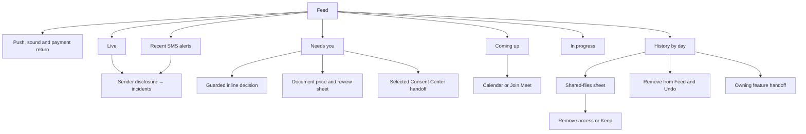

# Feed UI Contract

Status: current product and UI reference, checked against source revision
`296d7769c83176739e4db8d3ad549b0521894f52` on 20 October 2026. Owner: frontend architecture. Classification:
`canonical`, package-local. This contract covers `/one/feed`, every mounted
Feed detail/decision, and the immediate destinations of its rows. Full Mail,
Calendar, Consent Center, Location, Finance, and chat products retain their
own owners after a handoff. Shared chrome and fonts are described in
[Navigation](./navigation.md) and [Typography](./typography.md).

## Visual Map

## Route, admission, and page states

Visible order is Live, Needs you, Recent SMS alerts, Coming up, In progress,
then day-grouped History, omitting empty sections. Ended-only SMS groups count
as content; such a Feed is not empty.

Feed is one route, `/one/feed`, within One's private auth, vault, and phone
guards. It is not an auth-only exception. Signed-out/locked branches inside
the component are defensive or transient/shared-use behavior, not an ordinary
way around route admission. Suspense initially says **Loading feed…**.

The shared top bar owns the title. Route Back goes to `/one`; overlays unwind
before route Back through the existing dialog/sheet owner. Mobile details use
a bottom sheet and desktop uses a dialog. No route-local second header or
navigation bar is introduced.

Sources: [route](../../app/one/feed/page.tsx),
[One gate](../../app/one/one-auth-gate.tsx),
[route layout](../../lib/navigation/app-route-layout.contract.json),
[page](../../components/feed/feed-page.tsx), and
[shared detail surface](../../components/app-ui/settings-ui.tsx).

Visible order is notification recovery, payment-return notice, compact bank
payout status, browser sound control, **Live**, **Needs you**, **Coming up**,
**In progress**, then history and its footer controls. Empty sections are
omitted; section counts are current account state, not product limits.

| State / CTA | Current behavior |
| --- | --- |
| Loading feed | Cold skeleton while no content is usable. Once any lane is usable it renders immediately; unfinished Needs you, In progress, or Recent activity lanes show local skeleton/retry states. |
| Activity unavailable · Retry | Cold failure with no retained content. Retry forces history plus actionable/progress reconciliation. |
| Showing saved activity… · Retry | Retains saved rows after failed refresh; does not replace them with a cold error page. |
| No activity yet | Valid only when all rendered content families and errors are absent. No second explanatory sentence is mounted in the current empty state. |
| History day labels | Today, Yesterday, or local weekday/month/day; newest timestamp first. |
| Load more / Loading… / Retry | Twenty-row history paging. Older-page failure retains existing rows and says Couldn't load more. Try again. |

The session is keyed by account. Switching account retires read/clear
watermarks, pending UI, paging and Undo ownership. First/older pages
deduplicate; consent bundles and Drive lifecycle rows collapse. Opening Feed
marks the newest displayed history identity read and repeats for new arrivals;
rows that arrived unread during the visit retain their visit emphasis.
Sources: [page](../../components/feed/feed-page.tsx),
[pagination](../../lib/feed/feed-pagination.ts),
[history service](../../lib/services/feed-service.ts),
[consent grouping](../../lib/feed/feed-consent-grouping.ts), and
[Drive grouping](../../lib/feed/feed-drive-grouping.ts).

## History: open, remove, Undo, and Clear

| Entry / CTA | Mutation and return boundary |
| --- | --- |
| Row activation | Uses the event renderer's owning destination. `document_share_files_sent` with a request ID opens the local shared-files sheet instead. |
| Swipe left | Removes history after server acknowledgment. A committed swipe does not also activate the row. |
| Swipe right / Keep | Reports **Kept in Feed**; no persistence or permission mutation. |
| Hold, context menu, Delete/Backspace | Opens **Remove from feed?**, event label, **Cancel**, **Remove**. Unknown/non-navigation row tap also opens this confirmation. |
| Remove | Locks that row during dispatch. Removes the server-returned grouped identities, or the bounded compatible group if identities are omitted. Failure leaves the row visible. |
| Removed from Feed · Undo | Server restore using the dismissal token. Missing token is not confirmed removal: refresh and show Couldn't confirm removal. Try again. |
| Expired/failed Undo | This item can no longer be restored, or Couldn't restore this item. Try again. A later Clear or account change retires Undo. |
| Clear Feed → Confirm clear | First tap arms for five seconds; second tap commits. Busy reads **Clearing…**. Offered only when dismissible history or ended emergency SMS exists. Pending work remains. |
| Confirmed Clear | Saves the server watermark before resetting pagination/suppressing the snapshot. Future identities remain visible. Then clears ended SMS cards. Success says Feed cleared. |
| Failed Clear | Couldn't clear your feed. Existing content remains recoverable. Legacy device clear migrates to server and stays locally if migration fails; timestamp-only legacy clear is retired. |

Gesture thresholds: 84px commit, 132px maximum, 10px axis lock, 600ms hold;
the first 28px touch edge is reserved for native iOS Back. Vertical scroll and
pointer cancel do not remove/keep. Source: [history row](../../components/feed/feed-row.tsx).

## Actionable row grammar

Each row's sibling controls lock synchronously while one action runs. The
active action shows a spinner; unexpected failure says **That didn't go
through. Try again.** Actions marked for confirmation require a first tap
**Sure?** and a second tap within 3.5 seconds. Ordinary consent **Don't allow**
instead uses its separate delayed-denial Undo flow.

A row with inline actions navigates independently only when it explicitly
defines an `onSelect`. Current phone location/circle/connection rows do define
review destinations. Below640px ordinary consent, Location and Circle
decisions use **Review**; desktop retains its inline choices. Android unscoped
connections show **Report + Review** on phones. Compact Decline/positive
pairs can use cross/check icons with accessible labels. Ordinary rows use
the compact settings layout, single inline truncated title/description and
nonstacking trailing controls. SMS incidents use wrapped sender/status/original
sent-time lines. Timestamps remain visible at phone widths.
Action targets have minimum44px. Earlier hidden-time/stacked-row behavior is
not the current implementation.
Source: [actionable row](../../components/feed/feed-actionable-row.tsx).

## Live, Needs you and Recent SMS alerts

All rows below come from current owner-scoped domain state, not just immutable
historical events. The [actionable hook](../../lib/feed/use-feed-actionables.ts)
owns their guards and handlers.

| Row / guard | CTA | Destination or explicit operation |
| --- | --- | --- |
| Complete ordinary owner consent bundle | Desktop Details / Don't allow / Allow; phone Review | Review/Details opens selected pending Consent Center with request/bundle and Feed origin. Desktop Allow invokes shared encrypted-export approval. Don't allow uses delayed denial with Undo. |
| Incomplete bundle | Desktop Details; phone Review | Says Still arriving. Open Details to review it; no inline grant. |
| Incoming document prerequisites | Connect Google Drive / Link payouts / Set price | Ordered Drive, payouts, price. Drive opens Profile Connectors over Feed; payout/price route carries Feed origin. |
| Payments unavailable | Inspectable row only | Selected pending Consent Center; no manufactured Pay action. |
| Authorized incoming document | Deny / Allow | Two-tap Deny sends guarded revisioned decline. Allow opens the local price/review sheet, without committing yet. Row tap opens the selected request. |
| Trusted price-only document | Set price | Same sheet; final commit sets request price without a separate consent grant. |
| Prepared document package | Review packet / review row | Selected Consent Center packet review. Feed cannot bypass that review with inline grant/payment. |
| Requester document payable | Pay $amount; row opens detail | Button opens checkout after current owner/session/row checks. Row opens selected pending sent request with Feed origin. |
| Waiting owner setup/price, expired request/link | No Pay | Inspectable pending sent request. Request expiry wins over checkout expiry; local countdown retires Pay. |
| Owner answer request | Deny / Allow | Deny declines after confirmation. Allow opens selected answer review because scopes/price need review. |
| Requester answer payable | Pay $amount | Requires approved, staged, nonempty answer and known amount. Opens answer checkout; failure says checkout couldn't open and no charge was made. |
| Other answer state | Write answer / Review question / Review price and pay / Open, or none | Selected `answer_request:<id>` pending Consent Center. Preparing or empty staged answers do not invent a payment action. |
| Active received emergency SMS | Live sender group/incident | Sender title, original sent time, `Emergency SMS · Active`; only active incidents link selected Location grant. Cannot be cleared active. |
| Ended received emergency SMS | Recent SMS alerts, or inside same sender’s Live group | Original sent time; Revoked/Expired/Ended; no map link. Root Clear owns dismissal. |
| Incoming pending location request | Desktop Deny / duration-specific Approve; phone Review | Desktop vault-token mutation preserves requested amount/manual mode. Review and row open `/one/location?requestId=<id>`. |
| Incoming circle invitation | Desktop Decline / Accept; phone Review | Desktop vault-token membership decision. Review and row open `/one/location?circleInviteId=<id>`. |
| Scoped incoming connection | Review | Selected pending Consent Center; cannot inline-accept around scope review. |
| Unscoped incoming connection | Decline / Confirm | Authenticated relationship reject/accept, graph/capability invalidation and refresh. |
| Android unscoped connection | Phone Report / Review; desktop Report / Decline / Confirm | Additional two-tap Report declines/blocks. Review/row opens selected Consent Center. Report absent web/iOS or scoped-review branch. |
| Pending slice overflow | View all pending requests | Pending Consent Center with Feed origin; summary minus loaded rows is not a product cap. |
| Running Kai analysis | Open row / Cancel | Resumable analysis route; two-tap cancel requires vault owner token. Analyzing/Reconnecting/Updates paused remain distinct. |
| Ready Kai analysis | Open / Dismiss | Durable saved run identity. Until saved, says Analysis ready. Saving to history… |
| Analysis persistence failed | Retry / Dismiss | Retries saving the existing analysis, not starting a new analysis. |
| Running background task | Open, if route exists | Existing task route and passive progress. |
| Failed background task | Open, if route exists / Dismiss | Owning recovery route or dismissal in the background-task store. |

Inline document decisions require the expected incoming kind, valid prefixed
request UUID, integer revision, and explicit server availability; packages are
excluded. Location requires a vault owner token. Task stores filter account and
dismissal. Connections are excluded from the consent projection to prevent a
duplicate decision. Stale/negative reads never authorize action. Sources:
[decision guard](../../lib/consent/document-request-decision.ts),
[payment context](../../lib/feed/use-feed-payment-context.ts), and
[actionable hook](../../lib/feed/use-feed-actionables.ts).

### Consent unlock and delayed denial

Missing vault key opens the existing **Unlock to allow** / **Unlock to
decline** dialog with vault creation disabled. Cancel resolves the pending
decision without sending; success resumes that exact decision. **Don't allow**
unlocks first, hides the row and offers five-second Undo. Denial commits when
that window closes **or immediately on unmount/pagehide**; Undo before dispatch
makes no deny request. Undo or denial failure restores the row. Allow settles
only after the shared encrypted-export handler confirms success.
Owners: [consent decision hook](../../lib/consent/use-owner-consent-decision.ts),
[unlock prompt](../../components/consent/owner-consent-unlock-prompt.tsx).

### SMS sender grouping and original sent time

Current source refresh at296d7769c adds presentation grouping only; existing
Location state and Clear endpoints remain unchanged.
[Grouping](../../lib/feed/feed-sms-grouping.ts) deduplicates incident IDs,
keys by actual sender ID (unknown senders keep separate incident IDs), sorts
incidents by original sent-time sortAt then ID, chooses newest active incident
as group representative when any active exists, and sorts groups by that
representative. Same display names never merge different owners. Only current
recipient grants from another owner are included.

One incident renders its ordinary incident row directly. Multiple incidents
render [inline details/summary](../../components/feed/feed-sms-alert-group.tsx),
initially closed. Summary click/Enter/Space expands/collapses locally: **no
API, approval, dismissal, route change or new overlay**. No dedicated Back
layer is registered. A sender with any active incident stays in Live, including
its ended incidents inside disclosure; a wholly ended sender appears in
**Recent SMS alerts**, after Needs you and before Coming up. Ended alerts are
not pending decisions and have no href/chevron; active incident opens its exact
Location grant. Clear removes eligible ended incidents, including those inside
a Live group, while retaining active incidents.

Grant status from the server determines active/ended; device wall clock does
not expire an SMS grant. Live grants add force-refresh every10 seconds through the existing
visible pending-refresh clock. Original `createdAt` supplies displayTimestamp
and sorting, never revokedAt/updatedAt/expiresAt. Missing createdAt uses
first-seen sorting but displays `Sent time unavailable`.
[Sent-time renderer](../../components/feed/feed-sms-sent-time.tsx) always shows
local year/month/day/hour/minute, including phones, with an ISO time datetime.

The summary has min44px,flex gap12,px12/py12,compact person avatar,flexible
copy,16px chevron rotating180° open. Copy spacing2px; child rows divide with
hairlines and border-top. Incidents wrap name/status/sent time (py4), rather
than ordinary Feed’s single inline truncating track; SMS has no separate
trailing timestamp. Name still resolves13/15.86/400; status/sent time12/15.6/400.
This is normal-flow disclosure, with no portal or new Z tier.

## Document price and review sheet

This sheet is mounted inside Feed. Opening it first loads protected request
terms; it does not approve. **Loading request…** prevents submission until
the current review/revision exists.

| Control | Behavior |
| --- | --- |
| Allow request / Set price | Mode-dependent title; paid/free wording explains when sharing begins. |
| Purpose, Share with, Period, Access | Review information. Viewer access is until removed; period conflicts show chosen dates. |
| Price | Optional requester estimate is informational. Presets **$10**, **$20**, **$30**, **Custom**; default $10 unless valid draft exists. |
| Custom price | Amount in USD; $0.50–$500 under cents policy, $1–$500 under legacy whole-dollar policy. Enter invokes the same submit as footer. |
| Allow / Allow · $amount / Save / Save · $amount | Reads current token and revision at tap. Normal mode calls allow; price-only calls setRequestPrice. Owner/vault-session fences prevent stale commit. |
| Cancel / Back / Escape / outside dismissal | Closes without mutation when idle and invalidates pending terms reads. No visual X. Busy disables dismissal and pricing/bank/footer controls. |
| Payout bank / Bank linked | Inline **Link bank**, **Finish setup**, **Manage bank**, conditional **Verify details**, **Retry** bank check. Shared payout owner validates URL/session. Web Manage opens a gesture-created tab; other setup/verification and native handoffs navigate to provider. |

If protected review identifies a package, close and hand off to packet review.
Already allowed/no-longer-allowable requests settle/refresh rather than being
submitted again. Failed submission retains or rereads current terms. Initial
terms failure has no dedicated Retry; Cancel/reopen retries. Success closes,
refreshes, and distinguishes price set, free sharing, and paid sharing after
payment. Earnings copy preserves commission/actual fees and undelivered-file
refunds. Owners: [price sheet](../../components/consent/document-request-price-sheet.tsx),
[price policy](../../lib/consent/document-request-price.ts),
[bank row](../../components/consent/payouts/payout-bank-row.tsx),
[handlers](../../lib/feed/use-feed-actionables.ts).

## Shared-files sheet and access removal

Owner-sent-files history opens this sheet with current count/recipient.
It has no preview, open-file, or download CTA. **Close**, overlay dismissal,
or mobile downward drag returns to Feed without changing access.

| State / CTA | Current behavior |
| --- | --- |
| Loading files / No files yet | Initial loading or valid empty list. |
| Unlock One to see these files | Locked explanation, with no local unlock CTA. |
| Couldn't load files · Retry | Repeats owner-bound list read. |
| File status | Shared, Kept, Already had access, Removing access, Access removed, Couldn't remove access. Only server-removable Shared rows offer removal. |
| Load more / Loading | Cursor paging; failure preserves rows and reports Couldn't load more files. Try again. |
| Tap / keyboard / hold / context menu | Opens **Remove access?**, file name, **Keep**, **Remove access**. |
| Swipe left | Queues access removal directly; swipe right keeps. Gesture geometry/edge exclusion matches history. |
| Keep | Per-device request-bound kept-file set, at most 500 references; no server permission change. |
| Remove access | Optimistic Removing access, then server queue. Access remains until the drain executes. Missing token reports Unlock One to remove access. |
| Undo | Toast and row offer Undo while server permits it; five-second window when returned as undoable. Restore failure says access is being removed and retires Undo. |
| Remove failure | Restores previous status/removability; Couldn't remove access. Try again. |

File names/responses stay in memory; the service uses no-store and validates
request binding, opaque references and statuses. This is owner-only; requester
reads return not found. Load-more and Undo currently return silently if token
is absent. The sheet has no independent completion polling/subscription;
later read/reopen reconciles returned queued status. Owners:
[shared-files sheet](../../components/feed/feed-shared-files-sheet.tsx),
[shared-files service](../../lib/services/drive-shared-files-service.ts).

## Coming up and In progress

| Surface / CTA | Current behavior |
| --- | --- |
| Information request ready to review · Review | Private KYC briefing; selected Mail workspace `/one/gmail?workspace=kyc`. Nothing is shared just by opening it. |
| A message needs your reply · Open Mail | Count-sensitive briefing; `/one/gmail`. |
| Calendar event row | Reads next 24 hours, sorted ascending, displays at most three. Row opens `/one/calendar`; title/date/all-day wording comes from the account. |
| Join Meet | Only with conference URL, valid times, and now between 15 minutes before start and event end. Opens external meeting URL. |
| Passive document progress | Waiting to start / Taking longer than usual / finding / checking / sharing; selected pending or active Consent Center. Sent pending preserves sent view and Feed origin. |
| Document request sent | Current estimate/quote/final price and waiting-owner status; never implied approval. |
| Documents unavailable / Waiting for price / Waiting for owner setup | Distinct server-driven states. No fabricated running-sharing claim or action. |
| View all received / sent / active requests | Corresponding Consent Center list, only when that projection reports more. |

Progress rows have no local cancel/restart/retry/approve control. Queued/delayed
dots remain still; actual work can pulse. Payable/expired/setup-blocked or
reconciliation-required requests are excluded from already-sharing progress.
Owners: [private briefing](../../lib/feed/use-feed-briefing.ts),
[progress projection](../../lib/feed/drive-request-progress.ts),
[progress row](../../components/feed/feed-drive-progress-row.tsx).

## Payment returns, bank status, push, and sound

| Surface / CTA | Current behavior |
| --- | --- |
| Drive payment return | Valid UUID `paymentRequestId` plus checkout hint. Server decides paid/processing/reconciliation/refund/expired/closed/incomplete/unavailable state. Successful return polls at three seconds up to 40 checks; no manual Retry/dismiss. |
| Answer payment return | `answerPaymentRequestId`, or compatible paid/cancelled answer return. Server decides status; **Refresh question** restarts checks, with the same bounded pending polling. |
| Compact Bank payout | Only with owner token and latest deposit. Reports actual deposit state/error; test deposits explicitly say no real money moves. No action/Retry; absence does not mean no earnings. |
| Push Turn on | Browser default permission: gesture requests permission and registers device. |
| Push Retry | Permission granted but device registration incomplete. Busy disables CTA. |
| Browser denied permission | Site-settings explanation; no dead request-permission CTA. |
| Native Open settings | Denied/quiet OS notification state; default registration can instead offer retry. Hidden when working or unsupported. |
| Feed sound off/on | Browser-only, account-local preference with pressed state; enabling previews cue. Saved enabled preference can need **Tap to activate**. |

Feed sound occurs only for visible authenticated newer activity correlated
with a nonsilent push within 15 seconds, with ten-second burst suppression.
Hydration, baseline/polling and local mutations do not sound. Native does not
duplicate this browser control. Owners:
[Drive return](../../components/feed/feed-payment-return-notice.tsx),
[answer return](../../components/feed/answer-payment-return-notice.tsx),
[bank deposits](../../components/consent/payouts/bank-deposits.tsx),
[push](../../components/feed/feed-push-prompt.tsx),
[sound](../../components/feed/feed-sound-control.tsx).

## Historical row destination catalog

The [renderer](../../lib/feed/feed-item-renderers.tsx) owns presentation and
immediate destination; [route builders](../../lib/navigation/routes.ts) and
[consent builder](../../lib/consent/consent-sheet-route.ts) retain URL authority.
Consent selection uses `requestId`, optional bundle, sent view and Feed origin
when supplied. This catalog does not promise every historical event is still
actionable.

| Family | Immediate destination |
| --- | --- |
| Consent requested / granted / revoked / denied / cancelled / timed out | Pending / Active / History Consent Center as appropriate; bundle selection when present. |
| Document request/review/decision/outcome/revocation | Selected `document_share_request:<UUID>` pending Consent Center. Request-sent's generic fallback can open the workspace without selecting a detail. |
| Document files sent | In-place shared-files sheet; Feed fallback when request identity is absent. |
| Drive question/answer/decline/withdraw/retry | Selected `drive_query_request:<UUID>` pending/history Consent Center. |
| Document payment ready/confirmed/refunded | Current live Feed payment projection; payout setup needed can instead open Profile Payouts. |
| Answer request/payment/decline/delivery | Selected `answer_request:<UUID>` pending/history according to current or terminal state. |
| Location share or approval | Recipient Shared with me; owner Location or selected grant. |
| Location access request/withdraw/referral/public response | Selected request/referral/submission and authored my-requests/approvals/public-responses section. |
| Location revoke/view/SMS contact/expiry/denial | Location root. |
| Network/circle join/invite/member added | Location People with circle/invitation identity when valid. |
| Circle message | Canonical circle-chat route; grouped count, no plaintext message preview. |
| Circle decline/cancel/leave/end/delete | Connect Circles list. |
| Connection accept/reject/revoke/withdraw | Connect. |
| Direct message | Validated opaque DM token first, conversation UUID fallback, otherwise inbox. Bounded authenticated preview/count only. |
| Wallet-card request/grant in DM | Selected wallet request with Choose card/Card sent/View request; grant uses DM View card. No card numbers/details in Feed. |
| Kai analysis completed/failed/cancelled | Saved run when identified, otherwise analysis/history. |
| Kai import / funding transfer | Import / portfolio. |
| KYC status | `/one/email` handoff. |
| Connector status | Profile Connectors pane over One. |
| Connected-system action/status | `/one/connected-systems`; CRM visibility guard applies to the relevant families. |
| Calendar status/action | Calendar. |
| Mail status/mailbox action | Mail. |
| Mail information-request/delivery | Mail KYC workspace. |
| Receipt import/manual sync | Mail Receipts workspace. |
| Drive search/share/trash/bulk outcome | Chat; partial, unavailable and unknown writes retain their distinct wording. |
| Drive bulk received | Profile Memory pane over One. |
| Personal World Model research | World Model with validated draft UUIDv4 when present. |
| Unknown event | Activity, without description/navigation; history removal still available. |

Historical payment wording consults current order/deadline; immutable old Pay
text cannot revive expired checkout. Location copy preserves requested,
granted, added, or until-off duration. Payout copy distinguishes sent to Stripe
from bank deposit. Raw phone metadata does not become a person's name.

## Spatial placement, menus, and responsive constraints

CSS-pixel geometry at default root16; content heights and Y coordinates
depend on rendered rows. Let S=min(available width,720), gutter g=16 below640,
20 from640,24 from1024,28 from1280; section left=(W−S)/2+g and width=S−2g.
Feed uses `data-profile-type-scale="page"` on its whole AppPageShell, not
only the Needs you section. [Fonts](./typography.md) resolves the cascade.

| Surface | Placement / size / stacking |
| --- | --- |
| Page | Centered reading shell; bottom pad `calc(var(--app-screen-footer-pad)+16px)`. Sections normal-flow; label padding4px X,6px bottom,20px top. No second sticky header. |
| History | Minimum52px; grid30px visual, flexible inline copy, auto trailing time/unread,14px chevron; gaps8, padding6px12px.≤360: gaps7/paddingX9.26px person image/22px domain icon. |
| Actionable/progress | Minimum52px; flexible text+nonshrinking trailing time/actions; px12/py6/gap8; separator inset50. No mobile stack. Ordinary title/description one nowrap/truncate track gap6; complete text retained for accessibility. SMS incidents instead wrap sender/status/original sent time in a vertical text block. |
| Action group |44px minimum targets, compact X padding12/gap6, nowrap; paired glyph circles28 inside44px targets. Phone alternative group below640. |
| Swipe | Row isolated and clipped; revealed action under content; actual content local z1.84px commit/132px cap/10px axis/600ms hold; native Back edge28px. |
| Three dots | **No Feed ellipsis menu exists.** Context-menu/right-click opens centered remove AlertDialog, not a menu at mouse X/Y. |
| History/file confirmation | AlertDialog small, max320 and viewport−32, centered50%/50%; two-column footer. Dialog scrim800/content801; Cancel/Keep branch below. |
| Details | AdaptiveDetailSurface: phone real bottom Sheet, desktop real Dialog. Shared task frames have inner scrolling; native protected overlay regions and keyboard constrain seat. Shared-files default lg cap720; price overrides520. TaskDialog effective width viewport−32 despite wrapper utility viewport−24. |
| Phone Sheet | Full viewport X; bottom keyboard inset; max85dvh−keyboard; top corners24 via task frame. Shared primitive handle44px band; task visible grip40×4. Body-drag dismissal disabled where task owner requires inner scrolling. |
| Close | Shared-files task close44px target; task CSS owns exact top/right offsets. Price hides X and requires idle Cancel; no pointer-position context anchor. |
| Layers | Sheet711/712; Dialog800/801; transient10099/10100. Nested confirmation can cover Sheet. Native host ordering remains a separate presentation contract. |

Sources: [metadata](../../components/feed/feed-row-metadata.tsx),
[row](../../components/feed/feed-row.tsx), [actions](../../components/feed/feed-actionable-row.tsx),
[task surfaces](../../lib/morphy-ux/ui/task-surfaces.module.css),
[shared surface](../../components/app-ui/settings-ui.tsx),
[AlertDialog](../../components/ui/alert-dialog.tsx), [layers](../../app/globals.css).

## Per-row read models: endpoint, fields, and owner

F=Firebase bearer; V=vault-owner bearer; F+V additionally carries the consent
header in the service's required format. Native ApiService can call backend
directly; ordinary native consent uses HushhConsent and push uses
HushhNotifications. Web [One proxy](../../app/api/one/[...path]/route.ts),
[connector proxy](../../app/api/connectors/[...path]/route.ts), and
[Kai proxy](../../app/api/kai/[...path]/route.ts) preserve owning path/method/
query/body/authority. One responses are private/no-store; connector/Kai
families apply their own cache headers. Consent summary/list maintain explicit
auth-keyed30-second fresh/5-minute stale hot caches and revalidation (their
ordinary responses do not universally stamp private/no-store). Specific consent
and notification routes below have dedicated proxies. These tables list fields
consumed by Feed; unrelated response fields do not create extra Feed controls.

| Rendered family / trigger | Read request | Response projection → UI |
| --- | --- | --- |
| History load/refresh/next page | GET `/api/one/feed?limit=20[&cursor=<decimal string>]`,F | `{items,next_cursor,unread_count}`; each `{id,source_domain,event_type,actor_label,metadata,read,created_at}`→event renderer, timestamp/emphasis/destination. IDs stay strings. All historical rows share this read, not one request per row. |
| Shared unread dot | GET `/api/one/feed/unread-count`,F | `{unread_count}`; first history page can seed same badge cache, avoiding extra call. |
| Pending discovery | GET `/api/consent/center/summary?mode=consents`,F | `{user_id,actor,mode,counts:{pending,active,previous}}`; pending count enables slice/overflow. |
| Needs you consent | GET `/api/consent/center/list?mode=consents&surface=pending&page=1&limit=20`,F | `{user_id,actor,mode,surface,query,page,limit,total,has_more,items}`→pending rows. |
| Received documents | Same list pending default received,limit100 | Setup discovery and passive progress independent of ordinary pending count; ordinary incoming decisions are built from the limit20 consent slice. |
| Sent documents | Same list pending,`request_view=sent`,limit100 | Payment/deadline/progress. UI route query is `requestView`, API is `request_view`. |
| Active document work | Same list `surface=active`,limit100 | Active automated work, not a promise already shared. |
| Incoming connection | GET `/api/one/connections/requests?direction=incoming`,F | `{items:[{id,requesterUserId,addresseeUserId,status,message,counterpartUserId,counterpartDisplayName,counterpartPhotoUrl,scopes}]}`→relationship row; no arrival timestamp supplied in this shape. |
| Location/Circle/SMS | GET `/api/one/location/state`,V | `requests,circleMemberInvites,receivedGrants`→review/decision/live/ended rows. SMS consumes id,recipientUserId,ownerUserId,shareKind,status,ownerDisplayName,ownerPhotoUrl,createdAt,recipientClearedAt; server-status force-refresh every10s while live. No separate per-row fetch. |
| Private payment context | GET `/api/connectors/google_drive/sharing/requests/<id>/context`,V | `{requestId,purpose:{purpose,periodStart,periodEnd},requestRevision,packageDisclosure,recipientEmail,requestedAt,timeZone}`→purpose/period facts. Max2 concurrent reads; mount memory only. Failure leaves metadata-only copy. |
| Open Allow/Set price | GET same request `/review`,V | `revision,recipientEmail,purpose,allowAvailable,priceOnlyAvailable,ownerAllowed,paymentRequired,priceCents,estimateCents,wholeDollarPrice,periodConflict,agentPackage`→guarded sheet/route handoff. |
| Open shared files/Retry/next | GET same request `/shared-files[?cursor=<fileRef>]`,V | `{requestId,recipientLabel,sharedCount,files,nextCursor,undoSeconds}`; file `{fileRef,name,modifiedTime,status,removable,undoable}`→rows/actions. |
| Calendar prerequisite | GET `/api/one/calendar/status/<uid>`,F | `connected===true && status!==needs_reauth` enables private event read. |
| Coming up | **Read-only POST** `/api/one/calendar/events`,V, `{start_at:<now>,end_at:<now+24h>}` | `{events,time_zone}`; only `id,title,start,end,status,conferenceUrl` survive. Only validated HTTPS meet.google.com conference links used; no attendees/location/provider HTML. Sort then max3. |
| Mail prerequisite | GET `/api/kai/gmail/status/<uid>`,F | `connected,needs_reauth`; connector cache may satisfy. |
| Reply briefing | GET `/api/kai/gmail/nudges/<uid>?limit=10`,F+V | `{nudges}`; only counts `type===needs_reply`. |
| KYC briefing | GET `/api/one/email/information-requests?limit=1`,F+V | `{workflows,limit,offset,next_offset,total_count}`; detected workflow ID/times/count→review row. |
| Drive return verification | GET request `/payment`,F | `status,amountCents,currency,ownerPriceRequired,ownerPayoutAccountReady,paymentsReady,reconciliationRequired,paymentLinkExpired,checkoutExpiresAt,packageDisclosureRequired,packageDisclosure,paymentView`→notice; URL alone is not payment proof. |
| Answer return | GET `/api/one/answer-requests/<id>/payment`,F | `requestStatus,orderStatus,amountCents,currency,checkoutUrl,paidAt,refundedAt,refundReason,preparationStatus,reconciliationRequired,fulfilment,answerDeadlineAt,answerDeadlineHours`→notice/Refresh question. |
| Bank status | GET `/api/one/payouts/account/bank-payouts`,V | `{currency,stripeMode,payouts,nextCursor}`; first payout amount/status/arrival/failure→root compact status. |
| Price-sheet bank | GET `/api/one/payouts/account[?fresh=true]`,V | Account ready/bank/verification/manage flags→Link/Finish/Manage/Verify/Retry; no assumed bank readiness. |
| Kai work | Local DebateRunManager getState/subscribe | `userId,runId,ticker,status,dismissedAt,persistenceState,streamState,updatedAt,startedAt`→active/ready/failed-save. No analysis start/read simply to paint row. |
| Background tasks | Local AppBackgroundTask getState/subscribe | `userId,taskId,title,description,status,error,routeHref,dismissedAt,updatedAt,startedAt`→Open/Dismiss/passive progress. |
| Refresh doorbell | GET backend `/api/one/feed/events?v=2`,F,SSE; fallback `/api/consent/document-feed/<uid>?v=2`; native stream bridge fallback | Opaque change frames trigger authoritative reads. Not grant, names, checkout or permission authority. |

Common Consent Center entry fields are
`id,kind,status,action,scope,scope_description,counterpart_type,counterpart_id,
counterpart_label,counterpart_email,counterpart_secondary_label,counterpart_image_url,
request_id,bundle_id,bundle_labels,bundle_complete,bundle_items,issued_at,expires_at,
approval_timeout_at,reason,additional_access_summary,metadata`.

| Entry projection | Fields that choose branch |
| --- | --- |
| Ordinary consent | Request/bundle completeness, labels/reason, identity/photo, requested duration/timeout. Incomplete bundle has no inline grant. |
| Document setup | `direction,ownerDriveReady,ownerPayoutAccountReady,ownerPriceRequired,paymentsReady,paymentStatus,accessStopped`; ordered Drive→payout→price. |
| Document decision | `direction,owner_attention_required,owner_decision_available,owner_price_available,agent_package,revision,payment_required`. |
| Payment | `paymentAmountCents,paymentCurrency,paymentStatus,paymentCheckoutExpiresAt`, compatible deadline aliases,`paymentLinkExpired,paymentReconciliationRequired`, shared payment/price and setup fields. |
| Progress | `automatic_progress_active,automatic_progress_state,automatic_progress_stage,automatic_queued_at,owner_allowed,v1_evaluation_unavailable` plus price/setup/payment guards. |
| Scope answer | `request_status,role,question,amount_cents,answer_staged,answer_has_content,preparation_overdue`. |

Frontend read owners: [Feed](../../lib/services/feed-service.ts),
[Consent Center](../../lib/services/consent-center-service.ts),
[actionables](../../lib/feed/use-feed-actionables.ts),
[Calendar](../../lib/services/google-calendar-service.ts),
[Mail](../../lib/services/gmail-receipts-service.ts),
[KYC](../../lib/services/gmail-information-requests-service.ts),
[stream](../../lib/services/document-feed-transport.ts).
Backend: [feed](../../../consent-protocol/api/routes/one/feed.py),
[consent](../../../consent-protocol/api/routes/consent.py),
[Location](../../../consent-protocol/api/routes/one/location.py),
[Calendar](../../../consent-protocol/api/routes/one/calendar.py),
[Gmail](../../../consent-protocol/api/routes/kai/gmail.py).

## Every mutation, negative branch, and Undo wire

`D=/api/connectors/google_drive/sharing/requests/<requestId>`.
Services apply their own authority/session/version guards as listed below;
there is no universal current-row epoch fence (shared-file actions read the current
token/request identity). Simple opening, reviewing, choosing a preset, or initial confirmation tap is not the
mutation. A POST can also be a read (Calendar above); method alone does not
describe its product effect.

| Control | Exact mutation | Acknowledgement / negative branch |
| --- | --- | --- |
| Automatic read snapshot | POST `/api/one/feed/read`,F,`{up_to_id:<decimal string>}` | `{status:"ok"}`; failure resets read latch/optimistic badge. No success toast. |
| Remove history | POST `/api/one/feed/<id>/dismiss`,F,no body | `{status,dismissal_token,dismissed_ids}`; only nonnull token permits hide+Undo. Missing token refreshes/error; failure keeps row. |
| Undo history | POST `/api/one/feed/<id>/restore`,F,`{dismissal_token}` | `{status,restored}`; false→cannot restore. Account change/Clear retires token. |
| Confirm clear | POST `/api/one/feed/clear`,F,`{up_to_id}` | `{status}`; server watermark before page reset. First tap only local five-second arm; no current/future pending work deleted. |
| Clear ended SMS | POST `/api/one/feed/sos-cards/clear`,V,`{grant_ids:[]}` | `{cleared_grant_ids}`; excludes live. Failure/lock/older backend uses owner-local fallback then later migration. |
| Ordinary Allow | POST `/api/consent/pending/approve`,V | `{userId,requestId,encryptedData,encryptedIv,encryptedTag,wrappedExportKey?,wrappedKeyIv?,wrappedKeyTag?,senderPublicKey?,wrappingAlg?,connectorKeyId?,sourceContentRevision?,sourceManifestRevision?,durationHours?,exportEnvelope?}`; encrypted on-device, no plaintext key. Native HushhConsent.approve equivalent. |
| Ordinary Don't allow | Deferred POST `/api/consent/pending/deny`,V,`{userId,requestId}` | Dedicated Next proxy turns fields into backend query.5-second Undo before dispatch sends nothing. Unmount/pagehide flushes; failure restores. Native bridge equivalent. |
| Document Deny | POST `D/decline`,V,`{revision}` | Revision/current authority enforced; row settles on success, errors refresh. |
| Document final Allow | POST `D/allow`,V,`{revision,confirmed:true,amountCents?}` | Omit amount for free; response `{requestId,status,revision}`. Opening Allow only reads review. |
| Trusted price final Save | POST `D/price`,V,`{revision,amountCents,confirmed:true}` | Same response; sets price only. Cancel idle sheet no mutation, busy dismissal refused. |
| Document Pay | POST `D/payment/checkout`,F,no body | `{checkoutUrl}` HTTPS Stripe host validation→full redirect; not proof paid. |
| Answer Deny | POST `/api/one/answer-requests/<id>/decline`,F,no body | Successful HTTP→consent refresh; JSON unused. Failure remains retryable. |
| Answer Pay | POST same answer `/payment/checkout`,F,no body | `{checkoutUrl}`→validated Stripe redirect. |
| Location desktop Deny | POST `/api/one/location/requests/<id>/deny`,V,no body | `{request}`→refresh Location. First tap Sure? only local. |
| Location desktop Approve | POST same `/approve`,V,`{approvalMode:"manual"}` | `{request,grant,recipient?}`; no duration override. Phone Review is navigation instead. |
| Circle desktop Decline/Accept | POST `/api/one/location/circle-member-invites/<id>/decline` or `/accept`,V,no body | `{invite}` / `{circle,invite}`→refresh. Phone Review navigation has no decision POST. |
| Unscoped connection Confirm | POST `/api/one/connections/requests/<id>/accept`,F,no body | `{result}`; scoped requires full review, cannot use shortcut. |
| Connection Decline / Android Report | POST same `/reject`,F; no body for decline,`{block:true,report_reason:"inappropriate"}` for Report | `{result}`→graph/capability refresh. First confirm tap no call. |
| File Remove access | POST `D/shared-files/remove`,V,`{fileRef}`;202 | `{fileRef,status,undoable}`; queue actual permission removal, optional five-second Undo. |
| File Undo | POST `D/shared-files/restore`,V,`{fileRef}` | Same fields; only current undoable queue. Failure removal continues. |
| Bank Link/Finish/Verify | POST `/api/one/payouts/account/onboard`,V,no body or`{purpose:"verify"}` | `{url}` validated provider redirect. Not a bank editor owned by Feed. |
| Manage bank | POST `/api/one/payouts/account/manage`,V,no body | `{url}`; web gesture-opened tab/native current page. |
| Kai Cancel | POST `/api/kai/analyze/run/<runId>/cancel?user_id=<uid>`,V,no body | Manager aborts local stream/marks cancelled before settlement; successful HTTP required, error uses action failure. |
| Kai Retry save | Existing KaiHistory→PKM write coordinator→POST `/api/pkm/store-domain`,V | Encrypted blob/manifest/summary/mutation plan/expected revision. Saves same analysis, no new run. |
| Push Turn on/Retry | Permission/token ceremony then POST `/api/notifications/register`,F | `{user_id,token,platform,device_id,preview_key_id?,preview_public_key?}`→`{ok,user_id,platform,id}`. OS permission/delivery not proven by opening. |

| Choice without a domain write | Exact outcome |
| --- | --- |
| History Keep | Toast only; no persistence. |
| File Keep | Owner/device request-bound kept refs≤500, no server permission mutation. |
| Remove confirmation Cancel | Close only; file confirmation Keep also marks local kept state. |
| Price presets/Custom/text | Local draft. Enter invokes same guarded submit, not separate endpoint. |
| Price idle Cancel/Back/Escape/outside | Drops sheet and invalidates pending read. Busy blocks close. |
| Shared-files X/drag/outside | Closes sheet, does not remove/revoke. |
| Unlock Cancel | Resolves queued decision false; no allow/deny. |
| Row Review/Details/Open Mail/Calendar/progress/overflow | Navigation only; feature destination owns subsequent calls. |
| Join Meet | Validated external navigation only; no calendar change. |
| Kai/background Dismiss | Existing local task store, no Feed endpoint. |
| Sound/activate | Per-owner local preference/AudioContext, no API. |
| Native Open settings | Notification settings bridge, no app mutation API. |
| Root Retry / Refresh question | Re-read authoritative models/payment; do not replay successful mutations. |

**Three Undo contracts:** ordinary denial has not been sent; history dismissal
already committed and needs restore token; file removal is queued and can be
cancelled only while server permits. Do not collapse them into one guarantee.
Sources: [deferred denial](../../lib/consent/deferred-consent-decline.ts),
[shared files service](../../lib/services/drive-shared-files-service.ts),
[notification registration](../../app/api/notifications/register/route.ts),
[backend shared files](../../../consent-protocol/api/routes/drive_shared_files.py),
[backend payments](../../../consent-protocol/api/routes/drive_request_payments.py),
[backend answers](../../../consent-protocol/api/routes/one/answer_requests.py),
[backend connections](../../../consent-protocol/api/routes/one/connections.py).

## Exact mounted English content and every historical projection

Braces identify dynamic values; dates/times use the person's locale. This
catalog is Feed-authored content, not a copy of provider or OS screens.
Source: [page](../../components/feed/feed-page.tsx),
[actionables](../../lib/feed/use-feed-actionables.ts),
[row](../../components/feed/feed-actionable-row.tsx),
[duration copy](../../lib/one-location/duration-copy.ts).

| Surface/state | Exact English |
| --- | --- |
| Admission/sections | `Loading feed…`; accessible `Loading feed`; `Live`; `Needs you`; `Recent SMS alerts`; `Coming up`; `In progress`; `Today`; `Yesterday`; older local weekday/month/day |
| Failure/empty/paging | `Activity unavailable`; `Retry`; `Showing saved activity. Some updates couldn't refresh.`; `No activity yet`; `Load more`; `Loading…`; `Couldn't load more. Try again.` |
| History swipe/confirm | `Keep`; `Remove`; `Remove from feed?`; event label; `Cancel`; `Remove` |
| History outcome | `Removed from Feed`; `Undo`; `Couldn't confirm removal. Try again.`; `Couldn't remove this item. Try again.`; `This item can no longer be restored.`; `Couldn't restore this item. Try again.`; `Kept in Feed` |
| Clear | `Clear Feed`; `Confirm clear`; `Clearing…`; `Feed cleared`; `Couldn't clear your feed.` |
| Armed action | `Sure?`; `That didn't go through. Try again.`; accessible `{action} (tap again to confirm)` / `Confirm {action}` |
| Consent | Authored headline; reason or `Waiting for your answer`; incomplete `Still arriving. Open Details to review it.`; desktop `Details`, `Don't allow`, `Allow`; phone `Review` |
| Consent description | `Invitation waiting for your approval.`; first available additional-access summary/scope description/reason/scope, else `A new consent request needs your review.` |
| Document prerequisites | `Requested a document`; `Connect Google Drive`; `Link payouts`; `Set price`; `Payments unavailable` |
| Pending overflow | `View all pending requests`; `{N} more pending request is waiting in Consent Center.` / plural `requests are waiting` |
| Emergency incident | Sender label or `A contact`; `Emergency SMS · Active`; `Emergency SMS · Revoked`; `Emergency SMS · Expired`; `Emergency SMS · Ended`; `Sent {local datetime}` / `Sent time unavailable` |
| SMS disclosure | `Recent SMS alerts`; `{N} recent SMS alerts · {M} active` / `{N} recent SMS alerts · All ended`; `Latest active alert sent {local datetime}` / `Latest sent {local datetime}`; `Sent time unavailable` |
| Circle invite | `Invited you to join {circle}.`; desktop `Decline`, `Accept`; phone `Review` |
| Connection | Authored message or `Wants to connect`; scoped `Review`; unscoped desktop `Decline`, `Confirm`; Android also `Report`; Android phone `Report`, `Review`; success `Reported. This person can't send you another request.` |
| Briefing | `Information request ready to review`; `Nothing is shared until you choose what to send.` / `{N} requests are waiting. Nothing is shared until you choose.`; `Review`; `A message needs your reply` / `{N} messages need your reply`; `Open Mail` |
| Calendar | Title or `Calendar event`; `All day`; `Upcoming`; `Today · {time}`; `Tomorrow · {time}`; `{local date} · {time}`; eligible `Join Meet` |
| Kai | Ticker or `Analysis`; `Analyzing…`; `Reconnecting…`; `Updates paused`; `Cancel`; `Analysis ready. Saving to history…`; `Analysis ready to review.`; `Open`; `Dismiss`; `Analysis is ready, but could not be saved. Retry to keep it in history.`; `Retry` |
| Background work | Authored title/description/error; `Working in the background…`; `This background task needs attention.`; eligible `Open`, failed `Dismiss` |
| Location generated description | Authored message first, else `Asks to see your location`; `Asks to see your location for {amount}`; `Asks for more time on your live location`; `Asks for {amount} more · {remaining} left`; `Asks for {amount} more of your live location` |
| Location controls | Desktop `Deny`; `Approve` / `Approve {amount}` / `Approve {amount} more` / `Approve until you stop`; phone `Review`. Duration `45 min`, `1 hour`, `3 hours`, `1 hour 30 min`, `as long as they need`. |

### Consent unlock, settlement and deferred decline

Sources: [owner decision](../../lib/consent/use-owner-consent-decision.ts),
[deferred decline](../../lib/consent/deferred-consent-decline.ts),
[consent actions](../../lib/consent/use-consent-actions.ts).

| State | Exact English |
| --- | --- |
| Unlock | `Unlock to allow`; `Unlock to decline`; `Unlock your vault to answer {requester}. Nothing is shared.`; `Your {information} stays encrypted on this device until you unlock. Nothing is shared before you do.` |
| Decline staged | `Declined {requester}'s request.`; `Undo` |
| Allow | `Allowing...`; `Allowing {current} of {total}...`; `{requester} can now see your {information}.`; `Allowed. They can open it now.` |
| Decline success | `Declined. Nothing was shared.` |
| Partial | `Shared {succeeded} of {total}. Try the rest again.`; `Declined {succeeded} of {total}. Try the rest again.` |
| Failure | `Could not allow this. Nothing was shared.`; `Could not decline this. Try again.`; `Could not decline this request. Try again.`; `Unlock your vault first.`; `Could not prepare this. Unlock your vault and try again.`; `Could not load your saved details. Try again.`; `This app needs to send the request again before you can allow it.`; `There is nothing to share for this yet. Nothing was shared.` |

Ordinary decline Undo before its deadline sends nothing. Expiry/unmount/
pagehide flushes that deferred operation. History Undo and file-access Undo
have different server boundaries, described in the mutation table.

### Answer, document checkout, progress and returns

Sources: [answer/document action projection](../../lib/feed/use-feed-actionables.ts),
[payment](../../lib/feed/drive-request-payment.ts),
[payment view](../../lib/consent/document-request-payment-view.ts),
[progress](../../lib/feed/drive-request-progress.ts),
[Drive return](../../components/feed/feed-payment-return-notice.tsx),
[answer return](../../components/feed/answer-payment-return-notice.tsx).

| State/CTA | Exact English |
| --- | --- |
| Owner answer | `Retry answer preparation`; `Matching the question to your memory`; `Write answer`; `Nothing of yours answers this question`; otherwise `Set price` |
| Requester answer | `Answer not found`; `Their answer is being prepared`; `Ask them to unlock memory and retry preparation`; `Pay {price} · {question}`; `Pay {price}`; `Review price and pay`; `Open the answer`; `Waiting for them to set a price` |
| Answer controls/error | `Deny`; `Allow`; `Write answer`; `Review question`; `Review price and pay`; `Open`; `Pay {price}`; `Checkout couldn't open. You weren't charged.` |
| Document payment row | `Pay {price} · {purpose}`; `Pay {price} for files from {owner}` / `Pay {price} for your document request`; `Waiting for owner setup`; `Payment link expired`; `Document request expired` |
| Supporting fragments | `Quote {price}`; `From {owner}`; `Requested {month day}`; `{N}s left`; `{N}m left`; `{N}h left`; fragments join ` · `. Purpose whitespace-normalized/shortened72 Unicode characters here, full review retains it. |
| Request expiry | `Your request for files from {owner} expired before payment.` / `This request expired before payment.` |
| Checkout expiry | `The {price} link for files from {owner} expired.` / `The {price} link expired.` |
| Setup/ready | `Quote {price} · {owner} is setting up payouts.` / `Quote {price} · Owner payout setup pending.`; `{deadline} to pay.` / `You requested files from {owner}. Pay to continue.`; packet `Review packet` |
| Checkout failure | `You already have access. No payment was taken.`; `You already have access to part of this packet. Checkout is paused.`; `Checkout couldn't open. Try again.` |
| Progress title | `Waiting to start`; `Taking longer than usual`; `One is finding documents`; `One is checking documents`; `One is sharing documents` |
| Queued | `Request allowed. The Drive search starts soon.`; `Trusted Circle request. The Drive search starts soon.` |
| Delayed/checking | `This request is saved and continues automatically.` / `Your request is saved and continues automatically.`; `One is checking the documents for this request.` |
| Allowed incoming/outgoing | `Request allowed. One is handling it for you. Sharing is automatic.` / `Request allowed. One is handling it. Files appear after access is confirmed.` |
| Trusted incoming/outgoing | `One is handling a Trusted Circle request for you. Sharing is automatic.` / `One is handling your Trusted Circle request. Files appear after access is confirmed.` |
| Pending/evaluation | `Document request sent`; `Waiting for the owner to review your request.`; `Documents unavailable`; `One couldn't verify the documents for this request.`; `Waiting for price`; `Waiting for owner setup`; `Documents from {owner}` / `Document request pending` |
| Progress overflow | `View all received requests`; `View all sent requests`; `View all active requests` |
| Common return | `Checking payment status…` |
| Drive confirmed/reconcile | `Payment confirmed. Sharing will continue shortly.`; `Payment received. We're checking this request and will update you.` |
| Drive pending refund | `Payment received · Refund pending`; `Payment received after you withdrew · Refund of {price} pending`; `Payment received · Refund of {price} pending` |
| Drive refund/closed/expired | `Your payment was refunded because this request could not be completed.`; `This payment link expired. Send a new document request if you still need the files.`; `This request is closed. Nothing to pay.` |
| Drive canceled/unavailable/processing | `Payment wasn't completed. Your request is still waiting for payment.`; `We couldn't check payment yet. Your request will update when confirmation arrives.`; `Payment is processing. We'll update your request when it's confirmed.` |
| Answer refund | `Your payment was refunded because this question could not be answered.`; `Payment received · Refund pending.` |
| Answer ready/preparing | `Payment confirmed. Your answer is ready to open in Feed.`; `Payment confirmed. Your answer is being prepared.` |
| Answer expired/cancelled/processing/failure | `This payment link expired. Refresh the question before paying.`; `Checkout was cancelled. We'll update this question if payment confirmation arrives.`; `Payment is processing. We'll update your question when it's confirmed.`; `We couldn't check payment yet. Retry to refresh this question.`; `Refresh question` |

### Price sheet, bank and shared-files copy

Sources: [price sheet](../../components/consent/document-request-price-sheet.tsx),
[bank row](../../components/consent/payouts/payout-bank-row.tsx),
[files](../../components/feed/feed-shared-files-sheet.tsx).

| Element/state | Exact English |
| --- | --- |
| Price title/explanation | `Allow request`; `Set price`; `{requester} pays this once matching files are found. Nothing is shared before payment.` (fallback `The requester`); `Your private agent finds the matching files and shares them.` |
| Terms | `Loading request…`; `Share with`; `Period`; `Access`; `Viewer, until removed`; `The note says {span}. We used the picked dates: {dates}.` / `We used the picked dates: {dates}.` |
| Price controls | `Price`; `Requester saw an estimate of {price}`; `$10`; `$20`; `$30`; `Custom`; `Custom price`; `$`; placeholder `Amount in USD` / `Whole dollars` |
| Validation | `Choose a price from $0.50 to $500.`; `Choose a whole-dollar price from $1 to $500.` |
| Footer/earnings | `Allow`; `Allow · {price}`; `Save`; `Save · {price}`; `Cancel`; `Your net earnings are calculated after delivery, minus Hushh's 3% commission and the actual Stripe fee. Undelivered files are refunded to the requester.` |
| Decision result | `Already allowed.`; `Already allowed at {price}.`; `Price set at {price}.`; `Allowed. Files are shared as they're found.`; `Allowed at {price}. Files are shared after payment.` |
| Decision errors | `Link payouts to continue.`; `Set your request price to continue.`; `Payments are unavailable. Try again later.`; `This request changed. Check it and try again.`; `This request is no longer available.`; `This request expired.`; `Ask them to send a new request with exact start and end dates.`; `You're no longer connected with this person.`; `Reconnect Google Drive, then try again.`; `Verify your Google identity to continue.`; `Document sharing isn't available right now.`; `Unlock your vault, then try again.`; `That didn't go through. Try again.` |
| Bank | `Bank linked`; `Payout bank`; `Link bank`; `Finish setup`; `Manage bank`; `Verify details`; `Retry`; `Checking…`; `Opening…` |
| Bank descriptions | `Bank status unavailable`; `Update your bank`; `Bank needed`; `Bank check unavailable`; `Verification needed`; `{masked bank} · Default for deposits`; `Test payouts`; `US payouts`; `Finish setup to receive payouts.` |
| Bank failures | `Couldn't check your bank. Try again.`; `Couldn't open bank setup. Try again.`; `Bank setup is unavailable. Hussh needs to turn on payouts.`; `Your payout account needs support.` |
| Files heading/hint | `One sent {N} file` / `One sent {N} files`, optional ` to {recipient}`; `Swipe left to remove access. Swipe right to keep.` |
| Files list | `Loading files`; `Unlock One to see these files.`; `Couldn't load files.`; `Retry`; `No files yet.`; `Load more`; busy `Loading`; `Couldn't load more files. Try again.` |
| File statuses | `Shared`; `Kept`; `Already had access`; `Removing access`; `Access removed`; `Couldn't remove access` |
| File remove | `Remove access?`; filename; `Keep`; `Remove access`; `Undo`; `Unlock One to remove access.`; `Couldn't remove access. Try again.`; `Couldn't undo. Access is being removed.` |
| Files accessibility | `Tap for options. Swipe left to remove access, swipe right to keep.`; `Undo removing access to {filename}`; `Close detail panel`; phone `Drag down to close` |

Price purpose appears in quotation marks. Price sheet hides X; idle Cancel/
Back/Escape/dismissal cancel draft; busy refuses close. Shared-files has no
filename preview/open/download/three-dot control. Opening its option actions
is local; the exact remove/Undo requests are in the preceding mutation table.

| Root device/bank control | Exact English |
| --- | --- |
| Deposits | `Bank payout`; `{price} bank payout pending.` / `on its way.` / `paid.` / `canceled.` / `failed. Check your linked bank details.`; optional `Test · `; `Couldn't check bank payouts right now.`; `Simulated deposits. No real money moves.`; `Bank payouts may combine earnings from multiple requests.` |
| Push default/granted | `Get notifications for direct messages, Circle chats, and requests.` / `Turn on`; `Reconnect notifications to receive message alerts.` / `Retry` |
| Push denied/quiet | Browser `Notifications are blocked for One in this browser. Allow them in site settings to get alerts.` no CTA; native `Allow notifications in device settings to get message alerts.` / `Open settings`; `Device alerts or sounds are off. Enable them in notification settings to hear alerts.` / `Open settings` |
| Sound | `Feed sound off`; `Feed sound on`; `Tap to activate`; `Plays while Feed is open. Mac alerts may sound too.` |

Sources: [deposits](../../components/consent/payouts/bank-deposits.tsx),
[bank copy](../../components/consent/payouts/payout-copy.ts),
[push](../../components/feed/feed-push-prompt.tsx),
[sound](../../components/feed/feed-sound-control.tsx).

### Historical event → metadata → copy → destination

All rows share the history reader above. Their render/open handlers make no
new domain mutation. A destination can initiate its own reads. All115 explicit renderer event names are represented below. The following
is the explicit event vocabulary of
[renderer](../../lib/feed/feed-item-renderers.tsx), including its
`AGENT_OUTCOME_COPY` map; unknown events show `Activity`, empty description,
no href. Never infer an actionable payment from an old history label.

Notation used only to keep the repeated mappings readable:

- `N`: `counterpart_label`→`display_name`→`first_name`→`Someone`.
- `P`: `counterpart_photo_url`→`counterpartPhotoUrl`→`photo_url`→`photoUrl`→null.
- `R`: `feed_audience===recipient`; `Q`: `feed_audience===requester`.
- `C(tab,params)`: `/one/consent?tab=<pending|active|previous>` plus encoded parameters.
- `L(params)`: `/one/location` plus encoded parameters.
- `DM`: valid `direct_message_route_token` starting `dm1.`→messages token route;
  else UUID `direct_message_conversation_id`→conversation route; else inbox.
- Duration prefix `x`: `x_mode===until_stopped` else `x_hours`, formatted as above.

Metadata must satisfy trimmed-string/literal-boolean/UUID validation where
required. Phone fields never substitute for display names. Person-first rows
use N/P; generic fallback titles below replace Someone when unnamed.

| Static event (no metadata) | Exact title / description | Route |
| --- | --- | --- |
| calendar_action_failed | `Calendar change needs review` / `Open Calendar to check the event before trying again.` | `/one/calendar` |
| mail_mailbox_archive | `Messages archived` / `Your approved mailbox change finished.` | `/one/gmail` |
| mail_mailbox_trash | `Messages moved to trash` / same | `/one/gmail` |
| mail_mailbox_add_label | `Label added` / same | `/one/gmail` |
| mail_mailbox_remove_label | `Label removed` / same | `/one/gmail` |
| mail_mailbox_mark_read | `Messages marked as read` / same | `/one/gmail` |
| mail_mailbox_mark_unread | `Messages marked as unread` / same | `/one/gmail` |
| mail_mailbox_failed | `Mailbox change needs review` / `Check Mail before trying again; some changes may have finished.` | `/one/gmail` |
| connected_systems_mutation_succeeded | `App change completed` / `Your approved change finished.` | `/one/connected-systems` |
| connected_systems_mutation_partial | `App change needs review` / `The full outcome of your approved change could not be confirmed. Check the app before trying again.` | same |
| connected_systems_disconnected | `App disconnected` / `One no longer has access to this app.` | same |
| drive_search_completed | `Drive search finished` / `Return to your chat to review the search.` | `/` |
| drive_search_limited | `Drive search reached a limit` / `Return to your chat to review the search limit.` | `/` |
| drive_search_failed | `Drive search needs another try` / `Return to your chat to review or retry the search.` | `/` |
| drive_search_stopped | `Drive search stopped` / `The search ended before completion.` | `/` |
| drive_share_succeeded | `Drive sharing completed` / `Your approved file share finished.` | `/` |
| drive_share_failed | `Drive sharing needs review` / `Check Drive sharing before trying again.` | `/` |
| drive_share_unconfirmed | `Drive sharing unconfirmed` / `Check Drive before trying again; sharing may have succeeded.` | `/` |
| drive_trash_succeeded | `Drive file moved to trash` / `Your approved file change finished.` | `/` |
| drive_trash_failed | `Drive file change needs review` / `Check Drive before trying again.` | `/` |
| drive_trash_unconfirmed | `Drive file change unconfirmed` / `Check Drive before trying again; the change may have succeeded.` | `/` |
| drive_bulk_received | `Drive files shared with you` / `Open Profile to review files shared with you.` | Profile my-data pane over `/one` |
| drive_bulk_completed | `Drive sharing finished` / `Your approved sharing finished for all selected recipients.` | `/` |
| drive_bulk_partial | `Drive sharing partly finished` / `Some sharing outcomes could not be confirmed. Return to your chat to review the outcome before trying again.` | `/` |
| drive_bulk_failed | `Drive sharing needs review` / `Sharing could not be confirmed. Return to your chat to review the outcome before trying again.` | `/` |
| drive_bulk_stopped | `Drive sharing stopped` / `In-flight changes have settled. Review which files were shared.` | `/` |
| kai_analysis_failed | `Analysis could not finish` / `Open Kai to start another analysis.` | `/one/kai?tab=analysis` |
| kai_analysis_canceled | `Analysis canceled` / `The analysis ended before completion.` | same |
| kai_import_completed | `Statement parsing finished` / `Open Kai to check your current import.` | `/one/kai/import` |
| kai_import_failed | `Statement import could not finish` / `Open Kai to import the statement again.` | same |
| kai_import_canceled | `Statement import canceled` / `The import ended before completion.` | same |
| consent_denied | `Requested information declined` / `You declined requested information.` | C(previous) |
| consent_cancelled | `Requested access withdrawn` / `Requested access to information was withdrawn.` | C(previous) |
| consent_timed_out | `Requested access expired` / `An unanswered part of this request expired.` | C(previous) |

| Event | Metadata → exact title/description | Destination |
| --- | --- | --- |
| pwm_research | pwm_outcome ready/partial→`Your Personal World Model is ready to review`, else `Your Personal World Model needs a quick check`; attention→`Open your model to check the next step.`, else `Confirm the details that are yours.`; draft_id UUIDv4 | `/one/profile/world-model[?draft_id=…]` |
| connector_connected / connector_reconnect_required / connector_disconnected | top-level actor or `Connected app`; respectively `Connected to One.` / `Reconnect this app to keep using it in One.` / `Disconnected. One no longer has access.` | Profile Connectors over `/one` |
| circle_invite_declined | circle_name or `Circle`, N/P; `{N} declined your circle invitation.` / `Your circle invitation was declined.` | `/one/connect?tab=circles` |
| circle_invite_cancelled | Circle title; `Your circle invitation was withdrawn.` | same |
| circle_member_left | Circle title,N/P; `{N} left your circle.` / `A member left your circle.` | same |
| circle_membership_ended | Circle title; `Your membership in this circle ended.` | same |
| circle_deleted | Circle title; `This circle was deleted.` | same |
| drive_question_withdrawn | `Drive question` / `The requester withdrew this question.`; request_id | C(previous,requestId=drive_query_request:UUID) |
| drive_question_retry_required | `Drive question` / `The question could not finish. Review it before allowing another try.`; request_id | C(pending,same selection) |
| answer_request_received | `Request scope` / `Review the question and what it would use, then set a price.` | C(pending/previous,requestId=answer_request:id) |
| answer_request_payment_ready | `Answer priced`; `They approved your question. Open it to check answer preparation.`; staged→`Their answer is prepared. Open the request to review the price and pay.` | same |
| answer_request_declined | `Question declined` / `They declined this question. Anything paid is refunded in full.` | C(previous,answer selection) |
| answer_delivered | `Answer ready` / `Open the answer they sent you.` | by current status |
| All four answer events | request_id/status: answered/declined/cancelled/expired overrides description `Request {status}. Open its current status.`; answering→`Payment verified. Open the request to continue.` | terminal Previous, others Pending |
| connection_withdrawn | N/P or `Connection`; actor_is_self→`You withdrew the connection request`, else `Withdrew the connection request` | `/one/connect` |
| consent_requested | requester_label→requester_display_name→counterpart_label→display_name→actor; fallback `Information request`. grouped_scopes+scopes, scope, grouped_labels+labels/scope_description→information; reason adds ` · {reason}`; `Asked for your {information}` / `Someone asked for your {information}` | C(pending,bundleId=bundle_id **only**) |
| consent_granted | same requester/information fields; fallback `Sharing started`; `You shared your {information}` | C(active) |
| consent_revoked | same; fallback `Sharing ended`; `You stopped sharing your {information}` | C(previous) |
| location_share_created | N/P,R,share_kind=sos,duration prefix. SMS owner `You sent an SMS`, recipient `SMS for {amount}` / `Sent you an SMS`; ordinary owner `You started sharing location`, recipient `Shared location with you[ for {amount}]` | R→L(section=shared),else L() |
| location_share_revoked | N/P,R,share_kind,reason=owner_revoke. SMS `SMS ended` / `You ended your SMS`; ordinary recipient `Sharing stopped`; owner `You stopped sharing` / `Sharing stopped` | L() |
| location_share_viewed | N/P; `Saw your location` | L() |
| location_sms_contact_added | N/P,R→`Added you to SMS Circle`,else `Added to your SMS Circle` | L() |
| location_sms_contact_removed | N/P,R→`Removed you from SMS Circle`,else `Removed from your SMS` | L() |
| location_share_expired | N/P,sos→`SMS ran out of time`,else `Ended when time ran out` | L() |
| location_access_request | N/P,Q,is_extension,requested_duration prefix,request_id. Ordinary requester `You asked to see location[ for {amount}]`,owner `Requested your location[ for {amount}]`; extension `You asked for {amount} more` / `Asked for {amount} more`, missing amount `more location time` | L(requestId,section=my_requests if Q else approvals) |
| location_access_approved | N/P,Q,is_extension,duration/added_duration/duration_mode. Ordinary requester `Shared location with you for {amount}` / `Approved your location request`; owner `You approved sharing for {amount}` / `You approved sharing`. Extension added amount then duration fallback: `Gave you {amount} more` / `You gave them {amount} more`, absent `more location time`; open-ended `They are still sharing until they stop` / `You are still sharing until you stop` | Q→L(section=shared),else L() |
| location_access_denied | N/P,Q,is_extension. Requester `Declined your location request` / `Extra time declined`; owner `You declined the location request` / `You declined the extra time` | L() |
| location_share_shortened | N/P,R,reason=owner_shorten,grant_id. Recipient `Shortened your location access` / `You gave back your remaining time early`; owner `You shortened location access` / `Gave back remaining time early` | R→L(section=shared),owner L(grantId,section=shared) |
| location_share_duration_changed | N/P,R,direction,grant_id. Until-stopped `Sharing until they stop` / `You changed sharing to until you stop`; extended `Gave you more time` / `You gave them more time`;else `Shortened your location access` / `You shortened access` | same grant routing |
| location_access_request_withdrawn | N/P,Q,request_id; `You took back your location request` / `Took back location request` | L(requestId,section=my_requests if Q else approvals) |
| location_referral_invite | N/P,owner_label,request_id,referral_id; `Referred you into a location request[ for {owner}]` | L(requestId,referralId,section=my_requests) |
| location_public_invite_submitted | N/P,public_location_view,request_id,submission_id; true `Opened your public location link`,else `Requested location access from your public link` | L(requestId,submissionId,section=public_responses) |
| location_one_network_joined | N/P,R→`You joined the One Network`,else `Joined your One Network` | L(section=people) |
| location_circle_code_joined | N/P,circle_name,circle_id; `Joined {circle} using your code` / `Joined your Circle using your code` | L(circleId,section=people) |
| location_circle_member_invite_accepted | N/P,circle_name,circle_id; `Accepted your invitation and joined {circle}` / `Accepted your invitation and joined your Circle` | L(circleId,section=people) |
| circle_member_invited | `Circle invitation`; N/P,circle_name,invite_id; `You were invited to join {circle}.` / `You were invited to join a Circle.` | L(circleInviteId,section=people),missing L() |
| location_circle_message | circle_name or `Circle chat`; chat_unread_count→`{N} new messages` / `1 new message` / `Open your circle chat`; circle_id | UUID→Connect Circles action=circle-detail,circleId,circleChat=1;invalid no href |
| circle_member_added | `Added to a Circle`; P; added_by_label→top-level actor_label controls sentence (only avatar identity then falls back to N),circle_name,circle_id; `{actor} added you to {circle}.` / `{actor} added you to a Circle.` / `You were added to {circle}.` / `You were added to a Circle.` | L(circleId,section=people),else L() |
| kai_analysis_completed | `Analysis ready`; ticker→`One finished analyzing {ticker}.`,else `One finished an analysis.`; run_id durable identity | `/one/kai?tab=analysis[&analysis_id=…]` |
| funding_transfer_status | `Funding transfer`; direction OUTGOING→withdrawal,else deposit; user_facing_status→`Your {kind} completed` / `failed` / `was returned` / `was canceled` / `was updated` | `/one/kai?tab=portfolio` |
| kyc_status_changed | `KYC status updated`; new_status underscores→spaces; `Your KYC check is now {status}.` / `Your KYC check moved on.` | `/one/email` |
| connected_systems_approved | `App request approved` / `Your app request was approved.`;no metadata | `/one/connected-systems` |
| connected_systems_connected | `App connected` / `Your data finished coming in.`;no metadata | same |
| connected_systems_rejected | `Connection turned down` / `That app wasn't connected.`;no metadata | same |
| connected_systems_failed | `App action needs review` / `Open Connected apps to review what happened.`;no metadata | same |
| calendar_connected | `Calendar connected` / `Your calendar is ready in One.`;no metadata | `/one/calendar` |
| calendar_reconnect_required | `Calendar needs reconnection` / `Reconnect Calendar to keep using it in One.` | same |
| calendar_disconnected | `Calendar disconnected` / `One no longer has access to your calendar.` | same |
| calendar_event_created / calendar_event_rescheduled / calendar_event_canceled | `Event created` / `Event rescheduled` / `Event canceled`; all `Your confirmed Calendar change is complete.` | same |
| mail_connected | `Mail connected` / `Your Mail connection is ready in One.` | `/one/gmail` |
| mail_reconnect_required | `Mail connection needs attention` / `Open Mail to check your connection.` | same |
| mail_disconnected | `Mail disconnected` / `One no longer has access to your mailbox.` | same |
| mail_information_request_detected | `Information request detected` / `Review a new request in Mail before sharing anything.` | `/one/gmail?workspace=kyc` |
| mail_receipts_imported | `New receipts found` / `Your Mail receipts are ready to review.` | `/one/gmail?workspace=receipts` |
| mail_sync_completed | `Mail is up to date` / `Your manual sync finished without new receipts.` | receipts |
| mail_sync_failed | `Mail sync interrupted` / `Open Mail for the current status; One may retry automatically.` | receipts |
| mail_message_sent | `Message sent` / `Your approved message was sent.` | KYC workspace |
| mail_message_failed | `Message wasn't sent` / `Open Mail to review what happened.` | KYC workspace |
| mail_delivery_unconfirmed | `Message delivery unconfirmed` / `Check Mail before trying again; delivery may have succeeded.` | KYC workspace |
| connection_accepted | N/P,actor_is_self; self `You accepted the connection request`,other `Accepted your connection request`;unnamed `Connection` / `A connection was accepted.` | `/one/connect` |
| connection_rejected | same; `You declined the connection request` / `Declined your connection request`;unnamed `A connection request was rejected.` | same |
| connection_revoked | same; `You removed the connection` / `Removed your connection`;unnamed `A connection was removed.` | same |
| direct_message_received: card request | First valid wallet_card_request_id + wallet_card_request_status; `{N} requested a card`;pending `Choose card`,fulfilled `Card sent`,else `View request` | `/one/wallet?card_request=…` |
| Same: card grant | valid36-character hex/hyphen wallet_card_grant_id; `{N} shared their card with you` / `View card`;DM keys | DM |
| Same: ordinary | message_preview through wallet sanitizer/chat_unread_count;person or `New message`; `{count} new messages[ · {preview}]`,else preview or `Sent you a message` | DM |
| document_share_files_sent | N/P,shared_count safe positive else0; `One sent {count} file(s)[ to {N}]` / `Tap to review`;request_id | Local shared-files sheet if request identity,else Feed |

### Document-share history: current status overrides old events

All events here read N/P (fallback `Google Drive`), `feed_audience`,
`user_facing_status`, `request_id`. Current-state projection takes precedence;
no stale `payment_ready` event can revive an expired checkout.

| Event | Exact description |
| --- | --- |
| document_share_request_sent | `Request sent` |
| document_share_request | `Document request received` |
| document_share_review_ready | `Files ready for your review` |
| document_share_review_requested | `Asked you to review unshared files` |
| document_share_decided | Recipient declined `Declined your file request`;recipient pending `Files are available; more may arrive`;recipient other `Approved your document request`;owner canceled `Withdrew their file request`;owner pending `Some shared files are available`;owner other `Document request approved` |
| document_share_outcome | `No files were shared`;owner no-match `No file candidates in this search; nothing was shared`;partial below;else `Drive sharing finished; check file results` |
| document_share_revoked | Recipient `Removed your access to shared files`;owner `No longer has your shared files` |
| document_share_revocation_outcome | Recipient `Changed your access to shared files`;owner `Some access couldn't be removed` |
| document_share_question | `Asked a question about your Drive` |
| document_share_answered | `Answered your Drive question` |
| document_share_declined | `Declined your Drive question` |
| document_share_payment_ready | Current payment/deadline wording below |
| document_share_payment_confirmed | `Payment confirmed for your document request`,or closed-race refund wording |
| document_share_payment_refunded | `Payment refunded for your document request`,or `Refunded {price} for undelivered files` |

| Current metadata | Projection and exact text |
| --- | --- |
| current_delivery_total_count/current_delivery_confirmed_count/current_delivery_pending_count | `Files shared; request incomplete`; `Sharing is still being checked`; `Some selected files could not be shared`; `Check sharing and search results` |
| current_payment_state/current_access_stopped/current_request_status/current_payment_status/current_request_expires_at/current_request_expired/current_checkout_expires_at/current_checkout_expired/current_owner_payout_account_ready | Precedence produces `Payment confirmed`; `Payment refunded`; `Refund pending`; `Document access stopped`; `Document request closed`; `Document request expired`; `Payment link expired`; `Check document request`; `Waiting for owner payout setup`; `Payment due for your document request` |
| current_payment_state/current_request_status/current_refund_amount_cents | `Payment received after you withdrew · {refund}` / `Payment received after the request closed · {refund}`;refund=`Refunded {price}` / `Refunded` / `Refund of {price} pending` / `Refund pending` |
| current_refund_amount_cents/current_payment_amount_cents | Full/proportional refund wording |
| owner_payout_status/owner_payout_account_ready/owner_earning_cents | `Set up US payouts`; `Sent to Stripe`; `Hussh Coins credited`; `Hussh Coins under review`; `Hussh Coins reversed`; `Payout needs review`; `Transfer reversed`; `No payout due`; `Payout pending setup`; `Payout pending`;optional ` · Net {price}` |

Payout-setup destination is Profile Payouts. Payment-ready/confirmed/refunded
otherwise open Feed/current payment owner. Question/answered/declined select
C(pending,requestId=drive_query_request:UUID). Other recognized document events
select C(pending,requestId=document_share_request:UUID).
`document_share_request_sent` renders but is absent from the closed selection
vocabulary, so it can open generic Pending without selecting a request.
[Closed selection owner](../../lib/consent/document-share-consent.ts) and
[route builders](../../lib/navigation/routes.ts) remain authoritative.

## Existing gaps and verification limits

| Finding | Classification / consequence |
| --- | --- |
| KYC briefing recovery | `partially_exists`: hook exposes loading/error/retry, but Feed does not render or include these in root Retry/empty logic. Failed KYC briefing can resemble no KYC work. |
| Shared-files unlock and completion refresh | `partially_exists`: explanatory locked state and explicit remove error exist; local unlock CTA and independent completion refresh do not. |
| Price-sheet first-read retry | `partially_exists`: Cancel/reopen retries, without a dedicated initial Retry control. |
| Payment-return retry | Drive notice lacks manual Retry; answer notice has Refresh question. Compact bank status has no Retry. |
| Clear is device-only | `wrong_direction`: current executable Clear persists server watermark; an old source comment claiming no backend delete is stale. |
| Every document event selects one request | `wrong_direction`: request-sent fallback can open the generic workspace. |
| Passing fixtures prove a live protected session | `wrong_direction`: provider/OS delivery, account permissions, vault continuity and payments need separate authorized live proof. |

Nearest verification owners:
[Clear/removal/Undo](../../__tests__/components/feed-page-clear.test.tsx),
[history row](../../__tests__/components/feed-row.test.tsx),
[action row](../../__tests__/components/feed-actionable-row.test.tsx),
[shared files](../../__tests__/components/feed-shared-files-sheet.test.tsx),
[payment return](../../__tests__/components/feed-payment-return-notice.test.tsx),
[history service](../../__tests__/services/feed-service.test.ts), and
[Feed layout](../../e2e/feed-needs-you-row.layout.spec.ts).
These identify test owners; execution is reported with the change.

No real requests, file grants, checkout, notifications, or account mutations
were triggered for this inventory. Run `./bin/hushh docs verify` for prose;
implementation changes follow the existing
[UI contributor scaffold](../../../docs/reference/architecture/ui-contract-contributor-guide.md).

### Background reads and return continuity

History reads share one owner/session/version-scoped request. A forced refresh
behind an older read schedules one forced successor; obsolete mutation versions
cannot publish or refill memory. Unchanged-version slow responses remain valid.
Sign-out fences token acquisition, transport dispatch and cache publication.

While reading below the top, existing-row updates settle in place and newly
prepended history waits behind **New activity**. The CTA applies it and scrolls
to the top; live/actionable lanes continue independently. One memory-only bounded
snapshot retains loaded history and scroll for an ordinary same-session return.
Confirmed Dismiss/Clear/Undo advances a presentation revision and invalidates
that snapshot, preventing an old unmount cleanup from resurrecting removed rows.
Server mutation receipts and existing Undo/clear-watermark semantics remain canonical.
