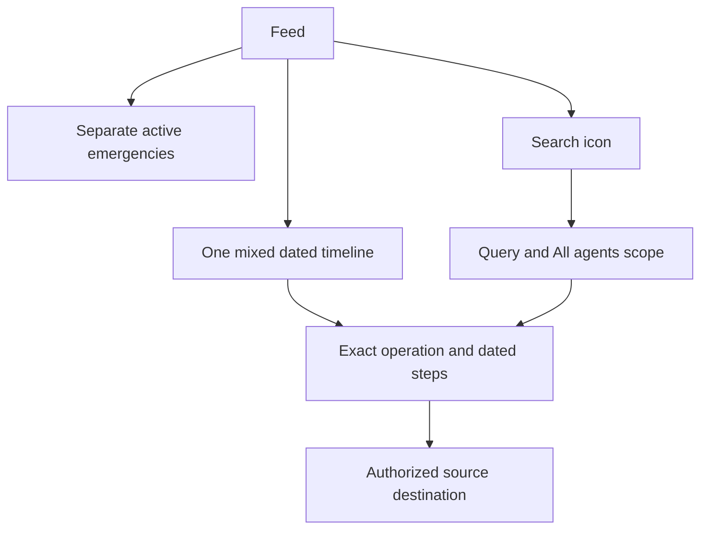
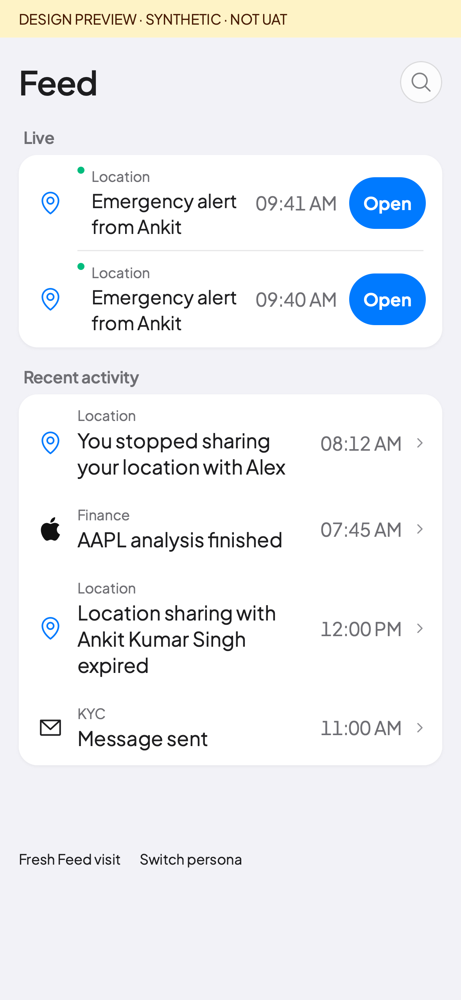
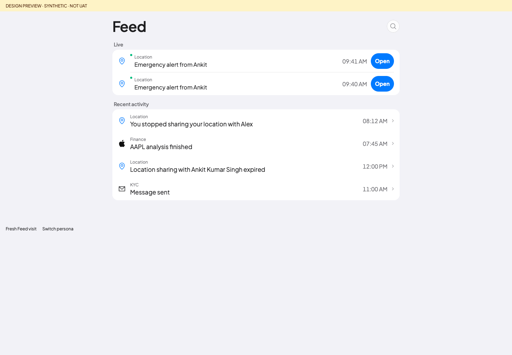

# Feed UI Contract

Owner: frontend architecture. Classification: `canonical`, package-local.
This contract covers `/one/feed`, its search and immediate handoffs. Domain
services retain authority over requests, consent, payments and results.

## Visual Map

## Default screen and rows

Feed uses the existing One shell, Talk to One and bottom navigation. It opens
with its title and one search icon. Active emergencies remain individually
visible in Live; decisions and meaningful outcomes share one timeline, newest
first by meaningful time. There are no agent sections, permanent filter chips,
routine progress lists, notification-recovery card or Feed-only sound setting.
Empty sections disappear. Notification delivery retains its existing owners;
permission recovery belongs in notification settings.

Each row has a compact, user-facing source label and logical icon, concise
activity, real time and at most one primary next action. A person and their
activity use distinct lines. Names and descriptions wrap; time and the chevron
retain their own space. Known ticker/company assets use the existing local
logo source. A person's photo does not replace the Location source label.

The authored [activity policy](../../../consent-protocol/contracts/feed/activity-policy.v1.json)
owns event admission, public agent scopes, bounded search aliases and stable
operation families. [Its generated browser copy](../../lib/feed/activity-policy.generated.json)
must agree. Unreviewed events and routine search, sync, retries and progress
are suppressed. Historical source publishers can retain those facts without
creating visible rows or unread attention.

## Grouping and attention

Group by authenticated viewer and verified operation identity before paging,
search and unread counting. Never group by name, ticker, amount or time window.
One current source action supersedes its matching historical representative;
earlier recorded steps remain in the selected operation detail. Ambiguous
legacy identities stay separate or are safely withheld when no truthful exact
destination exists.

Location requests bind to resulting grants only through verified source links.
Private Check-In uses its operation ID and confirmed recipient receipts. Circle
membership changes cannot conceal separate location-access changes. Every
active SOS grant remains separate, including two from the same person.
Nearby Check-In is temporary map presence: no durable Feed row or search entry.
GPS, map views and polling never become activity.

A new meaningful decision, first accessible delivery or material exception may
raise attention once for its workflow. Own acknowledged actions and quiet
expiry/revoke outcomes do not introduce unread attention. Reading never resolves
a pending action. A Feed tap never grants access; source review rechecks the
request revision, exact access, duration and current share before committing.

## Search and return

Search opens one field and an All agents selector. Scope filters server-side
history even with an empty query. Query, scope, person and date criteria combine
before ranked pagination; the loaded first page is not the search corpus.
Exact matches rank before prefixes and substrings. A unique adjacent
transposition can offer an explicit suggestion; ambiguous identities never
produce an invented Top Hit. Authorized current contacts and verified,
consented Advisor clients can supply a Top Hit independently of Feed events.

In the advisor persona the public scope is Advisor, with one quiet Clients
route to the existing roster. Roster membership and workspace access are
independently checked. A review-snapshot relationship never grants a full client
workspace. Finance labels are matched in existing unlocked owner memory.

An active scope has a removable label. Opening a result arms return state;
Back restores query, scope, results and scroll through existing navigation
owners. A fresh Feed visit resets to All agents. Search state and bounded
query caches remain in memory, tied to owner, auth, vault and Feed epochs.
No protected query, snippet or key is persisted in a URL or durable cache.

Emergencies stay pinned across scopes and search. Scope never alters push,
subscriptions, notification preferences or another agent's unread count.
Empty scoped results say `No Location activity` with `Show all`; empty search
provides a short query-specific message and clear controls.

## Read, Clear and recovery

The normal history owner preserves loaded pages and scroll while new activity
waits. Current received-request updates can settle in place. Quiet updates keep
their presentation position. Rows above the reader's viewport and all hidden
search/scope activity remain unread. Snapshot ID, time and material fingerprint
fence Read/Clear against concurrent or same-ID source updates.

Clear and Remove are viewer preferences. They never revoke access, cancel a
request, erase a receipt or hide an active emergency. Undo requires the exact
server dismissal token; a later Clear invalidates it. Search respects cleared
workflow revisions. A later eligible outcome can resurface the workflow; its
exact detail retains recorded earlier steps. Domain records remain accessible
through their independently authorized source routes.

Retain known rows during refresh. Cold failure offers Retry; empty history says
`No activity yet`. Owner/session invalidation fences both cached and in-flight
responses. Global unread remains owner-scoped and independent of search scope.

## Source handoffs and current limits

| Source | Implemented boundary / remaining limitation |
| --- | --- |
| Drive/document requests | Exact participant request, guarded review, current payable quote and accessible-file flow. Confirm counts and settlement through source readback. Private, vault-authorized filename continuation searches confirmed request deliveries; exact open rechecks access. Payment-only milestone matches open a fresh read-only participant receipt. Standalone bulk files and filename typo suggestions remain unsupported. |
| KYC | Pending review hands an owner/session-bound workflow ID to the existing review. A confirmed reply opens its dated Feed receipt and recorded steps. No new send/reconciliation API is introduced. |
| Finance | Reads existing device analysis history and decrypted statement/connection records. Statements and institutions open exact read-only Feed detail. Current completed import drafts use the existing review entry. No new report storage, save acknowledgement, correction workflow or provider reconnect behavior. A completed run is described as finished, not saved. |
| Location | Verified request/grant and existing Check-In operation grouping. Every confirmed active SOS is separately pinned using a Feed-owned read-only paginated projection. No new Check-In plan, intended audience, retry or retention writes; complete/partial totals cannot be reconstructed from current baseline records. |
| People / Advisor | Existing confirmed contacts and authorized clients only. No new nickname editor or relationship-alias storage. |

Confirmed family aliases use the owner's encrypted `identity.contact_aliases`
version 1 binding authored in Connections, with a current confirmed relationship.
Model or retrieval hints cannot establish aliases or substitute another person.
Raw coordinates, precise places, private Check-In notes, document
contents, protected holdings and emergency location information are not indexed.
Disconnected agents can retain authorized history; connector recovery requires
confirmed current source state rather than an old warning event.

## Verification

Use [the contributor scaffold](../../../docs/development/contracts/ui-contract-contributor-guide.md)
for Back/Search changes. Generate Feed policy, then Back before Search and
native/voice/topology mirrors. Run focused Feed, unread, pagination, source API,
PostgreSQL, authorization and recovery contracts.

[Visual QA](feed-visual-qa.md) owns the native journey matrix and private manifest.
Deterministic production-component fixtures are design previews. They do not
prove provider settlement, fresh UAT workflows, vault continuity or native
acceptance. Keep live end-to-end evidence separately labeled with exact deployed
SHA, viewer role, stable operation ID, confirmed state, time and tap destination.

## Design previews

These are synthetic production-component previews, not authenticated UAT evidence.
The iPhone viewport is 393 × 852 CSS pixels; desktop is 1440 pixels wide.

| iPhone | Desktop |
| --- | --- |
|  |  |

Real provider operations, dedicated account readbacks and native screenshots
remain a separate release acceptance gate. Preview controls and synthetic
workflow records are isolated from the application build.
