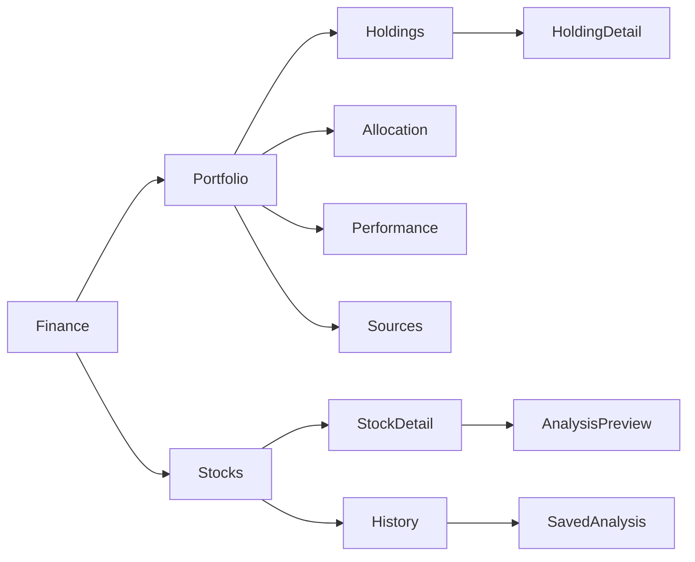

# Finance: Portfolio and Stocks

Source owners: `components/kai/kai-market-hub-page.tsx`,
`components/kai/views/dashboard-master-view.tsx`,
`components/kai/views/kai-stocks-view.tsx` and their imported feature components.
Evidence date: 2026-10-23. This contract describes source behavior; browser
fixtures use synthetic holdings and prices, not a signed-in account.

The existing `/one/kai?tab=portfolio` and `?tab=analysis` query panels retain
one Finance header, registered tab rail, mounted pager and shared Back owner.
Portfolio details remain finite `/one/kai/portfolio/{holdings,allocation,performance,sources}`
routes. The shared shell owns the outer gutter; Finance scopes the 728px
Connect reading measure and Plus Jakarta Sans roles. Rows use 14/21/550,
support 12/18/400, section labels 14/22/600, and compact actions 12/18/550.
Financial totals retain their larger type. Cards keep natural content height.

Portfolio value, period change, holdings, allocations and sources still come
from the existing owner-scoped dashboard mapper. Overview and Performance share
the same chart of genuine `historical_values`; absent history produces no
manufactured trend. `Holdings`, `Allocation`, `Performance`, and `Portfolio source`
retain their existing destinations. Share PDF, source selection, statement
import/review, statement editing, Save/Cancel/Delete/Restore, and read-only
brokerage restrictions retain their current handlers and vault admission.
The holding drawer uses a flat definition list; no extra read or mutation is
performed when it opens. Its Edit/Delete controls retain the existing callbacks.

Stocks exposes `Search stocks` (placeholder `Symbol or company`) beside
`History`. Tier, Sector, Rows per page, and the source selector when alternatives
exist retain local filtering/pagination and the existing source-selection owner.
Searching, choosing a chart range, and closing History make no API calls.
History contents use the existing encrypted history service only when
opened with an unlocked vault. The existing history action/route intent opens
the same sheet, including while a debate continues. Close/Escape/Back dismiss
the shared sheet before route navigation; the inactive pane releases its Back layer.

A stock row opens the existing shared detail sheet/dialog. The header shows
its symbol and company/sector/list description, then USD quote/change/time,
observed daily price chart, Company facts, and Summary. Facts retain market
cap, P/E (TTM), P/B, debt/equity, list free cash flow, financial period, retrieval
time and source. Missing facts say `Unavailable`. `Analyze {symbol}` closes
details and enters the existing preview; starting a debate retains confirmation
and vault guards. Public browsing/facts/history require signed-in owner identity,
but no decrypted portfolio or vault key is sent to the new history endpoint.

History reads once on stock selection through
`ApiService.getKaiStockPriceHistory` → the Kai proxy →
`api/routes/kai/price_history.py`; dismissal aborts/ignores late results.
The service retains cache/retrieval metadata and the sheet distinguishes
`Cached history` from `Daily observations`. Failed/empty history shows
`Price history is unavailable for this source.` while quote and facts remain.
Only supplied ranges are selectable (month history supports 1W/1M where covered).
No 1D candles, synthetic series, provider swap, earnings or trading action is implied.

Focused proof owners: `renaissance-market-detail.test.tsx`,
`portfolio-workspace.contract.test.ts`, `dashboard-data-mapper.test.ts`,
`price-history.test.ts`, backend `test_kai_market_public_cache.py`, and the
production-component `finance-interactions.layout.spec.ts` browser fixture.
Authenticated sequential vault continuity, live provider availability and
physical iPhone behavior require separate runtime acceptance.
