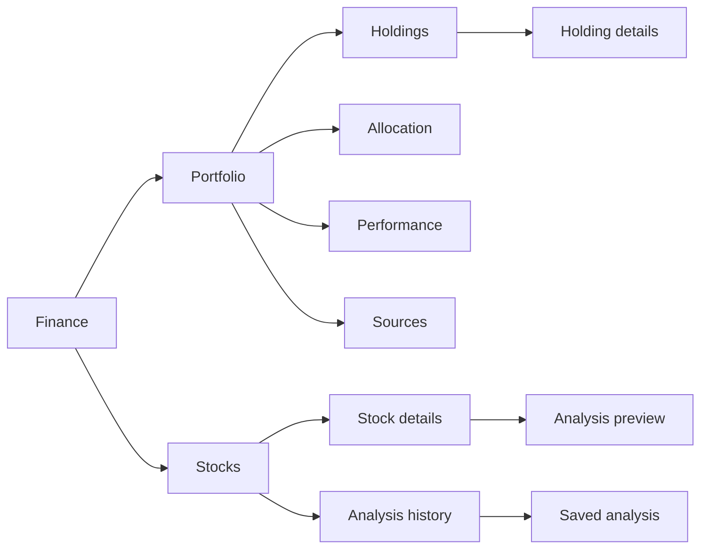

# Finance: Portfolio and Stocks

Source owners: `components/kai/kai-market-hub-page.tsx`,
`components/kai/views/dashboard-master-view.tsx`,
`components/kai/views/kai-stocks-view.tsx` and their imported feature components.
Evidence date: 2026-10-23. This contract describes source behavior; browser
fixtures use synthetic holdings and prices, not a signed-in account.

## Back navigation

The shared top-left Back arrow closes an open detail sheet first. From a saved,
completed or running analysis it returns to Stocks on the same mounted Finance
page. Retained results cannot reopen that workspace after its query selection
is cleared. A running analysis continues in the task manager and can be reopened
with Open active analysis; only Cancel cancels it. Debate, Summary and Detailed
view selections each return to Stocks before the next Back leaves Finance.
Statement import opened from Portfolio preserves its opening Finance screen.
Focused evidence: `kai-analysis-back.test.tsx`, `top-shell-back.test.ts` and the
authored route Back cases; this is not deployed or physical-device acceptance.

## Visual Map

The existing `/one/kai?tab=portfolio` and `?tab=analysis` query panels retain
one Finance header, registered tab rail, mounted pager and shared Back owner.
Portfolio details remain finite `/one/kai/portfolio/{holdings,allocation,performance,sources}`
routes. The shared shell owns the outer gutter and the canonical 880px header/tab
column. The Portfolio and Stocks panels scope the centered 728px Connect
reading measure and Plus Jakarta Sans roles. Market retains its panel typography;
styles do not change on hidden mounted panels when the selected tab changes. Rows use 14/21/550,
support 12/18/400, section labels 14/22/600, and compact actions 12/18/550.
Financial totals retain their larger type. Cards keep natural content height.

Portfolio value, period change, holdings, allocations and sources still come
from the existing owner-scoped dashboard mapper. Overview and Performance share
the same chart of genuine `historical_values`; absent history produces no
manufactured trend. `Holdings`, `Allocation`, `Performance`, and `Portfolio source`
retain their existing destinations. Share PDF, source selection, statement
import/review, statement editing, Save/Cancel/Delete/Restore, and read-only
brokerage restrictions retain their current handlers and vault admission.
The holding drawer uses a flat definition list and the existing public price-history
read. Opening it performs no holding mutation; entry controls retain the draft/save flow.
At 1024px and wider, the holding sheet is centered with a 1120px maximum width:
value and price history sit left, facts and individual entries sit right. A single
scroll area retains the existing footer and dismissal owner. Mobile stays stacked
with the same text sizes; cash and CUSIP positions leave no empty chart column.
The shared 44px close control sits in the company header row, centered with the
logo/name block and aligned to the same right inset as the content.

Holdings browse as one derived position per compatible security, source, account,
currency and position side. The position retains its original entries; edits and
pending removals target the selected entry, and Save persists the individual rows.
Opening a position shows its shared chart/facts once, then **Your entries** with
shares, cost basis and acquisition date when supplied. In Edit mode, Add entry,
Edit, Remove and Restore reuse the existing editor and draft/save confirmation.
The group drawer closes while the entry editor is open; closing the editor returns
to the group. Back then closes details, cancels edit mode, and reaches the route parent.

Normalized read projections preserve entries rather than merging them by ticker.
Save updates the selected statement snapshot (including legacy statement storage)
or the existing V7 position map. It preserves unrelated records and artifact
references through the existing encrypted coordinator and revision checks. A
changed source or stale edit is rejected before saving. Different statement
snapshots are never added together; no prior entry breakdown is invented.
Position cost/gain remains unavailable when constituent coverage is incomplete;
different reported prices/times never become an invented common quote. Position
counts and concentration use the same grouping as mobile and desktop lists.

Stocks exposes `Search stocks` (placeholder `Symbol or company`) beside
`History`. Tier, Sector, Rows per page, and the source selector when alternatives
exist retain local filtering/pagination and the existing source-selection owner.
Failed reads offer Retry through the same shared Finance resource, with the
current source selection preserved. Saved rows remain visible during refresh and
after a refresh failure, with a quiet loading/update-availability status. A partial
refresh failure never relabels all visible quotes as cached. Retry is disabled while
the resource is busy; History stays available during an initial load failure.
Searching, choosing a chart range, and closing History make no API calls.
History contents use the existing encrypted history service only when
opened with an unlocked vault. The existing history action/route intent opens
the same sheet, including while a debate continues. Close/Escape/Back dismiss
the shared sheet before route navigation; the inactive pane releases its Back layer.

A stock row opens the existing shared detail sheet/dialog. The header shows
its symbol and company/sector/list description, then USD quote/change/time.
The sheet also shows an observed daily price chart, Company facts, and Summary.
It reads the selected symbol through the existing public `/api/market/quotes`
service. This read uses the shared provider cache and closed-market policy; it
requires no vault authority and never requests the full stock list. Late results
are aborted/ignored on dismissal, selection change or inactive pane. A successful
list refresh also updates an open detail instead of leaving a copied row frozen.
An unavailable quote has its own Retry action; known prices stay visible during
recovery. Provider quote time, unknown time, cached and delayed observations remain
distinct. History observations are never promoted into a spot quote.
Facts retain market
cap, P/E (TTM), P/B, debt/equity, list free cash flow, financial period, retrieval
time and source. Missing facts say `Unavailable`. `Analyze {symbol}` closes
details and enters the existing preview; starting a debate retains confirmation
and vault guards. Public browsing/facts/history require signed-in owner identity,
but no decrypted portfolio or vault key is sent to the new history endpoint.
The hub inventory classifies this endpoint as `SUPPORT`: its explicit public
symbol read carries no owner-private content, matching public company facts.

History reads once on stock selection through
`ApiService.getKaiStockPriceHistory` → the Kai proxy →
`api/routes/kai/price_history.py`; dismissal aborts/ignores late results.
The service retains cache/retrieval metadata and the sheet distinguishes
`Cached history` from `Daily observations`. Failed/empty history shows
`Price history is unavailable for this source.` while quote and facts remain.
Only supplied ranges are selectable (month history supports 1W/1M where covered).
No 1D candles, synthetic series, provider swap, earnings or trading action is implied.

Focused proof owners: `renaissance-market-detail.test.tsx`,
`portfolio-workspace.contract.test.ts`, `dashboard-data-mapper.test.ts`,
`price-history.test.ts`, backend `test_kai_market_public_cache.py`, and the
production-component `finance-interactions.layout.spec.ts` browser fixture.
Authenticated sequential vault continuity, live provider availability and
physical iPhone behavior require separate runtime acceptance.

## Implementation verification: 2026-10-23

The production UI revision `e73f1f4a93eb47dab0215c2c0ea5396352974dc6`
was exercised through the optimized production-component browser fixture.
Identity and observations in that fixture are synthetic; it does not represent
an authenticated portfolio or independently reconciled provider prices.

| Evidence | Result |
| --- | --- |
| Chart layout at 360, 393, 430, 768, 1024 and 1440px, both themes | All 12 combinations pass in Chromium and all 12 pass in WebKit |
| Existing iPhone stock/news/index layout checks | Pass |
| History intent, dismissal/abort, company facts, portfolio mapping and chart ranges | 15 focused frontend cases pass |
| Authenticated API transport, including cached-history metadata | 103 cases pass |
| Existing cache contracts | 102 cases pass |
| Shared Back/navigation behavior | 500 cases pass; Back/Search regenerated and verified |
| Backend market cache, owner/currency admission and closed-history guard | 10 cases pass |
| TypeScript, full ESLint, design system, render performance, service boundary and docs | Pass |
| Architecture ratchet | Zero new or worsened findings; baseline unchanged |

The local core mirror stops in the existing Windows Python `/bin/bash`
subprocess boundary in `test_secret_scan_ranges.py`; hosted Linux checks remain
required. The signed-in route sweep also requires the canonical reviewer UID
and vault passphrase. Neither limitation was bypassed. Physical devices, live
provider acceptance and UAT remain unverified. A later documentation-only CI
correction does not change the production UI revision described here.

The branch subsequently integrated main at
`6fa2ace8f38527b988834725c0a2defd6498f174` (functional PR #8357).
Combined verification passes 119 frontend/API cases and 33 backend cache/session
cases. The new history read consumes the provider port's existing degradation
signal: a failed provider refresh retains the outer cache's original timestamp
and stale flag; without prior history it remains unavailable. This avoids
reclassifying stale provider observations as a successful fresh history read.

After that integration, eight focused chart layout cases also pass at 393px
and 1440px in Chromium/WebKit and both themes. TypeScript, scoped lint and
regenerated Back/Search verification pass on the combined source. The history
transport case lives in the existing authentication recovery suite (five cases
pass), keeping the large generic API test module within its ratchet.

## Market quote presentation

Market observation times use the existing local-date formatter, so index tiles,
index details and movers follow the viewer's device timezone and locale. Market
keeps three Movers and three Losers slots. Each uses a valid provider observation;
a missing rank is a noninteractive `Quote unavailable` row, never a synthetic
company or percentage. Matching observation times share one line; differing
times stay with their rows. Market omits cache labels while preserving actual
quote times, delayed/closed/unavailable states and the underlying cache policy.
Stocks detail and Portfolio source/history disclosures retain their own wording.
