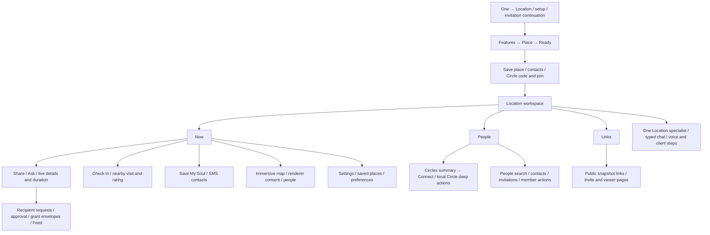

# Location UI Contract

Status: **Implementation complete / acceptance pending**, 22 October 2026.
Current main source baseline: `b34d1e93d291cfa106b08893a9587973867044f2`.
The fresh mounted inventory and typography evidence supersede the earlier
`47026022e873ac03f62423eda5122e4f3f117945` source review; unchanged functional chapters remain below.
Owner: frontend architecture with Location, onboarding, consent, native and
agent-runtime owners. Classification: `canonical`, package-local.

This is the Location counterpart to the [Mail](./mail.md),
[Calendar](./calendar.md) and [Drive](./drive.md) contracts. Its completeness
unit is the reachable interaction: entry → read → rendered row/control →
affirmative or negative choice → request or local change → acknowledgement →
refresh/recovery. Each chapter records exact authored English, consumed fields,
API boundaries, cancellation, sizing and source evidence.

The mounted customer workspace is `OneLocationAgentPage` →
`LocationRedesignHub`, with **Now**, **People** and **Links**. Setup mounts the
established Location experience in setup mode; its authored top-level sequence
is **Features → Place → Ready**, with nested contacts and Circle branches.
The separate `components/location/LocationArea` migration, six-step setup,
legacy Activity/trips block and standalone places-history components must not
be counted as additional current tabs merely because their code or tests exist.
Reachability and retained compatibility surfaces are identified below.

Exact app-authored literals are quoted. `{values}` mean values supplied by the
current person, recipient, server, provider, locale, clock or model. OS permission
prompts, native share targets, Google map/provider responses and generated agent
answers are externally owned or dynamic; this contract does not invent their
complete English. Full executable schemas, route/action registries, legal text,
encryption and permission owners remain authoritative in their linked sources.
No live coordinates, accounts, secrets, one-use tokens or recipient details are
included.

Sizes are CSS pixels at a default 16px root unless stated. Per-site ledger fields distinguish authored cascade candidates from measured computed values. Native points, OS text sizing, keyboard and safe-area behavior require separate acceptance. A changed source declaration alone is not rendered proof.

## Mounted typography pass — current authority

This pass was rebuilt from the actual `OneLocationAgentPage → LocationRedesignHub` production returns, then all mounted children, routes and actual body portals. Visible tabs are **Now**, **People**, **Links**; semantic metadata “Overview” does not rename Now. Onboarding, standalone map/check-in and public invite/view roots have their own scoped DOM host. The later legacy page JSX, `components/location/**`, unmounted places-history and unavailable Location Circle chat/photo/custom-type branches are explicitly excluded.

The source was refreshed from main during implementation. The concurrent Chat/Messages changes through `b34d1e93d291cfa106b08893a9587973867044f2` were inspected and rebased locally; they did not change Location/Connect typography owners. Existing work in the primary checkout was preserved. This expanded candidate is local only: it has not been pushed, merged or deployed.

Functional chapters retain their existing layout and wire contracts. Any local class/font declaration there is an authored source declaration; the effective role comparison and fresh per-site ledger below take precedence over those declarations because the actual important cascade can supersede them.

Current evidence and exact contracts:

- [Complete text, accessible copy, CTA, branch and wire coverage](./location-coverage.md): exact source templates; route/state/entry; handler and endpoint or explicit no request; portal/CSS owner; source role and target breakpoints; disposition; computed evidence or exact gap.
- [Role comparison and effective typography](./location-typography-roles.md).
- [Implementation and verification report](./location-verification.md): changed files, header before/after, widths/themes, behavior and missing evidence.

Each source-aligned or exceptional text has a disposition even when native/provider/rendered evidence remains pending. Action contracts are the interaction unit: selecting/opening is separated from the actual mutation, and cancel/outside/Escape/drag/Back and busy/failed/partial outcomes are recorded separately from success. A source-verified disposition must never be read as live service acceptance.

## Visual Map

## Contract map

| Area | Detailed contract |
| --- | --- |
| First use | [Entry, onboarding, permissions, save-place and Ready branches](#entry-and-onboarding) |
| Workspace | [Mounted tabs, Now, map, nearby and settings](#workspace-now-map-nearby-and-settings) |
| People and delivery | [People, sharing, requests, Links, SOS and recipient decisions](#people-sharing-requests-links-and-emergency-actions) |
| Circle deep actions | [Create/join/detail, roster and all nested controls](#named-circle-actions-and-connect-handoff) |
| Private agent | [Location specialist, chat, voice and action semantics](#private-agent-chat-voice-and-action-contract) |
| Wire contract | [API/authentication, payloads, fields, effects and recovery](#api-authority-and-wire-contract) |
| Visual redesign | [Font schema, phone/desktop/native geometry and layers](#typography-responsive-geometry-and-layering) |
| QA and limits | [Completeness ledger and verification evidence](#qa-ledger-and-verification-boundary) |

## Reading rules and adjacent authorities

- A row normally consumes one shared state/list response. The table identifies
  that shared provenance; it does not invent one network request per row.
- Open, expand, select, search, change a draft, preview, acknowledge, commit,
  revoke and deliver are distinct operations. Each action states its actual
  boundary, including **no API call** where appropriate.
- Cancel, No, Back, X, Escape, outside tap, swipe and dismiss are independent
  branches. Closing a surface can fence a late local result while an accepted
  server/provider effect continues. A busy guard is not a rollback.
- Authenticated identity, unlocked vault authority, a Circle membership, an
  active recipient key, verified phone, public viewer token and renderer consent
  answer different questions. Their per-endpoint requirements remain separate.
- `F` denotes a current Firebase ID token; `V` denotes the same owner's current
  vault-owner authority. These are symbolic types, never example credentials.
- General app Back, Search and voice action declarations keep their current
  [route layout](../../lib/navigation/app-route-layout.contract.json),
  [local Location actions](../../app/one/location/page.voice-action-contract.json),
  [shared navigation](./navigation.md) and
  [contributor scaffold](../../../docs/reference/architecture/ui-contract-contributor-guide.md)
  owners. This Markdown is a product reference, not a second executable registry.
- The [Connect contract](./connect.md), [Feed contract](./feed.md),
  [Profile contract](./profile.md) and [typography](./typography.md) retain their
  shared-surface roles; Location-specific mounting and handoffs are recorded here.

## Entry and onboarding

Evidence baseline: `47026022e873ac03f62423eda5122e4f3f117945`. This chapter describes the authored customer tree mounted by `/one/location` and `/one/setup/location`. English below is verbatim authored copy; `{…}` is a runtime substitution, not an additional literal. Provider/OS prompts, Google Maps attribution, names, addresses, returned safe error messages and invitation codes are runtime/provider content.

### Admission, entry and persistence boundaries

| Surface / condition | Current contract and branch | Source |
| --- | --- | --- |
| Location capability | Registry title `Location`; description `Share where you are with people you trust.`; preview `Live location & Alerts`; `setup.open_location`, control `one_setup_tile_location`, agent `agent_location`, href `/one/location`, registry `requiresVault: true`. The separate setup route deliberately operates before vault creation; the registry flag must not be read as proof that its introduction requires a vault. | [Capability registry](../../lib/onboarding/one-capabilities.ts), 187–205 |
| `/one/setup/location` | Route mounts `LocationOnboardingSetupClient`, which mounts the established `OneLocationAgentPage mode="setup"`. No `LocationArea` switch, experimental Location provider, or new six-step flow is selected here. Auth loading says `Preparing location setup…`; already-completed admission settles before mounting the introduction and says `Returning to setup...`. | [Route](../../app/one/setup/location/page.tsx); [setup client](../../app/one/setup/location/location-onboarding-setup-client.tsx), 1–104 |
| Setup authentication | Coordinator waits for auth; unauthenticated entry resolves to `/login?redirect=%2Fone%2Fsetup%2Flocation`. It reads bootstrap state and the active setup journey before preparing/settling. `isOperationallyReady` becomes true from this introduction independent of whether device location was allowed. | [Coordinator](../../components/onboarding/setup/setup-capability-coordinator.tsx); [page](../../app/one/location/page.tsx), 2557 |
| Setup already completed | `resolveCompletedSetupCapabilityEntry` sends root-resolved Location to `/one/location`; otherwise an unresolved root journey acknowledges at `/one/setup`. It is not a fresh permission request or a repeated introduction. | [Route helpers](../../lib/navigation/routes.ts), 445 onward; [setup client](../../app/one/setup/location/location-onboarding-setup-client.tsx) |
| `/one/location` first-run takeover | Auth loading → checking; no owner → hidden; workspace requires vault owner token before takeover evaluation. Setup mode always shows. Workspace read error hides takeover. A nonempty `action` query bypasses takeover, so a share/request/settings entry can reach the actual requested workspace action. Once hidden in that mount, it remains hidden. Otherwise owner local marker v2 or v1 hides introduction. | [Page admission](../../app/one/location/page.tsx), 4893–4974 |
| Intro-seen marker | `one_location_onboarding_v2:{uid}` in localStorage stores only `1`. Workspace completion marks seen, clears session progress and hides takeover. Setup successful completion marks seen and clears progress after the coordinator resolves. Setup Skip clears progress but does **not** mark seen. Workspace Skip delegates to normal dismiss/seen behavior. These are not permission, consent, circle-membership or saved-place records. | [Page settlement](../../app/one/location/page.tsx), 13529–13590 |
| In-tab progress | SessionStorage key `one_location_onboarding_progress_v1:{mode}:{uid}` records screen name. `features` and `ready` restore; `place` restores as `features` because its sensitive draft does not survive remount. Blocked storage falls back to mounted state; owner and setup/workspace modes are isolated. | [Progress hook](../../lib/one-location/use-onboarding-progress.ts) |
| Authored screens | Exactly `features` / `place` / `ready`, labels `What One Location does` / `Save a place` / `Ready`. Legacy `welcome` and `permissions` start values normalize to Features. Contacts and Join are optional disclosures on Ready, not additional top-level steps. | [Step source](../../components/one-location/onboarding/one-location-onboarding-steps.ts); [flow](../../components/one-location/onboarding/one-location-onboarding-flow.tsx), 1673 onward; [v4 contract](../../lib/onboarding/one-location-onboarding.contract.json) |
| Actual mounting | Onboarding, SaveLocationModal, contact privacy and results are body portals. Save-place is hosted by the same page only while open, active screen `place`, and owner matches. A saved-journey owner ref avoids re-opening the place prompt on Ready → Features → Continue. | [Page](../../app/one/location/page.tsx), 14200–14360 |
| Recipient entry | Public live/invite routes are standalone recipient surfaces, not this signed-in introduction. Named-circle deep flows and recipient link acceptance remain their own owners. Ready's code lookup/join is described below because it is directly mounted here. | [Route contract](../../lib/navigation/app-route-layout.contract.json), public Location route entries; [page](../../app/one/location/page.tsx) |

### Per-control action and negative/cancel contract

No row below implies a server call unless the wire column names one. In particular opening a disclosure, editing a form, going Back, skipping the place, copying a code and paging local results do not grant Location access or share a coordinate.

| Rendered control / condition | Read / action / result → UI | Negative, cancellation, failure, retry and busy behavior |
| --- | --- | --- |
| Features `Continue` | Starts one guarded `onPreparePlace` operation. Page calls `openSavedPlaceFromBanner(false)` → `ensureForegroundLocationReady({capturePoint:false,requirePoint:true,requireMeasurement:true,autoOpenSettings:false,announce:true,…})`. Device readiness/capture succeeds → host opens unified save-place and screen becomes `place`; false/throw → `ready`. No app HTTP endpoint is called merely to obtain the coordinate. | No prompt on mount. Device permission denial, restriction, disabled services or no fix do not block Ready/Finish. Continue retains its text with a spinner and is disabled while leaving/preparing. Concurrent taps coalesce. Back is consumed while capture is pending. |
| Features `Skip` | Setup: coordinator skip settlement; workspace: normal dismiss/seen. Does not run place capture, circle joining or contact sync. | Single leaving state prevents duplicate exits. Rejection releases leaving and keeps current UI. Top Skip exists on Features, not Ready or unified place. |
| Header arrow, aria `Go back` | Shared `useBackLayer`: top optional Ready disclosure closes first; otherwise Ready or place returns to Features; Features calls authored `/one` navigation (`push`, scroll false/full). | Consumes Back during leaving, place preparation, completion, join, contact check or selected-request operation. No raw browser-history fallback. It does not implicitly Skip, save or complete setup. |
| Ready `Finish` (setup) / `Open One Location` (workspace) | Explicit press calls `onComplete`, never a timer. Setup uses coordinator completion mutation below; workspace marks seen/hides takeover. Completion is guarded by an in-flight ref. | Available when invite preparation or contact checking fails; Finish itself is disabled only for leaving/completion, not every optional contact/join operation. Rejection releases completion guard, increments retry count and displays `That didn't save. Tap again.`; same CTA retries. A press event and successful settlement event are distinct telemetry boundaries. |
| Ready invite `Try again` | Re-runs guarded circle invite preparation after preparation error; response code/circle name repopulate card. | One preparation per initial Ready entry; no automatic endless retry. Finish remains available if provisioning fails. |
| Ready `Copy` | Local clipboard helper receives invite code. Parent success toast `Circle code copied.`; failure toast `Could not copy the Circle code.` | Child immediately renders `Copied` for two seconds without awaiting clipboard success, so that label alone does not prove a successful write. No Location mutation. |
| Ready `Share` | Builds Circle join URL from canonical web origin and code; invokes shared native/Web Share or clipboard fallback. See payload copy below. | Share cancellation is silent. Clipboard fallback gives `Circle code copied.`; other failure `Could not open the share sheet.`. Opening/handoff is not confirmed sending or delivery. |
| Ready `Join with a code` | Local mutually exclusive disclosure; expands `onboarding-join-circle-panel`, aria-expanded. Reveals text field and Look up. | Toggling/back closes disclosure, preserves local flow; no lookup or join until explicit CTA. Opens with nearest scroll into view. |
| Join input / `Look up` | Local trimmed input, aria `Circle code`, placeholder `Enter their code`, upper-case characters, auto-correct off, no spellcheck. Own normalized code is rejected locally; otherwise authenticated code preview POST below → preview `{name, ownerDisplayName, memberCount, alreadyMember}`. | Look up disabled for empty trimmed input, joinBusy or leaving. Dynamic safe error alert; no membership mutation from preview. Own-code rejection makes no request. |
| Preview `Join {name}` | If `alreadyMember` false, accept via authenticated vault join POST if token exists, otherwise owner-bound pending code storage. Success shows accepted state. | Disabled joinBusy/leaving, spinner keeps label. Failure preserves flow and shows safe error/fallback. This is Circle membership, not a Location share. |
| Preview `Use a different code` | Local reset of preview/accepted/error; typed code remains available to edit. | No leave/undo request, no join rollback, no HTTP call. |
| Ready `Find contacts` | Local mutually exclusive disclosure `onboarding-contacts-panel`, shown only when a usable native contacts or configured Google source is detected. It does not read the address book by opening. | Hidden for no supported source. Closing disclosure does not undo accepted connections. |
| Embedded `Check my contacts` / `Sync again` / `Try again` | Calls guarded contact handler after privacy preference gate. Native/device picker and matching or Google account consent/read/matching detailed below. Local `busy` → matched/none/failed outcomes. | Cancelled picker/Google account selection restores prior matched/none result if any, otherwise idle. Unknown/partial outcomes are preserved, not reclassified as no match. Double invocation blocked. |
| Embedded `Open Settings` | Contacts settings helper only when permission remediation supported. Return can resume the contact check through existing settings-return owner. | Does not change consent preference or guarantee OS permission. Contact failure still permits Finish. |
| Embedded `Use a different Google account` | Calls sync with `chooseAccount` → Google account picker prompt; old results are retained if the chooser is dismissed. | Only shown for Google empty/recovery case and enabled account-switch flag. No app account signout. |
| Embedded `Show more` | Increases visible match count by 100 from already loaded local matches. | No contact reread/server pagination. |
| Embedded `Request` | Firebase `ConnectionsService.sendRequest` with selected `addressee_user_id` and Location-specific message below. Success adds requested ID locally; label `Requested`. | Only `request_required` outcomes. `Sending` while pending. In-flight/added/leaving disabled. Source catches failure in the flow, while comment expects caller toast; inline parent callback itself throws without its own toast, so user-visible failure feedback is weaker than result-sheet Request. No location grant is implied. |
| Save-place Back, aria `Back to what One Location does` | Calls Features callback. Form values are local to the mounted save surface. | Disabled for interactionBusy. No save, seen marker or setup settlement. |
| Map move / pin | Local selected coordinate and resolved address; parent receives selection change/readiness. Backend/provider address read only when configured, as below. | Old address invalidated while settling; no persistence from dragging. Authored sheet owns save; embedded picker has no standalone Confirm/Cancel/X controls. |
| Map locate icon, aria `Use my current location` | Explicit fresh measured `captureCurrentPosition`; valid fix moves camera to zoom 17 and replaces selection. | No app HTTP capture endpoint. Failure `Move the map manually.`; retaining/editing captured point remains possible. Hidden unless map ready and handler exists. |
| Address / House or flat / Landmark / Other name | Local edits. Address max 300, required; house max 80, landmark max 100, custom name max 40. Pre-vault address inputs turn browser autocomplete off. Postal code is derived, not requested; no building-color input. Typed address/house value wins over automatic prefill. | Disabled while interactionBusy. Blank address alert on validation; Other blank label defaults to `Other`. No network write while typing. |
| `Home` / `Work` / `Other` | Local category buttons with aria-pressed. Initial category uses existing singleton availability; the actual onboarding caller has no existing-location list, so defaults Home. | No persistence until Save. Existing shared modal supports edit and collision-aware categories, but those broader callers are not additional onboarding steps. |
| `Save & continue` / `Try saving again` | Calls embedded map imperative confirm first, then saves normalized latest point/address/category/label and optional address details. Vault-ready → encrypted location PKM add; pre-vault → memory staging. On success host closes modal, records confirmed point, enables self-preview and sets screen Ready. | Disabled until valid coordinates, ready/not editing map, selected category, nonblank address and no in-flight save. `Saving…` while guarded write. Failure retains details and exposes retry; duplicate error can toast exact safe error. |
| `Skip saving this place` | Local Ready transition, no location record write, no setup completion marker. | Disabled interactionBusy. No revoke of OS permission already granted. |
| Save surface Escape / outside / X | No visible X in unified branch. Idle close maps to the same Features callback. Pointer outside is prevented in map flow; interaction busy blocks dismissal. | No implicit save. Old non-unified carousel/dots and standalone map-confirm copy are not mounted by onboarding. |

Sources for this table: [flow](../../components/one-location/onboarding/one-location-onboarding-flow.tsx), 673–841, 864–1181, 1182–1676, 1750–2151; [page permission](../../app/one/location/page.tsx), 4667 onward; [contacts callbacks](../../app/one/location/page.tsx), 7677–8060; [Circle callbacks](../../app/one/location/page.tsx), 9125–9365; [place callbacks](../../app/one/location/page.tsx), 13636–14070; [unified save](../../components/one-location/onboarding/save-location-modal.tsx), 930–1395; [map picker](../../components/one-location/onboarding/location-picker-map.tsx).

### Wire, read provenance and commit boundaries

Firebase ID token means signed-in identity authorization; vault owner token means the vault-authorized transport required by that Location method. Device/provider operations are separate from app-server API mutations. Proxy/backend canonical route families should remain linked to their shared owner; this chapter states the exact frontend method/body/result consumed by this mounted tree.

| Trigger / read | Request and authorization | Consumed response / effect / failure |
| --- | --- | --- |
| Coordinator bootstrap | `PreVaultUserStateService.bootstrapState(uid)`: web POST `/api/vault/bootstrap-state`, native `/db/vault/bootstrap-state`, Firebase auth; JSON `{userId}`. Cache is owner scoped; settlement explicitly forces fresh state. | Uses `setupCompleted`, `setupCapabilityIds`, `setupCapabilityDeclinedIds`, `onboardingPhase`, `onboardingActiveCapability`, `onboardingCallbackState`, `onboardingJourneyUpdatedAt` to admit/redirect/settle; full bootstrap schema owner remains the service. No vault creation. |
| Prepare root Location journey | Web POST `/api/vault/pre-vault-state`, native `/db/vault/pre-vault-state`; Firebase; `{userId,onboardingJourneyVersion:1,onboardingPhase:"capability_setup",onboardingActiveCapability:"location",onboardingResumeRoute:"/one/setup",onboardingCallbackState:"none",expectedOnboardingJourneyUpdatedAt?}`. | Skips already-active preparation. `409 STALE_ONBOARDING_JOURNEY` refreshes bootstrap and retries preparation once. Other failure reports preparation error then replaces setup hub. This is an optimistic journey version boundary, not an idempotency UUID. |
| Finish root journey | Same pre-vault-state POST; `{userId,setupCapabilityIds:<fresh full set union location>,onboardingJourneyVersion:1,onboardingPhase:"setup_hub",onboardingActiveCapability:null,onboardingResumeRoute:"/one/setup",onboardingCallbackState:"succeeded",expectedOnboardingJourneyUpdatedAt?}`. | On succeeded result, mark capability explored locally, then route hub/appropriate completed entry and resolve onComplete. Root completion does not itself create vault or finalize staged place. Conflict returns the safe changed-in-another-session summary and returns hub; active-goal mismatch blocks stale settlement. |
| Skip root journey | Same journey settlement fields but no completion set addition, callback `"none"`. | Clears active Location journey; returns setup hub. Location is not marked complete or intro-seen here. |
| Individual capability Finish / Skip | Finish POST `{userId,setupCapabilityIds:<fresh union location>}`. Skip POST `{userId,setupCapabilityDeclinedIds:<fresh union location>}`. Same auth/transport. | Individual Location finish normally returns `/one` because Location is not in the individual-workspace landing set. It must not be described as always landing `/one/location`; completed-root admission has a separate resolver. |
| Foreground availability / capture | `OneLocationService.getPermissionState()` → HushhLocation bridge permission state; on explicit Continue, `captureCurrentPosition({fresh:true,requireMeasurement:true})` → shared LocationBus/device geolocation. Native and web OS permission may be requested by real capture; no separate authored permission-primer is mounted. | Query-state `denied` alone is not treated as proof of failure; actual capture may recover. Unsupported/services-off/restricted are blocking early states. Denial/no fix returns false → Ready; `autoOpenSettings:false` means no automatic settings jump. Owner/session epoch and location-intent guards discard stale capture. |
| Map rendering | Web Google Maps SDK / native Capacitor GoogleMap; real captured coordinates only. Parent passes disclosure props but picker explicitly ignores them and initializes directly. | Map init timeout/hard error may expose captured-point fallback; unavailable renderer does not make point invalid. Provider renderer consent UI in the shared file is not mounted for this actual picker. No fabricated/example map point. |
| Pin reverse-geocode (token available) | Vault-authorized POST `/api/one/location/maps/reverse-geocode`, JSON `{lat,lng}`. | `{place:{name,formattedAddress,countryCode,…}}`; display `formattedAddress \|\| name`, derive address details. Read failure leaves address editable. No save from this read. |
| Pin reverse-geocode (pre-vault web) | No app-server call. Browser `google.maps.Geocoder.geocode({location:{lat,lng}})`; fallback Places `Place.searchNearby` requests `formattedAddress`/`displayName`, locationRestriction center/radius 100, max 1, DISTANCE. | First formatted address/name pre-fills. Pre-vault native without browser SDK and without parent reverse callback may have empty address; manual Address remains required. |
| Save with vault ready | `addSavedLocation` → `PkmWriteCoordinator.saveMergedDomain({domain:"location",…})` through canonical encrypted PKM. Record `{id,category,label,latitude,longitude,address,addressBase,addressDetails,savedAt}`; explicit confirmation source `one_location_saved_place_confirm`. | Coordinate/category/address duplicate guard; Home/Work replace same category singleton, Other appends. No dedicated Location saved-place POST is invented. Parent publishes successful UI state only while owner/intent still current. Canonical PKM encryption/read/merge API and cache behavior belong to PKM owner. |
| Save before vault | `PreVaultSensitiveDraftService.stageSavedLocation(uid,input)` in process memory only. Stores normalized `category,label,latitude,longitude,address`; caller additionally passes addressBase/details but draft normalizer does not retain those structured fields. | No sensitive coordinate/address localStorage. Composed full address retains details, but separate addressBase/addressDetails are not preserved by pre-vault draft type. Master setup `one-setup-hub` calls `finalizeForVault`; queued owner/session guard writes via same addSavedLocation, exact duplicates reconcile, errors retain memory draft, signout clears it. Introduction Finish alone does not execute finalization. |
| Ready first invite, before vault | Firebase POST `/api/one/location/circles/bootstrap`; `{name:<first name + "'s Circle" or "My Circle">}`. | `{invite:{circleId,circleName,code,…}}` → card. Frontend has guarded in-flight operation, no per-request idempotency key; backend bootstrap owns reuse semantics. Failure → invite error/Try again, not blocked Finish. |
| Ready first invite, vault present | Vault-authorized GET `/api/one/location/circles` → `{circles:[{id,role,systemKind,isSystem,…}]}`; filter system circles, choose first owned else first membership. GET `/api/one/location/circles/{id}` → `{circle}`. If no candidate/list failure, POST `/api/one/location/circles`, `{name,kind:"family"}`. | Uses normalized circle `id,name,activeInviteCode.code`. When no active code, POST `/api/one/location/circles/{id}/invite-code`, no body, no rotate query (`rotate:false`) → `{inviteCode:{code,…}}`. Creation/join schedules circle refresh. A failed list falls through to create, so reuse cannot be assumed for an indeterminate list read. |
| Ready code lookup | Firebase POST `/api/one/location/circle-codes/preview`, `{code:<trimmed input>}`. | `{circle:{name,ownerDisplayName,memberCount,alreadyMember,…}}` → preview. No vault required; no join yet. Own-code compare is local and prevents the call. |
| Ready code acceptance, vault present | Vault-authorized POST `/api/one/location/circle-codes/join`, `{code}` → `{circle,joined}`. | Schedules circle refresh; accepted UI literal still says `You'll join … after setup.` even though this path has already performed membership. No coordinate share/grant follows from membership in this callback. |
| Ready code acceptance, pre-vault | `rememberPendingCircleJoin(uid,code)` localStorage key `one_location_pending_circle_join_v1:{uid}`, normalized uppercase alphanumeric code. No immediate API join. | Failure to store rejects with actionable error. Once vault token appears, effect reads and **clears code before** one join POST. Success toast joined; failure asks for fresh code; no automatic replay/persistent retry queue after failure. |
| Contact-source availability | `HushhContacts.getPermissionState()` read only; configured Google fallback if native/device unavailable. GIS script may preload; this does not read contacts or open account consent. | Find contacts hidden when no available source. Device permission read and address-book picker are separate. |
| Contact privacy read | Firebase GET `/api/iam/contact-discoverability`, no body. | `{user_id,contact_discoverable,stored_contact_discoverable,contact_sync_consent_enabled_at,contact_sync_consent_rule_version,contact_sync_consent_contract_version,contact_sync_preference_state,contact_sync_match_policy_version,directory_visible,iam_schema_ready}`. Hook checks owner + current contract/rule/policy; unknown/loading/error does not silently grant matching. |
| Privacy `Keep private` / `Allow contact matching` | Firebase POST `/api/iam/contact-discoverability`, `{enabled:false}` or `{enabled:true,consent_version:CONTACT_SYNC_CONSENT_CONTRACT_VERSION}`. | Same preference schema validates decision. Saves discoverability only. Must tap Find contacts again to open local picker; no background address-book read immediately after consent. Private person can still check own contacts. |
| Device `Check my contacts` | Gesture invokes local contacts picker/read before awaiting auth. Phone candidates remain local; normalized hashed lookups dispatch Firebase POST `/api/one/connections/contact-sync`, JSON `{lookups:[{lookup_id,hash,last4}],context?}`; this onboarding caller supplies no context. Batches 1000; secure total cap 10000. | Sanitized response matches/items, counts, checkedLookupCount and indeterminateLookupIds → local aliases/match outcomes `auto_connected`, `already_connected`, `request_required`, `suppressed`; unknown and uncovered lookups remain indeterminate. Matching may actually auto-connect eligible people. On auto/already/unknown result refresh accepted connections. Exact account/verified-number identity checked before/after auth; one transient retry per batch uses same opaque lookup IDs. No raw address-book names/numbers sent in contact-sync body. |
| Google `Check my contacts` | Existing `useGoogleContactSyncSession`: ephemeral Google Contacts consent token and direct People API read, then same hashed contact-sync request; choose-different-account forces account prompt. Google token is not requested from the Hussh backend or persisted by this flow. | Phase authorizing/syncing/cancelled/error/complete drives shared results sheet. ReadContactCount, source and contact-match summary drive empty-copy distinction. Exact provider scopes/read fields remain canonical Google contacts source implementation, not a new Location sync implementation. |
| Inline Request | Firebase POST `/api/one/connections/requests`, `{addressee_user_id,message:"I would like to add you to my private Location circle.",requested_scope_handles:[],offered_scope_handles:[]}`. | `{request}` body is not needed by this inline local label; success → Requested. No requested/offered information scopes and no location grant. Shared cache mutation `CacheSyncService.onConnectionCapabilityMutated(uid)`. |
| Results-sheet Request | Same POST/body except message `I'd like to connect with you on Hushh.`. | Success tracks ID locally → Request sent; failure alert uses safe Error.message or `Could not send connection request.`. Callback likewise not a location grant. |
| Invite contacts preparation | Writes local first-touch funnel source `contact_sync`; Firebase GET `/api/one/referrals/summary` (no body) → summary `link`. The shared service also validates `joined_count` is a nonnegative safe integer; unavailable/malformed summary falls back to generic One invite link. | Referral link payload title/text/dialog below; missing all shareable origins → `Sharing is not available here.`. Opening invitation controller prepares once with timeout/retry, owner/session isolation. |
| Invitations handoff | No recipient-sending Hussh endpoint. Native `HushhInvitations.composeSmsBatch({recipients,body,…})`; web sets one `mailto:?bcc=…&subject=…&body=…`; share via native/Web Share; copy via clipboard. Message is `${share.text}\n${share.url}`. | At most 15 unique valid destinations. Native phone-only; web email-only. Validate complete batch before handoff. A composer opening is not delivery confirmation; result-specific copy below. Owner/session capture suppresses stale completion. External handoff cannot be rolled back by closing sheet. |

Wire sources: [coordinator](../../components/onboarding/setup/setup-capability-coordinator.tsx); [pre-vault user service](../../lib/services/pre-vault-user-state-service.ts); [Location service](../../lib/one-location/service.ts), 348–410 and Circle/map methods; [location readiness](../../lib/one-location/location-readiness.ts); [LocationBus](../../lib/one-location/location-bus.ts); [saved locations](../../lib/one-location/saved-locations.ts), 462 onward; [sensitive draft](../../lib/services/pre-vault-sensitive-draft-service.ts); [setup hub](../../components/onboarding/setup/one-setup-hub.tsx), 264 onward; [contact privacy hook](../../lib/contacts/use-contact-discoverability-consent.ts); [RIA service privacy methods](../../lib/services/ria-service.ts), 1610 onward; [contact matching](../../lib/one-location/contact-signals.ts), 80 onward; [Connections service](../../lib/services/connections-service.ts), 288 onward; [Google session](../../lib/contacts/use-google-contact-sync-session.ts); [Google token](../../lib/contacts/google-contacts-token.ts); [referral service](../../lib/services/referral-service.ts), 176 onward; [invitations controller](../../lib/contacts/use-contact-invitations.ts); [queue](../../lib/contacts/use-invitation-queue.ts); [handoff service](../../lib/services/contact-invitations-service.ts).

### Exact mounted Features, Ready and join copy

Source: [flow](../../components/one-location/onboarding/one-location-onboarding-flow.tsx), 273–341, 474–841, 1182–1676, 1750–2000. Cards are informational; their feature tags/headlines are not controls.

| Placement / condition | Authored literal / template |
| --- | --- |
| Header Back / stepper aria | `Go back` / `One Location setup progress` |
| Features heading | `Keep your people updated.` |
| Features first tag / headline / detail | `Share location` / `Can’t explain where you are?` / `Share your live location with your Circle in one tap.` |
| Features second tag / headline / detail | `Check in` / `At the venue, but can't find each other?` / `Check in on the spot and notify your circle` |
| Features third tag / headline / detail / decoration | `SMS · Save My Soul` / `Need help but can’t talk?` / `Alert your contacts with your live location.` / `SMS` |
| Features controls | `Skip` / `Continue` |
| Ready with confirmed map point / without point | `You're on the map.` / `You're all set.` |
| Ready map empty | `Turn on Location when you're ready.` |
| Invite loading / no invite | `Getting your code` / `Your code isn't ready yet.` |
| Invite preparation fallback / retry | `Couldn't get your code.` / `Try again` |
| Invite expiry | `Expires in 72 hours` (literal, not a rendered countdown derived from response expiry) |
| Invite actions | `Copy` / `Copied` / `Share` |
| Disclosure buttons | `Join with a code` / `Find contacts` |
| Join input placeholder / aria | `Enter their code` / `Circle code` |
| Lookup | `Look up` |
| Preview subline | `{ownerDisplayName} · {count} person` / `{ownerDisplayName} · {count} people` |
| Accept / already member | `Join {name}` / `Already in this circle.` |
| Accepted | `You'll join {name} after setup.`; fallback name `their circle` |
| Change code | `Use a different code` |
| Local own-code error | `That's your own code — send it to someone else so they can join you.` |
| Preview fallback | `That code did not match a circle. Check it and try again.` |
| Join fallback | `We couldn't join that circle. You can try again from Circles.` |
| Finish / retry helper | `Finish` / `Open One Location` / `That didn't save. Tap again.` |

Page-owned Circle/error/share literals ([page](../../app/one/location/page.tsx), 9125–9365):

| Condition | Exact literal / template |
| --- | --- |
| Default circle name | `{firstName}'s Circle` / `My Circle` |
| Missing Firebase token provision / preview | `Sign in to prepare your circle code.` / `Sign in to look up a circle code.` |
| No returned invite code | `Could not prepare an invite code for your circle.` |
| Pending join cannot persist | `We couldn't hold on to that code here. You can join from Circles once setup finishes.` |
| Deferred join success / failure | `You joined {circleName}.` (fallback `the circle`) / `That circle code could not be used. Ask for a fresh one from Circles.` |
| Clipboard toast success / failure | `Circle code copied.` / `Could not copy the Circle code.` |
| Share title / dialog title | `Join {circleName} on One` / `Share Circle code` |
| Share text with URL | `Join my {circleShareLabel} on One. Code {code}` |
| Fallback share text without URL | `Join my {circleShareLabel} on One. Enter code {code} under Location → People.` |
| Share error | `Could not open the share sheet.` |

`circleShareLabel` appends `Circle` unless name already ends in circle. The fallback `Location → People` text is the literal in current source, even though current shared Circle navigation has moved elsewhere.

### Exact device and unified place copy

Sources: [readiness](../../lib/one-location/location-readiness.ts), 36 onward; [page](../../app/one/location/page.tsx), 262 and 13636–14070; [save modal](../../components/one-location/onboarding/save-location-modal.tsx), 930–1395; [map picker](../../components/one-location/onboarding/location-picker-map.tsx). These are the unified branch; do not include the older shared carousel's extra copy as if it were mounted here.

| Condition / placement | Literal / template |
| --- | --- |
| Device unsupported | `This device or browser cannot share location.` |
| Device services off | `Turn on Location for your device, then try again.` |
| Device restricted | `Location is restricted on this device by its settings policy.` |
| App denied / no fix / locating | `Location is off for Hussh.` / `Couldn't find you. Try again.` / `Finding you…` |
| Save Back aria / navigation title | `Back to what One Location does` / `Save a place` |
| Save heading (also sr-only DialogTitle) | `Save this place` |
| Save description | `Pin the entrance, then check the address. It stays private to you.` |
| Map section | `Pin your entrance` |
| No map-initial point | `We couldn't load the map. Go back and try Location again, or skip this place.` |
| Selected spot / resolving | `Selected spot` / `Finding this address…` |
| No reverse address | `Address not found — enter it beside the map.` |
| Map loading / provider unavailable | `Loading map…` / `The interactive map isn't available right now. You can continue with the captured point and complete the address manually.` |
| Accuracy >75m / ordinary map instruction | `We're not sure of this spot. Check it.` / `Move the pin if needed.` |
| Locate button aria / locate failure | `Use my current location` / `Move the map manually.` |
| Details region aria | `Place details` |
| Address label / badge / placeholder / validation | `Address` / `Required` / `12 MG Road, Bengaluru` / `Enter the address.` |
| House label / badge / placeholder | `House or flat` / `Optional` / `Flat 4B, Tower 2` |
| Landmark label / badge / placeholder | `Landmark` / `Optional` / `e.g. Opposite City Hospital` |
| Category label / group aria / choices | `Kind of place` / `Saved location category` / `Home` / `Work` / `Other` |
| Other label / placeholder | `Name it` / `Gym, parents' house` |
| Ready-in-progress status | `Getting the pin ready…` |
| Missing category / address | `Pick Home, Work or Other first.` / `Add the address above.` |
| Cannot confirm settled pin | `Wait for the pin to settle, then try again.` |
| Inline failed save | `We couldn't save this place. Your details are still here — try again.` |
| Primary control states | `Save & continue` / `Saving…` / `Try saving again` |
| Secondary control | `Skip saving this place` |
| Wrong owner/missing point parent error | `Choose a location before continuing.` |
| Parent save failure toast | `Could not save this location. Please try again.` (duplicate may use safe exact error instead) |
| Duplicate save toast | `This place is already saved as {label}. Choose a different place or remove it first.` (`{label}` is Home, Work, Other, or `{customLabel} (Other)` from the shared formatter) |
| Vault-ready success toast | `Location saved securely.` |
| Pre-vault staged success toast | `Location ready. One will save it after your private vault is set up.` |

### Exact embedded contact disclosure copy

Source: [flow](../../components/one-location/onboarding/one-location-onboarding-flow.tsx), 864–1181; [page handlers](../../app/one/location/page.tsx), 7765–7965. This caller sets `embedded`; standalone `Find your people`, `Not now`, and Continue footer in the shared ContactsScreen are **not** rendered here.

| Condition / placement | Literal / template |
| --- | --- |
| Idle/busy introduction | `Find people from your contacts already on One. Exact matches connect automatically.` |
| Matched introduction | `Your matched ONE contacts and connection results are ready.` |
| Other introduction | `You can always find people later from the People tab.` |
| Busy | `Checking your contacts` |
| Idle body / control | `Connect contacts to see who is already here.` / `Check my contacts` |
| Matched badge aria | `Connected from your contacts` |
| Request-required states | `Request` / `Sending` / `Requested` |
| Outcome labels | `Connected now` / `Already connected` / `Kept disconnected` |
| Local pagination | `Showing {visible} of {total}` / `Show more` |
| Partial fallback | `Only part of your contact list was checked.` |
| Retry sync | `Sync again` |
| Empty heading | `No eligible contacts matched.` |
| Empty full explanation | `ONE users with an exact verified phone match connect automatically unless they are hidden, opted out, or were previously disconnected. Use the circle code above to invite anyone you want here.` |
| Empty partial explanation | `{partialSummary}` (or `Only part of your contact list was checked. `) followed by `Use the circle code above to invite anyone you want here.` |
| Different Google account button / aria | `Use a different Google account` / `Check a different Google account` |
| Error controls | `Open Settings` / `Try again` |
| Generic flow error | `We couldn't check your contacts. You can try again later.` |
| Missing sign-in | `Sign in to check your contacts.` |
| Page denial / restricted | `One does not have access to your contacts yet.` / `Contact access is restricted on this device.` |
| Page unavailable | `Reading contacts is not available here. You can add people later from the People tab.` |
| Indeterminate result | `Some contact results need confirmation. Your connections were refreshed; try contact sync again.` |
| Shared contact service permission errors (may be translated by page) | `Contact access is turned off for Hushh. Turn it on in Settings to find people you already know.` / `Contact access is restricted on this device.` / `Contact sync is available in the iOS and Android app.` / `Could not sync contacts.` |

### Mounted contact privacy dialog: controls, outcomes and exact copy

The shared canonical owner is [Connect](./connect.md); this table repeats the current Location-mounted content so the Location contract can stand alone. Sources: [privacy dialog](../../components/connections/contact-discoverability-consent-dialog.tsx); [privacy hook](../../lib/contacts/use-contact-discoverability-consent.ts); [RIA methods](../../lib/services/ria-service.ts), 1610 onward.

| Element / condition | Exact copy / action |
| --- | --- |
| Title | `Choose your contact privacy` |
| Visible description | `Allow verified people who already have your verified phone number to find and automatically connect with you, or keep your profile private from contact matching.` |
| Screen-reader description | `Choose whether verified people who have your verified phone number may find and automatically connect with you.` |
| Loading | `Checking your current choice...` |
| Read retry | `Try again` → repeat preference GET; no address-book read. |
| Negative / affirmative | `Keep private` → POST enabled false; `Allow contact matching` → POST enabled true + current contract version. Neither immediately starts picker. |
| Footer | `After saving, tap Find contacts again to choose which contacts to check.` |
| Preference already ready toast | `Privacy preference ready. Tap Find contacts again.` |
| Enabled saved toast | `Contact matching is on. Tap Find contacts again to check your contacts.` |
| Disabled saved toast | `You will stay private. Tap Find contacts again to check your contacts.` |
| Auth/read errors | `Sign in to check contact privacy.` / `Contact privacy was returned for another account.` / `Could not check contact privacy.` |
| Save errors | `Sign in to save contact privacy.` / `Contact privacy choice was not recorded.` / `Could not save contact privacy.` |
| X / dismiss | Shared Dialog Close label `Close` when shown; cancel/dismiss makes no preference POST and does not check contacts. Save busy hides X, disables choice/retry controls and rejects onOpenChange dismissal. First contact tap when preference is unknown/loading opens this dialog and consumes that tap. |

### Mounted contact results sheet: action matrix and exact copy

Source: [results sheet](../../components/one-location/contact-sync-results-sheet.tsx), 1–479; [Google empty summaries](../../lib/contacts/google-contact-sync-summary.ts). This is mounted alongside Ready, not an extra mandatory step. If invitations are enabled and active, it yields to the invitation sheet below. No onViewConnections callback is supplied here; Proceed follows the authored Connect URL and closes the sheet.

| Control / state | Effect / guard |
| --- | --- |
| `Choose Google account` | Calls configured Google sync callback with explicit account picker. |
| `Cancel` while Google consent/read busy | Shared Google session cancel aborts owned operation; results are not fabricated. |
| `Close` / shared X / Escape / pointer outside | Close sheet; no rollback of auto-connections; no unsubscribe/location revoke. Drag dismissal disabled; focus-outside prevented. |
| Row `Request` | Sends selected explicit connection request, body above; spinner during row pending, then Request sent. Error is visible, retry Request remains available. |
| `Show more ({count})` | Adds up to100 local matched rows. |
| `Sync again` / `Check more` | Starts matching again via owning source callback; disabled while syncing. |
| `Check Google Contacts` | External `https://contacts.google.com`, new tab/noopener/noreferrer. No Hussh mutation. |
| `Proceed to connections` | Follows `CONNECT_CONNECTIONS_LIST_HREF` (`/one/connect?tab=all&view=connections`) and closes. |
| `Invite contacts` | Opens invitation selector for eligible locally retained contacts. Disabled while syncing or no eligible candidates; omitted for empty Google address book. Unknown/unchecked phone results never become inviteable by inference. |

| State / element | Authored literal / template |
| --- | --- |
| Google idle title / description | `Connect Google Contacts` / `Choose the Google account where your contacts are saved. Keep One open; your results will appear here when you return.` |
| Google syncing title / description | `Checking your Google contacts` / `Reading saved contacts and checking phone numbers for matches.` |
| Google cancelled title / description | `Contact sync cancelled` / `No contacts were read. You can choose a Google account and try again.` |
| Google error title / description | `Could not sync Google contacts` / `{googleSync.error}` |
| Google busy labels | `Waiting for Google…` / `Syncing contacts…` |
| Google idle/busy/dismiss controls | `Choose Google account` / `Cancel` / `Close` |
| Results title | `Contact sync results` |
| Invitations-enabled description / otherwise | `Contact details stay on your device.` / `Only eligible Hushh accounts are shown.` |
| Google read summary | `Read {count} saved Google contact.` / `Read {count} saved Google contacts.` |
| Google external link | `Check Google Contacts` |
| Count tiles | `Checked` / `Matched` / `Connected` / `No match` (Connected = autoConnected + alreadyConnected) |
| Partial read warning | `Only part of your contact list was checked.` / `{partialFailureMessage}` |
| Unknown count | `{count} contacts need confirmation. They are not counted as unmatched or inviteable.` |
| Unchecked count | `{count} contacts were not checked yet.` |
| Cap warning | `This address book exceeded the secure {cap}-number sync limit.` |
| Cap with overflow contacts | `{count} contacts with overflow numbers were left unchecked and are not inviteable.` |
| Cap without overflow contacts | `Additional numbers were outside the limit, but no matched contact was reclassified as unchecked or inviteable.` |
| Unusable/self summaries | `{count} contacts had no usable phone number.` / `{count} contact entries containing your own number were skipped.` |
| Row outcomes | `Connected now` / `Already connected` / `Connection request required` / `Kept disconnected` / `Request sent` |
| Row request visible / aria | `Request` / `Send a connection request to {name}` |
| Request fallback error | `Could not send connection request.` |
| Non-Google empty | `No eligible contacts matched. ONE users need an exact verified phone match and must remain visible in the Connect directory. Explicit opt-outs and previous disconnects stay protected.` |
| Google empty-book heading | `No saved Google contacts found` |
| Google empty-book detail | `This Google account returned no saved contacts. Choose the account where your contacts are saved, or check Google Contacts. Contacts saved only on your phone are not included.` |
| Google no-number heading | `No phone numbers to match` |
| Google no-number detail | `Your Google contacts were read, but none had a usable phone number. One matches verified phone numbers. You can still invite contacts with a mail address, or choose another Google account.` |
| Google zero-match heading | `No matching One accounts found` |
| Google zero-match detail | `Your Google contacts were checked using their phone numbers. A match requires a verified number and a discoverable One account. You can invite eligible contacts below or try another Google account.` |
| Pagination | `Showing {visible} of {total} matched people` / `Show more ({count})` |
| Footer recovery/navigation/invite | `Choose Google account` / `Check more` / `Sync again` / `Proceed to connections` / `Invite contacts` |

### Mounted invitation selector/review/handoff: controls and exact copy

Sources: [invitation sheet](../../components/connections/contact-invitation-sheet.tsx), 1–557; [controller](../../lib/contacts/use-contact-invitations.ts); [queue](../../lib/contacts/use-invitation-queue.ts); [candidates](../../lib/contacts/invitation-candidates.ts); [handoff service](../../lib/services/contact-invitations-service.ts); [generic share builder](../../lib/connect/invite-to-one.ts); [page](../../app/one/location/page.tsx), 7968–8047. Canonical shared semantics also live in [Connect](./connect.md).

| Control / action | Local vs external / success / negative branch |
| --- | --- |
| Search / Show more contacts | Local case-insensitive search across names/destinations; initially50, +50; no server read. Changing step scrolls list to top. |
| Select checkbox / destination dropdown | Local selection; max15 unique normalized destinations; native valid phones, web valid emails; duplicate destination disabled/explained. No invite send from selection. |
| Review | Local select→review; disabled empty. Preserves choices/query and reviewed batch. |
| Remove | Local deselect selected recipient; no server request. |
| Back to selection / Back to review | Local step return; blocked busy; retains selection. Escape on review/queue consumes and performs same back; select Escape closes. |
| Share link instead | Calls shared platform Share on prepared payload, no reviewed-recipient server POST. Shows outcome; no sending/delivery claim. |
| Copy invitation | Copies complete text + URL locally; success toast `Invitation copied`. No delivery. |
| Retry invitation link | Re-runs preparation GET/fallback using current owner/session; 15s timeout; not a recipient send retry. |
| Open Messages / Open email | Snapshot reviewed unique recipients + share before handoff, set queue step and busy. Native batch composer vs one web BCC draft. Native compose disabled until canComposeBatchSms true; share missing/preparing/empty/busy also disable. |
| Done / Close | Clears controller session-owned draft and closes. No server cancel/revoke, no undo of an external draft already opened. |
| X / outside / Escape while busy | Drag dismissal false and focus-outside prevented. Pointer outside blocked busy; Escape busy prevented. Source `onOpenChange(false)` unconditionally clears, so shared X can clear even if a handoff is busy; session guards suppress late UI. This is a real gap versus a blanket claim that every busy dismiss is blocked. |

| Placement / condition | Exact literal / template |
| --- | --- |
| Step titles | `Invite your contacts` / `Review invitations` / `Your invitation` |
| Selection description / review/queue description | `Choose up to 15. Contact details stay on your device.` / `One message for all selected contacts.` |
| Search placeholder / aria | `Search contacts…` / `Search contacts to invite` |
| Candidate group headings | `No match found` / `Not checked—mail only` |
| Group helper | `No match does not necessarily mean they are not on One.` |
| Select aria / destination aria | `Select {name}` / `Destination for {name}` |
| No selected destination | `Choose a number below` / `Choose an email below` |
| Dropdown first option | `Choose a number` / `Choose an email` |
| Duplicate destination | `This destination is already selected.` |
| Search empty | `No contacts match your search.` |
| Native empty | `No contacts with a valid phone number are available to invite.` |
| Web empty | `No contacts with an email address are available to invite. Sync Google contacts with emails, or share your invitation link.` |
| Native filter explanation | `Only contacts with a phone number appear here.` |
| Web filter explanation | `Only contacts with an email address appear here. Phone-only contacts can be invited from the One mobile app.` |
| Limit | `15 contacts selected. Remove one to choose another.` |
| Selection auxiliary actions | `Share link instead` / `Copy invitation` / `Retry invitation link` / `Show more contacts` |
| Preparation busy | `Preparing invitation…` |
| Link not yet available / preparation error | `An invitation link is unavailable. Retry to prepare it again.` / `Could not prepare the invitation. Check your connection and retry.` |
| Repeat-handoff warning | `Before opening again, check your app to avoid sending the same invitation twice.` |
| Message heading / textarea aria | `Message preview` / `Invitation message` |
| Native composer warning | `Opens one Messages draft from your device’s messaging account. This may create a group: recipients can see each other’s numbers. Check recipients and tap Send there. Carrier charges may apply.` |
| Web composer warning | `Opens one email draft with the selected addresses in BCC. Check BCC and send from your email account. Your email app must support BCC links.` |
| Selection count | `{count} selected contact` / `{count} selected contacts` |
| Removal visible / aria | `Remove` / `Remove {name}` |
| Native batch unsupported | `Batch Messages is unavailable. Update One and check your messaging app. You can still copy the invitation.` |
| Share helper | `Sharing the link lets you choose recipients in another app.` |
| Select primary | `Review {count} invitation` / `Review {count} invitations` |
| Review primary | `Open Messages · {count} contact` / `Open Messages · {count} contacts` / `Open email · {count} contact` / `Open email · {count} contacts` |
| Queue done / local Back | `Done` / `Back to selection` / `Back to review` |
| Native queued/sent outcome | `Handed to Messages. Delivery is not confirmed.` |
| Native opened outcome | `Messages opened. Check all recipients and tap Send there. One cannot confirm sending or delivery.` |
| Web launch requested | `Email draft requested. Check that all selected addresses are in BCC, then send in your email app. If nothing opened, copy the invitation.` |
| Cancelled | `Cancelled. Your selection is saved here; you can try again.` |
| Failed | `The message could not be handed off. Try again or copy the invitation.` |
| Unavailable | `Messages is unavailable or this app version does not support batch invitations. Update One or copy the invitation.` |
| Native/Web Share | `Share sheet opened. Choose recipients there; sending and delivery are not confirmed.` |
| Copied | `Invitation copied. Paste it into your chosen conversation or email.` |
| Handoff exception | `Could not open or copy the invitation. Try again, select fewer contacts, or copy the message below.` |
| Copy toast | `Invitation copied` (no full stop) |
| Validation reachable if reviewed payload is invalid | `This invitation link is unavailable.` / `Choose between 1 and 15 contacts.` / `Choose a valid phone number.` / `Choose a valid mail address.` / `Choose contacts for this app.` / `Choose a valid contact destination.` / `Choose each destination only once.` / `Invalid invitation subject.` / `This email draft is too long. Select fewer contacts or copy the invitation.` / `Could not copy the invitation.` (queue catches to generic exception copy above) |
| Referral share payload title/text/dialog | `Join me on Hushh` / `Join me on Hushh so we can share location.` / `Invite to Hushh` |
| Generic fallback share payload title/text/dialog | `Join me on One` / `Join me on One so we can connect.` / `Invite to One` |
| Page missing share / clipboard / failure toasts | `Sharing is not available here.` / `Invite link copied.` / `Could not open the share sheet.` |

The invitation preview body is authored share text, newline, actual referral/generic invitation URL. Names, destinations and returned URLs must remain placeholders in documentation and QA artifacts. No assertion here confirms SMS/email sending or delivery.

### Setup settlement copy and compatibility boundary

Sources: [setup client](../../app/one/setup/location/location-onboarding-setup-client.tsx); [coordinator](../../components/onboarding/setup/setup-capability-coordinator.tsx); [legacy verified-run helper](../../lib/one-location/legacy-setup-finish.ts).

| Condition | Exact copy |
| --- | --- |
| Mount loading / completed-return loading | `Preparing location setup…` / `Returning to setup...` |
| Finish toast loading / wrapper failure | `Finishing Location setup…` / `Location setup could not be saved. Please try again.` |
| Skip toast loading / wrapper failure | `Skipping Location setup…` / `Location setup could not be updated. Please try again.` |
| Coordinator prepare failure | `This setup could not be prepared. Please try again.` |
| Root finish success / individual finish success | `Setup is complete. Returning to setup.` / `Setup is complete. Returning to One.` |
| Resolved Location completed entry | `Setup is complete. Opening Location.` |
| Root skip / individual skip | `Skipped for now. Returning to setup.` / `Skipped for now. Returning to One.` |
| Stale settlement | `This setup changed in another session. Returning to setup.` |
| Generic settlement failure | `Setup could not be saved. Please try again.` |
| Guards | `Sign in to continue setup.` / `This setup is already being settled.` / `This setup is still saving. Wait for it to finish.` / `Complete the required location step before finishing setup.` / `A different setup is active. Returning to setup.` |

The normal terminal button is `setup.finish_location_intro` through the coordinator. The adjacent `setup.finish_location` compatibility action accepts only a server run verified for the same owner (`verified_succeeded`, `completionClaimAllowed`); it is not proof that the six-step device-orchestrator UI is mounted. [Experimental LocationSetupFlow](../../components/location/setup/location-setup-flow.tsx), its setup-progress PATCH, [permission primer](../../components/onboarding/setup/location-permission-primer.tsx), standalone shared ContactsScreen footer, old map/details carousel, and legacy command/device orchestration must be classified separately from this current customer introduction. Existing tests for those components do not establish customer reachability.

### Source-derived presentation and overlay boundary

The page body-portal root and flow main are fixed `inset-0`, `z-[9000]`, `h-dvh`/min `100svh`, with `data-no-route-swipe`; session chrome suppression hides shell navigation while mounted. Features uses its responsive rail; Ready owns its panel, with bottom completion footer and one optional disclosure at a time. Header Back target is44×44; the right slot is another44px spacer when no Skip exists. This keeps the header center independent of disclosure height. All Back surfaces use the registered local flow rather than route history.

Unified place keeps a fixed header, independently scrolling body, fixed footer; header minimum72px and safe-area top padding; body maximum1120px, map above details until lg, then columns `1.08fr` / min360px `0.92fr`. Footer content max430px, primary max244px, safe-area bottom padding12px. Shared unified sheet max height is96% of keyboard-remaining viewport with top radius28px; native renderer clears scrim/background where required. Results/invitation use explicit takeover overlay/surface z9100/z9101. The contact privacy Dialog does **not** receive takeover classes: shared Dialog resolves to `--z-dialog-overlay:800` / `--z-dialog:801` in globals.css, below the fixed z9000 introduction. This is a source-derived potential occlusion gap; successful privacy presentation above the takeover is not established by this static review. No overflow menu or named-circle deep menu is mounted by this introduction.

Sources: [flow](../../components/one-location/onboarding/one-location-onboarding-flow.tsx), 273–341 and 2151 onward; [save modal](../../components/one-location/onboarding/save-location-modal.tsx), 1025–1395; [save layer constants](../../components/one-location/onboarding/save-location-sheet-layout.ts); [contact sheet layout](../../components/connections/contact-sheet-layout.ts); [results sheet](../../components/one-location/contact-sync-results-sheet.tsx); [privacy dialog](../../components/connections/contact-discoverability-consent-dialog.tsx).

### Evidence QA, drift and bounded unknowns

Static verification only; no tests, servers, accounts, device prompts or provider requests were executed for this evidence chapter.

| Claim inspected | Classification / current truth | Source-level QA pointer / limitation |
| --- | --- | --- |
| “Location setup is a two-screen passive intro; permission only later.” | `partially_exists` / stale generated route prose: actual flow has3screens and Continue attempts capture before optional place. `app-route-layout.contract.json` setup purpose/completionBoundary still say two screens / device permission later. | [Setup route contract test](../../__tests__/app/one/setup/location-onboarding-setup-route.contract.test.ts), test title `completes the passive introduction without requesting device permission` does not negate the mounted page Continue handler. Contract/source drift should be recorded, not fixed silently in a documentation-only lane. |
| Features/place/Ready/back/disclosures | `already_exists`; exact mounted journey and local Back contract above. | [Flow tests](../../__tests__/components/one-location-onboarding-flow.test.tsx): host place transition, unwind, Skip independence, one disclosure, explicit contact action, cancellation preserving results, partial read, settings recovery, own-code no lookup, provisioning failure with Finish, explicit terminal press. |
| Real finale map, no false position claim | `already_exists`; map point comes from actual capture/confirmed place; unavailable map retains usable Finish. | [Finale tests](../../__tests__/components/one-location-onboarding-finale.contract.test.tsx); [onboarding point tests](../../__tests__/lib/one-location/onboarding-map-point.test.ts); [Ready layout](../../e2e/one-location-ready-panel.layout.spec.ts). |
| Place sensitive pre-vault durability | `partially_exists`; memory staging then master setup finalization; reload/remount loses sensitive draft by design. Separate addressBase/details are dropped by current staging normalizer, full composed address retained. | [Save modal tests](../../components/one-location/onboarding/__tests__/save-location-modal.test.tsx); [saved location tests](../../__tests__/lib/one-location/saved-locations.test.ts); [PKM integration](../../__tests__/lib/one-location/saved-locations-persistence.integration.test.ts); stage/finalize source is authority. |
| Map renderer disclosure before SDK init | `missing` in actual picker: incoming props are ignored. Do not infer disclosure from an older shared modal test. | [Picker](../../components/one-location/onboarding/location-picker-map.tsx); [web picker tests](../../components/one-location/onboarding/__tests__/location-picker-map.test.tsx); [native picker tests](../../components/one-location/onboarding/__tests__/location-picker-map-native.test.tsx); [native locate tests](../../components/one-location/onboarding/__tests__/location-picker-locate-me-native.test.tsx). Runtime/provider behavior unexecuted. |
| Contact privacy and unknown outcomes | `already_exists`; fresh gesture required after explicit choice; unknown never promoted to unmatched/inviteable. | [Results tests](../../__tests__/components/contact-sync-results-sheet.test.tsx); [contact signals tests](../../__tests__/lib/one-location/contact-signals.test.ts); [Google session tests](../../lib/contacts/__tests__/google-contact-sync-session.test.tsx); [settings-return tests](../../__tests__/lib/contacts/contact-sync-settings-return.test.tsx). |
| Invite local selection and truthful delivery status | `already_exists`;15unique recipients, draft/session isolation, one batch handoff, no app recipient-send endpoint. X busy caveat above remains source-derived. | [Invitation tests](../../__tests__/components/contact-invitation-sheet.test.tsx); [invitation session tests](../../__tests__/components/contact-invitation-session.test.tsx); [invitation layout](../../e2e/contact-invitation-sheet.layout.spec.ts); deeper shared owner [Connect](./connect.md). |
| Completed setup and remount progress | `already_exists`; completed admission settles before body, owner/mode-specific session checkpoint; place does not restore. | [Completed screen tests](../../__tests__/app/one/setup/location-onboarding-completed-screen.test.tsx); [progress tests](../../__tests__/lib/one-location/use-onboarding-progress.test.tsx). |
| Circle acceptance sentence / clipboard label | `partially_exists`; UI says deferred join even on immediate join path; child Copied is optimistic without awaiting parent clipboard result. | [Flow](../../components/one-location/onboarding/one-location-onboarding-flow.tsx); [onboarding Circle source contract test](../../__tests__/components/one-location-onboarding-circle-invite.contract.test.ts). Do not turn these labels into proof of persistence. |

Source boundary: this chapter traces the established customer page, setup coordinator and mounted shared contacts. The workspace, Circle, public-recipient, agent and API chapters complete the adjacent interaction and server boundaries. Source inspection does not prove OS permission, provider consent, delivery, deployed responses or device behavior.

### Additional mounted Google contact read/consent copy

This is shared source reached by Ready’s Check my contacts/account-switch and results recovery. [Token owner](../../lib/contacts/google-contacts-token.ts), 24–27 and 190–313; [People source](../../lib/contacts/google-people-source.ts), 34–106 and 193–232; [session owner](../../lib/contacts/use-google-contact-sync-session.ts), 100–220. Token grant is exactly `https://www.googleapis.com/auth/contacts.readonly`, with `include_granted_scopes:false`; response scope is validated before any People read. Account-switch requests `prompt:"select_account"`. Direct GET `https://people.googleapis.com/v1/people/me/connections` sends Google bearer token, `cache:"no-store"`, query `personFields=names,phoneNumbers` (`,emailAddresses` added only with contact-invitations flag), `pageSize=1000`, `sources=READ_SOURCE_TYPE_CONTACT`, optional `pageToken`. Consumed `connections` use `resourceName`, names, phoneNumbers and conditionally emailAddresses; `nextPageToken`/`totalPeople` classify coverage. Maximum10pages; no persistent sync token/cache.30s request timeout, cancellation abort. These provider requests are not Next proxies or a Hussh contact recipient upload.

| Error or cancellation condition | Authored literal / visible handling |
| --- | --- |
| Nonbrowser | `Google sign-in is only available in a browser.` |
| GIS preload unreachable | `Could not reach Google sign-in.` |
| Missing build client | `Google contacts are not available in this build.` |
| GIS not ready | `Google Contacts is still getting ready. Try again.` |
| OAuth timeout | `Google sign-in did not finish. Close its window and try again.` |
| OAuth response error | `Google contact access was not granted. Try again and allow contact access.` |
| Wrong returned scope | `Google did not confirm the exact contacts-only scope. Nothing was read.` |
| Missing token | `Google contact access was not granted.` |
| Popup closed / abort | `Google contact access was cancelled.` (cancelled state renders shared cancellation copy rather than a failure alert) |
| Popup blocked | `Google sign-in was blocked. Allow pop-ups and try again.` |
| Popup error | `Could not open Google sign-in.` |
| Synchronous popup failure | `Could not open Google sign-in. Try again.` |
| People read timeout | `Google Contacts took too long to respond. Check your connection and try again.` |
| People401 | `Google contact access expired. Connect again to keep going.` |
| People403 | `Google Contacts access is unavailable for this app or account. Try again later.` |
| Other non-OK People response | `Could not read your Google contacts. Try again in a moment.` |
| Session generic error fallback | `Could not sync Google contacts. Try again.` |

### Public recipient invitation: shared welcome and four-story introduction

This appendix is reachable from a **signed-out** public Location invitation, not from the authenticated Location capability flow above. Invitation-specific preview/read/accept authorization remains with the public invite owner. Current caller [invite page client](../../app/one/location/invite/[token]/page-client.tsx), 293, passes `GuestPreview` with `kind:"connection"`, ownerLabel, loading/unavailable/error and `onStart` navigating to `loginHref(invitePath)`. It passes **no onRetry and no publicLinks**. Thus its final CTA is `Accept invitation`; neither `Join this Circle` nor generic `Get started`, public Research/Blog/Developers links, or Try again are mounted by this caller. `Accept invitation` is a login route handoff, not an accepted connection or location grant.

Sources: [GuestPreview](../../components/onboarding/guest-preview.tsx), 47–175; [welcome](../../components/onboarding/OneWelcomeStory.tsx), 49–106; [carousel adapter](../../components/onboarding/IntroV2Carousel.tsx); [presentation](../../components/onboarding/mentor-onboarding/AgentOneOnboarding.tsx), 30–194; [story content](../../components/onboarding/mentor-onboarding/content.ts); [footer](../../components/onboarding/mentor-onboarding/components/OnboardingFooter.tsx); [layout](../../components/onboarding/mentor-onboarding/components/SlideLayout.tsx).

| Control / condition | Read, mutation, local branch, dismissal and busy contract |
| --- | --- |
| Welcome `Create your One` | Local step0→1 (first story). No account creation, membership, connection, connector, device permission, consent or sharing write. |
| Story `Next` | Local index advance, first3stories. No HTTP call. |
| Story `Skip` | Calls same parent `onStart` from any story; for this caller login redirect, never invitation acceptance. `CompletionReason` is presentation-only and adapter discards reason. Disabled while busy or definitive invitation unavailable. |
| Story final `Accept invitation` | Calls parent login redirect. Disabled only final-action-disabled/unavailable or busy. Loading preview or a temporary preview error does not definitively disable continuation. |
| Story previous icon | Aria `Previous screen`; hidden/disabled on first story, otherwise local index -1. |
| Four dots | Local direct index selection; disabled busy, current aria-current step. They do not execute Skip/continue. |
| Arrow keys | Unmodified Left/Right moves index unless input/textarea/select/contenteditable/textbox is target; no external action. |
| Swipe | Primary left/right gesture starting outside interactive control; >55px horizontal and >1.35×vertical moves one story; busy prevents. |
| Shell/native Back | Guest registers Back under `ROUTES.HOME`; when story step>=1 decrements local Guest step, including first story→welcome; step0 returns false to outer route owner. This is distinct from footer Previous being hidden on first story. |
| Completion reject | Guarded one flight; error alert, releases busy, can retry. Exact failure `Could not continue. Please try again.`. Auth navigation outcome itself is owned by invite caller. |
| Focus / scroll | On local step change scroll nearest app root/document to top and focus active heading. Root region carousel aria `Meet Agent One`; screen count is sr-only. No X or overlay dismissal within shared welcome/carousel itself. |
| Motion | Welcome honors reduced motion and document visibility. Carousel presentation default motion=true; own motion hook/assets handle animation. No preference write or domain API. |

| Surface | Exact rendered copy / accessibility copy |
| --- | --- |
| Welcome region aria | `Welcome to One` |
| Welcome heading | `Your private AI agent for everyday life.` (two spans) |
| Welcome decorative cues (aria-hidden illustration) | `Find a time` / `Catch me up` / `My access` |
| Welcome action | `Create your One` |
| Carousel region aria / role description | `Meet Agent One` / `carousel` |
| Story1 headline / description | `Big plans. Less busywork.` / `Plan your day and draft replies. Just ask One.` |
| Story1 decorative scene | `“Find 30 minutes tomorrow.”` / `Mail` / `Reply drafted.` / `Ready for your review` / `Calendar` / `Tomorrow` / `10:30` / `AM` / `30 minutes free` / `Less on your plate.` |
| Story2 headline / description | `Find answers. Not more tabs.` / `Search your files, finances and saved details in one place.` |
| Story2 decorative scene | `Find my latest statement.` / `Files` / `Memory` / `Your statement` / `Found in your files` |
| Story3 headline / description | `Your people. Right here.` / `Message, send voice notes and share location with people you choose.` |
| Story3 decorative scene | `M` / `Mum` / `Let me know you’re home.` / `0:12` / `Shared for 1 hour` / `Made it home.` |
| Story4 headline / description | `Your information. Your call.` / `Choose who sees what, and for how long. Stop access anytime.` |
| Story4 decorative scene | `Access request` / `Who` / `Your advisor` / `What` / `3 selected files` / `For` / `7 days` / `You decide.` / `Only with your approval.` |
| Footer visible controls | `Skip` / `Next` / final `Accept invitation` / busy `Continuing…` |
| Footer previous aria / progress nav aria | `Previous screen` / `Onboarding screens` |
| Dot aria1 | `Screen 1 of 4: Less busywork` |
| Dot aria2 | `Screen 2 of 4: Find your answers` |
| Dot aria3 | `Screen 3 of 4: Stay close` |
| Dot aria4 | `Screen 4 of 4: Stay in control` |
| Screen-reader progress | `Screen {index} of 4` |
| Final invitation heading | `Connect on One` (caller provides no name; kind connection) |
| Preview loading / owner / default status | `Checking your invitation…` / `Invited by {ownerName}` / `Sign in to continue with this invitation.` |
| Caller unavailable error | `This invitation is unavailable. Ask for a new link.` |
| Caller temporary error | `Preview is temporarily unavailable. You can still sign in.` |
| Continue failure | `Could not continue. Please try again.` |

Illustration copy is visible but not interactive, and the common scene wrapper is aria-hidden. These examples are authored presentation; they read no actual files, calendar, messages, statements, advisor grants or location. `paidDocumentAccess` is hardcoded false by the mounted adapter: alternate paid-access description and `One-time price · You decide` are not rendered. Invitation status is injected only into fourth/control story, never into welcome or first3stories. The parent public invite owns retry and final authenticated acceptance semantics; this shared tree does not implement them.

Illustration source anchors: [Ask](../../components/onboarding/mentor-onboarding/screens/AskScreen.jsx), 1–43; [Know](../../components/onboarding/mentor-onboarding/screens/KnowScreen.jsx), 1–35; [Connect](../../components/onboarding/mentor-onboarding/screens/ConnectScreen.jsx), 1–50; [Control](../../components/onboarding/mentor-onboarding/screens/ControlScreen.jsx), 1–42. QA pointers: [mentor component tests](../../__tests__/components/mentor-onboarding.test.tsx); [mentor layout pack](../../e2e/mentor-onboarding.layout.spec.ts); public invitation page tests remain with recipient owner. This appendix was source-inspected only.

### Final static-copy QA additions (mounted onboarding)

A second pass classified the unmatched-source survey by actual caller rather than treating every repository string as missing customer copy. The genuinely reachable additional control is the contact-graph refresh toast below. Dynamic partial/unknown descriptions are expanded here rather than left only as `{summary}` placeholders. Sources: [page reconciliation](../../app/one/location/page.tsx), 7717–7745; [Google onboarding outcome](../../app/one/location/page.tsx), 2399–2407; [contact batch/outcome descriptions](../../lib/one-location/contact-signals.ts), 300–325 and 490–565; [result sheet warning render](../../components/one-location/contact-sync-results-sheet.tsx), 264–280.

| Mounted condition / control | Exact literal / template and branch |
| --- | --- |
| Matching succeeded or outcome unknown, but graph refresh fails | Toast `Contacts synced. Matches are saved; refresh connections to update.` with action `Refresh connections`. Calls the same owner-guarded reconciler: invalidates graph cache, waits pending refresh when appropriate, then parallel workspace state refresh and recipient page1 read using current recipient query. No repeat contact-sync mutation or new consent; toast does not pretend failed refresh means matching failed. |
| Google no matches and mutation outcome unknown | `Some contact results need confirmation. Try contact sync again.` (differs from native/device variant that adds `Your connections were refreshed;`). |
| Batch explicit4xx after earlier successful batch | `{safeErrorMessage} Remaining contacts were not checked.` |
| Dispatched batch response lost/ambiguous | `A sync request may have completed even though its response was lost. We refreshed your connections; run contact sync again to confirm these results.` |
| Paused before a later batch | `Sync paused before the next contact batch was checked.` |
| Inline unknown partial-summary clause | `1 contact need confirmation and are not counted as unmatched or inviteable.` / `{count} contacts need confirmation and are not counted as unmatched or inviteable.` (current source does not correct singular grammar here) |
| Inline unchecked partial-summary clause | `1 contact was not checked yet.` / `{count} contacts were not checked yet.` |
| Inline capped-summary clause, overflow contacts | `1 contact had additional phone numbers beyond the secure {cap}-number sync limit and were left unchecked, not marked inviteable.` / `{count} contacts had additional phone numbers beyond the secure {cap}-number sync limit and were left unchecked, not marked inviteable.` |
| Inline capped-summary clause, no overflow contacts | `Additional phone numbers were outside the secure {cap}-number sync limit. Every matched contact remains matched; none was reclassified as unchecked or inviteable.` |
| Inline partial read, no count-specific description | `The contact source reported that this was not the full address book.` |

`{cap}` uses `10_000.toLocaleString()` in the current JS locale. Unknown clauses join with a space. The sheet independently renders its count-specific warnings already listed above; the inline flow consumes `describeContactSyncOutcome(...).description` only for partial/unknown branches. It does not render that function’s title or the separate workspace-only `describeContactSyncToast` labels. All three contact sheets disable drag dismissal, so shared primitive aria `Drag down to close` is not mounted here. Unified save also explicitly hides that handle. The shared privacy X label is `Close`; results/invitation Sheet X uses `Close` from its primitive.

## Workspace: Now, map, Nearby and Settings

### Active renderer and shell

[Page:639,14622](../../app/one/location/page.tsx#L643) sets `USE_LOCATION_REDESIGN: boolean = true`; the customer renderer always uses [LocationRedesignHub:1807](../../components/one-location/redesign/location-redesign-hub.tsx#L1809), including loading/error. The JSX after page:14757 is an unreachable legacy fallback. Its `LocationTab = compose|activity`, **Share & Request**, **Activity**, dashboard, drive-to/pickup/meeting/safe-arrival forms are not current pages. [PlacesVisitedFlow](../../components/one-location/redesign/places-visited-flow.tsx#L112) has an export and isolated tests but no production import/caller; it is not an `action=places-visited` destination.

| Surface/control | Exact visible/accessibility contract | Outcome and call boundary |
| --- | --- | --- |
| Header | **Location**; header switch accessible **Turn location on** / **Turn location off**, description status **Finding you…**, **Location on**, **Location off**, **Location blocked** | Device control below; never disabled merely because acquiring. No settings menu in this header. |
| Tabs | **Now**, **People**, **Links** | `view=now\|people\|links`; default/unknown is `now`. Registry href for Now is `/one/location`, other two explicitly name `view`. Pointer/swipe selection uses local state and contextual `router.replace`, explicitly writes even `view=now`, removes `action`, `circleId`, `source`; same-tab press is a no-op. No API call. |
| Task flows | `action=settings` and sharing-owned actions replace hub subtree; no local tab strip inside a task flow | Synchronous authored query flow state; URL follows via `commitLocationFlowHistory` (`pushState/replaceState(null,...)`), not raw-history Back. Flow transitions reset scroll and enter animation. Close resets local flow/review/selection and replaces URL with named `view`, normally preserving unrelated query. Circle-sourced close returns to parent Circle instead. |
| Legacy action compatibility | `action=privacy` maps to `settings`; `temp-link` maps quietly to Links | `drive-to`, `pick-me-up`, `meeting`, `safe-arrival` emit **That's no longer there.**, remove `action`, replace to `view=now`. Unknown action resolves no task. |
| Root cold loading | **Loading location...** | A durable running share card can remain above loader. No older UI fallback. |
| Root cold failure | Dynamic `loadError`, role alert | Banner only while `!state`; background poll failure with a usable snapshot does not flash this banner. No visible universal root Retry button in this renderer; separate One refresh command exists. |
| Shared feature wrapper | `FeedPushPrompt context="location"` before children; live-share duration dialog mounted by wrapper | Notification control is shared Feed owner. Running-share/duration/stop interactions belong to sharing chapter. |

Sources: [tab registry:79](../../lib/navigation/top-shell-tabs.ts#L79), [tab changes:1171](../../components/one-location/redesign/location-redesign-hub.tsx#L1172), [flow/query owners:812–1021](../../components/one-location/redesign/location-redesign-hub.tsx#L813), [close flow:1402](../../components/one-location/redesign/location-redesign-hub.tsx#L1403), [root loading:14639](../../app/one/location/page.tsx#L14485), [header:30](../../components/one-location/redesign/location-hub-summary.tsx#L30).

### Now inventory and device control

[NowHub:2030](../../components/one-location/redesign/location-redesign-hub.tsx#L2031) renders, in order: live-sharing status if present, otherwise the primary share card; three action cells; nonzero activity rows; Map/Settings list. It has no nearby directory, visit list, trips list or saved-place list inline.

| Row | Fields/guard → copy | Tap/result |
| --- | --- | --- |
| No active share | `!vm.liveShare` → **You're not sharing**, **Choose a Circle or contact.**, **Share location** (same accessible name) | Clears named-Circle context, opens sharing-owned `action=share`; no mutation yet. |
| Running share | `vm.liveShare` from restored/polled sharing state | Sharing-owner card, manage/stop/duration guards. |
| Ask cell | **Ask for location** | Opens `action=ask`; no API call. |
| Check-in cell | **Check In** | If Nearby build available, push `/one/location/check-in`; otherwise opens ordinary private `action=check-in` flow. These are distinct information audiences. |
| Emergency cell | **Save My Soul**, **Emergency alert**; accessible **Save My Soul emergency alert** | Opens `action=sos`; sharing/SOS owner. |
| Incoming shares | `receivedGrants.length > 0` → **Sharing with you**, count; same accessible name | `action=shared-with-me`. |
| Pending location review | `pendingOwnerRequests.length > 0` → **Needs review**, count; same accessible name | `action=needs-review`. |
| Map | **Map**, accessible **Map** | Push `/one/location/map`. |
| Settings | **Settings**, accessible **Settings** | Opens in-app `action=settings`, not OS settings. |

The switch is a local privacy preference that flips immediately. On: clears previous error, increments intent, optimistically clears pause/enables preview unless known platform refusal, then `ensureForegroundLocationReady` requires a new measurement. Older completion cannot override a later tap. Failure rolls back only its own intent and uses **Location is off for Hussh.** or **Couldn't find you. Try again.**; success **Your live location preview is ready.** `myLocationError` is supplied in the view model but is not rendered by the active hub itself; do not invent an inline error paragraph for this field. Permission recovery below remains independently mounted.

Off: synchronously stops automatic private publishing, sets local `paused=true`, `selfPreviewEnabled=false`, clears local Nearby indicator and self-preview, disables background sharing. Existing grant consent/expiry survives; stopping updates is not revoking every grant. If Nearby is available it then performs idempotent Nearby DELETE, skipping a recently confirmed checkout via dedupe window; it does not first GET presence. With locked vault: **Location updates are paused on this device, but I could not check you out of nearby presence -- unlock One and pause again to finish that.** Remote failure: **Location updates are paused on this device, but I could not check you out of nearby presence -- you may still be visible to people around you.** Success: **Location updates are paused on this device.** A newer On intent suppresses the older pause announcement. [On/off handlers:11205–11439](../../app/one/location/page.tsx#L11051).

#### Permission recovery

[Recovery card](../../components/one-location/location-permission-recovery-card.tsx#L34) appears below header and above tabs only for `locationBlocked`; plain permission-query `denied` is not itself proof of refusal. Exact common body: **We can’t turn this on for you — only you can, and it takes a few seconds.** Buttons **Check again** (disabled acquiring; retries the same Show action), and **Open Settings** only native/supporting guide+handler. A granted permission/lifecycle healing event retries automatically. Captions in OS/provider settings are outside this authored copy.

Exact [guide variants:124](../../lib/one-location/location-permission-recovery.ts#L124):

| Target/title | Ordered steps |
| --- | --- |
| Chromium desktop: **Chrome is blocking location for this site** | Click the icon just left of the web address, at the top of this window. / Turn Location on. / Come back here — it turns on by itself. |
| Chromium Android: same title | Tap the lock or icon left of the web address. / Tap Permissions, then turn Location on. / Come back here — it turns on by itself. |
| Safari desktop: **Safari is blocking location for this site** | Open Safari, then Settings, then Websites, then Location. / Set this site to Allow. / Come back here — it turns on by itself. |
| iOS browsers: same Safari title | Tap the aA icon in the address bar, then Website Settings. / Set Location to Allow. / If it is still off, open Settings, then Privacy & Security, then Location Services, and turn on Safari Websites. |
| Firefox: **Firefox is blocking location for this site** | Click the lock icon left of the web address. / Next to Blocked, for Access your location, click the X to clear it. / Reload this page and turn location on again. |
| Native iOS: **iPhone Settings is blocking location for Hussh** | Open Settings. / Set Location to While Using the App. / Come back here — it turns on by itself. |
| Native Android: **Android Settings is blocking location for Hussh** | Open Settings. / Tap Permissions, then Location, then Allow only while using the app. / Come back here — it turns on by itself. |
| Other: **Your browser is blocking location for this site** | Open this site's settings from the icon left of the web address. / Allow location. / Come back here — it turns on by itself. |

Pre-attempt hard-block messages: **This device or browser cannot share location.** / **Turn on Location for your device, then try again.** / **Location is restricted on this device by its settings policy.** [Readiness](../../lib/one-location/location-readiness.ts#L37).

### Your Map: route, reads and authority

[Map route](../../app/one/location/map/page.tsx#L23) mounts owner-keyed `LocationImmersiveMap`. Auth account identity remounts and discards decrypted markers, preferences, Nearby attendees and pending work. Legacy `action=check-in|event-check-in` redirects once to check-in route (when available), deleting `action` while preserving other query, temporarily **Checking you in…**. Your Map itself is a private shared-pin surface. Check-in route mounts the same renderer with `surface="check-in"` and omits incoming private pins and people tray.

| Shared read/projection | Visible fields and effect |
| --- | --- |
| GET `/api/one/location/map-preferences`, vault owner Bearer | `{preferences:{presenceMode,rendererConsentVersion,updatedAt}}`; only exact current renderer consent enables private marker reading/placement. Unknown presence mode displays Ghost. Errors retain recovery control, not invented consent. |
| GET `/api/one/location/map-state`, same auth | `{preferences,freshnessSeconds,markers:[{grant,envelope}]}`; decrypt each envelope on this device. Grant `ownerDisplayName` → full name/fallback **A trusted person**; short pill first-name/fallback **Trusted person**; `ownerPhotoUrl` → avatar; grant ID locates marker. Envelope `id` or grant/capturedAt forms key; decrypted `latitude,longitude,capturedAt,accuracyM` locate it; capturedAt+freshnessSeconds drives stale treatment. Failed per-envelope decryption drops that marker, never guesses. |
| GET `/api/one/location/state`, through owner resource | Active `ownerGrants` count and recipientDisplayName → trimmed display name, else recipientMaskedPhone, else **Someone**. These are outgoing shares, a different direction from pins. A failed refresh preserves last-known count; before known count, display **Private sharing** / **Checking your active shares…**. |
| GET Nearby presence, shared mounted sheet | `presence` and attendees feed separate Nearby roster; attendee alias/name/relationship/canConnect never supply map coordinates. |
| Process memory | Owner-scoped `myLocationPoint` and `decryptedPoints`, cloned on read/write; never serialized by this workspace memory module. Exact point equality includes check-in message and drive payload fields; that does not make trips a visible current feature. |

The three-audience region is labelled **Who can see you, and who you can see**. Nearby tray region is **People checked in nearby**; empty roster there **No one else here yet.**, subtitle per relationship **Connected**, **Checked in nearby**, **Wants to connect**, **Available to connect**. Row accessible **Open nearby actions for {name}**, **Connect with {name}**, **Respond to {name}**; Connect uses the same alias POST, success **Connection request sent.**, failure **That person may no longer be nearby. Open Check in and refresh the list.** with owner/presence/alias fences; Respond or name opens the check-in route, no decision mutation.

Map self-marker accessible name is **Your location** or **Your check-in at {place}**, focus-only camera action; on-map short self label **My location**. Other avatar controls name **Location of {person}**.

Map markers refresh on shared visible idle clock5s, outgoing share count30s; visibility resume forces refresh. Overlapping marker reads coalesce one follow-up rather than overlap. Preference revision and refresh generation reject stale publication. Staleness advances with a coarse clock, so a stationary stale pin can grey without another payload. Missing/invalid capturedAt is not fabricated as stale. Native map lifecycle has one serialized create/destroy authority keyed by map ID; late abandoned creates cannot destroy the next instance. [Reads/polling:1432–1700](../../components/one-location/location-immersive-map.tsx#L1429), [memory](../../lib/one-location/location-workspace-memory.ts#L7), [native lifecycle](../../lib/one-location/native-map-lifecycle.ts#L1).

#### Map controls and every branch

| Control/surface | Exact English and accessibility | Result/call boundary |
| --- | --- | --- |
| Close X, always above loading/unavailable/tray | **Back to Location** | Guard same-tick repeated close; immediately releases map ref, queues disableTouch/destroy, authored `replace('/one/location')`. Navigation rejection restores ability to retry, **Couldn’t leave the map. Try again.** No raw-history fallback, hard reload or automatic replay. Back layer100 dismisses open Nearby sheet first, otherwise same close owner. |
| Google access | Region **Google Maps access**; **Show your location with Google Maps.** / **Use Google Maps** | Explicit PATCH map-preferences `{rendererConsentVersion:GOOGLE_MAPS_RENDERER_CONSENT_VERSION}`. Waits for exact acknowledged version, then sets accepted state and cache/resource projection. A neutral world renderer may start before this action; private points/markers are withheld until accepted. Reopen/Retry only GETs acceptance and does not rewrite it. |
| Preparation pending | **Loading your map…** (map); check-in **Checking you in…**, **Getting the map and nearby places ready.** | Full-cover status while renderer/preference/startup pending. Close remains above it. |
| Preference preparation failure | **Your map could not be prepared. Check your connection and try again.** / **Try again** | Retry increments preparation attempt, reruns GET preferences. Same literal for failed acceptance. |
| Missing Maps key | **Maps isn't available** / **Nothing is wrong with your location.** | Neutral full-cover placeholder; no fake retry promising configuration recovery. |
| Renderer start failure | **The map could not start** / **Check your connection and try again.** / **Try again** | Retries renderer; no persistence mutation. |
| Locate | Idle **Show my location**, busy **Finding your location**; active check-in **Show my check-in place** / **Centering your check-in place** | Active anchored check-in only focuses selected venue. Otherwise captures device location and moves camera, then GET state and encrypts one envelope per active outgoing grant with available recipient key; POST `/api/one/location/grants/<encoded grantId>/envelopes` body `{envelope}` via storeEnvelope, envelope publicationContext `foreground_map_visible`; acknowledgement `{envelope,recipientAlerted?}` (this map handler does not inspect recipientAlerted). Ghost never suppresses named private grants. Busy disables Locate only. |
| Locate outcomes | **Location is off for Hussh.** / **Couldn't find you. Try again.**; **Sent to the people you share with.** / **Couldn't send the update.** | Capture failure leaves no fabricated fix; publish failure occurs after map moved. Grants lacking keys are skipped by mapper. No grants: **Ghost Mode is on, and you aren't sharing with anyone yet.** or **You aren't sharing your location with anyone yet.** Demo: **Centered on your device location.** |
| Header outgoing badge | **Sharing with {N}**; accessible **Show who you are sharing your location with. {N} person/people.**; live announcement **You are sharing your location with {N} person/people.** | Only non-demo known positive count. Opens nonmodal anchored popover title **Sharing with**, list **People you are sharing with**; scroll closes; count0 closes. |
| Outgoing person in header or tray | Name; header pin match shows **On your map**; accessible **Show {name} on your map** or **Manage your location share with {name}** | Matching incoming pin (case-insensitive display-label match) focuses it; otherwise closes map to Location root. No selected-person/grant query is carried on this fallback. Do not claim stable-ID match. |
| Tray toggle | **Show people** / **Hide people**, `aria-expanded` | Local expand/collapse only, no API. Collapsed badge caps display **9+**, not a product member cap; expanded avatar preview uses at most3 identities. |
| Tray header | With presence `{N} nearby · {M} sharing`, `{N} nearby`, `{M} sharing · none nearby`, **No one nearby**; without presence `{M} on your map` or **No one sharing yet** | Counts incoming markers and active Nearby attendees separately; local projection. |
| Search | Hidden label **Find a person**, placeholder **Search** | Local A–Z/relevance filter shared by both incoming markers and Nearby attendee list; no API. No match **No matches.** |
| Incoming people | List **Live locations shared with you**; button **Show {person} on the map**; title `{person} — live now` | Selects marker, clears search, collapses tray, moves camera to coordinate zoom15. Stale subtitle `last seen just now`, `last seen {M}m ago`, `last seen {H}h ago`, `last seen {D}d ago`; exact stale accessible template **Show {person} on the map. Last seen {lastSeen}.** and title `{person} — last seen {lastSeen}` where helper already includes `last seen` (source currently repeats phrase). |
| Empty incoming | **Pins appear when someone shares.** | No invented pin or map permission error. |
| Selected strip | Name; non-self **Sharing now** | Informational; no detail/remove/directions menu. |
| Incoming fit row | **No one is sharing their location**, **1 person sharing with you**, **{N} people sharing with you**; positive subtitle **Tap to fit everyone on the map** and accessible `{label}. Fit them all on the map.` | Local camera framing; never a visibility mode. Empty press **No one is sharing a live location with you yet.**, then frames available self or captures self if nothing exists. Fit failure **Map could not frame everyone.** Camera-generation guards prevent older queued fit overriding newer Locate/selection. |
| Private sharing row | Unknown above;0 **Not sharing with anyone**, helper **Start a share to appear on their map**;1 **Private sharing with 1 person**;N **Private sharing with {N} people** | Positive count toggles local names disclosure, list **People you are sharing with privately**; zero disabled. No API until a name’s map/exit action. Hidden demo. |
| Ghost Mode switch | **Ghost Mode** | PATCH map-preferences `{presenceMode:'ghost'\|'foreground_private'}`; disabled only own presence busy; acknowledge before replacing preference. Failure **Map visibility could not be updated.** Successful ghost with no private grants **Ghost Mode is on. You are hidden from your connections.** With1 **Ghost Mode is on. The person you share with privately can still see you.** WithN **Ghost Mode is on. The {N} people you share with privately can still see you.** Visible **You are visible to your connections again.** Applies general audience only; private grants remain independent. |
| Optional check-in action | **Want to check in?** / **Checked in**; active accessible **Checked in, {N} nearby** where positive count | Your Map tray links directly to check-in route preserving query except action; own check-in surface has header **Check in** / **Checked in** reopen pill only while sheet closed. No check-in mutation on opening. |
| Demo | **Demo**, pressed state | Only development/native UI test/explicit nonproduction opt-in; production hard denied. Query `demo=people` only activates when available. Toggle fictional incoming people, opens tray, no backend preference write; **Showing fictional people. Locate Me still uses this device.** / **Fictional people hidden.** Demo Ghost **Demo Ghost Mode is on.** / **Demo visibility is on.** |
| Partial marker failure | **Some locations didn't refresh.** | Existing map retained; normal next poll can recover. |

Sources: [map handlers:3222–3854](../../components/one-location/location-immersive-map.tsx#L3250), [rendered controls:3856–5083](../../components/one-location/location-immersive-map.tsx#L3884), [access panel](../../components/one-location/map-renderer-access.tsx#L6), [demo gate:97](../../lib/testing/location-map-demo.ts#L97). No map three-dot menu, context menu, destination directions, route planner, trip recorder, rating history or memory editor is mounted here.

### Nearby check-in: separate route and four states

[Check-in route:33](../../app/one/location/check-in/page.tsx#L33) is the single Nearby destination. Build unavailable: render null and replace `/one/location?action=check-in` (private-sharing chapter). Build availability is true outside production; production requires explicit `NEXT_PUBLIC_ONE_LOCATION_NEARBY_CHECK_IN=true`; backend cohort remains authoritative even with this flag. A usable fix requires finite positive accuracy≤5000m; this is not the mutual discovery radius (500m). Advice threshold200m is not a block. [Availability](../../lib/one-location/nearby-check-in-availability.ts#L1).

Mounted sheet title **Check in nearby**. Setup subtitle **Let people at the same place know you're there.** Shared live announcement **Checked in. {N} person/people nearby.** or **Not checked in nearby.** States: loading, setup, active, completed. Opening does not itself make the owner visible; closing/dismissing does not check out and stays on its check-in map route. Reopen pill is a local state change. A remaining non-check-in legacy-map action-sheet branch uses its prepared history entry for close; it is distinct from the normal direct check-in-route entry. Presence read is needed even when sheet is closed;15s timer only while open and active, with visibility/lifecycle refresh while closed. Owner epoch, read/mutation/request/search generations and immediate mutation ref prevent old owners/read results or repeated mutations from replacing current state.

| State/control | Exact copy / options | Action/call/negative outcome |
| --- | --- | --- |
| Initial presence | **Checking your current status…** | GET `/api/one/location/nearby-presence`. Failure **Nearby check-in could not be loaded. Check your connection and retry.**, button **Retry status** disabled while loading; retries read then capture if absent. No failed GET treated as confirmed absence. |
| Setup place acquisition | **Nearby places**, capture spinner | Fresh device acquisition; checks permission, known precision, capability, quality. Successful fix remembered sealed per owner and location grant recorded. Fallback to session fix, then restored sealed fix≤1hour where permitted; last-known label explicit and backend still validates fresh confirmation. |
| Location fallback | **Still finding you**, dynamic exact error below; **Try again**; native **Open settings** | Retry recaptures/reloads. Settings opens OS app/location settings according to failure, resumes capture on lifecycle active. Error **Settings could not be opened. Please open them manually.** |
| Last-known notice | **Showing places around your last known position{ from just now / from about M minutes ago / from about an hour ago} — we couldn’t refresh it just now. Pick where you actually are, or update your location.** | Inline **update your location** recaptures; not auto-check-in permission. |
| Search | Hidden **Search**, placeholder **Search places** | Query≥2, debounce350ms, POST autocomplete `{input,lat,lng,nearbyOnly:true}`. Latest generation wins; query shorter clears search and restores automatic sweep. Empty **No matching places found.** |
| Category chips | **All**, **Food**, **Health**, **Shops**, **Hotels**, **Education**, **Leisure**, **Transit**, **Worship**, **Civic**, **More**; group **Nearby place categories** | Values respectively `all,food_drink,health,shopping_services,hotels_stays,education,outdoors_landmarks,transit,worship,civic,other`. Local filter of one all-category nearby sweep, no per-chip request. Automatic results deduplicate placeId, reject absent/nonfinite/negative/>500m distance, sort by distance then name; no category list truncation. Missing categories map to More. Typed search shows **Search results** and disables chips. Capture/no point also disables. |
| Place choices | Radiogroup **Nearby places**; row name `name.trim() \|\| text`; secondary `category \|\| address`; hover title unique category/address joined ` · `; distance **Nearby** / `{M} m` / `{K.1} km` | Local selected placeId; selecting autocomplete venue without point resolves place-details and pins venue separately; this response is session/generation fenced. Selection clears if filtered/reloaded out; never silently picks replacement. Optional rating summary `★{average.toFixed(1)} · {countBucket}`; sr `Hushh rating {average} out of 5, from {countBucket} people`. Provider attribution **Google Maps**. |
| Category empty | **Nothing here**, **See all {N}** | Local return to all; no refetch. No overall places **No places found. Search another place or update your location.** |
| Venue offset | **About {distance} from here.** | Informational at distance≥75m; map legend separately shows current self vs venue. |
| Duration | **Visible for**; **30 min**, **1 hour**, **2 hours** | Native select values30/60/120, default60; local only until submit. No portaled menu. |
| Visibility consent | **Visibility**; **Show my name here**; **Only people checked in at this place can see it.** | Checkbox defaultfalse, local only. Required for Check in. |
| Requests | **Allow connection requests**, **People here can ask to connect.**, accessible **Allow nearby connection requests** | Switch defaultfalse, local only until submit. |
| Submit | **Check in**; own spinner while busy | Disabled any busy/capture/search/missing point/missing selected venue/consent. Immediately serialized; obtains fresh confirmation measurement, verifies quality, then POST with exact selected place. Success **You're checked in nearby.**, switches active; clears search/place selection and transient add-time state. |
| Active card | **Checked in**; placeLabel or **Your place**; `{timeLeft} · {N person/people nearby}` (omit zero attendees); **Name shown · Requests allowed** / **Name shown · Requests off** | Presence fields own card. TimeLeft **Ending now**, `{M} min left`, `{H}h {M}m left`, `{H}h left`. Local countdown does not fabricate server checkout; poll reconciles. If owner drift>250m **You’ve moved away. People still see you here.** |
| Add time | **Add time** → nested sheet **Add time**; **30 min more**, **1 hour more** | Opening local only; PATCH `{incrementMinutes:30\|60}`, spinner only selected option; all blocked during any busy. Success **30 minutes added.** / **1 hour added.**, closes nested sheet; absent resulting presence becomes completed. Failure **Couldn't add time.**, retains sheet for retry. Busy rejects close via controlled onOpenChange. |
| Leave | **I'm leaving** / **Leaving...** | Direct DELETE nearby-presence (no extra confirmation). Failure **Couldn't end the check-in. You may still be visible nearby.**, retains active state. Success **Check-in ended.**, completed with server reviewPrompt; save-place offer derived from pre-DELETE public venue anchor, never guessed current GPS. |
| Nearby roster | **People nearby**, positive count; no people **Nobody nearby yet** | Name/alias/relationship/canConnect only, subtitle **At this place**. No coordinate/public profile from roster. |
| Relationship choices | **Connect**, **Requested** (disabled), **Respond**, **Connected** (disabled), **Not accepting requests** (disabled) | Connect POST participantAlias; busy serializes all roster operations. Accessible unavailable `{name} is not accepting connection requests`, incoming `Respond to {name}'s connection request`, other `{label} with {name}`. Respond→pending Consent Center with from `/one/location/check-in`. Failure **That person may no longer be nearby. Refreshing the list.**, triggers background presence refresh; success **Connection request sent.** |
| Completed card | **Check-in ended**; optional venue; expiry **Your time ran out.**, server ended **This check-in has ended.**, explicit leave **You're no longer visible nearby.** | Completed is local review surface after server absence/checkout; not ongoing visibility. Passive expiry completion has no invented reviewPrompt. |
| Done / Not now | **Done** or **Not now** | Clear completed/save-offer/note, return setup and close sheet; no rating/post/save unless already explicitly committed. |

[Sheet state/handlers:708–2533](../../components/one-location/nearby-check-in/nearby-check-in-sheet.tsx#L724), [rendered branches:2534–3508](../../components/one-location/nearby-check-in/nearby-check-in-sheet.tsx#L2592), [relationship projection](../../lib/connections/relationship-label.ts#L9).

#### Exact Nearby failure strings

Device/recovery strings from [capture:1097](../../components/one-location/nearby-check-in/nearby-check-in-sheet.tsx#L1114): **Precise location is off, so we can't see what's around you yet. Turn it on and we'll pick this up automatically.**; **Location access is off, so we can't list what's around you. Allow it in app settings.** / **Location access is off, so we can't list what's around you. Allow it in your browser's site settings.**; **Location services are off, so we can't list what's around you. Turn them on to continue.** / **Location isn't available in this browser, so we can't list what's around you.**; **We can't pin down where you are just yet. Stepping outside or near a window usually fixes it.**; **We couldn't get a location reading just now. This is usually momentary — try again in a second.** Confirmation quality failure: **We couldn't confirm where you are at the moment you checked in. Nothing was shared — try again in a second.**, plus toast **A more precise location is needed before check-in.**

[Service error projection:1768](../../lib/one-location/service.ts#L1785): `NEARBY_PRESENCE_LOCATION_TOO_COARSE`→**Turn on precise location, then try again.**; `_LOCATION_STALE`→**Your location reading expired. Refresh it and try again.**; `_OUTSIDE_RADIUS`→**You moved outside that place's range. Choose a nearby place again.**; `ONE_LOCATION_PLACE_NOT_CHECK_INABLE`→**This place is no longer available. Choose another nearby place.**; `_PHONE_VERIFICATION_REQUIRED`→**Verify your phone number before checking in nearby.**; `_UNAVAILABLE`→**Nearby check-in is not available in this environment.**;429→**Too many check-in attempts. Wait a moment and try again.**; default **Check-in didn't complete. Your location is not visible.** Stale/coarse recovers location, outside/unavailable venue refreshes choices using confirmation point when valid. Place lookup service projects **Place search isn't set up on this server yet (missing Maps key).** or **Couldn't search places. Check your connection.** where applicable.

#### Nearby checkout rating, note and save offer

Rating appears only if checkout returns `reviewPrompt` (`placeId,placeLabel,visitedAt,googleReviewUrl,...`), not after every passive disappearance. Heading **How was {venue segment before comma, capped48characters with ellipsis}?** or **How was it?**; longer original place label appears below. Empty choice **Tap a star to rate. Only you see this.** Five nonlooping radio choices accessible **1 star**, **2 stars**…**5 stars**, adjectives **Poor**, **Fair**, **Okay**, **Good**, **Great**. Arrow key at5 stops. Choosing a star is local and clears rating error; no save yet.

After choice, optional textarea hidden label **Add a note (optional)**, placeholder **Anything worth remembering**, max280; remaining **{N} left** appears from240characters. **Save** disabled without rating, loading while saving; **Not now** closes without saving. POST place-ratings `{placeId,rating,consentVersion:'one-location-place-rating-v1',consentAccepted:true}`. Success **Rated.**, locks stars, then **Opens Google Maps — you'll type it there.** when server URL exists, otherwise **Saved to your places.** Failure **Couldn't save your rating.**, preserves stars/note and permits Save retry.

The note is a second best-effort client-encrypted PKM write under Location `visit_notes`, only with owner+vaultKey; `placeId,label,rating,note,visitedAt,ratedAt` persist, one entry/place. Note failure is swallowed after successful star write and does not change **Rated.** Therefore do not promise rating success proves note persistence. The full six `PLACE_RATING_CONSENT_POINTS` strings are defined but not mounted by this sheet; only privacy line above is rendered. [Rating:2209](../../components/one-location/nearby-check-in/nearby-check-in-sheet.tsx#L2261), [star input](../../components/one-location/nearby-check-in/star-rating-input.tsx#L43), [note writer](../../lib/one-location/visit-notes.ts#L126).

After rating success, optional **Also post on Google** is an external anchor to server `googleReviewUrl`, `target=_blank` on web and no target native (OS app/link handling), with handoff telemetry only; One does not submit the review. **Done** dismisses. This anchor is absent without URL.

Optional **Save for faster check-ins** persists selected public venue anchor as category `other`, `savedFrom:'check_in'`, label/latitude/longitude in encrypted saved_places. Offer silently absent for locked vault/read failure/already saved within25m. Success **Saved.**, card **Saved for next time.** Duplicate detected between offer/tap counts as intent already satisfied without error. Failure **Couldn't save this place.** retains offer/error. It never implicitly turns a venue into Home. Save and rating are separate explicit writes.

#### Nearby wire and response projections

All following call through [OneLocationService:1840–2109](../../lib/one-location/service.ts#L1857) with vault owner Bearer; API/backend/proxy lane owns transport dispatch/native path and backend validation.

| Method/path | Request | Response → UI |
| --- | --- | --- |
| POST `/api/one/location/maps/nearby-places` | `{lat,lng,category:'all'}` | `{suggestions}` → shared automatic venue sweep. Each `{placeId,text,name,address,primaryType,category,categories,distanceMeters,latitude,longitude}` feeds name/secondary/distance/chips/focus. |
| POST `/api/one/location/maps/autocomplete` | `{input,lat,lng,nearbyOnly:true}`; no sessionToken supplied by Nearby sheet | `{suggestions}` → typed results, not persisted presence. |
| POST `/api/one/location/maps/place-details` | `{placeId}` | `{place}` → autocomplete venue's point/focus; read only. |
| GET `/api/one/location/nearby-presence` | no body | `{presence,attendees}`; presence `placeLabel,placeLat,placeLng,placeId,checkedInAt,expiresAt,allowConnectionRequests` → active card, map anchor and save offer; attendees `participantAlias,displayName,relationship,canConnect` → roster. No per-attendee fetch. |
| POST `/api/one/location/nearby-presence/check-in` | `{placeId,currentLat,currentLng,accuracyM,capturedAt,durationMinutes,consentAccepted,allowConnectionRequests}`; manual path does not add commandOperationId/consentVersion | Same state → active; command-specific operations additionally use declared receipts/operation identifiers, see voice owner. |
| PATCH `/api/one/location/nearby-presence` | `{incrementMinutes:30\|60}` | State/presence expiry → active or ended. |
| DELETE `/api/one/location/nearby-presence` | ordinary UI no body; voice can add `{commandOperationId,presenceId,presenceVersion}` | State plus `reviewPrompt`, `checkoutTransitioned`; only true transitioned emits checkout telemetry. No general manual operation ID implied. |
| POST `/api/one/location/nearby-presence/connection-request` | `{participantAlias}` | `{relationship}` patches that roster row; alias is presence scoped. |
| POST `/api/one/location/place-ratings/summaries` | `{placeIds}` unique, nonempty, bounded25 per service call | `{summaries:[{placeId,average,countBucket,minimumRaters}]}` → only returned aggregate shown. UI uses bucket, never exact rater count. Summary fetch failure is silent; successful response first clears all queried IDs so withdrawn summaries cannot linger; no positive result required to show place choices. |
| POST `/api/one/location/place-ratings` | `{placeId,rating,consentVersion,consentAccepted:true}` | `{rating}` acknowledged before local ratingSaved; plaintext note is absent from body. |

### Settings: automatic approval, safety and saved places

[Settings flow:3065–3342](../../components/one-location/redesign/location-redesign-hub.tsx#L3063) title **Settings**, sections **Automatic approval**, **Safety**, then saved-place groups. No separate live-updates toggle, Nearby settings form, map-presence toggle, trips toggle or Memory route appears here. **Emergency contacts** with count opens sharing/SOS-owned contact flow, records Settings source for Back.

**Auto-approve requests** row description off **Choose a Circle or all contacts.**; enabled scope **All contacts**, one owned Circle name, **{N} Circles**, or **Choose another scope.** Deleted/foreign/trusted-system Circle IDs do not draw a blank scope; available choices are owned non-trusted Circles. Row tap opens dialog; switch On only opens dialog and does not grant standing permission. Switch Off sends mutation immediately `{enabled:false,scope:null}`.

Dialog **Auto-approve for**, **All contacts, or any combination of your Circles.** Checkbox options **All contacts**, owned Circle name plus **1 person** / **{N} people**; heading **Circles**; **Select all** / **Clear all** local only. Choosing all contacts excludes Circle selection; choosing Circle toggles a `circles` scope, final removal clears selection. Primary **Turn on** when off / **Save** when on, disabled without scope. **Cancel**, Escape/outside close only draft, no call. Dialog hides X. Exact helper: **Requests already waiting still need your answer.** Preceded with selection by **New requests from current and future contacts will be approved automatically.**, **New requests from current and future members of {Circle} will be approved automatically.**, or **New requests from current and future members of these {N} Circles will be approved automatically.**

Commit calls parent and immediately closes dialog; no explicit dialog pending/error state. Parent same-tick mutation ref blocks concurrent preference writes, requires owner+vault token. PATCH `/api/one/location/auto-approve-preference` body `{enabled,scopeKind?,circleId?,circleIds?}` depending chosen scope. `{preference}` response is authority: merge into resource and displayed state before cache notification; a broader refresh failure cannot revert saved preference. Success **Auto-approve is on. Waiting requests still need your answer.** / **Auto-approve is off.** Error is dynamic Error.message, fallback **Could not update auto-approve.** Existing waiting requests remain manual; automatic approval uses server ruleVersion. [Handler:13475](../../app/one/location/page.tsx#L13321), [service:562](../../lib/one-location/service.ts#L563).

#### Saved-place inventory and reads

[SavedLocationsSection:81](../../components/one-location/saved-locations-section.tsx#L84) reads encrypted PKM `location.saved_places` via PkmDomainResourceService; not `/location/state` or Places provider. It prefers fresh cross-device read after stale snapshot but retains encrypted device snapshot offline. Owner/key/token equality and request generations reject stale results; account/vault changes clear old state. Domain change revisions reconcile mounted list. [Saved storage:431](../../lib/one-location/saved-locations.ts#L445).

Exact section labels **Saved Locations** (aria), **Favorite Places** (`savedFrom !== 'check_in'`) and **Checked In Places** (`savedFrom === 'check_in'`). Favorite is always the available group; checked-in group only after unlocked/nonloading/nonerror. Row `label`, `category` icon, `address || 'Address unavailable'`. Single expanded row at a time; expansion only local, no API. Sorted category Home/Work/Other, then newest `savedAt` within category. Saved record schema `{id,category,label,latitude,longitude,address?,addressBase?,addressDetails?,savedAt,savedFrom?}`. Home/Work are singleton IDs; Other unique IDs. Default unoccupied category Home, then Work, then Other. Duplicate radius25m; default label Home/Work/Other, Other custom label≤40, address≤300; address detail composition preserves base separate from derived full line.

| Row/control/state | Exact copy | Behavior |
| --- | --- | --- |
| Locked | **Unlock your vault to view saved places**; **Exact locations stay encrypted and are available only while your vault is unlocked.** | Add disabled; no unencrypted fallback. |
| Loading | **Loading saved places…** | No false empty. |
| Read failure | **Saved locations could not be loaded. Try again.**; **Retry** | Repeats same encrypted read. |
| Favorite empty | **No places yet**; sr **Add Home, Work, or another place to see it here.** | Not a source of prefilled fictional records. |
| Checked-in empty | **No checked-in places yet**; **Save a place after checking out to find it here.** | No automatic visit history. |
| Add | **Add place**, capture spinner | Disabled locked/paused/capturing. Captures fresh measured point, enables preview, opens modal, reverse-geocodes in background; reverse failure leaves editable missing address. Locked **Unlock your vault before adding a saved location.**; paused **Resume Location before adding a saved place.**; capture fail **Check location permission and try again.** |
| Expand | Label/address/chevron, aria-expanded | Only one expanded; no call. |
| Missing-address repair | **Find address**, own icon spinner | Only absent address; POST reverse-geocode, then encrypted updateSavedLocationAddress. **No street address was found for this location.** / **Address updated.** / **Could not find the address. Please try again.** All repair buttons disabled while repair runs. |
| Edit | **Edit** | Requires vault; **Unlock your vault before editing a saved location.** Opens same pin/details modal at saved point without fresh initial capture. Uses addressBase fallback composed address; restores original details and custom label. Disabled remove/repair/capture/paused. No write until Update location. |
| Remove | **Remove**, own spinner | Immediate encrypted remove (no confirmation, Undo or Yes/No dialog). All Removes disabled while removal; success **Saved location removed.**, failure **Could not remove this location. Please try again.** |
| Save result | **Location saved securely.** / edit **Location updated.** | Await encrypted coordinator success, set next list, close/reset modal, enables preview without clearing an existing deliberate paused flag in this Settings path. |
| Save error | **Unlock your vault and capture the location again.** / **Could not save this location. Please try again.** | Retains modal/input for retry; duplicate **This place is already saved as {existingLabel}. Choose a different place or remove it first.** (Home/Work normalized label). Editing excludes own ID from duplicate check. |

A memory/chat “Add as Home in Location” offer is a process-memory prefill. Hub automatically opens Settings once; saved section consumes category/name and still requires current owner to capture/pin/confirm. It does not write the offered coordinate in another authority. [Prefill entry:1302](../../components/one-location/redesign/location-redesign-hub.tsx#L1303), [section consume:396](../../components/one-location/saved-locations-section.tsx#L448).

#### Now saved-place reminder

Shown only on Now, when current vault-session/current PKM revision verifies empty saved places and owner-specific dismissal has not occurred. **Save your places**, **Home, work and more.**, **Save a place** / **Finding your location…**, accessible **Dismiss saved places reminder**. Dismiss stores only owner reminder flag `1` locally, cancels pending capture ownership, **no saved-place mutation**. Dismiss announces **You can save places anytime in Location settings.** [Banner](../../components/one-location/saved-places-banner.tsx#L14), [eligibility:14356](../../app/one/location/page.tsx#L14202).

Save joins in-flight reminder acquisition rather than duplicates; session epoch and Location intent prevent stale capture/address from reopening after dismiss/account switch/turn-off. Fresh measured fix opens same modal, background reverse-geocode uses formattedAddress/name. Final handler requires point owner/session; exact error **Choose a location before continuing.** With unlocked vault calls addSavedLocation; otherwise setup-only continuation stages sensitive draft in process memory and future Finish setup owns commit (setup chapter). Dismissal toast is **You can save places anytime in Location settings.** (no toast after successful save dismissal). Current successful reminder save may clear paused and enable preview only if its original Location intent is still current, unlike Settings save's preserve-pause rule. Success **Location saved securely.**; setup-only **Location ready. One will save it after your private vault is set up.** Same duplicate/failure strings. [Reminder handlers:13636–13896](../../app/one/location/page.tsx#L13482).

### Saved-place pin/details modal — mounted non-onboarding variant

Settings/reminder pass `startWithMapPicker` and `collectAddressDetails`, not `unifiedOnboarding`. With valid initial point starts map; without point starts details/summary fallback. It is a real bottom Sheet below640px and centered Dialog at≥640px. This is not the first-run unified full-screen flow; do not copy **Save & continue** into Settings. SaveLocationModal supports other exported variants but their first-run inventory belongs to setup owner.

The current [LocationPickerMap:150](../../components/one-location/onboarding/location-picker-map.tsx#L150) explicitly ignores renderer-disclosure props and opens Google Maps directly; the separate Your Map acceptance screen must not be asserted here. It can fall back after5s/error/missing key and continue with captured point plus manual address. Pin changes/Confirm pin change local draft only; encrypted storage happens only on Save/Update.

| Step/control | Exact copy/options | Effect/bounds |
| --- | --- | --- |
| Two-slide rail | Aria **Save this place**; map/details slide labels from carousel | Local horizontal navigation; gestures starting on map surface are excluded; non-mouse horizontal motion≥56px with horizontal dominance changes slide, while vertical-dominant motion does not. Details can go back to map. |
| Map heading | **Pin your entrance**; hidden title pre-ready **Before Google Maps opens** or same map heading; description **Review before opening Maps.** / **Move the pin to the entrance.** | Move map under fixed center pin; settling/reverse lookup invalidates old address response. |
| Accuracy advice | **We're not sure of this spot. Check it.** if initial accuracy>75; otherwise **Move the pin if needed.** | Advice, not denied save authority. |
| Map loading/unavailable | **Loading map…**; **The interactive map isn't available right now. You can continue with the captured point and complete the address manually.** | On unavailable **Use captured point** advances; otherwise **Confirm pin**. Confirm disabled dragging/resolving/no usable point. |
| Locate | Aria **Use my current location** | Fresh measured capture; camera/draft change only. Failure **Move the map manually.**, keeps prior chosen point. |
| Selected spot | **Selected spot**, **Finding this address…**; address or **Captured point ready** / **Address not found — add details on the next step** / **Move the map to choose a place** | Dynamic provider address, no raw-coordinate display. |
| Map cancel/X | **Skip for now**, accessible **Close map** | With startWithMapPicker closes whole modal via onSkip; no saved-place write. |
| Details header | **Address details**; **Back to map** (otherwise **Back**); **Close** | Back goes map without saving; X onSkip. Hidden description **Check the address. The rest helps someone reach your door.** |
| Pinned card | **Pinned**; **Finding address…** / address / **No address found**; **Edit**, aria **Edit pin** | Local map return; no call until new settle reverse lookup. |
| Required address | **Address**, badge **Required**, placeholder **12 MG Road, Bengaluru** / pending **Finding address…** | Required editable max300; aria-required/invalid; after settled missing or touched blank **Enter the address.** User typed value wins over later detected lookup. |
| Optional details | **House or flat**, **Optional**, placeholder **Flat 4B, Tower 2**, max80; **Landmark**, **Optional**, **e.g. Opposite City Hospital**, max100 | Local only. Existing buildingColor is preserved; postcode inferred at save; neither has current input. Neither visible optional field blocks Save. |
| Category | **Kind of place**; group **Saved location category**; **Home**, **Work**, **Other**, aria-pressed | Default first free singleton. Local selection only. |
| Other label | **Name it**, placeholder **Gym, parents' house**, max40 | Blank falls back Other; no invented required-name gate. |
| Save/Update | **Save location** or **Update location**; busy spinner | Disabled busy/address lookup/editing place/map step/missing category/missing address. Explanations **Pick Home, Work or Other first.** / **Add the address above.** No required house/flat/landmark. Parent owns persistence/error. |
| Details skip | **Skip for now** | Cancels draft, no mutation; blocked busy. |

[Modal branch/render:1395–1737](../../components/one-location/onboarding/save-location-modal.tsx#L1399), [validation:780–835](../../components/one-location/onboarding/save-location-modal.tsx#L784), [picker:604–880](../../components/one-location/onboarding/location-picker-map.tsx#L604).

Summary fallback supported by mounted generic modal: **Save this place**, **Tag where you are. It stays private to you.**, **Current location**, **Finding your address…** / **Address unavailable**, **Change** (aria **Change captured location**) if caller supplies both search/select methods; **Pin your entrance**, **GPS lands near, not at, your door.**; **Search for another place**, placeholder **Search address or place**, aria clear **Clear place search**, spinner **Searching places**, results **Location suggestions**, dynamic suggestion.text, **No matching places found.**, **Could not search places. Please try again.**, **Could not update this place. Please try again.**, **Keep current location**; Other placeholder **Gym, Mom's house**. Settings does not pass search/select, so its Change/search branch is unavailable; reminder does pass them when vault token exists. The start-map/details path normally bypasses this summary. [Summary:1740–1993](../../components/one-location/onboarding/save-location-modal.tsx#L1744).

Close behavior: both adaptive surfaces controlled `onOpenChange`→onSkip only idle; Escape blocked busy; pointer outside blocked busy or on map pane, otherwise dismisses; Sheet body dragging disabled (inner scroller/map pan), only authored handle/header drag region dismisses. Explicit Close/Skip disabled busy. Details/map focus moves to corresponding title. No explicit feature useBackLayer appears in this modal; shared Dialog/Sheet primitive owns overlay registration and Escape/Back behavior. [Modal surfaces:2016](../../components/one-location/onboarding/save-location-modal.tsx#L2020).

### Spatial anchors and independent state, source-derived

These are source anchors, not device measurements; typography/native sizing lane owns full shell composition.

- Hub centered max820px, page-header-section-gap; swipe panels restore standard page gutter. Now body space10px; Settings centered max640px and safe-bottom padding. No pointer-position menu for these owned rows.
- Map main100dvh full width, clipped; renderer absolute inset0. Header absolute top safe area, z30; loading/error/tray z20, so close remains tappable. Below640px header puts outgoing badge full width on second row;≥640 uses symmetric three columns. Close and Locate56×56. Sharing popover bottom/center, offset8, max272px or viewport−32.
- Map tray bottom centered at max12px/safe-bottom. Collapsed56×56; expanded width min544px/viewport minus24+safe sides, content-measured height capped min472px/100dvh−104px−safe top/bottom. Header72px expanded; body scroll owns long content; collapsed body inert. Person buttons44px high horizontal strip, private/incoming/ghost rows min52px. No global scrim for tray.
- Nearby main sheet nonmodal, no overlay/scrim; outside interaction explicitly prevented, map remains live. X/shared Back/handle drag dismiss to map without checkout. Body drag disabled, inner content scroll. Phone maxheight `100dvh-safeTop-136px-keyboard`; md right rail26rem, full height. Add-time nested Sheet is independently modal/controlled, not same outside rule. Map's desktop camera padding reserves436px while panel constant is26rem=416px: preserve distinction.
- Check-in surface hides sharing badge belowmd while sheet open, hides redundant reopen pill at every width while open, keeps self/venue/radius legend. Legend top `max(16px,safeTop)+72px`, left/right16px, max288px; **You are here**, **Checking in at {place}**, **Checked in at {place}**, optional `{M} m / {K.1} km from you`, **500 m around you** / **500 m around your place**.
- Settings scope Dialog max420px/viewport−32, rounded24px,p20/24, no X; stacked decision group max244px. Saved rows min56px, expanded actions36px visual buttons; do not falsely claim all authored controls here are44px. Favorite Add place uses expanded pseudo hit region.
- Save modal phone width100%, maxheight92% of keyboard-available viewport; own details header/footer pinned and body scroll; desktop base Dialog effective512px from primitive with cap min92dvh/760px (no contradictory420px width). Standard shared overlay layers, no onboarding takeover elevation for Settings/reminder. Native map showing makes overlay/background transparent; native lifecycle owns actual map placement. [Modal layout](../../components/one-location/onboarding/save-location-sheet-layout.ts#L46).

### Reachability and actual gaps

| Claim | Classification / evidence / consequence |
| --- | --- |
| Location has an Activity/trips tab | **wrong_direction** for current UI: forced redesign + three registered tabs. Legacy dashboard, route ETA and drive service methods do not establish a mounted trips screen. |
| Places you've been offers rating history/removal | **already_exists as unmounted component**, not current reachable product. No active import, action or row leads to PlacesVisitedFlow. Its tests prove isolated behavior only. Do not document its Google/remove confirmation controls as current. |
| Rating success confirms note saved | **partially_exists**: star POST awaited, optional note PKM write catches silently. `Rated.` can coexist with absent note. |
| Rating UI shows all consent points | **missing in mounted sheet**: full six points defined; current body shows **Only you see this.** and supplies version on save. Do not promote defined constant into visible copy. |
| All map types require the same explicit renderer permission CTA | **wrong_direction**: Your Map access PATCH exists; saved-place picker intentionally opens directly and ignores accepted props. |
| Private share names select stable recipient identity | **needs_verification / limitation**: outgoing-to-incoming match here is display-label based; unmatched name only returns Location root, without selected-grant query. Same-name collision risk remains. |
| All mutations use universal owner fence/idempotency | **wrong_direction**: strong epochs for Nearby check-in/extend/connect/checkout and saved-section captures/writes; rating/save-offer handlers have saving booleans but no equivalent awaited owner-epoch publication fence. Manual check-in/extend/rating do not pass command operation IDs. Do not infer safe replay after ambiguous network acknowledgement. |
| Current exact last-seen accessible wording is polished | **already_exists with copy defect**: helper includes `last seen`; button/title template prepends it again. Record source truth, do not silently normalize. |
| Settings scope dialog reports pending/error in place | **missing**: commit closes immediately, parent serializes and toasts; failure requires reopen/retry. |
| All location failure text is visible in Now | **partially_exists**: active hub never consumes vm.myLocationError; switch status/recovery and explicit thrown-error toast still exist. |

### Evidence and verification ledger

Inspected source transitively from page.tsx → LocationRedesignHub/Now/Settings, LocationImmersiveMap, MapRendererAccess, NearbyCheckInSheet/StarRatingInput, SavedLocationsSection/SaveLocationModal/LocationPickerMap, tab registry, service/types, readiness/recovery, saved-place/note/volatile-memory owners, check-in route/navigation/demo gate. Confirmed production import reachability with repository search. No executable source changed.

Nearest existing evidence (inspected ownership/names; **not run in this lane**): [map component tests](../../__tests__/components/location-immersive-map.test.tsx), [map chrome contract](../../__tests__/components/location-map-chrome.contract.test.tsx), [map owner boundary](../../__tests__/components/one-location-map-owner-boundary.contract.test.ts), [header contract](../../__tests__/components/location-area-header.contract.test.tsx), [Settings placement](../../__tests__/components/one-location-settings-placement.contract.test.ts), [root page behavior](../../__tests__/components/one-location-agent-page.test.tsx), [Nearby sheet tests](../../components/one-location/nearby-check-in/__tests__/nearby-check-in-sheet.test.tsx), [star tests](../../components/one-location/nearby-check-in/__tests__/star-rating-input.test.tsx), [saved section tests](../../components/one-location/__tests__/saved-locations-section.test.tsx), [save modal](../../components/one-location/onboarding/__tests__/save-location-modal.test.tsx), [picker](../../components/one-location/onboarding/__tests__/location-picker-map.test.tsx), [saved persistence integration](../../__tests__/lib/one-location/saved-locations-persistence.integration.test.ts), [unmounted rating-history tests](../../components/one-location/redesign/__tests__/places-visited-flow.test.tsx), [tab layout](../../e2e/one-location-tab-strip.layout.spec.ts), [check-in panel layout](../../e2e/one-location-check-in-panel.layout.spec.ts), [save modal layout](../../e2e/save-location-sheet.layout.spec.ts), [native lifecycle](../../__tests__/lib/one-location/native-map-lifecycle.test.ts).

Remaining verification: no live provider/schema/account/device execution, computed browser geometry, physical GPS/permission prompts, deployed backend cohort, rate-limit/replay proof or cross-device persistence rehearsal. The API and onboarding chapters separately document source-level forwarding, response aliases and setup settlement; neither is live acceptance proof.

## People, sharing, requests, Links and emergency actions

### Mounted authority and object boundaries

- The current workspace always uses `LocationRedesignHub` because `USE_LOCATION_REDESIGN` is true. Its render handles load errors, skeleton and ready states before the legacy JSX; the legacy Activity, public-response, referral and owner-grant sections after the return are not mounted. A service method or legacy JSX alone is not evidence of a reachable control. [Workspace branch](../../app/one/location/page.tsx#L632), [active render](../../app/one/location/page.tsx#L14468), [flow mounts](../../components/one-location/redesign/location-redesign-hub.tsx#L1591).
- Private grants, pending access requests, temporary bearer public links, single-use “Invite to One” connection links and named-Circle membership invitations are distinct records. Sending an Ask does not authorize viewing. Accepting Invite to One connects accounts; it does not start location sharing. Joining/being added to a Circle does not itself authorize location. Ordinary sharing and SMS/SOS are separate consent lanes; one person can hold both. Count people by counterpart groups, while stop/edit controls act on exact grant IDs. [Types](../../lib/one-location/types.ts#L177), [grant grouping](../../lib/one-location/grant-lanes.ts#L1), [connection claim](../../app/one/location/invite/[token]/page-client.tsx#L1).
- Current deep links preserve section/record IDs. Explicit `section` wins over request/grant inference: approvals and my_requests open Needs review; shared opens Shared with me; public_responses opens Links; people opens People. Circle IDs/invite IDs route to parent-owned Circle surfaces. Thus `my_requests` currently lands on the owner's Needs review renderer, not an independently mounted outgoing-request history. `action=temp-link` is normalized to Links, privacy to Settings; retired drive-to/pick-me-up/meeting/safe-arrival actions clear the action, open Now and toast “That's no longer there.” [Focus resolution](../../components/one-location/redesign/location-redesign-hub.tsx#L924), [URL synchronization](../../components/one-location/redesign/location-redesign-hub.tsx#L1461), [notification hrefs](../../lib/one-location/notifications.ts#L451).

### Shared reads, rendered fields and reconciliation

All ordinary Location service calls below use platform-aware `ApiService.apiFetch` through `apiJson`. Vault authorization is `Authorization: Bearer {vaultOwnerToken}`; JSON writes add `Content-Type: application/json`. Public token resolve calls have no vault authorization. `apiJson` returns parsed JSON and throws `ApiError` with server error/message/detail or `Request failed: {status}`; no blanket application `no-store` is declared by these methods. `apiJsonWithRetry` retries once after450ms only for classified transient502/503/504, unless caller explicitly disables it. Do not read this as a universal idempotency guarantee. [Auth headers/retry](../../lib/one-location/service.ts#L154), [JSON errors](../../lib/services/api-client.ts#L46).

| Read | Fields consumed by this chapter | Render/effect and limits |
|---|---|---|
| GET `/api/one/location/state`, vault, one transient retry | `recipients`; `ownerGrants`, `receivedGrants`; `requests`; `publicInvites`, `circleInvites`; `smsContactUserIds`; `myRecipientKey`; `autoApprovePreference`; circle and network projections | Recipient identity/photographs, direct readiness (`canReceiveLocation,keyId,publicKeyJwk`), incoming/outgoing status, requested duration/revision/deadline, received grant key/expiry/kind/message, link expiry/recoverable URL, standing-rule enabled/scope/version. [Service](../../lib/one-location/service.ts#L550), [state types](../../lib/one-location/types.ts#L544). |
| GET `/api/one/location/recipients?page={page}&limit={limit}&query={trimmedQuery}` (query omitted when blank; defaults page1/limit50), vault | recipient `userId,displayName,photoUrl,isRia,connectedFromContacts,maskedPhone,canReceiveLocation,keyId,publicKeyJwk`; `items,page,hasMore,totalCount` | People search, page append/infinite sentinel and pickers. Ordinary share does not require a verified phone. SMS does. Server-projected recommendation/relationship fields exist but are not all rendered by current PersonRow. [Service](../../lib/one-location/service.ts#L653), [People](../../components/one-location/redesign/location-redesign-hub.tsx#L4103). |
| GET `/api/one/location/sms-contacts`, vault | validated `smsContactUserIds`, optional normalized `recipients` | Exact fresh emergency roster at send time; old IDs-only responses fall back to full `listRecipients`. Never fall back from an empty SMS membership to all connections. [Service](../../lib/one-location/service.ts#L1246), [SOS readiness](../../lib/one-location/sos-trigger.ts#L47). |
| GET `/api/one/location/grants/{grantId}/envelope?allow_empty=1`, vault | `grant,envelope\|null,status` | Null/awaiting first publish is successful access without a point. Envelope decrypts in memory to `latitude,longitude,accuracyM,capturedAt,sourcePlatform`, encrypted Check-In note and optional drive facts. A missing local key can restore encrypted vault key backup and retry once. [Service](../../lib/one-location/service.ts#L1750), [view handler](../../app/one/location/page.tsx#L6240). |
| POST `/api/one/location/maps/reverse-geocode`, vault, `{lat,lng}` | `place.name,formattedAddress,countryCode` | Recipient street address or coordinates fallback; SOS country lookup. Recipient address results are keyed to grant+coordinates; old coordinates cannot overwrite newer address. Failed lookup settles skeleton and releases retry guard. [Service](../../lib/one-location/service.ts#L2099), [address resolution](../../components/one-location/redesign/location-redesign-hub.tsx#L2554). |
| GET `/api/one/location/public-invites/{token}`, no auth | `invite.status,ownerLabel,ownerDisplayName,expiresAt,durationHours`; `publicLocation`; `expiresInSeconds` | Public viewer live pin/name/time and terminal/empty states. Token is a bearer capability. [Service](../../lib/one-location/service.ts#L1388), [public viewer hook](../../lib/one-location/use-public-location-invite.ts#L35). |
| GET `/api/one/location/circle-invites/{token}`, no auth | `invite.status,inviter identity,masked phone,expiresAt,message` | Public Invite to One preview, phone/vault gates and claim. This is a connection invitation, not a named-Circle membership invite. [Service](../../lib/one-location/service.ts#L1492), [invite client](../../app/one/location/invite/[token]/page-client.tsx#L1). |
| GET Feed/Consent canonical reads | Location event `metadata`, consent `request_source`, prefixed ID, scope, requester/duration/kind/message/section; Location state read shared with workspace | Location lifecycle rows and decision cards are projections of their real records, not generic developer consent. Source recognizer comments claiming the backend contributor is merely future work are stale; mounted consumers already use it. [Feed state load](../../lib/feed/use-feed-actionables.ts#L877), [consent recognizer](../../lib/consent/location-consent.ts#L25). |

`OneLocationStateResource` is an account-keyed memory presentation/cache seam, not durable decrypted point storage. In-flight loads carry revision fences; invalidation retains last confirmed presentation while rejecting a pre-mutation fetch. Duration PATCHes merge returned mutable fields without erasing identity joins returned as null. SMS roster and automatic-rule PATCH acknowledgements merge into cache before reconciliation. Sign-out/vault-boundary discard remains part of the shared resource contract. Share/ask/revoke/request decisions dispatch Feed/consent state events and schedule canonical refresh. [Resource](../../lib/one-location/one-location-state-resource.ts#L1), [duration merge](../../lib/one-location/one-location-state-resource.ts#L110).

### People and direct person handoffs

People rows show name/photo, RIA verification and optional status: both ways; outgoing ordinary/SMS; incoming; pending new request; or no subtitle. Multiple grants from one counterpart read `{N} active shares`; one timed grant uses remaining time, open-ended uses “Until you stop”/“Until they stop”. Pending extensions do not replace the directory's new-request status. A row opens local PersonActionsDialog; Share and Ask quick actions start a fresh intent preselected to that person. Unready Share opens the explanation dialog rather than calling a grant endpoint. [Person row/status](../../components/one-location/redesign/location-redesign-hub.tsx#L3459).

Dialog answer set: both ways→View their location/Manage my sharing; outgoing→Manage my sharing plus Ask if no pending ask; incoming→View their location plus Share if ready; pending→Cancel request (withdraw) plus Share if ready; neutral-ready→Share/Ask; neutral-unready→Ask/Manage connection. At most three rows render. View/Manage open full respective lists; these do not themselves read/decrypt a chosen person's grant. Manage connection routes Connect. Cancel request mutates immediately; successful refreshed state removes the pending dialog action. Default X (“Close”), Escape/outside and native top-overlay dismissal clear selected person only, with no network call. No extra Yes/No confirmation is authored. [Dialog](../../components/one-location/redesign/location-redesign-hub.tsx#L3966), [callbacks](../../components/one-location/redesign/location-redesign-hub.tsx#L4440).

People local search/clear/sort/row-open are not mutations. Search paginates via current query; near-end IntersectionObserver triggers next page. Empty search/no match have distinct recovery copy. Add/manage menu routes Find contacts (existing contact-sync owner), View contact sync results when present, Invite to One, Manage connections. Named-Circle summary/invitations are parent-owned. [People rendering](../../components/one-location/redesign/location-redesign-hub.tsx#L4240).

### Share: selection, consent review, delivery and cancellation

Step1 selects direct people and whole ready Circle snapshots; Trusted and foreign SMS system Circles cannot be bulk authority. Own SMS Circle and authored/joined Circles may be selected. Circle inclusion and direct inclusion remain distinct: unticking a direct selection does not remove inclusion through a selected Circle. Duplicate people merge once. Direct people already holding an ordinary active grant are shown first, disabled and timed; a separate active SMS grant does not block ordinary sharing. Pending Circle resolution disables Continue. Search/selection/Continue are local; Continue depends on selected ready people, not device permission. [Share flow](../../components/one-location/redesign/location-redesign-hub.tsx#L4882).

Step2 “Ready to share?” shows duration, actual access-end readback, optional140-character note count/overflow error, selected recipients and Edit. Default share duration is15min. Share ladder offers15min/1hour, Custom and Until I stop; Custom uses the shared15min-step wheel within24h. Actual open-ended payload is `{durationMode:"until_stopped"}` with no numeric duration. Edit or nested Back resets review flag and returns step1 while retaining draft; Cancel invokes resetShareDraft, invalidates the composer generation and closes. Closing from a Circle returns to that Circle via replace, preserving parent source; other closes name the target tab explicitly. A route action removed by shell/OS Back resets Share state before reopening. [Review](../../components/one-location/redesign/location-redesign-hub.tsx#L5200), [close/reset](../../components/one-location/redesign/location-redesign-hub.tsx#L1405), [duration payload](../../app/one/location/page.tsx#L1274).

A shorter replacement of an already-live ordinary share opens a neutral readback and AlertDialog naming exact people/current remaining time/new duration. Keep current or Escape returns to review with duration unchanged, no mutation; outside follows AlertDialog's inherited non-dismissal. Start sharing dismisses dialog and performs the share; the positive action is disabled while sharing. Dialog closes automatically when no replacement is relevant or step changes. [Replacement text and dialog](../../components/one-location/redesign/share-replacement-notice.tsx#L64).

On confirm: require vault/current account, synchronously latch an in-flight operation, re-resolve the selected authoritative audience, validate readiness/note/device permission, capture an allowed foreground point, then deliver with concurrency4. Ordinary tap uses POST `/grants` then encrypt + POST `/grants/{id}/envelopes`; governed command uses atomic POST `/grants/with-envelope` with operation/directive/confirmation IDs and frozen first envelope. The former has no client idempotency key. Each recipient is attempted independently; count success only after envelope acknowledgement. Zero successes leaves stable “Sharing didn’t start”+error in review. Any success increments completion tick and closes, including partial success; partial warning names failed readiness count, while command continuation reports partial failure. [Handler](../../app/one/location/page.tsx#L5203).

Cancellation/account/generation/audience fences reject stale delivery. If a grant was created while the draft became obsolete, cleanup attempts DELETE with delays0/250/750ms; unresolved cleanup warns “Cancellation is incomplete. Review the pending share in Active shares.” A lost acknowledgement is not proof no grant exists. A normal tap's create/publish split can leave a grant when publication fails; only the documented cancellation path explicitly compensates here. Do not promise full transactionality, automatic rollback or identical command/tap retries. [Cleanup and fanout](../../app/one/location/page.tsx#L5340).

### Ask, outgoing status, withdrawal and extra time

Ask step1 filters already-live and pending people out of the default eligible roster; searching their name exposes status and management controls. Search filtering is debounced250ms; text remains immediate. A sessionStorage draft retains search, selected owner IDs, numeric duration, Other text and reason under a shared key (not account-scoped). A named-person Ask explicitly clears that draft, resets request composer and seeds that person/details. Full successful send clears draft and closes to Now; partial send retains details and removes only acknowledged owners; total failure retains selection. Cancel/Back closes without withdrawing already-sent requests; details Back/Edit returns step1. [Draft](../../components/one-location/redesign/location-redesign-hub.tsx#L231), [Ask](../../components/one-location/redesign/location-redesign-hub.tsx#L5859), [send-close](../../components/one-location/redesign/location-redesign-hub.tsx#L6110).

Step2 shows selected people, How long (15min/1h/2h/Custom, no open-ended), Reason (Safety check-in/Meeting nearby/Pick-up/Other), Other text capped80, Send request/Cancel. Reason change away from Other clears text. Same-frame latch prevents duplicate tap before busy repaint. Send re-resolves recipients without requiring their receiving key, best-effort identity sync/key bootstrap, then sequentially POSTs `/requests` with `ownerUserId,message,requestedDurationHours,requestedDurationMode:"timed"`; governed commands add IDs and disable automatic retry. Success is request acknowledgement, not location access. [Request handler](../../app/one/location/page.tsx#L8083).

Recipient status resolves live share, latest pending ask and latest denied/cancelled/expired outcome. Exact asked amount/deadline and “more” increment remain visible. New pending ask has Take back (X aria names request rather than grant)→POST `/requests/{id}/withdraw`, no body. It is requester authority only; success toast “Request taken back.” and reconciliation. Denied/cancelled/expired become selectable again. [Status](../../lib/one-location/request-recipient-status.ts#L87), [withdraw](../../app/one/location/page.tsx#L7165).

Extra-time UI is additive:15min/30min/1h/2h more, or a pending-extension banner+Take back. It POSTs `/requests` with owner, exact `extendsGrantId`, `requestedDurationHours:additionalHours`, timed mode and “Requesting {amount} more of your live location.” It never invokes duration PATCH from these mounted controls. Only one pending extension per displayed grant blocks new amount choices; one amount spins and all amounts disable during the request. Success closes the editor and refreshes; failed request leaves choices. Taking back does not revoke existing access. [Component](../../components/one-location/redesign/request-more-time.tsx#L81), [handler](../../app/one/location/page.tsx#L7207).

### Incoming review, standing approval, grant management and received viewing

Needs review renders only pending requests owned by this viewer. Header “Nothing is shared until you approve.” Request card shows requester, exact duration/extension remaining time and optional raw reason. Full Approve grants exact requested mode/amount; shorter alternatives are strictly below requested amount from15min/30min/1h/2h/4h, at most four longest valid choices; all shorter answers force timed mode. Extension copy says “Or add less”/“Add {amount} instead”. Decline is immediate dedicated deny; no confirmation dialog. Per-card pending decision disables only that card; only a resolved callback not equal tofalse latches Approved/Declined; rejection/false restores controls. [Review renderer](../../components/one-location/redesign/location-redesign-hub.tsx#L2898), [card](../../components/one-location/redesign/cards.tsx#L275), [shorter options](../../lib/one-location/approve-duration-options.ts#L42).

Location manual approval POSTs dedicated approve with manual mode+resolved exact duration; automatic omits duration override and sends current ruleVersion. Returned `grant,recipient` is authoritative: verify returned recipient user/key matches frozen grant, then publish an encrypted point with retry. Schedule refresh immediately after approve acknowledgement even if capture/publish fails. Therefore failure can mean request approved but first point not published. Automatic approval while paused explicitly leaves location paused. Deny POST has no body and toast; each schedules canonical refresh. [Approval](../../app/one/location/page.tsx#L9649).

Settings Auto-approve switch-on first opens local scope dialog; chooses All contacts or any combination of owned user Circles, Select all/Clear all, Save/Turn on/Cancel. Disclosure includes current and future contacts/members and says already-waiting requests still need your answer. Cancel/Escape/outside closes draft without PATCH; no X is rendered. Off PATCHes immediately. PATCH `/auto-approve-preference` body `{enabled,scopeKind?,circleId?,circleIds?}` returns preference; authoritative result merges before refresh, so failed reconciliation cannot claim the rule is off. UI closes dialog when save starts, not only on success; no dedicated spinner/disable is passed from preference in-flight ref. Automatic effect attempts eligible new request IDs once/account with rule-version/time/scope/pause constraints, not every poll. [Settings](../../components/one-location/redesign/location-redesign-hub.tsx#L3063), [save](../../app/one/location/page.tsx#L13321), [auto effect](../../app/one/location/page.tsx#L9783).

Manage sharing groups by person and separates ordinary and SMS controls. Narrow view categorizes Location shares/SMS; wide comparison Person/Location share/SMS. Stop or Stop SMS immediately DELETEs exact grant; it does not stop the other lane. Only ordinary shares offer Change time/Set end time. Open editor seeds remaining duration snapped15min or current open-ended; local choices15min/1h/2h/4h/Until I stop plus temporary Current option. Unchanged Save closes with no API. Changed Save PATCH `/grants/{id}/duration` body `{durationMode,durationHours:number|null,clientOperationId}`; owner-only. Acknowledged grant merges into resource before reconciliation and toast “Time updated.” Failure keeps editor; disappearing grant closes it. Saving removes X, disables Cancel/select and prevents Escape/outside dismissal; on normal close restore original trigger/fallback replacement after rotation. [Manage](../../components/one-location/redesign/share-lanes.tsx#L49), [dialog](../../components/one-location/redesign/location-redesign-hub.tsx#L1934), [save](../../app/one/location/page.tsx#L7260).

Shared with me is one card per owner, SMS-first when both grants exist. It shows identity, kind/count or end time, decrypted Check-In note preferred over grant message, reverse-geocoded address/coordinates and map. View location reads/decrypts only when no decrypted point is already present; otherwise it locally re-expands the existing point. Hide map only collapses local preview and does not revoke. Recenter changes viewport key only. Open in Google Maps opens external directions URL; no authorization mutation. Stop viewing (or each lane's Stop viewing) immediately DELETEs exact grant using recipient authority. The single Stop control is suppressed for multi-lane groups; expand shares reveals each real stop. `handleUnwatch` exists as older local hiding logic but is not wired to these current controls. [Received renderer](../../components/one-location/redesign/location-redesign-hub.tsx#L2738), [card](../../components/one-location/redesign/cards.tsx#L482), [DELETE handler](../../app/one/location/page.tsx#L7131).

Visible active received grants poll every5s, independently via Promise.allSettled; waiting/skipped backs off to30s, errors exponentially cap at60s (first failure10s), hidden page skips, a30s watchdog recovers hung sweep while sweep IDs prevent old completion releasing a new guard. State expiry/revocation clears decrypted points. Empty envelope gives calm waiting state (legacy typed404 supported); generic manual failure toasts and persists blocked reason, silent network failure leaves current point. Unavailable recipient key tries vault restoration once; otherwise re-register key and shows key-change recovery. Ask to refresh POSTs ordinary access request with “Please share your live location again — my secure key was refreshed.” and no grant modification. [View](../../app/one/location/page.tsx#L6240), [reshare](../../app/one/location/page.tsx#L6440), [poll](../../app/one/location/page.tsx#L6980).

Owner foreground heartbeat runs every20s, with movement publication after25m and a minimum8s interval, only when unpaused, visible, permission allowed and not other busy work. It reads session LocationBus rather than competing GPS capture, encrypts independently for each frozen grant recipient key, isolates failures, and skips unavailable keys. Public link has its own20s foreground heartbeat POST `/public-invites/{id}/location` with point snapshot; it changes location without extending expiry. Typed inactive result clears local live-link receipt and reconciles. Background/native publishing and permission provider details belong to the core lane and cannot be inferred from a visible dot. [Private/public publishers](../../app/one/location/page.tsx#L6530).

### Links and public entrypoints

Links has15min/1h/2h selector, Create link and one live-link receipt. Server active row or local just-created URL suppresses the creation form before refresh. Existing live link with no recoverable URL explains that holders still have access, and offers Stop link to revoke before creating another. Recoverable links offer Share, Copy link→Copying…→Copied (1.6s only after clipboard true), Revoke link→Revoking…; none has a separate confirmation. [Links](../../components/one-location/redesign/location-redesign-hub.tsx#L4486).

Create requires current vault/account, fresh permission/readiness+point and POST `/public-invites` `{durationHours,locationSnapshot,commandOperationId?,commandBinding?}`. A returned existing live link may be reused and its expiry restarted; toast distinguishes reused/new and clipboard success. Tap creates with automatic transient retry; command disables it and validates operation receipt, preserving uncertain outcome for review rather than blindly reissuing. Copy is local clipboard only. Share uses native Capacitor sheet, Web Share, then clipboard fallback; authored title/text “View my live location on One”, dialog title “Share to contacts”. OS/provider choices/text and actual recipient delivery are external. Sheet cancellation is silent and link stays active. Revoke DELETEs exact public invite, checks returned revoked status, clears receipt/list row and toasts after acknowledgement. [Create/share](../../app/one/location/page.tsx#L8260), [revoke](../../app/one/location/page.tsx#L9575), [platform share](../../lib/share/share-link.ts#L66).

Public `/one/location/view/{token}` has no sign-in/approval/visitor request form. It resolves automatically, polls15s one at a time, pauses later reads while hidden and wakes on visibility. Trusted server TTL anchors at request start using performance.now so network transit cannot extend viewing. Token changes immediately hide previous token's point. Server nonactive/typed invalid/notactive is terminal; generic404/410 is not sufficient evidence and keeps retrying. A transient error after success retains the last point only within trusted TTL; local expiry hides it while server confirmation runs. Viewer has read-only Google map, Recenter local control and external Directions; no revoke/submit/retry CTA. Label/time/privacy/empty/expired errors are cataloged below. Optional historical drive destination/ETA may render if supplied; no current create-drive workflow is implied. [Hook](../../lib/one-location/use-public-location-invite.ts#L35), [viewer](../../app/one/location/view/[token]/page-client.tsx#L1).

Legacy `/one/location/request/{token}` only trims token and replaces with public view (or Location for blank token), displaying “Opening shared location...”. `submitPublicInvite` still exists in service, but no visitor form mounts here; historical public-request/submission notifications remain interpretable. [Redirect](../../app/one/location/request/[token]/page-client.tsx#L1).

Invite to One is a separate creator flow: choose1h/24h, Create invite→POST `/circle-invites` `{durationHours,message:"Join me on One."}`, store URL and try clipboard; created receipt shows Circle invite/Pending, Share invite, Copy link, Revoke invite. Share copy/title “Join me on One”; native dialog “Share Invite to One”. Revoke DELETEs invite, clears URL and refreshes. Cancellation of system share is silent. No extra confirm exists. [Invite creator](../../components/one-location/redesign/location-redesign-hub.tsx#L6532), [handlers](../../app/one/location/page.tsx#L8464).

Public `/invite/{token}` resolves unauthenticated preview. Signed-out mounts the shared GuestPreview welcome (Create your One), then the shared IntroV2Carousel; its final Accept invitation goes to login with redirect preserved. The shared welcome/carousel content is owned by the core/onboarding chapter; invitation-specific injected text is cataloged here. GuestPreview sets no local Back depth for an invitation even as its carousel step changes, so do not promise per-slide shell Back from this caller. Signed-in checks phone; transient failure offers Try again. Accept invitation branches to phone mandate, vault unlock, or claim. Claim best-effort syncs identity, bootstraps recipient key, POST `/circle-invites/{token}/claim` `{message:"Joined from an Invite to One link."}`; one owner/token guard+latch prevents duplicate/stale action. Successful connection claim may best-effort materialize separate Connections record; failure there does not roll back accepted invitation. Toast “You're connected on One.” then Location circle section. No Decline/Yes/No/cancel action is authored. Expiry/unavailable view offers Open One; transient resolve offers Try again. [Public invite](../../app/one/location/invite/[token]/page-client.tsx#L1), [service](../../lib/one-location/service.ts#L1469).

### Private Check-In handoff

The private Check-In flow is separate from Nearby participation. A Nearby source explicitly says Nearby sees name only and selected people get this share; starts with nobody selected. Standalone legacy flow seeds first ready contact once. Circle selection resolves current ready members only, never future ones, allows individual untick and exposes parent-owned grow actions; Trusted/foreign SMS bulk sources are excluded. Search/selection/note/duration/recenter/cancel are local. Find/Refresh calls core-owned current-location readiness. Message default “I've checked in here, let's catch up”, maximum120. [Flow](../../components/one-location/redesign/check-in-flow.tsx#L213).

Send freezes reviewed point, note, recipient key IDs, duration, source Circle and one operation ID. Initial review point must be≤60s old (future skew≤30s); retained confirmation≤10min. Selected key change or stale confirmation discards operation and requires Edit and confirm again. Retry locks fields/audience and attempts only failed recipients while successful contacts read Already shared; Edit and confirm again releases locks for remaining contacts, preserving completed deliveries. Cancel/unmount discards private operation memory; it does not undo completed grants. [Freeze/retry](../../components/one-location/redesign/check-in-flow.tsx#L374).

Handler rechecks account/permission without recapturing reviewed point, validates timestamps and selected readiness, encrypts note within `point.checkIn.message` (metadata reason is fixed `check_in`), then sequential atomic POST `/grants/with-envelope` per recipient with shared `clientOperationId,confirmedAt,recipientKeyId,envelope,durationHours,shareKind:"check_in",sourceCircleId?`. Encryption cache owner+operation+recipient+key reuses the same failed envelope for idempotent retry; acknowledged successes evict their cache entries. Full completion closes; partial result preserves failed IDs and warns; zero success keeps screen. [Handler](../../app/one/location/page.tsx#L10086).

### Save My Soul, emergency roster and stop

SOS/Save My Soul reads fresh selected SMS roster, not a directory page. Ready requires verified phone plus receiving key/JWK/canReceiveLocation. Empty/unverifiable membership fails closed. Editing emergency contacts usually routes to own SMS system Circle (parent chapter); while provisioning unresolved, mounted fallback SmsContactsFlow remains. It immediately saves each add/remove rather than waiting for submit, lets Circle picker add a handpicked eligible subset, excludes Trusted bulk selector, and shows saved selected-contact count/review. Removing asks “Remove {firstName}?” / “They won't receive SMS alerts.”; Cancel/Escape leaves membership; while removal pending buttons disable and onOpenChange refuses close. Confirm stays open until true result. [Routing fallback](../../components/one-location/redesign/location-redesign-hub.tsx#L1343), [fallback flow](../../components/one-location/redesign/sms-contacts-flow.tsx#L95).

SMS roster POST `/sms-contacts` `{recipientUserId,commandOperationId?}` / DELETE `/sms-contacts/{userId}` optional command body must return validated membership IDs including/excluding target respectively before success. Cache uses mutation revision fence. Bulk Circle add re-fetches Circle roster with phone requirement, attempts selected eligible notalready-added targets independently, then authoritative GET SMS roster+refresh; partial toast names added/total/failures. No rollback of acknowledged additions is promised. Changing contact roster does not itself send an alert or revoke an existing grant. [Handlers](../../app/one/location/page.tsx#L6005).

Save My Soul allows preset “I'm not safe” / “Come get me” or custom140-character note. A pointer/Enter/Space hold of2s on ring sends (blank note allowed). Composer nonblank short tap starts separate2s countdown; second tap Cancel cancels; composer also supports hold. Blur/window blur/tab hidden/unmount/pointer cancellation/typing/preset change cancel pending hold/countdown. Fired latch prevents duplicate send. Busy/active/loading/no-ready/over-limit blocks send. Active panel locks originally sent message, exposes Stop alert and Edit contacts. Closing flow does not stop an alert. [Panel](../../components/one-location/redesign/sos-panel.tsx#L90).

Trigger has owner-scoped operation gate, refuses another recorded/server-active SOS, revalidates roster and permission/point, then for each ready contact POSTs ordinary `/grants` `{recipientUserId,recipientKeyId,durationHours:8,shareKind:"sos",reason:note||"sos_panic"}` and encrypts/stores first envelope. Every created ID is persisted immediately in owner-scoped localStorage incident (IDs+startedAt+owner only, no coordinates) before publish, so partial publication remains stoppable. Every contact is attempted; partial error carries incident/delivery. `recipientAlerted:true` means push queued, false=no device, null=backend omitted, not recipient read confirmation. [SOS core](../../lib/one-location/sos-trigger.ts#L215), [incident](../../lib/one-location/sos-incident.ts#L40).

After grants, caller POSTs Next-origin `/api/one/location/sos-email` with vault auth and `{grantIds,latitude,longitude,accuracyM?,capturedAt,note?,emergencyNumber?}`. This separately sends plaintext point/note to server email path, unlike encrypted private envelopes; normalized response counts emailed/attempted/configured/withoutEmail. Email failure resolves fallback counts and does not undo grant success. UI distinguishes zero delivery “The alert could not be sent. Call for help directly.”, partial “Some contacts may miss this alert.”, confirmed queued push/email “SMS alert sent.” and share-only “SMS location shared.” These are source labels, not proof a carrier SMS, email inbox, push receipt or human help reached anyone. [Caller](../../app/one/location/page.tsx#L5842), [email service](../../lib/one-location/service.ts#L1584).

Stop alert opens “Stop Save My Soul alert?”; Keep active does nothing; Stop alert invokes stop and closes confirmation immediately. Buttons disable while stopBusy; panel onOpenChange has no busy guard on Escape. Handler unions incident IDs with all current server SOS grant IDs (including another device), DELETEs each, retains unresolved IDs and avoids clearing a newer incident. Full ack clears incident and says “SOS ended. Its live location shares stopped.”; partial counts stopped/still need review. Ordinary location lane remains independent. [Stop handler](../../app/one/location/page.tsx#L7386), [stop helper](../../lib/one-location/command-sos.ts#L23).

Opening SOS performs passive best-effort location/country reverse lookup without prompting permission, with age/distance cache and in-flight/stale-result guards. The panel's props declare emergency-number/status/resolve callbacks, but its actual destructuring/render never consumes them. There is no mounted emergency Call/Find number button in current SosPanel; lookup can still feed email's emergencyNumber. Do not turn comments/props into a promised screen. [Lookup](../../app/one/location/page.tsx#L5598), [panel props vs render](../../components/one-location/redesign/sos-panel.tsx#L57).

### Feed, notification and Consent Center contracts

Feed dedicated Location state read is vault-gated and writes canonical resource. Actionable incoming request guard checks viewer owner/not requester, pending status and deadline. Mobile Review/row opens needs-review deep link. Wide inline Approve calls POST approve manual without duration, so server honors asked amount; **it does not capture/encrypt/store an envelope here**. Deny arms confirming “Sure?” second tap (auto-disarm3500ms, inherited `useArmedAction`); only confirmed second tap POSTs deny. While any row action runs its sibling controls disable; action stops row navigation propagation. After acknowledgement invalidate state, notify Feed resolved and force location refresh. [Feed actions](../../lib/feed/use-feed-actionables.ts#L2009), [row confirmation](../../components/feed/feed-actionable-row.tsx#L77).

Incoming SMS incidents remain person-grouped in Feed; live status uses server `grant.status` (never device-clock expiry). Active row→live Location deep link; revoked/expired/ended rows have no navigation. Clear applies only ended incidents: POST `/api/one/feed/sos-cards/clear` vault JSON `{grant_ids}`→`cleared_grant_ids`; failure/locked vault records device-only clear immediately and retries copying later visit. It never revokes a live share. Server `recipientClearedAt` suppresses across devices; no undo/reopen is authored here. [Feed emergency rows](../../lib/feed/use-feed-actionables.ts#L1958), [clear](../../lib/feed/use-feed-actionables.ts#L1452), [service](../../lib/services/feed-service.ts#L287).

Feed history renderer uses counterpart privacy label, viewer_role, reason, share_kind, requested/granted/added duration and direction metadata to distinguish owner/requester, SOS vs ordinary, increment vs total. History navigation does not rerun original mutation. Old referral/public-submission/drive-kind event copy remains supported without implying current create flows. Exact lifecycle text follows below. [History](../../lib/feed/feed-item-renderers.tsx#L1071).

Location notification helper records deduplicated IDs/revisions/account in localStorage and marks seen before emitting task; opened/unwatched grant sets suppress share notices. Copy strips masked-phone suffixes. Workflow sections and optional IDs normalize to internal Location hrefs. Share-open marks opened locally, dismisses task and routes focused shared card; no revoke/approval implied. Notification labels/bodies are coordinate-free; emergency custom toast after decryption may add address/coordinates, assertive “Emergency SMS”+View live location. Template text does not prove system-notification delivery. [Notifications](../../lib/one-location/notifications.ts#L217), [copy](../../lib/one-location/notifications.ts#L531), [record](../../lib/one-location/notifications.ts#L987), [emergency toast](../../components/one-location/emergency-sms-notification-toast.tsx#L7).

Consent Center identifies Location by request_source/prefixed record ID or `cap.location.*`/`attr.location.*`; request/grant/public/circle-invite types dispatch dedicated endpoints via `useOneLocationConsentActions`. Detail shows asked duration and extension-specific “Extra time to add”; Allow supports shorter durations, defaults parsed requested or1h. Don't allow uses confirming second tap; Stop sharing uses shared confirmation. Received Location active grants suppress generic revoke control and link into Location instead. [Presenter](../../lib/consent/location-consent.ts#L25), [detail](../../components/consent/consent-center-page.tsx#L1194), [dispatch](../../components/consent/consent-center-page.tsx#L2350).

Consent hook locks by exact action key (duplicate same action joins), obtains vault token, fetches state/request/requester key, approves with numeric clamp (fallback1h), captures GPS and encrypts to **pre-read** requester key, stores envelope; only complete pipeline emits consent completion. Missing request/key errors preserve failure. It does not validate server-returned recipient key like Location; it does not explicitly preserve open-ended mode. A post-approve capture/encryption error can leave approved grant while no completion event fires. Deny/revoke toasts use loading and emoji-prefixed success/error; grant/public/circle revoke dispatch by real record kind. The hook is also mounted by agent chat, whose card-specific UI belongs to that lane. [Hook](../../lib/consent/use-one-location-consent-actions.ts#L82).

### Mutation request/acknowledgement index

All rows use vault Bearer auth and JSON headers unless explicitly public; IDs in path are URL-encoded. UI acknowledgement semantics are described above. This is the frontend body/response contract, not an independent backend authorization proof.

| Action | Request body / response | Source |
|---|---|---|
| POST `/api/one/location/recipient-keys` during receiving-key bootstrap/recovery | `{keyId,publicKeyJwk,algorithm,encryptedPrivateKeyJwk?}`→`recipientKey` normalized; private key backup is opaque vault-key ciphertext | [Service](../../lib/one-location/service.ts#L525) |
| POST `/api/one/location/grants` | `{recipientUserId,recipientKeyId,durationHours?numeric,durationMode?,reason?,shareKind?,sourceCircleId?}`→`grant`; no client operation ID; no automatic service retry | [Service](../../lib/one-location/service.ts#L1535) |
| POST `/api/one/location/grants/with-envelope` | Above grant fields + `{clientOperationId,commandOperationId?,commandDirectiveId?,confirmedAt,envelope}`→`grant,envelope,idempotentReplay`; one transient retry | [Service](../../lib/one-location/service.ts#L1660) |
| POST `/api/one/location/grants/{id}/envelopes` | `{envelope}`→`envelope,recipientAlerted?` normalized boolean/null; no automatic service retry | [Service](../../lib/one-location/service.ts#L1711) |
| DELETE `/api/one/location/grants/{id}` | no body→`grant`; both owner Stop and recipient Stop viewing call this method; Feed changed event | [Service](../../lib/one-location/service.ts#L2145) |
| PATCH `/api/one/location/grants/{id}/duration` | `{durationHours:number\|null,durationMode,clientOperationId}` auto-generates operation if omitted→`grant`; retry1; current mounted owner editor | [Service](../../lib/one-location/service.ts#L2217) |
| POST `/api/one/location/requests` | `{ownerUserId,message?,requestedDurationHours?positive,requestedDurationMode?,extendsGrantId?,clientOperationId?,commandOperationId?,commandDirectiveId?}`→`request`; retry0 with clientOperationId, otherwise1 | [Service](../../lib/one-location/service.ts#L2243) |
| POST `/api/one/location/requests/{id}/approve` | `{approvalMode,durationHours?positive,durationMode?,autoApproveRuleVersion?,expectedRequestRevision?}`→`request,grant,recipient?`; no service retry | [Service](../../lib/one-location/service.ts#L2288) |
| POST `/api/one/location/requests/{id}/deny` or `/withdraw` | no body→`request`; owner deny vs requester withdraw, distinct route authority; no service retry | [Service](../../lib/one-location/service.ts#L2332) |
| POST `/api/one/location/public-invites` | `{durationHours,locationSnapshot,commandOperationId?,commandBinding?}`→`invite,publicToken,publicUrl,reused?,operationReceipt?`; command retry0, tap1 | [Service](../../lib/one-location/service.ts#L1353) |
| POST `/api/one/location/public-invites/{id}/location` | `{locationSnapshot}`→`invite`; updates point, not viewing window | [Service](../../lib/one-location/service.ts#L1412) |
| DELETE `/api/one/location/public-invites/{id}` | optional `{commandOperationId,commandBinding}`→`invite`; command caller verifies receipt/status | [Service](../../lib/one-location/service.ts#L1452) |
| POST `/api/one/location/circle-invites`; POST `/{token}/claim`; DELETE `/{id}` | creator `{durationHours,message}`→`invite,inviteToken,inviteUrl`; claim `{message}`→`invite,connection`; revoke no body→`invite`; create/claim retry1 | [Service](../../lib/one-location/service.ts#L1469) |
| PATCH `/api/one/location/auto-approve-preference` | `{enabled,scopeKind?,circleId?,circleIds?}`→`preference` including enabledAt/ruleVersion; no service retry | [Service](../../lib/one-location/service.ts#L563) |
| POST `/api/one/location/sms-contacts`; DELETE `/{recipientUserId}` | add `{recipientUserId,commandOperationId?}`; remove optional `{commandOperationId}`→`smsContactUserIds` validated; no service retry | [Service](../../lib/one-location/service.ts#L1208) |
| POST frontend-origin `/api/one/location/sos-email` | `{grantIds,latitude,longitude,accuracyM?,capturedAt,note?,emergencyNumber?}`→counts/configuration fallback-safe; failure doesn't undo grants | [Service](../../lib/one-location/service.ts#L1584) |
| POST `/api/one/feed/sos-cards/clear` | `{grant_ids}`→`cleared_grant_ids`; failure uses durable device fallback, later migration retry | [Feed service](../../lib/services/feed-service.ts#L287) |

Encrypted envelope fields are `recipientKeyId,algorithm:"ECDH-P256-AES256-GCM",ciphertext,iv,senderEphemeralPublicKeyJwk,capturedAt,sourcePlatform,publicationContext?,metadata?` plus optional server IDs/timestamps. The private point and Check-In note are inside ciphertext. Public link snapshot and SOS email are separate plaintext request bodies. No API call occurs for picking a reason/duration/person, search clearing, preview collapsing/recentering, opening a dialog, cancelling an unsent draft, or choosing Keep current/Keep active. `shortenGrant` and `referGrant` remain service methods but no current controls traced above call them. [Envelope types](../../lib/one-location/types.ts#L793), [shorten](../../lib/one-location/service.ts#L2168), [refer](../../lib/one-location/service.ts#L2369).

### Source risks and proof limits

1. Public Links offers2hours but tap handler clamps public duration to1hour. The screen's selected amount and posted amount can disagree. [Options](../../components/one-location/redesign/location-redesign-hub.tsx#L4486), [cap](../../app/one/location/page.tsx#L1266), [create](../../app/one/location/page.tsx#L8260).
2. Private Check-In “Until I stop” resolves to24 numeric hours and atomic creation omits until_stopped mode. It is timed24h, unlike ordinary Share's real open-ended grant. [Alias](../../components/one-location/redesign/check-in-flow.tsx#L73), [submit](../../components/one-location/redesign/check-in-flow.tsx#L449), [create](../../app/one/location/page.tsx#L10237).
3. Feed approval, Location approval and Consent approval are not identical pipelines. First may remain awaiting publish until owner publisher runs; Consent can silently change an open-ended ask to timed/default1h and uses pre-read key. Failed approval UX does not prove server rollback.
4. Current my_requests deep link resolves Needs review, which renders pendingOwnerRequests only. Outgoing request status is reachable in Ask exact search/People pending dialog, but do not promise a full outgoing history workspace from that link.
5. Source comments still describe retired flows, old phone requirements, unwatch authority, default-duration choices or future Consent integration. Executable bindings take precedence. Public submit/referral methods and notification compatibility labels are not evidence of a mounted current form.
6. Ask draft storage is not account-scoped; owner selection is filtered to currently known IDs on restore, but search/reason/message/duration can survive same-tab account change. Grant/view async result fencing is not uniform across every older handler. No race execution was performed.
7. SOS means product Save My Soul. Source combines encrypted location grants, push queue acknowledgement and optional email; no carrier/human receipt guarantee. Save My Soul emergency-number props do not render a call control.
8. Ordinary share/SOS create+publish split, atomic check-in/command path, transient service retries and server receipt/idempotency rules differ. Unknown external outcomes must be reconciled before reissuing; no live endpoint guarantees are claimed by this frontend lane.

### Exact authored copy by mounted component and rendered state

Verbatim English literals, errors, accessible names and compact dynamic templates follow. Duplicate occurrences within each component are combined. Braced expressions identify rendered interpolation; amounts/dates use the formatter contracts above. Provider labels, supplied person/Circle names, authored user messages and server error messages remain dynamic, not invented fixed copy. Compatibility event strings are retained but do not prove a mounted creation flow. Technical identifiers, enums, CSS, tests and source dumps are excluded.

#### components/one-location/redesign/location-redesign-hub.tsx

**Shared Ask draft reason and waiting-count copy**

| Exact text/template | Source line(s) |
|---|---|
| Safety check-in | [L270](../../components/one-location/redesign/location-redesign-hub.tsx#L268) |
| Meeting nearby | [L271](../../components/one-location/redesign/location-redesign-hub.tsx#L269) |
| Pick-up | [L272](../../components/one-location/redesign/location-redesign-hub.tsx#L270) |
| Other | [L273](../../components/one-location/redesign/location-redesign-hub.tsx#L271), [L6184](../../components/one-location/redesign/location-redesign-hub.tsx#L6184), [L6189](../../components/one-location/redesign/location-redesign-hub.tsx#L6189) |
| Waiting for {count} {response / responses} | [L332](../../components/one-location/redesign/location-redesign-hub.tsx#L330) |

**Selected audience count**

| Exact text/template | Source line(s) |
|---|---|
| {count} selected | [L1062](../../components/one-location/redesign/location-redesign-hub.tsx#L1063) |
| Choose one or more Circles or contacts. | [L1067](../../components/one-location/redesign/location-redesign-hub.tsx#L1068) |
| {parts.join(" + ")} selected | [L1079](../../components/one-location/redesign/location-redesign-hub.tsx#L1080) |

**Owner end-time dialog**

| Exact text/template | Source line(s) |
|---|---|
| Set an end time | [L1951](../../components/one-location/redesign/location-redesign-hub.tsx#L1952) |
| Change end time | [L1952](../../components/one-location/redesign/location-redesign-hub.tsx#L1953) |
| Choose how long this live location share should continue. | [L1967](../../components/one-location/redesign/location-redesign-hub.tsx#L1968) |

**Manage sharing, Shared with me and Needs review**

| Exact text/template | Source line(s) |
|---|---|
| Manage sharing | [L2673](../../components/one-location/redesign/location-redesign-hub.tsx#L2671) |
| 1 person can see your location. | [L2676](../../components/one-location/redesign/location-redesign-hub.tsx#L2674) |
| {ownerGrantGroups.length} people can see your location. | [L2677](../../components/one-location/redesign/location-redesign-hub.tsx#L2675) |
| Shared with me | [L2680](../../components/one-location/redesign/location-redesign-hub.tsx#L2678) |
| 1 person is sharing their location with you. | [L2683](../../components/one-location/redesign/location-redesign-hub.tsx#L2681) |
| {receivedGrantGroups.length} people are sharing their locations with you. | [L2685](../../components/one-location/redesign/location-redesign-hub.tsx#L2683) |
| Locations shared with you appear here. | [L2686](../../components/one-location/redesign/location-redesign-hub.tsx#L2684) |
| Needs review | [L2689](../../components/one-location/redesign/location-redesign-hub.tsx#L2687) |
| Nothing is shared until you approve. | [L2690](../../components/one-location/redesign/location-redesign-hub.tsx#L2688) |
| Location | [L2700](../../components/one-location/redesign/location-redesign-hub.tsx#L2698) |
| No active shares | [L2719](../../components/one-location/redesign/location-redesign-hub.tsx#L2717) |
| No one can see your location. | [L2720](../../components/one-location/redesign/location-redesign-hub.tsx#L2718) |
| Share location | [L2732](../../components/one-location/redesign/location-redesign-hub.tsx#L2730) |
| {group.grants.length} live shares | [L2771](../../components/one-location/redesign/location-redesign-hub.tsx#L2769) |
| Until stopped | [L2776](../../components/one-location/redesign/location-redesign-hub.tsx#L2774) |
| Show the shares {ownerName} has with you | [L2796](../../components/one-location/redesign/location-redesign-hub.tsx#L2794) |
| Ask to refresh | [L2868](../../components/one-location/redesign/location-redesign-hub.tsx#L2866) |
| No one is sharing with you | [L2882](../../components/one-location/redesign/location-redesign-hub.tsx#L2880) |
| Ask someone to share location. | [L2883](../../components/one-location/redesign/location-redesign-hub.tsx#L2881) |
| Ask for location | [L2892](../../components/one-location/redesign/location-redesign-hub.tsx#L2890), [L4025](../../components/one-location/redesign/location-redesign-hub.tsx#L4025), [L4049](../../components/one-location/redesign/location-redesign-hub.tsx#L4049), [L4053](../../components/one-location/redesign/location-redesign-hub.tsx#L4053), [L6255](../../components/one-location/redesign/location-redesign-hub.tsx#L6255) |
| No requests to review | [L2945](../../components/one-location/redesign/location-redesign-hub.tsx#L2943) |
| New requests will appear here. | [L2946](../../components/one-location/redesign/location-redesign-hub.tsx#L2944) |

**Automatic approval scope and safety entry**

| Exact text/template | Source line(s) |
|---|---|
| Choose a Circle or all contacts. | [L3094](../../components/one-location/redesign/location-redesign-hub.tsx#L3092) |
| All contacts | [L3096](../../components/one-location/redesign/location-redesign-hub.tsx#L3094), [L3234](../../components/one-location/redesign/location-redesign-hub.tsx#L3232) |
| Choose another scope. | [L3098](../../components/one-location/redesign/location-redesign-hub.tsx#L3096), [L3101](../../components/one-location/redesign/location-redesign-hub.tsx#L3099) |
| {activeCircles.length} Circles | [L3100](../../components/one-location/redesign/location-redesign-hub.tsx#L3098) |
| Save | [L3102](../../components/one-location/redesign/location-redesign-hub.tsx#L3100), [L5640](../../components/one-location/redesign/location-redesign-hub.tsx#L5640) |
| Turn on | [L3102](../../components/one-location/redesign/location-redesign-hub.tsx#L3100) |
| Settings | [L3165](../../components/one-location/redesign/location-redesign-hub.tsx#L3163) |
| Automatic approval | [L3167](../../components/one-location/redesign/location-redesign-hub.tsx#L3165) |
| Auto-approve requests | [L3175](../../components/one-location/redesign/location-redesign-hub.tsx#L3173), [L3181](../../components/one-location/redesign/location-redesign-hub.tsx#L3179) |
| Safety | [L3194](../../components/one-location/redesign/location-redesign-hub.tsx#L3192) |
| Emergency contacts | [L3201](../../components/one-location/redesign/location-redesign-hub.tsx#L3199) |
| Auto-approve for | [L3225](../../components/one-location/redesign/location-redesign-hub.tsx#L3223) |
| All contacts, or any combination of your Circles. | [L3228](../../components/one-location/redesign/location-redesign-hub.tsx#L3226) |
| Circles | [L3244](../../components/one-location/redesign/location-redesign-hub.tsx#L3242) |
| Clear all | [L3251](../../components/one-location/redesign/location-redesign-hub.tsx#L3249) |
| Select all | [L3251](../../components/one-location/redesign/location-redesign-hub.tsx#L3249) |
| New requests from current and future contacts will be approved automatically. | [L3278](../../components/one-location/redesign/location-redesign-hub.tsx#L3276) |
| New requests from current and future members of {selectedCircleName or “this Circle”} will be approved automatically. | [L3280](../../components/one-location/redesign/location-redesign-hub.tsx#L3278) |
| New requests from current and future members of these {draftCircles.length} Circles will be approved automatically. | [L3281](../../components/one-location/redesign/location-redesign-hub.tsx#L3279) |
| Requests already waiting still need your answer. | [L3282](../../components/one-location/redesign/location-redesign-hub.tsx#L3280), [L3286](../../components/one-location/redesign/location-redesign-hub.tsx#L3284) |
| Cancel | [L3312](../../components/one-location/redesign/location-redesign-hub.tsx#L3310), [L5359](../../components/one-location/redesign/location-redesign-hub.tsx#L5359), [L5651](../../components/one-location/redesign/location-redesign-hub.tsx#L5651), [L6241](../../components/one-location/redesign/location-redesign-hub.tsx#L6241) |

**People row, action names and live/pending status**

| Exact text/template | Source line(s) |
|---|---|
| Open Location actions for {name}. {subtitle} | [L3489](../../components/one-location/redesign/location-redesign-hub.tsx#L3487) |
| Open Location actions for {name} | [L3490](../../components/one-location/redesign/location-redesign-hub.tsx#L3488) |
| Actions for {name} | [L3561](../../components/one-location/redesign/location-redesign-hub.tsx#L3561) |
| Share your location with {name} | [L3575](../../components/one-location/redesign/location-redesign-hub.tsx#L3575) |
| Share | [L3585](../../components/one-location/redesign/location-redesign-hub.tsx#L3585), [L4570](../../components/one-location/redesign/location-redesign-hub.tsx#L4570) |
| Ask {name} for their location | [L3599](../../components/one-location/redesign/location-redesign-hub.tsx#L3599) |
| Ask | [L3608](../../components/one-location/redesign/location-redesign-hub.tsx#L3608) |
| {group.grants.length} active shares | [L3645](../../components/one-location/redesign/location-redesign-hub.tsx#L3645) |
| Until they stop | [L3651](../../components/one-location/redesign/location-redesign-hub.tsx#L3651) |
| Until you stop | [L3652](../../components/one-location/redesign/location-redesign-hub.tsx#L3652), [L5047](../../components/one-location/redesign/location-redesign-hub.tsx#L5047), [L5119](../../components/one-location/redesign/location-redesign-hub.tsx#L5119), [L5678](../../components/one-location/redesign/location-redesign-hub.tsx#L5678) |
| Sharing with you | [L3655](../../components/one-location/redesign/location-redesign-hub.tsx#L3655) |
| Save My Soul | [L3657](../../components/one-location/redesign/location-redesign-hub.tsx#L3657) |
| You’re sharing | [L3658](../../components/one-location/redesign/location-redesign-hub.tsx#L3658) |
| Sharing both ways | [L3671](../../components/one-location/redesign/location-redesign-hub.tsx#L3671) |
| Waiting for response | [L3692](../../components/one-location/redesign/location-redesign-hub.tsx#L3692) |

**People directory, person dialog and menu**

| Exact text/template | Source line(s) |
|---|---|
| View their location | [L4020](../../components/one-location/redesign/location-redesign-hub.tsx#L4020), [L4028](../../components/one-location/redesign/location-redesign-hub.tsx#L4028) |
| Manage my sharing | [L4021](../../components/one-location/redesign/location-redesign-hub.tsx#L4021), [L4023](../../components/one-location/redesign/location-redesign-hub.tsx#L4023) |
| Share my location | [L4030](../../components/one-location/redesign/location-redesign-hub.tsx#L4030), [L4045](../../components/one-location/redesign/location-redesign-hub.tsx#L4045), [L4048](../../components/one-location/redesign/location-redesign-hub.tsx#L4048) |
| Cancelling… | [L4036](../../components/one-location/redesign/location-redesign-hub.tsx#L4036) |
| Cancel request | [L4036](../../components/one-location/redesign/location-redesign-hub.tsx#L4036) |
| Manage connection | [L4055](../../components/one-location/redesign/location-redesign-hub.tsx#L4055) |
| Location actions for {name} | [L4062](../../components/one-location/redesign/location-redesign-hub.tsx#L4062) |
| {name} is connected on One. They need to open One before they can receive your location. | [L4081](../../components/one-location/redesign/location-redesign-hub.tsx#L4081) |
| {name} is connected on One. They need to open One before they can receive your location. | [L4082](../../components/one-location/redesign/location-redesign-hub.tsx) |
| Find or invite someone | [L4242](../../components/one-location/redesign/location-redesign-hub.tsx#L4242), [L4251](../../components/one-location/redesign/location-redesign-hub.tsx#L4251), [L6415](../../components/one-location/redesign/location-redesign-hub.tsx#L6415) |
| Add or manage people | [L4256](../../components/one-location/redesign/location-redesign-hub.tsx#L4256) |
| People | [L4257](../../components/one-location/redesign/location-redesign-hub.tsx#L4257), [L4335](../../components/one-location/redesign/location-redesign-hub.tsx#L4335) |
| Finding contacts… | [L4270](../../components/one-location/redesign/location-redesign-hub.tsx#L4270) |
| Sync contacts again | [L4272](../../components/one-location/redesign/location-redesign-hub.tsx#L4272) |
| Find contacts | [L4273](../../components/one-location/redesign/location-redesign-hub.tsx#L4273) |
| View contact sync results | [L4285](../../components/one-location/redesign/location-redesign-hub.tsx#L4285) |
| Invite to One | [L4292](../../components/one-location/redesign/location-redesign-hub.tsx#L4292) |
| Manage connections | [L4300](../../components/one-location/redesign/location-redesign-hub.tsx#L4300) |
| Search people | [L4349](../../components/one-location/redesign/location-redesign-hub.tsx#L4349), [L5453](../../components/one-location/redesign/location-redesign-hub.tsx#L5453), [L6268](../../components/one-location/redesign/location-redesign-hub.tsx#L6268) |
| Loading more… | [L4398](../../components/one-location/redesign/location-redesign-hub.tsx#L4398) |
| No match for “{vm.recipientSearch.trim()}” | [L4407](../../components/one-location/redesign/location-redesign-hub.tsx#L4407) |
| No people yet | [L4408](../../components/one-location/redesign/location-redesign-hub.tsx#L4408) |
| They may not be in your connections yet. | [L4412](../../components/one-location/redesign/location-redesign-hub.tsx#L4412) |
| Find or invite someone to start sharing privately. | [L4413](../../components/one-location/redesign/location-redesign-hub.tsx#L4413) |
| 15 min | [L4486](../../components/one-location/redesign/location-redesign-hub.tsx#L4486) |
| 1 hour | [L4487](../../components/one-location/redesign/location-redesign-hub.tsx#L4487), [L6626](../../components/one-location/redesign/location-redesign-hub.tsx#L6626) |
| 2 hours | [L4488](../../components/one-location/redesign/location-redesign-hub.tsx#L4488) |

**Public Links states and actions**

| Exact text/template | Source line(s) |
|---|---|
| Active | [L4492](../../components/one-location/redesign/location-redesign-hub.tsx#L4492), [L4696](../../components/one-location/redesign/location-redesign-hub.tsx#L4696) |
| Copy link | [L4531](../../components/one-location/redesign/location-redesign-hub.tsx#L4531), [L4554](../../components/one-location/redesign/location-redesign-hub.tsx#L4554), [L6580](../../components/one-location/redesign/location-redesign-hub.tsx#L6580) |
| Copied | [L4549](../../components/one-location/redesign/location-redesign-hub.tsx#L4549) |
| Copying… | [L4581](../../components/one-location/redesign/location-redesign-hub.tsx#L4581) |
| Revoking… | [L4591](../../components/one-location/redesign/location-redesign-hub.tsx#L4591) |
| Revoke link | [L4591](../../components/one-location/redesign/location-redesign-hub.tsx#L4591) |
| Copy | [L4623](../../components/one-location/redesign/location-redesign-hub.tsx#L4623) |
| Temporary link | [L4673](../../components/one-location/redesign/location-redesign-hub.tsx#L4673) |
| Link is live | [L4687](../../components/one-location/redesign/location-redesign-hub.tsx#L4687), [L4719](../../components/one-location/redesign/location-redesign-hub.tsx#L4719) |
| Anyone with this link can see your location. | [L4699](../../components/one-location/redesign/location-redesign-hub.tsx#L4699) |
| People who have this link can still see your location until it expires. Stop it to create a new link. | [L4720](../../components/one-location/redesign/location-redesign-hub.tsx#L4720) |
| Stopping… | [L4732](../../components/one-location/redesign/location-redesign-hub.tsx#L4732) |
| Stop link | [L4733](../../components/one-location/redesign/location-redesign-hub.tsx#L4733) |
| Create a temporary link | [L4743](../../components/one-location/redesign/location-redesign-hub.tsx#L4743) |
| Anyone with the link can view. | [L4744](../../components/one-location/redesign/location-redesign-hub.tsx#L4744) |
| Duration | [L4752](../../components/one-location/redesign/location-redesign-hub.tsx#L4752) |
| Creating link… | [L4765](../../components/one-location/redesign/location-redesign-hub.tsx#L4765) |
| Create link | [L4766](../../components/one-location/redesign/location-redesign-hub.tsx#L4766) |
| Invite link | [L4785](../../components/one-location/redesign/location-redesign-hub.tsx#L4785) |
| {vm.expiresCountdownLabel(invite.expiresAt)} · one person | [L4786](../../components/one-location/redesign/location-redesign-hub.tsx#L4786) |

**Share choose/review, ready state and note validation**

| Exact text/template | Source line(s) |
|---|---|
| {label} is already sharing your location | [L5014](../../components/one-location/redesign/location-redesign-hub.tsx#L5014) |
| Remove {label} as an individual contact; they will still be included through {includedThroughCircle.circle.name} | [L5018](../../components/one-location/redesign/location-redesign-hub.tsx#L5018) |
| Deselect {label} for private sharing | [L5019](../../components/one-location/redesign/location-redesign-hub.tsx#L5019) |
| Also select {label} as an individual contact; already included through {includedThroughCircle.circle.name} | [L5021](../../components/one-location/redesign/location-redesign-hub.tsx#L5021) |
| Select {label} for private sharing | [L5022](../../components/one-location/redesign/location-redesign-hub.tsx#L5022) |
| Included through {includedThroughCircle.circle.name} | [L5052](../../components/one-location/redesign/location-redesign-hub.tsx#L5052), [L5064](../../components/one-location/redesign/location-redesign-hub.tsx#L5064) |
| Connected · Location receiving unavailable | [L5054](../../components/one-location/redesign/location-redesign-hub.tsx#L5054) |
| Circle | [L5068](../../components/one-location/redesign/location-redesign-hub.tsx#L5068) |
| This person | [L5110](../../components/one-location/redesign/location-redesign-hub.tsx#L5110) |
| less than a minute more | [L5123](../../components/one-location/redesign/location-redesign-hub.tsx#L5123) |
| Your circles | [L5180](../../components/one-location/redesign/location-redesign-hub.tsx#L5180) |
| Joined circles | [L5183](../../components/one-location/redesign/location-redesign-hub.tsx#L5183) |
| Step 2 of 2 | [L5215](../../components/one-location/redesign/location-redesign-hub.tsx#L5215) |
| Ready to share? | [L5215](../../components/one-location/redesign/location-redesign-hub.tsx#L5215) |
| Sharing didn’t start | [L5223](../../components/one-location/redesign/location-redesign-hub.tsx#L5223) |
| How long | [L5243](../../components/one-location/redesign/location-redesign-hub.tsx#L5243), [L6172](../../components/one-location/redesign/location-redesign-hub.tsx#L6172) |
| Optional note | [L5255](../../components/one-location/redesign/location-redesign-hub.tsx#L5255) |
| On my way to the meeting | [L5273](../../components/one-location/redesign/location-redesign-hub.tsx#L5273) |
| Note is too long | [L5296](../../components/one-location/redesign/location-redesign-hub.tsx#L5296) |
| Can see you | [L5304](../../components/one-location/redesign/location-redesign-hub.tsx#L5304) |
| People who can see your location | [L5305](../../components/one-location/redesign/location-redesign-hub.tsx#L5305) |
| Change who can see you | [L5312](../../components/one-location/redesign/location-redesign-hub.tsx#L5312) |
| Edit | [L5315](../../components/one-location/redesign/location-redesign-hub.tsx#L5315), [L6160](../../components/one-location/redesign/location-redesign-hub.tsx#L6160) |
| Start sharing | [L5349](../../components/one-location/redesign/location-redesign-hub.tsx#L5349) |
| Step 1 of 2 | [L5384](../../components/one-location/redesign/location-redesign-hub.tsx#L5384), [L6254](../../components/one-location/redesign/location-redesign-hub.tsx#L6254) |
| Who can see you? | [L5385](../../components/one-location/redesign/location-redesign-hub.tsx#L5385) |
| {Deselect / Select} the {circle.name} Circle, {circleSelectionDescription} | [L5430](../../components/one-location/redesign/location-redesign-hub.tsx#L5430) |
| Adding… | [L5443](../../components/one-location/redesign/location-redesign-hub.tsx#L5443) |
| Already sharing | [L5471](../../components/one-location/redesign/location-redesign-hub.tsx#L5471) |
| Not sharing | [L5493](../../components/one-location/redesign/location-redesign-hub.tsx#L5493) |
| No matching people | [L5512](../../components/one-location/redesign/location-redesign-hub.tsx#L5512) |
| Try a different name. | [L5513](../../components/one-location/redesign/location-redesign-hub.tsx#L5513) |
| No trusted people yet | [L5517](../../components/one-location/redesign/location-redesign-hub.tsx#L5517) |
| Invite someone first. | [L5518](../../components/one-location/redesign/location-redesign-hub.tsx#L5518) |
| Sharing… | [L5537](../../components/one-location/redesign/location-redesign-hub.tsx#L5537) |
| Adding Circle… | [L5539](../../components/one-location/redesign/location-redesign-hub.tsx#L5539) |
| Continue | [L5540](../../components/one-location/redesign/location-redesign-hub.tsx#L5540), [L6429](../../components/one-location/redesign/location-redesign-hub.tsx#L6429) |

**End-time edit and calculated date-time copy**

| Exact text/template | Source line(s) |
|---|---|
| Until I stop | [L5583](../../components/one-location/redesign/location-redesign-hub.tsx#L5583) |
| Current · {currentLabel} | [L5597](../../components/one-location/redesign/location-redesign-hub.tsx#L5597) |
| Current time | [L5597](../../components/one-location/redesign/location-redesign-hub.tsx#L5597) |
| New time | [L5626](../../components/one-location/redesign/location-redesign-hub.tsx#L5626) |
| Ends {time} {day} | [L5692](../../components/one-location/redesign/location-redesign-hub.tsx#L5692) |
| Ends {time} | [L5694](../../components/one-location/redesign/location-redesign-hub.tsx#L5694) |

**Ask person row accessible actions**

| Exact text/template | Source line(s) |
|---|---|
| Live | [L5770](../../components/one-location/redesign/location-redesign-hub.tsx#L5770) |
| {Cancel editing / Edit} access for {name} | [L5811](../../components/one-location/redesign/location-redesign-hub.tsx#L5811) |
| Remove {name}'s access | [L5822](../../components/one-location/redesign/location-redesign-hub.tsx#L5822) |

**Ask choose/details, pending/partial/empty states**

| Exact text/template | Source line(s) |
|---|---|
| Request Location | [L6149](../../components/one-location/redesign/location-redesign-hub.tsx#L6149) |
| People you are asking for location | [L6150](../../components/one-location/redesign/location-redesign-hub.tsx#L6150) |
| Change who you are asking | [L6157](../../components/one-location/redesign/location-redesign-hub.tsx#L6157) |
| Reason | [L6186](../../components/one-location/redesign/location-redesign-hub.tsx#L6186) |
| Add reason | [L6192](../../components/one-location/redesign/location-redesign-hub.tsx#L6192) |
| What should they know? | [L6207](../../components/one-location/redesign/location-redesign-hub.tsx#L6207) |
| Send request | [L6231](../../components/one-location/redesign/location-redesign-hub.tsx#L6231) |
| Choose who to ask. | [L6258](../../components/one-location/redesign/location-redesign-hub.tsx) |
| People you can ask | [L6285](../../components/one-location/redesign/location-redesign-hub.tsx#L6285) |
| {Deselect / Select} {recipientLabel} for location request | [L6326](../../components/one-location/redesign/location-redesign-hub.tsx#L6326) |
| Take back your request to {recipientLabel} | [L6353](../../components/one-location/redesign/location-redesign-hub.tsx#L6353) |
| No one new to ask | [L6401](../../components/one-location/redesign/location-redesign-hub.tsx#L6401) |
| Find or invite them in Connect. | [L6402](../../components/one-location/redesign/location-redesign-hub.tsx#L6402) |
| No one to ask yet | [L6406](../../components/one-location/redesign/location-redesign-hub.tsx#L6406) |
| Find or invite someone first. | [L6407](../../components/one-location/redesign/location-redesign-hub.tsx#L6407) |

**Save My Soul wrapper**

| Exact text/template | Source line(s) |
|---|---|
| recipient summary | [L6464](../../components/one-location/redesign/location-redesign-hub.tsx#L6464), [L6497](../../components/one-location/redesign/location-redesign-hub.tsx#L6497) |
| {recipients.length} people | [L6491](../../components/one-location/redesign/location-redesign-hub.tsx#L6491) |

**Invite to One creator and receipt**

| Exact text/template | Source line(s) |
|---|---|
| Share invite link | [L6541](../../components/one-location/redesign/location-redesign-hub.tsx#L6541) |
| Invite link created | [L6542](../../components/one-location/redesign/location-redesign-hub.tsx#L6542) |
| They approve first. | [L6543](../../components/one-location/redesign/location-redesign-hub.tsx#L6543) |
| Circle invite | [L6552](../../components/one-location/redesign/location-redesign-hub.tsx#L6552) |
| Invite expires soon | [L6557](../../components/one-location/redesign/location-redesign-hub.tsx#L6557) |
| Pending | [L6561](../../components/one-location/redesign/location-redesign-hub.tsx#L6561) |
| Share invite | [L6572](../../components/one-location/redesign/location-redesign-hub.tsx#L6572) |
| Revoke invite | [L6590](../../components/one-location/redesign/location-redesign-hub.tsx#L6590) |
| Invite to One / Circle | [L6600](../../components/one-location/redesign/location-redesign-hub.tsx#L6600) |
| Invite before sharing | [L6601](../../components/one-location/redesign/location-redesign-hub.tsx#L6601) |
| Invite | [L6604](../../components/one-location/redesign/location-redesign-hub.tsx#L6604) |
| They sign in, verify phone, and approve. | [L6605](../../components/one-location/redesign/location-redesign-hub.tsx#L6605) |
| Expires after | [L6609](../../components/one-location/redesign/location-redesign-hub.tsx#L6609) |
| How long the link stays usable. | [L6610](../../components/one-location/redesign/location-redesign-hub.tsx#L6610) |
| 24 hours | [L6627](../../components/one-location/redesign/location-redesign-hub.tsx#L6627) |
| Create invite | [L6639](../../components/one-location/redesign/location-redesign-hub.tsx#L6639) |

#### components/one-location/redesign/check-in-flow.tsx

**Check-In duration, message and accuracy**

| Exact text/template | Source line(s) |
|---|---|
| 30 min | [L71](../../components/one-location/redesign/check-in-flow.tsx#L71) |
| 1 hour | [L72](../../components/one-location/redesign/check-in-flow.tsx#L72) |
| 2 hours | [L73](../../components/one-location/redesign/check-in-flow.tsx#L73) |
| I've checked in here, let's catch up | [L78](../../components/one-location/redesign/check-in-flow.tsx#L78) |
| Accurate to about {Math.round(accuracyM)} meters | [L99](../../components/one-location/redesign/check-in-flow.tsx#L99) |

**Contact ready/completed state**

| Exact text/template | Source line(s) |
|---|---|
| Already shared in this check-in | [L191](../../components/one-location/redesign/check-in-flow.tsx#L191) |
| Hasn't set up sharing yet | [L195](../../components/one-location/redesign/check-in-flow.tsx#L195) |

**Check-In review, retry and local controls**

| Exact text/template | Source line(s) |
|---|---|
| No one in this Circle can receive it yet. | [L311](../../components/one-location/redesign/check-in-flow.tsx#L311) |
| Could not load this Circle. | [L318](../../components/one-location/redesign/check-in-flow.tsx#L318) |
| Until I stop | [L413](../../components/one-location/redesign/check-in-flow.tsx#L413) |
| Unlock One before sending this check-in. | [L521](../../components/one-location/redesign/check-in-flow.tsx#L521) |
| The original private check-in has expired or is unavailable. Review this screen; earlier deliveries will not be repeated. | [L527](../../components/one-location/redesign/check-in-flow.tsx#L527) |
| Unlock the original account to resume this check-in. | [L531](../../components/one-location/redesign/check-in-flow.tsx#L531) |
| A different private check-in draft is open. Review it before continuing the unfinished task. | [L543](../../components/one-location/redesign/check-in-flow.tsx#L543) |
| Choose who should receive this check-in, then Continue. | [L546](../../components/one-location/redesign/check-in-flow.tsx#L546) |
| Review a current location and ready recipients on this screen, then Continue. | [L549](../../components/one-location/redesign/check-in-flow.tsx#L549) |
| Choose a supported check-in duration on this screen, then Continue. | [L551](../../components/one-location/redesign/check-in-flow.tsx#L551) |
| Refresh and review your location before sending another check-in. | [L564](../../components/one-location/redesign/check-in-flow.tsx#L564) |
| The private check-in draft or remaining audience changed. Review this screen before starting another check-in; earlier deliveries will not be repeated. | [L577](../../components/one-location/redesign/check-in-flow.tsx#L577) |
| Send the same private check-in to the {ids.length} remaining people. {continuation.completedUnitIndices.length} earlier deliveries are complete. | [L578](../../components/one-location/redesign/check-in-flow.tsx#L578) |
| Send this check-in to {recipient names joined by comma} for {duration} hours? | [L590](../../components/one-location/redesign/check-in-flow.tsx#L590) |
| Check-in sent to everyone you selected. | [L596](../../components/one-location/redesign/check-in-flow.tsx#L596) |
| Some check-in deliveries need review. They will not be sent again automatically. | [L596](../../components/one-location/redesign/check-in-flow.tsx#L596) |
| Location | [L629](../../components/one-location/redesign/check-in-flow.tsx#L629) |
| Check-In | [L630](../../components/one-location/redesign/check-in-flow.tsx#L630) |
| Let trusted people know you're here. | [L631](../../components/one-location/redesign/check-in-flow.tsx#L631) |
| Cancel | [L638](../../components/one-location/redesign/check-in-flow.tsx) |
| Nearby and private sharing are separate | [L650](../../components/one-location/redesign/check-in-flow.tsx#L650) |
| Nearby sees your name only. Selected people get this share. | [L653](../../components/one-location/redesign/check-in-flow.tsx#L653) |
| Your location | [L660](../../components/one-location/redesign/check-in-flow.tsx#L660) |
| Location confirmed for this share | [L666](../../components/one-location/redesign/check-in-flow.tsx#L666) |
| Live location ready | [L669](../../components/one-location/redesign/check-in-flow.tsx#L669) |
| Location needs a refresh | [L670](../../components/one-location/redesign/check-in-flow.tsx#L670) |
| No location yet | [L671](../../components/one-location/redesign/check-in-flow.tsx#L671) |
| {accuracyLine or “Location found”} · Using the spot you confirmed | [L676](../../components/one-location/redesign/check-in-flow.tsx#L676) |
| Find your location to check in. | [L678](../../components/one-location/redesign/check-in-flow.tsx#L678) |
| Recenter map on the confirmed check-in location | [L691](../../components/one-location/redesign/check-in-flow.tsx#L691) |
| Recenter | [L702](../../components/one-location/redesign/check-in-flow.tsx#L703) |
| Refresh | [L702](../../components/one-location/redesign/check-in-flow.tsx#L703) |
| Find | [L702](../../components/one-location/redesign/check-in-flow.tsx#L703) |
| That expired. Edit and confirm again. | [L708](../../components/one-location/redesign/check-in-flow.tsx#L709) |
| Refresh so the location you review is no more than one minute old. | [L709](../../components/one-location/redesign/check-in-flow.tsx#L710) |
| A selected person's secure key changed. Edit and reconfirm this private share. | [L714](../../components/one-location/redesign/check-in-flow.tsx#L715) |
| Who should know? | [L735](../../components/one-location/redesign/check-in-flow.tsx#L736) |
| {circleSelection.ready.length} ready now | [L779](../../components/one-location/redesign/check-in-flow.tsx#L780) |
| Loading… | [L785](../../components/one-location/redesign/check-in-flow.tsx#L786) |
| Selected | [L787](../../components/one-location/redesign/check-in-flow.tsx#L788) |
| Select all | [L788](../../components/one-location/redesign/check-in-flow.tsx#L789) |
| Current ready members only. Future members are not added to this check-in. | [L796](../../components/one-location/redesign/check-in-flow.tsx#L797) |
| Search contacts… | [L850](../../components/one-location/redesign/check-in-flow.tsx#L851) |
| No contacts yet. Add people to your Circle. | [L880](../../components/one-location/redesign/check-in-flow.tsx#L881) |
| No matching contacts. | [L881](../../components/one-location/redesign/check-in-flow.tsx#L882) |
| Edits apply only to people still waiting. | [L895](../../components/one-location/redesign/check-in-flow.tsx#L896) |
| Duration | [L901](../../components/one-location/redesign/check-in-flow.tsx#L902) |
| Stops automatically. | [L924](../../components/one-location/redesign/check-in-flow.tsx#L925) |
| Message | [L928](../../components/one-location/redesign/check-in-flow.tsx#L929) |
| Encrypted. Sends again to the people it missed. | [L946](../../components/one-location/redesign/check-in-flow.tsx#L947) |
| Encrypted with your location. | [L947](../../components/one-location/redesign/check-in-flow.tsx#L948) |
| Edit and confirm again | [L956](../../components/one-location/redesign/check-in-flow.tsx#L957) |
| Their security key changed - confirm again | [L973](../../components/one-location/redesign/check-in-flow.tsx#L974) |
| Confirm your location again | [L975](../../components/one-location/redesign/check-in-flow.tsx#L976) |
| Refresh your location first | [L977](../../components/one-location/redesign/check-in-flow.tsx#L978) |
| Share location with {selectedReadyCount} {person / people} | [L980](../../components/one-location/redesign/check-in-flow.tsx#L981) |
| Check in with {selectedReadyCount} {person / people} | [L983](../../components/one-location/redesign/check-in-flow.tsx#L984) |
| Choose who to tell | [L986](../../components/one-location/redesign/check-in-flow.tsx#L987) |
| Get your location first | [L987](../../components/one-location/redesign/check-in-flow.tsx#L988) |

#### components/one-location/redesign/sos-panel.tsx

**Save My Soul idle/arming/pending/active/error/stop states**

| Exact text/template | Source line(s) |
|---|---|
| Come get me | [L40](../../components/one-location/redesign/sos-panel.tsx#L43), [L44](../../components/one-location/redesign/sos-panel.tsx#L47) |
| I'm not safe | [L40](../../components/one-location/redesign/sos-panel.tsx#L43), [L43](../../components/one-location/redesign/sos-panel.tsx#L46) |
| 1 contact | [L144](../../components/one-location/redesign/sos-panel.tsx#L143), [L146](../../components/one-location/redesign/sos-panel.tsx) |
| {recipientCount} contacts | [L144](../../components/one-location/redesign/sos-panel.tsx#L143) |
| {readyRecipients.length} contacts | [L146](../../components/one-location/redesign/sos-panel.tsx) |
| Live location sharing is active | [L147](../../components/one-location/redesign/sos-panel.tsx#L144) |
| Sending... | [L358](../../components/one-location/redesign/sos-panel.tsx#L355) |
| Alert active | [L360](../../components/one-location/redesign/sos-panel.tsx#L357), [L426](../../components/one-location/redesign/sos-panel.tsx#L424) |
| {remainingSeconds}s | [L362](../../components/one-location/redesign/sos-panel.tsx#L359), [L561](../../components/one-location/redesign/sos-panel.tsx#L537) |
| Hold 2 seconds | [L363](../../components/one-location/redesign/sos-panel.tsx#L360) |
| Save My Soul | [L375](../../components/one-location/redesign/sos-panel.tsx#L372) |
| Checking emergency contacts… | [L378](../../components/one-location/redesign/sos-panel.tsx) |
| Edit emergency contacts | [L389](../../components/one-location/redesign/sos-panel.tsx#L386) |
| Edit | [L392](../../components/one-location/redesign/sos-panel.tsx#L390) |
| Updating your SMS Circle… | [L404](../../components/one-location/redesign/sos-panel.tsx#L402) |
| Review emergency contacts | [L413](../../components/one-location/redesign/sos-panel.tsx) |
| Add emergency contacts | [L413](../../components/one-location/redesign/sos-panel.tsx) |
| Stop Save My Soul alert | [L449](../../components/one-location/redesign/sos-panel.tsx#L447) |
| Stopping... | [L456](../../components/one-location/redesign/sos-panel.tsx#L454) |
| Stop alert | [L456](../../components/one-location/redesign/sos-panel.tsx#L454), [L691](../../components/one-location/redesign/sos-panel.tsx#L667) |
| Choose or type a message | [L462](../../components/one-location/redesign/sos-panel.tsx) |
| {readyRecipients.length} of {recipientCount} contacts ready. | [L465](../../components/one-location/redesign/sos-panel.tsx) |
| contacts ready. | [L466](../../components/one-location/redesign/sos-panel.tsx) |
| See who needs attention | [L469](../../components/one-location/redesign/sos-panel.tsx) |
| Open One Location to finish secure sharing setup. | [L474](../../components/one-location/redesign/sos-panel.tsx) |
| Account verification could not be confirmed. Reopen One and try again. | [L475](../../components/one-location/redesign/sos-panel.tsx) |
| Or write your own | [L515](../../components/one-location/redesign/sos-panel.tsx#L491) |
| Type a message | [L536](../../components/one-location/redesign/sos-panel.tsx#L512) |
| Cancel pending Save My Soul alert | [L544](../../components/one-location/redesign/sos-panel.tsx#L520) |
| Send message: tap for a two-second countdown or hold for two seconds | [L545](../../components/one-location/redesign/sos-panel.tsx#L521) |
| Cancel | [L559](../../components/one-location/redesign/sos-panel.tsx#L535) |
| Send | [L562](../../components/one-location/redesign/sos-panel.tsx#L538) |
| Message is too long | [L573](../../components/one-location/redesign/sos-panel.tsx#L549) |
| Sending in {remainingSeconds}s · Tap Cancel | [L578](../../components/one-location/redesign/sos-panel.tsx#L554) |
| Tap Send (2s delay) or hold 2s | [L579](../../components/one-location/redesign/sos-panel.tsx#L555) |
| Press and hold for two seconds to send Save My Soul SMS alert with your live location to {readyCountLabel} | [L632](../../components/one-location/redesign/sos-panel.tsx) |
| Sends {your message and live location / live location} to {readyCountLabel} | [L663](../../components/one-location/redesign/sos-panel.tsx#L639) |
| Sends | [L664](../../components/one-location/redesign/sos-panel.tsx) |
| your message and live location | [L664](../../components/one-location/redesign/sos-panel.tsx) |
| live location | [L664](../../components/one-location/redesign/sos-panel.tsx) |
| Stop Save My Soul alert? | [L673](../../components/one-location/redesign/sos-panel.tsx#L649) |
| Your emergency contacts will stop receiving your live location. | [L675](../../components/one-location/redesign/sos-panel.tsx#L651) |
| Keep active | [L680](../../components/one-location/redesign/sos-panel.tsx#L656) |

#### components/one-location/redesign/sms-contacts-flow.tsx

**Emergency-contact fallback tabs, empty results and remove decision**

| Exact text/template | Source line(s) |
|---|---|
| Circles | [L44](../../components/one-location/redesign/sms-contacts-flow.tsx#L47) |
| All Contacts | [L45](../../components/one-location/redesign/sms-contacts-flow.tsx#L48) |
| Emergency contacts | [L198](../../components/one-location/redesign/sms-contacts-flow.tsx#L201) |
| Choose who receives your Save My Soul alerts. | [L199](../../components/one-location/redesign/sms-contacts-flow.tsx#L202) |
| Contact sources | [L213](../../components/one-location/redesign/sms-contacts-flow.tsx#L216) |
| Search Circles | [L254](../../components/one-location/redesign/sms-contacts-flow.tsx#L257) |
| No Circles match that name. | [L291](../../components/one-location/redesign/sms-contacts-flow.tsx#L294) |
| No Circles yet. | [L292](../../components/one-location/redesign/sms-contacts-flow.tsx#L295) |
| Search contacts | [L316](../../components/one-location/redesign/sms-contacts-flow.tsx#L319) |
| All contacts | [L325](../../components/one-location/redesign/sms-contacts-flow.tsx#L328) |
| No contacts match that name. | [L348](../../components/one-location/redesign/sms-contacts-flow.tsx#L351) |
| No contacts yet. | [L349](../../components/one-location/redesign/sms-contacts-flow.tsx#L352) |
| Remove | [L399](../../components/one-location/redesign/sms-contacts-flow.tsx#L402), [L422](../../components/one-location/redesign/sms-contacts-flow.tsx#L425) |
| They won't receive SMS alerts. | [L406](../../components/one-location/redesign/sms-contacts-flow.tsx#L409) |
| Cancel | [L430](../../components/one-location/redesign/sms-contacts-flow.tsx#L433) |

#### components/one-location/redesign/contact-picker/atoms.tsx

**SMS fallback contact ready/add/remove rows**

| Exact text/template | Source line(s) |
|---|---|
| Remove {label} | [L120](../../components/one-location/redesign/contact-picker/atoms.tsx#L120) |
| Remove | [L123](../../components/one-location/redesign/contact-picker/atoms.tsx#L123) |
| Add {label} | [L132](../../components/one-location/redesign/contact-picker/atoms.tsx#L132) |
| Add | [L135](../../components/one-location/redesign/contact-picker/atoms.tsx#L135) |
| Setup | [L135](../../components/one-location/redesign/contact-picker/atoms.tsx#L135) |

#### components/one-location/redesign/contact-picker/list-controls.tsx

**SMS fallback search/sort/clear results**

| Exact text/template | Source line(s) |
|---|---|
| Sort contacts | [L92](../../components/one-location/redesign/contact-picker/list-controls.tsx#L92) |

#### components/one-location/redesign/contact-picker/selected-review-sheet.tsx

**Saved emergency-contact count and review sheet**

| Exact text/template | Source line(s) |
|---|---|
| They receive your SMS alerts. Remove anyone who should not. | [L114](../../components/one-location/redesign/contact-picker/selected-review-sheet.tsx#L117) |
| Search added people | [L130](../../components/one-location/redesign/contact-picker/selected-review-sheet.tsx#L133) |
| People added to SMS alerts | [L139](../../components/one-location/redesign/contact-picker/selected-review-sheet.tsx#L142) |
| Remove | [L175](../../components/one-location/redesign/contact-picker/selected-review-sheet.tsx#L178) |
| No one added matches that name. | [L186](../../components/one-location/redesign/contact-picker/selected-review-sheet.tsx#L189) |
| No one is added yet. | [L187](../../components/one-location/redesign/contact-picker/selected-review-sheet.tsx#L190) |

#### components/one-location/redesign/contact-picker/circle-member-picker.tsx

**SMS fallback Circle ready-member selection and errors**

| Exact text/template | Source line(s) |
|---|---|
| This Circle's members could not be loaded. Try again. | [L92](../../components/one-location/redesign/contact-picker/circle-member-picker.tsx#L92) |
| Loading members… | [L252](../../components/one-location/redesign/contact-picker/circle-member-picker.tsx#L252) |
| Try again | [L262](../../components/one-location/redesign/contact-picker/circle-member-picker.tsx#L262) |
| No one in this Circle is ready for SMS yet. | [L267](../../components/one-location/redesign/contact-picker/circle-member-picker.tsx#L267) |
| Clear all | [L289](../../components/one-location/redesign/contact-picker/circle-member-picker.tsx#L289) |
| {tickedAddable.length} selected | [L292](../../components/one-location/redesign/contact-picker/circle-member-picker.tsx) |
| Already added | [L339](../../components/one-location/redesign/contact-picker/circle-member-picker.tsx#L339) |
| Select people to add | [L374](../../components/one-location/redesign/contact-picker/circle-member-picker.tsx#L374) |

#### components/one-location/redesign/cards.tsx

**Incoming request per-card decisions**

| Exact text/template | Source line(s) |
|---|---|
| Reason | [L366](../../components/one-location/redesign/cards.tsx#L366) |
| Approved | [L385](../../components/one-location/redesign/cards.tsx#L385) |
| Declined | [L385](../../components/one-location/redesign/cards.tsx#L385) |
| Or add less | [L406](../../components/one-location/redesign/cards.tsx#L406) |
| Or approve for less | [L406](../../components/one-location/redesign/cards.tsx#L406) |
| Add {option.label} instead | [L429](../../components/one-location/redesign/cards.tsx#L429) |
| Approve for {option.label} instead | [L430](../../components/one-location/redesign/cards.tsx#L430) |
| Decline | [L448](../../components/one-location/redesign/cards.tsx#L448) |

**Received-share expanded/waiting/key error and map actions**

| Exact text/template | Source line(s) |
|---|---|
| Waiting for their first update… | [L631](../../components/one-location/redesign/cards.tsx#L631) |
| Ask to refresh | [L673](../../components/one-location/redesign/cards.tsx#L673) |
| Collapse shared location from {name} | [L693](../../components/one-location/redesign/cards.tsx#L693) |
| View shared location from {name} | [L694](../../components/one-location/redesign/cards.tsx#L694) |
| Hide map | [L706](../../components/one-location/redesign/cards.tsx#L706) |
| View location | [L706](../../components/one-location/redesign/cards.tsx#L706) |
| Recenter map on {name}'s location | [L729](../../components/one-location/redesign/cards.tsx#L729) |
| Reset map view | [L731](../../components/one-location/redesign/cards.tsx#L731) |
| Open shared location in Google Maps | [L771](../../components/one-location/redesign/cards.tsx#L771) |
| Open in Google Maps | [L773](../../components/one-location/redesign/cards.tsx#L773) |
| Remove {name} from Shared with me | [L783](../../components/one-location/redesign/cards.tsx#L783) |
| Stopping… | [L787](../../components/one-location/redesign/cards.tsx#L787) |
| Stop viewing | [L787](../../components/one-location/redesign/cards.tsx#L787) |

#### components/one-location/redesign/share-lanes.tsx

**Ordinary/SMS per-grant and person-group controls**

| Exact text/template | Source line(s) |
|---|---|
| Stop viewing | [L88](../../components/one-location/redesign/share-lanes.tsx#L88) |
| Stop SMS | [L90](../../components/one-location/redesign/share-lanes.tsx#L90) |
| Stop | [L90](../../components/one-location/redesign/share-lanes.tsx#L90), [L91](../../components/one-location/redesign/share-lanes.tsx#L91) |
| Change end time for {counterpartName} | [L101](../../components/one-location/redesign/share-lanes.tsx#L101) |
| Set end time | [L103](../../components/one-location/redesign/share-lanes.tsx#L103) |
| Change time | [L103](../../components/one-location/redesign/share-lanes.tsx#L103) |
| Until you stop | [L132](../../components/one-location/redesign/share-lanes.tsx#L132) |
| Access until {formatEndsAt(grant.expiresAt)} | [L134](../../components/one-location/redesign/share-lanes.tsx#L134) |
| Stop viewing the Save My Soul share from {counterpartName} | [L154](../../components/one-location/redesign/share-lanes.tsx#L154) |
| Stop viewing the location share from {counterpartName} | [L155](../../components/one-location/redesign/share-lanes.tsx#L155) |
| Stop the SMS share with {counterpartName} | [L157](../../components/one-location/redesign/share-lanes.tsx#L157) |
| Stop the location share with {counterpartName} | [L158](../../components/one-location/redesign/share-lanes.tsx#L158) |
| Stopping… | [L161](../../components/one-location/redesign/share-lanes.tsx#L161) |
| Location shares | [L211](../../components/one-location/redesign/share-lanes.tsx#L211) |
| Person | [L246](../../components/one-location/redesign/share-lanes.tsx#L246) |
| Location share | [L246](../../components/one-location/redesign/share-lanes.tsx#L246) |
| No active share | [L274](../../components/one-location/redesign/share-lanes.tsx#L274) |
| Manage | [L370](../../components/one-location/redesign/share-lanes.tsx#L370) |

#### components/one-location/redesign/live-share-status-card.tsx

**Shared live status/countdown/metadata vocabulary**

| Exact text/template | Source line(s) |
|---|---|
| Active | [L94](../../components/one-location/redesign/live-share-status-card.tsx#L94) |
| Stopping now | [L96](../../components/one-location/redesign/live-share-status-card.tsx#L96) |
| {formatShareDuration(remainingMs)} left | [L100](../../components/one-location/redesign/live-share-status-card.tsx#L100) |
| Sharing with {only} | [L111](../../components/one-location/redesign/live-share-status-card.tsx#L111) |
| Sharing with 1 person | [L113](../../components/one-location/redesign/live-share-status-card.tsx#L113) |
| Sharing with {count} people | [L114](../../components/one-location/redesign/live-share-status-card.tsx#L114) |
| {status.grantCount} active shares | [L207](../../components/one-location/redesign/live-share-status-card.tsx#L208) |
| Different end times | [L211](../../components/one-location/redesign/live-share-status-card.tsx#L212), [L214](../../components/one-location/redesign/live-share-status-card.tsx#L215) |
| All end at {formatShareEndsAt(endsAtMs)} | [L211](../../components/one-location/redesign/live-share-status-card.tsx#L212) |
| Until you stop | [L213](../../components/one-location/redesign/live-share-status-card.tsx#L214), [L308](../../components/one-location/redesign/live-share-status-card.tsx#L309) |
| Ends {formatShareEndsAt(endsAtMs)} | [L309](../../components/one-location/redesign/live-share-status-card.tsx#L310) |
| Your live location share | [L326](../../components/one-location/redesign/live-share-status-card.tsx#L327) |
| Sharing now | [L339](../../components/one-location/redesign/live-share-status-card.tsx#L340) |
| Stop SMS | [L360](../../components/one-location/redesign/live-share-status-card.tsx#L362) |
| Stop | [L360](../../components/one-location/redesign/live-share-status-card.tsx#L362) |
| Manage | [L375](../../components/one-location/redesign/live-share-status-card.tsx#L378) |
| Sharing methods | [L442](../../components/one-location/redesign/live-share-status-card.tsx#L446) |
| Location | [L446](../../components/one-location/redesign/live-share-status-card.tsx#L450) |
| Share with more | [L490](../../components/one-location/redesign/live-share-status-card.tsx#L495) |
| Set an end time | [L508](../../components/one-location/redesign/live-share-status-card.tsx#L514) |
| Change end time | [L508](../../components/one-location/redesign/live-share-status-card.tsx#L514) |

#### components/one-location/redesign/share-replacement-notice.tsx

**Replacement disclosure and keep/start decision**

| Exact text/template | Source line(s) |
|---|---|
| {row.label} can see you until you stop | [L63](../../components/one-location/redesign/share-replacement-notice.tsx#L66) |
| {row.label} can see you for {row.remainingLabel} | [L64](../../components/one-location/redesign/share-replacement-notice.tsx#L67) |
| This replaces a live share | [L72](../../components/one-location/redesign/share-replacement-notice.tsx#L75) |
| This replaces live shares | [L72](../../components/one-location/redesign/share-replacement-notice.tsx#L75) |
| {canSeeYouClause(rows[0])}. Sharing again ends that and starts {newDurationLabel} instead. | [L105](../../components/one-location/redesign/share-replacement-notice.tsx#L108) |
| Sharing again ends the time these people already have and starts {newDurationLabel} instead. | [L106](../../components/one-location/redesign/share-replacement-notice.tsx#L109) |
| End the share you have? | [L159](../../components/one-location/redesign/share-replacement-notice.tsx#L162) |
| End the shares you have? | [L159](../../components/one-location/redesign/share-replacement-notice.tsx#L162) |
| {canSeeYouClause(rows[0])}. Starting a new share replaces that with {newDurationLabel}. | [L163](../../components/one-location/redesign/share-replacement-notice.tsx#L166) |
| These people can already see you. Starting a new share replaces the time they have with {newDurationLabel}. | [L164](../../components/one-location/redesign/share-replacement-notice.tsx#L167) |
| Keep current | [L195](../../components/one-location/redesign/share-replacement-notice.tsx#L198) |
| Start sharing | [L204](../../components/one-location/redesign/share-replacement-notice.tsx#L207) |

#### components/one-location/redesign/request-more-time.tsx

**Additive request amount and pending withdrawal**

| Exact text/template | Source line(s) |
|---|---|
| {duration} more | [L66](../../components/one-location/redesign/request-more-time.tsx#L66) |
| More time | [L66](../../components/one-location/redesign/request-more-time.tsx#L66) |
| Ask for more time | [L111](../../components/one-location/redesign/request-more-time.tsx#L111) |
| Waiting for approval | [L124](../../components/one-location/redesign/request-more-time.tsx#L124) |
| Take back | [L133](../../components/one-location/redesign/request-more-time.tsx#L133) |
| Ask {ownerLabel} for {label} | [L158](../../components/one-location/redesign/request-more-time.tsx#L158) |
| Requesting… | [L170](../../components/one-location/redesign/request-more-time.tsx#L170) |

#### components/one-location/redesign/duration-presets.tsx

**Duration presets and Custom disclosure**

| Exact text/template | Source line(s) |
|---|---|
| 15 min | [L33](../../components/one-location/redesign/duration-presets.tsx#L33), [L58](../../components/one-location/redesign/duration-presets.tsx#L58), [L75](../../components/one-location/redesign/duration-presets.tsx#L75) |
| 1 hour | [L34](../../components/one-location/redesign/duration-presets.tsx#L34), [L59](../../components/one-location/redesign/duration-presets.tsx#L59), [L76](../../components/one-location/redesign/duration-presets.tsx#L76) |
| 2 hours | [L60](../../components/one-location/redesign/duration-presets.tsx#L60), [L77](../../components/one-location/redesign/duration-presets.tsx#L77) |
| 4 hours | [L78](../../components/one-location/redesign/duration-presets.tsx#L78) |
| Custom | [L133](../../components/one-location/redesign/duration-presets.tsx#L133), [L262](../../components/one-location/redesign/duration-presets.tsx#L264) |
| {minutes}m | [L137](../../components/one-location/redesign/duration-presets.tsx#L137) |
| {wholeHours}h | [L138](../../components/one-location/redesign/duration-presets.tsx#L138) |
| {wholeHours}h {minutes}m | [L139](../../components/one-location/redesign/duration-presets.tsx#L139) |
| Until I stop | [L289](../../components/one-location/redesign/duration-presets.tsx#L292) |

#### components/one-location/redesign/duration-wheel-picker.tsx

**Custom duration wheel accessible units/selection**

| Exact text/template | Source line(s) |
|---|---|
| Hours | [L574](../../components/one-location/redesign/duration-wheel-picker.tsx#L574) |
| Minutes | [L591](../../components/one-location/redesign/duration-wheel-picker.tsx#L591) |
| Until I stop | [L615](../../components/one-location/redesign/duration-wheel-picker.tsx#L615) |
| Duration: until I stop | [L624](../../components/one-location/redesign/duration-wheel-picker.tsx#L624) |
| Duration: {hoursIndex} hours {effectiveMinutesValue} minutes | [L625](../../components/one-location/redesign/duration-wheel-picker.tsx#L625) |

#### components/one-location/redesign/selectors.tsx

**Duration selector**

| Exact text/template | Source line(s) |
|---|---|
| 15 min | [L58](../../components/one-location/redesign/selectors.tsx#L61) |
| 30 min | [L59](../../components/one-location/redesign/selectors.tsx#L62) |
| 1 hour | [L60](../../components/one-location/redesign/selectors.tsx#L63) |
| 4 hours | [L61](../../components/one-location/redesign/selectors.tsx#L64) |
| 24 hours | [L62](../../components/one-location/redesign/selectors.tsx#L65) |
| Duration | [L69](../../components/one-location/redesign/selectors.tsx#L72), [L213](../../components/one-location/redesign/selectors.tsx#L216), [L264](../../components/one-location/redesign/selectors.tsx#L267) |
| min({options.length * 44 + 18}px, 40dvh) | [L251](../../components/one-location/redesign/selectors.tsx#L254) |

**Request reasons and search/clear accessible text**

| Exact text/template | Source line(s) |
|---|---|
| Safety check-in | [L376](../../components/one-location/redesign/selectors.tsx#L379), [L379](../../components/one-location/redesign/selectors.tsx#L382) |
| Meeting nearby | [L376](../../components/one-location/redesign/selectors.tsx#L379), [L380](../../components/one-location/redesign/selectors.tsx#L383) |
| Pick-up | [L376](../../components/one-location/redesign/selectors.tsx#L379), [L381](../../components/one-location/redesign/selectors.tsx#L384) |
| Other | [L376](../../components/one-location/redesign/selectors.tsx#L379), [L382](../../components/one-location/redesign/selectors.tsx#L385) |
| Reason | [L388](../../components/one-location/redesign/selectors.tsx#L391), [L448](../../components/one-location/redesign/selectors.tsx#L451), [L480](../../components/one-location/redesign/selectors.tsx#L483) |
| Pick a reason… | [L389](../../components/one-location/redesign/selectors.tsx#L392) |
| Search trusted people | [L519](../../components/one-location/redesign/selectors.tsx#L522) |
| Clear {placeholder.toLowerCase()} | [L543](../../components/one-location/redesign/selectors.tsx#L547) |

#### components/one-location/redesign/location-hub-summary.tsx

**Ask confirm header**

| Exact text/template | Source line(s) |
|---|---|
| Step 2 of 2 | [L27](../../components/one-location/redesign/location-hub-summary.tsx#L27) |
| Request Access Duration | [L27](../../components/one-location/redesign/location-hub-summary.tsx#L27) |

#### components/onboarding/guest-preview.tsx

**Connection invitation injected guest preview**

| Exact text/template | Source line(s) |
|---|---|
| Connect on One | [L96](../../components/onboarding/guest-preview.tsx#L99) |
| Checking your invitation… | [L100](../../components/onboarding/guest-preview.tsx#L103) |
| Sign in to continue with this invitation. | [L105](../../components/onboarding/guest-preview.tsx#L108) |
| Try again | [L113](../../components/onboarding/guest-preview.tsx#L116) |
| Accept invitation | [L122](../../components/onboarding/guest-preview.tsx#L125) |

#### lib/one-location/contact-picker-controls.ts

**SMS sort labels and saved people count**

| Exact text/template | Source line(s) |
|---|---|
| {count} {person / people} added | [L146](../../lib/one-location/contact-picker-controls.ts#L146) |

#### app/one/location/page.tsx

**Authored public and connection share-sheet copy**

| Exact text/template | Source line(s) |
|---|---|
| Join me on One | [L603](../../app/one/location/page.tsx#L607), [L622](../../app/one/location/page.tsx#L626) |
| View my live location on One | [L614](../../app/one/location/page.tsx#L618) |

**Shared timestamp and expiry display**

| Exact text/template | Source line(s) |
|---|---|
| Not set | [L938](../../app/one/location/page.tsx#L942) |
| Revoked | [L950](../../app/one/location/page.tsx#L954) |
| Expired | [L951](../../app/one/location/page.tsx#L955) |
| Until stopped | [L952](../../app/one/location/page.tsx#L956) |
| Expires {formatDateTime(grant.expiresAt)} | [L953](../../app/one/location/page.tsx#L957) |
| Stopping now | [L970](../../app/one/location/page.tsx#L974) |
| Stops in {minutes} min | [L973](../../app/one/location/page.tsx#L977) |
| Stops in {hours}h {remMinutes}m | [L979](../../app/one/location/page.tsx#L983) |
| Stops in {hours}h | [L980](../../app/one/location/page.tsx#L984) |
| Stops {formatDateTime(value)} | [L982](../../app/one/location/page.tsx#L986) |

**First update waiting helper**

| Exact text/template | Source line(s) |
|---|---|
| A trusted person | [L1384](../../app/one/location/page.tsx#L1319) |
| Waiting for a live location update. | [L1396](../../app/one/location/page.tsx#L1331) |

**Share prerequisites, partial delivery and cleanup errors**

| Exact text/template | Source line(s) |
|---|---|
| Unlock One before sharing your location. | [L5386](../../app/one/location/page.tsx#L5216) |
| Your current location share is still being sent. | [L5392](../../app/one/location/page.tsx#L5222) |
| Wait for your Circle selection to finish loading. | [L5402](../../app/one/location/page.tsx#L5232) |
| Nobody is selected yet. Pick who you want to share with, then say share again. | [L5431](../../app/one/location/page.tsx#L5261), [L5513](../../app/one/location/page.tsx#L5343) |
| The selected people changed. Review who can see you. | [L5483](../../app/one/location/page.tsx#L5313) |
| {blockedNames.join(", ")} still needs to finish Location setup before you can share with them. | [L5526](../../app/one/location/page.tsx) |
| Someone you picked still needs to finish Location setup. | [L5527](../../app/one/location/page.tsx) |
| The note on this share is too long. | [L5533](../../app/one/location/page.tsx#L5363) |
| Sharing needs device Location permission. | [L5539](../../app/one/location/page.tsx#L5369), [L5584](../../app/one/location/page.tsx#L5414) |
| Sharing was interrupted before it was sent. | [L5543](../../app/one/location/page.tsx#L5373) |
| Cancellation is incomplete. Review the pending share in Active shares. | [L5571](../../app/one/location/page.tsx#L5401) |
| Sharing was cancelled because the audience changed. | [L5590](../../app/one/location/page.tsx#L5420) |
| Sharing stopped because the audience changed. | [L5673](../../app/one/location/page.tsx#L5503) |
| Location shared with {peopleCountLabel(successCount)} for {durationLabel}. {recipientFailureCount} {person was / people were} no longer ready. | [L5691](../../app/one/location/page.tsx#L5521) |
| Location shared with {peopleCountLabel(successCount)} for {durationLabel}. | [L5696](../../app/one/location/page.tsx#L5526) |
| Could not share location. | [L5720](../../app/one/location/page.tsx#L5550) |

**SOS lookup/trigger failures and delivery outcomes**

| Exact text/template | Source line(s) |
|---|---|
| Couldn't get your location — alert not sent. Check location permissions. | [L6050](../../app/one/location/page.tsx#L5881) |
| The alert could not be sent. Call for help directly. | [L6119](../../app/one/location/page.tsx#L5950) |
| Some contacts may miss this alert. | [L6122](../../app/one/location/page.tsx#L5953) |
| SMS alert sent. | [L6127](../../app/one/location/page.tsx#L5958) |
| SMS location shared. | [L6127](../../app/one/location/page.tsx#L5958) |
| Could not send SMS alert. | [L6152](../../app/one/location/page.tsx#L5983) |

**SMS roster save/remove and bulk partial results**

| Exact text/template | Source line(s) |
|---|---|
| The emergency contact was not added. | [L6189](../../app/one/location/page.tsx#L6020) |
| SMS contact added. | [L6201](../../app/one/location/page.tsx#L6032) |
| Could not add SMS contact. | [L6206](../../app/one/location/page.tsx#L6037) |
| {selection.circle.name} has no members ready for SMS yet. | [L6257](../../app/one/location/page.tsx#L6087) |
| Those people are already in your SMS contacts. | [L6259](../../app/one/location/page.tsx#L6089) |
| {selection.circle.name} is already in your SMS contacts. | [L6260](../../app/one/location/page.tsx#L6090) |
| Added {addedUserIds.length} of {targets.length} Circle members. {failedCount} could not be added. | [L6294](../../app/one/location/page.tsx#L6124) |
| Added {peopleCountLabel(addedUserIds.length)} from {selection.circle.name}{optional “; {unavailableCount} not ready and left out”}. | [L6298](../../app/one/location/page.tsx#L6128) |
| Could not add this Circle to SMS contacts. | [L6310](../../app/one/location/page.tsx#L6140) |
| The emergency contact is still on your SOS list. | [L6337](../../app/one/location/page.tsx#L6167) |
| SMS contact removed. | [L6349](../../app/one/location/page.tsx#L6179) |
| Could not remove SMS contact. | [L6356](../../app/one/location/page.tsx#L6186) |

**Received decrypt/wait/key recovery and re-request outcomes**

| Exact text/template | Source line(s) |
|---|---|
| Couldn't open {receivedGrantOwnerLabel(                 grant,               )}'s live location — the secure key changed. Ask them to share again. | [L6537](../../app/one/location/page.tsx#L6367) |
| Could not view this private location update. | [L6570](../../app/one/location/page.tsx#L6400) |
| Please share your live location again — my secure key was refreshed. | [L6620](../../app/one/location/page.tsx#L6450) |
| Asked {receivedGrantOwnerLabel(grant)} to share location again. | [L6624](../../app/one/location/page.tsx#L6454) |
| Could not send request. | [L6627](../../app/one/location/page.tsx#L6457), [L8382](../../app/one/location/page.tsx#L8229) |

**Revoke/withdraw/more-time/end-time/SOS-stop results**

| Exact text/template | Source line(s) |
|---|---|
| Location access revoked. | [L7292](../../app/one/location/page.tsx#L7139) |
| Could not revoke access. | [L7297](../../app/one/location/page.tsx#L7144) |
| Request taken back. | [L7327](../../app/one/location/page.tsx#L7174) |
| Could not take back request. | [L7333](../../app/one/location/page.tsx#L7180) |
| Requesting {amount} more of your live location. | [L7382](../../app/one/location/page.tsx#L7229) |
| Requesting more time. | [L7383](../../app/one/location/page.tsx#L7230) |
| Asked {ownerLabel} for {amount} more. | [L7387](../../app/one/location/page.tsx#L7234) |
| Asked {ownerLabel} for more time. | [L7388](../../app/one/location/page.tsx#L7235) |
| Couldn't ask {ownerLabel} for more time. Try again. | [L7396](../../app/one/location/page.tsx#L7243) |
| Time updated. | [L7500](../../app/one/location/page.tsx#L7347) |
| Couldn't change the time. Try again. | [L7507](../../app/one/location/page.tsx#L7354) |
| Unlock One and review the active SOS first. | [L7546](../../app/one/location/page.tsx#L7393) |
| Sign in to review the active SOS. | [L7547](../../app/one/location/page.tsx#L7394) |
| An SOS operation is still finishing. Review its result first. | [L7549](../../app/one/location/page.tsx#L7396) |
| {result.revoked.length} shares stopped; {result.unresolved.length} still need review. | [L7575](../../app/one/location/page.tsx#L7422) |
| SOS ended. Its live location shares stopped. | [L7578](../../app/one/location/page.tsx#L7425) |

**Ask/public link/connection invitation outcomes**

| Exact text/template | Source line(s) |
|---|---|
| Refresh your session before sending a location request. | [L8253](../../app/one/location/page.tsx#L8100) |
| The selected people changed. Review who you want to ask. | [L8280](../../app/one/location/page.tsx#L8127) |
| Request sent. We'll notify you here when they respond. | [L8361](../../app/one/location/page.tsx#L8208) |
| Requests sent to {peopleCountLabel(                 requestOwners.length,               )}. We'll notify you here when they respond. | [L8362](../../app/one/location/page.tsx#L8209) |
| Unlock One to create a public link. | [L8414](../../app/one/location/page.tsx#L8261) |
| Review this public link again. | [L8418](../../app/one/location/page.tsx#L8265), [L9736](../../app/one/location/page.tsx#L9582) |
| A public-link operation is still finishing. Review its result first. | [L8420](../../app/one/location/page.tsx#L8267), [L9738](../../app/one/location/page.tsx#L9584) |
| Location is not ready. Review the Location controls, then retry. | [L8433](../../app/one/location/page.tsx#L8280) |
| Your account or command changed. Review the saved link after unlocking. | [L8442](../../app/one/location/page.tsx#L8289) |
| Your live link now runs for another window, and is copied. | [L8465](../../app/one/location/page.tsx#L8312) |
| Your live link now runs for another window. | [L8466](../../app/one/location/page.tsx#L8313) |
| Public location link created and copied. | [L8468](../../app/one/location/page.tsx#L8315) |
| Public location link created. | [L8469](../../app/one/location/page.tsx#L8316) |
| The existing public location link was extended for the reviewed duration. | [L8472](../../app/one/location/page.tsx#L8319) |
| Public location link created for the reviewed duration. | [L8472](../../app/one/location/page.tsx#L8319) |
| The link outcome needs review. Open Links before retrying. | [L8474](../../app/one/location/page.tsx#L8321), [L9778](../../app/one/location/page.tsx#L9624) |
| Could not create public location link. | [L8485](../../app/one/location/page.tsx#L8332) |
| Could not create the public link. | [L8488](../../app/one/location/page.tsx#L8335) |
| Public location link copied. | [L8512](../../app/one/location/page.tsx#L8359), [L8539](../../app/one/location/page.tsx#L8386) |
| Could not copy the public location link. | [L8515](../../app/one/location/page.tsx#L8362), [L8519](../../app/one/location/page.tsx#L8366) |
| Review the live link before sharing it. | [L8530](../../app/one/location/page.tsx#L8377) |
| Sharing was interrupted. | [L8532](../../app/one/location/page.tsx#L8379) |
| Create a public location link before sharing. | [L8535](../../app/one/location/page.tsx#L8382) |
| Share to contacts | [L8536](../../app/one/location/page.tsx#L8383), [L8584](../../app/one/location/page.tsx#L8431) |
| Sharing was interrupted. Review the link after unlocking. | [L8537](../../app/one/location/page.tsx#L8384) |
| Public link copied. Paste it into WhatsApp or another app. | [L8540](../../app/one/location/page.tsx#L8387) |
| The system share sheet finished. Delivery is handled by the app you chose. | [L8540](../../app/one/location/page.tsx#L8387) |
| Sharing was canceled. Your public link is still available. | [L8542](../../app/one/location/page.tsx#L8389) |
| The share sheet could not open. Use Share to contacts on this screen. | [L8542](../../app/one/location/page.tsx#L8389) |
| Invite link copied. | [L8593](../../app/one/location/page.tsx#L8440) |
| Could not prepare invite. | [L8604](../../app/one/location/page.tsx#L8451) |
| Join me on One. | [L8627](../../app/one/location/page.tsx#L8474) |
| Invite to One link created and copied. | [L8642](../../app/one/location/page.tsx#L8489) |
| Invite to One link created. | [L8643](../../app/one/location/page.tsx#L8490) |
| Could not create Invite to One link. | [L8655](../../app/one/location/page.tsx#L8502) |
| Invite to One link copied. | [L8673](../../app/one/location/page.tsx#L8520), [L8698](../../app/one/location/page.tsx#L8545) |
| Could not copy the Invite to One link. | [L8675](../../app/one/location/page.tsx#L8522), [L8678](../../app/one/location/page.tsx#L8525) |
| Share Invite to One | [L8689](../../app/one/location/page.tsx#L8536) |
| Could not open the share sheet. | [L8702](../../app/one/location/page.tsx#L8549) |
| Invite to One link revoked. | [L8716](../../app/one/location/page.tsx#L8563) |
| Could not revoke Invite to One link. | [L8722](../../app/one/location/page.tsx#L8569) |

**Public revoke and owner request approval/denial outcomes**

| Exact text/template | Source line(s) |
|---|---|
| Unlock One to revoke the public link. | [L9731](../../app/one/location/page.tsx#L9577) |
| The command was canceled. | [L9734](../../app/one/location/page.tsx#L9580) |
| The command changed. Review the link after unlocking. | [L9747](../../app/one/location/page.tsx#L9593) |
| The service did not confirm revocation. | [L9748](../../app/one/location/page.tsx#L9594) |
| Public location link revoked. | [L9769](../../app/one/location/page.tsx#L9615), [L9770](../../app/one/location/page.tsx#L9616) |
| Could not revoke public location link. | [L9782](../../app/one/location/page.tsx#L9628) |
| Could not revoke the public link. | [L9785](../../app/one/location/page.tsx#L9631) |
| Approval key changed. Refresh and try again. | [L9849](../../app/one/location/page.tsx#L9695), [L9858](../../app/one/location/page.tsx#L9704) |
| Approved. Location stays paused. | [L9865](../../app/one/location/page.tsx#L9711) |
| Shared with {recipientLabel(requester)} automatically. | [L9879](../../app/one/location/page.tsx#L9725) |
| Request approved and encrypted update published. | [L9880](../../app/one/location/page.tsx#L9726) |
| Could not auto-approve request. | [L9897](../../app/one/location/page.tsx#L9743) |
| Could not approve request. | [L9898](../../app/one/location/page.tsx#L9744) |
| Request denied. | [L9999](../../app/one/location/page.tsx#L9845) |
| Could not deny request. | [L10010](../../app/one/location/page.tsx#L9856) |

**Private Check-In outcomes**

| Exact text/template | Source line(s) |
|---|---|
| Location permission is required to check in. | [L10262](../../app/one/location/page.tsx#L10108), [L10296](../../app/one/location/page.tsx#L10142) |
| Select at least one trusted contact who is ready to receive your location. | [L10267](../../app/one/location/page.tsx#L10113) |
| Refresh and review your location before sharing it. | [L10310](../../app/one/location/page.tsx#L10156) |
| Checked in with {peopleCountLabel(selected.length)}. | [L10400](../../app/one/location/page.tsx#L10246) |
| Shared with {peopleCountLabel(successCount)}. Retry {peopleCountLabel(failureCount)}. | [L10406](../../app/one/location/page.tsx#L10252) |
| Could not share with the selected people. Please retry. | [L10410](../../app/one/location/page.tsx#L10256) |
| Could not check in. | [L10440](../../app/one/location/page.tsx#L10286) |

**Automatic-rule save outcomes**

| Exact text/template | Source line(s) |
|---|---|
| Auto-approve is on. Waiting requests still need your answer. | [L13514](../../app/one/location/page.tsx#L13360) |
| Auto-approve is off. | [L13515](../../app/one/location/page.tsx#L13361) |
| Could not update auto-approve. | [L13527](../../app/one/location/page.tsx#L13373) |

#### app/one/location/view/[token]/page-client.tsx

**Public viewer loading/live/expired/empty/map/time states**

| Exact text/template | Source line(s) |
|---|---|
| Not set | [L95](../../app/one/location/view/[token]/page-client.tsx#L95) |
| {hours}h {minutes}m | [L117](../../app/one/location/view/[token]/page-client.tsx#L117) |
| {minutes}m {seconds}s | [L118](../../app/one/location/view/[token]/page-client.tsx#L118) |
| {seconds}s | [L119](../../app/one/location/view/[token]/page-client.tsx#L119) |
| Link expired | [L192](../../app/one/location/view/[token]/page-client.tsx#L192) |
| Checking link | [L194](../../app/one/location/view/[token]/page-client.tsx#L194) |
| Expires in {formatRemaining(remainingMs)} | [L195](../../app/one/location/view/[token]/page-client.tsx#L195) |
| a trusted person | [L237](../../app/one/location/view/[token]/page-client.tsx#L237) |
| Accuracy +/- {Math.round(point.accuracyM)} m | [L278](../../app/one/location/view/[token]/page-client.tsx#L278) |
| Live location map | [L285](../../app/one/location/view/[token]/page-client.tsx#L285) |
| Live | [L308](../../app/one/location/view/[token]/page-client.tsx#L308) |
| Recenter live location map | [L315](../../app/one/location/view/[token]/page-client.tsx#L315) |
| Reset map view | [L316](../../app/one/location/view/[token]/page-client.tsx#L316) |
| Latest update | [L325](../../app/one/location/view/[token]/page-client.tsx) |
| Directions | [L358](../../app/one/location/view/[token]/page-client.tsx#L358) |
| Shared securely through Hussh | [L378](../../app/one/location/view/[token]/page-client.tsx) |
| This link shows a location, who shared it, and when it expires. | [L380](../../app/one/location/view/[token]/page-client.tsx#L380) |
| Checking this live location link. | [L452](../../app/one/location/view/[token]/page-client.tsx#L452) |
| Sharing has ended. Ask the sender for a fresh link. | [L456](../../app/one/location/view/[token]/page-client.tsx#L456) |
| Checking whether this live location link is still active. | [L458](../../app/one/location/view/[token]/page-client.tsx#L458) |
| Live updates appear here automatically while this link is active. | [L460](../../app/one/location/view/[token]/page-client.tsx#L460) |
| This link is active, but no location has been attached to it yet. | [L461](../../app/one/location/view/[token]/page-client.tsx#L461) |
| Live location | [L469](../../app/one/location/view/[token]/page-client.tsx) |
| {ownerName}'s live location | [L482](../../app/one/location/view/[token]/page-client.tsx#L482) |
| Shared location | [L482](../../app/one/location/view/[token]/page-client.tsx#L482) |
| The viewing window closed, so the location is no longer shown. Ask the sender to share a fresh live location link. | [L516](../../app/one/location/view/[token]/page-client.tsx#L516) |
| The viewing window may have closed. Checking this link before showing the location again. | [L518](../../app/one/location/view/[token]/page-client.tsx#L518) |
| This link opened correctly, but no live location is attached to it. Ask the sender to share a fresh live location link. | [L519](../../app/one/location/view/[token]/page-client.tsx#L519) |

#### app/one/location/request/[token]/page-client.tsx

**Legacy viewer redirect loading**

| Exact text/template | Source line(s) |
|---|---|
| Opening shared location... | [L33](../../app/one/location/request/[token]/page-client.tsx) |

#### app/one/location/invite/[token]/page-client.tsx

**Invite to One guest/auth/phone/vault/claim/expiry/error states**

| Exact text/template | Source line(s) |
|---|---|
| Not set | [L46](../../app/one/location/invite/[token]/page-client.tsx#L46) |
| a trusted person | [L58](../../app/one/location/invite/[token]/page-client.tsx#L58) |
| A trusted person | [L67](../../app/one/location/invite/[token]/page-client.tsx) |
| Phone ending in {match[2]} | [L68](../../app/one/location/invite/[token]/page-client.tsx) |
| This Invite to One link is unavailable. | [L152](../../app/one/location/invite/[token]/page-client.tsx#L152) |
| This Invite to One link is invalid. | [L163](../../app/one/location/invite/[token]/page-client.tsx#L163) |
| Joined from an Invite to One link. | [L229](../../app/one/location/invite/[token]/page-client.tsx#L229) |
| You're connected on One. | [L250](../../app/one/location/invite/[token]/page-client.tsx#L250), [L328](../../app/one/location/invite/[token]/page-client.tsx#L328) |
| Could not accept this Invite to One link. | [L257](../../app/one/location/invite/[token]/page-client.tsx#L257) |
| Checking your account | [L290](../../app/one/location/invite/[token]/page-client.tsx) |
| This invitation is unavailable. Ask for a new link. | [L293](../../app/one/location/invite/[token]/page-client.tsx) |
| Preview is temporarily unavailable. You can still sign in. | [L293](../../app/one/location/invite/[token]/page-client.tsx) |
| Invitation | [L317](../../app/one/location/invite/[token]/page-client.tsx#L317) |
| Connect on One | [L320](../../app/one/location/invite/[token]/page-client.tsx#L320) |
| Checking Invite to One link. | [L324](../../app/one/location/invite/[token]/page-client.tsx#L324) |
| invited you to connect. | [L329](../../app/one/location/invite/[token]/page-client.tsx) |
| Ask the person who invited you for a new link. | [L345](../../app/one/location/invite/[token]/page-client.tsx) |
| Open One | [L346](../../app/one/location/invite/[token]/page-client.tsx#L346) |
| Try again | [L348](../../app/one/location/invite/[token]/page-client.tsx), [L374](../../app/one/location/invite/[token]/page-client.tsx) |
| Expires | [L353](../../app/one/location/invite/[token]/page-client.tsx) |
| Your location stays private until you choose to share it. | [L361](../../app/one/location/invite/[token]/page-client.tsx) |
| Couldn't check your account. Please try again. | [L373](../../app/one/location/invite/[token]/page-client.tsx) |
| Checking sign in | [L379](../../app/one/location/invite/[token]/page-client.tsx#L379) |
| Checking phone | [L379](../../app/one/location/invite/[token]/page-client.tsx#L379) |
| Accept invitation | [L386](../../app/one/location/invite/[token]/page-client.tsx#L386), [L396](../../app/one/location/invite/[token]/page-client.tsx#L396), [L412](../../app/one/location/invite/[token]/page-client.tsx#L412) |
| Verify your phone to accept this invitation. | [L389](../../app/one/location/invite/[token]/page-client.tsx) |
| Unlock your private place to continue. | [L399](../../app/one/location/invite/[token]/page-client.tsx) |
| Accepting invitation… | [L412](../../app/one/location/invite/[token]/page-client.tsx#L412) |

#### lib/one-location/use-public-location-invite.ts

**Public resolve error and automatic retry**

| Exact text/template | Source line(s) |
|---|---|
| We couldn't check this link. Retrying automatically. | [L103](../../lib/one-location/use-public-location-invite.ts#L103) |
| This live location link is invalid. | [L114](../../lib/one-location/use-public-location-invite.ts#L114) |

#### lib/one-location/request-recipient-status.ts

**Outgoing request live/pending/settled duration and age templates**

| Exact text/template | Source line(s) |
|---|---|
| just now | [L66](../../lib/one-location/request-recipient-status.ts#L66) |
| {minutes}m ago | [L67](../../lib/one-location/request-recipient-status.ts#L67) |
| {hours}h ago | [L69](../../lib/one-location/request-recipient-status.ts#L69) |
| {Math.floor(hours / 24)}d ago | [L70](../../lib/one-location/request-recipient-status.ts#L70) |
| Sharing with you, {remaining} left | [L131](../../lib/one-location/request-recipient-status.ts#L131) |
| Sharing with you now | [L132](../../lib/one-location/request-recipient-status.ts#L132) |
| no end time | [L138](../../lib/one-location/request-recipient-status.ts#L138), [L171](../../lib/one-location/request-recipient-status.ts#L171) |
| {formatLocationDurationLabel(pending.requestedDurationHours)} more | [L140](../../lib/one-location/request-recipient-status.ts#L140) |
| {live} · asked for {askedFor} | [L144](../../lib/one-location/request-recipient-status.ts#L144) |
| {live} · asked for more time | [L145](../../lib/one-location/request-recipient-status.ts#L145) |
| Asked | [L147](../../lib/one-location/request-recipient-status.ts#L147), [L181](../../lib/one-location/request-recipient-status.ts#L181) |
| Live | [L156](../../lib/one-location/request-recipient-status.ts#L156) |
| Asked {shortAgo(askedAt, nowMs)} | [L174](../../lib/one-location/request-recipient-status.ts#L174) |
| Asked already | [L175](../../lib/one-location/request-recipient-status.ts#L175) |
| {when} for {askedFor}, waiting on them | [L178](../../lib/one-location/request-recipient-status.ts#L178) |
| {when}, waiting on them | [L179](../../lib/one-location/request-recipient-status.ts#L179) |
| Request expired · Ask again | [L215](../../lib/one-location/request-recipient-status.ts#L215) |
| Expired | [L217](../../lib/one-location/request-recipient-status.ts#L217) |
| Declined earlier | [L229](../../lib/one-location/request-recipient-status.ts#L229) |
| Cancelled earlier | [L230](../../lib/one-location/request-recipient-status.ts#L230) |
| Ready for private sharing | [L237](../../lib/one-location/request-recipient-status.ts#L237) |

#### lib/one-location/duration-copy.ts

**Shared timed/open-ended/extension duration templates**

| Exact text/template | Source line(s) |
|---|---|
| {totalMinutes} min | [L24](../../lib/one-location/duration-copy.ts#L24), [L66](../../lib/one-location/duration-copy.ts#L66) |
| 1 hour | [L27](../../lib/one-location/duration-copy.ts#L27), [L70](../../lib/one-location/duration-copy.ts#L70) |
| {wholeHours} hours | [L27](../../lib/one-location/duration-copy.ts#L27) |
| {hourLabel} {minutes} min | [L28](../../lib/one-location/duration-copy.ts#L28) |
| {totalMinutes} more min | [L46](../../lib/one-location/duration-copy.ts#L46) |
| {hours}h {minutes}m more | [L49](../../lib/one-location/duration-copy.ts#L49) |
| 1 more hour | [L50](../../lib/one-location/duration-copy.ts#L50) |
| {hours} more hours | [L50](../../lib/one-location/duration-copy.ts#L50) |
| {hours}h {minutes}m | [L69](../../lib/one-location/duration-copy.ts#L69) |
| {hours} hours | [L70](../../lib/one-location/duration-copy.ts#L70) |
| as long as they need | [L107](../../lib/one-location/duration-copy.ts#L107) |
| Asked for more time | [L131](../../lib/one-location/duration-copy.ts#L131) |
| is asking for more time on your live location. | [L132](../../lib/one-location/duration-copy.ts#L132) |
| Asked for {amountLabel} more ({remainingLabel} left) | [L136](../../lib/one-location/duration-copy.ts#L136) |
| Asked for {amountLabel} more | [L137](../../lib/one-location/duration-copy.ts#L137) |
| is asking for {amountLabel} more of your live location.{tail} | [L140](../../lib/one-location/duration-copy.ts#L140) |
| Asked to see your location | [L144](../../lib/one-location/duration-copy.ts#L144) |
| is asking to view your location. | [L145](../../lib/one-location/duration-copy.ts#L145) |
| Asked to see your location for {amountLabel} | [L148](../../lib/one-location/duration-copy.ts#L148) |
| is asking to view your location for {amountLabel}. | [L149](../../lib/one-location/duration-copy.ts#L149) |
| Asks for more time on your live location | [L159](../../lib/one-location/duration-copy.ts#L159) |
| Asks for {facts.amountLabel} more · {facts.remainingLabel} left | [L161](../../lib/one-location/duration-copy.ts#L161) |
| Asks for {facts.amountLabel} more of your live location | [L162](../../lib/one-location/duration-copy.ts#L162) |
| Asks to see your location for {facts.amountLabel} | [L165](../../lib/one-location/duration-copy.ts#L165) |
| Asks to see your location | [L166](../../lib/one-location/duration-copy.ts#L166) |
| Approve | [L178](../../lib/one-location/duration-copy.ts#L178) |
| Approve until you stop | [L180](../../lib/one-location/duration-copy.ts#L180) |
| Approve {amountLabel} more | [L182](../../lib/one-location/duration-copy.ts#L182) |
| Approve {amountLabel} | [L182](../../lib/one-location/duration-copy.ts#L182) |

#### lib/one-location/approve-duration-options.ts

**Shorter approval amount labels**

| Exact text/template | Source line(s) |
|---|---|
| {Math.round(hours * 60)} min | [L61](../../lib/one-location/approve-duration-options.ts#L61) |
| 1 hour | [L62](../../lib/one-location/approve-duration-options.ts#L62) |
| {hours} hours | [L62](../../lib/one-location/approve-duration-options.ts#L62) |

#### lib/one-location/share-countdown.ts

**Live share countdown vocabulary**

| Exact text/template | Source line(s) |
|---|---|
| {hours}h {pad(minutes)}m | [L36](../../lib/one-location/share-countdown.ts#L36) |
| {days}d {hours}h | [L40](../../lib/one-location/share-countdown.ts#L40) |
| Sharing is stopping now | [L45](../../lib/one-location/share-countdown.ts#L45) |
| Less than a minute left | [L46](../../lib/one-location/share-countdown.ts#L46) |
| {minutes} {minute / minutes} left | [L49](../../lib/one-location/share-countdown.ts#L49) |
| {hourPart} left | [L54](../../lib/one-location/share-countdown.ts#L54) |
| {hourPart} {rest} {minute / minutes} left | [L55](../../lib/one-location/share-countdown.ts#L55) |
| Sharing for less than a minute | [L60](../../lib/one-location/share-countdown.ts#L60) |
| Sharing for {minutes} {minute / minutes} | [L63](../../lib/one-location/share-countdown.ts#L63) |
| Sharing for {hours} {hour / hours} | [L66](../../lib/one-location/share-countdown.ts#L66) |

#### lib/one-location/grant-lanes.ts

**Ordinary and SMS lane labels**

| Exact text/template | Source line(s) |
|---|---|
| Save My Soul | [L128](../../lib/one-location/grant-lanes.ts#L128) |
| Location share | [L128](../../lib/one-location/grant-lanes.ts#L128) |

#### lib/one-location/sos-trigger.ts

**SMS readiness error vocabulary**

| Exact text/template | Source line(s) |
|---|---|
| Add at least one SMS contact before sending an alert. | [L81](../../lib/one-location/sos-trigger.ts#L79) |
| Your SMS contacts' setup could not be confirmed. Try again. | [L84](../../lib/one-location/sos-trigger.ts) |
| Your SMS contacts are not ready to receive location yet. | [L86](../../lib/one-location/sos-trigger.ts) |

**SOS creation/partial error fallbacks**

| Exact text/template | Source line(s) |
|---|---|
| Message is too long | [L230](../../lib/one-location/sos-trigger.ts#L225) |
| No SMS contacts provided. | [L234](../../lib/one-location/sos-trigger.ts#L229) |
| Could not send SMS alert. | [L283](../../lib/one-location/sos-trigger.ts#L278) |

#### lib/one-location/notifications.ts

**Workflow notification title and fallback body**

| Exact text/template | Source line(s) |
|---|---|
| Location shared | [L76](../../lib/one-location/notifications.ts#L76), [L659](../../lib/one-location/notifications.ts#L659) |
| A trusted person shared location access with you. | [L77](../../lib/one-location/notifications.ts#L77) |
| Location request approved | [L80](../../lib/one-location/notifications.ts#L80) |
| Your location request was approved. | [L81](../../lib/one-location/notifications.ts#L81) |
| Location access removed | [L84](../../lib/one-location/notifications.ts#L84) |
| Location access from a trusted person was removed. | [L85](../../lib/one-location/notifications.ts#L85) |
| Location access shortened | [L88](../../lib/one-location/notifications.ts#L88) |
| A location share's remaining time was shortened. | [L89](../../lib/one-location/notifications.ts#L89) |
| Sharing time changed | [L94](../../lib/one-location/notifications.ts#L94) |
| A location share's end time changed. | [L95](../../lib/one-location/notifications.ts#L95) |
| Location access expired | [L98](../../lib/one-location/notifications.ts#L98) |
| A location share reached its expiry time. | [L99](../../lib/one-location/notifications.ts#L99) |
| Location request | [L102](../../lib/one-location/notifications.ts#L102) |
| Someone is asking to view your location. | [L103](../../lib/one-location/notifications.ts#L103) |
| Location request denied | [L106](../../lib/one-location/notifications.ts#L106) |
| Your location request was denied. | [L107](../../lib/one-location/notifications.ts#L107) |
| Location request taken back | [L110](../../lib/one-location/notifications.ts#L110) |
| Someone took back location request. | [L111](../../lib/one-location/notifications.ts#L111) |
| Location referral pending | [L114](../../lib/one-location/notifications.ts#L114) |
| A trusted person referred you into a location request flow. | [L116](../../lib/one-location/notifications.ts#L116) |
| Public location request | [L119](../../lib/one-location/notifications.ts#L119) |
| Someone requested location access from your public link. | [L121](../../lib/one-location/notifications.ts#L121) |
| Connected on One | [L124](../../lib/one-location/notifications.ts#L124) |
| A trusted person joined your One Network. | [L125](../../lib/one-location/notifications.ts#L125) |
| Circle invitation | [L128](../../lib/one-location/notifications.ts#L128) |
| A connection invited you to join a Circle. | [L129](../../lib/one-location/notifications.ts#L129) |
| Circle invitation accepted | [L132](../../lib/one-location/notifications.ts#L132) |
| Someone accepted your Circle invitation. | [L133](../../lib/one-location/notifications.ts#L133) |
| Circle invitation declined | [L136](../../lib/one-location/notifications.ts#L136) |
| Someone declined your Circle invitation. | [L137](../../lib/one-location/notifications.ts#L137) |
| Circle invitation withdrawn | [L140](../../lib/one-location/notifications.ts#L140) |
| A Circle invitation was withdrawn. | [L141](../../lib/one-location/notifications.ts#L141) |
| Added to a Circle | [L147](../../lib/one-location/notifications.ts#L147) |
| A connection added you to a Circle. | [L148](../../lib/one-location/notifications.ts#L148) |
| Removed from a Circle | [L151](../../lib/one-location/notifications.ts#L151) |
| You were removed from a Circle. | [L152](../../lib/one-location/notifications.ts#L152) |
| Circle member left | [L155](../../lib/one-location/notifications.ts#L155) |
| Someone left your Circle. | [L156](../../lib/one-location/notifications.ts#L156) |
| Circle renamed | [L159](../../lib/one-location/notifications.ts#L159) |
| A Circle you belong to was renamed. | [L160](../../lib/one-location/notifications.ts#L160) |
| Circle deleted | [L163](../../lib/one-location/notifications.ts#L163) |
| A Circle you belonged to was deleted. | [L164](../../lib/one-location/notifications.ts#L164) |
| Someone joined your Circle | [L167](../../lib/one-location/notifications.ts#L167) |
| Someone used your Circle code to join. | [L168](../../lib/one-location/notifications.ts#L168) |

**Share/SMS/Check-In/legacy Drive notification copies**

| Exact text/template | Source line(s) |
|---|---|
| A trusted person | [L533](../../lib/one-location/notifications.ts#L533) |
| {label} shared location access with you. | [L557](../../lib/one-location/notifications.ts#L557) |
| Check-In | [L615](../../lib/one-location/notifications.ts#L615) |
| Drive | [L617](../../lib/one-location/notifications.ts#L617) |
| Share | [L619](../../lib/one-location/notifications.ts#L619) |
| SMS · Save my soul | [L638](../../lib/one-location/notifications.ts#L638) |
| {label} sent an SMS and shared live location with you. Open to view it now. | [L641](../../lib/one-location/notifications.ts#L641) |
| Check-in shared | [L646](../../lib/one-location/notifications.ts#L646) |
| {label} checked in and shared location with you. | [L649](../../lib/one-location/notifications.ts#L649) |
| Drive shared | [L654](../../lib/one-location/notifications.ts#L654) |
| {label} started sharing drive and live ETA with you. | [L655](../../lib/one-location/notifications.ts#L655) |

**Lifecycle and request/approval/withdrawal notification templates**

| Exact text/template | Source line(s) |
|---|---|
| Someone | [L712](../../lib/one-location/notifications.ts#L712), [L719](../../lib/one-location/notifications.ts#L719) |
| for as long as you need | [L740](../../lib/one-location/notifications.ts#L740) |
| More location time approved | [L774](../../lib/one-location/notifications.ts#L774), [L780](../../lib/one-location/notifications.ts#L780), [L789](../../lib/one-location/notifications.ts#L789) |
| {ownerLabel} is now sharing live location until they stop. | [L775](../../lib/one-location/notifications.ts#L775) |
| {ownerLabel} gave you {addedLabel} more of live location. | [L781](../../lib/one-location/notifications.ts#L781) |
| {ownerLabel} gave you more location time. You now have {grantedLabel}. | [L791](../../lib/one-location/notifications.ts#L791) |
| {ownerLabel} gave you more location time. | [L792](../../lib/one-location/notifications.ts#L792) |
| {ownerLabel} shared live location with you {grantedLabel}. | [L798](../../lib/one-location/notifications.ts#L798) |
| SMS location sharing stopped | [L812](../../lib/one-location/notifications.ts#L812) |
| {ownerLabel} stopped sharing location with you over SMS. | [L813](../../lib/one-location/notifications.ts#L813) |
| {ownerLabel} removed your location access. | [L818](../../lib/one-location/notifications.ts#L818) |
| {ownerLabel} shortened your location access. | [L823](../../lib/one-location/notifications.ts#L823) |
| {ownerLabel} changed the end time. | [L832](../../lib/one-location/notifications.ts#L832) |
| Location sharing with {ownerLabel} has expired. | [L837](../../lib/one-location/notifications.ts#L837) |
| More location time requested | [L842](../../lib/one-location/notifications.ts#L842) |
| Extra time declined | [L851](../../lib/one-location/notifications.ts#L851) |
| {ownerLabel} declined the extra time. Any access you already have is unchanged. | [L852](../../lib/one-location/notifications.ts#L852) |
| {ownerLabel} denied your location request. | [L857](../../lib/one-location/notifications.ts#L857) |
| {requesterLabel} took back location request. | [L862](../../lib/one-location/notifications.ts#L862) |
| {referringLabel} referred you into a location request for {ownerLabel}. | [L867](../../lib/one-location/notifications.ts#L867) |
| {visitorLabel} requested location access from your public link. | [L872](../../lib/one-location/notifications.ts#L872) |
| {networkLabel} is now connected with you on One. | [L877](../../lib/one-location/notifications.ts#L877) |
| {networkLabel} invited you to join a Circle. | [L882](../../lib/one-location/notifications.ts#L882) |
| {networkLabel} joined your Circle. | [L887](../../lib/one-location/notifications.ts#L887) |
| {networkLabel} declined your Circle invitation. | [L892](../../lib/one-location/notifications.ts#L892) |
| {networkLabel} added you to {circleName}. | [L908](../../lib/one-location/notifications.ts#L908) |
| {networkLabel} added you to a Circle. | [L909](../../lib/one-location/notifications.ts#L909) |
| {networkLabel} joined using your Circle code. | [L917](../../lib/one-location/notifications.ts#L917) |
| You were removed from {circleName}. | [L924](../../lib/one-location/notifications.ts#L924) |
| {networkLabel} left your Circle. | [L931](../../lib/one-location/notifications.ts#L931) |
| This Circle is now called {circleName}. | [L938](../../lib/one-location/notifications.ts#L938) |
| {circleName} was deleted by its owner. | [L947](../../lib/one-location/notifications.ts#L947) |

#### lib/consent/location-consent.ts

**Consent Location kind and summary templates**

| Exact text/template | Source line(s) |
|---|---|
| Someone in your One Network | [L102](../../lib/consent/location-consent.ts#L102) |
| a Circle | [L106](../../lib/consent/location-consent.ts#L106) |
| {who} invited you to join {circleName}. Membership connects the group, while location and SMS stay private until you choose to share. | [L107](../../lib/consent/location-consent.ts#L107) |
| {who} sent an SMS and is sharing live location with you{durationSuffix}. | [L113](../../lib/consent/location-consent.ts#L113) |
| {who} checked in and shared location with you{durationSuffix}. | [L119](../../lib/consent/location-consent.ts#L119) |
| {who} is sharing location with you{durationSuffix}. | [L122](../../lib/consent/location-consent.ts#L122) |
| {who} wants to see your location for {durationLabel}. | [L125](../../lib/consent/location-consent.ts#L125) |
| {who} wants to see your location through Location. | [L127](../../lib/consent/location-consent.ts#L127) |

#### lib/consent/use-one-location-consent-actions.ts

**Consent allow/deny/revoke busy, success and failure text**

| Exact text/template | Source line(s) |
|---|---|
| Unlock your vault to manage this location request. | [L161](../../lib/consent/use-one-location-consent-actions.ts#L161) |
| This location request can no longer be opened here. | [L177](../../lib/consent/use-one-location-consent-actions.ts#L177), [L260](../../lib/consent/use-one-location-consent-actions.ts#L260) |
| This location request is no longer available. | [L194](../../lib/consent/use-one-location-consent-actions.ts#L194) |
| They need to open Location once before approval can finish. | [L201](../../lib/consent/use-one-location-consent-actions.ts#L201) |
| Request approved and encrypted update published. | [L221](../../lib/consent/use-one-location-consent-actions.ts#L221) |
| Approving location request... | [L226](../../lib/consent/use-one-location-consent-actions.ts#L226) |
| Request denied. | [L272](../../lib/consent/use-one-location-consent-actions.ts#L272) |
| Denying location request... | [L277](../../lib/consent/use-one-location-consent-actions.ts#L277) |
| This location grant can no longer be revoked here. | [L321](../../lib/consent/use-one-location-consent-actions.ts#L321) |
| Location access revoked. | [L331](../../lib/consent/use-one-location-consent-actions.ts#L331) |
| Public location link revoked. | [L338](../../lib/consent/use-one-location-consent-actions.ts#L338) |
| Invite to One link revoked. | [L345](../../lib/consent/use-one-location-consent-actions.ts#L345) |
| This location item cannot be revoked here. | [L347](../../lib/consent/use-one-location-consent-actions.ts#L347) |
| Revoking location access... | [L352](../../lib/consent/use-one-location-consent-actions.ts#L352) |

#### lib/feed/use-feed-actionables.ts

**Feed SMS incident status and owner request actions**

| Exact text/template | Source line(s) |
|---|---|
| A contact | [L1955](../../lib/feed/use-feed-actionables.ts#L1978), [L1965](../../lib/feed/use-feed-actionables.ts#L1988) |
| Active | [L1958](../../lib/feed/use-feed-actionables.ts#L1981) |
| Revoked | [L1958](../../lib/feed/use-feed-actionables.ts#L1981) |
| Expired | [L1959](../../lib/feed/use-feed-actionables.ts#L1982) |
| Ended | [L1959](../../lib/feed/use-feed-actionables.ts#L1982) |
| Emergency SMS · {status} | [L1977](../../lib/feed/use-feed-actionables.ts#L2000) |
| Someone | [L1999](../../lib/feed/use-feed-actionables.ts#L2022), [L2009](../../lib/feed/use-feed-actionables.ts#L2032) |
| Review {label}'s location request | [L2003](../../lib/feed/use-feed-actionables.ts#L2026) |
| Review | [L2018](../../lib/feed/use-feed-actionables.ts#L2041) |
| Deny | [L2027](../../lib/feed/use-feed-actionables.ts#L2050) |

#### lib/feed/feed-item-renderers.tsx

**Location lifecycle history owner/requester/duration templates**

| Exact text/template | Source line(s) |
|---|---|
| Someone | [L935](../../lib/feed/feed-item-renderers.tsx#L1078), [L969](../../lib/feed/feed-item-renderers.tsx#L1112), [L1007](../../lib/feed/feed-item-renderers.tsx#L1150), [L1018](../../lib/feed/feed-item-renderers.tsx#L1161), [L1031](../../lib/feed/feed-item-renderers.tsx#L1174), [L1044](../../lib/feed/feed-item-renderers.tsx#L1187), [L1074](../../lib/feed/feed-item-renderers.tsx#L1217), [L1106](../../lib/feed/feed-item-renderers.tsx#L1249), [L1161](../../lib/feed/feed-item-renderers.tsx#L1304), [L1181](../../lib/feed/feed-item-renderers.tsx#L1324), [L1205](../../lib/feed/feed-item-renderers.tsx#L1348), [L1233](../../lib/feed/feed-item-renderers.tsx#L1376), [L1253](../../lib/feed/feed-item-renderers.tsx#L1396), [L1273](../../lib/feed/feed-item-renderers.tsx#L1416) |
| Location | [L941](../../lib/feed/feed-item-renderers.tsx#L1084), [L975](../../lib/feed/feed-item-renderers.tsx#L1118), [L1011](../../lib/feed/feed-item-renderers.tsx#L1154), [L1022](../../lib/feed/feed-item-renderers.tsx#L1165), [L1035](../../lib/feed/feed-item-renderers.tsx#L1178), [L1048](../../lib/feed/feed-item-renderers.tsx#L1191), [L1096](../../lib/feed/feed-item-renderers.tsx#L1239), [L1154](../../lib/feed/feed-item-renderers.tsx#L1297), [L1174](../../lib/feed/feed-item-renderers.tsx#L1317), [L1187](../../lib/feed/feed-item-renderers.tsx#L1330), [L1221](../../lib/feed/feed-item-renderers.tsx#L1364) |
| SMS for {shareAmount} | [L957](../../lib/feed/feed-item-renderers.tsx#L1100) |
| Sent you an SMS | [L958](../../lib/feed/feed-item-renderers.tsx#L1101) |
| You sent an SMS | [L959](../../lib/feed/feed-item-renderers.tsx#L1102) |
| Shared location with you for {shareAmount} | [L962](../../lib/feed/feed-item-renderers.tsx#L1105) |
| Shared location with you | [L963](../../lib/feed/feed-item-renderers.tsx#L1106) |
| You started sharing location | [L964](../../lib/feed/feed-item-renderers.tsx#L1107) |
| SMS ended | [L983](../../lib/feed/feed-item-renderers.tsx#L1126) |
| You ended your SMS | [L984](../../lib/feed/feed-item-renderers.tsx#L1127) |
| Sharing stopped | [L986](../../lib/feed/feed-item-renderers.tsx#L1129), [L989](../../lib/feed/feed-item-renderers.tsx#L1132) |
| You stopped sharing | [L988](../../lib/feed/feed-item-renderers.tsx#L1131) |
| Saw your location | [L1013](../../lib/feed/feed-item-renderers.tsx#L1156) |
| Added you to SMS Circle | [L1025](../../lib/feed/feed-item-renderers.tsx#L1168) |
| Added to your SMS Circle | [L1026](../../lib/feed/feed-item-renderers.tsx#L1169) |
| Removed you from SMS Circle | [L1038](../../lib/feed/feed-item-renderers.tsx#L1181) |
| Removed from your SMS | [L1039](../../lib/feed/feed-item-renderers.tsx#L1182) |
| SMS ran out of time | [L1059](../../lib/feed/feed-item-renderers.tsx#L1202) |
| Ended when time ran out | [L1060](../../lib/feed/feed-item-renderers.tsx#L1203) |
| You asked for {amount} more | [L1081](../../lib/feed/feed-item-renderers.tsx#L1224) |
| You asked for more location time | [L1082](../../lib/feed/feed-item-renderers.tsx#L1225) |
| You asked to see location for {amount} | [L1084](../../lib/feed/feed-item-renderers.tsx#L1227) |
| You asked to see location | [L1085](../../lib/feed/feed-item-renderers.tsx#L1228) |
| Asked for {amount} more | [L1088](../../lib/feed/feed-item-renderers.tsx#L1231) |
| Asked for more location time | [L1089](../../lib/feed/feed-item-renderers.tsx#L1232) |
| Requested your location for {amount} | [L1091](../../lib/feed/feed-item-renderers.tsx#L1234) |
| Requested your location | [L1092](../../lib/feed/feed-item-renderers.tsx#L1235) |
| They are still sharing until they stop | [L1129](../../lib/feed/feed-item-renderers.tsx#L1272) |
| You are still sharing until you stop | [L1130](../../lib/feed/feed-item-renderers.tsx#L1273) |
| Gave you {addedAmount} more | [L1134](../../lib/feed/feed-item-renderers.tsx#L1277) |
| Gave you more location time | [L1135](../../lib/feed/feed-item-renderers.tsx#L1278) |
| Shared location with you for {amount} | [L1137](../../lib/feed/feed-item-renderers.tsx#L1280) |
| Approved your location request | [L1138](../../lib/feed/feed-item-renderers.tsx#L1281) |
| You gave them {addedAmount} more | [L1141](../../lib/feed/feed-item-renderers.tsx#L1284) |
| You gave them more location time | [L1142](../../lib/feed/feed-item-renderers.tsx#L1285) |
| You approved sharing for {amount} | [L1149](../../lib/feed/feed-item-renderers.tsx#L1292) |
| You approved sharing | [L1150](../../lib/feed/feed-item-renderers.tsx#L1293) |
| Extra time declined | [L1166](../../lib/feed/feed-item-renderers.tsx#L1309) |
| Declined your location request | [L1167](../../lib/feed/feed-item-renderers.tsx#L1310) |
| You declined the extra time | [L1169](../../lib/feed/feed-item-renderers.tsx#L1312) |
| You declined the location request | [L1170](../../lib/feed/feed-item-renderers.tsx#L1313) |
| Shortened your location access | [L1191](../../lib/feed/feed-item-renderers.tsx#L1334), [L1212](../../lib/feed/feed-item-renderers.tsx#L1355) |
| You gave back your remaining time early | [L1192](../../lib/feed/feed-item-renderers.tsx#L1335) |
| You shortened location access | [L1194](../../lib/feed/feed-item-renderers.tsx#L1337) |
| Gave back remaining time early | [L1195](../../lib/feed/feed-item-renderers.tsx#L1338) |
| Sharing until they stop | [L1209](../../lib/feed/feed-item-renderers.tsx#L1352) |
| Gave you more time | [L1211](../../lib/feed/feed-item-renderers.tsx#L1354) |
| You changed sharing to until you stop | [L1214](../../lib/feed/feed-item-renderers.tsx#L1357) |
| You gave them more time | [L1216](../../lib/feed/feed-item-renderers.tsx#L1359) |
| You shortened access | [L1217](../../lib/feed/feed-item-renderers.tsx#L1360) |
| Location request | [L1237](../../lib/feed/feed-item-renderers.tsx#L1380) |
| You took back your location request | [L1240](../../lib/feed/feed-item-renderers.tsx#L1383) |
| Took back location request | [L1241](../../lib/feed/feed-item-renderers.tsx#L1384) |
| Location referral | [L1253](../../lib/feed/feed-item-renderers.tsx#L1396) |
| Referred you into a location request for {ownerLabel} | [L1256](../../lib/feed/feed-item-renderers.tsx#L1399) |
| Referred you into a location request | [L1257](../../lib/feed/feed-item-renderers.tsx#L1400) |
| Public location link | [L1273](../../lib/feed/feed-item-renderers.tsx#L1416) |
| Opened your public location link | [L1276](../../lib/feed/feed-item-renderers.tsx#L1419) |
| Requested location access from your public link | [L1277](../../lib/feed/feed-item-renderers.tsx#L1420) |

#### components/one-location/emergency-sms-notification-toast.tsx

**Emergency received alert and location action**

| Exact text/template | Source line(s) |
|---|---|
| Emergency SMS | [L46](../../components/one-location/emergency-sms-notification-toast.tsx#L46) |
| Last known location: | [L68](../../components/one-location/emergency-sms-notification-toast.tsx#L68) |
| View live location | [L89](../../components/one-location/emergency-sms-notification-toast.tsx#L89) |

#### components/consent/consent-center-page.tsx

**Consent Location detail fields**

| Exact text/template | Source line(s) |
|---|---|
| Shared since | [L1463](../../components/consent/consent-center-page.tsx#L1468) |
| Recorded | [L1465](../../components/consent/consent-center-page.tsx#L1470) |
| Requested | [L1466](../../components/consent/consent-center-page.tsx#L1471) |
| Access | [L1493](../../components/consent/consent-center-page.tsx#L1498) |
| Decide by | [L1501](../../components/consent/consent-center-page.tsx#L1506) |
| Ends | [L1504](../../components/consent/consent-center-page.tsx#L1509) |
| Ended | [L1507](../../components/consent/consent-center-page.tsx#L1512) |
| Extra time requested | [L1514](../../components/consent/consent-center-page.tsx#L1519) |
| For | [L1514](../../components/consent/consent-center-page.tsx#L1519) |
| What changes | [L1519](../../components/consent/consent-center-page.tsx#L1524) |
| Reason | [L1521](../../components/consent/consent-center-page.tsx#L1526) |

**Consent duration/Allow/deny/revoke decision controls**

| Exact text/template | Source line(s) |
|---|---|
| Consent decision | [L1639](../../components/consent/consent-center-page.tsx#L1644) |
| Extra time to add | [L1652](../../components/consent/consent-center-page.tsx#L1664) |
| Access duration | [L1653](../../components/consent/consent-center-page.tsx#L1665) |
| Time to add | [L1658](../../components/consent/consent-center-page.tsx#L1670) |
| Duration | [L1658](../../components/consent/consent-center-page.tsx#L1670) |
| Allowing... | [L1708](../../components/consent/consent-center-page.tsx#L1721) |
| Allow | [L1713](../../components/consent/consent-center-page.tsx#L1726) |
| Rejecting... | [L1740](../../components/consent/consent-center-page.tsx#L1753) |
| Stopping... | [L1760](../../components/consent/consent-center-page.tsx#L1773) |
| Stop sharing | [L1760](../../components/consent/consent-center-page.tsx#L1773), [L1783](../../components/consent/consent-center-page.tsx) |
| Stop sharing with | [L1769](../../components/consent/consent-center-page.tsx) |
| They lose this access right away. The change stays visible in History. | [L1772](../../components/consent/consent-center-page.tsx) |
| Keep sharing | [L1777](../../components/consent/consent-center-page.tsx) |
| Related workspace | [L1794](../../components/consent/consent-center-page.tsx#L1790) |
| Open the app or source connected to this consent. | [L1795](../../components/consent/consent-center-page.tsx#L1791) |

#### lib/ui/use-armed-action.ts

**Shared confirming second-tap accessibility**

| Exact text/template | Source line(s) |
|---|---|
| Sure? | [L19](../../lib/ui/use-armed-action.ts#L19) |
| Confirm {restingLabel} | [L81](../../lib/ui/use-armed-action.ts#L81) |
| {restingLabel} (tap again to confirm) | [L82](../../lib/ui/use-armed-action.ts#L82) |

#### lib/share/share-link.ts

**Unsupported share error**

| Exact text/template | Source line(s) |
|---|---|
| Sharing is not supported on this device. | [L46](../../lib/share/share-link.ts#L46) |

#### components/ui/dialog.tsx

**Inherited dialog accessible description and Close**

| Exact text/template | Source line(s) |
|---|---|
| Close | [L118](../../components/ui/dialog.tsx#L118) |

### Assembled dynamic-copy and punctuation completion

These preserve entire rendered phrases where JSX, concatenation, branch interpolation or non-word punctuation would otherwise split the literal table. Names/messages/errors from users or server remain unmodified dynamic values.

| Rendered state/control | Exact assembled template or variants | Source |
|---|---|---|
| Share audience selection | `{N} Circle` / `{N} Circles`; `{N} contact` / `{N} contacts`; `{Circle part} + {contact part} selected` (only nonempty parts); `{N} selected` | [Hub](../../components/one-location/redesign/location-redesign-hub.tsx#L1061) |
| People row without status | `Open Location actions for {name}` | [Hub](../../components/one-location/redesign/location-redesign-hub.tsx#L3486) |
| Single People grant | `Sharing with you · {remaining} left`; `You’re sharing · {remaining} left`; `Save My Soul · {remaining} left`; `Until {formatted end}` replaces absolute Stops prefix; open-ended labels remain until they/you stop | [Hub](../../components/one-location/redesign/location-redesign-hub.tsx#L3618) |
| Share note count | `{length}/140`; selected recipient rail overflow `+{count−3}`, `{count} people`; `recipient summary` | [Hub](../../components/one-location/redesign/location-redesign-hub.tsx#L5286), [rail](../../components/one-location/redesign/location-redesign-hub.tsx#L6458) |
| Check-In captured point | `{accuracyLine or “Location found”} · {formatted capturedAt}`; confirmed `{accuracyLine or “Location found”} · Using the spot you confirmed` | [Check-In](../../components/one-location/redesign/check-in-flow.tsx#L655) |
| Check-In Circle readiness | `Current ready members only. Future members are not added to this check-in.` plus ` {N} not ready.` only excluded nonself count>0 | [Check-In](../../components/one-location/redesign/check-in-flow.tsx#L767) |
| Check-In partial delivery/count | `Shared with {N} person already` / `Shared with {N} people already`; `{message.length}/120` | [Check-In](../../components/one-location/redesign/check-in-flow.tsx#L879), [count](../../components/one-location/redesign/check-in-flow.tsx#L942) |
| SMS header readiness | `1 contact` / `{N} contacts` followed ` · Setup needs attention` or ` · Live location` | [SOS panel](../../components/one-location/redesign/sos-panel.tsx) |
| SMS readiness reason | `{person}: Open One Location to finish secure sharing setup.` / `{person}: Account verification could not be confirmed. Reopen One and try again.`; `{N} contact could not be checked. Reopen Save My Soul to refresh your circle.` / `{N} contacts could not be checked. Reopen Save My Soul to refresh your circle.` | [SOS panel](../../components/one-location/redesign/sos-panel.tsx) |
| SOS screen reader/send counters | `SENT`; `SMS`; `{note.length}/140`; `{remainingSeconds}s`; ring/hint `Sends your message and live location to {readyCountLabel}` / `Sends live location to {readyCountLabel}` | [SOS panel](../../components/one-location/redesign/sos-panel.tsx#L438), [count](../../components/one-location/redesign/sos-panel.tsx#L566), [ring](../../components/one-location/redesign/sos-panel.tsx#L621) |
| Emergency saved roster | `{N} person added` / `{N} people added`; `Review {peoplePillLabel}`; `Remove {firstName}?`; `Remove {name}` aria; `They won't receive SMS alerts.` | [Count](../../lib/one-location/contact-picker-controls.ts#L146), [review](../../components/one-location/redesign/contact-picker/selected-review-sheet.tsx#L65), [remove](../../components/one-location/redesign/sms-contacts-flow.tsx#L393) |
| SMS fallback sort/search | `Suggested`, `A–Z`, `Z–A`; `{N} result` / `{N} results`; `Search {circleName}`; `Clear {lowercased placeholder}` | [Modes](../../lib/one-location/contact-picker-controls.ts#L114), [results](../../components/one-location/redesign/contact-picker/list-controls.tsx) |
| SMS fallback Circle member selection | `Collapse {circleName}` / `Choose people from {circleName}`; `{circleName} members`; `Select all {addableCount}`; `{selectedCount} selected`; `{member count} · {alreadyAddedCount} added`; `Add {N} person` / `Add {N} people` | [Circle picker](../../components/one-location/redesign/contact-picker/circle-member-picker.tsx#L216), [submit](../../components/one-location/redesign/contact-picker/circle-member-picker.tsx#L370) |
| Shared received note/coordinates | `“{message}”`; `{latitude.toFixed(5)}, {longitude.toFixed(5)}`; message prioritizes decrypted Check-In payload then grant shareMessage | [Card](../../components/one-location/redesign/cards.tsx#L751), [fallback](../../components/one-location/redesign/location-redesign-hub.tsx#L2839) |
| Extra-time pending | `{amount} more requested`; `They’ll need to approve.`; amounts `15 min more`, `30 min more`, `1 hour more`, `2 hours more` | [More time](../../components/one-location/redesign/request-more-time.tsx), [disclosure](../../components/one-location/redesign/request-more-time.tsx) |
| Request settled age | `Declined {shortAgo}` / `Cancelled {shortAgo}`; `Asked for {amount} more`; `Asked to see your location for {amount}`; `Approve {amount}` | [Status](../../lib/one-location/request-recipient-status.ts#L231), [duration copy](../../lib/one-location/duration-copy.ts#L152) |
| Live countdown | below1h `{MM}:{SS}`, above1h `{hours}h {MM}m`, above1d `{days}d {hours}h`; accessibility `{N} minute(s) left`, `{N} hour(s) left`, `{hours} hour(s) {minutes} minute(s) left` (authored singular/plural branches) | [Countdown](../../lib/one-location/share-countdown.ts#L29) |
| Public viewer update | `Updated {locale capturedAt}` optionally ` - Accuracy +/- {roundedM} m`; optional historical `Driving to {destination.label}`; countdown `{h}h {m}m` / `{m}m {s}s` / `{s}s` | [Public view](../../app/one/location/view/[token]/page-client.tsx#L327), [duration](../../app/one/location/view/[token]/page-client.tsx#L112) |
| Invite guest injection | `Connect on One`; `Checking your invitation…`; `Invited by {ownerName}` or `Sign in to continue with this invitation.`; final `Accept invitation`; caller supplies unavailable/temporary error. This connection caller never renders generic `Join this Circle`/`Get started` final-label branches | [Guest preview](../../components/onboarding/guest-preview.tsx#L95) |
| Invite signed-in identity/date | `{InviterIdentity} invited you to connect.`; `Expires {localized date}`; `Phone ending in {last4}`; invite.message verbatim except suppressed default `Join me on One.` | [Invite](../../app/one/location/invite/[token]/page-client.tsx#L325) |
| Kind labels | `SMS`, `Check-In`, `Share`; `Drive` only compatibility share-kind copy | [Notification kinds](../../lib/one-location/notifications.ts#L610) |
| Notification/private note | `{safeOwnerLabel}: {shareMessage}` for SMS/Check-In; `{safeRequesterLabel} {describeLocationAsk(...)}`; scope summary `{who}: {shareMessage}`; all are dynamic templates, not fixed guessed text | [Notifications](../../lib/one-location/notifications.ts#L635), [request](../../lib/one-location/notifications.ts#L844), [Consent](../../lib/consent/location-consent.ts#L135) |
| Notification duration fragments | timed granted `{grantedAmount}` (the source composes `shared live location with you {grantedLabel}.`); open-ended `for as long as you need`; extension fallback `{ownerLabel} gave you more location time.` | [Notification copy](../../lib/one-location/notifications.ts#L736) |
| Consent Location busy/success/error toasts | approving `✅ Request approved and encrypted update published.`; deny `❌ Request denied.`; revoke `🔒 {kind-specific success}`; all errors `❌ {error.message or fallback}`. Fallbacks `Could not approve request.`, `Could not deny request.`, `Could not revoke access.` | [Consent hook](../../lib/consent/use-one-location-consent-actions.ts#L224) |
| Consent owner stop confirmation | `Stop sharing with {counterpart}?`; `They lose this access right away. The change stays visible in History.`; `Keep sharing` / `Stop sharing` | [Consent detail](../../components/consent/consent-center-page.tsx) |
| Feed history fixed short fallbacks | `You asked to see location`; `Requested your location`; `You approved sharing`; `Shared location with you`; `Referred you into a location request`; branch-specific longer variants are in the catalog | [Feed history](../../lib/feed/feed-item-renderers.tsx#L1220) |
| Generic dialog | default hidden `Dialog content`; X `Close`; caller-specific owner-duration hidden description overrides default | [Dialog](../../components/ui/dialog.tsx#L65) |

Date/time formatting is locale-derived, not fixed English: workspace month short/day numeric/hour numeric/minute2-digit, absent value `Not set`, invalid timestamp returns original value; end-time readback `Ends {time}` and for duration≥12h `Ends {time} {short weekday}`. The public viewer and Invite to One format their own timestamp values in the current locale. Countdown strings use actual duration calculations described above; they do not certify freshness, movement, delivery or continuing authorization independently of server state.

Consent Location negative decision labels are `Don't allow`, armed `Sure?`, pending `Rejecting...`; positive `Allow`, pending `Allowing...`. The generic component also supports connection decisions, but their Accept/Decline branches are not Location request controls. [Decision labels](../../components/consent/consent-center-page.tsx#L1405), [busy labels](../../components/consent/consent-center-page.tsx#L1750).

SMS fallback search/sort controls appear only when the full source list exceeds10 entries and stay revealed for that mounted list even when filtered/removed below the threshold. Default/Suggested preserves input order; A–Z and Z–A sort names; controls and selection/search do not authorize a new recipient or emit a network mutation. Saved review drawer dismisses via drag/Escape/outside/native overlay with no membership change; Remove opens the separate server-confirmed removal decision. [Controls rule](../../lib/one-location/contact-picker-controls.ts#L39), [review drawer](../../components/one-location/redesign/contact-picker/selected-review-sheet.tsx#L106).

People pagination isolates display freshness from sharing authority: request sequence and recipient-authority signature reject late pages; append merges by user ID; failures keep last safe page/bounded fallback silently unless the caller explicitly requests a thrown error. `totalCount` is a server field, not a count inferred from currently rendered search results. A display page never replaces a complete authority-bearing share snapshot. [Paged loader](../../app/one/location/page.tsx#L3107).

Nested selector Back/dismissal details: Ask Reason is an inline collapsible despite its `presentation="buttons"` caller. Opening focuses the selected radio/first option; selecting any reason closes it and restores trigger focus. Escape prevents propagation and closes only the picker; `useBackLayer` depth3 closes it before Ask details depth2. ArrowDown/ArrowUp on the trigger opens it. There is no authored outside-click dismissal for this inline choice. [Reason control](../../components/one-location/redesign/selectors.tsx#L402).

Custom duration is another inline expansion: Custom toggles the wheel; choosing any preset closes it; wheel settles emit local value immediately, with no Done/API. Opening from Until I stop restores last timed value. It declares no separate `useBackLayer` or custom Escape/outside handler, so current route Back can unwind the owning Share/Ask step rather than only close that wheel. End-time Select portals through shared native-overlay registration and inherits Radix option/escape/outside dismissal; changing a value stays local until Save. [Custom](../../components/one-location/redesign/duration-presets.tsx#L193), [Select](../../components/one-location/redesign/selectors.tsx#L206), [native overlay](../../components/ui/select.tsx#L64).

### Final unmatched-copy QA additions

These are mounted Location/contact or shared Consent container literals absent from the earlier exact catalog. Shared Consent loading/retry/lookup copy does not imply a different Location mutation pipeline.

| Rendered exact text | Source |
|---|---|
| In your contacts | [L1176](../../app/one/location/page.tsx#L1180) |
| Refresh connections | [L7740](../../app/one/location/page.tsx#L7587) |
| Access timeline | [L1864](../../components/consent/consent-center-page.tsx#L1860) |
| How access changed with this connection. | [L1865](../../components/consent/consent-center-page.tsx#L1861) |
| Loading consent entries | [L1925](../../components/consent/consent-center-page.tsx#L1921) |
| Refresh consent entries | [L3780](../../components/consent/consent-center-page.tsx#L3781) |
| Showing saved consent information | [L3802](../../components/consent/consent-center-page.tsx#L3807) |
| The latest refresh failed. You can keep reviewing cached data or refresh from the page header. | [L3803](../../components/consent/consent-center-page.tsx#L3808) |
| Consent service is unavailable | [L3811](../../components/consent/consent-center-page.tsx#L3816) |
| Request direction | [L3852](../../components/consent/consent-center-page.tsx#L3857) |
| Request status | [L4116](../../components/consent/consent-center-page.tsx#L4121) |
| We’re loading the consent request from this link. | [L4117](../../components/consent/consent-center-page.tsx#L4122) |
| Loading request | [L4121](../../components/consent/consent-center-page.tsx#L4126) |
| Fetching the latest details. | [L4122](../../components/consent/consent-center-page.tsx#L4127) |
| Unlock vault to review | [L4126](../../components/consent/consent-center-page.tsx#L4131) |
| Unlock your vault to load this request securely. | [L4127](../../components/consent/consent-center-page.tsx#L4132) |
| Could not load request | [L4131](../../components/consent/consent-center-page.tsx#L4136) |
| Refresh the list and try opening the request again. | [L4132](../../components/consent/consent-center-page.tsx#L4137) |
| Request not found | [L4136](../../components/consent/consent-center-page.tsx#L4141) |
| This request may already be approved, denied, expired, or belong to a different consent lane. Use the tabs to check Active Access or History. | [L4137](../../components/consent/consent-center-page.tsx#L4142) |
| View list | [L4146](../../components/consent/consent-center-page.tsx#L4151) |
| Nothing to review here | [L4153](../../components/consent/consent-center-page.tsx#L4158) |
| This was already handled. History shows what happened. | [L4154](../../components/consent/consent-center-page.tsx#L4159) |
| Open History | [L4166](../../components/consent/consent-center-page.tsx#L4171) |
| View all pending requests | [L1933](../../lib/feed/use-feed-actionables.ts#L1956) |
| Some results need review | [L605](../../lib/one-location/contact-signals.ts#L605) |
| Sync again to confirm them. | [L606](../../lib/one-location/contact-signals.ts#L606) |

Shared Consent full-failure body is `The consent service did not return the latest access state. {consentLoadError}` or `The consent service did not return the latest access state. Refresh from the page header when the backend is available.` Its header Refresh retries reads, not decisions. Location history without grouped trails/long chains mounts shared HandshakeTimeline: GET handshake history through Firebase ID token (not Location vault token), with counterpart ID/actor; returned `timeline` renders generic consent events. Timeline failure/empty/loading belongs to this shared subcomponent and is not a Location endpoint response. [Retry body](../../components/consent/consent-center-page.tsx#L3817), [timeline read](../../components/consent/handshake-timeline.tsx#L127).
### Shared Consent timeline reached from Location history

This is a shared Consent history component, not a Location-specific history API. A Location entry reaches it when `kind===history`, no nonempty `consent_trails`, no `consent_chain` longer than1, a nonempty counterpart ID and `counterpart_type!==self`. The wrapper passes the actual counterpart ID, resolved display label and current Consent actor; it shows `Access timeline` / `How access changed with this connection.` [Mounted caller](../../components/consent/consent-center-page.tsx#L1851).

| Boundary | Exact contract / rendered use | Source |
|---|---|---|
| Auth | `useAuth().user.getIdToken()` obtains Firebase ID token; failure returns null. This is not the Location vault token. | [Component](../../components/consent/handshake-timeline.tsx#L38) |
| Client read | GET `/api/consent/handshake/history?counterpart_id={URLSearchParams encoded ID}&actor={investor\|ria}&page=1&limit=50`; header `Authorization: Bearer {idToken}`; no body. Caller supplies no pagination options. Service defaults investor/page1/limit50. | [Service](../../lib/services/consent-center-service.ts#L772) |
| Web proxy | Same method/path/search forwarded to Python API; incoming Authorization plus request-ID headers; `force-dynamic`, configured slow timeout seeded15,000ms. Upstream JSON/status forwarded. Proxy exception returns500 `{error:"Failed to load consent handshake history"}`. Native uses shared platform-aware ApiService transport. | [Proxy](../../app/api/consent/handshake/history/route.ts#L11) |
| Backend authority | Same route; Firebase auth dependency, counterpart length1–128, actor default investor max50, page1–1000, limit1–200. Service normalizes non-ria actor to investor. | [Route](../../../consent-protocol/api/routes/consent.py#L1388) |
| Response schema | `{user_id,counterpart_id,actor,page,limit,total,has_more,timeline:[{id,action,status,scope?,scope_description?,issued_at?,expires_at?,request_id?,actor,counterpart_id,metadata?}]}`. Client coerces non-array/missing timeline to `[]`; other fields are unvalidated here. | [Types](../../lib/services/consent-center-service.ts#L286), [normalization](../../lib/services/consent-center-service.ts#L799) |
| Render mapping | `timeline` order is used directly, `id\|\|index` React key; `action`→authored action label/icon; `status`→dot color only; scope line shown only if `scope` truthy, preferring `scope_description` else `humanizeConsentScope(scope)`; issued_at truthy→locale short-month/day/year/hour/minute2-digit, invalid date→no text. `expires_at,request_id,metadata,actor,counterpart_id` are not shown by this component; top-level totals/pagination are ignored. | [Render](../../components/consent/handshake-timeline.tsx#L175) |
| API/read error | Service throws `payload.detail \|\| payload.error \|\| Request failed: {HTTP status}`; component shows raw Error.message or `Failed to load timeline`. No error retry CTA, pagination/load-more, mutation, Yes/No or dedicated Close/Back is authored inside the timeline. | [Service error](../../lib/services/consent-center-service.ts#L801), [component error](../../components/consent/handshake-timeline.tsx#L139) |

Exact timeline copy:

| State | Exact text/template | Source |
|---|---|---|
| Loading | `Loading timeline...` (sr-only, containing `role=status`) | [L154](../../components/consent/handshake-timeline.tsx#L154) |
| Empty | `No consent history with {counterpartLabel or “this connection”}.` | [L169](../../components/consent/handshake-timeline.tsx#L169) |
| Populated heading | `Consent history` / `Consent history with {counterpartLabel}` | [L177](../../components/consent/handshake-timeline.tsx#L177) |
| Action labels | `Allowed`, `Declined`, `Stopped sharing`, `Request withdrawn`, `Request expired`, `Requested`, `Invite sent`, `Opened`; unknown action replaces underscores with spaces and lowercases | [L70](../../components/consent/handshake-timeline.tsx#L70) |
| Error fallback | `Failed to load timeline`; proxy fallback `Failed to load consent handshake history`; service `Request failed: {status}`; upstream supplied detail/error may appear verbatim | [L140](../../components/consent/handshake-timeline.tsx#L140), [proxy](../../app/api/consent/handshake/history/route.ts#L36) |

Closing/back belongs to the enclosing shared Consent detail surface. Desktop X aria `Close detail panel`; mobile bottom-sheet X sr-only `Close` and drag handle inherits sheet dismissal. Escape/outside/top native overlay close call `closeDetailPanel`: immediately hide panel, then clear `requestId,selected,bundleId,notificationAction` through URL replacement while retaining tab/page/q. Non-RIA compatibility normalization also removes actor/view; do not repeat the nearby comment's stronger “actor/view untouched” claim without this qualification. There is no timeline-specific busy dismissal guard; a read can continue after closing. When no overlay remains, `/one/consent` authored route Back parent is `/one`. No close action withdraws/revokes/approves anything. [Surface](../../components/app-ui/settings-ui.tsx#L1017), [mobile sheet](../../components/app-ui/settings-ui.tsx#L1034), [close callback](../../components/consent/consent-center-page.tsx#L3639), [URL normalization](../../components/consent/consent-center-page.tsx#L3606), [Back route](../../lib/navigation/app-route-layout.contract.json#L2744), [sheet X](../../components/ui/sheet.tsx#L327).

Read/state limitations: loading starts true. If user/token is absent or token acquisition fails, callback returns before finally, so loading remains true. On normal attempt it clears prior error, sets loading and reads once; effect reruns for changed user/counterpart/actor or remount. There is no timer, subscription, resource-cache write, in-flight dedup, abort/unmount fence, or request-generation guard in this component/service; a later-resolving previous counterpart read can overwrite a newer result. Parent list Refresh is not a dedicated timeline retry contract because the child dependencies may remain unchanged. API wrapper may apply its general transport behavior; no feature-specific retry is implemented here. [Fetch lifecycle](../../components/consent/handshake-timeline.tsx#L122).

The backend currently reads at most500 consent-audit items for this user, filters counterpart matches (agent_id, ria-prefixed ID, requester_entity_id or subject_entity_id), adds RIA invite rows only for actor=ria, sorts issued_at descending and slices requested page/limit. It does not query the Location contributor's request/grant/public-link tables for this timeline. Therefore a mounted Location history row can show an empty/incomplete generic timeline; do not label this as exhaustive Location event history. The UI displays only first50 and ignores has_more. [Backend source](../../../consent-protocol/hushh_mcp/services/consent_center_service.py#L2511).

### Feed shared Consent overflow handoff

When first loaded Consent page exists and `(pendingConsentCount − consentItems.length)>0`, Feed appends `View all pending requests` with `{N} more pending request is waiting in Consent Center.` / `{N} more pending requests are waiting in Consent Center.` It carries no decision actions and sorts below real actionable rows. Its `href=buildConsentCenterHref("pending",{from:"/one/feed"})` resolves `/one/consent?tab=pending&from=%2Fone%2Ffeed`; the helper only builds URLSearchParams. Tapping is client navigation into shared Consent Center, not a Location request or approval call. Counts are aggregate Consent summary/page values, not a separately fetched Location count. Destination owns subsequent reads and authored `from` Back context. [Feed caller](../../lib/feed/use-feed-actionables.ts#L1944), [helper](../../lib/consent/consent-sheet-route.ts#L103), [route constant](../../lib/navigation/routes.ts#L202).

## Named-circle actions and Connect handoff

### Actual mounting, entry and scope

When the People search is empty, the **Circles** summary uses `vm.circles`, excluding product-managed
Circles for its personal created/joined counts. `role === "owner"` supplies
`{N} created`; `role === "member"` supplies `{N} joined`; nonzero parts join with
` · `, otherwise `Create or join a Circle`. Its accessible name is
`Circles, {summary with " and " instead of " · "}`. Opening it navigates to
`/one/connect?tab=circles`; **no Circle mutation** occurs. A conditional
`Circle invitation`/`Circle invitations` row shows the incoming invitation count
and accessible `{title}, {N} pending`; it opens the People invitation disclosure,
not a new per-row GET. Source: [summary and labels](../../components/one-location/redesign/location-redesign-hub.tsx#L3697),
[People mount](../../components/one-location/redesign/location-redesign-hub.tsx#L4314),
[Connect destination](../../components/one-location/redesign/location-redesign-hub.tsx#L322).
Any nonempty trimmed People search hides both summary rows; the invitation-count condition is additional. The full Connect-owned workspace retains the [Connect contract](./connect.md).

Location also mounts query actions `create-circle`, `join-circle` and
`circle-detail`, including the SMS-contacts return path. The hub supplies
`showCircleType={false}` to creation and does **not** supply
`livingCircleExperience`, `renderChat`, `onPhotoUpdate` or
`onCancelMemberRequest` to detail. Consequently this Location variant has no
Chat/Members tab strip, Circle photo editor, living-members panel or outgoing
connection-cancel control. Those shared-component branches belong to other
callers. The exported `CirclesSection` has no current production JSX caller;
its older list is not another Location tab. Sources:
[actual local mounts](../../components/one-location/redesign/location-redesign-hub.tsx#L1681),
[Connect-only enhancement defaults](../../components/one-location/redesign/circles/named-circle-flows.tsx#L1587).

The detail Back target depends on origin: SOS contacts → SOS, settings origin →
Settings, otherwise close the local flow into People. Creating finishes with
`openCircleDetail(id,"replace")`; joining similarly replaces the join flow with
the returned Circle. Opening a review or changing a local draft creates no
membership and shares no location. [Mount callbacks](../../components/one-location/redesign/location-redesign-hub.tsx#L1692).

### Create: details → add people, with exact copy and commit points

| Element or branch | Exact content, read provenance and behavior | Source |
| --- | --- | --- |
| Details title and instruction | SR `Create a Circle`; `Step 1 of 2 · Name your Circle, then add people now or later.` | [create body](../../components/one-location/redesign/circles/named-circle-flows.tsx#L783) |
| Name | `Circle name`; placeholder `Family, close friends, project team`; max80 raw characters, autocomplete off, spellcheck enabled. Trimmed nonempty one-character name is valid. Local edit advances input revision, **no API call**. Missing attempted submission focuses input and shows `Enter a Circle name.`. Focused input at64+ characters shows `{rawLength} / 80` unless missing-name error wins. | [model](../../components/one-location/redesign/circles/named-circle-flows.tsx#L639), [field](../../components/one-location/redesign/circles/named-circle-flows.tsx#L819) |
| Type | Location hides `Circle type` and its option radios, retaining local `kind:"family"`. Other callers may expose family/friends/other; those controls are absent from this Location mount. | [mount](../../components/one-location/redesign/location-redesign-hub.tsx#L1682) |
| `Next` / `Saving…` | Disabled for missing name, caller busy or local saving. First valid Next POSTs `/api/one/location/circles` with V and `{name:trimmedName,kind}`. A saved Circle changed after Back uses PATCH `/api/one/location/circles/{id}` with `{name,kind}`; identical saved details reuse retained Circle without another write. Server `circle` becomes `savedCircle`; only then advances to people. Duplicate submit held synchronously across caller busy reset. **The Circle is already created before people selection.** | [prepare](../../components/one-location/redesign/circles/named-circle-flows.tsx#L719), [page writer](../../app/one/location/page.tsx#L8806), [POST](../../lib/one-location/service.ts#L800), [PATCH](../../lib/one-location/service.ts#L872) |
| Create result/errors | Initial toast `{circle.name} created.`; edit toast `Circle updated.`. Handler fallback `Could not create the Circle.`; component fallback `Could not create this Circle.`; server-derived sanitized error can replace either. Failure releases synchronous submit hold; remains details. On unmount a received result is ignored locally, without undoing accepted creation. | [writer](../../app/one/location/page.tsx#L8806), [model](../../components/one-location/redesign/circles/named-circle-flows.tsx#L719) |
| Step2 | Heading `Add people`; `Step 2 of 2 · Choose people for {savedCircle.name}, or add them later.`; focus heading on activation. `Search people`; count `{N} selected`, then ` · Choose up to {limit} people` or, once loaded successfully with0 capacity, ` · This Circle is full`. | [people body](../../components/one-location/redesign/circles/create-circle-people-step.tsx#L131) |
| Shared candidates read | GET `/api/one/location/circles/{id}/eligible-connections?page={page}&limit=50&query={trimmedNonemptyQuery}` under V. Read once per page/query/retry, delay200ms for a query,0 otherwise. `eligibleConnections` feeds names/photo/verification/contact badges; `remainingCapacity` bounds selection; `hasMore` gates pagination. Page1 replaces, later pages dedupe by userId. A row toggle is local, **no API call**. Previous read is fenced on query/circle/unmount changes. | [people model](../../components/one-location/redesign/circles/create-circle-people-step.tsx#L37), [service](../../lib/one-location/service.ts#L1062) |
| Candidate identity | Shared `connectPersonName(person)` and `connectPersonSelectionDetail(person)` own name/secondary projection; photoUrl, isRia, connectedFromContacts own avatar/badges. Selected check is local; accessible `Add {name}` / `Remove {name}`; list `Contacts to add`. Limit=min20 and floor(max0,remainingCapacity); invalid/nonfinite capacity gives0. Off-page selected IDs survive search; unchanged matches cannot be selected twice. | [selection row](../../components/one-location/redesign/circles/circle-person-selection-row.tsx#L11), [limit](../../lib/one-location/circle-invite-contract.ts#L1) |
| Loading/empty/retry | `Loading contacts…`; `Could not load your contacts.` + `Try again`; search-empty `No contacts match that name.`; initial empty `No connections to add yet. You can add people later.`. `Try again` reruns current read, not create. Pagination `Load more contacts` / `Loading…`; guarded by hasMore/loading/saving. | [people body](../../components/one-location/redesign/circles/create-circle-people-step.tsx#L196) |
| Add | `Add people` when0, `Add 1 person`, `Add {N} people`; disabled saving/loading/no selection/over limit. POST `/api/one/location/circle-member-invites` under V with `{circleId,inviteeUserIds}` through current direct-add adapter. It is not a location-sharing POST. Accepted response then `onComplete(circleId)` replaces with detail. Failure `Could not add those people. Try again or add people later.`; stays recoverable, no Circle deletion. | [finish](../../components/one-location/redesign/circles/create-circle-people-step.tsx#L87), [parent](../../app/one/location/page.tsx#L9322), [wire](../../lib/one-location/service.ts#L1118) |
| `Add people later` | Finishes to saved Circle without a membership POST; the previously created Circle persists. Single-flight while finishing; disabled saving. This is not a rollback of creation. | [finish(false)](../../components/one-location/redesign/circles/create-circle-people-step.tsx#L87) |
| `Back` / shell Back from people | Returns to details, preserves savedCircle and people draft model, releases create hold, focuses name after animation frame. Blocked during caller busy, saving or adding; registered Back still consumes the action. No API call. Leaving whole flow later does not delete already created Circle. | [Back layer](../../components/one-location/redesign/circles/named-circle-flows.tsx#L699) |

Current add-response limitation: the service returns added/compatibility-invited
IDs, but this page handler ignores the returned list. The detailed API chapter
records `added`, `skipped`, `skippedReasons` and compatibility `invites`; a
selection-count completion is not proof every selected user became a member.
The successful detail/eligibility refresh remains the membership readback.

### Join: code entry → reviewed preview → membership

Source: [JoinCircleFlow](../../components/one-location/redesign/circles/named-circle-flows.tsx#L957),
[preview handler](../../app/one/location/page.tsx#L8851),
[join handler](../../app/one/location/page.tsx#L8907).

| State/control | Exact content and input behavior | Request, affirmative and negative outcome |
| --- | --- | --- |
| Entry | SR `Join a Circle`; `Enter invite code`; three fields with placeholders `ABCD`, `EFGH`, `KMNP`. Aria first `Circle invite code`, then `Circle invite code, characters 5 to 8` and `Circle invite code, characters 9 to 12`. | Local normalization uppercases allowed alphabet23456789A–H,J–K,M–N,P–Z, groups4-4-4, max12. Can extract `Code ...` or a hyphenated code from shared message; arbitrary other text becomes empty. Each group max4, autocomplete/correct/spellcheck off. Filling group advances/selects next; Backspace on empty group focuses previous. Editing increments resolve generation, clears preview/error, **no API call**. |
| Paste | `Paste from clipboard`; disabled busy/pasting, loading while reading. | Clipboard is an OS read, no backend call. Invalid length → `Enter a valid 12-character Circle invite code.`. Unavailable/denied → `Clipboard access is unavailable. Touch and hold a code field to paste, or type the code.` and focus first field. A newer edit fences a late clipboard result. Native/browser clipboard prompts are externally owned. |
| Review | `Review Circle` / `Reviewing…`; disabled unless exactly12 normalized characters and idle. Enter on a complete code invokes same handler. | POST `/api/one/location/circle-codes/resolve`, V, `{code}` → `preview`. Initial valid code auto-resolves once per initial normalized value. Latest generation only; success focuses preview. Error replaces preview with current error or `That Circle code is invalid or no longer available.`. Resolve is not join. |
| Preview | `preview.name`, `{ownerDisplayName via shared name helper} · 1 member` or `· {N} members`; `You're already in this Circle.` when alreadyMember; `Location and SMS stay private until you choose to share.` | `name`, `ownerDisplayName`, `memberCount`, `alreadyMember` come from one resolve response. No additional name/count request per row. |
| Join/open | `Join Circle` / `Joining…`, or already-member `Open Circle` / `Opening…`; busy guarded and synchronous joiningRef blocks duplicate calls through navigation. | POST `/api/one/location/circle-codes/join`, V, `{code:resolved.code}` → `{circle,joined}`. Even Open Circle uses this owning join endpoint. Toast `Joined {circle.name}.` if joined, otherwise `{circle.name} is already in your Circles.`; refresh Circle resources then replaces flow with Circle detail. Error current message / `Could not join the Circle.` / component `Could not join this Circle.`; resets joiningRef for retry. |
| Use different code | `Use Another Code` opens confirmation `Use another code?` with `Are you sure you don't want to join this circle and want to check another one? The preview will be cleared.`; buttons `No`, `Yes`. | **No** closes confirmation and retains reviewed Circle/code. **Yes** increments resolve generation, clears code/preview/error, closes confirmation, focuses first input. Both are local; no join, revoke or decline API. Alert outside/Escape behavior belongs to shared AlertDialog; there is no independently authored network cancel. |

Joining, adding membership and receiving an invite are distinct from agreeing to
location or SMS sharing. The UI's preview disclosure remains necessary even if
the returned Circle already exists in the owner-scoped list.

### Detail reads, roster projection and actions

The actual Location mount supplies **both** paged read callbacks, so initial
load is concurrent GET `/api/one/location/circles/{id}/overview` and GET
`/api/one/location/circles/{id}/members?page=1&limit=50[&query=...]` under V.
Overview can display before roster resolves. The retained complete-detail GET
`/api/one/location/circles/{id}` is used for explicit share-recipient resolution
and other callers; this detail view does not call it merely to render each row.
[Loaders](../../app/one/location/page.tsx#L8636),
[service](../../lib/one-location/service.ts#L717),
[detail load](../../components/one-location/redesign/circles/named-circle-flows.tsx#L1794).

| Rendered unit | Source fields and projection | Control/result |
| --- | --- | --- |
| Initial header | Matching retained summary.id/name/memberCount is display identity only. No authority before fresh detail. Fallback title `Circle`, description `Getting members ready…`; status `Loading circle members` / SR `Loading circle members…`. | Missing ID → `This Circle link is incomplete.`; read failure current message / `Could not load this Circle.` with `Retry` reloading overview+members. Old-owner/circle/unlock scope cannot render old Circle. |
| Loaded identity | circle.name and memberCount; count `Only you` for<=1, `{N} people` otherwise; page counts are not mistaken for whole roster. | Matching fresh `viewerCapabilities` gates canInviteMembers, canViewInviteCode, canRotateInviteCode, canDeleteCircle, canLeaveCircle. Compatibility fallbacks use owner/system state; they do not override server enforcement. |
| Roster order | Each member's userId,displayName,photoUrl,role,secureLocationReady,relationship,publicPersonRef,isRia,connectedFromContacts. Owner partition first only without search; ranked query order retained during search. | Name uses shared fallback; photo/contact/verification badges consume the listed fields, not a per-row request. |
| Secondary line | Current owner `You · Owner`; current member `You`; other owner `Owner`; other secure-ready member `Connected`; otherwise `Location setup needed`. | This visible `Connected` follows secure-location readiness, not necessarily accepted app connection. Separate relationship model supplies relationship CTA; accessible inactive connected state `Connected on One`. |
| Member search | `Search members` label/placeholder; shown with>=8 total members, or nonempty active query (Connect living variant always shows, not this Location default). | Paged GET query after250ms, resets page1; generation fences prior initial/search/pagination responses. Source-compat local filter path exists only without paged callbacks. Count `{totalCount} match`/`matches` with search. |
| Empty roster | `No members found`, `Try a different name.` | Local empty result; `Load more members` only when server hasMore. Pagination GET next page limit50/query, dedupes by userId; error toast `Could not load more members.`; does not remove existing rows. |
| Connect | Nonself relationship helper returns actionable `connect` CTA; accessible `Connect with {memberName}`, busy/connecting lock. | **Location handler sends no connection request.** It navigates to `/one/connect?tab=circles&action=circle-detail&circleId={id}` for existing capability review, ignoring the passed member userId in this handler. Do not claim the Circle roster directly sends without review. |
| Incoming relation | Helper's Respond CTA, accessible `Respond to the connection request from {memberName}`. | Next Link into pending Consent Center; no respond mutation from this row. Existing consent owner supplies review. |
| Outgoing relation | `Requested` helper label when pending_outgoing; no active Cancel here because Location mount omits onCancelMemberRequest. | Shared component's optional `Cancel` and aria `Cancel your request to {name}` exist for callers with callback; not offered by this Location mount. |
| Open profile / message | Menu profile destination built from publicPersonRef with `from:/one/location`; message destination only accepted `relationship:"connected"` and publicPersonRef. | These are client-navigation handoffs; no location mutation. Profile and direct message retain their own contracts. |

Sources: [roster projection](../../components/one-location/redesign/circles/named-circle-flows.tsx#L1331),
[member search](../../components/one-location/redesign/circles/named-circle-flows.tsx#L1974),
[Connect handoff](../../app/one/location/page.tsx#L8688).

#### Three dots → phone sheet / desktop menu → remove confirmation

The trigger is `Actions for {displayName}`. Eligibility is
`messageHref || canShare || canRemove`; **profileHref alone does not create a
menu**. Otherwise an inert44px column spacer preserves alignment. Share requires
nonself + `secureLocationReady`; remove requires viewing owner + target not
owner. A verified phone is not required for ordinary private location sharing.

| Presentation/choice | Exact content and result |
| --- | --- |
| Phone `<640px` | Bottom Drawer with selected person's photo, name and same secondary line (fallback `Circle member`). Eligible Share is a 44×44px icon button beside that identity, with a 20px icon and accessible name `Share location with {displayName}`. Optional menu rows are `View profile` and `Message`; destructive `Remove from Circle`; `Cancel`. Main Cancel/dismiss closes sheet and resets removal substep; no API call. Profile/message close sheet and navigate; Share closes sheet then resolves sharing audience. |
| Desktop `>=640px` | Anchored menu offers `Message`, `Share location`, `Remove from Circle` as eligible. **View profile is not rendered in this desktop branch**, despite profileHref prop. Outside/Escape closes menu without mutation. Remove explicitly closes menu before showing separate AlertDialog, preventing stacked focus owners. |
| Remove review | `Remove {displayName}?`; `Circle shares with {displayName} will stop. Direct shares stay unchanged.`. Phone uses second pane of same sheet; desktop uses AlertDialog. |
| Remove negative | `Cancel`: phone returns to initial person's action pane; desktop closes alert. No DELETE. Closing whole phone sheet clears confirmation; no membership mutation. |
| Remove affirmative | `Remove`: phone closes sheet then invokes remove; desktop invokes remove from Alert action. DELETE `/api/one/location/circles/{circleId}/members/{userId}`, V. Parent refreshes Circle state/SMS roster, toast `Member removed.`; component reloads overview+roster. Error current message / `Could not remove this member.`. Confirm buttons do not add a separate operation/idempotency token; UI closure is not server rollback. |
| Share member | Reads full Circle and resolves ready recipients excluding self; selected target must remain ready. Sets one-member Circle sharing context, resets duration to default and message empty, opens ordinary Share details. No grant exists yet. Errors `This Circle member is not ready to receive location yet.` / `Could not prepare this member for sharing.`. |

Sources: [menu and both confirmation branches](../../components/one-location/redesign/circles/circle-member-actions-menu.tsx#L248),
[shared confirmation strings](../../components/one-location/redesign/circles/circle-member-actions-menu.tsx#L168),
[remove](../../app/one/location/page.tsx#L9243),
[prepare sharing](../../app/one/location/page.tsx#L9525).

### Edit, add people, invitation code and destructive Circle actions

| Action/path | Exact content and field/read requirements | Commit, negative/busy/recovery |
| --- | --- | --- |
| Edit name | Owner and not Trusted: `Edit` opens `Rename Circle`; `Circle name`, max80. Draft normalization folds Unicode whitespace and trims, matching backend name normalization. Dirty invalid empty shows `Enter a name.`. | Local draft only until `Save`/Enter; PATCH `/api/one/location/circles/{id}` `{name}` under V, then returned circle/name updates header and dependent copy, closes sheet, toast `Circle name updated.`. Unchanged/empty/too long/busy/saving cannot Save. Error `Could not rename the Circle.` or component `Could not rename this Circle.`. |
| Rename Cancel/X/Escape/outside/drag | `Cancel` restores saved name and closes. Input Escape does same. Controlled sheet rejects dismissal while renameInFlight; field and Cancel disabled saving. | **No PATCH** for cancellation. Overview refresh never replaces dirty active rename draft; mutation revision prevents an older overview from overwriting new name. Scope changes invalidate pending rename result. |
| Invite section | `Invite`; normal non-SMS `Add people` row if canInviteMembers; SMS offers standalone `Add people` control. `Invite code` row trailing `Ready` when retained active code, otherwise `Create`; gated canViewInviteCode. | Opening Add people reads eligibility; opening existing Invite code only reveals retained code. Neither creates a code automatically on this row. Busy disables these entry controls. |
| Add people sheet | `Add people`; normal description `Choose connections.`. SMS description `Checking available places…`, `Couldn’t check available places.`, `Your SMS Circle is full.`, or `You can add {N} more person/people.`. Search `Search people`. | Shared eligibility GET page1 limit50, same route as creation. Every search250ms resets page; append dedupes. `eligibleConnections`, `pendingInvites`, `remainingCapacity`, `totalCount`, `hasMore`, `page` feed list/count/capacity. Reload signal refreshes visible page plus full eligibility when necessary to reconcile off-page selections. |
| Candidates | `Your connections`; normal help when capacity>20: `Add up to 20 people at a time. {available} available; {capacity} Circle slots remain.`; capacity1 `You can add 1 more person right now.`; other `You can add {capacity} more people right now. {available} available.`. SMS suppresses this group help. | Local selected Map, max min20/capacity; deselection stays possible at capacity. Not a membership write until footer Add. Candidate name/description/avatar match shared selector projection above. |
| Sheet loading/error/empty | `Loading connections…`; current read error / `Could not load your connections.` + `Retry`; `No room left in this Circle` + `Circle is full.`; `No matching connections`; `No connections to add`. Empty unsearched nonfull action `Find people` closes sheet and routes `/one/connect?tab=all`. | Retry reruns GET only. `Load more connections` reads next page. None of these actions creates a membership or grants access. |
| Pending historical invitations | Heading `Pending`; inviteeDisplayName via shared helper (fallback `One connection`), inviteePhotoUrl, description `Waiting`; trailing `Cancel`, one busy invite at a time. | POST current `/api/one/location/circle-member-invites/{inviteId}/cancel` under V; toast `Circle invitation cancelled.`, eligibility reload. Error `Could not cancel the Circle invitation.` / component `Could not cancel the invitation.`. Cancellation is distinct from removing already added member. |
| Add selected | Footer `{N} selected`; `Add people` or `Add 1 person` / `Add {N} people`. Disabled no authority/no selection/loading/submitting/cancellingInvite. | POST `/api/one/location/circle-member-invites` `{circleId,inviteeUserIds}` under V. Synchronous single-flight; accepted then clears selection/search, fences stale reads, closes sheet, reloads detail. Toast `Added to the Circle.` or `{selectedCount} people added to the Circle.`; parent currently discards per-user added/skipped response (see limitation). Failure `Could not add them to the Circle.` / component `Could not add them.`; clears selection then reloads authority and eligibility, closes if invite power lost. |
| Add sheet dismiss | Current non-living Location onOpenChange closes, clears query/selection and invalidates pending reads. Drag dismissal disabled. | There is **no people-submit busy-close fence** in this Location variant's controlled onOpenChange. Closing does not cancel in-flight membership write; owner/unlock scope fences old results separately. Connect living variant has a different guard and is not this mount. |
| Invite code initially absent | `Invite code`; `Create a code to invite someone to this Circle.`; `Cancel`, `Create code`. If `inviteCodeNeedsOwnerRotation` and cannot rotate: `Invite code unavailable`, `Ask the Circle owner for a new code.`. | Create POST `/api/one/location/circles/{id}/invite-code`, optionally `?rotate=true` for owner-required replacement, V, no body. Response `inviteCode` supplies code; toast `Invite code ready.`/`Invite code rotated.`. Error `Could not create an invite code.`. Cancel local. |
| Active invite code | Exact returned code, `Joining does not share location.`; `Copy code`/`Copied`, `Share invite`, optional `Replace code`. | Copy uses clipboard helper only, toast `Circle code copied.`/`Could not copy the Circle code.`. Component nevertheless sets Copied for1600ms after callback resolves, so failed-copy helper return does not necessarily prevent transient Copied label. No API. |
| Share invite | OS title `Join {circle.name} on One`; dialogTitle `Share Circle code`; text `Join my {circleLabel} on One. Code {code}` with join URL supplied only in url field. Without join origin: `Join my {circleLabel} on One. Enter code {code} under Location → People.`. A name already ending Circle/Circles avoids duplicate suffix. | Shared native Share/Web Share/clipboard fallback; cancellation silently returns; fallback copied → `Circle code copied.`, noncancel failure `Could not open the share sheet.`. It shares an invite, not current location. Origin resolver avoids Capacitor-local URL. Full actual join link is generated, never an account token copied here. |
| Replace code review | `Replace invite code?`; `The current code will stop working.`; `Cancel`, `Replace code`. | Cancel retains code. Confirm POST same invite-code route with `?rotate=true`, response replaces code; busy disabled. Underlying code sheet prevents Escape/focus/pointer outside while replacement confirmation is open; nested alert layers are713/714. Closing code sheet otherwise resets copied/replace-review state; no implicit revocation. |
| Code-generation cancellation and late completion | The initial `Cancel` remains enabled; the controlled sheet has no generation busy-close fence. X, Escape, outside interaction or permitted handle drag can close the sheet while creation/rotation continues. While replacement confirmation is open, the underlying code sheet prevents its own Escape/focus/pointer-outside dismissal; the AlertDialog retains the shared alert dismissal semantics. | An accepted result unconditionally updates retained invite-code state. Unlike rename/add-member, `generateCode` has no Circle/session result-generation check. Closing does not abort the write; a late completion after Circle/scope change is a source-level QA risk, not a reproduced disclosure. [generation](../../components/one-location/redesign/circles/named-circle-flows.tsx#L2403), [close](../../components/one-location/redesign/circles/named-circle-flows.tsx#L2762), [Cancel](../../components/one-location/redesign/circles/named-circle-flows.tsx#L2864). |
| Delete review | Only canDeleteCircle. Trigger `Delete circle`; title `Delete “{circle.name}”?`; body `This removes the Circle for everyone. Circle shares will stop. Direct shares stay unchanged.`; `Cancel`, `Delete Circle`. | Cancel/outside appropriate shared Alert behavior no DELETE. Confirm DELETE `/api/one/location/circles/{id}`, V; success schedules workspace/circles/sms_roster invalidation, toast `Circle deleted.`, then authored origin Back. Busy disables confirm. Error `Could not delete the Circle.` / component `Could not delete this Circle.`; no optimistic member removal. |
| Leave review | Shown if cannotDelete but canLeaveCircle. `Leave circle`; `Leave “{circle.name}”?`; `Circle shares with you will stop. Direct shares stay unchanged.`; `Cancel`, `Leave Circle`. | Confirm DELETE `/api/one/location/circles/{id}/members/me`, V, then state refresh, `You left the Circle.`, origin Back. Negative stays. Busy disables entry and confirm. Error `Could not leave the Circle.` / component `Could not leave this Circle.`. |
| Continue to SMS | `Proceed to SMS` only if callback supplied (SOS editor origin) and loaded roster has another member. | Local opens SOS with replace; no SMS/grant sent. Other-member existence is not proof SMS delivery readiness; SOS owner rechecks actual eligibility. |

Primary sources: [rename/add/code UI and destructive branches](../../components/one-location/redesign/circles/named-circle-flows.tsx#L2634),
[detail mutation logic](../../components/one-location/redesign/circles/named-circle-flows.tsx#L2274),
[page mutation/refresh owners](../../app/one/location/page.tsx#L8806),
[Circle API adapters](../../lib/one-location/service.ts#L872),
[share text and delivery owner](../../lib/one-location/share-circle-code.ts#L1),
[batch contract](../../lib/one-location/circle-invite-contract.ts#L1).

All listed ordinary Circle calls require V; local missing-authority fallbacks
are exact strings: `Unlock One before opening a Circle.`,
`Unlock One before creating a Circle.`, `Unlock One before joining a Circle.`,
`Unlock One before changing a Circle.`, `Unlock One before inviting people.`,
`Unlock One before changing a Circle invitation.`,
`Unlock One before leaving a Circle.`, `Unlock One before deleting a Circle.`.
These are separate from the Firebase-only onboarding bootstrap/preview paths.
[Page guards](../../app/one/location/page.tsx#L8636).

Successful create/rename/add/remove/join/leave/delete schedule the existing
Location cache event with `workspace`, `circles`, `sms_roster` buckets as authored.
Create/rename/delete attach their notification type/circle ID. Remove/add also
refresh SMS roster; a failed background roster read retains last confirmed rows
and returns null rather than converting success into empty authority. Accept/
decline invitation handlers remove the local incoming row, publish consent
state change, then re-read incoming invites in finally. Pending/accepted/sent
copy remains endpoint- and current-response-specific.
[Invalidation](../../app/one/location/page.tsx#L8579),
[SMS roster recovery](../../app/one/location/page.tsx#L3761),
[invitation handlers](../../app/one/location/page.tsx#L9354).

QA references inspected, not executed by this contract: [named flows](../../components/one-location/redesign/circles/__tests__/named-circle-flows.test.tsx),
[join input](../../components/one-location/redesign/circles/__tests__/join-circle-input.test.tsx),
[member menus](../../components/one-location/redesign/circles/__tests__/circle-member-actions-menu.test.tsx),
[roster actions](../../components/one-location/redesign/__tests__/people-hub.test.tsx).

### Static-copy sweep: excluded shared-component branches

The final named-circle literal sweep found **no additional unmatched copy in the current Location variant**. The following fifteen literals are real source strings, but their actual mounting conditions exclude them from Location's current controls. This appendix records that classification only; it does not add these controls to the mounted inventory.

| Source-only or other caller | Exact unmatched copy | Why it is excluded from the current Location variant | Source |
| --- | --- | --- | --- |
| Unmounted `CirclesSection` | `Add Circle`; `Join with code`; `Circle invitations unavailable`; `Checking Circle invitations…`; `Circle invitation no longer available`; `It may have expired, been cancelled or already been answered.`; `No circles yet`; `Create one for family or friends, or join with a code.` | All eight belong to the exported legacy CirclesSection, which has no production JSX caller in the current source. Its tests do not establish another Location list or invitation surface. | [CirclesSection](../../components/one-location/redesign/circles/named-circle-flows.tsx#L312), source lines416,430,443,469,549–550,599–600; caller sweep |
| Connect chat branch | aria `Circle views`; aria `View circle members`; `View members` | Guarded by `hasChat`, which requires `livingCircleExperience && renderChat` and a non-system Circle. Location supplies neither flag nor renderer; Connect's current mount supplies both. | [guard](../../components/one-location/redesign/circles/named-circle-flows.tsx#L1916), [copy](../../components/one-location/redesign/circles/named-circle-flows.tsx#L2565), [Connect caller](../../components/connect/circles/connect-circles-tab.tsx#L773) |
| Connect member-setup completion | `Your Circle is ready`; `You've added your first member. Add more people below or start chatting.`; `Open chat` | Guarded by `livingCircleExperience`, invite power, a non-system Circle, `memberSetup` and a completed first-member step; Open chat additionally requires `hasChat`. Location leaves livingCircleExperience/memberSetup false and does not pass renderChat. | [completion branch](../../components/one-location/redesign/circles/named-circle-flows.tsx#L2583), [defaults](../../components/one-location/redesign/circles/named-circle-flows.tsx#L1613), [Connect caller](../../components/connect/circles/connect-circles-tab.tsx#L773) |
| Connect living Add people sheet | `Select connections to add to {circle.name}.` | The sweep captured only the static prefix `Select connections to add to`; the full authored template includes the current Circle name and final full stop. This sheet is guarded by livingCircleExperience. Current Location uses its separate non-living sheet with `Choose connections.` or the SMS capacity description. | [living sheet](../../components/one-location/redesign/circles/named-circle-flows.tsx#L2596), [Location sheet](../../components/one-location/redesign/circles/named-circle-flows.tsx#L2927) |

## Private-agent and navigation handoffs

The shared bottom navigation encountered from Location remains **Chat**, **One**, **Connect**, **Feed**, with the existing private-agent control. Chat navigates to the authored `/` route; the voice/private-agent launcher uses its existing shared owner and availability gates. This pass does not restyle the destination Chat/Connect/Feed/Profile applications. Their internal text is not an additional Location tab.

Current mounted labels, availability, handlers, command/tool routes and no-request distinctions are recorded in the core lane of [the coverage ledger](./location-coverage.md). [Shared navigation](./navigation.md), [Connect](./connect.md) and [Feed](./feed.md) own the destination experiences. Typed/voice tool APIs do not become a mounted Location CTA merely because the service or semantic action exists. Location Circle props do not mount Chat/photo/custom-type controls.

## API authority and wire contract

Source-only projection inspected at `47026022e873ac03f62423eda5122e4f3f117945`. This appendix links executable declarations; their schemas, validators, migrations and generated command contracts remain authoritative. No runtime, account, provider, deployment or persistence outcomes were exercised. Registration is verified through [one/__init__.py:98](../../../consent-protocol/api/routes/one/__init__.py) and [server.py:444](../../../consent-protocol/server.py#L429). A route being registered does not prove that its legacy control is mounted.

### Transport and credentials

* **V** = owner-scoped `vault.owner` HCT. The ordinary client sends `Authorization: Bearer <vaultOwnerToken>`. Backend accepts nonempty `X-Hushh-Consent` preferentially over Authorization, permits raw HCT on this dependency, validates DB revocation and account lifecycle, and binds any request chat key to the authenticated owner. Firebase login alone is insufficient. [middleware.py:291](../../../consent-protocol/api/middleware.py#L291); [service.ts:153](../../lib/one-location/service.ts#L154).
* **F** = `Authorization: Bearer <Firebase ID token>`, owner derived from verified token. `require_firebase_auth` also schedules best-effort identity synchronization after the response; “read” F workflow calls therefore need not be side-effect-free. No caller-supplied owner selects authority. [middleware.py:207](../../../consent-protocol/api/middleware.py#L207); [middleware.py:221](../../../consent-protocol/api/middleware.py#L221).
* Web `ApiService.apiFetch`→Next `/api/one/[...path]`→same Python `/api/one/<path>`; native platform transport can target Python directly. Next forwards Authorization, `X-Hushh-Consent`, `X-Hussh-Chat-Key`, `Accept`, `X-Voice-Turn-Id` and request ID, preserving query and method. It does not invent another Location permission. [api-client.ts:72](../../lib/services/api-client.ts#L72); [api-service.ts:1](../../lib/services/api-service.ts#L1); [route.ts:109](../../app/api/one/[...path]/route.ts#L221).
* Derived chat key header is exactly `X-Hussh-Chat-Key`; legacy chat and the mounted bounded command client attach it. Ordinary private location envelopes use recipient keys, not this history key. [one-chat-key.ts:17](../../lib/vault/one-chat-key.ts#L17); [location-command-runtime.ts:242](../../lib/agent/location-command-runtime.ts#L269); [service.ts:1293](../../lib/one-location/service.ts#L1311).
* Next returns `private, no-store`/`Pragma: no-cache`, passes retry-after, and preserves 204 empty task responses. Generic upstream deadline is configurable 45s by default; **only exact `agent-chat/proposals` gets 140s**. `/typed`, checkpoints, execution and other JSON calls retain generic deadline; agent-chat SSE lifetime follows request disconnect. Proxy abort/timeout cannot prove backend mutation rollback. [route.ts:14](../../app/api/one/[...path]/route.ts#L14); [route.ts:67](../../app/api/one/[...path]/route.ts); [route.ts:139](../../app/api/one/[...path]/route.ts); [route.ts:195](../../app/api/one/[...path]/route.ts#L330).
* `apiJson` retains backend payload/code and extracts string error→message→nested detail.message/error/code; malformed successful JSON can yield undefined. It rejects declared Content-Length >10MiB; absent/chunked length is outside that guard. Selected Location calls retry **once**, after 450ms, only ApiError502/503/504 and the authored transient-message predicate; this is not a global write-retry guarantee. Each retrying call is visible below in service source. [api-client.ts:44](../../lib/services/api-client.ts#L44); [api-client.ts:72](../../lib/services/api-client.ts#L72); [service.ts:190](../../lib/one-location/service.ts#L191).

### Registered route matrix

All paths below are full backend paths; except the separately listed Next SOS mail route, web uses the same URL. Path aliases: token/invite/grant strings1–128; recipient/member IDs1–160; named Circle/member-invite IDs length36 followed by UUID/service validation; chat path IDs are UUID. Query aliases shown exactly. Body links point to the compact payload table and canonical class. Status/errors and effects are shared by family below; absence of a per-row call does not imply separate row-specific APIs. [location.py:78](../../../consent-protocol/api/routes/one/location.py#L84).

#### location routes

| Method / full path / auth | Caller classification and client adapter | Inputs / explicit rate limits | Response projection and owning execution |
| --- | --- | --- | --- |
| `GET /api/one/location/state` **V** [location.py:744](../../../consent-protocol/api/routes/one/location.py#L794) | Shared service; current VM/retained caller distinction below; [getState](../../lib/one-location/service.ts#L550) | No caller body/query | service/runtime projection [list_state](../../../consent-protocol/hushh_mcp/services/one_location_agent_service.py) |
| `POST /api/one/location/sms-contacts` **V** [location.py:752](../../../consent-protocol/api/routes/one/location.py#L802) | Shared service; current VM/retained caller distinction below; [addSmsContact](../../lib/one-location/service.ts#L1208) | body [AddSmsContactRequest](../../../consent-protocol/api/routes/one/location.py#L150) | smsContactUserIds [add_sms_contact](../../../consent-protocol/hushh_mcp/services/one_location_agent_service.py#L5614) |
| `POST /api/one/location/sos-email-recipients` **V** [location.py:773](../../../consent-protocol/api/routes/one/location.py#L823) | Shared service; current VM/retained caller distinction below; shared runtime client / see source | body [SosEmailRecipientsRequest](../../../consent-protocol/api/routes/one/location.py#L161) | ownerDisplayName, openInOneUrl, recipients [list_sos_email_recipients](../../../consent-protocol/hushh_mcp/services/one_location_agent_service.py#L1848) |
| `GET /api/one/location/sms-contacts` **V** [location.py:803](../../../consent-protocol/api/routes/one/location.py#L853) | Shared service; current VM/retained caller distinction below; [getSmsContacts](../../lib/one-location/service.ts#L1246), [getSmsRecipientRoster](../../lib/one-location/service.ts#L1253) | No caller body/query | smsContactUserIds, recipients [list_sms_contact_ids](../../../consent-protocol/hushh_mcp/services/one_location_agent_service.py#L5454), [list_verified_recipients](../../../consent-protocol/hushh_mcp/services/one_location_agent_service.py#L4339) |
| `DELETE /api/one/location/sms-contacts/{recipient_user_id}` **V** [location.py:821](../../../consent-protocol/api/routes/one/location.py#L871) | Shared service; current VM/retained caller distinction below; [removeSmsContact](../../lib/one-location/service.ts#L1227) | `recipient_user_id: _RecipientUserId (required)` optional body [CommandOperationRequest](../../../consent-protocol/api/routes/one/location.py#L157) | smsContactUserIds [remove_sms_contact](../../../consent-protocol/hushh_mcp/services/one_location_agent_service.py#L5641) |
| `GET /api/one/location/map-state` **V** [location.py:839](../../../consent-protocol/api/routes/one/location.py#L889) | Shared service; current VM/retained caller distinction below; [getMapState](../../lib/one-location/service.ts#L1277) | No caller body/query | service/runtime projection [list_map_state](../../../consent-protocol/hushh_mcp/services/one_location_agent_service.py#L7862) |
| `GET /api/one/location/map-preferences` **V** [location.py:847](../../../consent-protocol/api/routes/one/location.py#L897) | Shared service; current VM/retained caller distinction below; [getMapPreferences](../../lib/one-location/service.ts#L1286) | No caller body/query | preferences [get_map_preferences](../../../consent-protocol/hushh_mcp/services/one_location_agent_service.py#L7785) |
| `PATCH /api/one/location/map-preferences` **V** [location.py:861](../../../consent-protocol/api/routes/one/location.py#L911) | Shared service; current VM/retained caller distinction below; [updateMapPreferences](../../lib/one-location/service.ts#L1296) | body [UpdateMapPreferencesRequest](../../../consent-protocol/api/routes/one/location.py#L178) | preferences [update_map_preferences](../../../consent-protocol/hushh_mcp/services/one_location_agent_service.py#L7815) |
| `PATCH /api/one/location/auto-approve-preference` **V** [location.py:878](../../../consent-protocol/api/routes/one/location.py#L928) | Shared service; current VM/retained caller distinction below; [updateAutoApprovePreference](../../lib/one-location/service.ts#L563) | body [UpdateAutoApprovePreferenceRequest](../../../consent-protocol/api/routes/one/location.py#L185) | preference [update_auto_approve_preference](../../../consent-protocol/hushh_mcp/services/one_location_agent_service.py#L7376) |
| `GET /api/one/location/nearby-check-in-preferences` **V** [location.py:901](../../../consent-protocol/api/routes/one/location.py#L951) | Shared service; current VM/retained caller distinction below; [getNearbyCheckInPreferences](../../lib/one-location/service.ts#L589) | No caller body/query | preferences [get_nearby_check_in_defaults](../../../consent-protocol/hushh_mcp/services/one_location_agent_service.py#L7582) |
| `PATCH /api/one/location/nearby-check-in-preferences` **V** [location.py:919](../../../consent-protocol/api/routes/one/location.py#L969) | Shared service; current VM/retained caller distinction below; [updateNearbyCheckInPreferences](../../lib/one-location/service.ts#L600) | body [UpdateNearbyCheckInPreferencesRequest](../../../consent-protocol/api/routes/one/location.py#L197) | preferences [update_nearby_check_in_defaults](../../../consent-protocol/hushh_mcp/services/one_location_agent_service.py#L7603) |
| `GET /api/one/location/sos-voice-preference` **V** [location.py:936](../../../consent-protocol/api/routes/one/location.py#L986) | Shared service; current VM/retained caller distinction below; [getSosVoicePreference](../../lib/one-location/service.ts#L618) | No caller body/query | preference [get_sos_voice_preference](../../../consent-protocol/hushh_mcp/services/one_location_agent_service.py#L7647) |
| `PATCH /api/one/location/sos-voice-preference` **V** [location.py:952](../../../consent-protocol/api/routes/one/location.py#L1002) | Shared service; current VM/retained caller distinction below; [updateSosVoicePreference](../../lib/one-location/service.ts#L629) | body [UpdateSosVoicePreferenceRequest](../../../consent-protocol/api/routes/one/location.py#L204) | preference [update_sos_voice_preference](../../../consent-protocol/hushh_mcp/services/one_location_agent_service.py#L7668) |
| `GET /api/one/location/activity` **V** [location.py:968](../../../consent-protocol/api/routes/one/location.py#L1018) | Shared service; current VM/retained caller distinction below; [getActivity](../../lib/one-location/service.ts#L1340) | `range_key: str = Query(default='30d', alias='range', pattern='^(7d\|30d\|90d\|all)$')` `limit: int = Query(default=40, ge=1, le=100)` | service/runtime projection [list_activity](../../../consent-protocol/hushh_mcp/services/one_location_agent_service.py#L3457) |
| `POST /api/one/location/retention/purge` **Maintenance** [location.py:984](../../../consent-protocol/api/routes/one/location.py#L1034) | Internal maintenance; shared runtime client / see source | `older_than_hours: float = 12` | service/runtime projection [purge_expired](../../../consent-protocol/hushh_mcp/services/command_checkpoints.py#L80), [purge_terminal_work](../../../consent-protocol/hushh_mcp/services/one_location_agent_service.py#L4109), [purge_terminal](../../../consent-protocol/hushh_mcp/services/one_location_nearby_presence_service.py#L1734), [purge_expired_drafts](../../../consent-protocol/hushh_mcp/services/location_onboarding_runtime.py#L1502), [purge_expired_visits](../../../consent-protocol/hushh_mcp/services/one_location_place_rating_service.py#L720) |
| `GET /api/one/location/recipients` **V** [location.py:1026](../../../consent-protocol/api/routes/one/location.py#L1076) | Shared service; current VM/retained caller distinction below; [listRecipients](../../lib/one-location/service.ts#L653), [listRecipientsPage](../../lib/one-location/service.ts#L663) | `page: int \| None = Query(default=None, ge=1)` `limit: int \| None = Query(default=None, ge=1, le=100)` `query: str \| None = Query(default=None, max_length=160)` | recipients [list_verified_recipients_page](../../../consent-protocol/hushh_mcp/services/one_location_agent_service.py#L4498), [list_verified_recipients](../../../consent-protocol/hushh_mcp/services/one_location_agent_service.py#L4339) |
| `GET /api/one/location/circles` **V** [location.py:1050](../../../consent-protocol/api/routes/one/location.py#L1100) | Shared service; current VM/retained caller distinction below; [listCircles](../../lib/one-location/service.ts#L693) | No caller body/query | circles [list_circles](../../../consent-protocol/hushh_mcp/services/one_location_circle_service.py#L855) |
| `POST /api/one/location/circles` **V** [location.py:1061](../../../consent-protocol/api/routes/one/location.py#L1132) | Shared service; current VM/retained caller distinction below; [createNamedCircle](../../lib/one-location/service.ts#L800) | body [CreateNamedCircleRequest](../../../consent-protocol/api/routes/one/location.py#L344) limits `RateLimits.ONE_LOCATION_CIRCLE_MUTATION` | circle [create_circle](../../../consent-protocol/hushh_mcp/services/one_location_circle_service.py#L1330) |
| `GET /api/one/location/circles/{circle_id}` **V** [location.py:1080](../../../consent-protocol/api/routes/one/location.py#L1156) | Shared service; current VM/retained caller distinction below; [getCircle](../../lib/one-location/service.ts#L717) | `circle_id: _CircleId (required)` | circle [get_circle](../../../consent-protocol/hushh_mcp/services/one_location_circle_service.py#L899) |
| `GET /api/one/location/circles/{circle_id}/overview` **V** [location.py:1098](../../../consent-protocol/api/routes/one/location.py#L1174) | Shared service; current VM/retained caller distinction below; [getCircleOverview](../../lib/one-location/service.ts#L728) | `circle_id: _CircleId (required)` | circle [get_circle_overview](../../../consent-protocol/hushh_mcp/services/one_location_circle_service.py#L1073) |
| `GET /api/one/location/circles/{circle_id}/members` **V** [location.py:1121](../../../consent-protocol/api/routes/one/location.py#L1197) | Shared service; current VM/retained caller distinction below; [listCircleMembersPage](../../lib/one-location/service.ts#L739) | `circle_id: _CircleId (required)` `page: int = Query(default=1, ge=1)` `limit: int = Query(default=50, ge=1, le=100)` `query: str = Query(default='', max_length=160)` | CircleMembersPageResponse [list_circle_members_page](../../../consent-protocol/hushh_mcp/services/one_location_circle_service.py#L1143) |
| `GET /api/one/location/circles/{circle_id}/eligible-connections` **V** [location.py:1143](../../../consent-protocol/api/routes/one/location.py#L1219) | Shared service; current VM/retained caller distinction below; [listNamedCircleEligibleConnections](../../lib/one-location/service.ts#L1037), [listNamedCircleEligibleConnectionsPage](../../lib/one-location/service.ts#L1062) | `circle_id: _CircleId (required)` `page: int \| None = Query(default=None, ge=1)` `limit: int \| None = Query(default=None, ge=1, le=100)` `query: str \| None = Query(default=None, max_length=160)` | eligibleConnections, pendingInvites, remainingCapacity [list_eligible_direct_connections](../../../consent-protocol/hushh_mcp/services/one_location_circle_service.py#L3084), [list_eligible_direct_connections_page](../../../consent-protocol/hushh_mcp/services/one_location_circle_service.py#L3221), [list_member_invites](../../../consent-protocol/hushh_mcp/services/one_location_circle_service.py#L3479), [get_remaining_invite_capacity](../../../consent-protocol/hushh_mcp/services/one_location_circle_service.py#L3404) |
| `PATCH /api/one/location/circles/{circle_id}` **V** [location.py:1190](../../../consent-protocol/api/routes/one/location.py#L1266) | Shared service; current VM/retained caller distinction below; [updateNamedCircle](../../lib/one-location/service.ts#L872), [executeCircleManagementCommand](../../lib/one-location/service.ts#L910) | `circle_id: _CircleId (required)` body [UpdateNamedCircleRequest](../../../consent-protocol/api/routes/one/location.py#L362) limits `RateLimits.ONE_LOCATION_CIRCLE_MUTATION` | service/runtime projection [update_circle](../../../consent-protocol/hushh_mcp/services/one_location_circle_service.py#L2214) |
| `DELETE /api/one/location/circles/{circle_id}` **V** [location.py:1215](../../../consent-protocol/api/routes/one/location.py#L1296) | Shared service; current VM/retained caller distinction below; [executeCircleManagementCommand](../../lib/one-location/service.ts#L910), [deleteNamedCircle](../../lib/one-location/service.ts#L934) | `circle_id: _CircleId (required)` optional body [CircleCommandRequest](../../../consent-protocol/api/routes/one/location.py#L357) limits `RateLimits.ONE_LOCATION_CIRCLE_MUTATION` | service/runtime projection [delete_circle](../../../consent-protocol/hushh_mcp/services/one_location_circle_service.py#L6062) |
| `POST /api/one/location/circles/{circle_id}/invite-code` **V** [location.py:1237](../../../consent-protocol/api/routes/one/location.py#L1318) | Shared service; current VM/retained caller distinction below; [createNamedCircleInviteCode](../../lib/one-location/service.ts#L947) | `circle_id: _CircleId (required)` `rotate: bool = Query(default=False)` limits `RateLimits.ONE_LOCATION_CIRCLE_MUTATION` | inviteCode [create_invite_code](../../../consent-protocol/hushh_mcp/services/one_location_circle_service.py#L2318) |
| `POST /api/one/location/circle-codes/public-preview` **Public** [location.py:1262](../../../consent-protocol/api/routes/one/location.py#L1343) | Public link/join presentation; [previewPublicCircleCode](../../lib/one-location/service.ts#L864) | body [NamedCircleCodeRequest](../../../consent-protocol/api/routes/one/location.py#L389) limits `RateLimits.ONE_LOCATION_CIRCLE_JOIN` | PublicNamedCirclePreviewResponse; circle [preview_public_invite_code](../../../consent-protocol/hushh_mcp/services/one_location_circle_service.py#L2668) |
| `POST /api/one/location/circle-codes/preview` **F** [location.py:1278](../../../consent-protocol/api/routes/one/location.py#L1359) | Shared service; current VM/retained caller distinction below; [previewOnboardingCircleCode](../../lib/one-location/service.ts#L848) | body [NamedCircleCodeRequest](../../../consent-protocol/api/routes/one/location.py#L389) limits `RateLimits.ONE_LOCATION_CIRCLE_JOIN` | circle [resolve_invite_code](../../../consent-protocol/hushh_mcp/services/one_location_circle_service.py#L2660) |
| `POST /api/one/location/circles/bootstrap` **F** [location.py:1311](../../../consent-protocol/api/routes/one/location.py#L1392) | Shared service; current VM/retained caller distinction below; [bootstrapOnboardingCircle](../../lib/one-location/service.ts#L826) | body [BootstrapNamedCircleRequest](../../../consent-protocol/api/routes/one/location.py#L350) limits `RateLimits.ONE_LOCATION_CIRCLE_MUTATION` | invite [bootstrap_signup_contacts_circle](../../../consent-protocol/hushh_mcp/services/one_location_circle_service.py#L2529), [bootstrap_first_circle](../../../consent-protocol/hushh_mcp/services/one_location_circle_service.py#L2596) |
| `POST /api/one/location/circles/sms-system` **V** [location.py:1348](../../../consent-protocol/api/routes/one/location.py#L1429) | Shared service; current VM/retained caller distinction below; [ensureSmsSystemCircle](../../lib/one-location/service.ts#L771) | limits `RateLimits.ONE_LOCATION_CIRCLE_MUTATION` | circle [ensure_sms_system_circle](../../../consent-protocol/hushh_mcp/services/one_location_circle_service.py#L1546) |
| `POST /api/one/location/circles/trusted` **V** [location.py:1379](../../../consent-protocol/api/routes/one/location.py#L1460) | Shared service; current VM/retained caller distinction below; [ensureTrustedSystemCircle](../../lib/one-location/service.ts#L787) | `summary_only: bool = Query(default=False, alias='summaryOnly')` limits `RateLimits.ONE_LOCATION_CIRCLE_MUTATION` | circle [ensure_trusted_system_circle](../../../consent-protocol/hushh_mcp/services/one_location_circle_service.py#L1513) |
| `DELETE /api/one/location/circles/{circle_id}/invite-code` **V** [location.py:1407](../../../consent-protocol/api/routes/one/location.py#L1488) | Shared service; current VM/retained caller distinction below; [revokeNamedCircleInviteCode](../../lib/one-location/service.ts#L965) | `circle_id: _CircleId (required)` limits `RateLimits.ONE_LOCATION_CIRCLE_MUTATION` | revoked [revoke_invite_code](../../../consent-protocol/hushh_mcp/services/one_location_circle_service.py#L3048) |
| `POST /api/one/location/circle-codes/resolve` **V** [location.py:1425](../../../consent-protocol/api/routes/one/location.py#L1506) | Shared service; current VM/retained caller distinction below; [resolveNamedCircleCode](../../lib/one-location/service.ts#L978) | body [NamedCircleCodeRequest](../../../consent-protocol/api/routes/one/location.py#L389) limits `RateLimits.ONE_LOCATION_CIRCLE_JOIN` | preview [resolve_invite_code](../../../consent-protocol/hushh_mcp/services/one_location_circle_service.py#L2660) |
| `POST /api/one/location/circle-codes/join` **V** [location.py:1444](../../../consent-protocol/api/routes/one/location.py#L1525) | Shared service; current VM/retained caller distinction below; [joinNamedCircle](../../lib/one-location/service.ts#L992) | body [NamedCircleCodeRequest](../../../consent-protocol/api/routes/one/location.py#L389) limits `RateLimits.ONE_LOCATION_CIRCLE_JOIN` | service/runtime projection [join_circle](../../../consent-protocol/hushh_mcp/services/one_location_circle_service.py#L2732) |
| `DELETE /api/one/location/circles/{circle_id}/members/me` **V** [location.py:1461](../../../consent-protocol/api/routes/one/location.py#L1542) | Shared service; current VM/retained caller distinction below; [executeCircleManagementCommand](../../lib/one-location/service.ts#L910), [leaveNamedCircle](../../lib/one-location/service.ts#L1010) | `circle_id: _CircleId (required)` optional body [CircleCommandRequest](../../../consent-protocol/api/routes/one/location.py#L357) limits `RateLimits.ONE_LOCATION_CIRCLE_MUTATION` | service/runtime projection [leave_circle](../../../consent-protocol/hushh_mcp/services/one_location_circle_service.py#L5999) |
| `DELETE /api/one/location/circles/{circle_id}/members/{member_user_id}` **V** [location.py:1483](../../../consent-protocol/api/routes/one/location.py#L1564) | Shared service; current VM/retained caller distinction below; [executeCircleManagementCommand](../../lib/one-location/service.ts#L910), [removeNamedCircleMember](../../lib/one-location/service.ts#L1023) | `circle_id: _CircleId (required)` `member_user_id: _CircleMemberUserId (required)` optional body [CircleCommandRequest](../../../consent-protocol/api/routes/one/location.py#L357) limits `RateLimits.ONE_LOCATION_CIRCLE_MUTATION` | service/runtime projection [remove_member](../../../consent-protocol/hushh_mcp/services/one_location_circle_service.py#L5973) |
| `POST /api/one/location/circle-member-invites` **V** [location.py:1507](../../../consent-protocol/api/routes/one/location.py#L1588) | Shared service; current VM/retained caller distinction below; [createNamedCircleMemberInvites](../../lib/one-location/service.ts#L1118), [addNamedCircleMembers](../../lib/one-location/service.ts#L1128) | body [CreateCircleMemberInvitesRequest](../../../consent-protocol/api/routes/one/location.py#L428) limits `RateLimits.ONE_LOCATION_CIRCLE_MUTATION` | invites, added, skipped, skippedReasons [create_member_invites](../../../consent-protocol/hushh_mcp/services/one_location_circle_service.py#L3643) |
| `GET /api/one/location/circle-member-invites` **V** [location.py:1547](../../../consent-protocol/api/routes/one/location.py#L1628) | Shared service; current VM/retained caller distinction below; [listNamedCircleMemberInvites](../../lib/one-location/service.ts#L1151) | `direction: str = Query(default='incoming', pattern='^(incoming\|outgoing)$')` `invite_status: str = Query(default='pending', alias='status', pattern='^pending$')` | invites [list_member_invites](../../../consent-protocol/hushh_mcp/services/one_location_circle_service.py#L3479) |
| `POST /api/one/location/circle-member-invites/{invite_id}/accept` **V** [location.py:1566](../../../consent-protocol/api/routes/one/location.py#L1647) | Shared service; current VM/retained caller distinction below; [acceptNamedCircleMemberInvite](../../lib/one-location/service.ts#L1168) | `invite_id: _CircleMemberInviteId (required)` optional body [CircleCommandRequest](../../../consent-protocol/api/routes/one/location.py#L357) limits `RateLimits.ONE_LOCATION_CIRCLE_JOIN` | service/runtime projection [accept_member_invite](../../../consent-protocol/hushh_mcp/services/one_location_circle_service.py#L4733) |
| `POST /api/one/location/circle-member-invites/{invite_id}/decline` **V** [location.py:1586](../../../consent-protocol/api/routes/one/location.py#L1667) | Shared service; current VM/retained caller distinction below; [declineNamedCircleMemberInvite](../../lib/one-location/service.ts#L1182) | `invite_id: _CircleMemberInviteId (required)` optional body [CircleCommandRequest](../../../consent-protocol/api/routes/one/location.py#L357) limits `RateLimits.ONE_LOCATION_CIRCLE_MUTATION` | service/runtime projection [decline_member_invite](../../../consent-protocol/hushh_mcp/services/one_location_circle_service.py#L5200) |
| `DELETE /api/one/location/circle-member-invites/{invite_id}` **V** [location.py:1606](../../../consent-protocol/api/routes/one/location.py#L1687) | Shared service; current VM/retained caller distinction below; [cancelNamedCircleMemberInvite](../../lib/one-location/service.ts#L1195) | `invite_id: _CircleMemberInviteId (required)` limits `RateLimits.ONE_LOCATION_CIRCLE_MUTATION` | cancelled [cancel_member_invite](../../../consent-protocol/hushh_mcp/services/one_location_circle_service.py#L5279) |
| `POST /api/one/location/public-invites` **V** [location.py:1629](../../../consent-protocol/api/routes/one/location.py#L1710) | Shared service; current VM/retained caller distinction below; [createPublicInvite](../../lib/one-location/service.ts#L1353) | body [CreatePublicInviteRequest](../../../consent-protocol/api/routes/one/location.py#L316) limits `RateLimits.ONE_LOCATION_CIRCLE_MUTATION` | service/runtime projection [create_public_invite](../../../consent-protocol/hushh_mcp/services/one_location_agent_service.py#L8065) |
| `GET /api/one/location/public-invites/{public_token}` **Public** [location.py:1648](../../../consent-protocol/api/routes/one/location.py#L1729) | Public link/join presentation; [resolvePublicInvite](../../lib/one-location/service.ts#L1388) | `public_token: _PublicToken (required)` | service/runtime projection [resolve_public_invite](../../../consent-protocol/hushh_mcp/services/one_location_agent_service.py#L8482) |
| `POST /api/one/location/public-invites/{invite_id}/location` **V** [location.py:1657](../../../consent-protocol/api/routes/one/location.py#L1738) | Shared service; current VM/retained caller distinction below; [refreshPublicInviteLocation](../../lib/one-location/service.ts#L1412) | `invite_id: _InviteId (required)` body [RefreshPublicInviteLocationRequest](../../../consent-protocol/api/routes/one/location.py#L444) limits `RateLimits.ONE_LOCATION_PUBLIC_LINK_HEARTBEAT` | service/runtime projection [refresh_public_invite_location](../../../consent-protocol/hushh_mcp/services/one_location_agent_service.py#L8355) |
| `POST /api/one/location/public-invites/{public_token}/submit` **Public** [location.py:1685](../../../consent-protocol/api/routes/one/location.py#L1766) | Registered legacy visitor intake; no external service caller; [submitPublicInviteRequest](../../lib/one-location/service.ts#L1427) | `public_token: _PublicToken (required)` body [SubmitPublicInviteRequest](../../../consent-protocol/api/routes/one/location.py#L450) | service/runtime projection [submit_public_invite_request](../../../consent-protocol/hushh_mcp/services/one_location_agent_service.py#L8582) |
| `DELETE /api/one/location/public-invites/{invite_id}` **V** [location.py:1704](../../../consent-protocol/api/routes/one/location.py#L1785) | Shared service; current VM/retained caller distinction below; [revokePublicInvite](../../lib/one-location/service.ts#L1452) | `invite_id: _InviteId (required)` optional body [RevokePublicInviteRequest](../../../consent-protocol/api/routes/one/location.py#L330) limits `RateLimits.ONE_LOCATION_CIRCLE_MUTATION` | invite [revoke_public_invite](../../../consent-protocol/hushh_mcp/services/one_location_agent_service.py#L8762) |
| `POST /api/one/location/circle-invites` **V** [location.py:1725](../../../consent-protocol/api/routes/one/location.py#L1806) | Shared service; current VM/retained caller distinction below; [createCircleInvite](../../lib/one-location/service.ts#L1469) | body [CreateCircleInviteRequest](../../../consent-protocol/api/routes/one/location.py#L335) | service/runtime projection [create_circle_invite](../../../consent-protocol/hushh_mcp/services/one_location_agent_service.py#L8826) |
| `GET /api/one/location/circle-invites/{public_token}` **Public** [location.py:1740](../../../consent-protocol/api/routes/one/location.py#L1821) | Public link/join presentation; [resolveCircleInvite](../../lib/one-location/service.ts#L1492) | `public_token: _PublicToken (required)` | service/runtime projection [resolve_circle_invite](../../../consent-protocol/hushh_mcp/services/one_location_agent_service.py#L8916) |
| `POST /api/one/location/circle-invites/{public_token}/claim` **V** [location.py:1748](../../../consent-protocol/api/routes/one/location.py#L1829) | Shared service; current VM/retained caller distinction below; [claimCircleInvite](../../lib/one-location/service.ts#L1502) | `public_token: _PublicToken (required)` body [ClaimCircleInviteRequest](../../../consent-protocol/api/routes/one/location.py#L340) | service/runtime projection [claim_circle_invite](../../../consent-protocol/hushh_mcp/services/one_location_agent_service.py#L8920) |
| `DELETE /api/one/location/circle-invites/{invite_id}` **V** [location.py:1764](../../../consent-protocol/api/routes/one/location.py#L1845) | Shared service; current VM/retained caller distinction below; [revokeCircleInvite](../../lib/one-location/service.ts#L1521) | `invite_id: _InviteId (required)` | invite [revoke_circle_invite](../../../consent-protocol/hushh_mcp/services/one_location_agent_service.py#L9080) |
| `POST /api/one/location/recipient-keys` **V** [location.py:1780](../../../consent-protocol/api/routes/one/location.py#L1861) | Shared service; current VM/retained caller distinction below; [registerRecipientKey](../../lib/one-location/service.ts#L525) | body [RecipientKeyRequest](../../../consent-protocol/api/routes/one/location.py#L97) | recipientKey [register_recipient_key](../../../consent-protocol/hushh_mcp/services/one_location_agent_service.py#L4116) |
| `POST /api/one/location/maps/autocomplete` **V** [location.py:1804](../../../consent-protocol/api/routes/one/location.py#L1885) | Shared service; current VM/retained caller distinction below; [placesAutocomplete](../../lib/one-location/service.ts#L1852) | body [MapsAutocompleteRequest](../../../consent-protocol/api/routes/one/location.py#L456) limits `RateLimits.ONE_LOCATION_MAPS_PROVIDER` | suggestions [autocomplete](../../../consent-protocol/hushh_mcp/services/google_maps_service.py#L802) |
| `POST /api/one/location/maps/place-details` **V** [location.py:1842](../../../consent-protocol/api/routes/one/location.py#L1923) | Shared service; current VM/retained caller distinction below; [placeDetails](../../lib/one-location/service.ts#L2084) | body [MapsPlaceDetailsRequest](../../../consent-protocol/api/routes/one/location.py#L472) limits `RateLimits.ONE_LOCATION_MAPS_PROVIDER` | place [place_details](../../../consent-protocol/hushh_mcp/services/google_maps_service.py#L1354) |
| `POST /api/one/location/maps/nearby-places` **V** [location.py:1862](../../../consent-protocol/api/routes/one/location.py#L1943) | Shared service; current VM/retained caller distinction below; [nearbyPlaces](../../lib/one-location/service.ts#L1876) | body [MapsNearbyPlacesRequest](../../../consent-protocol/api/routes/one/location.py#L464) limits `RateLimits.ONE_LOCATION_MAPS_PROVIDER` | suggestions [nearby_places](../../../consent-protocol/hushh_mcp/services/google_maps_service.py#L1017) |
| `POST /api/one/location/nearby-presence/check-in` **V** [location.py:1886](../../../consent-protocol/api/routes/one/location.py#L1967) | Shared service; current VM/retained caller distinction below; [checkInNearby](../../lib/one-location/service.ts#L1908) | body [NearbyPresenceCheckInRequest](../../../consent-protocol/api/routes/one/location.py#L488) limits `RateLimits.ONE_LOCATION_NEARBY_WRITE` | service/runtime projection [place_details](../../../consent-protocol/hushh_mcp/services/google_maps_service.py#L1354), [check_in](../../../consent-protocol/hushh_mcp/services/one_location_nearby_presence_service.py#L1260) |
| `GET /api/one/location/nearby-presence` **V** [location.py:1946](../../../consent-protocol/api/routes/one/location.py#L2027) | Shared service; current VM/retained caller distinction below; [getNearbyPresence](../../lib/one-location/service.ts#L1896) | limits `RateLimits.ONE_LOCATION_NEARBY_READ` | service/runtime projection [get_state](../../../consent-protocol/hushh_mcp/services/one_location_nearby_presence_service.py#L1458) |
| `DELETE /api/one/location/nearby-presence` **V** [location.py:1961](../../../consent-protocol/api/routes/one/location.py#L2042) | Shared service; current VM/retained caller distinction below; [checkoutNearby](../../lib/one-location/service.ts#L2028) | optional body [NearbyPresenceCheckoutRequest](../../../consent-protocol/api/routes/one/location.py#L508) limits `RateLimits.ONE_LOCATION_NEARBY_WRITE` | service/runtime projection [checkout](../../../consent-protocol/hushh_mcp/services/one_location_nearby_presence_service.py#L1561) |
| `PATCH /api/one/location/nearby-presence` **V** [location.py:1987](../../../consent-protocol/api/routes/one/location.py#L2068) | Shared service; current VM/retained caller distinction below; [extendNearbyPresence](../../lib/one-location/service.ts#L2054) | body [NearbyPresenceExtendRequest](../../../consent-protocol/api/routes/one/location.py#L516) limits `RateLimits.ONE_LOCATION_NEARBY_WRITE` | service/runtime projection [extend](../../../consent-protocol/hushh_mcp/services/one_location_nearby_presence_service.py#L1614) |
| `POST /api/one/location/nearby-presence/connection-request` **V** [location.py:2006](../../../consent-protocol/api/routes/one/location.py#L2087) | Shared service; current VM/retained caller distinction below; [requestNearbyConnection](../../lib/one-location/service.ts#L2070) | body [NearbyConnectionRequest](../../../consent-protocol/api/routes/one/location.py#L522) limits `RateLimits.ONE_LOCATION_NEARBY_CONNECT` | service/runtime projection [request_connection](../../../consent-protocol/hushh_mcp/services/one_location_nearby_presence_service.py#L1641) |
| `GET /api/one/location/place-ratings/pending` **V** [location.py:2035](../../../consent-protocol/api/routes/one/location.py#L2116) | Shared service; current VM/retained caller distinction below; [listRateableVisits](../../lib/one-location/service.ts#L2007) | limits `RateLimits.ONE_LOCATION_PLACE_RATING_READ` | pendingRatings [list_rateable_visits](../../../consent-protocol/hushh_mcp/services/one_location_place_rating_service.py#L681) |
| `GET /api/one/location/place-ratings` **V** [location.py:2056](../../../consent-protocol/api/routes/one/location.py#L2137) | Shared service; current VM/retained caller distinction below; [listPlaceRatings](../../lib/one-location/service.ts#L1972) | `limit: int = Query(default=25, ge=1, le=50)` limits `RateLimits.ONE_LOCATION_PLACE_RATING_READ` | service/runtime projection [list_own_ratings](../../../consent-protocol/hushh_mcp/services/one_location_place_rating_service.py#L818) |
| `POST /api/one/location/place-ratings/summaries` **V** [location.py:2077](../../../consent-protocol/api/routes/one/location.py#L2158) | Shared service; current VM/retained caller distinction below; [listPlaceRatingSummaries](../../lib/one-location/service.ts#L1988) | body [PlaceRatingSummariesRequest](../../../consent-protocol/api/routes/one/location.py#L558) limits `RateLimits.ONE_LOCATION_PLACE_RATING_READ` | summaries [place_summaries](../../../consent-protocol/hushh_mcp/services/one_location_place_rating_service.py#L842) |
| `POST /api/one/location/place-ratings` **V** [location.py:2100](../../../consent-protocol/api/routes/one/location.py#L2181) | Shared service; current VM/retained caller distinction below; [ratePlace](../../lib/one-location/service.ts#L1950) | body [PlaceRatingSubmitRequest](../../../consent-protocol/api/routes/one/location.py#L532) limits `RateLimits.ONE_LOCATION_PLACE_RATING_WRITE_DAILY`, `RateLimits.ONE_LOCATION_PLACE_RATING_WRITE` | rating [submit_rating](../../../consent-protocol/hushh_mcp/services/one_location_place_rating_service.py#L725) |
| `DELETE /api/one/location/place-ratings` **V** [location.py:2125](../../../consent-protocol/api/routes/one/location.py#L2206) | Shared service; current VM/retained caller distinction below; [deletePlaceRating](../../lib/one-location/service.ts#L2017) | body [PlaceRatingDeleteRequest](../../../consent-protocol/api/routes/one/location.py#L552) limits `RateLimits.ONE_LOCATION_PLACE_RATING_WRITE` | service/runtime projection [delete_rating](../../../consent-protocol/hushh_mcp/services/one_location_place_rating_service.py#L823) |
| `POST /api/one/location/maps/reverse-geocode` **V** [location.py:2146](../../../consent-protocol/api/routes/one/location.py#L2227) | Shared service; current VM/retained caller distinction below; [reverseGeocode](../../lib/one-location/service.ts#L2099) | body [MapsReverseGeocodeRequest](../../../consent-protocol/api/routes/one/location.py#L476) | place [reverse_geocode](../../../consent-protocol/hushh_mcp/services/google_maps_service.py#L1420) |
| `POST /api/one/location/maps/route-eta` **V** [location.py:2162](../../../consent-protocol/api/routes/one/location.py#L2243) | Shared service; current VM/retained caller distinction below; [routeEta](../../lib/one-location/service.ts#L2122) | body [MapsRouteEtaRequest](../../../consent-protocol/api/routes/one/location.py#L481) | eta [route_eta](../../../consent-protocol/hushh_mcp/services/google_maps_service.py#L1469) |
| `POST /api/one/location/grants` **V** [location.py:2183](../../../consent-protocol/api/routes/one/location.py#L2264) | Shared service; current VM/retained caller distinction below; [createGrant](../../lib/one-location/service.ts#L1535) | body [CreateGrantRequest](../../../consent-protocol/api/routes/one/location.py#L109) | grant [create_grant](../../../consent-protocol/hushh_mcp/services/one_location_agent_service.py#L6214) |
| `POST /api/one/location/grants/with-envelope` **V** [location.py:2212](../../../consent-protocol/api/routes/one/location.py#L2290) | Shared service; current VM/retained caller distinction below; [createGrantWithEnvelope](../../lib/one-location/service.ts#L1660) | body [CreateGrantWithEnvelopeRequest](../../../consent-protocol/api/routes/one/location.py#L126) | service/runtime projection [create_grant_with_initial_envelope](../../../consent-protocol/hushh_mcp/services/one_location_agent_service.py#L6477) |
| `POST /api/one/location/grants/{grant_id}/envelopes` **V** [location.py:2252](../../../consent-protocol/api/routes/one/location.py#L2327) | Shared service; current VM/retained caller distinction below; [storeEnvelope](../../lib/one-location/service.ts#L1711) | `grant_id: _GrantId (required)` body [StoreEnvelopeRequest](../../../consent-protocol/api/routes/one/location.py#L174) | service/runtime projection [store_encrypted_envelope](../../../consent-protocol/hushh_mcp/services/one_location_agent_service.py#L7074) |
| `GET /api/one/location/grants/{grant_id}/envelope` **V** [location.py:2277](../../../consent-protocol/api/routes/one/location.py#L2352) | Shared service; current VM/retained caller distinction below; [viewEnvelope](../../lib/one-location/service.ts#L1750) | `grant_id: _GrantId (required)` `allow_empty: bool = Query(False, description="Treat 'grant is live but the owner has not published yet' as a success (200 with envelope=null) instead of a 404. Opt-in so already-shipped clients keep the legacy LOCATION_ENVELOPE_MISSING error contract they branch on.")` | service/runtime projection [view_latest_envelope](../../../consent-protocol/hushh_mcp/services/one_location_agent_service.py#L7275) |
| `DELETE /api/one/location/grants/{grant_id}` **V** [location.py:2301](../../../consent-protocol/api/routes/one/location.py#L2376) | Shared service; current VM/retained caller distinction below; [revokeGrant](../../lib/one-location/service.ts#L2145) | `grant_id: _GrantId (required)` | grant [revoke_grant](../../../consent-protocol/hushh_mcp/services/one_location_agent_service.py#L9875) |
| `PATCH /api/one/location/grants/{grant_id}/shorten` **V** [location.py:2317](../../../consent-protocol/api/routes/one/location.py#L2392) | Registered compatibility; shortenGrant has no external caller; [shortenGrant](../../lib/one-location/service.ts#L2168) | `grant_id: _GrantId (required)` body [ShortenGrantRequest](../../../consent-protocol/api/routes/one/location.py#L278) | grant [shorten_grant](../../../consent-protocol/hushh_mcp/services/one_location_agent_service.py#L9933) |
| `PATCH /api/one/location/grants/{grant_id}/duration` **V** [location.py:2340](../../../consent-protocol/api/routes/one/location.py#L2415) | Shared service; current VM/retained caller distinction below; [setGrantDuration](../../lib/one-location/service.ts#L2217) | `grant_id: _GrantId (required)` body [SetGrantDurationRequest](../../../consent-protocol/api/routes/one/location.py#L289) | grant [set_grant_duration](../../../consent-protocol/hushh_mcp/services/one_location_agent_service.py#L10129) |
| `POST /api/one/location/requests` **V** [location.py:2366](../../../consent-protocol/api/routes/one/location.py#L2441) | Shared service; current VM/retained caller distinction below; [requestAccess](../../lib/one-location/service.ts#L2243) | body [CreateAccessRequest](../../../consent-protocol/api/routes/one/location.py#L210) | request [request_access](../../../consent-protocol/hushh_mcp/services/one_location_agent_service.py#L10311) |
| `POST /api/one/location/requests/{request_id}/approve` **V** [location.py:2392](../../../consent-protocol/api/routes/one/location.py#L2467) | Shared service; current VM/retained caller distinction below; [approveRequest](../../lib/one-location/service.ts#L2288) | `request_id: str (required)` body [ResolveAccessRequest](../../../consent-protocol/api/routes/one/location.py#L238) | service/runtime projection [approve_request](../../../consent-protocol/hushh_mcp/services/one_location_agent_service.py#L10776) |
| `POST /api/one/location/requests/{request_id}/deny` **V** [location.py:2416](../../../consent-protocol/api/routes/one/location.py#L2491) | Shared service; current VM/retained caller distinction below; [denyRequest](../../lib/one-location/service.ts#L2332) | `request_id: str (required)` | request [deny_request](../../../consent-protocol/hushh_mcp/services/one_location_agent_service.py#L11292) |
| `POST /api/one/location/requests/{request_id}/withdraw` **V** [location.py:2432](../../../consent-protocol/api/routes/one/location.py#L2507) | Shared service; current VM/retained caller distinction below; [withdrawRequest](../../lib/one-location/service.ts#L2354) | `request_id: str (required)` | request [withdraw_request](../../../consent-protocol/hushh_mcp/services/one_location_agent_service.py#L11383) |
| `POST /api/one/location/grants/{grant_id}/refer` **V** [location.py:2449](../../../consent-protocol/api/routes/one/location.py#L2524) | Shared service; current VM/retained caller distinction below; [referRecipient](../../lib/one-location/service.ts#L2369) | `grant_id: str (required)` body [ReferralRequest](../../../consent-protocol/api/routes/one/location.py#L311) | service/runtime projection [refer_recipient](../../../consent-protocol/hushh_mcp/services/one_location_agent_service.py#L11474) |

#### location settings routes

| Method / full path / auth | Caller classification and client adapter | Inputs / explicit rate limits | Response projection and owning execution |
| --- | --- | --- | --- |
| `GET /api/one/location/account-settings` **V** [location_settings.py:70](../../../consent-protocol/api/routes/one/location_settings.py#L70) | Registered posture API; retained settings UI, voice tools/publisher runtime; shared runtime client / see source | No caller body/query | settings [as_payload](../../../consent-protocol/hushh_mcp/services/one_location_account_settings_service.py#L67) |
| `PATCH /api/one/location/account-settings` **V** [location_settings.py:81](../../../consent-protocol/api/routes/one/location_settings.py#L81) | Registered posture API; retained settings UI, voice tools/publisher runtime; shared runtime client / see source | body [UpdateAccountSettingsRequest](../../../consent-protocol/api/routes/one/location_settings.py#L22) | service/runtime projection [record_consent](../../../consent-protocol/hushh_mcp/services/one_location_account_settings_service.py#L177), [record_os_permission](../../../consent-protocol/hushh_mcp/services/one_location_account_settings_service.py#L166), [set_precision](../../../consent-protocol/hushh_mcp/services/one_location_account_settings_service.py#L155), [set_sharing_state](../../../consent-protocol/hushh_mcp/services/one_location_account_settings_service.py#L196), [as_payload](../../../consent-protocol/hushh_mcp/services/one_location_account_settings_service.py#L67) |
| `GET /api/one/location/setup-progress` **V** [location_settings.py:114](../../../consent-protocol/api/routes/one/location_settings.py#L114) | Registered six-step setup API; retained UI/voice resource, distinct from current onboarding; shared runtime client / see source | No caller body/query | progress [as_payload](../../../consent-protocol/hushh_mcp/services/one_location_setup_service.py#L63) |
| `PATCH /api/one/location/setup-progress` **V** [location_settings.py:123](../../../consent-protocol/api/routes/one/location_settings.py#L123) | Registered six-step setup API; retained UI/voice resource, distinct from current onboarding; shared runtime client / see source | body [AdvanceSetupProgressRequest](../../../consent-protocol/api/routes/one/location_settings.py#L36) | progress [start](../../../consent-protocol/hushh_mcp/services/one_location_setup_service.py#L111), [as_payload](../../../consent-protocol/hushh_mcp/services/one_location_setup_service.py#L63), [accept_consent](../../../consent-protocol/hushh_mcp/services/one_location_setup_service.py#L146), [record_os_permission](../../../consent-protocol/hushh_mcp/services/one_location_setup_service.py#L167), [set_precision](../../../consent-protocol/hushh_mcp/services/one_location_setup_service.py#L193), [confirm_recipient_key](../../../consent-protocol/hushh_mcp/services/one_location_setup_service.py#L219), [complete](../../../consent-protocol/hushh_mcp/services/one_location_setup_service.py#L250) |

#### location chat routes

| Method / full path / auth | Caller classification and client adapter | Inputs / explicit rate limits | Response projection and owning execution |
| --- | --- | --- | --- |
| `POST /api/one/location/chat` **V** [location_chat.py:56](../../../consent-protocol/api/routes/one/location_chat.py#L57) | Registered compatibility; dedicated chat unmounted; [chat](../../lib/one-location/service.ts#L1317) | body [LocationChatRequest](../../../consent-protocol/api/routes/one/location_chat.py#L47) | service/runtime projection |

#### capability runtime routes

| Method / full path / auth | Caller classification and client adapter | Inputs / explicit rate limits | Response projection and owning execution |
| --- | --- | --- | --- |
| `POST /api/one/workflows/location/onboarding/runs` **F** [capability_runtime.py:325](../../../consent-protocol/api/routes/one/capability_runtime.py#L325) | Registered F pre-vault task; separate from current master onboarding; shared runtime client / see source | body [LocationOnboardingStartRequest](../../../consent-protocol/api/routes/one/capability_runtime.py#L186) limits `RateLimits.ONE_LOCATION_MAPS_PROVIDER` | LocationOnboardingRunResultResponse [start_or_resume](../../../consent-protocol/hushh_mcp/services/location_onboarding_runtime.py#L2483) |
| `GET /api/one/workflows/location/onboarding/runs/active` **F** [capability_runtime.py:359](../../../consent-protocol/api/routes/one/capability_runtime.py#L359) | Registered F pre-vault task; separate from current master onboarding; shared runtime client / see source | limits `RateLimits.ONE_LOCATION_MAPS_PROVIDER` | LocationOnboardingRunResultResponse [find_active](../../../consent-protocol/hushh_mcp/services/location_onboarding_runtime.py#L2601) |
| `GET /api/one/workflows/location/onboarding/runs/{run_id}` **F** [capability_runtime.py:393](../../../consent-protocol/api/routes/one/capability_runtime.py#L393) | Registered F pre-vault task; separate from current master onboarding; shared runtime client / see source | `run_id: Annotated[str, Path(pattern='^run_[a-z0-9]{16,96}$', max_length=100)] (required)` limits `RateLimits.ONE_LOCATION_MAPS_PROVIDER` | LocationOnboardingRunResultResponse |
| `POST /api/one/workflows/location/onboarding/runs/{run_id}/cancel` **F** [capability_runtime.py:424](../../../consent-protocol/api/routes/one/capability_runtime.py#L424) | Registered F pre-vault task; separate from current master onboarding; shared runtime client / see source | `run_id: Annotated[str, Path(pattern='^run_[a-z0-9]{16,96}$', max_length=100)] (required)` body [LocationOnboardingCancelRequest](../../../consent-protocol/api/routes/one/capability_runtime.py#L197) limits `RateLimits.ONE_LOCATION_MAPS_PROVIDER` | LocationOnboardingRunResultResponse [cancel](../../../consent-protocol/hushh_mcp/services/location_onboarding_runtime.py#L2642) |
| `POST /api/one/workflows/location/onboarding/runs/{run_id}/interactions/{directive_id}` **F** [capability_runtime.py:457](../../../consent-protocol/api/routes/one/capability_runtime.py#L457) | Registered F pre-vault task; separate from current master onboarding; shared runtime client / see source | `run_id: Annotated[str, Path(pattern='^run_[a-z0-9]{16,96}$', max_length=100)] (required)` `directive_id: Annotated[str, Path(pattern='^locdirective_[a-z0-9]{16,96}$', max_length=109)] (required)` body [LocationOnboardingInteractionRequest](../../../consent-protocol/api/routes/one/capability_runtime.py#L223) limits `RateLimits.ONE_LOCATION_MAPS_PROVIDER` | LocationOnboardingRunResultResponse [settle_interaction](../../../consent-protocol/hushh_mcp/services/location_onboarding_runtime.py#L2677) |
| `GET /api/one/commands/location/circle-name/active` **V** [capability_runtime.py:510](../../../consent-protocol/api/routes/one/capability_runtime.py#L510) | Mounted run-bound name interaction; shared runtime client / see source | limits `RateLimits.ONE_LOCATION_MAPS_PROVIDER` | LocationCircleNameDirectiveResponse [find_active](../../../consent-protocol/hushh_mcp/services/location_onboarding_runtime.py#L2601), [wire_projection](../../../consent-protocol/hushh_mcp/services/location_circle_name_interaction.py#L92) |
| `POST /api/one/commands/location/circle-name/{run_id}/submit` **V** [capability_runtime.py:547](../../../consent-protocol/api/routes/one/capability_runtime.py#L547) | Mounted run-bound name interaction; shared runtime client / see source | `run_id: Annotated[str, Path(pattern='^run_[a-z0-9]{16,96}$', max_length=100)] (required)` body [LocationCircleNameSubmitRequest](../../../consent-protocol/api/routes/one/capability_runtime.py#L132) limits `RateLimits.ONE_LOCATION_CIRCLE_MUTATION` | LocationCircleNameSubmitResponse [submit](../../../consent-protocol/hushh_mcp/services/location_circle_name_interaction.py#L577), [wire_projection](../../../consent-protocol/hushh_mcp/services/location_circle_name_interaction.py#L92) |
| `POST /api/one/capabilities/execute` **V** [capability_runtime.py:591](../../../consent-protocol/api/routes/one/capability_runtime.py#L591) | Siri/system direct narrow create_circle; shared runtime client / see source | body [ServerDirectCapabilityDispatchRequest](../../../consent-protocol/api/routes/one/capability_runtime.py#L69) limits `RateLimits.ONE_LOCATION_CIRCLE_MUTATION` | ServerDirectCapabilityDispatchResponse |

#### command proposals routes

| Method / full path / auth | Caller classification and client adapter | Inputs / explicit rate limits | Response projection and owning execution |
| --- | --- | --- | --- |
| `POST /api/one/transcriptions` **V** [command_proposals.py:311](../../../consent-protocol/api/routes/one/command_proposals.py) | Mounted bounded command runtime; shared runtime client / see source | body [TranscriptionRequest](../../../consent-protocol/api/routes/one/command_proposals.py#L102) | transcript |
| `POST /api/one/agent-chat/proposals` **V** [command_proposals.py:333](../../../consent-protocol/api/routes/one/command_proposals.py) | Mounted bounded command runtime; shared runtime client / see source | body [ProposalRequest](../../../consent-protocol/api/routes/one/command_proposals.py) | observations; checkpoint, recovery_required [command_outcome](../../../consent-protocol/hushh_mcp/services/action_directive_ledger.py#L311) |
| `POST /api/one/agent-chat/proposals/typed` **V** [command_proposals.py:353](../../../consent-protocol/api/routes/one/command_proposals.py) | Mounted bounded command runtime; shared runtime client / see source | body [TypedProposalRequest](../../../consent-protocol/api/routes/one/command_proposals.py#L96) | checkpoint, recovery_required [command_outcome](../../../consent-protocol/hushh_mcp/services/action_directive_ledger.py#L311) |
| `GET /api/one/action-proposals` **V** [command_proposals.py:398](../../../consent-protocol/api/routes/one/command_proposals.py) | Mounted bounded command runtime; shared runtime client / see source | No caller body/query | commands [list](../../../consent-protocol/hushh_mcp/services/command_checkpoints.py#L123) |
| `GET /api/one/action-proposals/{proposal_id}` **V** [command_proposals.py:404](../../../consent-protocol/api/routes/one/command_proposals.py#L453) | Mounted bounded command runtime; shared runtime client / see source | `proposal_id: str (required)` | checkpoint, outcome, results, observations, explicit_resume_required, capability_revision [command_outcome](../../../consent-protocol/hushh_mcp/services/action_directive_ledger.py#L311), [command_results](../../../consent-protocol/hushh_mcp/services/action_directive_ledger.py#L323) |
| `POST /api/one/action-proposals/{proposal_id}/resolve` **V** [command_proposals.py:433](../../../consent-protocol/api/routes/one/command_proposals.py#L482) | Mounted bounded command runtime; shared runtime client / see source | `proposal_id: str (required)` body [ResolveRequest](../../../consent-protocol/api/routes/one/command_proposals.py) | plan, assessment_token, observations [_hmac](../../../consent-protocol/hushh_mcp/services/action_directive_ledger.py#L137), [command_outcome](../../../consent-protocol/hushh_mcp/services/action_directive_ledger.py#L311) |
| `PUT /api/one/action-proposals/{proposal_id}/checkpoint` **V** [command_proposals.py:485](../../../consent-protocol/api/routes/one/command_proposals.py#L534) | Mounted bounded command runtime; shared runtime client / see source | `proposal_id: str (required)` body [CheckpointRequest](../../../consent-protocol/api/routes/one/command_proposals.py#L114) | checkpoint [_hmac](../../../consent-protocol/hushh_mcp/services/action_directive_ledger.py#L137) |
| `POST /api/one/action-proposals/{proposal_id}/admit` **V** [command_proposals.py:826](../../../consent-protocol/api/routes/one/command_proposals.py) | Mounted bounded command runtime; shared runtime client / see source | `proposal_id: str (required)` body [StepRequest](../../../consent-protocol/api/routes/one/command_proposals.py#L106) | service/runtime projection |
| `POST /api/one/action-proposals/{proposal_id}/resume` **V** [command_proposals.py:834](../../../consent-protocol/api/routes/one/command_proposals.py#L881) | Mounted bounded command runtime; shared runtime client / see source | `proposal_id: str (required)` body [ResumeRequest](../../../consent-protocol/api/routes/one/command_proposals.py#L130) | service/runtime projection |
| `POST /api/one/action-proposals/{proposal_id}/confirm` **V** [command_proposals.py:842](../../../consent-protocol/api/routes/one/command_proposals.py#L889) | Mounted bounded command runtime; shared runtime client / see source | `proposal_id: str (required)` body [ConfirmationRequest](../../../consent-protocol/api/routes/one/command_proposals.py#L135) | service/runtime projection [confirm](../../../consent-protocol/hushh_mcp/services/action_directive_ledger.py#L740) |
| `POST /api/one/action-proposals/{proposal_id}/claim` **V** [command_proposals.py:867](../../../consent-protocol/api/routes/one/command_proposals.py) | Mounted bounded command runtime; shared runtime client / see source | `proposal_id: str (required)` body [ClaimRequest](../../../consent-protocol/api/routes/one/command_proposals.py#L124) | effect, route [claim_command](../../../consent-protocol/hushh_mcp/services/action_directive_ledger.py#L419), [command_outcome](../../../consent-protocol/hushh_mcp/services/action_directive_ledger.py#L311) |
| `POST /api/one/action-proposals/{proposal_id}/execute` **V** [command_proposals.py:952](../../../consent-protocol/api/routes/one/command_proposals.py#L997) | Mounted bounded command runtime; shared runtime client / see source | `proposal_id: str (required)` body [ClaimRequest](../../../consent-protocol/api/routes/one/command_proposals.py#L124) | status, workflow, checkpoint; status, checkpoint |
| `POST /api/one/action-proposals/{proposal_id}/settle` **V** [command_proposals.py:1005](../../../consent-protocol/api/routes/one/command_proposals.py#L1050) | Mounted bounded command runtime; shared runtime client / see source | `proposal_id: str (required)` body [SettlementRequest](../../../consent-protocol/api/routes/one/command_proposals.py#L141) | checkpoint, settlement_status, verified_membership_result, verified_effect_result; checkpoint, settlement_status, resume_required, verified_membership_result, verified_effect_result [command_outcome](../../../consent-protocol/hushh_mcp/services/action_directive_ledger.py#L311), [settle_command](../../../consent-protocol/hushh_mcp/services/action_directive_ledger.py#L480), [reconcile_membership_command](../../../consent-protocol/hushh_mcp/services/action_directive_ledger.py#L587) |
| `DELETE /api/one/action-proposals/{proposal_id}` **V** [command_proposals.py:1113](../../../consent-protocol/api/routes/one/command_proposals.py) | Mounted bounded command runtime; shared runtime client / see source | `proposal_id: str (required)` | checkpoint |

#### circle chat routes

| Method / full path / auth | Caller classification and client adapter | Inputs / explicit rate limits | Response projection and owning execution |
| --- | --- | --- | --- |
| `GET /api/one/circles/{circle}/chat` **V** [circle_chat.py:225](../../../consent-protocol/api/routes/one/circle_chat.py#L225) | Mounted Connect-only Circle chat; Location renders no chat; shared runtime client / see source | `circle: UUID (required)` limits `AUTOMATIC_READ_LIMIT` | service/runtime projection |
| `PUT /api/one/circles/{circle}/photo` **V** [circle_chat.py:236](../../../consent-protocol/api/routes/one/circle_chat.py#L236) | Mounted Connect-only Circle chat; Location renders no chat; [updateNamedCirclePhoto](../../lib/one-location/service.ts#L894) | `circle: UUID (required)` body [CirclePhoto](../../../consent-protocol/api/routes/one/circle_chat.py#L197) limits `'10/minute'` | circle [update_circle_photo](../../../consent-protocol/hushh_mcp/services/one_location_circle_service.py#L2163) |
| `GET /api/one/circles/{circle}/chat/messages` **V** [circle_chat.py:259](../../../consent-protocol/api/routes/one/circle_chat.py#L259) | Mounted Connect-only Circle chat; Location renders no chat; shared runtime client / see source | `circle: UUID (required)` `before: Annotated[int \| None, Query(gt=0, le=MAX_SEQUENCE)] = None` `after: Annotated[int \| None, Query(ge=0, le=MAX_SEQUENCE)] = None` `limit: Annotated[int, Query(ge=1, le=50)] = 40` `receiptAfter: Annotated[int \| None, Query(ge=0, le=MAX_SEQUENCE)] = None` `receiptThrough: Annotated[int \| None, Query(ge=0, le=MAX_SEQUENCE)] = None` limits `AUTOMATIC_READ_LIMIT` | service/runtime projection |
| `GET /api/one/circles/{circle}/chat/wait` **V** [circle_chat.py:291](../../../consent-protocol/api/routes/one/circle_chat.py#L291) | Mounted Connect-only Circle chat; Location renders no chat; shared runtime client / see source | `circle: UUID (required)` `after: Annotated[int, Query(ge=0, le=MAX_SEQUENCE)] = 0` limits `AUTOMATIC_READ_LIMIT` | changed, readChanged, receiptsChanged, reactionsChanged, membershipChanged, photoChanged |
| `POST /api/one/circles/{circle}/chat/messages` **V** [circle_chat.py:367](../../../consent-protocol/api/routes/one/circle_chat.py#L367) | Mounted Connect-only Circle chat; Location renders no chat; shared runtime client / see source | `circle: UUID (required)` body [SendMessage](../../../consent-protocol/api/routes/one/circle_chat.py#L107) limits `'30/minute'`, `'1000/day'` | service/runtime projection |
| `POST /api/one/circles/{circle}/chat/messages/resolve` **V** [circle_chat.py:379](../../../consent-protocol/api/routes/one/circle_chat.py#L379) | Mounted Connect-only Circle chat; Location renders no chat; shared runtime client / see source | `circle: UUID (required)` body [ResolveMessages](../../../consent-protocol/api/routes/one/circle_chat.py#L160) limits `AUTOMATIC_READ_LIMIT` | service/runtime projection |
| `POST /api/one/circles/{circle}/chat/messages/updates` **V** [circle_chat.py:391](../../../consent-protocol/api/routes/one/circle_chat.py#L391) | Mounted Connect-only Circle chat; Location renders no chat; shared runtime client / see source | `circle: UUID (required)` body [MessageUpdates](../../../consent-protocol/api/routes/one/circle_chat.py#L164) limits `AUTOMATIC_READ_LIMIT` | service/runtime projection |
| `PATCH /api/one/circles/{circle}/chat/messages/{message}` **V** [circle_chat.py:403](../../../consent-protocol/api/routes/one/circle_chat.py#L403) | Mounted Connect-only Circle chat; Location renders no chat; shared runtime client / see source | `circle: UUID (required)` `message: UUID (required)` body [EditMessage](../../../consent-protocol/api/routes/one/circle_chat.py#L168) limits `'30/minute'` | service/runtime projection |
| `DELETE /api/one/circles/{circle}/chat/messages/{message}` **V** [circle_chat.py:416](../../../consent-protocol/api/routes/one/circle_chat.py#L416) | Mounted Connect-only Circle chat; Location renders no chat; shared runtime client / see source | `circle: UUID (required)` `message: UUID (required)` body [DeleteMessage](../../../consent-protocol/api/routes/one/circle_chat.py#L182) limits `'30/minute'` | service/runtime projection |
| `GET /api/one/circles/{circle}/chat/messages/{message}/image` **V** [circle_chat.py:437](../../../consent-protocol/api/routes/one/circle_chat.py#L437) | Mounted Connect-only Circle chat; Location renders no chat; shared runtime client / see source | `circle: UUID (required)` `message: UUID (required)` limits `'120/minute'` | service/runtime projection |
| `PUT /api/one/circles/{circle}/chat/messages/{message}/reactions/{emoji}` **V** [circle_chat.py:449](../../../consent-protocol/api/routes/one/circle_chat.py#L449) | Mounted Connect-only Circle chat; Location renders no chat; shared runtime client / see source | `circle: UUID (required)` `message: UUID (required)` `emoji: str (required)` limits `'60/minute'` | service/runtime projection |
| `DELETE /api/one/circles/{circle}/chat/messages/{message}/reactions/{emoji}` **V** [circle_chat.py:462](../../../consent-protocol/api/routes/one/circle_chat.py#L462) | Mounted Connect-only Circle chat; Location renders no chat; shared runtime client / see source | `circle: UUID (required)` `message: UUID (required)` `emoji: str (required)` limits `'60/minute'` | service/runtime projection |
| `GET /api/one/circles/{circle}/chat/keys/{key}` **V** [circle_chat.py:475](../../../consent-protocol/api/routes/one/circle_chat.py#L475) | Mounted Connect-only Circle chat; Location renders no chat; shared runtime client / see source | `circle: UUID (required)` `key: Annotated[str, Path(min_length=8, max_length=160)] (required)` limits `'60/minute'` | service/runtime projection |
| `POST /api/one/circles/{circle}/chat/read` **V** [circle_chat.py:487](../../../consent-protocol/api/routes/one/circle_chat.py#L487) | Mounted Connect-only Circle chat; Location renders no chat; shared runtime client / see source | `circle: UUID (required)` body [ReadMessage](../../../consent-protocol/api/routes/one/circle_chat.py#L156) limits `AUTOMATIC_READ_LIMIT` | service/runtime projection |
| `PUT /api/one/circles/{circle}/chat/preferences` **V** [circle_chat.py:499](../../../consent-protocol/api/routes/one/circle_chat.py#L499) | Mounted Connect-only Circle chat; Location renders no chat; shared runtime client / see source | `circle: UUID (required)` body [Preference](../../../consent-protocol/api/routes/one/circle_chat.py#L193) limits `'20/minute'` | service/runtime projection |

### Caller reachability and shared reads

`/one/location` mounts `LocationRedesignHub` for its success, loading and error states; the later legacy JSX branch is unreachable. Therefore an exported method or an old handler in the large page is not sufficient mounting evidence. Shared state/publisher resources issue state, settings and envelope calls for several screens; do not invent a separate API for each list row. [page.tsx:14622](../../app/one/location/page.tsx#L14468); [location-publisher-bridge.tsx:9](../../components/location/location-publisher-bridge.tsx#L9).

| Surface | Transport/client evidence and reachability boundary |
| --- | --- |
| Modern Share, Check-in, SOS | Current VM binds onConfirmShare/onCheckIn/onTriggerSos to page handlers; SOS creates real grants then reports independent push/email outcomes. The retained createGrant lane also has check-in/SOS compatibility helpers; it is not the atomic review path. [page.tsx:14489](../../app/one/location/page.tsx#L14335) |
| Shared publisher | App-owned publisher posts envelopes; server account posture, vault/owner state and active grants bound publishing. Local/native stop does not itself revoke a server grant. [location-publisher-bridge.tsx:336](../../components/location/location-publisher-bridge.tsx#L336) |
| Public snapshot links | Owner list is drawn from shared state; create/revoke use service methods. Public viewer uses the bearer link read, never recipient private-envelope APIs. [page.tsx:14520](../../app/one/location/page.tsx#L14366) |
| Circles | Code, member detail and direct-add methods also serve Connect circles; shared endpoint semantics remain the same. [page.tsx:14528](../../app/one/location/page.tsx#L14374) |
| Circle chat | Connect-only mounted state/keys bootstrap; current Location livingCircleExperience is false and has no renderChat.  pagination, updates, resolve, long poll, read/mute/send/reaction/edit/delete/image service calls. [circle-chat.tsx:134](../../components/connect/circles/circle-chat.tsx#L134) |
| Settings/setup | Registered shared resources and retained migration UI/voice contracts; current Features→Place→Ready onboarding does not select LocationArea account-settings/six-step wizard. Publisher reads may still consume posture. Server step/projection is authoritative; OS permission and sharing posture are separate facts. [account-settings.ts:180](../../lib/location/account-settings.ts#L180) |
| Pre-vault task | Registered F-auth task client and run/lease graph, distinct from the currently selected master onboarding coordinator; no claim it is the current Features→Place→Ready screen path. Draft stores local encrypted information and sends only bound metadata/position observation to task interactions. [one-location-onboarding-run-client.ts:946](../../lib/services/one-location-onboarding-run-client.ts#L946) |
| Run-bound Circle name | Fixed form GET active and POST submit; no caller-selected action, route or owner. [location-circle-name-interaction-client.ts:256](../../lib/services/location-circle-name-interaction-client.ts#L256) |
| Bounded command runtime | Mounted provider/bar delegates typed request/proposal→checkpoint→admit/confirm→claim/execute→settle; parent chat/voice chapter owns the active mic/transcript projection. [location-command-runtime.ts:242](../../lib/agent/location-command-runtime.ts#L269) |
| Dedicated legacy Location chat | Only service.chat caller is retained hook; LocationChatPanel is not imported by production hub. Registered /location/chat is not the modern chat screen. [use-location-chat.ts:256](../../components/one-location/redesign/use-location-chat.ts#L256) |
| Shorten/legacy public intake | shortenGrant and submitPublicInviteRequest have no external production callers in app/components/lib search; registered compatibility surface retained. [service.ts:2151](../../lib/one-location/service.ts#L2168) |

### Response fields consumed by the clients

These are bounded UI projections rather than copied response schemas. Optional aliases and legacy fields remain defined in the linked TypeScript types and Python serializers. Normalizers coerce `isRia` to Boolean and absent member/recipient arrays to `[]`; paged adapters keep server page/hasMore/totalCount and support legacy eligible `connections` spelling. [service.ts:114](../../lib/one-location/service.ts#L115); [service.ts:662](../../lib/one-location/service.ts#L663); [service.ts:1044](../../lib/one-location/service.ts#L1062).

| Response family | UI consumption / limits and source |
| --- | --- |
| State | recipients; circles; myRecipientKey; viewerCapabilities; ownerGrants/receivedGrants; requests/referrals; publicInvites/circleInvites/publicInviteSubmissions; smsContactUserIds; autoApprovePreference/nearbyCheckInPreferences/sosVoicePreference; incoming circleMemberInvites; networkConnections; capabilityScopes. Shared projection can contain empty degraded auxiliary sections; empty is not a proof the owner never had records. [types.ts:542](../../lib/one-location/types.ts#L544) |
| Recipients | userId/displayName/photo/maskedPhone; keyId/publicKeyJwk/keyAlgorithm; phoneVerified and canReceiveLocation; recommendation/readiness/relationship badges. Paged wrapper items,page,hasMore,totalCount. Phone verification is not the ordinary private-grant eligibility rule. [types.ts:61](../../lib/one-location/types.ts#L61) |
| Grants | id, parties and labels; recipientKeyId; status; consentScope/capabilityScopes; timed/until_stopped duration and timestamps; sourceCircleId/shareKind/shareMessage; latestEnvelopeId. Envelope plaintext is absent. [types.ts:178](../../lib/one-location/types.ts#L178) |
| Requests/referrals | request id/parties/status/message; requestedDurationHours/Mode; expiresAt; approvedGrantId; extendsGrantId/isExtension/extendsGrantExpiresAt; requestRevision. Referral supplies requestId and workflow status; referring never grants recipient access. [types.ts:219](../../lib/one-location/types.ts#L219) |
| Named Circle | id/name/kind/role/count/limit/system flags, share/member capabilities; detail members; overview omits members; page items,page,hasMore,totalCount; code returns share code/deadline/url. Direct-add returns added,skipped,skippedReasons; legacy invites array empty. [types.ts:369](../../lib/one-location/types.ts#L369) |
| Activity | range,summary,buckets,events; event kinds and status labels from shared activity serializer. Server range enum7d/30d/90d/all,40 default max100 events. [types.ts:605](../../lib/one-location/types.ts#L607) |
| Private map | preferences,freshnessSeconds,markers[{grant,envelope}]. Marker coordinates decrypt only in the client; freshness ages an existing marker rather than silently removing all stale signals. [types.ts:875](../../lib/one-location/types.ts#L877) |
| Public link | invite status/ownerLabel/locationAvailable/expiresAt/publicUrl where owner-recoverable; create token/publicUrl/reused/receipt; anonymous read optional publicLocation and database-relative expiresInSeconds. Owner metadata/phones are not simply copied into anonymous projection. [types.ts:278](../../lib/one-location/types.ts#L278) |
| Circle invite-to-One | invite,status,duration/deadline/message, claimedBy/claimedAt/requestId where relevant. This route is distinct from named Circle join-code and member-add routes. [types.ts:338](../../lib/one-location/types.ts#L338) |
| Maps provider | suggestions placeId/text/name/address/category/categories/distanceMeters and selected venue lat/lng; place details DriveDestination; reverse geocode display place; eta seconds/meters/formatted labels. A venue coordinate is not a peer live coordinate. [types.ts:628](../../lib/one-location/types.ts#L630) |
| Nearby | presence \| null,attendees, optional operationReceipt/checkoutReceipt,checkedOut/checkoutTransitioned,reviewPrompt. Owner presence has id/version/deadline/placeLabel/venue anchor; attendee has only rotating participantAlias,displayName,relationship,canConnect. No attendee userId/position/distance/place is returned. [types.ts:655](../../lib/one-location/types.ts#L657) |
| Ratings | own rating id/placeId/label/stars,countsTowardAverage,consentCurrent/version,visitCount/revision/timestamps/googleReviewUrl; pending visit deadline; summary placeId,average,countBucket,minimumRaters. No author IDs, exact aggregate counts or private note are in aggregate response. [types.ts:694](../../lib/one-location/types.ts#L696) |
| Account settings | wire snake_case sharing_state/sharing_enabled/precision/consent and OS reported timestamps; frontend adds camelCase aliases. Optional transition changed,revoked_grant_ids,revoked_link_ids,notified_recipients. Settings value, OS permission and notification delivery are different facts. [account-settings.ts:36](../../lib/location/account-settings.ts#L36) |
| Setup progress | step,next_step,started,completed,consent,reported OS permission,precision,recipient key registered time,start/complete timestamps,ordered steps. No local stored step becomes server authority. [setup-progress.ts:52](../../lib/location/setup-progress.ts#L52) |
| Onboarding task | schemaVersion,run,directive \| null,waitingReason. Run includes ID/revision/status/cursor/evidence/completionClaimAllowed, optional bound draft/finalize authorization/command binding; directive includes fixed contract/copy keys,allowedResults,expiresAt,lease. UI parser rejects malformed or cross-bound authorization. Bearer finalize authorization is never presentation-cached. [location_workflow.py:78](../../../consent-protocol/api/models/location_workflow.py#L78) |
| Commands | proposal/typed/checkpoint and list commands; fetched checkpoint with outcome/results/observations,explicit_resume_required,capability_revision; resolve plan/assessment_token/observations; claim effect/route; execute status/workflow/checkpoint; settlement verified membership/effect receipt and resume_required. Only typed backend-verified settlement supports completion. [command_proposals.py:397](../../../consent-protocol/api/routes/one/command_proposals.py#L446) |
| Circle chat | state rosterVersion,members/unreadCount/latestSequence/muted,notificationDevices public keys. Page items,hasMore,receipts,replyTargets,reactionUpdates,events,senders; each item includes ciphertext/iv/envelope plus message identity/revision/time/receipt/reactions. Historical backup, image ciphertext and badge counts are protected helper projections. [circle-chat-service.ts:11](../../lib/services/circle-chat-service.ts#L11) |

### Trust, persistence, effects, and recovery

**Private grants and envelopes.** Client ECDH P-256 derives AES-256-GCM keys per recipient; coordinates and any check-in note are encrypted before publishing. Recipient private key persists primarily in IndexedDB and is mirrored to native Keychain (`afterFirstUnlock`), with an opaque vault-encrypted remote backup; do not describe recipient keys as memory-only. Server key registration locks writers, binds key ID/material, and revokes grants tied to a replaced active key. Ordinary grants require an active connection or named-Circle peer relationship and the active recipient key; phone verification is separately required for SOS. The server issues/stores a signed `cap.location.live.view` recipient-bound token and verifies it when publishing; client V alone does not bypass grant/key/recipient checks. [encryption.ts:27](../../lib/one-location/encryption.ts#L27); [encryption.ts:398](../../lib/one-location/encryption.ts#L398); [encryption.ts:558](../../lib/one-location/encryption.ts#L558); [one_location_agent_service.py:4210](../../../consent-protocol/hushh_mcp/services/one_location_agent_service.py#L4116); [one_location_agent_service.py:5306](../../../consent-protocol/hushh_mcp/services/one_location_agent_service.py#L5212); [one_location_agent_service.py:5369](../../../consent-protocol/hushh_mcp/services/one_location_agent_service.py#L5275).

`CreateGrantWithEnvelopeRequest` atomically commits first grant+first ciphertext, deterministic grant/envelope IDs and exact request fingerprint under owner/recipient serialization. Replaying the same clientOperationId and byte-equivalent reviewed payload returns its existing result; changing the bound payload conflicts. New operation IDs are not deduplication of the same human intent. Confirmation cannot be >30s in future; capturedAt cannot be >30s after confirmation; reviewed fix must be≤60s old at confirmation; confirmation expires after10min. Publishing later envelopes is a separate active-grant/key-bound operation. `createGrant` is retained two-step grant creation; a successful grant response alone does not prove a first point exists. [one_location_agent_service.py:363](../../../consent-protocol/hushh_mcp/services/one_location_agent_service.py#L374); [one_location_agent_service.py:392](../../../consent-protocol/hushh_mcp/services/one_location_agent_service.py#L403); [one_location_agent_service.py:6569](../../../consent-protocol/hushh_mcp/services/one_location_agent_service.py#L6477); [one_location_agent_service.py:7166](../../../consent-protocol/hushh_mcp/services/one_location_agent_service.py#L7074); [service.ts:1643](../../lib/one-location/service.ts#L1660).

Envelope dict input is intentionally validated by service: ciphertext/iv/sender ephemeral key and atomic capturedAt, recipientKeyId consistency, allowed publication context and exclusion of plaintext coordinate/address/map metadata keys. Server can enforce declared precision tag but cannot inspect/coarsen ciphertext. Notification fan-out follows commit; recipientAlerted is reported for SOS only and omitted means “not reported”, normalized to null. It is not a durable record of successful human receipt. [one_location_agent_service.py:292](../../../consent-protocol/hushh_mcp/services/one_location_agent_service.py#L303); [one_location_agent_service.py:7166](../../../consent-protocol/hushh_mcp/services/one_location_agent_service.py#L7074); [service.ts:1694](../../lib/one-location/service.ts#L1711).

**Requests, approval and duration.** Ask is a pending request, never access. Ordinary direct asks expire after24h; linked referral/public workflows can have parent-owned lifetimes. Atomic approval locks pending request, standing rule, relationship, key/grant and audit event. `approvalMode` is required: manual forbids rule version; automatic requires current server rule version and forbids duration overrides. Expected request revision prevents consenting to a changed ask. Omitted manual duration accepts the actual requested duration; explicit duration overrides it. Common timed policy is15min–24h (stricter than route float>0), rounded2decimals; until_stopped is explicit rather than a huge numeric duration. Revoke/duration changes update persisted authority and post-commit notifications; request denial/withdrawal are role-specific and do not authorize sharing. [one_location_agent_service.py:137](../../../consent-protocol/hushh_mcp/services/one_location_agent_service.py#L148); [one_location_agent_service.py:10393](../../../consent-protocol/hushh_mcp/services/one_location_agent_service.py#L10311); [one_location_agent_service.py:10858](../../../consent-protocol/hushh_mcp/services/one_location_agent_service.py#L10776); [policy.py:36](../../../consent-protocol/hushh_mcp/operons/location/policy.py#L36); [location.py:232](../../../consent-protocol/api/routes/one/location.py#L238).

**Account posture and setup.** Sharing ON needs recorded consent; sharing OFF revokes live grants/public links and switches general map visibility to ghost in one transaction. If SOS is active, OFF without explicit includeSos fails409 instead of silently skipping it. Notifications follow commit. A PATCH containing consent, OS permission, precision and sharingState invokes several service operations in order; do not promise whole-request rollback across all of them. Precision is a client-encryption preference and a server tag check. Persisted V setup progression is intro→consent→os_permission→precision→recipient_key→done; backend checks ordering and recipient key. This retained setup contract is separate from the F pre-vault run/lease workflow and from the currently selected master onboarding screens. The current header pause switch is a local pause/resume control, not this API sharingState=off revocation transaction. [one_location_account_settings_service.py:196](../../../consent-protocol/hushh_mcp/services/one_location_account_settings_service.py#L196); [location_settings.py:81](../../../consent-protocol/api/routes/one/location_settings.py#L81); [one_location_setup_service.py:102](../../../consent-protocol/hushh_mcp/services/one_location_setup_service.py#L102).

**Named Circles and direct addition.** Code preview is presentation: public preview exposes only name/ownerDisplayName, signed-in F preview supports pre-vault flow, actual join is V and subject to active code, capacity and membership guards. Bootstrap is F owner-derived find/create first/signup Circle; it cannot name another owner’s Circle. Code rotation/revoke, leave/remove/delete change server membership and revoke origin-bound private authority through owning Circle service. The “trusted” system endpoint creates an empty curated Circle; it does not auto-add every connection. [location.py:1258](../../../consent-protocol/api/routes/one/location.py#L1339); [location.py:1309](../../../consent-protocol/api/routes/one/location.py#L1390); [location.py:1377](../../../consent-protocol/api/routes/one/location.py#L1458); [one_location_circle_service.py:828](../../../consent-protocol/hushh_mcp/services/one_location_circle_service.py#L855); [one_location_circle_service.py:1300](../../../consent-protocol/hushh_mcp/services/one_location_circle_service.py#L1330).

Despite its legacy path/name, POST `circle-member-invites` **adds eligible connections outright**. Route deduplicates IDs; schema accepts1–20, batchIndex0–249/batchCount1–250, optional operationId/directive. Service holds one transaction for successful additions, filters already-member/previous-membership/left-recently targets into skippedReasons, preserves cooldowns/capacity/relationship constraints, and records optional batch receipt so replay uses the same batch identity. Partial added/skipped is a successful response; all-blocked can be a precise error or a verified no-op receipt depending on signup/command context. Push follows commit. Frontend compatibility wrapper returns added as invited, while selected-count success copy in some modern flows ignores returned partial result; a toast cannot certify all selections were added. [location.py:1507](../../../consent-protocol/api/routes/one/location.py#L1588); [one_location_circle_service.py:3487](../../../consent-protocol/hushh_mcp/services/one_location_circle_service.py#L3643); [one_location_circle_service.py:3692](../../../consent-protocol/hushh_mcp/services/one_location_circle_service.py#L3848); [one_location_circle_service.py:4197](../../../consent-protocol/hushh_mcp/services/one_location_circle_service.py#L4353); [service.ts:1100](../../lib/one-location/service.ts#L1118).

**Public snapshot links.** The bearer link is an intentional anonymous disclosure. Public snapshot validator accepts bounded lat/lng, rounds7decimals, normalizes optional positive accuracy and source/capturedAt; it is plaintext in public-link metadata. Manual/plain public create accepts15min–2h; command public_link_terms permits only0.25/0.5/1h and binds the exact reviewed active invite. Create can reuse an existing live recoverable token while restarting the deadline/snapshot; command writes additionally bind reviewed resource/action receipt. Heartbeat updates snapshot only and cannot lengthen expiry/revive a revoked link. Anonymous resolution may settle an expired row via `_expire_public_invite`; successful response carries only public projection and database-relative remaining lifetime. Derivable owner URL can be recovered after reload; older unrecoverable token is optional/error, not a fabricated URL. Anyone holding a live link can read its snapshot. [one_location_agent_service.py:3323](../../../consent-protocol/hushh_mcp/services/one_location_agent_service.py#L3229); [one_location_agent_service.py:8157](../../../consent-protocol/hushh_mcp/services/one_location_agent_service.py#L8065); [location_public_link_writer.py:20](../../../consent-protocol/hushh_mcp/services/location_public_link_writer.py#L20); [one_location_agent_service.py:8447](../../../consent-protocol/hushh_mcp/services/one_location_agent_service.py#L8355); [one_location_agent_service.py:8538](../../../consent-protocol/hushh_mcp/services/one_location_agent_service.py#L8446); [one_location_agent_service.py:8574](../../../consent-protocol/hushh_mcp/services/one_location_agent_service.py#L8482).

Legacy public submit collects visitor name/phone/message, hashes phone/fingerprint, creates or links a request, and applies token/phone/fingerprint throttles. It does not itself create a private grant. Public “invite to One” link claim creates the trusted relationship edge; this distinct workflow does not grant location access. [one_location_agent_service.py:8607](../../../consent-protocol/hushh_mcp/services/one_location_agent_service.py#L8515); [one_location_agent_service.py:8674](../../../consent-protocol/hushh_mcp/services/one_location_agent_service.py#L8582); [one_location_agent_service.py:9012](../../../consent-protocol/hushh_mcp/services/one_location_agent_service.py#L8920).

**Maps/nearby.** Maps requests cross to Google with supplied point/query/place details; they are not recipient-encrypted. Provider timeout10s/connect5s. Nearby Places cache is10min, bounded2000 entries, rounded3decimal geocell+category namespace; optional Redis second tier has0.5s operations and degrades to process-local cache. Do not claim globally no persistence/cache or distributed cache from a dependency alone. Backend admission gates nearby and ratings identically for HTTP and tools: safe non-production environments default enabled; production requires mode=production and explicit cohort (all or owner IDs). No environment values were read, so this is admission code, not deployment availability. [google_maps_service.py:27](../../../consent-protocol/hushh_mcp/services/google_maps_service.py#L27); [google_maps_service.py:64](../../../consent-protocol/hushh_mcp/services/google_maps_service.py#L64); [google_maps_service.py:1017](../../../consent-protocol/hushh_mcp/services/google_maps_service.py#L1017); [one_location_feature_admission.py:28](../../../consent-protocol/hushh_mcp/services/one_location_feature_admission.py#L28).

Nearby check-in requires fresh caller-reported point/capturedAt/accuracy, explicit consent and verified profile, resolves Google venue details and validates proximity/continuity. Duration is30/60/120min (default60); maxaccuracy5000m, tolerance capped2000m; pointage≤300s/future≤60s; mutual venue-anchor radius500m; roster≤20 and candidates≤240. Client point/accuracy are request-memory only; selected venue anchor is server AES-GCM ciphertext with owner AAD and short-epoch keyed spatial index/rotating alias. This is **server-decryptable venue ciphertext**, distinct from recipient-encrypted private live coordinates. Continuity reduces implausible travel but is not device attestation and cannot prove a single honest fix. GET can expire/check out stale or undecryptable presence. Connect request rechecks both current versions, consent, opt-in and exact venue distance before creating real connection request; a stale alias cannot identify an arbitrary account. [one_location_nearby_presence_service.py:1](../../../consent-protocol/hushh_mcp/services/one_location_nearby_presence_service.py#L1); [one_location_nearby_presence_service.py:88](../../../consent-protocol/hushh_mcp/services/one_location_nearby_presence_service.py#L88); [one_location_nearby_presence_service.py:1163](../../../consent-protocol/hushh_mcp/services/one_location_nearby_presence_service.py#L1163); [one_location_nearby_presence_service.py:1260](../../../consent-protocol/hushh_mcp/services/one_location_nearby_presence_service.py#L1260); [one_location_nearby_presence_service.py:1458](../../../consent-protocol/hushh_mcp/services/one_location_nearby_presence_service.py#L1458); [one_location_nearby_presence_service.py:1641](../../../consent-protocol/hushh_mcp/services/one_location_nearby_presence_service.py#L1641).

Checkout command request binds required nullable presenceId and presenceVersion to the reviewed current presence; a missing ID is different from omitting the field. Command check-in/checkout receipts settle idempotently; UI checkoutTransitioned distinguishes a real visibility change from no-op. Optional rating-visit work uses a savepoint and250ms lock/750ms statement budget; failure must not keep presence visible. [location.py:498](../../../consent-protocol/api/routes/one/location.py#L510); [one_location_nearby_presence_service.py:55](../../../consent-protocol/hushh_mcp/services/one_location_nearby_presence_service.py#L55); [one_location_nearby_presence_service.py:1561](../../../consent-protocol/hushh_mcp/services/one_location_nearby_presence_service.py#L1561).

**Place rating.** Eligible visits are encrypted per owner, auto-expire after168h and are optional check-in/checkout side effects. Published own ratings deliberately persist plaintext venue/rating/label under explicit one-location-place-rating-v1 consent; the server request accepts no note. Private review notes belong to client encrypted PKM. Aggregate disclosure requires≥5 raters, bucketed counts and publication-safe rounded mean; health/worship/legal/funeral/shelter categories never expose public averages. Deletion removes the person’s rating and adjusts aggregate; it does not erase a private PKM note through this endpoint. Google reviewUrl is an external handoff, not a Google review publication API. [one_location_place_rating_service.py:66](../../../consent-protocol/hushh_mcp/services/one_location_place_rating_service.py#L66); [one_location_place_rating_service.py:725](../../../consent-protocol/hushh_mcp/services/one_location_place_rating_service.py#L725); [one_location_place_rating_service.py:818](../../../consent-protocol/hushh_mcp/services/one_location_place_rating_service.py#L818); [one_location_place_rating_service.py:842](../../../consent-protocol/hushh_mcp/services/one_location_place_rating_service.py#L842); [place_rating_policy.py:28](../../../consent-protocol/hushh_mcp/operons/location/place_rating_policy.py#L28).

**State, map and read side effects.** State defaults to read-only expiry projection and independent auxiliary reads degrade to empty sections; an explicit rollback configuration can re-enable stale grant/request settlement on that read. Complete source-inventory read uses stricter failure behavior. Map-state never expires/audits; it returns active recipient-bound foreground_map_visible envelopes within retention(default3600s,bounds300–86400), with freshness(default90s,bounds30–300) separate. General ghost preference does not cancel explicit private grants. Envelope GET does expire stale grants and writes location_share_viewed audit when ciphertext is returned; V caller must be recipient and key/grant active. allow_empty(defaultfalse) preserves legacy404, while current client sends1 and receives200 with null envelope/statusawaiting_first_publish. A successful read is not proof that client decryption succeeded. [one_location_agent_service.py:9199](../../../consent-protocol/hushh_mcp/services/one_location_agent_service.py); [one_location_agent_service.py:7954](../../../consent-protocol/hushh_mcp/services/one_location_agent_service.py#L7862); [one_location_agent_service.py:7367](../../../consent-protocol/hushh_mcp/services/one_location_agent_service.py#L7275); [service.ts:1733](../../lib/one-location/service.ts#L1750).

**Pre-vault workflow and continuation.** F workflow owns revision/lease/directive transitions and server evidence. DraftMetadata includes digest/TTL/run/revision; position observation includes permission/time/platform only, no coordinates and no device attestation. Interaction result must be an allowed action for the current one-time lease/run revision; cancellation requires expectedRevision. Local encrypted pre-vault draft TTL24h binds owner/run/workflow/schema/graph/revision; server finalization bearer is short-lived, single-use and bound to exact draft/commit. Client caches only validated owner-keyed presentation in sessionStorage up to24h/directive expiry and strips pkmFinalizeAuthorization; it must fetch new authority to settle. Client request has bounded interaction deadline; an elapsed UI bound reports timed_out, not verified failure or permission to replay a new mutation. [capability_runtime.py:186](../../../consent-protocol/api/routes/one/capability_runtime.py#L186); [location_workflow.py:49](../../../consent-protocol/api/models/location_workflow.py#L49); [location_onboarding_runtime.py:2677](../../../consent-protocol/hushh_mcp/services/location_onboarding_runtime.py#L2677); [one-location-pre-vault-draft-service.ts:22](../../lib/services/one-location-pre-vault-draft-service.ts#L22); [one-location-pre-vault-draft-service.ts:346](../../lib/services/one-location-pre-vault-draft-service.ts#L346); [one-location-onboarding-run-client.ts:1138](../../lib/services/one-location-onboarding-run-client.ts#L1138); [one-location-onboarding-run-client.ts:1220](../../lib/services/one-location-onboarding-run-client.ts#L1220).

Circle-name form uses15min lease, server-derived directive and fixed card/copy identifiers; typed name is normalized/rejected for control characters and encrypted in capability-run slots. Direct Siri/system execute accepts only fixed location.create_circle with bounded slots/invocationId, derives owner+action+invocation replay scope, repeats V validation, rereads compiled contract and records run-bound readback/settlement before completed. Missing name returns input_needed; working/settling/paused status is not completion. [location_circle_name_interaction.py:1](../../../consent-protocol/hushh_mcp/services/location_circle_name_interaction.py#L1); [location_circle_name_interaction.py:44](../../../consent-protocol/hushh_mcp/services/location_circle_name_interaction.py#L44); [capability_runtime.py:49](../../../consent-protocol/api/routes/one/capability_runtime.py#L49); [location_circle_direct_executor.py:1](../../../consent-protocol/hushh_mcp/services/location_circle_direct_executor.py#L1).

**Bounded command ledger.** Canonical typed LocationPlan/CommandCapsule/observations/candidate references remain at plan.py; route request context is not executable authority by itself. Stored checkpoint payloads are owner-bound ChatCipher sealed metadata plus opaque vault capsule in one_adk_sessions (revision, command status and plan HMAC remain queryable routing metadata), with24h retention and Postgres revision CAS; GET/list purge expired checkpoints. Confirmation binds directive/context revision and trusted activation; capability revision, resource binding, action digest and membership/effect preparation are rechecked before claim. The one atomic backend binding is location.create_circle; client-owned effects need claim→domain mutation→verified receipt→settle. Ledger and effect share the owning transaction where supported; lost commit acknowledgement must be recovered by ledger/readback, not a new independent domain retry. The execute route explicitly returns409 “Refresh this command to check the operation outcome.” when outcome is uncertain. [plan.py:15](../../../consent-protocol/hushh_mcp/operons/location/plan.py#L15); [command_checkpoints.py:1](../../../consent-protocol/hushh_mcp/services/command_checkpoints.py#L1); [command_checkpoints.py:135](../../../consent-protocol/hushh_mcp/services/command_checkpoints.py#L135); [command_proposals.py:841](../../../consent-protocol/api/routes/one/command_proposals.py#L888); [command_proposals.py:951](../../../consent-protocol/api/routes/one/command_proposals.py#L996); [location_command_execution.py:1](../../../consent-protocol/hushh_mcp/services/location_command_execution.py#L1); [action_directive_ledger.py:1](../../../consent-protocol/hushh_mcp/services/action_directive_ledger.py#L1).

**Circle chat relay.** Server persists only content/image ciphertext, per-recipient encrypted envelopes and visible message/roster/receipt metadata. Every operation requires active named non-system Circle membership; membership_joined_at gates historical recipient rows so leave/rejoin does not restore old access. Send locks Circle/member/key state and requires exact current rosterVersion+recipient/key set. clientMessageId+exact payload digest is idempotent for the same membership incarnation; changed replay conflicts. Edit/delete-for-everyone require expectedRevision, with exact repeated mutation supported; delete-for-me hides only caller row. Reactions use exact allowlisted emoji and idempotent insert/delete. Read updates receipt/badge state; mute updates per-owner preferences. Photo route is ordinary Circle photo storage, not encrypted chat content. [circle_chat_service.py:25](../../../consent-protocol/hushh_mcp/services/circle_chat_service.py#L25); [circle_chat_service.py:101](../../../consent-protocol/hushh_mcp/services/circle_chat_service.py#L101); [circle_chat_service.py:408](../../../consent-protocol/hushh_mcp/services/circle_chat_service.py#L408); [circle_chat_service.py:666](../../../consent-protocol/hushh_mcp/services/circle_chat_service.py#L666); [circle_chat_service.py:841](../../../consent-protocol/hushh_mcp/services/circle_chat_service.py#L841); [circle_chat_service.py:901](../../../consent-protocol/hushh_mcp/services/circle_chat_service.py#L901); [circle_chat.py:234](../../../consent-protocol/api/routes/one/circle_chat.py#L234).

Chat strict body uses canonical base64url/P-256 envelope validation, exact image ciphertext/IV pairing, max9MB request/photo430KB and30s body-read bound. Pagination chooses before or after, limit40default1–50; receiptAfter/Through must form valid range; safe sequence≤9007199254740991. Long poll subscribes before reading, releases DB transaction while waiting, reauthorizes on response,20s server deadline/max4active waits per user,429 Retry-After5,499 on disconnect. Native client intentionally awaits wait/image request without passing AbortSignal so cancellation cannot accumulate physical Capacitor calls; image bytes are discarded after logical abort/access loss. Historical encrypted key backups are bounded to8 entries per WeakMap session, not a cross-owner global plaintext cache. Notification-preview sealing is best effort and does not block encrypted send. [circle_chat.py:39](../../../consent-protocol/api/routes/one/circle_chat.py#L39); [circle_chat.py:94](../../../consent-protocol/api/routes/one/circle_chat.py#L94); [circle_chat.py:257](../../../consent-protocol/api/routes/one/circle_chat.py#L257); [circle_chat.py:289](../../../consent-protocol/api/routes/one/circle_chat.py#L289); [circle-chat-service.ts:22](../../lib/services/circle-chat-service.ts#L22); [circle-chat-service.ts:52](../../lib/services/circle-chat-service.ts#L52); [circle-chat-service.ts:101](../../lib/services/circle-chat-service.ts#L101).

**Maintenance.** Retention purge is internal, requires constant-time checked X-Hushh-Maintenance-Token; missing configured credential503,wrong/missing401. Auth defaults enabled and cannot be disabled outside local/test; local explicit bypass is a development code option, not deployed permission. It purges terminal Location/nearby rows/checkpoints, expired task drafts/runs and rating visits (last best effort). Do not expose this as a customer action or promise atomic purge across stores. [location.py:626](../../../consent-protocol/api/routes/one/location.py#L638); [location.py:675](../../../consent-protocol/api/routes/one/location.py#L727); [location.py:984](../../../consent-protocol/api/routes/one/location.py#L1034).

### Next-only SOS email path and delivery outcomes

| Method/path/auth | Request and response | Effects/recovery |
| --- | --- | --- |
| POST `/api/one/location/sos-email`; Authorization required and forwarded to V recipient resolver | Input grantIds normalized/nonempty/max20, latitude/longitude finite±90/±180; accuracyM finite optional, capturedAt optional string, note trimmed≤300, emergencyNumber≤16. Invalid/missing JSON/point/IDs yields zero counts. Response emailed,attempted,configured,withoutEmail display names only; no recipient addresses. | Special Next route shadows catch-all; native explicitly uses frontend origin. Server resolver sees only grantIds and authorizes caller-owned live SOS grants;10s resolver deadline. Next renders owner-supplied plaintext coordinates/note into mail using existing mail provider, with idempotencyKey `sos:<grantId>` and10s send deadline (no local automatic provider retry). [mail-client.ts:16](../../lib/mail/mail-client.ts#L16). Addresses stay server-side; no map location read from private ciphertext. Missing mail config/non-2xx resolver/provider failure degrades to counts, not failed original SOS. Counts are separate channel outcomes; sent is provider acknowledgement, not inbox/human receipt. [route.ts:195](../../app/api/one/location/sos-email/route.ts#L195); [route.ts:255](../../app/api/one/location/sos-email/route.ts#L255); [route.ts:309](../../app/api/one/location/sos-email/route.ts#L309); [service.ts:1567](../../lib/one-location/service.ts#L1584) |

### Transport/session/partial-result limits

* Browser fetch ceiling60s; exact `/api/one/agent-chat/proposals`150s. Native defaults60s read, iOS overallconnect matches read budget, Android connect15s; native request cannot be physically cancelled by AbortSignal. Caller abort can return before a backend mutation finishes. [api-service.ts:489](../../lib/services/api-service.ts#L437); [api-service.ts:939](../../lib/services/api-service.ts#L906); [api-service.ts:1039](../../lib/services/api-service.ts#L1005).
* Generic transport captures initiating Firebase subject/native owner generation and vault epoch. It may refresh/replay an F401 once only under the same initiating principal; HCT requests never become Firebase-replayed mutations. Terminal-auth invalidation/vault-lock side effects are fenced to that owner/epoch. This does not automatically discard every delayed successful payload: individual resource/caller lifetimes remain responsible for applying results to the correct owner. [api-service.ts:611](../../lib/services/api-service.ts#L580); [api-service.ts:680](../../lib/services/api-service.ts#L649); [api-service.ts:756](../../lib/services/api-service.ts#L725).
* Account settings/setup resources are in-memory keyed by user, coalesce in-flight loads and hold ready values until invalidated/forced; no TTL is promised there. Clearing an inFlight map or local view is not server cancellation or proof an older request cannot settle. State-cache, publisher and mounted ownership fences are covered by their owning frontend chapter. [account-settings.ts:286](../../lib/location/account-settings.ts#L286); [setup-progress.ts:248](../../lib/location/setup-progress.ts#L248).
* Distinguish durable grant/link/Circle/ledger success from first encrypted publication, background OS delivery, push alert, email provider acknowledgement, nearby optional rating side effect, and successfully decrypted/rendered point. Report committed partial results, empty degraded auxiliary sections and uncertain mutation outcomes honestly; a selected-count toast or a network timeout cannot replace server receipts/readback. [one_location_agent_service.py:9210](../../../consent-protocol/hushh_mcp/services/one_location_agent_service.py#L9122); [one_location_circle_service.py:4197](../../../consent-protocol/hushh_mcp/services/one_location_circle_service.py#L4353); [location_command_execution.py:80](../../../consent-protocol/hushh_mcp/services/location_command_execution.py#L80).

### Closed transport/UI error-copy mapping

| Condition | Exact emitted detail/copy | Source |
| --- | --- | --- |
| Next upstream failure | error `One API unavailable`; message `The request could not be completed right now. Please try again.`;502 or timeout504 | [route.ts:220](../../app/api/one/[...path]/route.ts#L358) |
| Next body limit | `Chat request is too large`;413 | [route.ts:208](../../app/api/one/[...path]/route.ts#L343) |
| Chat key malformed | `Chat key is invalid. Unlock your vault and try again.`;400 CHAT_KEY_INVALID | [chat_key.py:36](../../../consent-protocol/api/middlewares/chat_key.py#L42) |
| Chat key missing / mismatch | CHAT_KEY_REQUIRED `Update or refresh the app, then unlock your vault and try again.`; mismatch `Your chat history did not open with this vault. Unlock again.`;403 | [chat_key.py:32](../../../consent-protocol/api/middlewares/chat_key.py#L38) |
| Storage mapping | `Location storage is temporarily unavailable. Try again shortly.` or `Location request failed.`; no SQL/parameter text | [one_location_agent_service.py:11737](../../../consent-protocol/hushh_mcp/services/one_location_agent_service.py#L11655) |
| Places lookup unavailable | `Place search isn't set up on this server yet (missing Maps key).`; any ApiError503 or not-configured message | [service.ts:1758](../../lib/one-location/service.ts#L1775) |
| Places other error | `Couldn't search places. Check your connection.` | [service.ts:1758](../../lib/one-location/service.ts#L1775) |
| Nearby coarse | `Turn on precise location, then try again.`; retryLocation and openAppSettings true | [service.ts:1768](../../lib/one-location/service.ts#L1785) |
| Nearby stale | `Your location reading expired. Refresh it and try again.`; retryLocation true | [service.ts:1783](../../lib/one-location/service.ts#L1800) |
| Nearby outside radius | `You moved outside that place's range. Choose a nearby place again.`; retryPlaces true | [service.ts:1790](../../lib/one-location/service.ts#L1807) |
| Nearby unavailable venue | `This place is no longer available. Choose another nearby place.`; retryPlaces true | [service.ts:1799](../../lib/one-location/service.ts#L1816) |
| Nearby phone required | `Verify your phone number before checking in nearby.` | [service.ts:1808](../../lib/one-location/service.ts#L1825) |
| Nearby admission unavailable | `Nearby check-in is not available in this environment.` (client replacement; backend account-oriented message differs) | [service.ts:1815](../../lib/one-location/service.ts#L1832) |
| Nearby429 | `Too many check-in attempts. Wait a moment and try again.` | [service.ts:1822](../../lib/one-location/service.ts#L1839) |
| Nearby fallback | `Check-in didn't complete. Your location is not visible.` This copy is a UI fallback; unknown backend outcome still needs state refresh. | [service.ts:1829](../../lib/one-location/service.ts#L1846) |
| Onboarding client401 | `Sign in again to continue Location setup.` | [one-location-onboarding-run-client.ts:928](../../lib/services/one-location-onboarding-run-client.ts#L928) |
| Onboarding client other non2xx | `Agent One could not resume Location setup. Try again.` | [one-location-onboarding-run-client.ts:928](../../lib/services/one-location-onboarding-run-client.ts#L928) |
| Onboarding malformed server projection | `Agent One returned an invalid Location task.` | [one-location-onboarding-run-client.ts:934](../../lib/services/one-location-onboarding-run-client.ts#L934) |
| Circle name client validation | `Enter a Circle name up to 80 characters.`; NFC/trim/spacefold and rejects control/format chars | [location-circle-name-interaction-client.ts:266](../../lib/services/location-circle-name-interaction-client.ts#L266) |
| Circle name locked | `Unlock your vault to name the Circle.` | [location-circle-name-interaction-client.ts:228](../../lib/services/location-circle-name-interaction-client.ts#L228) |

Common duration validation contributes exact details `Duration must be a number of hours.`, `Location sharing duration must be between 15 minutes and 24 hours.`, and `Location sharing duration mode is invalid.` via LOCATION_DURATION_INVALID. [policy.py:36](../../../consent-protocol/hushh_mcp/operons/location/policy.py#L36). The family error table below is a source-authored vocabulary superset for these owning services, including internal authority refusals; not every template is emitted by every route; externally supplied model/provider exception text is not documentation copy authority.

Retained dedicated Location chat requires at least one nonempty message, actionResult or selectionResult; conversationId alone is insufficient and returns422 `message, actionResult, or selectionResult is required`. [location_chat.py:56](../../../consent-protocol/api/routes/one/location_chat.py#L57).

### Compact payload and validation projection

Required means no Pydantic default; nullable does not necessarily mean omittable. Field aliases are the wire spelling. `location.py` `_CamelModel` permits field-name spelling as well; it does **not** globally forbid extras. Strict subclasses explicitly declare `extra="forbid"`; command/onboarding/chat strictness and nested model validators remain at their linked declarations. This table is a reading aid, not a replacement schema; cross-field rules follow it.

| Canonical request / nested declaration | Field projection (type; required/default; bounds) |
| --- | --- |
| [RecipientKeyRequest](../../../consent-protocol/api/routes/one/location.py#L97); base `_CamelModel` | `keyId`: str \| None (default None, min_length 8, max_length 160); `publicKeyJwk`: dict[str, Any] (required); `algorithm`: str (default 'ECDH-P256-AES256-GCM', max_length 80); `encryptedPrivateKeyJwk`: dict[str, Any] \| None (default None) |
| [CreateGrantRequest](../../../consent-protocol/api/routes/one/location.py#L109); base `_CamelModel` | `recipientUserId`: str (required, min_length 1, max_length 160); `recipientKeyId`: str \| None (default None, max_length 160); `sourceCircleId`: UUID \| None (default None); `durationHours`: float \| None (default None, gt 0, le 24); `durationMode`: str (default 'timed', pattern '^(timed\|until_stopped)$'); `reason`: str \| None (default None, max_length 300); `shareKind`: str \| None (default None, max_length 40) |
| [CreateGrantWithEnvelopeRequest](../../../consent-protocol/api/routes/one/location.py#L126); base `CreateGrantRequest` | `commandDirectiveId`: str \| None (default None, pattern '^dir_[a-f0-9]{32}$'); `recipientKeyId`: str (required, min_length 1, max_length 160); `clientOperationId`: str (required, min_length 8, max_length 160, pattern '^[A-Za-z0-9][A-Za-z0-9._:-]+$'); `commandOperationId`: str \| None (default None, pattern '^[a-f0-9]{64}$'); `confirmedAt`: datetime (required); `envelope`: dict[str, Any] (required) |
| [AddSmsContactRequest](../../../consent-protocol/api/routes/one/location.py#L150); base `_CamelModel` | `recipientUserId`: str (required, min_length 1, max_length 160); `commandOperationId`: str \| None (default None, pattern '^[a-f0-9]{64}$') |
| [CommandOperationRequest](../../../consent-protocol/api/routes/one/location.py#L157); base `_CamelModel` | `commandOperationId`: str (required, pattern '^[a-f0-9]{64}$') |
| [SosEmailRecipientsRequest](../../../consent-protocol/api/routes/one/location.py#L161); base `_CamelModel` | `grantIds`: list[str] (required, min_length 1, max_length 20) |
| [StoreEnvelopeRequest](../../../consent-protocol/api/routes/one/location.py#L174); base `_CamelModel` | `envelope`: dict[str, Any] (required) |
| [UpdateMapPreferencesRequest](../../../consent-protocol/api/routes/one/location.py#L178); base `_CamelModel` | `presenceMode`: str \| None (default None, max_length 40); `rendererConsentVersion`: str \| None (default None, max_length 80) |
| [UpdateAutoApprovePreferenceRequest](../../../consent-protocol/api/routes/one/location.py#L185); base `_CamelModel` | `enabled`: bool (required); `scopeKind`: Literal['all_contacts', 'circle', 'circles'] \| None (default None); `circleId`: UUID \| None (default None); `circleIds`: list[UUID] \| None (default None, max_length 30) |
| [UpdateNearbyCheckInPreferencesRequest](../../../consent-protocol/api/routes/one/location.py#L197); base `_CamelModel` | `visible`: bool (required); `allowConnectionRequests`: bool (required) |
| [UpdateSosVoicePreferenceRequest](../../../consent-protocol/api/routes/one/location.py#L204); base `_CamelModel` | `defaultAction`: Literal['open', 'trigger'] (required) |
| [CreateAccessRequest](../../../consent-protocol/api/routes/one/location.py#L210); base `_CamelModel` | `commandDirectiveId`: str \| None (default None, pattern '^dir_[a-f0-9]{32}$'); `commandOperationId`: str \| None (default None, pattern '^[a-f0-9]{64}$'); `clientOperationId`: str \| None (default None, min_length 1, max_length 160); `ownerUserId`: str (required, min_length 1, max_length 160); `message`: str \| None (default None, max_length 500); `requestedDurationHours`: float \| None (default None, gt 0, le 24); `requestedDurationMode`: str \| None (default None, pattern '^(timed\|until_stopped)$'); `extendsGrantId`: str \| None (default None, max_length 128) |
| [ResolveAccessRequest](../../../consent-protocol/api/routes/one/location.py#L238); base `_CamelModel` | `approvalMode`: Literal['manual', 'automatic'] (required); `durationHours`: float \| None (default None, gt 0, le 24); `durationMode`: str \| None (default None, pattern '^(timed\|until_stopped)$'); `autoApproveRuleVersion`: int \| None (default None, ge 1); `expectedRequestRevision`: int \| None (default None, ge 1) |
| [ShortenGrantRequest](../../../consent-protocol/api/routes/one/location.py#L278); base `_CamelModel` | `durationHours`: float (required, gt 0, le 24); `clientOperationId`: str \| None (default None, min_length 8, max_length 160, pattern '^[A-Za-z0-9][A-Za-z0-9._:-]+$') |
| [SetGrantDurationRequest](../../../consent-protocol/api/routes/one/location.py#L289); base `_CamelModel` | `durationHours`: float \| None (default None, gt 0, le 24); `durationMode`: str (default 'timed', pattern '^(timed\|until_stopped)$'); `clientOperationId`: str \| None (default None, min_length 8, max_length 160, pattern '^[A-Za-z0-9][A-Za-z0-9._:-]+$') |
| [ReferralRequest](../../../consent-protocol/api/routes/one/location.py#L311); base `_CamelModel` | `referredUserId`: str (required, min_length 1, max_length 160); `message`: str \| None (default None, max_length 500) |
| [CreatePublicInviteRequest](../../../consent-protocol/api/routes/one/location.py#L316); base `_CamelModel` | `durationHours`: float (default 1, gt 0, le 2); `locationSnapshot`: dict[str, Any] \| None (default None); `commandOperationId`: str \| None (default None, pattern '^[a-f0-9]{64}$'); `commandBinding`: dict[str, Any] \| None (default None) |
| [RevokePublicInviteRequest](../../../consent-protocol/api/routes/one/location.py#L330); base `_CamelModel` | `commandOperationId`: str (required, pattern '^[a-f0-9]{64}$'); `commandBinding`: dict[str, Any] (required) |
| [CreateCircleInviteRequest](../../../consent-protocol/api/routes/one/location.py#L335); base `_CamelModel` | `durationHours`: float (default 1, gt 0, le 24); `message`: str \| None (default None, max_length 500) |
| [ClaimCircleInviteRequest](../../../consent-protocol/api/routes/one/location.py#L340); base `_CamelModel` | `message`: str \| None (default None, max_length 500) |
| [CreateNamedCircleRequest](../../../consent-protocol/api/routes/one/location.py#L344); base `_CamelModel` | `name`: str (required, min_length 1, max_length 80); `kind`: str (default 'other', pattern '^(family\|friends\|other)$') |
| [BootstrapNamedCircleRequest](../../../consent-protocol/api/routes/one/location.py#L350); base `_CamelModel` | `name`: str (required, min_length 1, max_length 80); `purpose`: Literal['signup_contacts_v1'] \| None (default None) |
| [CircleCommandRequest](../../../consent-protocol/api/routes/one/location.py#L357); base `_CamelModel` | `commandOperationId`: str (required, pattern '^[a-f0-9]{64}$'); `commandBinding`: dict[str, Any] (required) |
| [UpdateNamedCircleRequest](../../../consent-protocol/api/routes/one/location.py#L362); base `_CamelModel` | `commandOperationId`: str \| None (default None, pattern '^[a-f0-9]{64}$'); `commandBinding`: dict[str, Any] \| None (default None); `name`: str \| None (default None, min_length 1, max_length 80); `kind`: str \| None (default None, pattern '^(family\|friends\|other)$') |
| [NamedCircleCodeRequest](../../../consent-protocol/api/routes/one/location.py#L389); base `_CamelModel` | `code`: str (required, min_length 12, max_length 32) |
| [PublicNamedCirclePreview](../../../consent-protocol/api/routes/one/location.py#L393); base `_CamelModel` | `name`: str (required); `ownerDisplayName`: str (required) |
| [PublicNamedCirclePreviewResponse](../../../consent-protocol/api/routes/one/location.py#L398); base `_CamelModel` | `circle`: PublicNamedCirclePreview (required) |
| [CircleMemberPageItem](../../../consent-protocol/api/routes/one/location.py#L402); base `_CamelModel` | `userId`: str (required); `displayName`: str (required); `photoUrl`: str \| None (default None); `role`: str (required); `joinedAt`: str \| None (default None); `phoneVerified`: bool (required); `secureLocationReady`: bool (required); `keyId`: str \| None (default None); `publicKeyJwk`: dict[str, Any] \| None (default None); `keyAlgorithm`: str (required); `keyRegisteredAt`: str \| None (default None); `canReceiveLocation`: bool (required); `relationship`: str (required); `canConnect`: bool (required); `connectedFromContacts`: bool (required); `isRia`: bool (default False) |
| [CircleMembersPageResponse](../../../consent-protocol/api/routes/one/location.py#L421); base `_CamelModel` | `items`: list[CircleMemberPageItem] (required); `page`: int (required); `hasMore`: bool (required); `totalCount`: int (required) |
| [CreateCircleMemberInvitesRequest](../../../consent-protocol/api/routes/one/location.py#L428); base `_CamelModel` | `context`: Literal['explicit', 'signup'] (default 'explicit'); `commandDirectiveId`: str \| None (default None, pattern '^dir_[a-f0-9]{32}$'); `operationId`: str \| None (default None, pattern '^[a-f0-9]{64}$'); `batchIndex`: int (default 0, ge 0, lt 250); `batchCount`: int (default 1, ge 1, le 250); `circleId`: UUID (required); `inviteeUserIds`: list[_CircleInviteeUserId] (required, min_length 1, max_length 20) |
| [RefreshPublicInviteLocationRequest](../../../consent-protocol/api/routes/one/location.py#L444); base `_CamelModel` | `locationSnapshot`: dict[str, Any] (required) |
| [SubmitPublicInviteRequest](../../../consent-protocol/api/routes/one/location.py#L450); base `_CamelModel` | `visitorDisplayName`: str (required, min_length 2, max_length 120); `phoneNumber`: str (required, min_length 8, max_length 32); `message`: str \| None (default None, max_length 500) |
| [MapsAutocompleteRequest](../../../consent-protocol/api/routes/one/location.py#L456); base `_CamelModel` | `input`: str (required, min_length 1, max_length 200); `sessionToken`: str \| None (default None, max_length 120); `lat`: float \| None (default None, ge -90, le 90); `lng`: float \| None (default None, ge -180, le 180); `nearbyOnly`: bool (default False) |
| [MapsNearbyPlacesRequest](../../../consent-protocol/api/routes/one/location.py#L464); base `_CamelModel` | `lat`: float (required, ge -90, le 90); `lng`: float (required, ge -180, le 180); `category`: NearbyPlaceCategory (default 'all') |
| [MapsPlaceDetailsRequest](../../../consent-protocol/api/routes/one/location.py#L472); base `_CamelModel` | `placeId`: str (required, min_length 1, max_length 300) |
| [MapsReverseGeocodeRequest](../../../consent-protocol/api/routes/one/location.py#L476); base `_CamelModel` | `lat`: float (required, ge -90, le 90); `lng`: float (required, ge -180, le 180) |
| [MapsRouteEtaRequest](../../../consent-protocol/api/routes/one/location.py#L481); base `_CamelModel` | `originLat`: float (required, ge -90, le 90); `originLng`: float (required, ge -180, le 180); `destLat`: float (required, ge -90, le 90); `destLng`: float (required, ge -180, le 180) |
| [NearbyPresenceCheckInRequest](../../../consent-protocol/api/routes/one/location.py#L488); base `_CamelModel` | `placeId`: str (required, min_length 1, max_length 300); `currentLat`: float (required, ge -90, le 90); `currentLng`: float (required, ge -180, le 180); `accuracyM`: float \| None (default None, ge 0, le 5000); `capturedAt`: datetime (required); `durationMinutes`: int (default 60); `consentAccepted`: bool (required); `allowConnectionRequests`: bool (default False); `commandOperationId`: str \| None (default None, pattern '^[a-f0-9]{64}$'); `consentVersion`: str \| None (default None, max_length 80) |
| [NearbyPresenceCheckoutRequest](../../../consent-protocol/api/routes/one/location.py#L508); base `_CamelModel` | `commandOperationId`: str (required, pattern '^[a-f0-9]{64}$'); `presenceId`: UUID \| None (required); `presenceVersion`: int (required, ge 0, strict True) |
| [NearbyPresenceExtendRequest](../../../consent-protocol/api/routes/one/location.py#L516); base `_CamelModel` | `incrementMinutes`: Literal[30, 60] (required) |
| [NearbyConnectionRequest](../../../consent-protocol/api/routes/one/location.py#L522); base `_CamelModel` | `participantAlias`: str (required, min_length 1, max_length 128) |
| [PlaceRatingSubmitRequest](../../../consent-protocol/api/routes/one/location.py#L532); base `_CamelModel` | `placeId`: str (required, min_length 1, max_length 300); `rating`: int (required, ge 1, le 5); `consentVersion`: str (required, min_length 1, max_length 80); `consentAccepted`: bool (required) |
| [PlaceRatingDeleteRequest](../../../consent-protocol/api/routes/one/location.py#L552); base `_CamelModel` | `placeId`: str (required, min_length 1, max_length 300) |
| [PlaceRatingSummariesRequest](../../../consent-protocol/api/routes/one/location.py#L558); base `_CamelModel` | `placeIds`: list[str] (required, min_length 1, max_length 25) |
| [UpdateAccountSettingsRequest](../../../consent-protocol/api/routes/one/location_settings.py#L22); base `_CamelModel` | `sharingState`: Literal['on', 'off'] \| None (default None); `precision`: Literal['precise', 'approximate'] \| None (default None); `includeSos`: bool (default False); `consentVersion`: str \| None (default None, max_length 80); `osPermissionReported`: Literal['unknown', 'prompt', 'granted', 'denied'] \| None (default None) |
| [AdvanceSetupProgressRequest](../../../consent-protocol/api/routes/one/location_settings.py#L36); base `_CamelModel` | `action`: Literal['start', 'accept_consent', 'record_os_permission', 'set_precision', 'confirm_recipient_key', 'complete'] (required); `consentVersion`: str \| None (default None, max_length 80); `osPermissionState`: Literal['unknown', 'prompt', 'granted', 'denied'] \| None (default None); `precision`: Literal['precise', 'approximate'] \| None (default None) |
| [ActionResultModel](../../../consent-protocol/api/routes/one/location_chat.py#L25); base `BaseModel` | `id`: str (required, max_length 64); `type`: str (required, max_length 48); `status`: str (required, max_length 24); `publicUrl`: str \| None (default None, max_length 2048); `detail`: str \| None (default None, max_length 500) |
| [SelectionResultModel](../../../consent-protocol/api/routes/one/location_chat.py#L35); base `BaseModel` | `id`: str (required, max_length 64); `kind`: str (required, max_length 24); `selected`: list[dict[str, Any]] \| None (default None); `confirmed`: bool \| None (default None); `freeText`: str \| None (default None, max_length 4000); `status`: str (required, max_length 24); `display`: str \| None (default None, max_length 200) |
| [LocationChatRequest](../../../consent-protocol/api/routes/one/location_chat.py#L47); base `BaseModel` | `message`: str \| None (default None, max_length 4000); `conversationId`: str \| None (default None, max_length 128); `actionResult`: ActionResultModel \| None (default None); `selectionResult`: SelectionResultModel \| None (default None) |
| [ServerDirectCapabilityDispatchRequest](../../../consent-protocol/api/routes/one/capability_runtime.py#L69); base `_CamelModel` | `actionId`: Literal['location.create_circle'] (required); `slots`: dict[str, str] (default_factory dict, max_length 12); `invocationId`: str (required, min_length 1, max_length 96) |
| [ServerDirectCapabilityDispatchResponse](../../../consent-protocol/api/routes/one/capability_runtime.py#L77); base `_CamelModel` | `status`: Literal['completed', 'settling', 'paused', 'blocked', 'failed', 'input_needed', 'invalid_slots'] (required); `actionId`: Literal['location.create_circle'] (required); `message`: str (required, max_length 600); `runId`: str \| None (default None, max_length 96); `missingSlot`: Literal['name'] \| None (default None) |
| [CircleNameRunResponse](../../../consent-protocol/api/routes/one/capability_runtime.py#L93); base `_CamelModel` | `runId`: str (required, pattern '^run_[a-z0-9]{16,96}$'); `revision`: int (required, ge 1); `graphRevision`: str (required, min_length 1, max_length 128); `contextRevision`: str (required, max_length 191, pattern '^[A-Za-z0-9_.:-]*$'); `status`: Literal['needs_input'] (required) |
| [CircleNameLeaseResponse](../../../consent-protocol/api/routes/one/capability_runtime.py#L103); base `_CamelModel` | `leaseId`: str (required, pattern '^loccirclelease_[0-9]{10,11}_[0-9a-f]{64}$'); `runRevision`: int (required, ge 1) |
| [CircleNameFieldResponse](../../../consent-protocol/api/routes/one/capability_runtime.py#L108); base `_CamelModel` | `fieldId`: Literal['name'] (required); `type`: Literal['string'] (required); `required`: Literal[True] (required); `maxLength`: Literal[80] (required) |
| [LocationCircleNameDirectiveResponse](../../../consent-protocol/api/routes/one/capability_runtime.py#L115); base `_CamelModel` | `schemaVersion`: Literal['one.location_circle_name_interaction.v1'] (required); `actionId`: Literal['location.create_circle'] (required); `surfaceId`: Literal['render.form'] (required); `formId`: Literal['one.location.create_circle_name.v1'] (required); `directiveId`: str (required, pattern '^loccirclecmd_[0-9a-f]{32}$'); `run`: CircleNameRunResponse (required); `lease`: CircleNameLeaseResponse (required); `expiresAt`: datetime (required); `titleKey`: Literal['one.location.circle_name.title'] (required); `bodyKey`: Literal['one.location.circle_name.body'] (required); `fields`: list[CircleNameFieldResponse] (required, min_length 1, max_length 1); `submitKey`: Literal['one.location.circle_name.submit'] (required) |
| [LocationCircleNameSubmitRequest](../../../consent-protocol/api/routes/one/capability_runtime.py#L132); base `_CamelModel` | `runRevision`: int (required, ge 1); `directiveId`: str (required, pattern '^loccirclecmd_[0-9a-f]{32}$'); `leaseId`: str (required, pattern '^loccirclelease_[0-9]{10,11}_[0-9a-f]{64}$'); `name`: str (required, min_length 1, max_length 80) |
| [CircleNameStatusCardResponse](../../../consent-protocol/api/routes/one/capability_runtime.py#L141); base `_CamelModel` | `schemaVersion`: Literal['one.location_command_status_card.v1'] (required); `surfaceId`: Literal['render.data_card'] (required); `cardId`: Literal['one.location.command.circle_verified.v1'] (required); `actionId`: Literal['location.create_circle'] (required); `settlement`: Literal['verified'] (required) |
| [LocationCircleNameSubmitResponse](../../../consent-protocol/api/routes/one/capability_runtime.py#L149); base `_CamelModel` | `schemaVersion`: Literal['one.location_circle_name_submit_result.v1'] (required); `status`: Literal['verified', 'working', 'failed'] (required); `actionId`: Literal['location.create_circle'] (required); `runId`: str (required, pattern '^run_[a-z0-9]{16,96}$'); `statusCard`: CircleNameStatusCardResponse \| None (default None); `reasonCode`: str \| None (default None, max_length 96) |
| [LocationOnboardingStartRequest](../../../consent-protocol/api/routes/one/capability_runtime.py#L186); base `_CamelModel` | `runId`: str \| None (default None, pattern '^run_[a-z0-9]{16,96}$'); `contextRevision`: str \| None (default None, max_length 191, pattern '^[A-Za-z0-9_.:-]*$'); `guideMode`: Literal['fast', 'full_guide'] (default 'fast') |
| [LocationOnboardingCancelRequest](../../../consent-protocol/api/routes/one/capability_runtime.py#L197); base `_CamelModel` | `expectedRevision`: int (required, ge 1) |
| [LocationPreVaultDraftMetadataRequest](../../../consent-protocol/api/routes/one/capability_runtime.py#L203); base `_CamelModel` | `schemaVersion`: Literal['one.location.pre_vault.draft_metadata.v1'] (required); `digest`: str (required, pattern '^[0-9a-f]{64}$'); `status`: Literal['staged'] (required); `expiresAt`: datetime (required); `runId`: str (required, pattern '^run_[a-z0-9]{16,96}$'); `revision`: int (required, ge 1) |
| [LocationPositionObservationRequest](../../../consent-protocol/api/routes/one/capability_runtime.py#L214); base `_CamelModel` | `schemaVersion`: Literal['one.location_position_observation.v1'] (required); `permissionStatus`: Literal['granted'] (required); `capturedAt`: datetime (required); `sourcePlatform`: Literal['web', 'ios', 'android', 'native'] (required) |
| [LocationOnboardingInteractionRequest](../../../consent-protocol/api/routes/one/capability_runtime.py#L223); base `_CamelModel` | `runRevision`: int (required, ge 1); `leaseId`: str (required, pattern '^loclease_[a-z0-9]{16,96}$'); `result`: LocationInteractionResult (required); `draftMetadata`: LocationPreVaultDraftMetadataRequest \| None (default None); `positionObservation`: LocationPositionObservationRequest \| None (default None) |
| [ProposalRequest](../../../consent-protocol/api/routes/one/command_proposals.py); base `CommandValue` | `plan_version`: Literal['location.plan.v1', 'location.plan.v2'] (default 'location.plan.v1'); `request_id`: UUID (required); `query`: str (required, min_length 1, max_length 4096); `context`: dict[str, Any] (required); `observations`: list[LocationObservation] (default_factory list, max_length 50) |
| [TypedProposalRequest](../../../consent-protocol/api/routes/one/command_proposals.py#L96); base `CommandValue` | `request_id`: UUID (required); `action`: LocationCommandStep (required); `context`: dict[str, Any] (required) |
| [TranscriptionRequest](../../../consent-protocol/api/routes/one/command_proposals.py#L102); base `CommandValue` | `audio_base64`: str (required, min_length 64, max_length 2580000) |
| [StepRequest](../../../consent-protocol/api/routes/one/command_proposals.py#L106); base `CommandValue` | `revision`: int (required, ge 1); `plan`: LocationPlan (required); `context`: dict[str, Any] (required); `resource_binding_digest`: str \| None (default None, pattern '^[a-f0-9]{64}$'); `prefer_screen`: bool (default False) |
| [CheckpointRequest](../../../consent-protocol/api/routes/one/command_proposals.py#L114); base `StepRequest` | `capsule`: CommandCapsule (required); `assessment_token`: str \| None (default None) |
| [ResolveRequest](../../../consent-protocol/api/routes/one/command_proposals.py); base `StepRequest` | `saved_observations`: list[LocationObservation] (default_factory list, max_length 50); `query`: str (required, min_length 1, max_length 8192); `observations`: list[LocationObservation] (default_factory list, max_length 50) |
| [ClaimRequest](../../../consent-protocol/api/routes/one/command_proposals.py#L124); base `StepRequest` | `membership_preparation`: MembershipPreparation \| None (default None); `effect_preparation`: MembershipPreparation \| None (default None); `confirmation_receipt`: str \| None (default None, max_length 128) |
| [ResumeRequest](../../../consent-protocol/api/routes/one/command_proposals.py#L130); base `StepRequest` | `preparation`: MembershipPreparation \| None (default None); `resume_snapshot`: str \| None (default None, pattern '^[a-f0-9]{64}$') |
| [ConfirmationRequest](../../../consent-protocol/api/routes/one/command_proposals.py#L135); base `StepRequest` | `directive_id`: str (required, max_length 128); `directive_context_revision`: str (required, max_length 256); `trusted_activation`: Literal[True] (required) |
| [SettlementRequest](../../../consent-protocol/api/routes/one/command_proposals.py#L141); base `CommandValue` | `step`: int (required, ge 0, lt 12); `operation_id`: str (required, max_length 128); `execution_receipt`: str (required, max_length 128); `status`: Literal['succeeded', 'failed', 'review_required'] (required) |
| [PublicKey](../../../consent-protocol/api/routes/one/circle_chat.py#L85); base `StrictModel` | `kty`: Literal['EC'] (required); `crv`: Literal['P-256'] (required); `x`: str (required, min_length 43, max_length 43, pattern _B64); `y`: str (required, min_length 43, max_length 43, pattern _B64); `ext`: bool (default True); `key_ops`: list[str] (default_factory list, max_length 0) |
| [KeyEnvelope](../../../consent-protocol/api/routes/one/circle_chat.py#L94); base `StrictModel` | `algorithm`: Literal['ECDH-P256-AES256-GCM'] (required); `recipientKeyId`: str (required, min_length 8, max_length 160); `ciphertext`: str (required, min_length 64, max_length 64, pattern _B64); `iv`: str (required, min_length 16, max_length 16, pattern _B64); `senderEphemeralPublicKeyJwk`: PublicKey (required) |
| [Recipient](../../../consent-protocol/api/routes/one/circle_chat.py#L102); base `StrictModel` | `userId`: str (required, min_length 1, max_length 160); `envelope`: KeyEnvelope (required) |
| [SendMessage](../../../consent-protocol/api/routes/one/circle_chat.py#L107); base `StrictModel` | `replyToMessageId`: UUID \| None (default None); `clientMessageId`: UUID (required); `rosterVersion`: str (required, min_length 64, max_length 64, pattern '^[a-f0-9]+$'); `ciphertext`: str (required, min_length 22, max_length 24000, pattern _B64); `iv`: str (required, min_length 16, max_length 16, pattern _B64); `imageCiphertext`: str \| None (default None, min_length 22, max_length 6990530, pattern _B64); `imageIv`: str \| None (default None, min_length 16, max_length 16, pattern _B64); `recipients`: list[Recipient] (required, min_length 1, max_length 100); `notificationPreviews`: dict[UUID, Annotated[str, Field(max_length=2600)]] (default_factory dict, max_length 500) |
| [ReadMessage](../../../consent-protocol/api/routes/one/circle_chat.py#L156); base `StrictModel` | `sequence`: int (required, gt 0, le MAX_SEQUENCE) |
| [ResolveMessages](../../../consent-protocol/api/routes/one/circle_chat.py#L160); base `StrictModel` | `messageIds`: list[UUID] (required, min_length 1, max_length 40) |
| [MessageUpdates](../../../consent-protocol/api/routes/one/circle_chat.py#L164); base `StrictModel` | `messageIds`: list[UUID] (required, min_length 1, max_length 600) |
| [EditMessage](../../../consent-protocol/api/routes/one/circle_chat.py#L168); base `StrictModel` | `ciphertext`: str (required, min_length 22, max_length 24000, pattern _B64); `iv`: str (required, min_length 16, max_length 16, pattern _B64); `expectedRevision`: int (required, ge 0, le MAX_SEQUENCE, strict True) |
| [DeleteMessage](../../../consent-protocol/api/routes/one/circle_chat.py#L182); base `StrictModel` | `scope`: Literal['me', 'everyone'] (required); `tombstone`: EditMessage \| None (default None) |
| [Preference](../../../consent-protocol/api/routes/one/circle_chat.py#L193); base `StrictModel` | `muted`: bool (required) |
| [CirclePhoto](../../../consent-protocol/api/routes/one/circle_chat.py#L197); base `StrictModel` | `photoUrl`: str \| None (required, max_length 410000) |

### Durable store and declaration homes

These migrations and stores own persistence; this UI appendix does not create parallel tables or policy. Base migrations must be read with later owner-family migrations and current service SQL.

| Durable family | Canonical declaration / execution owner |
| --- | --- |
| Recipient keys, grants, envelopes, requests, referrals and events | [061_one_location_agent.sql:5](../../../consent-protocol/db/migrations/061_one_location_agent.sql#L5), [one_location_agent_service.py:6306](../../../consent-protocol/hushh_mcp/services/one_location_agent_service.py#L6214) |
| Public snapshot links/intake; invite-to-One relationship | [064_one_location_public_invites.sql:5](../../../consent-protocol/db/migrations/064_one_location_public_invites.sql#L5), [068_one_location_circle_invites.sql:5](../../../consent-protocol/db/migrations/068_one_location_circle_invites.sql#L5) |
| Named Circles, memberships and codes; retained targeted invitations | [134_one_location_named_circles.sql:9](../../../consent-protocol/db/migrations/134_one_location_named_circles.sql#L9), [136_one_location_circle_member_invites.sql:9](../../../consent-protocol/db/migrations/136_one_location_circle_member_invites.sql#L9) |
| Map/auto-approve/SOS preferences and account posture | [115_one_location_map_presence.sql:5](../../../consent-protocol/db/migrations/115_one_location_map_presence.sql#L5), [169_one_location_auto_approve_preferences.sql:6](../../../consent-protocol/db/migrations/169_one_location_auto_approve_preferences.sql#L6), [181_one_location_sos_voice_preferences.sql:11](../../../consent-protocol/db/migrations/181_one_location_sos_voice_preferences.sql#L11), [221_one_location_account_settings.sql:15](../../../consent-protocol/db/migrations/221_one_location_account_settings.sql#L15) |
| Nearby encrypted venue presence / rating visits and published ratings | [126_one_location_nearby_presence.sql:17](../../../consent-protocol/db/migrations/126_one_location_nearby_presence.sql#L17), [190_one_location_place_ratings.sql:65](../../../consent-protocol/db/migrations/190_one_location_place_ratings.sql#L65) |
| Generic capability runs, Location leases/drafts/receipts/finalize authority | [209_one_capability_runs.sql:7](../../../consent-protocol/db/migrations/209_one_capability_runs.sql#L7), [210_one_location_onboarding_runtime.sql:20](../../../consent-protocol/db/migrations/210_one_location_onboarding_runtime.sql#L20) |
| Command history and executable directive/effect authority | [command_checkpoints.py:1](../../../consent-protocol/hushh_mcp/services/command_checkpoints.py#L1), [action_directive_ledger.py:143](../../../consent-protocol/hushh_mcp/services/action_directive_ledger.py#L142), [location_command_effect_receipts.py:1](../../../consent-protocol/hushh_mcp/services/location_command_effect_receipts.py#L1) |
| Circle message ciphertext, per-recipient envelope/read/preferences and reaction/event metadata | [265_circle_chat.sql:4](../../../consent-protocol/db/migrations/265_circle_chat.sql#L4), [296_circle_chat_reactions_events.sql:4](../../../consent-protocol/db/migrations/296_circle_chat_reactions_events.sql#L4) |

Rate limits resolve from signed authenticated user/middleware identity with fallback IP key. No configured limiter storage means process-local enforcement; optional Redis changes topology, not authorization. Named constants: join10/min, Circle mutation6/min, public heartbeat30/min, nearby read8/min/write6/min/connect10/min, rating read20/min/write6/min+40/day where decorated, Maps30/min. Circle chat automatic reads1200/min and per-route mutation limits are declared in matrix. Location routes are outside the typed human429 list, so standard limiter detail is numeric unless that client replaces it. No limiter is implied where the route has no decorator. [rate_limit.py:1](../../../consent-protocol/api/middlewares/rate_limit.py#L1), [rate_limit.py:107](../../../consent-protocol/api/middlewares/rate_limit.py#L107), [rate_limit.py:209](../../../consent-protocol/api/middlewares/rate_limit.py#L221), [circle_chat.py:35](../../../consent-protocol/api/routes/one/circle_chat.py#L35).

Shared auth refusals:401 `Missing Authorization header`, `Missing bearer token`, F-only `Invalid Authorization header format. Expected: Bearer <token>`, `Invalid Firebase ID token`, V `Token validation failed.`; trusted-device terminal codes stay exact. Account deletion returns423 `AUTH_ACCOUNT_DELETION_IN_PROGRESS`/`Account deletion is in progress.` (Retry-After2), tombstone401 `AUTH_ACCOUNT_NOT_FOUND`/`Account not found`, and lifecycle uncertainty503 `AUTH_ACCOUNT_STATUS_UNAVAILABLE`/`Unable to verify account status. Please retry.` (Retry-After3). [middleware.py:27](../../../consent-protocol/api/middleware.py#L27), [middleware.py:116](../../../consent-protocol/api/middleware.py#L116), [middleware.py:291](../../../consent-protocol/api/middleware.py#L291).

### Exact authored service and route error templates

Shared API errors use FastAPI `detail:{code,message}`; legacy/general HTTP exceptions may use `detail:string`. The table records source-authored closed text, not provider exception bodies or person information. `{expression}` denotes an intentionally dynamic authored placeholder. “Class default” is the error constructor default at the linked class; status overrides are recorded where present. These are backend details; a consuming screen can replace them with its own fallback, and validation422 bodies follow Pydantic rather than a single closed copy. Command conflicts also include imported ledger/store error classes linked in the family notes.

| Error family / code | Status | Exact authored message/detail template | Authority |
| --- | --- | --- | --- |
| ActionDirectiveAuthorityError | `class default` | ADK Chat requires exact reviewed terms. | [action_directive_ledger.py:696](../../../consent-protocol/hushh_mcp/services/action_directive_ledger.py#L688) |
| ActionDirectiveAuthorityError | `class default` | ADK Chat requires its owner session. | [action_directive_ledger.py:694](../../../consent-protocol/hushh_mcp/services/action_directive_ledger.py#L686) |
| ActionDirectiveAuthorityError | `class default` | Action authority is temporarily unavailable. | [action_directive_ledger.py:134](../../../consent-protocol/hushh_mcp/services/action_directive_ledger.py#L133) |
| ActionDirectiveAuthorityError | `class default` | Choose a supported public-link duration, up to one hour. | [location_public_link_writer.py:42](../../../consent-protocol/hushh_mcp/services/location_public_link_writer.py#L42) |
| ActionDirectiveAuthorityError | `class default` | Choose the live link to revoke. | [location_public_link_writer.py:38](../../../consent-protocol/hushh_mcp/services/location_public_link_writer.py#L38) |
| ActionDirectiveAuthorityError | `class default` | Command authority is unavailable. | [action_directive_ledger.py:424](../../../consent-protocol/hushh_mcp/services/action_directive_ledger.py#L416) |
| ActionDirectiveAuthorityError | `class default` | Document approval is stale, mismatched or already used. | [action_directive_ledger.py:219](../../../consent-protocol/hushh_mcp/services/action_directive_ledger.py#L211) |
| ActionDirectiveAuthorityError | `class default` | Document approval is unavailable. | [action_directive_ledger.py:267](../../../consent-protocol/hushh_mcp/services/action_directive_ledger.py#L259) |
| ActionDirectiveAuthorityError | `class default` | Document approval receipt is invalid. | [action_directive_ledger.py:309](../../../consent-protocol/hushh_mcp/services/action_directive_ledger.py#L301) |
| ActionDirectiveAuthorityError | `class default` | Document approval requires a caller transaction. | [action_directive_ledger.py:158](../../../consent-protocol/hushh_mcp/services/action_directive_ledger.py#L150) |
| ActionDirectiveAuthorityError | `class default` | Document approval terms are invalid. | [action_directive_ledger.py:173](../../../consent-protocol/hushh_mcp/services/action_directive_ledger.py#L165) |
| ActionDirectiveAuthorityError | `class default` | Explicit document review approval is required. | [action_directive_ledger.py:282](../../../consent-protocol/hushh_mcp/services/action_directive_ledger.py#L274) |
| ActionDirectiveAuthorityError | `class default` | Location capabilities changed. Review the unfinished action. | [command_proposals.py:596](../../../consent-protocol/api/routes/one/command_proposals.py#L645) |
| ActionDirectiveAuthorityError | `class default` | MCP approval requires exact current terms. | [action_directive_ledger.py:147](../../../consent-protocol/hushh_mcp/services/action_directive_ledger.py) |
| ActionDirectiveAuthorityError | `class default` | Nearby changed. Refresh before checking out. | [one_location_nearby_presence_service.py:694](../../../consent-protocol/hushh_mcp/services/one_location_nearby_presence_service.py#L694) |
| ActionDirectiveAuthorityError | `class default` | Nearby changed. Review the current check-in first. | [one_location_nearby_presence_service.py:698](../../../consent-protocol/hushh_mcp/services/one_location_nearby_presence_service.py#L698) |
| ActionDirectiveAuthorityError | `class default` | Prepare the exact Location operation before executing it. | [command_proposals.py:886](../../../consent-protocol/api/routes/one/command_proposals.py#L931) |
| ActionDirectiveAuthorityError | `class default` | Refresh the exact public link before reviewing it. | [location_public_link_writer.py:32](../../../consent-protocol/hushh_mcp/services/location_public_link_writer.py#L32) |
| ActionDirectiveAuthorityError | `class default` | Review this public link before creating it. | [location_public_link_writer.py:71](../../../consent-protocol/hushh_mcp/services/location_public_link_writer.py#L71) |
| ActionDirectiveAuthorityError | `class default` | That link can no longer be extended. Review creating a new link. | [location_public_link_writer.py:143](../../../consent-protocol/hushh_mcp/services/location_public_link_writer.py#L143) |
| ActionDirectiveAuthorityError | `class default` | The command changed or was already claimed. | [action_directive_ledger.py:421](../../../consent-protocol/hushh_mcp/services/action_directive_ledger.py#L413) |
| ActionDirectiveAuthorityError | `class default` | The command operation and reviewed link must be supplied together. | [location_public_link_writer.py:60](../../../consent-protocol/hushh_mcp/services/location_public_link_writer.py#L60) |
| ActionDirectiveAuthorityError | `class default` | The operation result is not correlated to this command. | [action_directive_ledger.py:517](../../../consent-protocol/hushh_mcp/services/action_directive_ledger.py#L509) |
| ActionDirectiveAuthorityError | `class default` | The operation was already claimed or its authority changed. | [action_directive_ledger.py:483](../../../consent-protocol/hushh_mcp/services/action_directive_ledger.py#L475) |
| ActionDirectiveAuthorityError | `class default` | The public link differs from the reviewed link. | [location_public_link_writer.py:76](../../../consent-protocol/hushh_mcp/services/location_public_link_writer.py#L76) |
| ActionDirectiveAuthorityError | `class default` | The public-link duration changed. | [location_public_link_writer.py:74](../../../consent-protocol/hushh_mcp/services/location_public_link_writer.py#L74) |
| ActionDirectiveAuthorityError | `class default` | The reviewed public-link terms are unavailable. | [location_public_link_writer.py:131](../../../consent-protocol/hushh_mcp/services/location_public_link_writer.py#L131) |
| ActionDirectiveAuthorityError | `class default` | The verified workflow result changed. | [action_directive_ledger.py:593](../../../consent-protocol/hushh_mcp/services/action_directive_ledger.py#L585) |
| ActionDirectiveAuthorityError | `class default` | The workflow reservation could not be bound. | [action_directive_ledger.py:539](../../../consent-protocol/hushh_mcp/services/action_directive_ledger.py#L531) |
| ActionDirectiveAuthorityError | `class default` | This action does not change a public link. | [location_public_link_writer.py:22](../../../consent-protocol/hushh_mcp/services/location_public_link_writer.py#L22) |
| ActionDirectiveAuthorityError | `class default` | This command reviewed a different public-link action. | [location_public_link_writer.py:64](../../../consent-protocol/hushh_mcp/services/location_public_link_writer.py#L64) |
| ActionDirectiveAuthorityError | `class default` | Unexpected ADK session authority. | [action_directive_ledger.py:698](../../../consent-protocol/hushh_mcp/services/action_directive_ledger.py#L699) |
| ActionDirectiveAuthorityError | `class default` | Use the bound document review authority. | [action_directive_ledger.py:691](../../../consent-protocol/hushh_mcp/services/action_directive_ledger.py#L683) |
| ActionDirectiveAuthorityError | `class default` | Your live links changed. Refresh and review the exact link and duration. | [location_public_link_writer.py:125](../../../consent-protocol/hushh_mcp/services/location_public_link_writer.py#L125) |
| ActionDirectiveAuthorityError | `class default` | confirmation authority unavailable | [action_directive_ledger.py:736](../../../consent-protocol/hushh_mcp/services/action_directive_ledger.py#L737) |
| ActionDirectiveAuthorityError | `class default` | confirmation receipt is invalid or already used | [action_directive_ledger.py:851](../../../consent-protocol/hushh_mcp/services/action_directive_ledger.py#L858) |
| ActionDirectiveAuthorityError | `class default` | directive cannot be settled | [action_directive_ledger.py:894](../../../consent-protocol/hushh_mcp/services/action_directive_ledger.py#L912), [action_directive_ledger.py:946](../../../consent-protocol/hushh_mcp/services/action_directive_ledger.py#L964) |
| ActionDirectiveAuthorityError | `class default` | directive is stale, mismatched, or already used | [action_directive_ledger.py:790](../../../consent-protocol/hushh_mcp/services/action_directive_ledger.py#L794) |
| ActionDirectiveAuthorityError | `class default` | typed directive cannot be cancelled | [action_directive_ledger.py:1022](../../../consent-protocol/hushh_mcp/services/action_directive_ledger.py#L1040) |
| ActionDirectiveAuthorityError | `class default` | voice directive cannot be cancelled | [action_directive_ledger.py:1047](../../../consent-protocol/hushh_mcp/services/action_directive_ledger.py#L1065) |
| CircleChatError / `CIRCLE_CHAT_EDIT_CONFLICT` | `409` | This message changed. Close and open it again. | [circle_chat_service.py:457](../../../consent-protocol/hushh_mcp/services/circle_chat_service.py#L457) |
| CircleChatError / `CIRCLE_CHAT_IMAGE_UNAVAILABLE` | `404` | Image is no longer available. | [circle_chat_service.py:835](../../../consent-protocol/hushh_mcp/services/circle_chat_service.py#L835) |
| CircleChatError / `CIRCLE_CHAT_IV_REUSED` | `422` | Encrypt this change again before saving. | [circle_chat_service.py:463](../../../consent-protocol/hushh_mcp/services/circle_chat_service.py#L463) |
| CircleChatError / `CIRCLE_CHAT_KEY_UNAVAILABLE` | `404` | This device cannot recover the message key. | [circle_chat_service.py:241](../../../consent-protocol/hushh_mcp/services/circle_chat_service.py#L241) |
| CircleChatError / `CIRCLE_CHAT_MESSAGE_UNAVAILABLE` | `404` | That message is no longer available. | [circle_chat_service.py:424](../../../consent-protocol/hushh_mcp/services/circle_chat_service.py#L424), [circle_chat_service.py:697](../../../consent-protocol/hushh_mcp/services/circle_chat_service.py#L697) |
| CircleChatError / `CIRCLE_CHAT_MESSAGE_UNAVAILABLE` | `409` | That message was deleted. | [circle_chat_service.py:445](../../../consent-protocol/hushh_mcp/services/circle_chat_service.py#L445) |
| CircleChatError / `CIRCLE_CHAT_REACTION_INVALID` | `422` | Choose a reaction. | [circle_chat_service.py:842](../../../consent-protocol/hushh_mcp/services/circle_chat_service.py#L842) |
| CircleChatError / `CIRCLE_CHAT_REACTION_UNAVAILABLE` | `404` | Message is no longer available. | [circle_chat_service.py:855](../../../consent-protocol/hushh_mcp/services/circle_chat_service.py#L855) |
| CircleChatError / `CIRCLE_CHAT_READ_INVALID` | `404` | That message is no longer available. | [circle_chat_service.py:911](../../../consent-protocol/hushh_mcp/services/circle_chat_service.py#L911) |
| CircleChatError / `CIRCLE_CHAT_REPLY_UNAVAILABLE` | `422` | The original message is no longer available. | [circle_chat_service.py:732](../../../consent-protocol/hushh_mcp/services/circle_chat_service.py#L732) |
| CircleChatError / `CIRCLE_CHAT_RETRY_CONFLICT` | `409` | This message retry changed. Start a new message. | [circle_chat_service.py:706](../../../consent-protocol/hushh_mcp/services/circle_chat_service.py#L706) |
| CircleChatError / `CIRCLE_CHAT_ROSTER_CHANGED` | `409` | Circle members changed. Review and send again. | [circle_chat_service.py:714](../../../consent-protocol/hushh_mcp/services/circle_chat_service.py#L714), [circle_chat_service.py:725](../../../consent-protocol/hushh_mcp/services/circle_chat_service.py#L725) |
| CircleChatError / `CIRCLE_CHAT_ROSTER_CHANGED` | `409` | Member keys are updating. Review and send again. | [circle_chat_service.py:136](../../../consent-protocol/hushh_mcp/services/circle_chat_service.py#L136) |
| CircleChatError / `CIRCLE_CHAT_SENDER_REQUIRED` | `403` | You can only change your own messages. | [circle_chat_service.py:439](../../../consent-protocol/hushh_mcp/services/circle_chat_service.py#L439) |
| CircleChatError / `CIRCLE_CHAT_UNAVAILABLE` | `404` | This circle chat is no longer available. | [circle_chat_service.py:112](../../../consent-protocol/hushh_mcp/services/circle_chat_service.py#L112) |
| CommandCheckpointConflict | `class default` | An operation may already have happened. Review it before changing the plan. | [command_checkpoints.py:222](../../../consent-protocol/hushh_mcp/services/command_checkpoints.py#L222) |
| CommandCheckpointConflict | `class default` | The command changed or expired. Refresh its checkpoint. | [command_checkpoints.py:172](../../../consent-protocol/hushh_mcp/services/command_checkpoints.py#L172), [command_checkpoints.py:200](../../../consent-protocol/hushh_mcp/services/command_checkpoints.py#L200) |
| CommandCheckpointConflict | `class default` | This command already exists; recover its checkpoint. | [command_checkpoints.py:104](../../../consent-protocol/hushh_mcp/services/command_checkpoints.py#L104) |
| GoogleMapsError / `ONE_LOCATION_MAPS_FAILED` | `503` | Maps is not configured on this backend. | [google_maps_service.py:534](../../../consent-protocol/hushh_mcp/services/google_maps_service.py#L534) |
| GoogleMapsError / `ONE_LOCATION_MAPS_FAILED` | `502` | Nearby place lookup failed. | [google_maps_service.py:784](../../../consent-protocol/hushh_mcp/services/google_maps_service.py#L784) |
| GoogleMapsError / `ONE_LOCATION_MAPS_FAILED` | `502` | Nearby places lookup failed. | [google_maps_service.py:940](../../../consent-protocol/hushh_mcp/services/google_maps_service.py#L940), [google_maps_service.py:1106](../../../consent-protocol/hushh_mcp/services/google_maps_service.py#L1106) |
| GoogleMapsError / `ONE_LOCATION_MAPS_FAILED` | `502` | Nearby places lookup returned an invalid response. | [google_maps_service.py:944](../../../consent-protocol/hushh_mcp/services/google_maps_service.py#L944) |
| GoogleMapsError / `ONE_LOCATION_MAPS_FAILED` | `502` | No route found. | [google_maps_service.py:1502](../../../consent-protocol/hushh_mcp/services/google_maps_service.py#L1502) |
| GoogleMapsError / `ONE_LOCATION_MAPS_FAILED` | `502` | Place details failed. | [google_maps_service.py:1313](../../../consent-protocol/hushh_mcp/services/google_maps_service.py#L1313), [google_maps_service.py:1380](../../../consent-protocol/hushh_mcp/services/google_maps_service.py#L1380) |
| GoogleMapsError / `ONE_LOCATION_MAPS_FAILED` | `502` | Place details lookup returned an invalid location. | [google_maps_service.py:1384](../../../consent-protocol/hushh_mcp/services/google_maps_service.py#L1384), [google_maps_service.py:1397](../../../consent-protocol/hushh_mcp/services/google_maps_service.py#L1397), [google_maps_service.py:1392](../../../consent-protocol/hushh_mcp/services/google_maps_service.py#L1392) |
| GoogleMapsError / `ONE_LOCATION_MAPS_FAILED` | `502` | Places autocomplete failed. | [google_maps_service.py:847](../../../consent-protocol/hushh_mcp/services/google_maps_service.py#L847) |
| GoogleMapsError / `ONE_LOCATION_MAPS_FAILED` | `502` | Places autocomplete returned an invalid response. | [google_maps_service.py:851](../../../consent-protocol/hushh_mcp/services/google_maps_service.py#L851) |
| GoogleMapsError / `ONE_LOCATION_MAPS_FAILED` | `502` | Reverse geocode failed. | [google_maps_service.py:1432](../../../consent-protocol/hushh_mcp/services/google_maps_service.py#L1432), [google_maps_service.py:1449](../../../consent-protocol/hushh_mcp/services/google_maps_service.py#L1449) |
| GoogleMapsError / `ONE_LOCATION_MAPS_FAILED` | `502` | Route ETA failed. | [google_maps_service.py:1499](../../../consent-protocol/hushh_mcp/services/google_maps_service.py#L1499) |
| GoogleMapsError / `ONE_LOCATION_MAPS_FAILED` | `502` | Nearby place lookup failed: {exc} | [google_maps_service.py:775](../../../consent-protocol/hushh_mcp/services/google_maps_service.py#L775) |
| GoogleMapsError / `ONE_LOCATION_MAPS_FAILED` | `502` | Nearby places lookup failed: {exc} | [google_maps_service.py:934](../../../consent-protocol/hushh_mcp/services/google_maps_service.py#L934) |
| GoogleMapsError / `ONE_LOCATION_MAPS_FAILED` | `502` | Place details failed: {exc} | [google_maps_service.py:1309](../../../consent-protocol/hushh_mcp/services/google_maps_service.py#L1309), [google_maps_service.py:1377](../../../consent-protocol/hushh_mcp/services/google_maps_service.py#L1377) |
| GoogleMapsError / `ONE_LOCATION_MAPS_FAILED` | `502` | Places autocomplete failed: {exc} | [google_maps_service.py:842](../../../consent-protocol/hushh_mcp/services/google_maps_service.py#L842) |
| GoogleMapsError / `ONE_LOCATION_MAPS_FAILED` | `502` | Reverse geocode failed: {exc} | [google_maps_service.py:1429](../../../consent-protocol/hushh_mcp/services/google_maps_service.py#L1429) |
| GoogleMapsError / `ONE_LOCATION_MAPS_FAILED` | `502` | Route ETA failed: {exc} | [google_maps_service.py:1496](../../../consent-protocol/hushh_mcp/services/google_maps_service.py#L1496) |
| GoogleMapsError / `ONE_LOCATION_MAPS_FAILED` | `502` | {operation} returned an invalid response. | [google_maps_service.py:632](../../../consent-protocol/hushh_mcp/services/google_maps_service.py#L632), [google_maps_service.py:627](../../../consent-protocol/hushh_mcp/services/google_maps_service.py#L627) |
| GoogleMapsError / `ONE_LOCATION_PLACE_NOT_CHECK_INABLE` | `422` | The selected place is not available for check-in. | [google_maps_service.py:1402](../../../consent-protocol/hushh_mcp/services/google_maps_service.py#L1402) |
| GoogleMapsError / `ONE_PLACES_UNKNOWN_CATEGORY` | `400` | Unknown directory category: {category} | [google_maps_service.py:1155](../../../consent-protocol/hushh_mcp/services/google_maps_service.py#L1155) |
| HTTP / `CIRCLE_CHAT_RETRY` | `503` | Chat is temporarily unavailable. Retry safely. | [circle_chat.py:213](../../../consent-protocol/api/routes/one/circle_chat.py#L213) |
| HTTP / `LOCATION_COMMAND_CHANGED` | `409` | This command changed or expired. Refresh it before continuing. | [location.py:593](../../../consent-protocol/api/routes/one/location.py#L605) |
| HTTP / `LOCATION_SETUP_CONSENT_INVALID` | `422` | consentVersion is required. | [location_settings.py:134](../../../consent-protocol/api/routes/one/location_settings.py#L134) |
| HTTP / `NEARBY_PRESENCE_UNAVAILABLE` | `status.HTTP_404_NOT_FOUND` | Nearby check-in is not available on this account yet. | [location.py:655](../../../consent-protocol/api/routes/one/location.py#L667) |
| HTTP / `ONE_LOCATION_API_FAILED` | `status.HTTP_500_INTERNAL_SERVER_ERROR` | Location request failed. | [location.py:620](../../../consent-protocol/api/routes/one/location.py#L632) |
| HTTP / `ONE_LOCATION_MAPS_FAILED` | `status.HTTP_502_BAD_GATEWAY` | The selected place did not return a valid location. | [location.py:1933](../../../consent-protocol/api/routes/one/location.py#L2014) |
| HTTP / `ONE_LOCATION_NEARBY_POINT_REQUIRED` | `status.HTTP_422_UNPROCESSABLE_CONTENT` | A current location is required for nearby place search. | [location.py:1813](../../../consent-protocol/api/routes/one/location.py#L1894) |
| HTTP / `ONE_LOCATION_RETENTION_TOKEN_MISSING` | `status.HTTP_503_SERVICE_UNAVAILABLE` | One Location retention token is not configured. | [location.py:674](../../../consent-protocol/api/routes/one/location.py#L726) |
| HTTP / `ONE_LOCATION_RETENTION_UNAUTHORIZED` | `status.HTTP_401_UNAUTHORIZED` | One Location retention purge is not authorized. | [location.py:683](../../../consent-protocol/api/routes/one/location.py#L735) |
| HTTP | `status.HTTP_503_SERVICE_UNAVAILABLE` | Agent One could not safely continue Location setup. Try again. | [capability_runtime.py:289](../../../consent-protocol/api/routes/one/capability_runtime.py#L289) |
| HTTP | `status.HTTP_503_SERVICE_UNAVAILABLE` | Agent One could not safely continue the Circle request. Try again. | [capability_runtime.py:313](../../../consent-protocol/api/routes/one/capability_runtime.py#L313) |
| HTTP | `status.HTTP_503_SERVICE_UNAVAILABLE` | Agent One could not safely run that action. Try again in a moment. | [capability_runtime.py:641](../../../consent-protocol/api/routes/one/capability_runtime.py#L641) |
| HTTP | `status.HTTP_401_UNAUTHORIZED` | Agent One could not verify the signed-in owner. | [capability_runtime.py:525](../../../consent-protocol/api/routes/one/capability_runtime.py#L525), [capability_runtime.py:566](../../../consent-protocol/api/routes/one/capability_runtime.py#L566), [capability_runtime.py:611](../../../consent-protocol/api/routes/one/capability_runtime.py#L611) |
| HTTP | `409` | An admitted step must be completed or reviewed before changing the plan. | [command_proposals.py:442](../../../consent-protocol/api/routes/one/command_proposals.py#L491) |
| HTTP | `499` | Chat connection closed. | [circle_chat.py:323](../../../consent-protocol/api/routes/one/circle_chat.py#L323) |
| HTTP | `413` | Chat request is too large. | [circle_chat.py:50](../../../consent-protocol/api/routes/one/circle_chat.py#L50), [circle_chat.py:56](../../../consent-protocol/api/routes/one/circle_chat.py#L56) |
| HTTP | `408` | Chat request timed out. | [circle_chat.py:69](../../../consent-protocol/api/routes/one/circle_chat.py#L69) |
| HTTP | `422` | Choose a valid receipt range. | [circle_chat.py:275](../../../consent-protocol/api/routes/one/circle_chat.py#L275) |
| HTTP | `422` | Choose one pagination direction. | [circle_chat.py:271](../../../consent-protocol/api/routes/one/circle_chat.py#L271) |
| HTTP | `status.HTTP_422_UNPROCESSABLE_ENTITY` | Circle name input is invalid. | [capability_runtime.py:309](../../../consent-protocol/api/routes/one/capability_runtime.py#L309) |
| HTTP | `503` | Circle photo could not be saved. Try again. | [circle_chat.py:254](../../../consent-protocol/api/routes/one/circle_chat.py#L254) |
| HTTP | `413` | Command context is too large. | [command_proposals.py:143](../../../consent-protocol/api/routes/one/command_proposals.py#L150) |
| HTTP | `404` | Command not found or expired. | [command_proposals.py:172](../../../consent-protocol/api/routes/one/command_proposals.py#L179) |
| HTTP | `422` | Invalid circle chat request. | [circle_chat.py:67](../../../consent-protocol/api/routes/one/circle_chat.py#L67) |
| HTTP | `409` | Location capabilities changed. Refresh the remaining plan. | [command_proposals.py:705](../../../consent-protocol/api/routes/one/command_proposals.py#L754) |
| HTTP | `409` | Location capabilities changed. Review a refreshed plan. | [command_proposals.py:187](../../../consent-protocol/api/routes/one/command_proposals.py#L194) |
| HTTP | `500` | Location chat could not be processed | [location_chat.py:87](../../../consent-protocol/api/routes/one/location_chat.py#L88) |
| HTTP | `401` | Location command read authority is required. | [command_proposals.py:231](../../../consent-protocol/api/routes/one/command_proposals.py#L238) |
| HTTP | `403` | Location commands are disabled in your settings. | [command_proposals.py:155](../../../consent-protocol/api/routes/one/command_proposals.py#L162) |
| HTTP | `504` | Location planning took too long. Please try again. | [command_proposals.py:296](../../../consent-protocol/api/routes/one/command_proposals.py#L277) |
| HTTP | `409` | Location setup already has a run. Refresh its current state. | [command_proposals.py:988](../../../consent-protocol/api/routes/one/command_proposals.py#L1033) |
| HTTP | `status.HTTP_409_CONFLICT` | Location setup changed. Resume it before continuing. | [capability_runtime.py:275](../../../consent-protocol/api/routes/one/capability_runtime.py#L275) |
| HTTP | `status.HTTP_422_UNPROCESSABLE_ENTITY` | Location setup input is invalid. | [capability_runtime.py:285](../../../consent-protocol/api/routes/one/capability_runtime.py#L285) |
| HTTP | `status.HTTP_404_NOT_FOUND` | Location setup task is unavailable. | [capability_runtime.py:280](../../../consent-protocol/api/routes/one/capability_runtime.py#L280) |
| HTTP | `503` | Location understanding is temporarily unavailable. Please try again. | [command_proposals.py:305](../../../consent-protocol/api/routes/one/command_proposals.py#L285) |
| HTTP | `503` | Location workflow capabilities are unavailable. | [command_proposals.py:133](../../../consent-protocol/api/routes/one/command_proposals.py) |
| HTTP | `422` | One could not prepare a valid Location plan. Please try again. | [command_proposals.py:300](../../../consent-protocol/api/routes/one/command_proposals.py#L281) |
| HTTP | `409` | Only the workflow completion receipt can settle this command. | [command_proposals.py:1018](../../../consent-protocol/api/routes/one/command_proposals.py#L1063) |
| HTTP | `409` | Refresh this command to check the operation outcome. | [command_proposals.py:999](../../../consent-protocol/api/routes/one/command_proposals.py#L1044) |
| HTTP | `409` | Review the earlier operation before changing this command. | [command_proposals.py:458](../../../consent-protocol/api/routes/one/command_proposals.py#L507) |
| HTTP | `409` | Save an encrypted checkpoint before continuing. | [command_proposals.py:520](../../../consent-protocol/api/routes/one/command_proposals.py#L569) |
| HTTP | `422` | Saved references must belong to this unfinished task. | [command_proposals.py:466](../../../consent-protocol/api/routes/one/command_proposals.py#L515) |
| HTTP | `status.HTTP_409_CONFLICT` | That Circle name request changed. Start it again. | [capability_runtime.py:299](../../../consent-protocol/api/routes/one/capability_runtime.py#L299) |
| HTTP | `status.HTTP_404_NOT_FOUND` | That Circle name request is unavailable. | [capability_runtime.py:304](../../../consent-protocol/api/routes/one/capability_runtime.py#L304) |
| HTTP | `409` | The assessment expired. Refresh the command. | [command_proposals.py:496](../../../consent-protocol/api/routes/one/command_proposals.py#L545) |
| HTTP | `409` | The command changed. Refresh its checkpoint. | [command_proposals.py:182](../../../consent-protocol/api/routes/one/command_proposals.py#L189) |
| HTTP | `422` | The command has too many steps. | [command_proposals.py:479](../../../consent-protocol/api/routes/one/command_proposals.py#L528) |
| HTTP | `409` | The command is not ready to execute. | [command_proposals.py:873](../../../consent-protocol/api/routes/one/command_proposals.py#L918) |
| HTTP | `409` | The complete membership audience has no verified result. Review the circle. | [command_proposals.py:1047](../../../consent-protocol/api/routes/one/command_proposals.py#L1092) |
| HTTP | `409` | The confirmation card is stale. | [command_proposals.py:852](../../../consent-protocol/api/routes/one/command_proposals.py#L899) |
| HTTP | `409` | The earlier operation has no verified resource result. Review it before continuing. | [command_proposals.py:692](../../../consent-protocol/api/routes/one/command_proposals.py#L741) |
| HTTP | `422` | The membership preparation is invalid. Review its audience. | [command_proposals.py:944](../../../consent-protocol/api/routes/one/command_proposals.py#L989) |
| HTTP | `409` | The operation does not match this command step. Review Location. | [command_proposals.py:534](../../../consent-protocol/api/routes/one/command_proposals.py#L583) |
| HTTP | `409` | The operation does not match this command step. | [command_proposals.py:1016](../../../consent-protocol/api/routes/one/command_proposals.py#L1061) |
| HTTP | `409` | The owning service has no verified receipt. Review this operation. | [command_proposals.py:1033](../../../consent-protocol/api/routes/one/command_proposals.py#L1078) |
| HTTP | `422` | The recording could not be transcribed. Please try again. | [command_proposals.py:322](../../../consent-protocol/api/routes/one/command_proposals.py#L373) |
| HTTP | `422` | The saved selection is invalid. Review this Location task. | [command_proposals.py:643](../../../consent-protocol/api/routes/one/command_proposals.py#L692) |
| HTTP | `409` | The submitted plan does not match the checkpoint. | [command_proposals.py:184](../../../consent-protocol/api/routes/one/command_proposals.py#L191) |
| HTTP | `409` | This action has no admitted backend executor. | [command_proposals.py:960](../../../consent-protocol/api/routes/one/command_proposals.py#L1005) |
| HTTP | `409` | This action has no authored review destination. | [command_proposals.py:744](../../../consent-protocol/api/routes/one/command_proposals.py#L793) |
| HTTP | `409` | This action no longer accepts the selected reference. | [command_proposals.py:701](../../../consent-protocol/api/routes/one/command_proposals.py#L750) |
| HTTP | `409` | This command cannot be changed. | [command_proposals.py:498](../../../consent-protocol/api/routes/one/command_proposals.py#L547) |
| HTTP | `409` | This command identity was already used. Start a new request. | [command_proposals.py:339](../../../consent-protocol/api/routes/one/command_proposals.py#L390), [command_proposals.py:362](../../../consent-protocol/api/routes/one/command_proposals.py#L411) |
| HTTP | `409` | This command is closed. | [command_proposals.py:180](../../../consent-protocol/api/routes/one/command_proposals.py#L187) |
| HTTP | `422` | This typed Location action or its inputs are not registered. | [command_proposals.py:373](../../../consent-protocol/api/routes/one/command_proposals.py#L422) |
| HTTP | `429` | Too many active chat connections. | [circle_chat.py:306](../../../consent-protocol/api/routes/one/circle_chat.py#L306) |
| HTTP | `503` | Transcription is temporarily unavailable. Please try again. | [command_proposals.py:327](../../../consent-protocol/api/routes/one/command_proposals.py#L378) |
| HTTP | `409` | Use the registered backend executor for this action. | [command_proposals.py:877](../../../consent-protocol/api/routes/one/command_proposals.py#L922) |
| HTTP | `422` | message, actionResult, or selectionResult is required | [location_chat.py:61](../../../consent-protocol/api/routes/one/location_chat.py#L62) |
| LocationCircleNameAuthorityError | `class default` | Circle form authority is unavailable. | [location_circle_name_interaction.py:245](../../../consent-protocol/hushh_mcp/services/location_circle_name_interaction.py#L245), [location_circle_name_interaction.py:433](../../../consent-protocol/hushh_mcp/services/location_circle_name_interaction.py#L433), [location_circle_name_interaction.py:489](../../../consent-protocol/hushh_mcp/services/location_circle_name_interaction.py#L489), [location_circle_name_interaction.py:475](../../../consent-protocol/hushh_mcp/services/location_circle_name_interaction.py#L475), [location_circle_name_interaction.py:240](../../../consent-protocol/hushh_mcp/services/location_circle_name_interaction.py#L240) |
| LocationCircleNameAuthorityError | `class default` | Circle form contract is unavailable. | [location_circle_name_interaction.py:254](../../../consent-protocol/hushh_mcp/services/location_circle_name_interaction.py#L254), [location_circle_name_interaction.py:296](../../../consent-protocol/hushh_mcp/services/location_circle_name_interaction.py#L296), [location_circle_name_interaction.py:252](../../../consent-protocol/hushh_mcp/services/location_circle_name_interaction.py#L252), [location_circle_name_interaction.py:300](../../../consent-protocol/hushh_mcp/services/location_circle_name_interaction.py#L300) |
| LocationCircleNameAuthorityError | `class default` | Circle form directive is invalid. | [location_circle_name_interaction.py:305](../../../consent-protocol/hushh_mcp/services/location_circle_name_interaction.py#L305) |
| LocationCircleNameAuthorityError | `class default` | Circle form directive is unavailable. | [location_circle_name_interaction.py:419](../../../consent-protocol/hushh_mcp/services/location_circle_name_interaction.py#L419) |
| LocationCircleNameAuthorityError | `class default` | Circle request is unavailable. | [location_circle_name_interaction.py:613](../../../consent-protocol/hushh_mcp/services/location_circle_name_interaction.py#L613), [location_circle_name_interaction.py:611](../../../consent-protocol/hushh_mcp/services/location_circle_name_interaction.py#L611), [location_circle_name_interaction.py:660](../../../consent-protocol/hushh_mcp/services/location_circle_name_interaction.py#L660) |
| LocationCircleNameConflictError | `class default` | Circle name is invalid. | [location_circle_name_interaction.py:171](../../../consent-protocol/hushh_mcp/services/location_circle_name_interaction.py#L171), [location_circle_name_interaction.py:179](../../../consent-protocol/hushh_mcp/services/location_circle_name_interaction.py#L179) |
| LocationCircleNameConflictError | `class default` | Circle name request changed. Try again. | [location_circle_name_interaction.py:575](../../../consent-protocol/hushh_mcp/services/location_circle_name_interaction.py#L575), [location_circle_name_interaction.py:561](../../../consent-protocol/hushh_mcp/services/location_circle_name_interaction.py#L561), [location_circle_name_interaction.py:563](../../../consent-protocol/hushh_mcp/services/location_circle_name_interaction.py#L563), [location_circle_name_interaction.py:618](../../../consent-protocol/hushh_mcp/services/location_circle_name_interaction.py#L618), [location_circle_name_interaction.py:642](../../../consent-protocol/hushh_mcp/services/location_circle_name_interaction.py#L642), [location_circle_name_interaction.py:645](../../../consent-protocol/hushh_mcp/services/location_circle_name_interaction.py#L645), [location_circle_name_interaction.py:414](../../../consent-protocol/hushh_mcp/services/location_circle_name_interaction.py#L414) |
| LocationCircleNameConflictError | `class default` | Circle name request is invalid. | [location_circle_name_interaction.py:605](../../../consent-protocol/hushh_mcp/services/location_circle_name_interaction.py#L605) |
| LocationCircleNameConflictError | `class default` | Circle request changed. Try again. | [location_circle_name_interaction.py:481](../../../consent-protocol/hushh_mcp/services/location_circle_name_interaction.py#L481), [location_circle_name_interaction.py:442](../../../consent-protocol/hushh_mcp/services/location_circle_name_interaction.py#L442), [location_circle_name_interaction.py:499](../../../consent-protocol/hushh_mcp/services/location_circle_name_interaction.py#L499) |
| LocationCircleNameConflictError | `class default` | Circle request is already being completed. | [location_circle_name_interaction.py:447](../../../consent-protocol/hushh_mcp/services/location_circle_name_interaction.py#L447) |
| LocationCircleNameConflictError | `class default` | Circle request needs a fresh start. | [location_circle_name_interaction.py:445](../../../consent-protocol/hushh_mcp/services/location_circle_name_interaction.py#L445) |
| LocationOnboardingAuthorityError | `class default` | A verified owner is required. | [location_onboarding_runtime.py:2049](../../../consent-protocol/hushh_mcp/services/location_onboarding_runtime.py#L2049) |
| LocationOnboardingAuthorityError | `class default` | Capability graph compatibility history is invalid. | [location_onboarding_runtime.py:2063](../../../consent-protocol/hushh_mcp/services/location_onboarding_runtime.py#L2063), [location_onboarding_runtime.py:2091](../../../consent-protocol/hushh_mcp/services/location_onboarding_runtime.py#L2091) |
| LocationOnboardingAuthorityError | `class default` | Capability graph revision is unavailable. | [location_onboarding_runtime.py:2056](../../../consent-protocol/hushh_mcp/services/location_onboarding_runtime.py#L2056) |
| LocationOnboardingAuthorityError | `class default` | Location Circle failure transition is invalid. | [location_onboarding_runtime.py:3209](../../../consent-protocol/hushh_mcp/services/location_onboarding_runtime.py#L3209) |
| LocationOnboardingAuthorityError | `class default` | Location Circle settlement target is not executable. | [location_onboarding_runtime.py:3222](../../../consent-protocol/hushh_mcp/services/location_onboarding_runtime.py#L3222) |
| LocationOnboardingAuthorityError | `class default` | Location PKM finalize authority is invalid. | [location_onboarding_runtime.py:1096](../../../consent-protocol/hushh_mcp/services/location_onboarding_runtime.py#L1096), [location_onboarding_runtime.py:1116](../../../consent-protocol/hushh_mcp/services/location_onboarding_runtime.py#L1116), [location_onboarding_runtime.py:1350](../../../consent-protocol/hushh_mcp/services/location_onboarding_runtime.py#L1350), [location_onboarding_runtime.py:1100](../../../consent-protocol/hushh_mcp/services/location_onboarding_runtime.py#L1100) |
| LocationOnboardingAuthorityError | `class default` | Location completed-state transition is invalid. | [location_onboarding_runtime.py:3109](../../../consent-protocol/hushh_mcp/services/location_onboarding_runtime.py#L3109) |
| LocationOnboardingAuthorityError | `class default` | Location completion could not be verified. | [location_onboarding_runtime.py:3342](../../../consent-protocol/hushh_mcp/services/location_onboarding_runtime.py#L3342), [location_onboarding_runtime.py:3358](../../../consent-protocol/hushh_mcp/services/location_onboarding_runtime.py#L3358) |
| LocationOnboardingAuthorityError | `class default` | Location completion failure transition is invalid. | [location_onboarding_runtime.py:3265](../../../consent-protocol/hushh_mcp/services/location_onboarding_runtime.py#L3265) |
| LocationOnboardingAuthorityError | `class default` | Location completion settlement transition is invalid. | [location_onboarding_runtime.py:3280](../../../consent-protocol/hushh_mcp/services/location_onboarding_runtime.py#L3280) |
| LocationOnboardingAuthorityError | `class default` | Location draft metadata is invalid. | [location_onboarding_runtime.py:1054](../../../consent-protocol/hushh_mcp/services/location_onboarding_runtime.py#L1054), [location_onboarding_runtime.py:1057](../../../consent-protocol/hushh_mcp/services/location_onboarding_runtime.py#L1057), [location_onboarding_runtime.py:1060](../../../consent-protocol/hushh_mcp/services/location_onboarding_runtime.py#L1060) |
| LocationOnboardingAuthorityError | `class default` | Location interaction cannot settle a terminal workflow transition. | [location_onboarding_runtime.py:3050](../../../consent-protocol/hushh_mcp/services/location_onboarding_runtime.py#L3050) |
| LocationOnboardingAuthorityError | `class default` | Location interaction lease is invalid. | [location_onboarding_runtime.py:1004](../../../consent-protocol/hushh_mcp/services/location_onboarding_runtime.py#L1004), [location_onboarding_runtime.py:1008](../../../consent-protocol/hushh_mcp/services/location_onboarding_runtime.py#L1008) |
| LocationOnboardingAuthorityError | `class default` | Location interaction presentation does not match the compiled workflow. | [location_onboarding_runtime.py:3054](../../../consent-protocol/hushh_mcp/services/location_onboarding_runtime.py#L3054), [location_onboarding_runtime.py:3045](../../../consent-protocol/hushh_mcp/services/location_onboarding_runtime.py#L3045) |
| LocationOnboardingAuthorityError | `class default` | Location onboarding run was not found. | [location_onboarding_runtime.py:2107](../../../consent-protocol/hushh_mcp/services/location_onboarding_runtime.py#L2107), [location_onboarding_runtime.py:2570](../../../consent-protocol/hushh_mcp/services/location_onboarding_runtime.py#L2570), [location_onboarding_runtime.py:2648](../../../consent-protocol/hushh_mcp/services/location_onboarding_runtime.py#L2648), [location_onboarding_runtime.py:2697](../../../consent-protocol/hushh_mcp/services/location_onboarding_runtime.py#L2697), [location_onboarding_runtime.py:2127](../../../consent-protocol/hushh_mcp/services/location_onboarding_runtime.py#L2127) |
| LocationOnboardingAuthorityError | `class default` | Location pause transition does not match the compiled workflow. | [location_onboarding_runtime.py:2883](../../../consent-protocol/hushh_mcp/services/location_onboarding_runtime.py#L2883) |
| LocationOnboardingAuthorityError | `class default` | Location position observation is unavailable. | [location_onboarding_runtime.py:2801](../../../consent-protocol/hushh_mcp/services/location_onboarding_runtime.py#L2801) |
| LocationOnboardingAuthorityError | `class default` | Location preflight recovery transition is invalid. | [location_onboarding_runtime.py:3127](../../../consent-protocol/hushh_mcp/services/location_onboarding_runtime.py#L3127) |
| LocationOnboardingAuthorityError | `class default` | Location preflight target is not executable. | [location_onboarding_runtime.py:3171](../../../consent-protocol/hushh_mcp/services/location_onboarding_runtime.py#L3171) |
| LocationOnboardingAuthorityError | `class default` | Location receipt binding is invalid. | [location_onboarding_runtime.py:3301](../../../consent-protocol/hushh_mcp/services/location_onboarding_runtime.py#L3301) |
| LocationOnboardingAuthorityError | `class default` | Location receipt chain is incomplete. | [location_onboarding_runtime.py:2022](../../../consent-protocol/hushh_mcp/services/location_onboarding_runtime.py#L2022), [location_onboarding_runtime.py:3292](../../../consent-protocol/hushh_mcp/services/location_onboarding_runtime.py#L3292) |
| LocationOnboardingAuthorityError | `class default` | Location receipt is invalid. | [location_onboarding_runtime.py:1032](../../../consent-protocol/hushh_mcp/services/location_onboarding_runtime.py#L1032) |
| LocationOnboardingAuthorityError | `class default` | Location receipt kind is invalid. | [location_onboarding_runtime.py:2001](../../../consent-protocol/hushh_mcp/services/location_onboarding_runtime.py#L2001) |
| LocationOnboardingAuthorityError | `class default` | Location workflow cursor is invalid. | [location_onboarding_runtime.py:2584](../../../consent-protocol/hushh_mcp/services/location_onboarding_runtime.py#L2584) |
| LocationOnboardingAuthorityError | `class default` | Location workflow reservation is unavailable. | [location_onboarding_runtime.py:2529](../../../consent-protocol/hushh_mcp/services/location_onboarding_runtime.py#L2529) |
| LocationOnboardingAuthorityError | `class default` | Location workflow transition authority is incompatible. | [location_onboarding_runtime.py:503](../../../consent-protocol/hushh_mcp/services/location_onboarding_runtime.py#L503), [location_onboarding_runtime.py:522](../../../consent-protocol/hushh_mcp/services/location_onboarding_runtime.py#L522), [location_onboarding_runtime.py:514](../../../consent-protocol/hushh_mcp/services/location_onboarding_runtime.py#L514) |
| LocationOnboardingAuthorityError | `class default` | Location workflow transition authority is incomplete. | [location_onboarding_runtime.py:562](../../../consent-protocol/hushh_mcp/services/location_onboarding_runtime.py#L562) |
| LocationOnboardingAuthorityError | `class default` | Location workflow transition authority is invalid. | [location_onboarding_runtime.py:494](../../../consent-protocol/hushh_mcp/services/location_onboarding_runtime.py#L494), [location_onboarding_runtime.py:528](../../../consent-protocol/hushh_mcp/services/location_onboarding_runtime.py#L528), [location_onboarding_runtime.py:499](../../../consent-protocol/hushh_mcp/services/location_onboarding_runtime.py#L499), [location_onboarding_runtime.py:533](../../../consent-protocol/hushh_mcp/services/location_onboarding_runtime.py#L533), [location_onboarding_runtime.py:538](../../../consent-protocol/hushh_mcp/services/location_onboarding_runtime.py#L538), [location_onboarding_runtime.py:543](../../../consent-protocol/hushh_mcp/services/location_onboarding_runtime.py#L543), [location_onboarding_runtime.py:549](../../../consent-protocol/hushh_mcp/services/location_onboarding_runtime.py#L549), [location_onboarding_runtime.py:555](../../../consent-protocol/hushh_mcp/services/location_onboarding_runtime.py#L555) |
| LocationOnboardingAuthorityError | `class default` | Location workflow transition authority is unavailable. | [location_onboarding_runtime.py:482](../../../consent-protocol/hushh_mcp/services/location_onboarding_runtime.py#L482) |
| LocationOnboardingAuthorityError | `class default` | Location workflow version is unsupported. | [location_onboarding_runtime.py:2445](../../../consent-protocol/hushh_mcp/services/location_onboarding_runtime.py#L2445) |
| LocationOnboardingAuthorityError | `class default` | Only an unfinished private save can renew its attempt. | [location_onboarding_runtime.py:1570](../../../consent-protocol/hushh_mcp/services/location_onboarding_runtime.py#L1570) |
| LocationOnboardingAuthorityError | `class default` | Paused Location interaction has no registered resume target. | [location_onboarding_runtime.py:1550](../../../consent-protocol/hushh_mcp/services/location_onboarding_runtime.py#L1550) |
| LocationOnboardingAuthorityError | `class default` | Paused Location run has no registered resume target. | [location_onboarding_runtime.py:3376](../../../consent-protocol/hushh_mcp/services/location_onboarding_runtime.py#L3376) |
| NearbyPresenceError / `NEARBY_ATTENDEE_UNAVAILABLE` | `404` | This person is no longer available. | [one_location_nearby_presence_service.py:1680](../../../consent-protocol/hushh_mcp/services/one_location_nearby_presence_service.py#L1680), [one_location_nearby_presence_service.py:1703](../../../consent-protocol/hushh_mcp/services/one_location_nearby_presence_service.py#L1703), [one_location_nearby_presence_service.py:1716](../../../consent-protocol/hushh_mcp/services/one_location_nearby_presence_service.py#L1716), [one_location_nearby_presence_service.py:1727](../../../consent-protocol/hushh_mcp/services/one_location_nearby_presence_service.py#L1727), [one_location_nearby_presence_service.py:1653](../../../consent-protocol/hushh_mcp/services/one_location_nearby_presence_service.py#L1653), [one_location_nearby_presence_service.py:1689](../../../consent-protocol/hushh_mcp/services/one_location_nearby_presence_service.py#L1689) |
| NearbyPresenceError / `NEARBY_PRESENCE_AUTH_REQUIRED` | `401` | Sign in to use nearby check-in. | [one_location_nearby_presence_service.py:1147](../../../consent-protocol/hushh_mcp/services/one_location_nearby_presence_service.py#L1147) |
| NearbyPresenceError / `NEARBY_PRESENCE_CONSENT_CHANGED` | `409` | Nearby visibility terms changed. Review them again. | [one_location_nearby_presence_service.py:1284](../../../consent-protocol/hushh_mcp/services/one_location_nearby_presence_service.py#L1284) |
| NearbyPresenceError / `NEARBY_PRESENCE_CONSENT_REQUIRED` | `422` | Confirm nearby visibility before checking in. | [one_location_nearby_presence_service.py:1290](../../../consent-protocol/hushh_mcp/services/one_location_nearby_presence_service.py#L1290) |
| NearbyPresenceError / `NEARBY_PRESENCE_DURATION_INVALID` | `422` | Choose 30 minutes, 1 hour, or 2 hours. | [one_location_nearby_presence_service.py:1304](../../../consent-protocol/hushh_mcp/services/one_location_nearby_presence_service.py#L1304) |
| NearbyPresenceError / `NEARBY_PRESENCE_EXTENSION_INVALID` | `422` | Choose 30 minutes or 1 hour. | [one_location_nearby_presence_service.py:1624](../../../consent-protocol/hushh_mcp/services/one_location_nearby_presence_service.py#L1624) |
| NearbyPresenceError / `NEARBY_PRESENCE_IMPLAUSIBLE_TRAVEL` | `422` | That place is too far from your last check-in to be reachable yet. Check in again once you have actually arrived. | [one_location_nearby_presence_service.py:1253](../../../consent-protocol/hushh_mcp/services/one_location_nearby_presence_service.py#L1253) |
| NearbyPresenceError / `NEARBY_PRESENCE_LOCATION_INVALID` | `422` | The selected place could not be verified. | [one_location_nearby_presence_service.py:1354](../../../consent-protocol/hushh_mcp/services/one_location_nearby_presence_service.py#L1354) |
| NearbyPresenceError / `NEARBY_PRESENCE_LOCATION_STALE` | `422` | Refresh your location and try checking in again. | [one_location_nearby_presence_service.py:1318](../../../consent-protocol/hushh_mcp/services/one_location_nearby_presence_service.py#L1318) |
| NearbyPresenceError / `NEARBY_PRESENCE_LOCATION_TOO_COARSE` | `422` | A precise location reading is needed for this check-in. | [one_location_nearby_presence_service.py:1325](../../../consent-protocol/hushh_mcp/services/one_location_nearby_presence_service.py#L1325) |
| NearbyPresenceError / `NEARBY_PRESENCE_LOCATION_TOO_COARSE` | `422` | Your location reading is too broad to place you. Turn on precise location, then try again. | [one_location_nearby_presence_service.py:1336](../../../consent-protocol/hushh_mcp/services/one_location_nearby_presence_service.py#L1336) |
| NearbyPresenceError / `NEARBY_PRESENCE_NOT_ACTIVE` | `409` | This check-in has already ended. | [one_location_nearby_presence_service.py:1634](../../../consent-protocol/hushh_mcp/services/one_location_nearby_presence_service.py#L1634) |
| NearbyPresenceError / `NEARBY_PRESENCE_OUTSIDE_RADIUS` | `422` | Choose a place closer to your current location. | [one_location_nearby_presence_service.py:1380](../../../consent-protocol/hushh_mcp/services/one_location_nearby_presence_service.py#L1380) |
| NearbyPresenceError / `NEARBY_PRESENCE_PHONE_VERIFICATION_REQUIRED` | `403` | Verify your phone number before appearing to nearby people. | [one_location_nearby_presence_service.py:1157](../../../consent-protocol/hushh_mcp/services/one_location_nearby_presence_service.py#L1157) |
| NearbyPresenceError / `NEARBY_PRESENCE_PLACE_REQUIRED` | `422` | Choose a nearby place before checking in. | [one_location_nearby_presence_service.py:1297](../../../consent-protocol/hushh_mcp/services/one_location_nearby_presence_service.py#L1297) |
| NearbyPresenceError / `NEARBY_PRESENCE_UNAVAILABLE` | `503` | This check-in could not be restored. Please check in again. | [one_location_nearby_presence_service.py:1471](../../../consent-protocol/hushh_mcp/services/one_location_nearby_presence_service.py#L1471) |
| NearbyPresenceError / `NEARBY_PRESENCE_WRITE_FAILED` | `503` | Check-in could not be saved. | [one_location_nearby_presence_service.py:465](../../../consent-protocol/hushh_mcp/services/one_location_nearby_presence_service.py#L465) |
| OneLocationAgentError / `LOCATION_ACCOUNT_SETTINGS_UNAVAILABLE` | `503` | Location settings storage is unavailable. | [one_location_account_settings_service.py:221](../../../consent-protocol/hushh_mcp/services/one_location_account_settings_service.py#L221) |
| OneLocationAgentError / `LOCATION_ACCOUNT_SETTINGS_WRITE_FAILED` | `500` | Location settings could not be saved. | [one_location_account_settings_service.py:139](../../../consent-protocol/hushh_mcp/services/one_location_account_settings_service.py#L139) |
| OneLocationAgentError / `LOCATION_APPROVAL_MODE_INVALID` | `422` | Refresh and review this request. | [one_location_agent_service.py:10889](../../../consent-protocol/hushh_mcp/services/one_location_agent_service.py#L10807), [one_location_agent_service.py:10904](../../../consent-protocol/hushh_mcp/services/one_location_agent_service.py#L10822) |
| OneLocationAgentError / `LOCATION_ATOMIC_SHARE_FAILED` | `500` | Could not read the saved private location share. | [one_location_agent_service.py:7090](../../../consent-protocol/hushh_mcp/services/one_location_agent_service.py#L6998), [one_location_agent_service.py:7111](../../../consent-protocol/hushh_mcp/services/one_location_agent_service.py#L7019) |
| OneLocationAgentError / `LOCATION_ATOMIC_SHARE_FAILED` | `500` | Could not save the private location share. | [one_location_agent_service.py:7081](../../../consent-protocol/hushh_mcp/services/one_location_agent_service.py#L6989) |
| OneLocationAgentError / `LOCATION_ATOMIC_SHARE_FAILED` | `409` | The share could not be verified. Review its current state. | [one_location_agent_service.py:1487](../../../consent-protocol/hushh_mcp/services/one_location_agent_service.py#L1424) |
| OneLocationAgentError / `LOCATION_AUTH_REQUIRED` | `401` | A user is required. | [one_location_agent_service.py:3559](../../../consent-protocol/hushh_mcp/services/one_location_agent_service.py#L3465), [one_location_agent_service.py:4220](../../../consent-protocol/hushh_mcp/services/one_location_agent_service.py#L4126), [one_location_agent_service.py:8215](../../../consent-protocol/hushh_mcp/services/one_location_agent_service.py#L8123), [one_location_agent_service.py:8475](../../../consent-protocol/hushh_mcp/services/one_location_agent_service.py#L8383), [one_location_agent_service.py:8926](../../../consent-protocol/hushh_mcp/services/one_location_agent_service.py#L8834) |
| OneLocationAgentError / `LOCATION_AUTH_REQUIRED` | `401` | Sign in before accepting this Invite to One link. | [one_location_agent_service.py:9020](../../../consent-protocol/hushh_mcp/services/one_location_agent_service.py#L8928) |
| OneLocationAgentError / `LOCATION_AUTO_APPROVE_DURATION_OVERRIDE_INVALID` | `422` | Automatic approval must use the requested duration. | [one_location_agent_service.py:10922](../../../consent-protocol/hushh_mcp/services/one_location_agent_service.py#L10840) |
| OneLocationAgentError / `LOCATION_AUTO_APPROVE_DURATION_REQUIRES_APPROVAL` | `403` | Approve ongoing access yourself. | [one_location_agent_service.py:11198](../../../consent-protocol/hushh_mcp/services/one_location_agent_service.py#L11116) |
| OneLocationAgentError / `LOCATION_AUTO_APPROVE_REQUEST_OUT_OF_SCOPE` | `403` | This request needs approval. | [one_location_agent_service.py:11042](../../../consent-protocol/hushh_mcp/services/one_location_agent_service.py#L10960), [one_location_agent_service.py:11058](../../../consent-protocol/hushh_mcp/services/one_location_agent_service.py#L10976) |
| OneLocationAgentError / `LOCATION_AUTO_APPROVE_RULE_INVALID` | `409` | Auto-approve is unavailable. Review this request. | [one_location_agent_service.py:7834](../../../consent-protocol/hushh_mcp/services/one_location_agent_service.py#L7742) |
| OneLocationAgentError / `LOCATION_AUTO_APPROVE_RULE_INVALID` | `422` | Auto-approve is unavailable. Review this request. | [one_location_agent_service.py:10896](../../../consent-protocol/hushh_mcp/services/one_location_agent_service.py#L10814), [one_location_agent_service.py:10916](../../../consent-protocol/hushh_mcp/services/one_location_agent_service.py#L10834) |
| OneLocationAgentError / `LOCATION_AUTO_APPROVE_RULE_STALE` | `409` | Auto-approve changed. Review this request. | [one_location_agent_service.py:7820](../../../consent-protocol/hushh_mcp/services/one_location_agent_service.py#L7728) |
| OneLocationAgentError / `LOCATION_AUTO_APPROVE_SCOPE_INVALID` | `422` | Choose Circles you created. | [one_location_agent_service.py:7523](../../../consent-protocol/hushh_mcp/services/one_location_agent_service.py#L7431) |
| OneLocationAgentError / `LOCATION_AUTO_APPROVE_SCOPE_INVALID` | `403` | Choose Circles you created. | [one_location_agent_service.py:7586](../../../consent-protocol/hushh_mcp/services/one_location_agent_service.py#L7494) |
| OneLocationAgentError / `LOCATION_AUTO_APPROVE_SCOPE_INVALID` | `422` | Choose a Circle you created. | [one_location_agent_service.py:7514](../../../consent-protocol/hushh_mcp/services/one_location_agent_service.py#L7422) |
| OneLocationAgentError / `LOCATION_AUTO_APPROVE_SCOPE_INVALID` | `403` | Choose a Circle you created. | [one_location_agent_service.py:7557](../../../consent-protocol/hushh_mcp/services/one_location_agent_service.py#L7465) |
| OneLocationAgentError / `LOCATION_AUTO_APPROVE_SCOPE_INVALID` | `422` | Choose who can be auto-approved. | [one_location_agent_service.py:6383](../../../consent-protocol/hushh_mcp/services/one_location_agent_service.py#L6291), [one_location_agent_service.py:7499](../../../consent-protocol/hushh_mcp/services/one_location_agent_service.py#L7407), [one_location_agent_service.py:7505](../../../consent-protocol/hushh_mcp/services/one_location_agent_service.py#L7413), [one_location_agent_service.py:7493](../../../consent-protocol/hushh_mcp/services/one_location_agent_service.py#L7401) |
| OneLocationAgentError / `LOCATION_AUTO_APPROVE_UPDATE_FAILED` | `500` | Could not update auto-approve. | [one_location_agent_service.py:7630](../../../consent-protocol/hushh_mcp/services/one_location_agent_service.py#L7538) |
| OneLocationAgentError / `LOCATION_CIRCLE_INVITE_CREATE_FAILED` | `500` | Could not create the Invite to One link. | [one_location_agent_service.py:8965](../../../consent-protocol/hushh_mcp/services/one_location_agent_service.py#L8873) |
| OneLocationAgentError / `LOCATION_CIRCLE_INVITE_INVALID` | `404` | This Invite to One link is invalid. | [one_location_agent_service.py:8985](../../../consent-protocol/hushh_mcp/services/one_location_agent_service.py#L8893) |
| OneLocationAgentError / `LOCATION_CIRCLE_INVITE_NOT_ACTIVE` | `410 if row else 404` | This Invite to One link is no longer active. | [one_location_agent_service.py:9001](../../../consent-protocol/hushh_mcp/services/one_location_agent_service.py#L8909) |
| OneLocationAgentError / `LOCATION_CIRCLE_INVITE_NOT_ACTIVE` | `410` | This Invite to One link is no longer active. | [one_location_agent_service.py:9065](../../../consent-protocol/hushh_mcp/services/one_location_agent_service.py#L8973) |
| OneLocationAgentError / `LOCATION_CIRCLE_INVITE_NOT_FOUND` | `404` | Active Invite to One link was not found. | [one_location_agent_service.py:9185](../../../consent-protocol/hushh_mcp/services/one_location_agent_service.py#L9093) |
| OneLocationAgentError / `LOCATION_CIRCLE_INVITE_SELF` | `422` | Open One Location instead of accepting your own Invite to One link. | [one_location_agent_service.py:9028](../../../consent-protocol/hushh_mcp/services/one_location_agent_service.py#L8936) |
| OneLocationAgentError / `LOCATION_CIRCLE_NOT_FOUND` | `404` | Circle not found. | [one_location_agent_service.py:5381](../../../consent-protocol/hushh_mcp/services/one_location_agent_service.py#L5287), [one_location_agent_service.py:5935](../../../consent-protocol/hushh_mcp/services/one_location_agent_service.py#L5843) |
| OneLocationAgentError / `LOCATION_COMMAND_CHANGED` | `409` | Review this command before sharing. | [one_location_agent_service.py:6601](../../../consent-protocol/hushh_mcp/services/one_location_agent_service.py#L6509) |
| OneLocationAgentError / `LOCATION_COMMAND_CHANGED` | `409` | Review this request command. | [one_location_agent_service.py:10489](../../../consent-protocol/hushh_mcp/services/one_location_agent_service.py#L10407) |
| OneLocationAgentError / `LOCATION_COMMAND_CHANGED` | `409` | The command writer is unavailable. | [one_location_agent_service.py:10515](../../../consent-protocol/hushh_mcp/services/one_location_agent_service.py#L10433) |
| OneLocationAgentError / `LOCATION_COMMAND_CHANGED` | `409` | This command did not review that kind of share. | [one_location_agent_service.py:1393](../../../consent-protocol/hushh_mcp/services/one_location_agent_service.py#L1330) |
| OneLocationAgentError / `LOCATION_CONFIRMATION_EXPIRED` | `409` | This location confirmation expired. Refresh and review it again. | [one_location_agent_service.py:418](../../../consent-protocol/hushh_mcp/services/one_location_agent_service.py#L429) |
| OneLocationAgentError / `LOCATION_CONFIRMATION_TIMESTAMP_INVALID` | `422` | Location confirmation time is in the future. | [one_location_agent_service.py:400](../../../consent-protocol/hushh_mcp/services/one_location_agent_service.py#L411) |
| OneLocationAgentError / `LOCATION_CONFIRMATION_TIMESTAMP_INVALID` | `422` | The encrypted location was captured after it was confirmed. | [one_location_agent_service.py:406](../../../consent-protocol/hushh_mcp/services/one_location_agent_service.py#L417) |
| OneLocationAgentError / `LOCATION_DURATION_INVALID` | `422` | A public location link can stay live for at most 2 hours. | [one_location_agent_service.py:8227](../../../consent-protocol/hushh_mcp/services/one_location_agent_service.py#L8135) |
| OneLocationAgentError / `LOCATION_DURATION_MODE_NOT_ALLOWED` | `422` | Until I stop is only available for trusted live shares. | [one_location_agent_service.py:889](../../../consent-protocol/hushh_mcp/services/one_location_agent_service.py#L878) |
| OneLocationAgentError / `LOCATION_ENVELOPE_INVALID` | `422` | Encrypted envelope is missing {field}. | [one_location_agent_service.py:314](../../../consent-protocol/hushh_mcp/services/one_location_agent_service.py#L325), [one_location_agent_service.py:7183](../../../consent-protocol/hushh_mcp/services/one_location_agent_service.py#L7091) |
| OneLocationAgentError / `LOCATION_ENVELOPE_KEY_MISMATCH` | `422` | Envelope key does not match the approved recipient. | [one_location_agent_service.py:320](../../../consent-protocol/hushh_mcp/services/one_location_agent_service.py#L331) |
| OneLocationAgentError / `LOCATION_ENVELOPE_METADATA_INVALID` | `422` | Envelope metadata must not contain coordinates or map details. | [one_location_agent_service.py:301](../../../consent-protocol/hushh_mcp/services/one_location_agent_service.py#L312), [one_location_agent_service.py:7176](../../../consent-protocol/hushh_mcp/services/one_location_agent_service.py#L7084) |
| OneLocationAgentError / `LOCATION_ENVELOPE_MISSING` | `404` | The owner has not published an encrypted location envelope yet. | [one_location_agent_service.py:7430](../../../consent-protocol/hushh_mcp/services/one_location_agent_service.py#L7338) |
| OneLocationAgentError / `LOCATION_ENVELOPE_PUBLICATION_CONTEXT_INVALID` | `422` | Location publication context is invalid. | [one_location_agent_service.py:331](../../../consent-protocol/hushh_mcp/services/one_location_agent_service.py#L342) |
| OneLocationAgentError / `LOCATION_ENVELOPE_STORE_FAILED` | `500` | Could not store the encrypted envelope. | [one_location_agent_service.py:7309](../../../consent-protocol/hushh_mcp/services/one_location_agent_service.py#L7217) |
| OneLocationAgentError / `LOCATION_EXTENSION_REVIEW_REQUIRED` | `409` | Review this extension against the current share before approving it. | [one_location_agent_service.py:11011](../../../consent-protocol/hushh_mcp/services/one_location_agent_service.py#L10929) |
| OneLocationAgentError / `LOCATION_GRANT_CAPABILITY_INVALID` | `403` | Location share capability is no longer valid. | [one_location_agent_service.py:5356](../../../consent-protocol/hushh_mcp/services/one_location_agent_service.py#L5262) |
| OneLocationAgentError / `LOCATION_GRANT_CREATE_FAILED` | `500` | Could not create the location share. | [one_location_agent_service.py:6512](../../../consent-protocol/hushh_mcp/services/one_location_agent_service.py#L6420), [one_location_agent_service.py:6300](../../../consent-protocol/hushh_mcp/services/one_location_agent_service.py#L6208) |
| OneLocationAgentError / `LOCATION_GRANT_EXPIRED` | `410` | Location share has expired. | [one_location_agent_service.py:7267](../../../consent-protocol/hushh_mcp/services/one_location_agent_service.py#L7175) |
| OneLocationAgentError / `LOCATION_GRANT_NOT_ACTIVE` | `409` | Location share is not active. | [one_location_agent_service.py:7247](../../../consent-protocol/hushh_mcp/services/one_location_agent_service.py#L7155) |
| OneLocationAgentError / `LOCATION_GRANT_NOT_ACTIVE` | `410` | Location share is not active. | [one_location_agent_service.py:7397](../../../consent-protocol/hushh_mcp/services/one_location_agent_service.py#L7305) |
| OneLocationAgentError / `LOCATION_GRANT_NOT_ACTIVE` | `410` | The secure recipient key changed. Ask the owner to share again. | [one_location_agent_service.py:7401](../../../consent-protocol/hushh_mcp/services/one_location_agent_service.py#L7309) |
| OneLocationAgentError / `LOCATION_GRANT_NOT_FOUND` | `404` | Location share was not found. | [one_location_agent_service.py:7243](../../../consent-protocol/hushh_mcp/services/one_location_agent_service.py#L7151), [one_location_agent_service.py:9866](../../../consent-protocol/hushh_mcp/services/one_location_agent_service.py#L9784), [one_location_agent_service.py:7200](../../../consent-protocol/hushh_mcp/services/one_location_agent_service.py#L7108), [one_location_agent_service.py:10057](../../../consent-protocol/hushh_mcp/services/one_location_agent_service.py#L9975), [one_location_agent_service.py:10253](../../../consent-protocol/hushh_mcp/services/one_location_agent_service.py#L10171) |
| OneLocationAgentError / `LOCATION_GRANT_NOT_FOUND` | `404` | No approved location share was found. | [one_location_agent_service.py:7393](../../../consent-protocol/hushh_mcp/services/one_location_agent_service.py#L7301) |
| OneLocationAgentError / `LOCATION_GRANT_SHORTEN_ONLY` | `422` | This can only make a share end sooner, not later. | [one_location_agent_service.py:10088](../../../consent-protocol/hushh_mcp/services/one_location_agent_service.py#L10006) |
| OneLocationAgentError / `LOCATION_MAP_CONSENT_INVALID` | `422` | Map renderer consent is invalid. | [one_location_agent_service.py:7921](../../../consent-protocol/hushh_mcp/services/one_location_agent_service.py#L7829) |
| OneLocationAgentError / `LOCATION_MAP_PRESENCE_INVALID` | `422` | Map presence mode is invalid. | [one_location_agent_service.py:7915](../../../consent-protocol/hushh_mcp/services/one_location_agent_service.py#L7823) |
| OneLocationAgentError / `LOCATION_NEARBY_CHECK_IN_PREFERENCES_UPDATE_FAILED` | `500` | Could not update Nearby Check-In defaults. | [one_location_agent_service.py:7723](../../../consent-protocol/hushh_mcp/services/one_location_agent_service.py#L7631) |
| OneLocationAgentError / `LOCATION_NETWORK_CONNECTION_FAILED` | `500` | Could not connect this One Network invite. | [one_location_agent_service.py:9098](../../../consent-protocol/hushh_mcp/services/one_location_agent_service.py#L9006) |
| OneLocationAgentError / `LOCATION_OPERATION_CONFLICT` | `409` | The earlier request needs review. | [one_location_agent_service.py:10618](../../../consent-protocol/hushh_mcp/services/one_location_agent_service.py#L10536) |
| OneLocationAgentError / `LOCATION_OPERATION_CONFLICT` | `409` | The earlier share needs review. | [one_location_agent_service.py:1463](../../../consent-protocol/hushh_mcp/services/one_location_agent_service.py#L1400) |
| OneLocationAgentError / `LOCATION_OPERATION_CONFLICT` | `409` | The saved share differs from this command. | [one_location_agent_service.py:1503](../../../consent-protocol/hushh_mcp/services/one_location_agent_service.py#L1440) |
| OneLocationAgentError / `LOCATION_OPERATION_CONFLICT` | `409` | This private-share operation id was already used for different details. | [one_location_agent_service.py:7102](../../../consent-protocol/hushh_mcp/services/one_location_agent_service.py#L7010) |
| OneLocationAgentError / `LOCATION_OPERATION_CONFLICT` | `409` | This request operation has different inputs. | [one_location_agent_service.py:10567](../../../consent-protocol/hushh_mcp/services/one_location_agent_service.py#L10485) |
| OneLocationAgentError / `LOCATION_OPERATION_FINALIZED` | `409` | "The recipient's secure location key changed. Review and share again." | [one_location_agent_service.py:7123](../../../consent-protocol/hushh_mcp/services/one_location_agent_service.py#L7031) |
| OneLocationAgentError / `LOCATION_OPERATION_FINALIZED` | `409` | This private location share has expired. | [one_location_agent_service.py:7132](../../../consent-protocol/hushh_mcp/services/one_location_agent_service.py#L7040) |
| OneLocationAgentError / `LOCATION_OPERATION_FINALIZED` | `409` | This private location share is no longer active. | [one_location_agent_service.py:7117](../../../consent-protocol/hushh_mcp/services/one_location_agent_service.py#L7025) |
| OneLocationAgentError / `LOCATION_OPERATION_ID_INVALID` | `422` | A valid private-share operation id is required. | [one_location_agent_service.py:6605](../../../consent-protocol/hushh_mcp/services/one_location_agent_service.py#L6513) |
| OneLocationAgentError / `LOCATION_OS_PERMISSION_INVALID` | `422` | OS permission state is invalid. | [one_location_account_settings_service.py:168](../../../consent-protocol/hushh_mcp/services/one_location_account_settings_service.py#L168), [one_location_setup_service.py:170](../../../consent-protocol/hushh_mcp/services/one_location_setup_service.py#L170) |
| OneLocationAgentError / `LOCATION_PHONE_VERIFICATION_REQUIRED` | `409` | Verify your phone number before joining One Network. | [one_location_agent_service.py:9036](../../../consent-protocol/hushh_mcp/services/one_location_agent_service.py#L8944) |
| OneLocationAgentError / `LOCATION_PRECISION_INVALID` | `422` | Envelope precision must be precise or approximate. | [one_location_agent_service.py:1611](../../../consent-protocol/hushh_mcp/services/one_location_agent_service.py#L1548) |
| OneLocationAgentError / `LOCATION_PRECISION_INVALID` | `422` | Precision must be precise or approximate. | [one_location_account_settings_service.py:157](../../../consent-protocol/hushh_mcp/services/one_location_account_settings_service.py#L157), [one_location_setup_service.py:196](../../../consent-protocol/hushh_mcp/services/one_location_setup_service.py#L196) |
| OneLocationAgentError / `LOCATION_PRECISION_MISMATCH` | `409` | Your sharing precision is approximate. Coarsen the point before encrypting it. | [one_location_agent_service.py:1624](../../../consent-protocol/hushh_mcp/services/one_location_agent_service.py#L1561) |
| OneLocationAgentError / `LOCATION_PUBLIC_INVITE_ALREADY_SUBMITTED` | `429` | This phone number has already sent a request for this link. | [one_location_agent_service.py:8658](../../../consent-protocol/hushh_mcp/services/one_location_agent_service.py#L8566) |
| OneLocationAgentError / `LOCATION_PUBLIC_INVITE_CREATE_FAILED` | `500` | Could not create the live location link. | [one_location_agent_service.py:8425](../../../consent-protocol/hushh_mcp/services/one_location_agent_service.py#L8333) |
| OneLocationAgentError / `LOCATION_PUBLIC_INVITE_INVALID` | `404` | This live location link is invalid. | [one_location_agent_service.py:8551](../../../consent-protocol/hushh_mcp/services/one_location_agent_service.py#L8459) |
| OneLocationAgentError / `LOCATION_PUBLIC_INVITE_NOT_ACTIVE` | `410 if row else 404` | This live location link is no longer active. | [one_location_agent_service.py:8567](../../../consent-protocol/hushh_mcp/services/one_location_agent_service.py#L8475) |
| OneLocationAgentError / `LOCATION_PUBLIC_INVITE_NOT_ACTIVE` | `410` | This live location link is no longer active. | [one_location_agent_service.py:8724](../../../consent-protocol/hushh_mcp/services/one_location_agent_service.py#L8632) |
| OneLocationAgentError / `LOCATION_PUBLIC_INVITE_NOT_ACTIVE` | `404` | This public location link is no longer active. | [one_location_agent_service.py:8498](../../../consent-protocol/hushh_mcp/services/one_location_agent_service.py#L8406), [one_location_agent_service.py:8526](../../../consent-protocol/hushh_mcp/services/one_location_agent_service.py#L8434) |
| OneLocationAgentError / `LOCATION_PUBLIC_INVITE_NOT_FOUND` | `404` | Active public request link was not found. | [one_location_agent_service.py:8903](../../../consent-protocol/hushh_mcp/services/one_location_agent_service.py#L8811) |
| OneLocationAgentError / `LOCATION_PUBLIC_INVITE_SUBMISSION_LIMIT` | `429` | This request link has reached its submission limit. | [one_location_agent_service.py:8649](../../../consent-protocol/hushh_mcp/services/one_location_agent_service.py#L8557) |
| OneLocationAgentError / `LOCATION_PUBLIC_INVITE_THROTTLED` | `429` | Too many requests were sent recently. Try again later. | [one_location_agent_service.py:8668](../../../consent-protocol/hushh_mcp/services/one_location_agent_service.py#L8576) |
| OneLocationAgentError / `LOCATION_PUBLIC_INVITE_UNRECOVERABLE` | `409` | An existing public location link is still live. Stop it before creating a new link. | [one_location_agent_service.py:8375](../../../consent-protocol/hushh_mcp/services/one_location_agent_service.py#L8283) |
| OneLocationAgentError / `LOCATION_PUBLIC_LINK_ACTION_INVALID` | `422` | Review the public-link action. | [one_location_agent_service.py:8171](../../../consent-protocol/hushh_mcp/services/one_location_agent_service.py#L8079) |
| OneLocationAgentError / `LOCATION_PUBLIC_LOCATION_INVALID` | `422` | Public location coordinates are outside the valid range. | [one_location_agent_service.py:3350](../../../consent-protocol/hushh_mcp/services/one_location_agent_service.py#L3256) |
| OneLocationAgentError / `LOCATION_PUBLIC_LOCATION_INVALID` | `422` | Public location links need a valid captured location. | [one_location_agent_service.py:3327](../../../consent-protocol/hushh_mcp/services/one_location_agent_service.py#L3233), [one_location_agent_service.py:8480](../../../consent-protocol/hushh_mcp/services/one_location_agent_service.py#L8388) |
| OneLocationAgentError / `LOCATION_PUBLIC_LOCATION_INVALID` | `422` | Public location links need valid latitude and longitude. | [one_location_agent_service.py:3335](../../../consent-protocol/hushh_mcp/services/one_location_agent_service.py#L3241), [one_location_agent_service.py:3344](../../../consent-protocol/hushh_mcp/services/one_location_agent_service.py#L3250) |
| OneLocationAgentError / `LOCATION_PUBLIC_SUBMISSION_FAILED` | `500` | Could not send the public location request. | [one_location_agent_service.py:8801](../../../consent-protocol/hushh_mcp/services/one_location_agent_service.py#L8709) |
| OneLocationAgentError / `LOCATION_PUBLIC_VISITOR_NAME_REQUIRED` | `422` | Enter your name before requesting location access. | [one_location_agent_service.py:8685](../../../consent-protocol/hushh_mcp/services/one_location_agent_service.py#L8593) |
| OneLocationAgentError / `LOCATION_PUBLIC_VISITOR_PHONE_INVALID` | `422` | Enter a valid phone number before requesting location access. | [one_location_agent_service.py:8692](../../../consent-protocol/hushh_mcp/services/one_location_agent_service.py#L8600) |
| OneLocationAgentError / `LOCATION_RECIPIENT_KEY_ID_CONFLICT` | `409` | This secure key id is already bound to different key material. | [one_location_agent_service.py:4402](../../../consent-protocol/hushh_mcp/services/one_location_agent_service.py#L4308) |
| OneLocationAgentError / `LOCATION_RECIPIENT_KEY_INVALID` | `422` | Recipient key id is too short. | [one_location_agent_service.py:4231](../../../consent-protocol/hushh_mcp/services/one_location_agent_service.py#L4137) |
| OneLocationAgentError / `LOCATION_RECIPIENT_KEY_INVALID` | `422` | Recipient public key material is required. | [one_location_agent_service.py:4224](../../../consent-protocol/hushh_mcp/services/one_location_agent_service.py#L4130) |
| OneLocationAgentError / `LOCATION_RECIPIENT_KEY_MISSING` | `409` | This device has not registered a location key yet. | [one_location_setup_service.py:238](../../../consent-protocol/hushh_mcp/services/one_location_setup_service.py#L238) |
| OneLocationAgentError / `LOCATION_RECIPIENT_KEY_REQUIRED` | `422` | The approved recipient key is required. | [one_location_agent_service.py:6618](../../../consent-protocol/hushh_mcp/services/one_location_agent_service.py#L6526) |
| OneLocationAgentError / `LOCATION_RECIPIENT_NOT_CONNECTED` | `409` | The sharing relationship changed. Review this person again. | [one_location_agent_service.py:1425](../../../consent-protocol/hushh_mcp/services/one_location_agent_service.py#L1362) |
| OneLocationAgentError / `LOCATION_RECIPIENT_SELF` | `422` | Choose a different verified recipient. | [one_location_agent_service.py:6324](../../../consent-protocol/hushh_mcp/services/one_location_agent_service.py#L6232), [one_location_agent_service.py:6611](../../../consent-protocol/hushh_mcp/services/one_location_agent_service.py#L6519) |
| OneLocationAgentError / `LOCATION_REFERRAL_CREATE_FAILED` | `500` | Could not create the location referral. | [one_location_agent_service.py:11673](../../../consent-protocol/hushh_mcp/services/one_location_agent_service.py#L11591) |
| OneLocationAgentError / `LOCATION_REFERRAL_NOT_ALLOWED` | `403` | Only an active approved recipient can refer another verified user. | [one_location_agent_service.py:11590](../../../consent-protocol/hushh_mcp/services/one_location_agent_service.py#L11508), [one_location_agent_service.py:11621](../../../consent-protocol/hushh_mcp/services/one_location_agent_service.py#L11539) |
| OneLocationAgentError / `LOCATION_REQUEST_CHANGED` | `409` | This request changed. Review it again. | [one_location_agent_service.py:11002](../../../consent-protocol/hushh_mcp/services/one_location_agent_service.py#L10920), [one_location_agent_service.py:11254](../../../consent-protocol/hushh_mcp/services/one_location_agent_service.py#L11172) |
| OneLocationAgentError / `LOCATION_REQUEST_CREATE_FAILED` | `500` | Could not create the access request. | [one_location_agent_service.py:10784](../../../consent-protocol/hushh_mcp/services/one_location_agent_service.py#L10702) |
| OneLocationAgentError / `LOCATION_REQUEST_EXPIRED` | `410` | This location request expired. Ask them to send a new one. | [one_location_agent_service.py:10947](../../../consent-protocol/hushh_mcp/services/one_location_agent_service.py#L10865), [one_location_agent_service.py:10986](../../../consent-protocol/hushh_mcp/services/one_location_agent_service.py#L10904), [one_location_agent_service.py:11249](../../../consent-protocol/hushh_mcp/services/one_location_agent_service.py#L11167) |
| OneLocationAgentError / `LOCATION_REQUEST_EXPIRED` | `410` | This location request has expired. | [one_location_agent_service.py:11405](../../../consent-protocol/hushh_mcp/services/one_location_agent_service.py#L11323), [one_location_agent_service.py:11510](../../../consent-protocol/hushh_mcp/services/one_location_agent_service.py#L11428) |
| OneLocationAgentError / `LOCATION_REQUEST_NOT_FOUND` | `404` | Pending location access request was not found. | [one_location_agent_service.py:10939](../../../consent-protocol/hushh_mcp/services/one_location_agent_service.py#L10857), [one_location_agent_service.py:10953](../../../consent-protocol/hushh_mcp/services/one_location_agent_service.py#L10871), [one_location_agent_service.py:10978](../../../consent-protocol/hushh_mcp/services/one_location_agent_service.py#L10896), [one_location_agent_service.py:10992](../../../consent-protocol/hushh_mcp/services/one_location_agent_service.py#L10910), [one_location_agent_service.py:11410](../../../consent-protocol/hushh_mcp/services/one_location_agent_service.py#L11328), [one_location_agent_service.py:11515](../../../consent-protocol/hushh_mcp/services/one_location_agent_service.py#L11433) |
| OneLocationAgentError / `LOCATION_REQUEST_SELF` | `422` | "Request a different person's location." | [one_location_agent_service.py:10428](../../../consent-protocol/hushh_mcp/services/one_location_agent_service.py#L10346) |
| OneLocationAgentError / `LOCATION_REVIEWED_POINT_STALE` | `409` | Refresh and review your location before sharing it. | [one_location_agent_service.py:412](../../../consent-protocol/hushh_mcp/services/one_location_agent_service.py#L423) |
| OneLocationAgentError / `LOCATION_SETUP_CONSENT_INVALID` | `422` | Consent version is invalid. | [one_location_setup_service.py:150](../../../consent-protocol/hushh_mcp/services/one_location_setup_service.py#L150) |
| OneLocationAgentError / `LOCATION_SETUP_CONSENT_REQUIRED` | `409` | Accept the Location consent before the device permission prompt. | [one_location_setup_service.py:175](../../../consent-protocol/hushh_mcp/services/one_location_setup_service.py#L175) |
| OneLocationAgentError / `LOCATION_SETUP_NOT_STARTED` | `409` | Start Location setup first. | [one_location_setup_service.py:127](../../../consent-protocol/hushh_mcp/services/one_location_setup_service.py#L127) |
| OneLocationAgentError / `LOCATION_SETUP_STEP_ORDER` | `409` | Choose precision before registering a key. | [one_location_setup_service.py:223](../../../consent-protocol/hushh_mcp/services/one_location_setup_service.py#L223) |
| OneLocationAgentError / `LOCATION_SETUP_STEP_ORDER` | `409` | Finish every setup step first. | [one_location_setup_service.py:256](../../../consent-protocol/hushh_mcp/services/one_location_setup_service.py#L256) |
| OneLocationAgentError / `LOCATION_SETUP_STEP_ORDER` | `409` | Finish the device permission step before choosing precision. | [one_location_setup_service.py:203](../../../consent-protocol/hushh_mcp/services/one_location_setup_service.py#L203) |
| OneLocationAgentError / `LOCATION_SHARING_CONSENT_INVALID` | `422` | Sharing consent version is invalid. | [one_location_account_settings_service.py:180](../../../consent-protocol/hushh_mcp/services/one_location_account_settings_service.py#L180) |
| OneLocationAgentError / `LOCATION_SHARING_CONSENT_REQUIRED` | `409` | Accept location sharing consent before turning sharing on. | [one_location_account_settings_service.py:250](../../../consent-protocol/hushh_mcp/services/one_location_account_settings_service.py#L250) |
| OneLocationAgentError / `LOCATION_SHARING_OFF` | `409` | Location sharing is turned off. Turn it on to share. | [one_location_agent_service.py:818](../../../consent-protocol/hushh_mcp/services/one_location_agent_service.py#L829) |
| OneLocationAgentError / `LOCATION_SHARING_STATE_INVALID` | `422` | Sharing state must be on or off. | [one_location_account_settings_service.py:212](../../../consent-protocol/hushh_mcp/services/one_location_account_settings_service.py#L212) |
| OneLocationAgentError / `LOCATION_SMS_CONTACT_REQUIRED` | `403` | This person is not in your SMS contacts. | [one_location_agent_service.py:6398](../../../consent-protocol/hushh_mcp/services/one_location_agent_service.py#L6306), [one_location_agent_service.py:7071](../../../consent-protocol/hushh_mcp/services/one_location_agent_service.py#L6979) |
| OneLocationAgentError / `LOCATION_SMS_CONTACT_SELF` | `422` | Choose a different connection as an SMS contact. | [one_location_agent_service.py:5712](../../../consent-protocol/hushh_mcp/services/one_location_agent_service.py#L5618) |
| OneLocationAgentError / `LOCATION_SMS_CONTACT_UPDATE_FAILED` | `500` | Could not update SMS contacts. | [one_location_agent_service.py:5696](../../../consent-protocol/hushh_mcp/services/one_location_agent_service.py#L5602) |
| OneLocationAgentError / `LOCATION_SOS_ACTIVE` | `409` | Save My Soul is active. Stop it explicitly before turning sharing off. | [one_location_account_settings_service.py:298](../../../consent-protocol/hushh_mcp/services/one_location_account_settings_service.py#L298) |
| OneLocationAgentError / `LOCATION_SOS_VOICE_PREFERENCE_UPDATE_FAILED` | `500` | Could not update the SOS voice default. | [one_location_agent_service.py:7785](../../../consent-protocol/hushh_mcp/services/one_location_agent_service.py#L7693) |
| OneLocationAgentError / `LOCATION_TIMESTAMP_INVALID` | `422` | {field_name} must be an ISO-8601 timestamp. | [one_location_agent_service.py:250](../../../consent-protocol/hushh_mcp/services/one_location_agent_service.py#L261) |
| OneLocationCircleError / `INITIAL_CONTACTS_CIRCLE_UNAVAILABLE` | `409` | Your Contacts circle is no longer available. | [one_location_circle_service.py:2418](../../../consent-protocol/hushh_mcp/services/one_location_circle_service.py#L2574) |
| OneLocationCircleError / `INITIAL_CONTACTS_CLOSED` | `409` | Initial contacts setup is unavailable. | [one_location_circle_service.py:2400](../../../consent-protocol/hushh_mcp/services/one_location_circle_service.py#L2556), [one_location_circle_service.py:3642](../../../consent-protocol/hushh_mcp/services/one_location_circle_service.py#L3798) |
| OneLocationCircleError / `LOCATION_CIRCLE_ACCOUNT_NOT_READY` | `409` | Finish setting up One before managing Circles. | [one_location_circle_service.py:561](../../../consent-protocol/hushh_mcp/services/one_location_circle_service.py#L578) |
| OneLocationCircleError / `LOCATION_CIRCLE_ALREADY_MEMBER` | `409` | One or more selected connections are already in the Circle. | [one_location_circle_service.py:3761](../../../consent-protocol/hushh_mcp/services/one_location_circle_service.py#L3917) |
| OneLocationCircleError / `LOCATION_CIRCLE_CODE_INVALID` | `404` | That Circle code is invalid or no longer available. | [one_location_circle_service.py:204](../../../consent-protocol/hushh_mcp/services/one_location_circle_service.py#L205), [one_location_circle_service.py:2555](../../../consent-protocol/hushh_mcp/services/one_location_circle_service.py#L2711), [one_location_circle_service.py:2598](../../../consent-protocol/hushh_mcp/services/one_location_circle_service.py#L2754), [one_location_circle_service.py:2626](../../../consent-protocol/hushh_mcp/services/one_location_circle_service.py#L2782), [one_location_circle_service.py:2644](../../../consent-protocol/hushh_mcp/services/one_location_circle_service.py#L2800), [one_location_circle_service.py:2682](../../../consent-protocol/hushh_mcp/services/one_location_circle_service.py#L2838) |
| OneLocationCircleError / `LOCATION_CIRCLE_CODE_NOT_FOUND` | `404` | No active Circle code was found. | [one_location_circle_service.py:2918](../../../consent-protocol/hushh_mcp/services/one_location_circle_service.py#L3074) |
| OneLocationCircleError / `LOCATION_CIRCLE_CODE_ROTATION_REQUIRED` | `409` | Ask the Circle owner to rotate the existing code before it can be shown. | [one_location_circle_service.py:2298](../../../consent-protocol/hushh_mcp/services/one_location_circle_service.py#L2454) |
| OneLocationCircleError / `LOCATION_CIRCLE_COMMAND_RESULT_INVALID` | `409` | The invitation result could not be verified. | [one_location_circle_service.py:4945](../../../consent-protocol/hushh_mcp/services/one_location_circle_service.py#L5101) |
| OneLocationCircleError / `LOCATION_CIRCLE_COMMAND_REVIEW_REQUIRED` | `409` | Review a circle rename without changing its type. | [one_location_circle_service.py:2084](../../../consent-protocol/hushh_mcp/services/one_location_circle_service.py#L2239) |
| OneLocationCircleError / `LOCATION_CIRCLE_COMMAND_REVIEW_REQUIRED` | `409` | Review this circle operation again. | [one_location_circle_service.py:2102](../../../consent-protocol/hushh_mcp/services/one_location_circle_service.py#L2257), [one_location_circle_service.py:5075](../../../consent-protocol/hushh_mcp/services/one_location_circle_service.py#L5231) |
| OneLocationCircleError / `LOCATION_CIRCLE_COMMAND_REVIEW_REQUIRED` | `409` | Review this membership operation again. | [one_location_circle_service.py:5787](../../../consent-protocol/hushh_mcp/services/one_location_circle_service.py#L5943) |
| OneLocationCircleError / `LOCATION_CIRCLE_DIRECT_CONNECTION_REQUIRED` | `409` | Every selected person must still be a connection. | [one_location_circle_service.py:3835](../../../consent-protocol/hushh_mcp/services/one_location_circle_service.py#L3991), [one_location_circle_service.py:3868](../../../consent-protocol/hushh_mcp/services/one_location_circle_service.py#L4024) |
| OneLocationCircleError / `LOCATION_CIRCLE_DIRECT_CONNECTION_REQUIRED` | `409` | Reconnect before accepting this Circle invitation. | [one_location_circle_service.py:4810](../../../consent-protocol/hushh_mcp/services/one_location_circle_service.py#L4966), [one_location_circle_service.py:4831](../../../consent-protocol/hushh_mcp/services/one_location_circle_service.py#L4987) |
| OneLocationCircleError / `LOCATION_CIRCLE_FULL` | `409` | This Circle is full. | [one_location_circle_service.py:2751](../../../consent-protocol/hushh_mcp/services/one_location_circle_service.py#L2907), [one_location_circle_service.py:4878](../../../consent-protocol/hushh_mcp/services/one_location_circle_service.py#L5034) |
| OneLocationCircleError / `LOCATION_CIRCLE_INVITEE_NOT_READY` | `409` | Someone you selected has not finished setting up One. | [one_location_circle_service.py:603](../../../consent-protocol/hushh_mcp/services/one_location_circle_service.py#L620) |
| OneLocationCircleError / `LOCATION_CIRCLE_INVITE_BATCH_INVALID` | `422` | Choose between 1 and 20 connections to invite. | [one_location_circle_service.py:3511](../../../consent-protocol/hushh_mcp/services/one_location_circle_service.py#L3667) |
| OneLocationCircleError / `LOCATION_CIRCLE_INVITE_BATCH_INVALID` | `422` | Choose between 1 and {CIRCLE_DEFAULT_MEMBER_LIMIT} connections to add. | [one_location_circle_service.py:4488](../../../consent-protocol/hushh_mcp/services/one_location_circle_service.py#L4644) |
| OneLocationCircleError / `LOCATION_CIRCLE_INVITE_CAPACITY_REACHED` | `409` | This Circle does not have room for everyone you selected. | [one_location_circle_service.py:4018](../../../consent-protocol/hushh_mcp/services/one_location_circle_service.py#L4174) |
| OneLocationCircleError / `LOCATION_CIRCLE_INVITE_COOLDOWN` | `429` | This person recently responded to a Circle invitation. Try again {retry_in}. | [one_location_circle_service.py:3955](../../../consent-protocol/hushh_mcp/services/one_location_circle_service.py#L4111) |
| OneLocationCircleError / `LOCATION_CIRCLE_INVITE_DIRECTION_INVALID` | `422` | Choose incoming or outgoing Circle invitations. | [one_location_circle_service.py:3335](../../../consent-protocol/hushh_mcp/services/one_location_circle_service.py#L3491) |
| OneLocationCircleError / `LOCATION_CIRCLE_INVITE_EXPIRED` | `410` | This Circle invitation has expired. | [one_location_circle_service.py:4735](../../../consent-protocol/hushh_mcp/services/one_location_circle_service.py#L4891) |
| OneLocationCircleError / `LOCATION_CIRCLE_INVITE_NOT_AVAILABLE` | `409` | The invitation changed or expired. | [one_location_circle_service.py:5069](../../../consent-protocol/hushh_mcp/services/one_location_circle_service.py#L5225) |
| OneLocationCircleError / `LOCATION_CIRCLE_INVITE_NOT_AVAILABLE` | `409` | The inviter is no longer in this Circle. | [one_location_circle_service.py:4770](../../../consent-protocol/hushh_mcp/services/one_location_circle_service.py#L4926) |
| OneLocationCircleError / `LOCATION_CIRCLE_INVITE_NOT_AVAILABLE` | `409 if row else 404` | This Circle invitation is no longer available. | [one_location_circle_service.py:5113](../../../consent-protocol/hushh_mcp/services/one_location_circle_service.py#L5269), [one_location_circle_service.py:5199](../../../consent-protocol/hushh_mcp/services/one_location_circle_service.py#L5355) |
| OneLocationCircleError / `LOCATION_CIRCLE_INVITE_NOT_AVAILABLE` | `409` | This Circle invitation is no longer available. | [one_location_circle_service.py:4638](../../../consent-protocol/hushh_mcp/services/one_location_circle_service.py#L4794), [one_location_circle_service.py:4727](../../../consent-protocol/hushh_mcp/services/one_location_circle_service.py#L4883) |
| OneLocationCircleError / `LOCATION_CIRCLE_INVITE_NOT_AVAILABLE` | `409` | This Circle invitation no longer represents an active membership. | [one_location_circle_service.py:4708](../../../consent-protocol/hushh_mcp/services/one_location_circle_service.py#L4864) |
| OneLocationCircleError / `LOCATION_CIRCLE_INVITE_NOT_FOUND` | `404` | Circle invitation not found. | [one_location_circle_service.py:406](../../../consent-protocol/hushh_mcp/services/one_location_circle_service.py#L407), [one_location_circle_service.py:3476](../../../consent-protocol/hushh_mcp/services/one_location_circle_service.py#L3632), [one_location_circle_service.py:4618](../../../consent-protocol/hushh_mcp/services/one_location_circle_service.py#L4774), [one_location_circle_service.py:4677](../../../consent-protocol/hushh_mcp/services/one_location_circle_service.py#L4833) |
| OneLocationCircleError / `LOCATION_CIRCLE_INVITE_SELF_INVALID` | `422` | You are already in this Circle. | [one_location_circle_service.py:3517](../../../consent-protocol/hushh_mcp/services/one_location_circle_service.py#L3673) |
| OneLocationCircleError / `LOCATION_CIRCLE_KIND_INVALID` | `422` | Choose Family, Friends, or Other. | [one_location_circle_service.py:441](../../../consent-protocol/hushh_mcp/services/one_location_circle_service.py#L442) |
| OneLocationCircleError / `LOCATION_CIRCLE_LEAVE_INVALID` | `403` | You can only leave your own Circle membership. | [one_location_circle_service.py:5565](../../../consent-protocol/hushh_mcp/services/one_location_circle_service.py#L5721) |
| OneLocationCircleError / `LOCATION_CIRCLE_MEMBERSHIP_NOT_ACTIVE` | `409` | Circle membership is no longer active. | [one_location_circle_service.py:806](../../../consent-protocol/hushh_mcp/services/one_location_circle_service.py#L833) |
| OneLocationCircleError / `LOCATION_CIRCLE_MEMBERSHIP_REMOVED` | `403` | Only the Circle owner can restore this membership. | [one_location_circle_service.py:4746](../../../consent-protocol/hushh_mcp/services/one_location_circle_service.py#L4902) |
| OneLocationCircleError / `LOCATION_CIRCLE_MEMBERSHIP_REMOVED` | `403` | The Circle owner removed this membership. | [one_location_circle_service.py:2705](../../../consent-protocol/hushh_mcp/services/one_location_circle_service.py#L2861) |
| OneLocationCircleError / `LOCATION_CIRCLE_MEMBERSHIP_REQUIRED` | `403` | "Only an active Circle member can see this Circle's room." | [one_location_circle_service.py:3297](../../../consent-protocol/hushh_mcp/services/one_location_circle_service.py#L3453) |
| OneLocationCircleError / `LOCATION_CIRCLE_MEMBERSHIP_REQUIRED` | `403` | Only an active Circle member can access its invite code. | [one_location_circle_service.py:2218](../../../consent-protocol/hushh_mcp/services/one_location_circle_service.py#L2374) |
| OneLocationCircleError / `LOCATION_CIRCLE_MEMBERSHIP_REQUIRED` | `403` | Only an active Circle member can add people. | [one_location_circle_service.py:4330](../../../consent-protocol/hushh_mcp/services/one_location_circle_service.py#L4486), [one_location_circle_service.py:3601](../../../consent-protocol/hushh_mcp/services/one_location_circle_service.py#L3757) |
| OneLocationCircleError / `LOCATION_CIRCLE_MEMBERSHIP_REQUIRED` | `403` | Only an active Circle member can invite people. | [one_location_circle_service.py:2962](../../../consent-protocol/hushh_mcp/services/one_location_circle_service.py#L3118), [one_location_circle_service.py:3228](../../../consent-protocol/hushh_mcp/services/one_location_circle_service.py#L3384) |
| OneLocationCircleError / `LOCATION_CIRCLE_MEMBER_INVALID` | `422` | Choose a valid connection to invite. | [one_location_circle_service.py:417](../../../consent-protocol/hushh_mcp/services/one_location_circle_service.py#L418) |
| OneLocationCircleError / `LOCATION_CIRCLE_MEMBER_LEFT_RECENTLY` | `429` | They recently left this Circle. You can add them again {retry_in}. | [one_location_circle_service.py:3772](../../../consent-protocol/hushh_mcp/services/one_location_circle_service.py#L3928) |
| OneLocationCircleError / `LOCATION_CIRCLE_MEMBER_NOT_FOUND` | `404` | Circle member not found. | [one_location_circle_service.py:5597](../../../consent-protocol/hushh_mcp/services/one_location_circle_service.py#L5753) |
| OneLocationCircleError / `LOCATION_CIRCLE_NAME_INVALID` | `422` | Circle name must be between 1 and 80 characters. | [one_location_circle_service.py:430](../../../consent-protocol/hushh_mcp/services/one_location_circle_service.py#L431) |
| OneLocationCircleError / `LOCATION_CIRCLE_NOT_FOUND` | `404` | Circle not found. | [one_location_circle_service.py:395](../../../consent-protocol/hushh_mcp/services/one_location_circle_service.py#L396), [one_location_circle_service.py:922](../../../consent-protocol/hushh_mcp/services/one_location_circle_service.py#L951), [one_location_circle_service.py:1089](../../../consent-protocol/hushh_mcp/services/one_location_circle_service.py#L1119), [one_location_circle_service.py:1284](../../../consent-protocol/hushh_mcp/services/one_location_circle_service.py#L1314), [one_location_circle_service.py:5545](../../../consent-protocol/hushh_mcp/services/one_location_circle_service.py#L5701) |
| OneLocationCircleError / `LOCATION_CIRCLE_OWNER_LEAVE_INVALID` | `422` | Delete the Circle instead of leaving it. | [one_location_circle_service.py:5571](../../../consent-protocol/hushh_mcp/services/one_location_circle_service.py#L5727) |
| OneLocationCircleError / `LOCATION_CIRCLE_OWNER_REMOVE_INVALID` | `422` | The Circle owner cannot be removed. | [one_location_circle_service.py:5559](../../../consent-protocol/hushh_mcp/services/one_location_circle_service.py#L5715) |
| OneLocationCircleError / `LOCATION_CIRCLE_OWNER_REQUIRED` | `403` | "Only the Circle owner can share this Circle's invite code." | [one_location_circle_service.py:2229](../../../consent-protocol/hushh_mcp/services/one_location_circle_service.py#L2385) |
| OneLocationCircleError / `LOCATION_CIRCLE_OWNER_REQUIRED` | `403` | A signed-in owner is required. | [one_location_circle_service.py:1484](../../../consent-protocol/hushh_mcp/services/one_location_circle_service.py#L1527), [one_location_circle_service.py:1528](../../../consent-protocol/hushh_mcp/services/one_location_circle_service.py#L1571) |
| OneLocationCircleError / `LOCATION_CIRCLE_OWNER_REQUIRED` | `403` | Only the Circle owner can add people to this Circle. | [one_location_circle_service.py:4336](../../../consent-protocol/hushh_mcp/services/one_location_circle_service.py#L4492), [one_location_circle_service.py:3614](../../../consent-protocol/hushh_mcp/services/one_location_circle_service.py#L3770) |
| OneLocationCircleError / `LOCATION_CIRCLE_OWNER_REQUIRED` | `403` | Only the Circle owner can change this photo. | [one_location_circle_service.py:2039](../../../consent-protocol/hushh_mcp/services/one_location_circle_service.py#L2192) |
| OneLocationCircleError / `LOCATION_CIRCLE_OWNER_REQUIRED` | `403` | Only the Circle owner can delete it. | [one_location_circle_service.py:5955](../../../consent-protocol/hushh_mcp/services/one_location_circle_service.py#L6111) |
| OneLocationCircleError / `LOCATION_CIRCLE_OWNER_REQUIRED` | `403` | Only the Circle owner can make this change. | [one_location_circle_service.py:1840](../../../consent-protocol/hushh_mcp/services/one_location_circle_service.py#L1993) |
| OneLocationCircleError / `LOCATION_CIRCLE_OWNER_REQUIRED` | `403` | Only the Circle owner can remove a member. | [one_location_circle_service.py:5553](../../../consent-protocol/hushh_mcp/services/one_location_circle_service.py#L5709) |
| OneLocationCircleError / `LOCATION_CIRCLE_OWNER_REQUIRED` | `403` | Only the Circle owner can rotate the invite code. | [one_location_circle_service.py:2261](../../../consent-protocol/hushh_mcp/services/one_location_circle_service.py#L2417) |
| OneLocationCircleError / `LOCATION_CIRCLE_OWNER_REQUIRED` | `401` | Sign in first. | [one_location_circle_service.py:2382](../../../consent-protocol/hushh_mcp/services/one_location_circle_service.py#L2538) |
| OneLocationCircleError / `LOCATION_CIRCLE_SYSTEM_NO_CODE` | `409` | This Circle is managed for you and cannot be shared with a code. | [one_location_circle_service.py:2255](../../../consent-protocol/hushh_mcp/services/one_location_circle_service.py#L2411) |
| OneLocationCircleError / `LOCATION_CIRCLE_SYSTEM_PROTECTED` | `409` | "Your SMS Circle can't be deleted. You can still add or remove its members." | [one_location_circle_service.py:5900](../../../consent-protocol/hushh_mcp/services/one_location_circle_service.py#L6056) |
| OneLocationCircleError / `LOCATION_CIRCLE_SYSTEM_PROTECTED` | `409` | Trusted is your built-in Circle and cannot be deleted. You can add or remove people at any time. | [one_location_circle_service.py:5893](../../../consent-protocol/hushh_mcp/services/one_location_circle_service.py#L6049) |
| OneLocationCircleError / `LOCATION_CIRCLE_UNAVAILABLE` | `503` | Circle service is temporarily unavailable. Please try again. | [one_location_circle_service.py:528](../../../consent-protocol/hushh_mcp/services/one_location_circle_service.py#L545) |
| OneLocationCircleError / `LOCATION_CIRCLE_UPDATE_EMPTY` | `422` | Change the Circle name or type before saving. | [one_location_circle_service.py:2075](../../../consent-protocol/hushh_mcp/services/one_location_circle_service.py#L2230) |
| OneLocationCircleError / `LOCATION_COMMAND_CHANGED` | `409` | The command or its reviewed audience changed. Review the circle. | [one_location_circle_service.py:4216](../../../consent-protocol/hushh_mcp/services/one_location_circle_service.py#L4372) |
| OneLocationCircleError / `LOCATION_SMS_CONTACT_UPDATE_FAILED` | `409` | The emergency contact was not added. | [one_location_circle_service.py:1670](../../../consent-protocol/hushh_mcp/services/one_location_circle_service.py#L1713) |
| PlaceRatingError / `PLACE_RATING_CONSENT_REQUIRED` | `422` | Accept the rating terms before saving. | [one_location_place_rating_service.py:737](../../../consent-protocol/hushh_mcp/services/one_location_place_rating_service.py#L737) |
| PlaceRatingError / `PLACE_RATING_CONSENT_VERSION_UNSUPPORTED` | `409` | "This app version can't save ratings. Update and try again." | [one_location_place_rating_service.py:747](../../../consent-protocol/hushh_mcp/services/one_location_place_rating_service.py#L747) |
| PlaceRatingError / `PLACE_RATING_NOT_FOUND` | `404` | "You haven't rated that place." | [one_location_place_rating_service.py:835](../../../consent-protocol/hushh_mcp/services/one_location_place_rating_service.py#L835) |
| PlaceRatingError / `PLACE_RATING_VISIT_REQUIRED` | `403` | Check in at this place before rating it. | [one_location_place_rating_service.py:773](../../../consent-protocol/hushh_mcp/services/one_location_place_rating_service.py#L773) |
| PlaceRatingError / `PLACE_RATING_VISIT_UNREADABLE` | `410` | That visit can no longer be rated. | [one_location_place_rating_service.py:782](../../../consent-protocol/hushh_mcp/services/one_location_place_rating_service.py#L782) |
| PlaceRatingError / `PLACE_RATING_WRITE_FAILED` | `503` | "Couldn't save your rating." | [one_location_place_rating_service.py:809](../../../consent-protocol/hushh_mcp/services/one_location_place_rating_service.py#L809) |

### Saved-place and private rating-note PKM wire appendix

Source inspected at `47026022e873ac03f62423eda5122e4f3f117945`,21 October2026. Source review only; no tests, runtime, provider or schema execution is asserted. Links assume integration into `hushh-webapp/docs/ui-contracts/location.md`. **Already exists:** one canonical encrypted Location domain read/merge/write lane. **Do not infer:** a separate saved-places REST endpoint, a plaintext note field in the rating endpoint, or replay identity shared by every manual click. Full PKM schemas retain their canonical owner.

#### Per-row provenance and writer boundary

| Mounted caller / row | Read / projection | Write / acknowledgement |
| --- | --- | --- |
| Settings Favorite Places / Checked In Places | `loadSavedLocations(context)`→`PkmDomainResourceService.getStaleFirst({userId,domain:'location',vaultKey,vaultOwnerToken,backgroundRefresh:false})`; consumes decrypted `saved_places.locations`. If initial snapshot is a cache hit rather than network, explicitly awaits refresh and falls back to the encrypted snapshot on refresh failure. | Add/Edit/Remove/Find address all call the shared `mutateSavedLocations`→`saveMergedDomain`. Add/Update returns freshly built list only after `result.success`; failure throws `result.message` or **Could not save locations to your vault.** Row-specific UI toasts described in workspace chapter. |
| Now Save your places reminder | Same encrypted saved-place read determines truly empty current-session/current-revision eligibility; local dismissal flag is not the saved-state authority. | Unlocked reminder writes via `addSavedLocation`. Save awaits canonical coordinator success before closing/reminder dismissal. Before vault, master setup stages process memory only, below. |
| Nearby post-checkout Save for faster check-ins | `loadSavedLocations` checks whether selected public venue is already saved≤25m; read failure suppresses offer silently. | `addSavedLocation`: `category:'other',savedFrom:'check_in',label,latitude,longitude`. Same PKM POST; success **Saved.** Duplicate error means intent already satisfied; other failure retains offer. |
| Checkout private note | No note-domain read for rendering completed checkout; textarea is current local draft. `recordVisitNote` write builder reads latest full Location domain and retains other branches. Standalone note-history `loadVisitNotes` reader exists but its PlacesVisitedFlow UI is unmounted. | First await public star POST `/api/one/location/place-ratings` (separate owner); then only for nonempty note+owner+vaultKey call `recordVisitNote`. It awaits coordinator success internally and throws **Visit note was not stored.** on failed result, but mounted rating handler catches this silently: **Rated.** proves star save, not note save. |

Sources: [saved read:431](../../lib/one-location/saved-locations.ts#L445), [shared saved mutation:230](../../lib/one-location/saved-locations.ts#L243), [note load/write:101,126](../../lib/one-location/visit-notes.ts#L101), [rating caller:2226](../../components/one-location/nearby-check-in/nearby-check-in-sheet.tsx#L2278), [reminder save:13745](../../app/one/location/page.tsx#L13591).

#### Actual current service requests

All web requests below use `ApiService.apiFetch`, not raw fetch. Normal mounted saved-place/note callers supply owner vault token as `Authorization: Bearer <vaultOwnerToken>`; `vaultKey` stays client-side for decrypt/encrypt and is absent from HTTP. `userId` is path/body routing, not substituted auth. Content requests have no `segment_ids` query because these callers request the full Location domain. Service supports repeated `segment_ids` for other callers; do not describe it as a per-place query. On native, domain blob/snapshot/store use the existing `HushhPersonalKnowledgeModel.getDomainData/getDomainSnapshot/storeDomainData` bridge rather than the web proxy; the explicit service inputs are the same owner/domain/keyless ciphertext boundary. Manifest read still uses ApiService. Native transport/backend mapping belongs to API/native owner.

| Stage / method and path | Query/body/headers | Response actually consumed |
| --- | --- | --- |
| Display/cross-device refresh: GET `/api/pkm/domain-data/{userId}/location` | No body/query for these rows. Forced refresh adds `Cache-Control:no-cache`; vault Bearer. | `{encrypted_blob:{ciphertext,iv,tag,algorithm,segments?},storage_mode,data_version,updated_at,manifest_revision,segment_ids?}`. Client decrypts ciphertext/segments; `data_version` becomes contentRevision; encrypted metadata populates audit/version/time, not row labels.404→absent domain, other non-OK→error. Labels/addresses/notes come only from decrypted Location branch. |
| Before merge, version preflight: GET `/api/pkm/metadata/{userId}` and GET `/api/pkm/manifest/{userId}/location` | Metadata called forceRefresh=true: no-cache plus `x-hushh-client-version:PKM_CLIENT_VERSION` when valid (configured vault protocol semver, default2.0.0), supplied vault Bearer. Manifest may use existing memory entry; no body. | Metadata `upgradeStatus`, `upgradableDomains[domain,needsUpgrade]`; manifest `domain_contract_version,readable_summary_version,pkm_contract_version,readable_projection_version` decide writable current version. Newer client-required contract blocks save; older contract routes through existing PKM upgrade owner before continuing. This is conditional preflight, not a new Location dialog. Manifest404→null. |
| Authoritative write base: GET `/api/pkm/domain-snapshot/{encoded userId}/location` | Force=true: no-cache, `cache:'no-store'`, vault Bearer; no query/body. | Requires `encrypted_blob`, nonnegative safe `content_revision`, nonempty `etag` (body or HTTP header). Consumes `manifest_revision,manifest,paths,scopes,storage_mode,updated_at,segment_ids,user_id,domain`. Decrypt once; current domain+manifest+contentRevision form coherent merge base.404 permits new domain. Returned ETag is retained in context; this save uses body `expected_data_version`, not an invented If-Match header. |
| Commit: POST `/api/pkm/store-domain` | JSON+vault Bearer. Required/common body `{user_id,domain:'location',encrypted_blob:{ciphertext,iv,tag,algorithm:'aes-256-gcm',segments},summary,structure_decision,manifest,write_projections:[],mutation_plan,expected_data_version?,sync_checkpoint}`. Full schema remains service owner. Ordinary saved-place/note callers do not add location_finalize_authorization, kyc_reply_authorization or upgrade_claim; conditional upgrade/task-specific exceptions below. | On HTTP success service consumes `success` (anything except explicit false succeeds), `idempotent_replay,conflict,message,data_version,updated_at,manifest_revision,commit_id` plus optional task/upgrade receipts. Coordinator returns success/saveState/version/time/commit identity; row writers primarily consume `success` then return locally built list. No row relies on plaintext saved-place echo from server. |
| Version conflict409 | Same commit request fails CAS; response `detail` object or top-level | `message,current_data_version,updated_at` → `{success:false,conflict:true,...}`. Coordinator reloads coherent base, rebuilds merge/plan/encryption, retries at most2times after initial attempt (50×2^attempt+0–100ms jitter). No plaintext destructive overwrite/retry from stale list. Other failed HTTP throws structured error normalized by coordinator. |

Sources: [domain data:3887,3993](../../lib/services/personal-knowledge-model-service.ts#L3876), [metadata:1639,1870](../../lib/services/personal-knowledge-model-service.ts#L1641), [manifest:2633](../../lib/services/personal-knowledge-model-service.ts#L2618), [snapshot:4633,4770](../../lib/services/personal-knowledge-model-service.ts#L4626), [prepare context:394](../../lib/pkm/pkm-domain-resource.ts#L394), [POST body/ack:2245–2461](../../lib/services/personal-knowledge-model-service.ts#L2247).

#### Merge/encryption, acknowledgement, replay and cache

1. Saved-place write builder merges only `saved_places` into current domain, preserving unrelated Location information and source receipts; uses scopePath `saved_places`. Confirmation source is `one_location_saved_place_confirm`, `one_location_saved_place_edit_confirm`, `one_location_saved_place_remove_confirm`, or `one_location_saved_place_address_repair`; all explicit confirmedByUser=true,surface=web. Its readable summary is inventory only: `{saved_places_configured,saved_places_count}`. No coordinate/address/name in that authored summary. Note writer merges `visit_notes`, replaces earlier entry for same placeId, preserves others; scopePath `visit_notes`, source `one_location_visit_rated`, summary `{rated_visits_recorded,rated_visits_count}`. Canonical manifest/structure generation may add its governed metadata; do not promise the entire request is opaque ciphertext—manifest, summary, plan and structure metadata are also sent.
2. Coordinator serializes owner+domain writes in-process and via Web Locks where supported. This queue-entry epoch check is not a universal per-await effect fence; the retained task passes an explicit beforeEffect guard, ordinary saved/note callers do not. A queued operation snapshots vault-session epoch and refuses a changed session before it runs. `ensureWritableVersion` runs governed PKM upgrade if required for these explicit writes; future-version blocks. Reserved-branch writer enforcement/metadata conflicts can stop before commit. Each attempt uses a fresh coherent base, then `buildConfirmedPkmMutationPlanV2`; ordinary saved/note writers do not pass idempotencyScope, so plan ID is opaque/new rather than deterministic per click.
3. `mergeAndEncryptPreparedBlob` composes current Location domain plus candidate, then `HushhVault.encryptData` encrypts complete JSON and each canonical storage segment using the vault key, AES-256-GCM. Neither notes nor saved coordinates go to store-domain plaintext; Google reverse-geocode is a separate expressly bounded provider read. The ciphertext+canonical plan/manifest/summary above goes to store-domain. A successful HTTP request is awaited before local list/modal success; generated candidate itself is not acknowledgement.
4. HTTP409 retries up to3total attempts; nonconflict errors do not become infinite/background replays. Ordinary network uncertainty has no Location commit lookup/deterministic operation ID automatically attached. Store service understands `idempotent_replay` and skips duplicate cache mutation on true, but `storeMergedDomainWithPreparedBlob`/`saveMergedDomain` do not carry that flag all the way to row callers. Only successful result gates UI success. The special builder `unchanged` path can return local idempotentReplay=true without POST; ordinary saved/note builders do not declare unchanged. Do not claim tapping Save again reuses the same committed plan.
5. Successful non-replay store invokes `CacheSyncService.onPkmDomainStored`: bump domain invalidation epoch; invalidate decrypted full-blob cache, manifest and Location DOMAIN_DATA; invalidate PkmDomainResource memory/device snapshot; cache acknowledged encrypted blob with data_version/updated_at; invalidate aggregate blob. Metadata is patched with domain inventory summary when available, otherwise invalidated. Emits `pkm-domain-stored` and governed PKM-domain change event, so mounted saved-place readers reconcile. Coordinator uses cacheFullBlob=false, avoiding an extra decrypted full-blob cache write. Replay acknowledgement suppresses repeated store cache notification at service boundary.
6. Display resource memory snapshots and encrypted secure-device snapshots are owner/domain/session scoped. Device TTL24hours; memory SESSION. Vault epoch/domain revision fences reject stale hydration/persistence, refresh single-flight; repeated invalidation races have bounded retry/backoff rather than infinite recursion. `loadSavedLocations` explicitly refreshes stale snapshot and falls back on offline error; standalone note load uses backgroundRefresh:false and can use stale secure snapshot. The authoritative write base never trusts that display snapshot for CAS.

Sources: [saved summary:287](../../lib/one-location/saved-locations.ts#L301), [note summary:150–209](../../lib/one-location/visit-notes.ts#L150), [serialization:42](../../lib/services/pkm-write-coordinator.ts#L42), [preflight:393](../../lib/services/pkm-write-coordinator.ts#L393), [save/retry:486–653](../../lib/services/pkm-write-coordinator.ts#L486), [plan ID:386](../../lib/personal-knowledge-model/mutation-plan.ts#L386), [encrypt:954](../../lib/services/personal-knowledge-model-service.ts#L956), [merge:3285,3385](../../lib/services/personal-knowledge-model-service.ts#L3270), [cache ack:341](../../lib/cache/cache-sync-service.ts#L334), [resource cache:191,254,447](../../lib/pkm/pkm-domain-resource.ts#L191).

Compatibility caveat: if domain-data returns `storage_mode:'legacy_full_blob'`, display loader uses canonical `loadFullBlob`: metadata GET, legacy GET `/api/pkm/data/{userId}`, and domain reads for metadata's available domains; decrypts and selects Location. That canonical compatibility helper can launch existing legacy migration and financial ticker synchronization. Therefore display is not universally a single GET/no possible read-side effect for legacy accounts. This is not a Location-specific second persistence path. [Legacy loader:3056](../../lib/services/personal-knowledge-model-service.ts#L3041).

#### Two different pre-vault contracts — keep them distinct

| Master setup sensitive draft | Retained requested Location task draft |
| --- | --- |
| `PreVaultSensitiveDraftService.stageSavedLocation(userId,input)` normalizes and stores one owner draft in a process Map; no HTTP, IndexedDB, localStorage, Preferences or cookie. Reload/signout loses draft. Current master page calls this when vault absent. `PreVaultSavedLocationDraft` keeps category,label,latitude,longitude,address; it does not declare addressBase/addressDetails, so do not imply those richer modal fields survive this master staging representation. | `OneLocationPreVaultDraftService.stage(userId,run,input)` binds to verified task/run/owner/schema/revisions, encrypts on device, stores encrypted draft in IndexedDB; web key is a nonextractable AES-GCM CryptoKey in its key store, native sealing uses existing HushhKeychain.sealLocationDraft with per-draft key reference. No remote draft HTTP occurs here. TTL24hours, owner isolation, serialized same-origin owner key/draft operations. This is a governed retained task recovery lane, not the master process-memory staging map and not a remote plaintext bootstrap record. |
| `finalizeForVault` serializes per owner, then `addSavedLocation` through the normal snapshot/CAS/store-domain lane after real key/token available. Clears only current draft after confirmed successful write. Failed unfinished draft remains in memory for deliberate retry. A duplicate after uncertain acknowledgement is accepted only if persisted category/label/address/coordinate matches exact intended saved place, not any nearby entry; generation/clear epoch prevents consuming replacement draft. | Device bridge finalization calls `saveRequestedLocationWorkflowPlace` with requested-workflow authorization, Location finalize authority and beforeEffect guard. Saves only `other`/`Current location`, stable ID `location_setup_{runId}`; actual POST adds `location_finalize_authorization` and canonical mutation plan. Deterministic idempotencyScope `one.location.pre_vault_finalize.v1:{runId}:{draftDigest}` gives same task/draft replay identity. Successful response may supply `commit_id,location_run_revision,location_place_receipt_id`; bridge owns receipt verification and exact draft consumption. No “master draft survives reload” claim follows from this separate lane. |

Sources: [master draft declaration:19–58](../../lib/services/pre-vault-sensitive-draft-service.ts#L19), [stage/finalize:188–238](../../lib/services/pre-vault-sensitive-draft-service.ts#L188), [master retry:300–357](../../lib/services/pre-vault-sensitive-draft-service.ts#L305), [task draft:13,947](../../lib/services/one-location-pre-vault-draft-service.ts#L13), [task saved-place writer:312–385](../../lib/one-location/saved-locations.ts#L326), [device bridge:234](../../components/one-location/onboarding/location-command-device-bridge.tsx#L234).

Conditional upgrades and retained task receipt schemas remain owned by the existing PKM/setup contracts; this appendix does not duplicate those schemas or assert live native/backend execution. Smallest evidence was static transitive caller/service inspection. The frontend transport, merge/CAS, encryption and acknowledgement were checked; full backend validation and permission schemas remain with the linked canonical PKM service and its existing [Memory contract](./profile-memory.md).

## Typography, responsive geometry and layering

The maintained numerical role comparison is [Location typography roles](./location-typography-roles.md). The complete site/state/CTA ledger is [Location coverage](./location-coverage.md). Source declarations, effective computed browser values and native/provider gaps are separate fields. A source-aligned role is not a claim that an unrendered state passed acceptance.

The shared `AppTopShell` owns `[Back] Location [Profile]`. The noninteractive current breadcrumb is 17/22/600, beside the existing Back control with the same baseline, gap and responsive inset as Connect. Location's root body title is an accessible `h1.sr-only`. The existing switch/status stays in a compact row above Now/People/Links; its handler, accessible label, 44px label target, 54×24px track and thumb remain unchanged. No second fixed header, route-local Back or avatar is added.

Location retains `AppPageShell width="agent"`, its content measure, card geometry, gutters, icons, colors, borders, radii and shadows. Connect's wider workspace layout is not imported. Shared shell inset and body measure are different owners: the header uses the existing responsive shell inset; the agent body uses the existing agent measure. Effective rectangles for both are recorded at each measured viewport in the linked evidence.

### Role and CSS ownership

Both product aliases, `--font-app-body` and `--font-app-display`, resolve to self-hosted Plus Jakarta Sans. The font has bundled 400/600/700 faces: CSS requested 550 selects the available 600 face and requested 650 selects 700. Computed CSS weight and selected font face are distinct; no new font or dependency is introduced.

| Context | Effective size / line / requested weight | Breakpoint |
| --- | --- | --- |
| Current shared header | 17 / 22 / 600 | all |
| Segmented tabs | 15 / 20 / 550 | all |
| Full-page authoring title | 28 / 36 / 600 | all |
| Section / source heading | 14 / 22 / 600; 12 / 18 / 600 | all |
| Ordinary row / supporting text | 14 / 21 / 550; 12 / 18 / 400 | all |
| Form label | 15 / 22 / 550 | all |
| Ordinary semantic input | 16 / 22 / 400; 14 / 22 / 400 | ≤620; >620 |
| Compact / utility action | 12 / 18 / 550; 12 or 13 / 21 / 550 | utility size12≤620, 13 above |
| Helper / status | 13 / 18 / 400; 13 / 18 / 600 | all |
| Full primary action | matching shared 17 / 22 / 650 | ordinary full primary; Task/Circle keep their own matching roles |
| Task title / action | 20 / 28 / 600; 13 / 20 / 600 | actual Task frame |
| Raw popup title / description | 20 / 25 / 600; 14 / 20 / 400 | ordinary shared Dialog/Sheet; full takeover title28/36 |
| Task input | 16 / 22 / 400; 14 / 22 / 400 | <768; ≥768 |
| Explicit Circle row / description / action | 13 / 15.86 / 400; 12 / 15.6 / 400; 12 / 15.6 / 500 | matching Connect Circle scope |
| Explicit Circle popup / input | 15 / 18 / 600; 13 / 16.9 / 400 | unitless Circle line tokens, all widths |
| Toast title / description | 13 / 20 / 500; 12 / 20 / 400 | Location-mounted shared toaster |

`LocationTypographyProvider` carries a presentation flag across React portals without adding a layout box. `withLocationTypography` repeats `data-location-type-scale="connect"` on the actual portalled content host. Its context distinguishes raw overlay, Task, Circle and full-screen flow. Explicit caller context wins. Shared contacts/guest onboarding adaptations are inert outside the Location opt-in. Existing Circle scope is retained only where the matching Connect Circle hierarchy applies; adding it to every Task portal would incorrectly override Task actions and inputs.

The scope changes semantic variables and individually selected font-only `data-location-type-role` hooks. It does not reset all descendants, every h1/h2, every button or every input. Foundation base-layer `!important` headings, unlayered semantic `!important` rules, local tracking, module overrides and directly redeclared Task/Circle variables were reviewed separately. Raw hooks avoid the ink changes that adding `.ui-text-row-description` could cause.

### Save My Soul

The title is28/36/600; contact count and Live location12/18/400; Edit uses the responsive utility role; Choose or type a message15/22/550; both presets and composer Send/Cancel12/18/550. The composer input follows ordinary620px semantics, helper/counter13/18/400 and hold/countdown/sending13/18/600. SMS remains42/42/600. The ring, controls, 2000ms hold and cancellable composer countdown are unchanged. No real emergency alert is sent for testing.

### Intentional exceptions and fit corrections

- Monospace invitation codes and existing tabular numbers retain their authored roles.
- Avatar initials, map marker glyphs and illustration/control graphics retain individually documented readable display geometry. Provider labels and credits remain provider-owned.
- Shared duration-wheel numerals retain17px tabular typography; units retain the current shared14/20/500 role. Larger duration selection controls use15/22/550; private Check-In's compact status rungs retain18px line boxes and use12/18/550.
- Medium/emphasized row text retains the matching shared strong role where it is genuinely emphasized. Ordinary private Check-In person/Circle names explicitly use14/21/550.
- The shared Sonner vendor cascade actually computes system-ui13/19.5/500 and12/16.8/400 on current Connect. Location explicitly corrects the requested product family and20px line boxes while mounted. A client-side navigation negative control confirms Connect restores its unchanged vendor styles; this is an intentional Location correction, not a claim that the current vendor result was already aligned.
- The request-duration heading previously combined a local viewport clamp with `white-space:nowrap`. Location now uses the requested28/36 title and allows natural wrapping. This is the necessary text-fit correction; parent widths, spacing, padding, footer and controls remain unchanged.
- Shared guest introduction still forces its existing light surface. A dark-document capture of that flow is therefore an intentional existing light rendering, not a new dark theme.

### Functional boundary

This is presentation-only. API paths/payloads/auth, consent, owner/vault guards, encryption, cache/persistence, delivery acknowledgement, partial/unknown results, system Circle capabilities and expiry/revocation are untouched. Nearby remains name-only presence; private Check-In remains explicit encrypted sharing. Opening a composer/share target never confirms delivery. Closing Save My Soul does not stop an active alert; the existing Stop action revokes incident grants.

## QA ledger and verification boundary

See the current [verification report](./location-verification.md), [effective role comparison](./location-typography-roles.md), [human-readable action matrix](./location-action-coverage.md) and [complete per-text ledger](./location-coverage.md).

Coverage is rebuilt from actual production returns and caller props. All A–P families have a source disposition; every rendered text site and accessible-only template in the fresh inventory has a role/disposition and either linked observations or a precise verification gap. Excluded retained, hidden capability and container-only nodes remain separate. The source audit is not a claim that every conditional branch was rendered.

The runtime harness imports actual page exports, shared shell/navigation, mounted child components and real portals. Auth/vault/location/service boundaries use synthetic information; actual network writes are blocked. Browser evidence records exact stylesheet hashes and distinguishes independently optimized harness CSS from the final shipped Next global stylesheet. No real emergency alert or sharing operation is used for screenshots.

Remaining native/provider/service acceptance is explicit. Do not turn a successful source review, passing unit test, composer handoff or screenshot into a claim of delivery, live-account proof, physical safe-area/keyboard verification or deployed UAT acceptance. The expanded implementation is local only.
