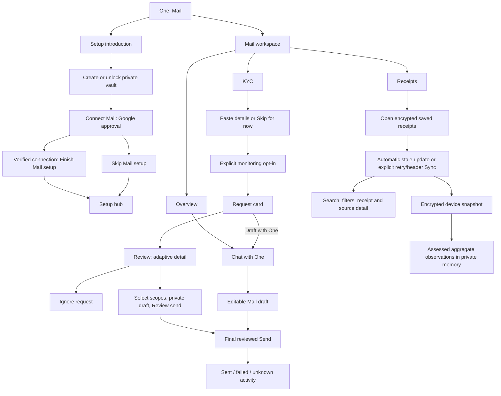

# Mail Subagent Product UI Contract

Status: maintained current-source contract, refreshed from `origin/main`
`dcc4f611e39c80a0001df0ada3f47e85b445421e` on 24 October 2026.
The intervening commits since the initial `f68bb44c8dd8` inspection did not
change mounted Mail owners; the presentation changes below are local to this task.
Classification: `canonical`. This is the Mail product interaction contract;
executable route, consent, provider, agent, schema and storage owners retain
authority. Values describe source behavior, not measurements of a deployed
account or physical device.

## Visual Context

The [web app visual map](../../README.md#visual-map) owns shared shell context.
The current Mail journey is diagrammed below; the state and action ledger carries
the exact copy and behavior.

## Connect alignment and mounted presentation audit — 24 October 2026

This pass refreshed the earlier 21 October comparison against the current
production mounts. The previous `Start sync` hero and manual provider-page
controls are retained source, not connected Receipts UI. The state and layout
tables in this section and the updated sections below supersede older historical
notes where they conflict. Backend endpoints, payloads, permissions, feature
gates, approved reply/send outcomes, receipt capture/grouping and encrypted
storage authority are unchanged.

- The shared top shell owns the visible **Mail** breadcrumb beside its existing
  Back control. Existing authored Back targets and Profile remain unchanged.
  The body retains one visually hidden accessible H1 and compact account detail.
- Mail uses Connect's 728px **outer** reading frame, including 24px gutters above
  620px, 20px at 351–620px and 16px at 350px or below. Header and navigation
  retain their independently sized frames.
- Self-hosted Plus Jakarta Sans remains the family. Effective roles are shared
  header 17/22/600; workspace labels 15/20/550; section 14/22/600; row title
  14/21/550; supporting copy 12/18/400; ordinary action 12/18/550. Inputs retain
  the shared 16px phone floor and 14/22 desktop role. Portals opt into the same
  family and supporting roles directly; their title retains the shared 20/28/600
  dialog role rather than inheriting the page's section scale.
- Ordinary actions reuse Morphy's target/ripple and Connect's transparent wrapper
  plus 44px neutral-surface pill, accent label and 32% accent/neutral border mix.
  Meaningful destructive actions keep shared destructive confirmation controls.
  Labels stay stable while pending; disabled/aria-busy/tint or existing progress
  communicates work, and success remains tied to the existing real result.
- SegmentedTabs and SwipeViews remain the single selection, keyboard and swipe
  owners. Selected surfaces use the existing neutral card token. Inactive panes
  keep their prior inert/voice semantics. No row refresh adds an entrance animation.
- KYC intake hints and request display reads use the existing `useStaleResource` coordinator and memory
  CacheService, scoped by owner/account/credential generation. Fresh valid snapshots
  render synchronously on remount; stale snapshots remain during background reads.
  Duplicate consumers join the same request. A completed invalidation burst queues
  at most one shared follow-up; mutation versions fence older results. Passive
  refresh does not disable current actions or replace empty states with skeletons.
- Vault epoch changes synchronously purge protected display entries, and sign-out
  purges their owner prefix. Credential renewal fences old responses without
  remounting the same owner's draft, selection or focus. Owner/account/vault-key
  changes retire that local workspace. The intake display hint also renders
  synchronously from session memory instead of hiding the child behind a new check. Draft text, selected scopes, action IDs and
  sender tokens never enter the display cache; cache contents never authorize send.
- Whole-operation budgets cover KYC display reads (30 seconds), KYC scans/actions
  (120 seconds), receipt detail/intake checks (30 seconds), and receipt scan passes
  (five minutes). Token waits count toward the same budget. Timeout retains safe
  content and ends pending state; it never retries a send. Navigation cancellation
  retains the existing interrupted-scan recovery, while timeout stays terminal
  until explicit retry. Existing encrypted receipt snapshots remain unchanged.

Owners: [Mail scope](../../components/gmail/mail-workspace.module.css),
[action primitive](../../components/gmail/mail-action-button.tsx),
[display resource](../../lib/gmail/use-mail-kyc-display.ts),
[request workspace](../../components/gmail/gmail-information-requests-section.tsx),
[shared resource](../../lib/cache/use-stale-resource.ts),
[Back hierarchy](../../lib/navigation/back-navigation-graph.ts), and
[source-coupled rendered fixture](../../e2e/mail-overview.layout.spec.ts).

The source-coupled mounted fixture compiles Tailwind and local CSS, minifies the
result with Lightning CSS, and loads the shipped Plus Jakarta Sans binaries.
WebKit light/dark screenshots and computed assertions cover Overview/KYC/Receipts,
setup introduction/body and OAuth cancellation recovery at 360, 393, 430, 768,
1024 and 1440 CSS pixels, plus frame edges at 350/351, 620/621 and 767/768,
device scale 1. KYC queue/review, monitoring confirmation, receipt detail and
updates dialog are exercised at 393/1024; OAuth waiting status is exercised at
393/1024; long synthetic account and receipt values are checked at 360/1024.
This is fixture-based rendered proof with synthetic identity, a saved
receipt snapshot and provider boundaries. It does not claim authenticated
Gmail/OAuth acceptance, physical-device keyboard/Dynamic Type or native frame
pacing certification. The receipt fixture supplies five paid saved rows and a
stable resource snapshot; its screenshots do not certify pagination, earlier
history, failed restore, partial scan, provider refresh or uncertain delivery.
Those states retain the existing source owners and focused behavior contracts
below. Cloud setup's shared OAuth return keeps its prior presentation outside
the Mail scoped callback roles.

### Mounted page, state, text and action ledger

The rows below route the current mount. The detailed literal inventories and
wire bodies remain in the matching sections of this contract; app-owned dynamic
values appear in braces. A local action has no request until its named
destination mounts and performs its own read.

| Mount/state | App text, action and next state | Request/authority |
| --- | --- | --- |
| Setup introduction | **One · Mail**, **Your mail, made useful.**, **Connected only with your yes.**, **Continue**. Continue marks the session introduction seen and focuses setup. Back follows the authored setup graph. | Local session flag; no provider consent or completion write. |
| Setup prerequisite/loading | Vault create/unlock keeps the shared private-vault flow. **Preparing Mail setup…** and **Opening setup…** preserve their current recovery routes; setup skeleton exposes accessible progress. | Vault and setup owners; no Mail typography applied to shared vault credentials. |
| Disconnected setup | Status card gives source-owned title/detail/helper and **Connect Mail** or **Reconnect Mail**; optional **Retry Mail status** rechecks status. Footer **Skip Mail setup** and its explanatory copy are separate from a verified connection. | Status GET/reconcile as selected by caller; Connect starts consent, Retry only rechecks, Skip settles setup without claiming a grant. |
| Connected setup | Status/header **Sync receipts**, **Syncing receipts…** or **Sync unavailable**, shared **Disconnect** confirmation, footer **Finish Mail setup**. Busy/disabled states retain caller guards. | Existing receipt resource and connector service; Finish verifies readiness then writes setup completion, Disconnect alone calls connector disconnect. |
| Google popup/native/callback | Waiting, cancellation, blocked popup, timeout, verified/unverified success and failed return keep their exact [OAuth outcome table](#oauth-each-affirmative-negative-and-uncertain-outcome). The return route owns its genuine full-page title and loader; provider/OS captions belong to Google/OS. | Attempt/source/origin/owner correlation, native server code and status verification. Opening a provider window is not completion. |
| Connected workspace shell | Shared Back + **Mail** breadcrumb/avatar; connected account/email, **Manage**, and **Overview / KYC / Receipts**. A hidden H1 preserves document semantics. Tabs retain swipe/keyboard/inactive-pane behavior. | Shell/tab selection local; connection status comes from shared connector store. |
| Manage menu | **Reconnect** opens a deliberate new authorization. **Disconnect** opens **Disconnect Mail?**; **Keep connected** cancels; confirm disconnect closes reads, aborts scan and calls the service. Escape/outside restores Manage focus; nested confirmation takes focus when selected. | Reconnect OAuth or connector disconnect only after the explicit action. Existing success/failure copy and retained encrypted snapshot distinctions are in [Overview](#overview-and-connection-management). |
| Overview | **Draft with One.**, **Instant drafts & replies**, **Ready for your 1-tap review**, decorative Reply/Follow up/Write stack, **Chat with One**. No receipt metric card is currently mounted here. | Chat navigation only; no model call or email send from opening chat. |
| KYC intake check/vault | **KYC requests / Getting your KYC workspace ready.** skeleton; locked state **Set up KYC**, vault explanation and **Open private vault**. | Existing intake display read and vault unlock; no disclosed profile in skeleton. |
| KYC profile | **Build your KYC profile**, supporting copy and decorative Name/Address/Employment preview; **Paste details** opens the controlled dialog. The preview is not editable data. | Opening is local. |
| Paste dialog | **Paste your profile details**, explanation, **KYC details** textarea/placeholder, **Copy AI prompt**→**Copied**, **Save profile**, **Skip for now**, privacy footnote, Close/Escape/outside. Closing returns focus to Paste details while it remains mounted. | Copy writes clipboard; Save explicitly authorizes encrypted PKM intake and proceeds optimistically with success/failure toast; Skip defers locally. Neither closing nor copying sends mail. |
| KYC monitoring off/on | Source-owned **KYC requests** empty/status content; **Start monitoring**→**Start monitoring?** / **Not now** / confirmation; enabled status and **Check now** / **Turn off**→**Turn off monitoring?** / cancel / **Turn off and delete activity**. Busy and alert states retain exact [KYC inventory](#monitoring-active-requests-and-activity-every-control). | Preference GET/PATCH and explicit inbox scan only; no automatic send. Confirmations, not opening them, mutate preference. |
| KYC queue/review | Request and activity cards show requested fields/time/status, **Open mail** external handoff, **Review**, **Draft with One**, **Ignore** and local pagination. Fullscreen phone/desktop modal **Review request** contains selected scope pills, editable private reply, prepare/review/send and negative outcomes. | List/scan/prepare/send/ignore use the exact [wire table](#kyc-request-wire-and-streaming); local scope choice/draft edits do not disclose. Final Send needs explicit reviewed approval; unknown outcome never retries automatically. |
| Receipts entry | Restore encrypted current-account snapshot before stale automatic update. Toolbar **Saved receipts** or **Your receipts** and the exact opening/checking/checked/saving/updated/error text above. Header Sync remains a distinct manual action; failed restore has a separate recovery. | Device snapshot/resource, then consented Gmail read only when eligible; five-minute freshness owner, signed continuation and owner/vault fences remain. |
| Receipt updates dialog | Conditional **View details** opens **Receipt updates** with disabled/migration description and earlier-history note. **Manage Mail** opens Profile connector settings with focus handoff; **Got it**, Back, Escape and outside close without a request. | Local dialog/navigation. No consent or sync on acknowledgement. |
| Receipt collection | Current **Overview** / **Categories** cards: saved count, Paid/Needs attention/Coming up, sample note, category count/percentage/bars. Archived/unresolved rows are excluded from current counts; no mixed-currency spend. | Pure projection of verified saved rows. Cards are not navigation. |
| Recent receipts | **Recent receipts**, vault/setup/reconnect/loading/empty/partial/error branches, **Search receipts**, All/Paid/Due/Overdue/Upcoming/Cancelled, month groups, merchant/status/amount rows and local Previous/Next. Due currently matches no records. | Search/filter/page are local over ten-row display pages. Row click opens detail; provider scan pagination is separate. Background insertion retains current row/page anchor. |
| Receipt detail | Phone adaptive sheet/desktop 520px modal, **Receipt details**, loading/**Try again**, conditional saved fallback, Amount/Status/Attention/Category/Document/Recurrence/identifiers, optional dates/sender/subject, Activity/excerpt/Source evidence, conditional **Visit merchant**. Close/Back/Escape/outside restore row focus as supported by surface. | Live detail GET only when usable; encrypted saved fallback stays available without fabricating original email evidence. Visit merchant opens verified external URL, not Gmail or payment. |
| Earlier saved history | Separate **Earlier saved receipts** with opening/retry/unverified-origin copy; same grouped list/detail owner without current-account overview. No original Mail account attribution, live email excerpt or current-account count. | Existing owner-authorized encrypted history read. It is never merged by a matching label. |
| One and compatibility | `/one/email` connection/handoff and the editable One Mail draft keep their separate send/review owner. `/one/setup/email` is the legacy platform-mailbox preference route. Inline Chat/Nudges and old receipt hero remain source-only at this mount. | Opening chat/draft does not send; only the final approved delivery path can. |

### Presentation decisions and action classification

| Surface/control | Classification | Verified presentation boundary |
| --- | --- | --- |
| Shared header, Back, avatar, three tabs, Overview Chat, Manage menu | Already aligned | Header 17/22/600, tabs 15/20/550, existing 44px MailActionButton and focus/keyboard/swipe owners are reused. No duplicate shell or button primitive. |
| Mail root/skeleton/return | Changed | Mail role variables now reach skeleton/return mounts; callback title uses the full-flow rung. The shared setup intro/footer retain their own full-primary owner. |
| Disconnected connection status | Changed | Narrow Gmail source eyebrow, support copy and full-width inner pill now match the scoped roles while status/badge/scope logic stays in the connector owner. |
| Paste/monitor/review | Changed | Paste title, form label/input, Copy/Skip utilities, KYC row/status text, selected scope contrast, quiet Open mail, full-width actions and Task portal description inherit the intended role. The ref-forwarding MailActionButton remains the trigger, and paste close returns focus. |
| Receipts toolbar/collection/list/detail | Changed | Toolbar Manage Mail uses the utility role; collection headings obey 14/22/600; month heading is 12/18/600 without mono uppercase; detail portal title/description, source blocks, values, retry and local pagination use their matching roles. The saved-first state machine is untouched. |
| Disconnect/grant/vault confirmations | Justified shared exception | Destructive confirmation, grant-replacement consent and vault credentials retain shared security primitives/copy. They are not normalized into ordinary Mail pills; portals receive scope only where Mail owns the surface. |
| Saved-count metric, badges, tabular amounts, filter labels, decorative preview, provider/OS captions | Justified role/authority exception | Preserve the matching metric, count, control or external owner; no global descendant font/button reset. |

## Visual Map

## Contract navigation

- [Entry routes and tabs](#entry-routes-tab-selection-and-shared-chrome)
- [Authority, snapshots and private memory](#authority-reads-and-persistence)
- [Overview and management](#overview-and-connection-management)
- [Receipts: every row, field and control](#receipts-tab-scan-rows-filters-and-detail)
- [Mail onboarding, Google approval and status copy](#mail-onboarding-google-authorization-and-status-copy)
- [KYC intake, monitoring and every review decision](#kyc-tab-profile-intake-monitoring-and-requests)
- [One editor, formatting, Send and recovery](#one-handoff-mail-editor-and-delivery-activity)
- [Mailbox changes, follow-ups and voice](#mailbox-changes-follow-ups-and-voice-mail-surfaces)
- [HTTP methods, bodies, authentication and response fields](#api-and-field-provenance-ledger)
- [Phone/desktop dimensions, layers, keyboard and font schema](#phonedesktop-canvas-sizing-scroll-and-typography)
- [Compatibility and unmounted source](#compatibility-screens-and-deliberately-unmounted-implementations)
- [Known gaps and verification](#known-gaps-verification-and-change-ownership)

## Coverage and how to read this contract

The completeness unit is a path: entry → rendered row/control → local state
or read → affirmative/negative choice → acknowledgement → destination or
recovery. **No API call** means that control itself is local; the newly mounted
destination can perform its own reads. A list endpoint serves many rows; rows
do not invent individual reads unless detail is opened. Braces such as
`{merchant}`, `{count}`, `{date}` and `{email}` denote dynamic projections.
Provider dialogs, OS permission text, server errors and model-written messages
are not finite app-owned English copy.

| Product boundary | Current truth |
| --- | --- |
| Mail capability | `gmail`, title **Mail**, specialist `agent_email`, description **Receipt sync and purchase-memory review.**, preview **Receipt & purchase memory**. It requires the private vault. |
| Three workspace tabs | **Overview**, **KYC**, **Receipts**; values `overview`, `kyc`, `receipts`. There is no current Chat or Nudges tab. |
| Personal Gmail | Current connection and provider approval are owned by `GmailReceiptsService`; the stored connection is `kai_gmail_connections`. Personal Gmail KYC requests use the person's inbox. |
| One | The private agent owns conversation. **Chat with One** opens its existing conversation with an empty composer. Opening chat alone does not start a model turn or send mail. |
| Compatibility Email/KYC | `/one/email` is a connection/handoff page. `/one/setup/email` is the distinct legacy platform-mailbox preference page. Neither is a fourth Mail tab. |
| Unmounted components | `GmailChatPanel` and `GmailNudgesSection` have source/tests but no current production caller. Their controls are not current Mail workspace controls. |
| Send | A chat reply, connection, receipt scan, profile paste or monitoring toggle does not send personal mail. Sending has its own reviewed snapshot and explicit final action. |

Sources: [capability registry](../../lib/onboarding/one-capabilities.ts),
[workspace navigation](../../components/gmail/gmail-workspace-navigation.tsx),
[mounted workspace](../../components/gmail/gmail-receipts-page.tsx),
[Email handoff](../../app/one/email/email-agent-page-client.tsx),
[owner-approved Mail architecture](../../../docs/reference/one/gmail-owner-approved-email.md).

## Entry routes, tab selection and shared chrome

| Entry/state | Owner and result |
| --- | --- |
| `/one/gmail` | `OneGmailPageClient` checks enabled capability, then `CapabilityVaultPrerequisite`, then `GmailReceiptsPage`. Disabled capability replaces route with `/one`; **Opening One…** is the interim state. |
| `/one/setup/gmail` | Setup-scoped introduction and the same connector workspace; finish/skip return through setup authority. This route has no three-tab workspace rail. |
| `?workspace=kyc` / `?workspace=receipts` | Explicit deep link takes precedence over remembered view. Only the tab value belongs in the URL. Sensitive prefills travel in memory. |
| Default/invalid query | `gmailDeepLinkWorkspace` accepts only `kyc` or `receipts`; otherwise the page uses remembered owner/path workspace, then `overview`. A literal `workspace=overview` is not an explicit force override. |
| Tab tap/swipe | Shared `SegmentedTabs`/`SwipeViews`, tab-set `gmail-workspace`, accessible name **Gmail workspace**. Changes local selection and owner/path-scoped session key `hushh.gmail.workspace.v1:{userId}:{pathname}`. No tab-selection API or history entry. |
| Inactive pane | Retained pager pane is inert and `aria-hidden`; it cannot publish active voice controls. KYC first mounts when visited, then can retain its local draft; its request owner receives `active=false` off-tab. |
| `/one/email` | **Mail Agent**; skeleton while connection resolves; disconnected **Connect Mail** routes to `/one/gmail`; connected **Ask One about Mail** opens One. |
| Compatibility redirects | `/gmail`, `/one/profile/gmail`, `/one/profile/gmail/connection`, `/one/profile/gmail/actions`, and old receipt entries resolve through existing route owners to canonical Mail. Profile connector details remain the connection/recovery owner described in [Connectors](./profile-connectors.md). |
| OAuth return | `/one/profile/gmail/oauth/return`, shared implementation under `app/profile/gmail/oauth/return`; signed provider state and current owner determine setup versus Mail continuation. |
| Shell | Profile avatar, authored Back, Chat/One/Connect/Feed bottom controls and any shared account/vault actions use [Navigation](./navigation.md). Opening Mail does not create new shell actions. |

Sources: [Mail route](../../app/one/gmail/gmail-page-client.tsx),
[route builders](../../lib/navigation/routes.ts),
[tab session](../../lib/profile/gmail-workspace-session.ts),
[route layout and Back declarations](../../lib/navigation/app-route-layout.contract.json),
[tab pager](../../components/gmail/gmail-workspace-navigation.tsx).

## Authority, reads and persistence

Use `F` below for a Firebase ID-token bearer; `V` for the same owner's current
`VAULT_OWNER` token in `X-Hushh-Consent`. Connector metadata/OAuth uses `F`.
Protected personal-mail reads and delivery use the combination specified by
their route, normally `F + V`. They are distinct grants. A remembered tab,
connected badge, Firebase session or provider scope is not vault authority.

### Private vault prerequisite

| State/control | Content, call and outcome |
| --- | --- |
| Authentication unresolved | **Redirecting to sign in…**; missing user replaces with `/login?redirect={encoded routeKey}`. No protected workspace mounts. |
| Presence checking | Safe workspace skeleton or **Preparing Mail…**. Existing in-memory owner token immediately admits content; otherwise `VaultService.checkVault(userId)` determines create/unlock. |
| No vault / existing locked vault | Automatically opens shared `VaultUnlockDialog` once with title **Set a lock** / **Unlock One**, description **Continue Mail setup once you're unlocked.** The dialog owns passphrase/generated-lock/biometric recovery; Mail does not reimplement these credential controls. |
| Check failed → **Try again** | **We couldn't confirm your lock yet.** Resets automatic-presentation guard and repeats presence check. No Gmail or receipt read. |
| Shared dialog closes | No Mail write or connection. Underlying capability remains inert until owner authority arrives; the wrapper does not itself grant authority on close. |
| Successful lock setup/unlock | **Opening Mail…** until memory-only token publication settles. Success callback alone does not mount protected content before that authority exists. |
| Workspace **Set up vault** | Opens dialog **Set up your private vault** / **Set up your private vault to view synced receipt records.** Info toast **Set up or open your private vault to view synced receipts.** Success **Private vault is ready.** |
| Lock/account change | Receipt snapshots, caches, detail requests and in-flight persistence use owner/session fences. Old completions must not populate another owner's visible state. Underlying credential values never belong in this contract. |

Sources: [prerequisite](../../components/vault/capability-vault-prerequisite.tsx),
[credential dialog owner](../../components/vault/vault-unlock-dialog.tsx),
[vault service](../../lib/services/vault-service.ts),
[workspace](../../components/gmail/gmail-receipts-page.tsx).

### Receipt snapshot and private-memory boundary

| Resource/effect | Exact current contract |
| --- | --- |
| Current device snapshot | `mail_receipts.v1:{account_binding}`, where binding is SHA-256 of the namespaced account identity. `ReceiptStoreSession` requires user ID, vault key, owner token and current-session guard. This read/write is encrypted IndexedDB through `SecureDurableResourceService`; it has **no snapshot HTTP endpoint**. |
| Snapshot fields | `schema:"mail_receipt_snapshot.v1",account_binding,freshness,coverage,rows`. Coverage: `partial,truncated,source_count,window_from,window_to,source`. A scan/window is not all purchases. |
| Stored row projection | `ref,display_id,primary_event_ref,merchant,category,display_kind,brand,amount,currency,transaction_date,identifiers,status,recurrence,attention_state,attention_reason,attention_is_prediction,attention_date,document_kind,confidence,events`. |
| Stored event projection | `ref,locator,document_kind,status,kind,date,amount,currency`. `locator` is an opaque durable source reference, not the email body. Snapshot excludes raw message text, subject/body snippets, provider tokens, credentials and arbitrary DTO fields. |
| Schema/capacity | Reject unknown nested fields, invalid bindings and duplicate refs; maximum 2 MiB, 10,000 rows, 300 events/row and 30 identifiers/row. These are storage bounds, not a promised UI result count. Exact decimal, dates, enum and reference validation stays in the schema owner. |
| Commit | Expected `{generation,revision}` compare-and-swap; stage encrypted candidate, read it back, decrypt/validate, then atomically commit. Old snapshot is retained on validation, capacity, readback, conflict or authority failure. An account reset changes generation. |
| Disconnected saved view | Without selected account, load owner's latest snapshot by freshness. Do not merge different account snapshots into one analytics result. Snapshot rows restore existing groups, not rerun provider inference. Disconnect and deletion cleanup must be assessed against their actual owners below. |
| Hidden automatic memory save | `GmailReceiptMemorySave` renders **no control**. After a finished owner-started workspace sync, it saves once per completion; setup has `autoSave=false`. It does not save on mount or an unfinished list. Empty completion requires verified generation/revision. |
| What reaches private memory | Bounded aggregate observations about up to three represented merchants/categories, with sample count, verified/undated range and partial/completed caveat. Memory agents assess exact-source statements for Soul.md. Individual transactions stay in Receipt Radar; no new shopping transaction index is written to PKM. |
| Memory acknowledgement/failure | Verify account/generation/revision again around assessment and staging. Unresolved source blocks/fallback previews preserve existing memory. Automatic failures retry quietly after 2s and 6s, then toast **We couldn't update your private receipt memory. It will retry after your next sync.** New completion/unmount ends old retries. |
| Memory API boundary | Receipt snapshot remains local encrypted storage. Aggregate assessment and `stageMarkdownMemoryFacts` use the existing [Memory contract](./profile-memory.md) and its service owners; they are not a new Mail persistence authority. |

Sources: [snapshot schema/projection](../../lib/mail/receipt-snapshot.ts),
[receipt store](../../lib/mail/receipt-store.ts),
[durable encrypted resource](../../lib/services/secure-durable-resource-service.ts),
[automatic save](../../components/gmail/gmail-receipt-memory-save.tsx),
[aggregate assessment and memory staging](../../lib/profile/gmail-receipt-memory-save.ts).

## Overview and connection management

| Rendered control/content | Effect and every branch |
| --- | --- |
| Connected account | **Mail**, **Connected**, green status dot. This is shared connector status, not a read per label. Account address appears in page description **Connected to {google_email}**; without an active connection but with stored records: **Saved receipts are still available here.** |
| **Manage** | Opens end-aligned dropdown; busy status/action disables trigger and items. Opening/closing/outside/Escape makes no API call. |
| **Reconnect** | Starts deliberate Google authorization; no confirmation dialog before opening provider. It preserves existing modify permission where applicable. Provider cancellation does not equal disconnect. |
| **Disconnect** menu item | Opens **Disconnect Mail?** confirmation. Focus restoration from menu is suppressed so confirmation owns focus. No disconnect call yet. |
| Confirmation body | **Stops Mail access and receipt sync, and deletes Mail receipts and summaries from Hussh. Information saved to private memory stays.** |
| **Keep connected** | Closes confirmation without disconnect API. Buttons disable during disconnect; the root open-state callback itself is not a universal busy dismissal guard. |
| Confirm **Disconnect** | Immediately closes local receipt-read admission, aborts scanning, invalidates read sequence, then calls connector disconnect. Requires response with `connected:false`; otherwise **Mail could not be disconnected.** Success closes dialog, empties live collection/page/cursors, and releases busy. Failure reopens local read admission and releases busy; no successful-disconnect claim. |
| Disconnect feedback | **Disconnecting Mail...**; if encrypted snapshot revision exists: **Mail disconnected. Saved receipts remain available; reconnect to open their original emails.** Otherwise **Mail disconnected and Mail receipt data was deleted.** Failure fallback **We couldn't disconnect Mail right now. Please try again in a moment.** |
| Hero | **Draft with One.**, **Instant drafts & replies**, **Ready for your 1-tap review**. Decorative stack **Reply**, **Follow up**, **Write** is `aria-hidden`, not three buttons. |
| **Chat with One** | `navigateToAgentChat()`; empty composer, no demonstration prompt, draft, model request or send. |
| Receipt metrics on Overview | Parent computes/passes fetching/count/update/issue props, but `MailOverview` consumes only `onOpenChat`. Those metrics are not rendered current Overview content. Do not design against a presumed count card. |

Sources: [Overview and Manage](../../components/gmail/mail-overview.tsx),
[connect/disconnect owners](../../components/gmail/gmail-receipts-page.tsx),
[connection service](../../lib/services/gmail-receipts-service.ts),
[shared connector store](../../lib/profile/gmail-connector-store.ts).

## Receipts tab: scan, rows, filters and detail

### Scan and collection states

| State/control | Exact content and result |
| --- | --- |
| No connection | Shared connection card and Connect/Reconnect actions. Saved encrypted receipts can still render after disconnect when authority and snapshot exist. |
| Connected entry | `ReceiptSyncToolbar` shows **Saved receipts** when a verified device snapshot exists, otherwise **Your receipts**. Open the encrypted saved snapshot first. An eligible connected, unlocked workspace automatically refreshes a stale snapshot after successful restore; online/visibility/lifecycle wakes use the existing resource freshness gate. A failed restore stays unknown and never starts a scan. |
| Toolbar status | **Opening saved receipts…** during restore/opening, **Checking Mail for receipts…** before progress, **{checked} mail messages checked · {found} receipts found** while reading, **Saving {N} receipt(s)…** while saving, **Some Mail remains unchecked · Updated {date/time}** for partial saved coverage, **Updated {date/time}** for complete saved coverage, **New receipt updates aren’t available with this setup yet.** when disabled, **Ready to check for receipts.** when idle without a saved snapshot. Resource error takes precedence over idle/updated text. Progress counts describe the scan, not a durable saved-collection count. |
| Toolbar **Try again** | Present only with a recovery callback. `onRestore` takes precedence over `onRefresh`: restore failure retries device hydration; update failure retries the provider update. Disabled/busy during refresh or restore. No new polling owner or automatic retry after failed hydration. |
| **View details** | Present only for migration or disabled updates. Opens **Receipt updates** dialog. Disabled description: **New receipt updates aren’t supported by your current setup yet. You can still open saved receipts found on this device.** Other migration description: **Your receipt sync continues while private receipt processing is prepared. New Mail is checked automatically when you return.** Shared note: **Earlier saved history is kept separately when its original Mail account can’t be verified.** **Manage Mail** closes and opens the Profile connector destination with focus handoff; **Got it**, outside, Escape or Back closes without a request. Inactive tab closes it. |
| **Recent receipts** | Section renders when Receipts is active and connected or saved rows exist. Missing authority shows **Set up or open your private vault to view synced receipts.** / **Set up vault**. |
| Cold loading | Busy/live skeleton **Loading receipts** with screen-reader sentence **Loading your receipts. Mail remains available while the list is prepared.** Eight placeholder rows; placeholders are not records. |
| In progress | **Looking through your recent purchases…**. Percentage is clamped to 5–95 while active from `(page−1)/maxPages`; it is not provider-wide completion. |
| No current saved account | **No current-account receipts are saved on this device yet.** after successful empty restore with no verified scan. |
| Completed empty | **No receipts were found in the Mail checked.** after a verified empty scan. The source-owned partial/limit and still-finishing notices qualify scan coverage without fabricating an empty purchase history. |
| Failed scan | **Couldn’t finish scanning your receipts.** / **Try again** retries recorded failed page; keep existing records when available. No unconditional reset of saved receipts. |
| Lost provider authorization | **Mail needs to be reconnected before it can sync your receipts.** / **Reconnect Mail**; another ordinary read is not offered as the repair. |
| More provider pages | **Load older receipts** / **Check older Mail** JSX remains for compatibility, but current `hasMore` stays false and the resource owns signed-cursor continuation. The manual provider-page control is unmounted at this baseline. |
| Unavailable scan | **Receipt sync is not available for this account right now.** or **Open your private vault before scanning Mail receipts.** |
| Header sync action | **Sync receipts**, **Syncing receipts…**, **Sync unavailable** selected from connection/authority/busy state; the setup variant retains its own caller. Manual header Sync, toolbar recovery and automatic lifecycle refresh are separate entries. |

`handleSyncNow` admits only current owner, connected inbox, unlocked owner token
and open receipt-read admission. An abort-controller ref closes the double-click
window before React renders busy. Scan is bounded to 50 pages; each service call
is at most six messages. Active-scan and retryable page errors each have two
bounded retries with 750ms waits. A valid continuation cursor, account identity,
current token, vault epoch and load sequence fence every completion. Leaving,
disconnecting or authority change aborts/suppresses stale work. Do not reinterpret
partial coverage as a complete inbox or purchase history.

Sources: [scan orchestration and collection states](../../components/gmail/gmail-receipts-page.tsx),
[scan protocol validation](../../lib/services/gmail-receipts-service.ts),
[toolbar](../../components/gmail/receipt-sync-toolbar.tsx),
[saved resource](../../lib/services/mail-receipt-resource-service.ts).

### Every table control and row projection

| Control/row | Provenance, logic and click result |
| --- | --- |
| Search | Placeholder **Search receipts**, accessible **Search table**. Trim/lowercase match against projected `searchText`; local only, reset display page. It searches loaded/saved receipts, not the entire provider inbox. |
| Filter **All** | All current rows. No request. |
| **Paid** | `status === paid`; local. |
| **Due** | Currently always returns no rows: backend has no general payment-due lifecycle. It does not infer Due from renewal, attention or absent amount. This visible limitation is intentional source truth. |
| **Overdue** | `status === overdue`; local. |
| **Upcoming** | `status === renewal_due` or `trial`; local. |
| **Cancelled** | `status === cancelled` or `refunded`; local. |
| Month group | Receipt date descending, localized month/year (or **DATE UNAVAILABLE** for invalid/missing date); source label is preserved, with 12/18/600 source-group typography rather than old uppercase/monospace decoration. Group only the current display page. |
| Merchant title/logo | `buildRecentReceiptRows`/saved row projection: verified merchant identity, brand/category/generic fallback. Logo failure falls back locally. An arbitrary merchant label does not become a trusted external domain. |
| Row status/secondary | Projected `status,category,recurrence,attentionState,attentionReason,attentionIsPrediction,receiptDate`. Exact status/document/identifier vocabulary comes from [presentation owner](../../lib/profile/gmail-receipt-presentation.ts). |
| Amount | Projected `currency,amount`; missing **—**, tooltip **Amount not found**. Zero must remain an amount rather than disappear. |
| Receipt row | Selects stable group and primary source key, stores actual opener; opens adaptive detail. A row already carrying validated `source_evidence` reuses it with **no detail API call**. |
| **Previous** / **Next** | Local pagination, ten grouped rows/page, accessible **Receipt pagination**, live `{currentPage} / {pageCount}`. Hidden for one page; disabled at first/last. No provider scan, API or persistence. Page clamps after filtering. |
| Detail **Try again** | Increments attempt to retry selected detail; not a send, rescan or new receipt. |
| Detail close / X / Back / Escape | Shared adaptive surface dismissal closes selection, aborts its detail effect and restores recorded row focus. No receipt mutation. Bounded surfaces can also expose outside dismissal; available mechanisms depend on presentation, not every mechanism on every device. |
| **Visit merchant** | Only for verified `homepageUrl`; `openExternalUrl` delegates to browser/OS. No Mail mutation. Failure **We couldn’t open the merchant website. Please try again.** |

### Detail content: every field and optional block

Title/eyebrow: **Receipt details**, merchant display name or **Receipt**;
description amount or **Not available**. Status **Loading receipt details…**;
failure displays safe returned/fallback error and **Try again**. Fields with
blank values are omitted; they are not editable form rows.

| Label/block | Response/projection |
| --- | --- |
| **Amount** | Detail `currency,amount`; unavailable **Not available**. |
| **Status** | Group status first, then detail status → shared status label. |
| **Attention** | Group/detail attention state, reason and prediction flag → attention label; prediction is visibly qualified. |
| **Category** | Detail category; `Other` → **Uncategorized**. |
| **Document** | Group/detail `document_kind` → document label. |
| **Recurrence** | Group/detail recurring → **Recurring**, one_time → **One-time**, unknown omitted. |
| Identifier row | Group identifiers first, detail identifiers next; payment → **Payment reference**, other kinds use shared identifier labels. Fallback `identifier_kind,identifier_value,order_id`. |
| **Details** | `short_detail`, omitted if identical to displayed excerpt text. |
| **Date** | Explicit `transaction_date`; if undefined, formatted receipt/Gmail/created date fallback. |
| **Due / renewal** | Group attention date first, then detail attention date. |
| **Received** | Formatted `gmail_internal_date \|\| created_at`. |
| **Confidence** | `classification_confidence × 100`, rounded percent; missing omitted. |
| **Sender** | Unique nonblank `from_name,from_email` joined ** · **. |
| **Subject** | Detail `subject`. |
| **Activity** | Only multiple timeline events: document label or **Purchase update**, **Fulfilment update**, **Refund**, **Cancellation**, **Receipt update**; formatted date and optional bounded passage. Timeline rows do not have individual action handlers. |
| Email excerpt | Returned `email_excerpt.label,text`, formatted whitespace-preserving passage. It is provider-derived content, not app-owned static prose. |
| **Source evidence** | `source_evidence[]`, each kind underscores converted to spaces and capitalized, ** · **, extracted text. No source-evidence click endpoint. |

Saved receipt detail without locator, live connection or network returns local
fields and **Saved receipt details are available. Reconnect Mail or sync again
to load the original email and source evidence.** A failed live detail for an
existing saved row falls back to that same message. Live response must match
requested source; otherwise **Mail returned details for a different receipt.**
Missing authority: **Open your private vault to view this receipt.** Old owner,
account, token, epoch or aborted request cancels detail publication.

Sources: [table, filters and detail](../../components/gmail/gmail-recent-receipts.tsx),
[detail loader](../../components/gmail/gmail-receipts-page.tsx),
[merchant identity registry](../../lib/mail/receipt-merchant-registry.ts),
[presentation and grouping](../../lib/profile/gmail-receipt-presentation.ts).

### Receipt vocabulary and remaining exact copy

| Placement | Literal values |
| --- | --- |
| Retained unmounted sync hero | **Your receipts**, **Start sync**, **Scanning** and the decorative category examples remain in `GmailReceiptOnboardingHero` source, but the connected Receipts mount renders `ReceiptSyncToolbar`. They are not current first-visit controls or progress. |
| Mounted toolbar/status | **Saved receipts** / **Your receipts** with the state-specific status, **Try again**, and conditional **View details** above. `profile.gmail.restore_saved_receipts` and `profile.gmail.sync_now` remain distinct voice actions. |
| Successful acknowledgement | Inline **Receipts updated.**; toast **Receipts updated**. |
| Device persistence failure | **Receipts are visible for this session, but couldn't be saved on this device. Sync again before reloading.** No automatic provider rescan. |
| Table empty/filter accessibility | **No receipts match this view.**; tablist **Receipt status filters**, list **{selectedFilterLabel} receipts**. |
| Status | **Paid**, **Overdue**, **Refunded**, **Cancelled**, **Trial**, **Delivered**, **Payment failed**, **Service suspended**, **Renewal due**. |
| Attention | **Overdue**, **Payment failed**, **Service suspended**, **Renewal due**, **Needs review**, **Needs attention**, **Coming up**; append ** · Predicted** when applicable. |
| Document | **Invoice**, **Receipt**, **Payment confirmation**, **Order confirmation**, **Booking**, **Fulfillment update**. |
| Identifier | **Order**, **Invoice**, **Receipt**, **PNR**, fallback **Identifier**; payment array entry **Payment reference**. |
| Detail fallback | **We couldn't load this receipt right now.**; excerpt label **Email preview**. |

Ordinary connected Receipts restores memory/device state first. After successful
restore, a connected and unlocked stale resource refreshes automatically. Fresh
entries do not rescan; wake/return uses the five-minute resource gate. A running
scan can continue across Mail tabs. `receiptSyncAvailable` is derived from
connected + unlocked owner-token + account + `receipt_sync_available !== false`;
do not equate displayed rows with a durable write or a completed provider pass.

## Mail onboarding, Google authorization and status copy

### Setup introduction and completion

| Step/control | Content and result |
| --- | --- |
| First setup introduction | Eyebrow **One · Mail**; heading **Your mail, made useful.**; promise **Connected only with your yes.**; **Continue** marks session key `one_capability_intro_seen_v1:gmail="1"`, mounts actual setup body and focuses it. No consent or completion API from Continue. |
| Preparing | **Preparing Mail setup…**; disabled-capability recovery **Opening setup…** replaces to `/one/setup`. |
| Connected setup | Header sync action and **Disconnect** confirmation; footer **Finish Mail setup**. Footer disabled during connector action and busy during coordinator settlement. |
| Disconnected setup | **Skip Mail setup**; **You can connect Mail from setup whenever you are ready.** Skipping does not record verified Gmail completion or disconnect an existing grant. |
| Finish | Revalidate current setup journey/version, verify connector readiness, settle `gmail` completed and mark explored. Root onboarding returns `/one/setup`; independent post-onboarding entry can return `/one`. |
| Skip | Root journey settles callback state `none` without completed Gmail; independent setup records declined capability. No Gmail send or new provider consent. |
| Setup conflicts/failures | **This setup could not be prepared. Please try again.**; **Setup could not be saved. Please try again.**; **Setup changed in another session. Please try again.** |
| Local action guards | **Sign in to continue setup.**; **This setup is already being settled.**; **This setup is still saving. Wait for it to finish.**; **Complete the required gmail step before finishing setup.**; **A different setup is active. Returning to setup.** |
| Connect action guards | **Open Mail setup before connecting Mail.**; **Mail connection is already being prepared.**; **Use the Connect Mail button to open the secure Mail connection window.**; **Mail connection is open in its secure window. Finish setup after it verifies.** These are local/voice action summaries, not additional rendered buttons. |

Sources: [Gmail setup route](../../app/one/setup/gmail/gmail-onboarding-setup-client.tsx),
[cinematic introduction](../../components/onboarding/setup/capability-cinematic-intro.tsx),
[setup copy](../../lib/onboarding/capability-setup-copy.ts),
[setup coordinator](../../components/onboarding/setup/setup-capability-coordinator.tsx),
[completion footer](../../components/onboarding/setup/setup-completion-footer.tsx).

### OAuth: each affirmative, negative and uncertain outcome

| Step | Actual request/effect and recovery |
| --- | --- |
| Connect/Reconnect click | `handleConnectGmail` defaults purpose `send`. The initial grant asks `gmail.readonly` and `gmail.send`; it does not authorize automatic sending. Compose/modify scopes remain deliberate separate upgrades. |
| Web popup | Create safe attempt and open window synchronously from click, then start OAuth. With blocked popup, persist safe attempt and use full-page redirect. If correlation cannot be safely stored, **Mail sign-in could not be started safely. Please allow popups or try again.** No unsafe completion fallback. |
| OAuth start inputs | Current owner, Google-provider email as optional login hint, `include_granted_scopes` true for send or Google sign-in; validated environment-derived redirect ending `/one/profile/gmail/oauth/return`. |
| Setup provider departure | Bootstrap only onboarding, verify active unresolved Gmail capability, version-write external-connector journey and callback-attempt ID before persisting browser intent. Provider opening is not setup completion. |
| Native | Start → `HushhAuth.connectGmail({serverClientId,purpose,preserveModify})` → server-auth-code completion → force-refresh status. Retain already granted modify permission. Missing config/code: **Mail OAuth is not configured for this environment.** / **Google did not return a Mail authorization code.** |
| Native success/failure | **Mail connected. You can read and send after reviewing each email.**; fallback **We couldn't connect Mail right now. Please try again in a moment.** |
| Web start failure | Close popup, clear correlation/busy; sanitized fallback **We couldn't start Mail connection right now. Please try again in a moment.** |
| Popup callback | Accept settlement only from same origin, exact popup and attempt. Storage fallback is attempt-bound too. Send-purpose success additionally requires `send_permission_granted:true`, not just Google returning successfully. |
| Verified popup success | **Mail connected. You can finish setup when ready.** |
| Google success, unverified connection | **Google authorization finished, but Mail is still connecting. Check again in a moment.** |
| Provider cancellation/failure | **Mail connection was cancelled.** / **Mail connection could not be completed.**; no disconnect or completed-setup claim. Provider-owned captions are not authored Yes/No buttons. |
| Popup manually closed | Force-check actual connection and reconcile setup attempt before settling. If still unverified: **The Mail window closed. You can try again whenever you are ready.** |
| Popup two-minute timeout | Close popup, reconcile: **Mail is taking longer than expected. Check your connection and try again.** |
| Callback pending | **Connecting your Gmail…**; after routing **Opening Gmail…**. BYOC callback displays **Setting up your cloud. This can take a few minutes…**. Missing authenticated owner goes to login; mismatched popup owner closes. |
| Callback missing code/state | **Missing OAuth code or state. Start Connect Mail again from Mail.** |
| Explicit provider error | **Mail connection needs attention**; provider `error_description` or `error`, fallback **Google OAuth authorization was denied.** Access denied is cancellation. |
| Direct callback completion | Exchange can continue after immediate Mail navigation. At 35s timeout reconcile status up to five times, two seconds apart. Recoverable replay/used-code errors check actual status before another claim. Reload/cold callback does not preserve memory-only unlocked vault authority. |
| Completion validation | **Mail authorization did not grant sending permission.** / **Mail authorization did not create an active connection.**; generic **Mail connection could not be completed.**; store fallback **Mail connection could not be completed. Try again from Mail.** |
| Callback recovery | **Back to setup** for correlated setup, else **Back to Mail**; route replace only. Starting another OAuth attempt requires a fresh Connect click. |

Sources: [connect and popup lifecycle](../../components/gmail/gmail-receipts-page.tsx),
[popup ownership](../../lib/profile/gmail-oauth-popup.ts),
[callback implementation](../../app/profile/gmail/oauth/return/page-client.tsx),
[OAuth service and scopes](../../../consent-protocol/hushh_mcp/services/gmail_receipts_service.py).

### Shared status-card literal inventory

This card is visible in disconnected panes and setup. Connected Overview has
the smaller account card. Status is shared; each title/helper is a projection
of the same connector status, not another endpoint.

| State | Title / detail / helper |
| --- | --- |
| Loading | Eyebrow **Gmail**; **Checking your Gmail status**; **Your Mail connection details will appear here when ready.** Busy accessible label **Checking your Gmail status**. |
| OAuth pending | **Finishing Gmail connection**; **Your Mail connection is being verified.** |
| Unconfigured | **Mail isn't available here**; **Receipt sync is not enabled for this workspace.** |
| Needs reauthorization | **Reconnect Mail**; **Refresh access to keep receipts syncing.**; optional last-updated helper. |
| Backfill | **Loading older receipts**; **Recent receipts are ready.** |
| Bootstrap/active sync | **Syncing receipts**; **Fetching your latest purchases…** |
| Failed connected sync | **Sync failed**; sanitized error or **Please try again in a moment.** |
| Settled connected | **Receipts are up to date** when timestamp exists, else **Mail connected**. Helper **Last updated {relative}.**, **Last updated {absolute}.**, or **Sync when you want the latest receipts.** Connected-address detail is suppressed here when page header already shows it. |
| Status error | **Couldn't check Mail**; fallback **We couldn't check your Mail connection right now. Please try again in a moment.** |
| Disconnected | **Mail not connected**; **Syncs receipts to build your private shopping memory.** |
| Optional count | **{n} receipt** / **{n} receipts**, only current connected owner/account projection. |
| Scan helper | **Scanning Mail for receipts. Your list will refresh here when it finishes.** |
| Stale helper | **Mail is still running in the background. This status may lag behind for a bit.** |
| Recovery controls | **Connect Mail**, **Reconnect Mail**, **Retry Mail status**. Retry only with status error; force-refreshes metadata without Google consent. Busy/loading disables applicable controls. |

Timestamp precedence is run `completed_at`, `started_at`, `requested_at`, then
status `last_sync_at`. Auth-like errors map to **Reconnect Mail to continue
syncing your receipts.** Empty/technical/over-180-character errors use safe
fallback; short safe server messages can remain dynamic. Recoverable interrupted
old syncs retain saved receipts rather than implying lost authorization.

Sources: [status card](../../components/gmail/mail-kyc-connect-entry.tsx),
[status presenter and sanitation](../../lib/profile/mail-flow.ts).

## KYC tab: profile intake, monitoring and requests

### Profile intake and exact pasted-profile content

| State/control | Exact English, operation and branch |
| --- | --- |
| Checking intake | Busy **Checking KYC setup**; **KYC requests** / **Getting your KYC workspace ready.** `hasCompletedIntake` reads private memory and legacy completion signal; read failure permits queue access because unreadable does not prove incomplete. |
| No vault | **Set up KYC**; **Open your private vault before importing details for future KYC replies.**; **Open private vault** invokes existing Mail vault dialog. |
| Intro card | **Build your KYC profile**; **Paste your profile details to automate future KYC responses.**; decorative, aria-hidden **Name**, **Address**, **Employment**. |
| **Paste details** | Opens ordinary Dialog; no API call. |
| Dialog title/description | **Paste your profile details**; screen-reader **Paste your profile details so One can prepare future KYC replies.**; visible **Provide your information so One can securely parse and automate your KYC documents.** |
| Textarea | Placeholder **Paste your profile details here…**, accessible **KYC details**; memory-only draft, disabled saving. |
| **Copy AI prompt** | Accessible **Copy prompt to clipboard**; local clipboard operation. Success **Prompt copied.**, label **Copied** for two seconds; failure **Couldn't copy the prompt. Try again.** No automatic external-AI request. |
| Clipboard helper | **· Optional**; **Use in your AI app. Then paste the reply here.** |
| **Save profile** / **Saving…** | Requires owner/key/token, nonblank trimmed details, and no save-started ref. `saveProfile({profile:{aboutMe},...owner authority})`. Immediately marks ready, closes dialog and clears draft, before background write settles. |
| Save feedback | **Saving your KYC details privately in the background…**; success returned message or **KYC details saved privately.**; failure returned message or **We couldn't save your KYC details to Memory. Nothing new was added.** |
| **Skip for now** | Disabled saving; closes and sets in-memory deferred flag. Shows request workspace without profile save. |
| X / Escape / outside / close | Shared ordinary Dialog close, accessible **Close**. Closes without save/defer; typed draft remains in component memory. |
| Footer | **Encrypted with 256-bit AES · Stored in your private vault**. This is authored text; it does not prove that the optimistic background write has completed. |

The exact copied prompt is:

> Summarize my personal and KYC details as simple Markdown bullet points under Facts, Preferences, and Commitments. Note anything uncertain or missing. Do not include passwords, PINs, security codes, or authentication keys.

Intake save uses the existing Soul.md memory path: guard current owner, load
memory, protect credentials, prepare bounded source suggestions with
`POST /api/pkm/memory/proposals`, body
`{user_id,message,current_domains,current_manifests,memory_profile}` and owner
bearer. Optional ingestion/chunk headers bind multi-chunk preparation. It then
stages `completeKycIntake:true` with shared encrypted checkpoint/sync and
`POST /api/pkm/store-domain`; exact encrypted payload/CAS and cache reads remain
in the [Memory contract](./profile-memory.md). Legacy identity completion is
read-only compatibility, not a second write target.

Returned service messages include **Date of birth must be a real past date.**,
**Identity details need an unlocked vault before they can be saved.**,
**Private memory unavailable.**, **Private memory is still syncing.**,
**The full summary couldn't be processed. Nothing new was added; retry the import.**,
**No private details could be recognized. Edit the summary and try again.**,
**Your details are available in memory.md and syncing privately.**, and
**Your details could not be added to memory.md.** A rejected/incomplete semantic
preparation does not become a successful encrypted save.

Sources: [intake wrapper](../../components/gmail/gmail-verification-onboarding.tsx),
[profile hero](../../components/gmail/kyc-profile-hero.tsx),
[paste dialog](../../components/gmail/kyc-paste-details-dialog.tsx),
[intake service](../../lib/services/kyc-identity-profile-pkm-service.ts),
[proposal wire](../../lib/agent/agent-pkm-memory.ts),
[memory staging](../../lib/pkm/markdown-memory.ts).

### Monitoring, active requests and activity: every control

| Rendered state/control | Copy, read provenance and effect |
| --- | --- |
| Heading and description | **KYC requests**; disabled **One checks emails for KYC requests. You approve before sending.**; enabled **Review requests and approve every reply before it sends.**; badge **On**. |
| **Start monitoring** | Opens confirmation only. Helper **Stop anytime.** Locked label **Unlock to start** invokes vault and records explicit missing-authority error without preference PATCH. |
| Enable confirmation | **Start monitoring?** / **We’ll look through recent Gmail emails for KYC requests. Nothing is shared or sent without your approval.** |
| **Not now** | Closes, no PATCH or scan; disabled while updating. |
| Confirm **Start monitoring** / **Starting…** | PATCH preference enabled; prevent primitive auto-close until handler settles, then closes in `finally` even on failure. Does not wait for scan. Automatic scan is a subsequent effect. |
| **Check now** / **Unlock to check** | Stream scan or vault prerequisite; busy **Looking…**, disabled loading/scanning. Checks recent messages, does not send. |
| Enabled status | **Gmail monitoring is on** / **We’ll show you new requests here when they arrive.** |
| Scan live status | **Scanning emails: {N}** / **New KYC requests appear here as we find them.** Completed metrics **Emails checked**, **KYC requests found**. Failure/retry counters are not separately rendered. |
| Enabled but locked | **Unlock your private vault to view KYC requests, check Gmail, or prepare a draft.** / **Unlock private vault**. |
| **Turn off** | Opens disable confirmation, disabled while updating/loading/scanning. |
| Disable confirmation | **Turn off monitoring?** / **This stops checking new Gmail emails and clears the requests shown here. Your Gmail emails are not deleted.** |
| **Keep monitoring on** | Close without PATCH. |
| **Turn off and delete activity** / **Turning off…** | PATCH false; transactionally clears request/scan-state records and disables future checks. Closes on success; failure leaves confirmation open. It does not delete Gmail messages. |
| Internal views | Accessible **KYC request views**; **Active requests** / **Activity**, append ** ({count})** when supplied. Local selected view, not another route or business mutation. |
| Active panel | Accessible **KYC requests**; **Showing {loaded} of {visibleCount} requests**; **Load more** / **Loading…** appends next list page; empty **No KYC requests found yet.** |
| Activity panel | Accessible **KYC activity**; **Showing {loaded} of {total} past decisions**; **Load more activity** / **Loading activity…**; empty **No KYC activity yet. Sent messages remain available in Gmail.** |
| Loading | **Loading KYC workspace**; busy status **Loading KYC requests** / **Loading KYC activity**; screen-reader **Loading {label}. Gmail remains available.** Two skeleton rows. |
| Request card | **Information requested**; first three `requested_field_labels`, normalized underscores/hyphens/whitespace/capitalization, fallback **Personal information**. **Received {localized date}** or **New request**; optional ** · Attachment included**. |
| **Draft with One** | In-memory workflow reference/labels/candidate scopes/attachment flag, then `/`; no body/private values in URL. Creates new chat with prompt **Reply to the selected Gmail email with appropriate details from my memory.** Missing auth opens sign-in/vault. |
| **Review** | Opens selected workflow detail using loaded workflow fields; no new detail GET merely to open. |
| Activity card | `sent` → **Reply sent**, `ignored` → **Request ignored**, `blocked` → **Request blocked**, fallback **Needs attention**. Timestamp updated→received→created. Optional **Open Mail** delegates to provider thread. |
| **Enable Mail sending** | Only recognized send-permission error plus callback; deliberate send-purpose OAuth upgrade. Does not send the failed reply automatically. |

Request source fields are
`workflow_id,status,gmail_thread_id,received_at,classification_confidence,requested_field_labels,candidate_scopes,attachment_review_required,created_at,updated_at`.
Candidate fields are `scope,domain,label,segment_ids,canonical_field_ids`.
These are metadata, not decrypted values. Activity and active lists share the
same endpoint with different `view`; pagination is not a request per row.

### Review request: selection, private draft, approval and send

| Control/state | Exact copy and positive/negative outcome |
| --- | --- |
| Detail header | Eyebrow **KYC request**, title **Review request**, description **Choose the exact private details to include, then review the reply before sending.** |
| Source summary | **Information requested**, normalized labels and optional **Received {date}**. Attachment warning **This mail has attachments. Review them in Mail; attachments are not read automatically.** |
| Candidate toggle | **Available: {scope.label}** / **Selected: {scope.label}**, `aria-pressed`. None selected initially. Select/unselect is local and clears this workflow's draft and send approval. |
| Empty candidates | **No matching private information is available for an automatic draft.** |
| **Open mail** | `https://mail.google.com/mail/#all/{encoded thread ID}` through external URL helper. No mark-read or share mutation by the app handler. Provider behavior is separate. |
| **Ignore** | Immediate detected→ignored POST, no confirmation. Disabled while this workflow busy. Repeated ignore can404; it is not universally idempotent. |
| **Prepare private draft** / **Preparing…** | Requires selected exact scopes and not busy. Force-refresh selected domain segments, decrypt client-side, project only exact approved paths, dedupe up to eight scalar values per candidate. No wildcard or broad-domain draft. No send. |
| Draft template | **Hello,**; **Thank you for your email.**; optional **My name is \*\*{value}\*\*.**, **I am currently a \*\*{value}\*\*.**, **I am pursuing {programme} in {department} at {institution}.** (only supplied parts), **I completed my schooling in \*\*{value}\*\*.**, fallback **My \*\*{label}\*\* is \*\*{value}\*\*.**; closing **Please let me know if you need any other details.** Markdown escaping is owned by the draft helper. |
| Draft field | Accessible **Private information reply draft**; editable even during busy. Any edit keeps only new body and clears action/sender/preview so another Review send is required. |
| **Review send** / **Preparing…** | Requires nonblank body and not busy. POST common prepare with `source_workflow_id`, new UUID idempotency key and current body. Response populates **To:**, optional **Cc:**, **Subject:**. Backend re-derives source envelope; no raw client recipient authority. |
| Before approval helper | **Review the recipient and subject before the final send approval.** |
| **Send approved reply** / **Sending…** | Reuses action/sender binding and exact body; final common send API. Success only matching action ID + state sent + not unknown. No automatic send from prepare. |
| After approval helper | **Confirm this exact recipient and subject before sending.** |
| Close / X / Escape / Back | Closes detail selection; scope/draft state stays in component memory. Bounded desktop dialog also has outside dismissal; fullscreen phone Drawer has no ordinary exposed outside area. No request ignore/send or workflow-level busy dismissal guard is supplied. |
| Failed preparation/send | Safe error in main section, which may sit behind an open detail/modal. Edit/review primary action is recovery; no separate reset/draft-cancel/retry button exists. Direct section discards preparation expiry, so backend still owns expiry rejection. |

The direct review uses
`prepareScopedGmailInformationRequestDraft` →
`PkmDomainResourceService.getStaleFirst({domain,segmentIds,forceRefresh:true,backgroundRefresh:false,...authority})`.
Web domain read uses `GET /api/pkm/domain-data/{uid}/{domain}` with repeated
`segment_ids`, encrypted response, then exact-path client projection. Returned
`unavailableLabels` is not displayed by this section; only no-body is an error.

### Exact KYC errors, lifecycle and stored state

| Failure | Literal fallback |
| --- | --- |
| Load | **Personal information-request monitoring is unavailable right now.** |
| Scan | **We couldn’t check Gmail right now. Try again.** |
| Locked preference change | **Open your private vault before changing KYC monitoring. This keeps request history and any future drafts owner-controlled.** |
| Preference | **We could not update KYC monitoring.** |
| Active pagination | **We could not load more information requests.** |
| Activity | **We could not load KYC activity.** |
| No approved facts | **No approved private details were available for these fields.** |
| Private draft | **We could not prepare your private reply draft.** |
| Send grant | **Enable Mail sending before you review this reply for delivery.** |
| Delivery prepare | **We could not prepare this reply for sending. Review the original mail and try again.** |
| Unverified delivery | **Mail did not confirm delivery. Check Sent Mail before trying again.** |
| Send exception | **We could not send this reply. Check Sent Mail before trying again.** |
| Ignore | **We could not ignore this information request.** |

Load/scan/preference/draft can display returned `Error.message` instead of
fallback. Send-permission recovery recognizes `GMAIL_SEND_PERMISSION_REQUIRED`
and `GMAIL_SEND_DISABLED`. It is not shown for every mail error.

Initial active list loads up to100; continuation25. Active connected/unlocked
preference/list refresh is60s. Automatic scan is once per owner-token session;
abort on leaving KYC allows retry on returning. Inactive pane closes review and
confirmations, aborts scan and stops polling while preserving warm state. Scan
events upsert by workflow ID; list-generation guard prevents old initial read
overwriting progressive results. Active pagination has no general dedupe/ref
guard; activity has its own in-flight ref. Do not describe every direct-section
request as owner/epoch-fenced: parent keyed remount supplies important isolation.

Preference persists in `gmail_personal_information_request_preferences`; enabling
locks current preference and establishes baseline/generation. Disabling deletes
owner request and scan state within its transaction. Queue is metadata in
`gmail_personal_information_requests`, active detected versus activity
ignored/blocked/sent. Terminal activity older30 days can be purged; active
requests are not covered by that cleanup. Source preview/reply re-fetches Gmail
and verifies thread/HMAC; body is transient. Workflow becomes sent only after
matching durable sent ledger evidence. Optimistic activity prepend does not
increment every displayed total; server refresh remains authoritative.

Alert confirmations have no X. Radix AlertDialog blocks outside-pointer
dismissal; this feature does not prevent Escape/Back even while buttons are
disabled. Review uses adaptive desktop modal/mobile fullscreen Drawer. These
are source/primitive conclusions, not a new browser/device acceptance result.

Sources: [request UI and state owner](../../components/gmail/gmail-information-requests-section.tsx),
[request wire](../../lib/services/gmail-information-requests-service.ts),
[scoped private draft](../../lib/services/gmail-information-request-draft-service.ts),
[request backend](../../../consent-protocol/api/routes/one/gmail_information_requests.py),
[monitor/queue service](../../../consent-protocol/hushh_mcp/services/gmail_personal_information_request_service.py),
[personal request architecture](../../../docs/reference/architecture/personal-gmail-information-requests.md).

## One handoff, Mail editor and delivery activity

### `/one/email` and request source attachment

| Surface/control | Complete literal copy and action |
| --- | --- |
| Handoff page | **Mail Agent**; **Use Mail context to classify receipts and inbox activity, then draft mail with One. Every mail message stays editable and needs your final Send click.** |
| Loading | Busy **Loading Mail connection**, skeleton, no CTA. |
| Connected | **Mail connected**; **One can use your Mail connection for receipt and inbox context, and help draft a mail message. Review each draft, then click Send when you are ready.**; **Ask One about Mail** opens empty One composer. |
| Disconnected | **Connect Mail**; **Connect Mail once to classify receipts and inbox context, and to prepare approval-gated mail drafts. One will never send from a chat reply.**; **Connect Mail** routes to `/one/gmail`. |
| Selected KYC mail in One | Inline toggle **Mail Selected Gmail message View** / **Mail Selected Gmail message Hide**, `aria-expanded`. Open explicitly fetches source preview; closed does not. |
| Source loading/content | **Loading Gmail message…**; conditional **From**, **Subject**; fallback **This email has no readable text.** |
| Source error | **Couldn’t load this Gmail message. Please try again.** Retry is collapse→open; no separate retry button. |
| Source collapse/unmount | Clears preview/error/loading, increments generation so late results are ignored. No send/ignore/mark-read call. No inline modal/outside/Escape handler. |

One's source request carries opaque workflow reference in memory, not private
body in URL or persisted handoff state. Source preview requires current owner
authority; failure **Vault access expired.** is hidden behind attachment's safe
error. The backend re-fetches original mail; opening this preview does not
approve sharing or a reply.

Sources: [handoff](../../app/one/email/email-agent-page-client.tsx),
[One workspace, source attachment and handlers](../../components/agent/agent-chat-workspace.tsx),
[in-memory session](../../lib/agent/one-conversation-session.ts),
[navigation helper directory](../../lib/navigation/) (`navigateToAgentChat` in
`agent-navigation.ts`).

### Shared `EmailDraftCard`: every field and CTA

This is an **inline One card**, not a new Mail-tab sheet. One opens it from
`open_gmail_email_draft` with nonblank request; the globally mounted voice bridge
reuses the same card. Initial event projection caps recipient strings2048,
subject512, body12000 and Drive ID256 JavaScript string units. Those are event
projection bounds, not editor/server validation limits.

| Element/control | Exact copy, reads, action and branches |
| --- | --- |
| Section/header | Accessible **Mail draft**; normal **Review Mail Draft** / **Verify recipients and content before sending**; source-bound **Review reply** / **Goes in the original thread when you tap Send reply**. |
| Header X | Accessible **Dismiss draft**; calls caller dismiss, no send. |
| Sender | Optional **From {reviewed sender label}**; not editable From input. |
| To | Label/accessibility **To**, placeholder **Select connection or type mail...**; editable ordinary compose. |
| **+ CC / BCC** | Local one-way reveal, automatically revealed for existing values; no hide control. |
| Cc/Bcc | Labels/accessibility **Cc**, **Bcc**, placeholder **Optional connection or mail...**. |
| Subject | Label/accessibility/placeholder **Subject**. |
| Bound To/Subject | Read-only **Verified recipient** / **Verified subject**; fallback **Recipient verified when you send** / **Reply in original thread**. Server derives real routing again at prepare/send. |
| Recipient suggestions | Focus/change uses last comma-delimited token, case-insensitive name/address match, first six connections. Header **Connections**, fallback **Connected User**, missing address **No mail on file (non-selectable)**. Choosing replaces last token and closes. Outside mousedown closes; no authored arrow/Escape navigation in this component. |
| Recipient read | Ordinary editable mode calls `ConnectionsService.listConnections`; failure permits typing. Bound replies do not load connections. No per-suggestion API. |
| Generation | `autoDraft` once per mount → draft API; busy status **Drafting your mail.** / **One is preparing your mail draft...**; editor replaced by skeleton. Existing recipient/subject and explicit edits survive gap fill. |
| Missing fields | **One still needs: {labels joined comma-space}.** This warning alone does not disable Send. |
| Named recipients | Only an app that sends `forwardedProps.emailDraftContract: 2` (admitted per turn as `temp:hussh:email_draft_envelope` by the hub and owner-pod ingress) gets names resolved; an older installed build gets an address-first rule, One looks the address up with `list_my_connections`, and names are refused with `recipient_address_required`. With the contract, One passes a person named without an address as `recipient_names`/`cc_names`; the server matches the owner's active connections and returns the resolved `envelope`, which prefills To/Cc/Bcc. It addresses the draft only when exactly one connection matches and the name as said is that connection's whole name or whole words of it; a display name that is an email address never counts as a name. A partial or misspelled match, several matches, connections sharing one name, an unknown name or a connection without an address opens no card: One asks the one question the result names (which person, whether they meant the closest match, or for an email address). Masked or guessed addresses are never filled. The model sees resolved addresses for that turn; durable history empties the tool's inputs and results, but the request text and any Drive file ID stay in the stored pending directive. |
| Send readiness | `EmailDraftGmailNotice` above Send: **Connect Gmail to send this.** + **Connect Gmail** for a mailbox never connected, **Reconnect Gmail to send this.** + **Reconnect Gmail** for live `needs_reauth` or `gmail_send: reconnect_required`, or **Allow One to send from Gmail.** + **Allow sending**; busy **Waiting for Google…**. A gap the live connector status shows wins. Its all-clear counts only once a status is read after the card opened, so a cached status never hides a gap the server's draft-time `gmail_send` hint reported. The hint covers a switched-off send until a connect from the card is confirmed; a cancelled or denied consent keeps it. Status is re-read once on open when Send looks blocked and again when the connect attempt ends. Unknown shows nothing; the server still checks every Send. |
| Generation error | **Try drafting again** only ordinary `autoDraft` mode; repeats generation, never sends. |
| First-connect recovery | **Connect Gmail** opens existing connections drawer when callback provided, otherwise `/one/gmail`. |
| Send-grant recovery | **Reconnect Mail** links `/one/gmail`; connection itself does not retry Send. |
| Body | Rich textbox **Message**, formatting controls below. Edits clear missing-detail state, saved flag and attachment review, invalidate reviewed send synchronously. |
| **Save to Gmail Drafts** | Ordinary compose only, hidden for source-bound or Drive-attached draft. **Saving…** → **Saved in Gmail Drafts**. Does not close editor or send mail. Known permission/400 rejection allows retry; unknown result blocks another save until edit. **Gmail may have saved this draft. Check Gmail Drafts before trying again.** |
| Drive attachment preparation | One optional supplied Drive ID, no generic upload/file-picker/remove-attachment widget in this card. **Review attachment** prepares exact envelope/file before showing review; no send yet. Status **Checking the selected Drive file…**. |
| Attachment review | **Review before sending**; **To: {to}**, optional **Cc: {cc}**, **Bcc: {bcc}**; filename, **{mimeType} · {ceil(bytes/1024)} KB · {sourceAccountLabel}**; **This file is attached only after you press Send email.** |
| **Send email** | Second explicit attachment click, uses matching nonexpired action/token/filename/type/account/size. Any edit invalidates review and requires fresh review. |
| Normal **Send** / bound **Send reply** | While a send-readiness gap shows, Send starts the in-place Gmail connect instead and keeps the draft open; it stays disabled while Google's window is open. Ordinary compose then runs a local recipient check that keeps the editor open with **Add a recipient before sending.** or **Use a full email address in {To/Cc/Bcc}.** Otherwise: snapshot exact reviewed fields; `onSendStarted` immediately closes One editor and adds sending activity before I/O. Prepare then send, or use already reviewed exact action. Ref suppresses duplicate click. Busy/autoDraft-no-body/sendUnavailable/stale review disables; expired review also refuses in handler. |
| Footer **Decline** | Same dismiss callback as X; during generation caption **Close draft**. Dismissing KYC reply does not Ignore its server workflow. |
| Busy dismissal | Fields/formatting/Save/primary disable during draft/attachment/save busy. X/Decline remain enabled. Card itself does not cancel in-flight async work. No standalone Yes/No, outside-click dismissal or `useBackLayer` is authored here; caller owns surrounding navigation. |

Ordinary recipient/subject fields are plain text inputs without HTML maxLength
or required attributes. Send's local recipient check mirrors the server's
normalizer and is never stricter; the server stays the authority and requires
valid headers, ≤50 total normalized recipients, subject≤256, body/HTML≤50000. Do
not interpret the looser event projection or absence of HTML bounds as send
policy.

Source-bound KYC replies suppress recipient editing, Cc/Bcc, connections read,
Save to Gmail Drafts, generic retry and Drive review. One adapter strips HTML
to plain companion, retains safe HTML alternative, and sends opaque workflow
binding. Empty-body adapter diagnostic is mapped before display to
**Mail could not be prepared. Review it and try again.** Missing
auth invokes vault and **Unlock your vault and try again.**

### Rich-text toolbar, links and paste

| Control | Exact accessible/visible content and local effect |
| --- | --- |
| Editor | **Message**, multiline textbox, contentEditable unless disabled; emits HTML on input/blur. |
| Toolbar | **Text formatting**. |
| Formatting buttons | **Bold**, **Italic**, **Underline**, **Heading**, **Bullet list**, **Numbered list**, **Quote**, **Align left**, **Center text**, **Align right**. Apply to editor selection; no API. |
| Link field | Accessible **Link URL**, placeholder **https://…**. |
| Link button | Accessible **Add link**, visible **Link**. Accept http/https/mailto with no newline; disabled invalid/busy, no error dialog. Adds safe link then clears URL. |
| Paste | Sanitizes HTML or inserts plain text. Allowed P/BR/H1/H2/H3/STRONG/B/EM/I/U/UL/OL/LI/BLOCKQUOTE/A/SPAN; scripts/styles/meta/link removed, unsupported wrappers flattened, only safe anchor attributes retained. |

There is no current edit/preview toggle: `showPreviewOnFirstContent` remains a
declared but unconsumed prop. History uses a separate read-only preview.

Sources: [draft card and all action handlers](../../components/agent/email-draft-card.tsx),
[rich-text owner](../../components/agent/email-rich-text.tsx),
[delivery service](../../lib/services/email-delivery-service.ts),
[One mounting/callbacks](../../components/agent/agent-chat-workspace.tsx),
[recipient read service](../../lib/services/connections-service.ts).

### Delivery acknowledgement, activity and recovery

| State/control | Exact English and result |
| --- | --- |
| Collapsed activity | Native `
` initially closed. Summary **Mail sending** while in flight, otherwise **Mail activity**. Expansion/collapse local only. |
| Status | **Sending in the background…**, **Mail sent**, unknown fallback **Gmail delivery is not confirmed**, failure fallback **Mail could not be sent.** |
| Expanded content | **Your request**, **To**, **Subject**, optional **Cc**, **Bcc**, **Message**; blanks **—**. Bound reply replaces ordinary envelope display with **Delivery** / **Original Mail thread**. |
| Unknown warning | **We cannot confirm whether Gmail sent it. Check Sent Mail before sending again.** |
| **Check status** / **Checking…** | Sending/unknown with action ID; POST same action status, no provider resend. Confirmed sent→sent; failed/expired/cancelled→failure **Mail was not sent.**; unresolved **Check Gmail Sent Mail before sending again.**; read failure **Could not check Mail right now.** |
| **Edit and retry** | Only definite failed item with retained in-memory draft. Reopens exact draft/instruction/binding at original turn; no immediate send. Unknown/restored-only cannot retry this way. |
| **Connect Gmail** / **Reconnect Mail** / **Waiting for Google…** | **Connect Gmail** for a never-connected mailbox (`GMAIL_NOT_CONNECTED`); **Reconnect Mail** for a send-permission, switched-off send or revoked/expired grant failure. In-place Google connect or upgrade; **Cancel sign-in** cancels waiting. Verified connect reopens review; still needs Send. |
| Restored sent | **Gmail confirmed this earlier send. Draft details are not saved here.** |
| Restored failed | **Gmail did not send this email. Draft details are not saved here.** |
| Restored unknown | **This earlier send attempt has no draft saved here. Check Gmail Sent Mail before sending it again.** |

Lost response after attempted send is unknown, not a safe automatic retry.
Strict matching action/status acknowledgement can resolve sent. Prepared action
is10 minutes; same envelope/idempotency can reuse it, mismatched envelope409.
Atomic prepared→sending prevents a second provider send. Five-minute stale
immediate sending can reconcile to unknown without resending. Gmail timeout,
5xx, absent message ID, wrong reply thread or terminal persistence ambiguity
remain unknown. Source-bound recipients, subject and routing headers are
re-read on prepare and send.

Draft/request/activity contents remain React memory. Only opaque pending action
IDs, created time and chat/voice surface enter owner-keyed session storage
`one-email-pending-send-actions:v1:{ownerId}`:24h TTL, at most8, raw4096 bound.
Restored rows have no draft to resend. Status publication fences owner/vault
epoch. Related chat-response retry is blocked while draft save or delivery is
saving/in-flight/unknown.

Sources: [delivery activity](../../components/agent/email-delivery-history-card.tsx),
[One status/retry ownership](../../components/agent/agent-chat-workspace.tsx),
[pending IDs and safe response validation](../../lib/services/email-delivery-service.ts),
[atomic delivery ledger](../../../consent-protocol/hushh_mcp/services/gmail_delivery_service.py),
[source-bound route bridge](../../../consent-protocol/api/routes/one/gmail_delivery.py).

### All shared delivery-service safe error messages

These are app-owned mappings; provider diagnostics are not echoed. A KYC-specific
code without a mapping falls through to the ordinary safe fallback.

| Condition/code family | Exact mapped copy |
| --- | --- |
| Send permission required | **Reconnect Mail to grant mail sending permission.** |
| Send disabled, or Google grant revoked/expired (`GMAIL_REAUTH_REQUIRED`) | **Reconnect Mail to continue. Your draft is still here.** Activity offers **Reconnect Mail**. |
| Compose permission required | **Enable Gmail drafts in Connectors, then review this draft again.** |
| Not connected | **Connect Gmail to continue. Your draft is still here.** |
| Missing recipient | **Add a recipient before sending.** |
| Invalid recipients | **Use a full email address for each recipient.** |
| Draft invalid | **One could not make a usable draft. Try drafting again or edit it yourself.** |
| Draft/delivery unavailable or504 | **One could not finish the draft right now. Please try again.** |
| Action expired | **This mail review expired. Review the unchanged draft again.** |
| Already used | **This mail action was already used. Check Sent Mail before trying again.** |
| Outcome unknown | **We could not confirm delivery. Check Sent Mail before trying again.** |
| Drive changed/unavailable or idempotency mismatch | **The selected Drive file or connection changed. Review the attachment again.** |
| Modify permission | **Allow Gmail changes, then ask One to prepare this change again.** |
| Mailbox proposal unavailable | **That mailbox change expired or was already used. Ask One to prepare it again.** |
| Mailbox account/source changed | **Your mail changed since this review. Ask One to prepare the change again.** |
| Mailbox unavailable | **Gmail's response was interrupted. Check the mailbox before making this change again.** |
| Reply source/account changed | **The original email or your Mail connection changed. Ask One to prepare the reply again.** |
| Reply reference expired/invalid | **This reply expired. Ask One to prepare it again.** |
| Reply unavailable source | **The original email can't be found now, so this reply wasn't sent.** |
| Reply target/header/recipient invalid | **This email can't be replied to from here. Write a new email instead.** |
| Reply transient source read | **Mail couldn't check the original email just now. Nothing was sent. Try again.** |
| Reply disabled | **Replying from One is switched off right now. Nothing was sent.** |
| Reply read permission | **Reconnect Mail to continue. Nothing was sent.** |
| Reply attachment | **A reply can't include an attachment. Nothing was sent.** |
| Gmail auth | **Reconnect Mail to continue.** |
| Other401/403 | **Unlock your vault and try again.** |
| Default | **Mail could not be completed. Please review the draft and try again.** |
| Save with Drive hint | **Gmail draft attachments are not available yet.** |
| Both source bindings supplied | **A reply can have only one original email.** |
| Partial mailbox change | Optional **Gmail confirmed {confirmed} of {reviewed} changes.** then **The remaining result is uncertain. Check Gmail before making this change again.** |
| Invalid mailbox success response | **Gmail may have applied this change. Check Gmail before making it again.** |
| Local generation failure | **One could not prepare a mail draft.** |
| Invalid/failed attachment review | **Drive file could not be reviewed. Try again.** |
| Preparation missing action ID | **Mail could not be prepared for sending.** |
| Reviewed snapshot changed during auth | **Review this draft again before sending.** |
| Same-action reconciliation confirms failure | **Mail was not sent. Review the draft before trying again.** |
| Voice reply prepare missing action ID | **The reply could not be prepared for sending.** |

Source: [safe errors and acknowledgement parsing](../../lib/services/email-delivery-service.ts).

## Mailbox changes, follow-ups and voice Mail surfaces

### One's explicit mailbox-change/follow-up review

`SpecialistDirectiveCard` is a mounted inline confirmation, not a Mail workspace
tab or modal. Summary and confirm label are model/proposal content; default
confirm **Continue**, busy **Working…** or **Waiting for Google…**, negative
**Cancel**. Message review shows up to25 lines
**{sender or Unknown sender} · {subject or (no subject)}**. Cancel is disabled
while execution is busy except cancellable provider sign-in waiting.

| Confirmed proposal | Effect and exact feedback |
| --- | --- |
| `gmail.connect` | Explicit modify-scope Google upgrade; unsupported native path **Allow Gmail changes from One on the web for now.** No mailbox modification merely from opening consent. |
| `gmail.execute_mailbox_proposal` | Current owner+Firebase+vault required, execute only opaque stored proposal ID. Exact targets/action/account were server-reviewed; client cannot replace IDs/labels at execution. Duplicate operation key suppressed. |
| Archive | **Archiving…** → **Archived {n} email(s).** |
| Add label | **Adding label…** → **Added the label “{label}” to {n} email(s).** |
| Remove label | **Removing label…** → **Removed the label “{label}” from {n} email(s).** |
| Mark read | **Marking as read…** → **Marked {n} email(s) as read.** |
| Mark unread | **Marking as unread…** → **Marked {n} email(s) as unread.** |
| Trash | **Moving to Trash…** → **Moved {n} email(s) to Trash.** This is not permanent-delete UI. |
| Generic mailbox progress/failure | **Updating Gmail…**, **Gmail updated.**, **The Gmail change could not be completed.**; malformed **Mailbox confirmation is invalid.** |
| `gmail.create_todos` | Save exact1–10 supplied title/item IDs through existing encrypted To-do writer. Proposal/item IDs and titles≤240; IDs must be unique and proposal-prefixed. Google message IDs remain server-side. Sequential item saves can partly complete before later failure; do not claim transaction-wide atomicity. |
| Follow-up feedback | **Adding to your To-do list…**, **Added to your To-do list.**, **The item couldn’t be added to your To-do list.**; result **Added the email follow-up to your To-do list.** or **Added {n} email follow-ups to your To-do list.**; invalid **That Gmail follow-up is no longer available.**; item failure **The item couldn’t be saved. Try again.** |
| Missing/obsolete authority | **Vault access expired. Unlock again to continue.**; unknown directive **That Gmail action is no longer available.** |
| **Cancel** | Cancels waiting OAuth if present and clears pending card; toast **Gmail change cancelled. Nothing was changed.** No mailbox execute or To-do write starts from Cancel. No X/outside/Escape handler belongs to this inline card. |

Mailbox execution atomically consumes stored review, rechecks account/modify
grant and does not replay ambiguous provider writes. Follow-ups call
`createTodo`→existing `PkmWriteCoordinator` domain writer; they are not a Gmail
send/modify request. They store title and opaque proposal item provenance in
encrypted To-do records, with shared PKM read/store endpoints below.

Sources: [One confirmation mounting](../../components/agent/agent-chat-workspace.tsx),
[directive card](../../components/agent/specialist-directive-card.tsx),
[mailbox action copies](../../lib/agent/gmail-mailbox-directive-runtime.ts),
[follow-up validation](../../lib/agent/gmail-todo-directive-runtime.ts),
[To-do writer](../../lib/services/todo-list-pkm-service.ts),
[mailbox proposal service](../../../consent-protocol/hushh_mcp/services/gmail_mailbox_actions.py).

### Voice list, message/draft opening and in-place close

These controls are reached through One Voice tool results, not a fourth Mail
tab. List/search/classification is model-mediated; there is no per-row request
just to render results. Returned order, source ref, ordinal, conversation ID
and offer revision are server authority. Open APIs resolve offered ordinals,
not caller-supplied Gmail message IDs.

| Surface/control | Content, operation and negative result |
| --- | --- |
| Mail/draft list | Accessible **Mail** / **Drafts**, unread marker **Unread**, subject fallback **No subject**. Subject/sender or draft recipients, receive/update time, gist/snippet and analysis are response projections. |
| Analysis headings | **Personal-information requests**, **Action items**, **Meetings in Mail**; counts from server, **unavailable** or **—**. |
| **Open email** / **Open draft** | Requires resolver + current offer revision/conversation/source position; POST offered-open API. Busy **Opening**. Row remains in place; one open row per card. |
| Opened mail | Subject/sender/plain text; no raw HTML, remote-image rendering or implicit unread mutation. Truncated **Shortened to fit. Open it in Gmail for the full text.** |
| Opened draft | Subject, **To {addresses}** or **No recipient yet**, optional **Cc {addresses}**, **Bcc {addresses}**, body and truncation. Bcc is screen-only. |
| **Close** | Clears selected private body/loading/error/active-mail publication, increments request ticket. Late response cannot reopen. New offer/unmount also clears. No mutation/API; no row-level outside/Escape/Back handler is authored. |
| Reply context | Only successfully visible opened Mail publishes active ordinal for spoken “reply to this”; loading/failed/closed/draft rows do not. No row Reply/Trash/Archive/Schedule button here. |
| Coverage | Server-derived **{n} conversation(s)/message(s) that may need a reply**, **{assessed} checked**, **{assessed} of {returned} message texts checked**, **{returned} of {assessed} checked**, **newest {returned} …**, **full text**, **headers only**, **more beyond this page**, **some left out to fit**, **some text shortened**, joined ** · **. Draft **{n} draft(s)**, optional **more in Gmail**. |

| Open failure | Exact safe copy |
| --- | --- |
| Missing auth | `Unlock Hushh to open your mail.` (copy-sensitive runtime string) |
| Disabled | **Opening mail isn't available right now.** |
| Unauthorized | **Mail didn't allow that.** |
| Superseded | **This list has been replaced. Ask again to see the current one.** |
| Expired/unresolved offer | **That one isn't on offer anymore. Ask again for a fresh list.** |
| Missing message | **That message isn't there anymore.** |
| Missing draft | **That draft isn't in Gmail anymore.** |
| Reconnect | **Mail needs reconnecting. Reconnect Gmail, then try again.** |
| Rate limited | **Too many requests just now. Try again in a moment.** |
| Network | **Couldn't reach your mail. Check your connection.** |
| Other/invalid | **I couldn't open that one.** |

### Voice draft review, scheduling and cancellation

| Surface/control | Source-backed contract |
| --- | --- |
| Draft bridge | Accessible region **Mail draft for {recipientName}**; same editor/Send/Decline/X as above. In-memory body portal, not a modal outside-click dismissal surface. Previous focus restored on dismissal. |
| Voice edit acknowledgement | First edit synchronously invalidates reviewed approval; coalesce revision report after250ms, one in flight. Current ref/revision/snapshot and expiry gate Send. Backgrounding invalidates review while retaining displayed draft; lock/account change clears private draft/delivery state. |
| Voice draft limits | Unicode code points: subject256, body4000, each recipient field16000; oversize stays editable: **Shorten the draft to continue. The subject allows 256 characters and the message allows 4,000.** |
| Review recovery | **Reconnect to voice to review these changes.**; **Review again**; optional **Connect Gmail** / **Reconnect Gmail** using existing connection path. |
| Delivery states | **Sending reply…** / **Sending mail…**; **Reply sent in the original thread.** / **Mail sent.**; **Mail cancelled.**; **Delivery could not be confirmed. Check Sent Mail before trying again.**; fallback **The reply could not be sent.** / **Mail could not be sent.** |
| Voice recovery controls | Definite failed draft without reviewed binding **Review draft**, including source-bound reply when that condition holds; sending/unknown **Check status** / **Checking…**; X **Dismiss mail status**. Restored status X **Dismiss earlier mail status**. No restored draft content. |
| Restored voice feedback | **Earlier mail sent. Message details are not saved here.**; **Earlier mail was not sent. Message details are not saved here.**; **Earlier mail delivery is unconfirmed. Check Sent Mail before sending again.** |
| Voice vault dialog | **Unlock vault to send mail**; **Unlock your vault, then review the draft and tap Send again.** or **Unlock your vault, then ask One to draft the mail again.** No vault creation in this flow. |
| Schedule entry | Spoken/model `schedule_mail`, not an EmailDraftCard schedule selector. Requires reviewed recipient/time/sender and Firebase actor proof at confirmation. |
| Scheduled list | Accessible **Scheduled emails**, server order/ordinal, subject or **No subject**, **{to} · {send_at_label}**. Empty **No scheduled emails** only ok/empty response. No row edit/open/cancel CTA. |
| Generic pending review | **Say yes, or tap Confirm** or tap-only **Tap Confirm to continue**; **Cancel**, **Confirm**, **Expires in**, **Expired**. Summary/time/recipient are tool content, not invented frontend text. |
| Yes/Confirm | Execute only current reviewed pending action; schedule success requires committed `status:scheduled`. Backend rechecks owner, timezone, recipient, sender and originally reviewed instant. |
| No/Cancel before schedule | Dismiss pending review; no schedule created. This differs from cancelling an already persisted schedule. |
| Cancel existing scheduled mail | Spoken `cancel_scheduled_mail` ordinal against fresh server offered list, separately reviewed. CAS competes with send drain; outcomes cancelled/already-cancelled/already-sent/already-sending/not-sent/unconfirmed are distinct. |
| Generic terminal captions | **Done**, **Didn't go through**, **Cancelled**, **Expired**, **No longer waiting**, **No change**. No-effect cancellation must not become Done; `schedule_unconfirmed` remains neutral. |

Voice review recovery has distinct visible messages from the generic delivery
service mapper:

| Condition | Exact visible copy |
| --- | --- |
| Send disabled | **Reconnect Gmail to continue. Your draft is still here.** |
| Never connected | **Connect Gmail to send this email. Your draft is still here.** |
| Send permission/reconnect | **Reconnect Gmail and allow sending, then review this draft again.** |
| Sender changed | **The sending account changed. Review this draft again.** |
| Recipient lookup | **Recipients could not be checked. Nothing was sent. Review this draft again.** |
| Default needs input | **Check the recipients, subject, and message to continue.** |
| Approval superseded | **Review the current email again. Nothing was sent.** |

Scheduling permits owner-local ISO wall-clock or2–43200 minutes, more than60s
ahead and within30 days. Subject≤256, dictated message1–4000. Duration is pinned
to reviewed instant. New schedules require schedule/read/drain admission;
list/cancel can remain available with schedule or drain enabled. Scheduled
envelope is sealed owner/action-bound with HMAC idempotency; listing reads only
display columns. Cancellation clears sealed body/subject. Due work expires after
its24h execution window rather than sending days late. No live scheduler or
provider acceptance was exercised for this document.

Sources: [voice tool-result UI](../../components/one-voice/tool-result-card.tsx),
[offered-open service](../../lib/one-voice/mail-open.ts),
[voice draft bridge](../../components/one-voice/one-voice-mail-draft-bridge.tsx),
[generic pending action card](../../components/one-voice/pending-action-card.tsx),
[voice Mail tools/specs](../../../consent-protocol/hushh_mcp/one_voice/tools/mail.py),
[voice HTTP twins](../../../consent-protocol/api/routes/one/voice.py),
[scheduled persistence](../../../consent-protocol/hushh_mcp/services/gmail_delivery_service.py).

## API and field provenance ledger

This ledger is joined to the CTA tables above. `F` is Firebase bearer; `V` is
current same-owner vault authority. Dual-auth requests use `Authorization:
Bearer <Firebase>` plus `X-Hushh-Consent: Bearer <owner token>`; values are never
documented or persisted here. Offered-open uses owner bearer instead. Declared
service methods without mounted callers are explicitly compatibility-only.

Web [Kai proxy](../../app/api/kai/[...path]/route.ts) forwards `/api/kai/*`
to the matching Python prefix. [One proxy](../../app/api/one/[...path]/route.ts)
forwards method/query/body/auth/consent and chat/voice headers to `/api/one/*`,
private no-store; SSE is streamed without JSON buffering. Default Kai Gmail15s,
status/sync/reconcile/nudges30s, legacy receipt/memory45s, live scan/detail75s;
web complete30s with45s development floor. One default45s, draft/save75s,
JSON information scan90s, streaming285s. A timeout is not proof that a provider
mutation did not happen.

### Connector and receipt wire

| CTA/read | Method/path; auth; request | Response feeding UI/effect |
| --- | --- | --- |
| Status / Retry / handoff page | GET `/api/kai/gmail/status/{uid}`; F; path owner | Shared connector fields below; service hot cache1min, force bypass. Not a request per title/badge. |
| Connect/Reconnect/Enable sending | POST `/api/kai/gmail/connect/start`; F; `{user_id,login_hint,include_granted_scopes,purpose,redirect_uri}` | `configured,authorize_url,state,redirect_uri,expires_at` → provider. Purpose read/send/compose/modify at schema; Mail page defaults send. |
| Provider complete | POST `/api/kai/gmail/connect/complete`; F; `{user_id,code,state,redirect_uri}` | Validated connected status; caller requires actual connected and required send grant. State10min, bound owner/redirect. |
| Native start | POST `/api/kai/gmail/connect/native/start`; F; `{purpose}` | `configured,server_client_id,purpose` → native SDK. No provider token exposed. |
| Native complete | POST `/api/kai/gmail/connect/native/complete`; F; `{user_id,server_auth_code}` | Validated connected status and send scope when requested. |
| Confirm Disconnect | POST `/api/kai/gmail/disconnect`; F; `{user_id}` | Require `connected:false`, advance cache generation and clear live receipt cache. Backend disables connection/grants, clears encrypted token columns, cancels active runs and deletes provider cache/sync artifacts; device snapshot/private memory are different owners. |
| Start/continue/retry scan | POST `/api/kai/gmail/receipts/scan`; F+V; `{user_id,page,per_page:6,cursor?}` | `items,page,per_page,returned_count,has_more,next_cursor,coverage`. Loaded item count, continuation and limit state drive list; no server-wide total claim. |
| Receipt detail read | POST `/api/kai/gmail/receipts/detail`; F+V; `{user_id,source_id}` | `item,email_excerpt,source_evidence`; exact field-to-row mapping above. Often bypassed for already extracted row or saved/offline fallback. |
| Legacy cache list, not current scan CTA | GET `/api/kai/gmail/receipts/{uid}?page={p}&per_page={n}`; F+V | `items,page,per_page,total,has_more`; read-only old server cache. Bounds page1–1000/per_page1–100. |
| Legacy background Sync, not mounted Receipts update | POST `/api/kai/gmail/sync`; F; `{user_id}` | During current storage cutover200 `accepted:false,reason:"receipt_storage_migration",message,run:null`; not current saved-first resource failure. |
| Forced connection reconcile | POST `/api/kai/gmail/reconcile`, F, `{user_id}` | Mounted native connection success and other store forced refreshes default to reconcile, with GET-status fallback. Retry Mail status explicitly sets `reconcile:false`. This is distinct from a receipt resource update. |
| Conditional legacy run polling | GET `/api/kai/gmail/sync/{runId}?user_id={uid}`; F → `{run}` | Connector store can poll a reported active legacy run. Missing owner run404. The mounted Receipts resource does not enqueue that legacy mechanism. |
| Feed-used nudges read, no Mail tab | GET `/api/kai/gmail/nudges/{uid}?limit=10`; F+V | `user_id,account_email,nudges[]`; mounted Feed briefing uses this endpoint. Only Mail's standalone nudges component is unmounted. Limit1–50 applies to separate reply/meeting derivations, not guaranteed global combined count. |
| Compatibility memory preview/artifact | POST `/api/kai/gmail/receipts-memory/preview`, `{user_id,force_refresh:false}`; GET `/api/kai/gmail/receipts-memory/artifacts/{artifactId}?user_id={uid}`; F+V | Existing artifact contract; no current device-snapshot or hidden-memory-save CTA calls this simply because its service exists. |

Status declares
`configured,connected,status,connection_state,sync_state,bootstrap_state,watch_status,watch_expires_at,status_refreshed_at,needs_reauth,receipt_counts,receipt_storage_mode,receipt_sync_available,receipt_storage_message,google_email,google_sub,scope_csv,compose_permission_granted,modify_permission_granted,send_permission_granted,last_sync_at,last_sync_status,last_sync_error,auto_sync_enabled,revoked,connected_at,disconnected_at,latest_run`.
Nullable/optional shape and enums remain in the
[wire types](../../lib/services/gmail-receipts-service.ts). UI consumes fields
by the status/CTA rules above; declared fields do not imply visible rows.

Live receipt item projection includes
`id,source_id,receipt_key,source_kind,durable_source_ref,gmail_message_id,gmail_thread_id,gmail_internal_date,from_name,from_email,sender_domain,subject,preview,snippet,merchant_name,merchant_domain,order_id,amount,amount_decimal,currency,receipt_date,category,category_confidence,classification_confidence,classification_source,event_type,status,recurrence,attention_state,attention_reason,attention_is_prediction,attention_date,identifier_kind,identifier_value,short_detail,cleaned_preview,transaction_date,document_kind,identifiers,source_evidence`.
Raw response is validated before display, then projected separately into the
restricted durable snapshot; do not persist this whole DTO.

Coverage fields:
`source,listed_count,candidate_count,matched_count,pages_scanned,max_messages,max_pages,reached_limit,query_scope,rejection_counts,evidence_counts`.
Rejection counts: `missing_receipt_signal,extractor_not_receipt`; evidence:
`gmail_category,subject_signal,body_signal,verified_merchant,order_candidate,total_candidate`.
Strict scan parser validates page identity/counters/continuation consistency.
Scan schema forbids extra fields; page1–50, per_page1–6, cursor≤8192;
source selector1–340, owner1–128. Backend rechecks Firebase/consent/requested
owner and current provider account before publishing.

Receipt retry classifications are exact:409
`GMAIL_RECEIPT_SCAN_IN_PROGRESS` bounded retry; retryable page codes
`GMAIL_CONNECTION_CHANGED,GMAIL_PROVIDER_UNAVAILABLE,GMAIL_RECEIPT_SCAN_TIMEOUT,GMAIL_RECEIPT_EXTRACTION_TIMEOUT,GMAIL_RECEIPT_EXTRACTION_UNAVAILABLE`;
`GMAIL_RECEIPT_CURSOR_EXPIRED` clears cursor and restart page1;
`GMAIL_REAUTH_REQUIRED,GMAIL_NOT_CONNECTED,GMAIL_READ_PERMISSION_REQUIRED` force
status/reconnect. Invalid response, authority failure and permanent continuation
errors are not blindly retried. Browser abort cancels scan; server499
`GMAIL_RECEIPT_SCAN_CANCELLED` is not ordinary empty success.

Sources: [client contracts/parsers](../../lib/services/gmail-receipts-service.ts),
[receipt API schemas/routes](../../../consent-protocol/api/routes/kai/gmail.py),
[provider connection/cache service](../../../consent-protocol/hushh_mcp/services/gmail_receipts_service.py),
[live reading service](../../../consent-protocol/hushh_mcp/services/gmail_live_receipts_service.py).

### KYC request wire and streaming

Prefix `I=/api/one/email/information-requests` below is notation only.

| Caller | Method and exact request | Returned projection |
| --- | --- | --- |
| Preference read | GET `I/preference?user_id={uid}`; F only | `user_id,monitoring_enabled,retention:"metadata_only",disclosure,monitoring_enabled_at,last_scan_completed_at,updated_at`; UI uses enabled, not server disclosure prose. |
| Enable/disable | PATCH `I/preference`; F+V; `{user_id,enabled}` | Authoritative preference before visible enabled state settles. |
| Active/activity | GET `I?limit=100` / `I?limit=100&view=activity`; continuation `limit=25&offset={next_offset}`, matching view; F+V | `workflows,limit,offset,next_offset,total_count,view`; workflow/candidate fields above. |
| Check/automatic scan | POST `I/scan/stream`; F+V; `{max_results:30,include_recent_inbox:false}` | SSE progress/request/complete/error; no mutation to Gmail. JSON `/scan` exists as service/backend alternative, not another rendered Check control. |
| Explicit selected source preview | GET `I/{workflowId}/source-preview`; F+V | `from,reply_to,subject,body`; transient owner-bound source, used only after View or bound reply envelope resolution. |
| Ignore | POST `I/{workflowId}/ignore`; F+V; no body | `{workflow_id,status:"ignored"}`. Otherwise404 if not detected/current owner. |
| Exact candidate refresh | POST `I/{workflowId}/refresh-candidates`; F+V; no body | `{workflow_id,candidate_scopes}`; capability/service use, no separate direct-section button. |
| PKM reply authorization | POST `I/{workflowId}/pkm-reply-authorization`; F+V; no body | Existing `KycReplyAuthorizationV1` for this open request; not another direct-section control. |
| Review send | POST common `/api/one/email/prepare`; F+V; `{body,html_body:null,idempotency_key,source_workflow_id}` | `action_id,expires_at,sender_token,preview:{to,cc,bcc,subject,gmail_thread_id}` → local approval/preview. |
| Send approved | POST common `/api/one/email/send`; F+V; `{action_id,sender_token,body,html_body:null,source_workflow_id}` | Require matching action/state sent/not unknown. Dedicated backend prepare-reply/send-reply compatibility routes are not current section calls. |

SSE named event must match JSON `event`; progress clamps count; request requires
minimal detected-workflow shape; complete requires accepted true and numeric
counts. Malformed frames are ignored; error or absent final completion fails.
Final fields `accepted,scanned_count,unchanged_count,matched_count,failed_count,workflow_ids,baseline_established,baseline_reestablished,retry_pending`.
Abort closes active stream and backend task. Scheduler `/scan-enabled` is
infrastructure, not a human CTA. No source text is persisted in request queue.

Sources: [SSE/client wire](../../lib/services/gmail-information-requests-service.ts),
[request API](../../../consent-protocol/api/routes/one/gmail_information_requests.py),
[queue persistence](../../../consent-protocol/hushh_mcp/services/gmail_personal_information_request_service.py).

### Draft/delivery, mailbox and offered-source wire

| Caller | Request, auth and body | Required acknowledgement |
| --- | --- | --- |
| Generate/retry draft | POST `/api/one/email/draft`; F+V; `{instruction}` | `to,cc,bcc,subject,body,missing_details` → editable fields; array recipients joined comma-space. No send/history/PKM persistence. |
| Save Gmail draft | POST `/api/one/email/draft/save`; F+V; `{to,cc,bcc,subject,body,html_body}` | `status:"saved",draft_id` nonempty; otherwise uncertain save. No attachments. |
| Prepare ordinary/Drive/reply | POST `/api/one/email/prepare`; F+V; `{to,cc,bcc,subject,body,html_body?,idempotency_key,draft_ref?,revision?,drive_attachment?:{file_id},source_workflow_id? OR source_mail_ref?}` | `action_id,expires_at,sender_token,sender_label,drive_attachment:{filename,mime_type,size,source_account_label},attachment_token,preview` as applicable. |
| Final send | POST `/api/one/email/send`; F+V; exact reviewed envelope plus `{action_id,sender_token?,attachment_token?,draft_ref?,revision?,source binding?}` | Matching `action_id,state:"sent"\|"outcome_unknown",outcome_unknown`; inconsistent result remains unknown. Server constructs MIME/From; no raw caller MIME/token accepted. |
| Recover/check send | POST `/api/one/email/send/status/{actionId}`; F+V; no body | `action_id,state,outcome_unknown`; no Gmail send. GET twin exists read-only. |
| Execute mailbox change | POST `/api/one/email/mailbox/execute`; F+V; `{proposal_id}` | `status:"executed",action,count`; partial/unknown cannot claim complete success. |
| Open offered mail/draft | POST `/api/one/voice/mail/open` or `/api/one/voice/draft/open`; V bearer; `{conversation_id,ordinal,offer_revision}` | Mail `message:{source_ref,subject,sender,received_at,body,body_truncated},coverage`; draft `draft:{to_label,to,cc,bcc,subject,body,body_truncated,updated_at}`. |
| Confirm scheduled action | POST `/api/one/voice/pending-actions/{id}/confirm`; V bearer; `{receipt_token?,firebase_id_token?}` | `{pending_action,result}`; schedule requires Firebase proof;403 missing/invalid,409 conflict/expired,404 missing review. No schedule-specific browser REST endpoint. |

Draft instruction1–12000; subject≤256; body/HTML≤50000; recipient headers reject
CR/LF, normalize/dedupe with To/Cc/Bcc precedence, at least1 and≤50 total.
Idempotency16–256, action/draft-ref1–128, revision≥1; proposal `gmod_…`8–256.
Drive file ID1–256. Sender/attachment review tokens are bounded opaque values,
not editable fields. Source workflow or sealed-mail reference are mutually
exclusive; source-bound replies cannot attach files and re-derive current
Reply-To/From, Re: subject, thread/In-Reply-To/References each prepare/send.

Offered-open conversation exactly36 characters, ordinal1–25, revision≥1, extras
forbidden. Superseded409 includes current revision; expired/wrong/unresolved409;
missing source410; disabled/permission403; oversized source413. Open does not
clear unread. Source body is plain text and never browser-stored by these files.

Schedule tools accept `schedule_mail({recipient,subject,message,send_at? OR send_in_minutes?})`,
`list_scheduled_mail({limit:10})`, and `cancel_scheduled_mail({ordinal})`.
List returns `status,items:[{source_ref:"scheduled:N",to,subject,send_at,send_at_label}],coverage:{returned,next_send_at},offer_revision,conversation_id,spoken_facts`.
Schedule commit returns `status:"scheduled",action_id,send_at,send_at_label,spoken_facts`.
Confirm body bounds receipt token200/Firebase proof8000; tool confirmation is
not inferred from a list click or prose “done”.

Sources: [delivery client](../../lib/services/email-delivery-service.ts),
[delivery schemas/routes](../../../consent-protocol/api/routes/one/gmail_delivery.py),
[delivery service](../../../consent-protocol/hushh_mcp/services/gmail_delivery_service.py),
[offered-open client](../../lib/one-voice/mail-open.ts),
[voice routes](../../../consent-protocol/api/routes/one/voice.py),
[schedule tools](../../../consent-protocol/hushh_mcp/one_voice/tools/mail.py).

## Phone/desktop canvas, sizing, scroll and typography

All dimensions below are **source-derived CSS values**, at default16px root.
`V` is available app scroll-container width, `H` dynamic viewport height,
`K=--kb-height`, and safe/native values are measured runtime variables.
Browser zoom changes CSS viewport; a 50% screenshot is not a sizing authority.
X/Y are formulas/anchors; there are no invented screenshot coordinates.

### Page canvas and tab rail

| Surface | Width, X/Y, layout and scroll ownership |
| --- | --- |
| Main Mail workspace | Connect reading shell `S=min(V,728px)`, centered; content `C=S−2G`, with `G=16px` at ≤350, `20px` at 351–620, `24px` above620. The shared header and bottom navigation own independent frames. |
| Setup Gmail, Email handoff, setup Email | Separate setup/handoff shells and footer; they do not inherit the 728px workspace cap. The Mail-specific setup skeleton and OAuth return are scoped at their existing route roots. |
| Initial body Y | Standard signed-in shell content offset applies; local Mail content and the body's tabs scroll beneath the independent top app bar. Scrolling/chrome collapse changes visible coordinates. |
| Header/stack | Shared top app bar owns Back, `Mail` breadcrumb at 17/22/600 and avatar. The workspace's hidden PageHeader supplies accessible H1 without a second visible title. Tabs are in the body, not another fixed top rail. |
| Page bottom | Resolved `.app-page-shell` bottom padding24px outranks ordinary route `pb-*` utility. Scroll root separately owns measured bottom-chrome clearance. Do not add these as if one fixed120px rule always wins. |
| Scroll owner | `[data-app-scroll-root]`: Y auto, X hidden, measured bottom clearance. Page is not a separate100vh scroller. |
| Three-tab rail | Row56px; track36px, radius10, inner pad2; equal thirds, button radius8. Horizontal button padding4 below360,8≥360,12≥640. |
| Pane viewport | `SwipeViews`: no inner inset, active-height mode, fill floor computed from root height minus pager layout offset and ancestor/bottom expenses. Not a fixed100vh. Retained inactive panes inert/hidden; X clipped, nested horizontal regions own their gestures. |

| CSS viewport width | Main Mail content width | Reading-shell content width |
| ---: | ---: | ---: |
| 350 |318|318|
| 351 |311|311|
| 360 |320|320|
| 393 |353|353|
| 430 |390|390|
| 620 |580|580|
| 621 |573|573|
| 768 |680|680|
| 1024 |680|680|
| 1440 |680|680|

These are arithmetic examples, not rendered screenshots or evidence that the
reading column must grow monotonically across a gutter breakpoint.

### Cards, grids, rows and CTAs

| Element | Source geometry and responsive behavior |
| --- | --- |
| Connected account | Flex row with 12px gap and 12px block padding, bottom separator; icon36. Manage 44px target. Account email is the separate page description. |
| Overview | Vertical stack with 24px gaps and block padding; compact section title, benefits and decorative card stack. The draft stack's own 640/1024 media queries change height and card spacing; it is not a page grid. |
| Decorative stack | Heights224/280/200, fan Y-step76/94/66 and tilt3/3/2° at base/640/1024. Fine pointer resting transform Y46+22i, rotate−6+6i°, scale1−.04i; hover fans,450ms transition/35i ms delay. Touch/reduced motion keeps fan. Local layers stay inside isolated stack. |
| Ordinary Mail CTA | Outer transparent 44px target; inner neutral-surface 44px pill, 1px border mixed 32% accent/neutral, full radius, accent 12/18/550 label. Compact variants retain the same owner. Wide Connect/Paste/Save/Sync controls fill their authored container to max244px; utility actions stay unfilled, 44px target, 13/21/550 desktop and 12px phone. Destructive confirmation uses the shared destructive control. |
| Receipt collection | Two 256px-high, internally scrolling cards: stacked below `md` (768px), two equal columns at `md`. Overview saved-count metric remains 28/34/600; category rows are count and percentage, not spend. |
| Retained receipt hero | Container-query layout remains in source but is not the mounted connected Receipts layout. |
| KYC profile hero | `@container` owns the stack-to-side-by-side `@lg` switch based on its own slot width, not viewport alone; preview max352 and action max244. |
| Receipt table row | Grid flexible left/auto amount, min58 high,padY10,padX `max(10,tableCellPx−2)`,gap12. Logo36/radius10. Merchant truncates, amount nowrap/tabular. Filters horizontally scroll; ten grouped rows per display page. |
| Receipt detail rows | Two columns .36:.64,gap12,padY12; value right-aligned with wrapping. Absent values omit whole row. Timeline/evidence blocks flow with content, no fixed Y. |
| KYC queue card | Pad16,gap16; phone vertical,≥640 horizontal. Action grid two equal columns phone,312px desktop with flexible/132px tracks,gap8. |
| KYC review | Card padX14/Y12,gap12; action rows wrap; reply textarea min144,pad12. Send remains inside same review. |
| `/one/email` | Insets padX16/Y20, X20≥640,gap16; icon20/gap12. Connect full width phone/intrinsic desktop. Min-height `100dvh−topContentOffset−bottomContentClearance`. |
| Setup terminal footer | Full width phone/max320≥640,height50,top margin16; its own safe-footer padding is separate from page/root bottom clearance. |
| Inline Mail draft | Header padX16/Y14,bodyX16,desktopX20,body stack12. To/Subject label width64,field36. Cc/Bcc stack→two columns≥640. Footer column-reverse→row≥640,gap8. |
| Recipient suggestions | Absolute local dropdown left/right0,top100%+4,z50,max-height224,own Y scroll; not a body portal. |
| Rich editor | Min-height208,resizable vertically,pad16,desktopX20. Formatting icon buttons28×28; link field height28,width112/160. These are authored control sizes, not a claim all targets are44. |

### Every relevant overlay family, phone and desktop

| Surface | Position, width/height, dismiss/scroll and layers |
| --- | --- |
| Manage dropdown | Body portal,end aligned,sideOffset8,collision padding16,width192; items min44. Shared transient z10100. Trigger-relative placement may flip on collision. |
| Disconnect/monitor AlertDialog | Center50%/50%,−50% translation,pad24,gap16; authored widthV−16 and primitive base maxV−32. Caller desktop max448 coexists with primitive data-size responsive max512: final compiled utility ordering **needs verification**. No base max-height/overflow rule; keyboard long-content reachability is not certified. |
| KYC Paste Dialog | Centered,phone maxV−32,≥640 cap576; pad24/32,gap0; helper max448,textarea min144,pad16,top margin24. Generic X16 from top/right. |
| Receipt detail | Adaptive JS phone cutoff768. Phone modal TaskSheet,bottomK,insetX0,max-height85dvh−K,top radius24; content drag dismissal disabled. Handle can dismiss below640 and is hidden640–767; X remains. Desktop modal TaskDialog cap520. |
| KYC request detail | Phone fullscreen Vaul Drawer100dvh,no radius/border; sticky header top32,X16/right64/bottom8,bodyX12/top8/bottom safeBottom+32. At640–767 header top24/X20/bottom12,bodyX16. Default Vaul gesture behavior retained. Desktop modal TaskDialog cap720. |
| Shared desktop TaskDialog | WidthV−32,max-heightH−32−K−safeTop−safeBottom; center. Header top20,X16/24,bottom18,gap6; body flex1,min-height0,Yauto,overscroll contain; footer top16/X16/bottom max(16,safeBottom,envBottom),top border. |
| Task overflow recovery | Whole-frame scroll if available body space<min(96,body.scrollHeight), or viewport height≤440; sticky footer. Shared close44×44,top12,right surfacePad−6,z20,accessible **Close detail panel**. |
| Private vault | Opaque overlay711/content712. Ordinary widthmin(V−32,448),top max(safeTop+24,6svh),max-heightmin(640,100svh−top−K−16). Interior VaultFlow owns overflow. Setup variant full100vw×100dvh,inset0. Credential UX is shared vault authority. |
| Voice Mail draft | Portal z700; visualViewport-positioned max-width2xl region with pointer-enabled editor and pointer-disabled surrounding layer. No modal scrim/outside-dismiss contract. |

Global layer ladder: chrome118; feature overlay/content700/701;
sheet/drawer711/712; boot790; dialog800/801; takeover9000; system9999;
transient scrim/content10099/10100. Portal layering is distinct from local z50
recipient suggestions and decorative card layers.

Ordinary Dialog defaults nonmodal; adaptive detail/vault explicitly opt modal.
Generic dialog keyboard-open max-heightH−32−K−safeTop and margin-top−K/2;
sheets lift byK. Keyboard manager is native/mobile-touch only; ordinary desktop
is inert. iOS uses full inset; Android subtracts resize already absorbed.
Native resize config is none. With admitted reserved native chrome, scrim
uses acknowledged top/bottom seats `Nt,Nb`; dialog center
`Nt+(H−Nt−Nb)/2`,max-heightH−Nt−Nb−32; sheet bottomNb/maxH−Nt−Nb.
These are negotiated branches, not constant safe-area numbers.

Mail body remains shared React/WebView. Custom native presentation requires
bootstrap contractVersion1, enabled and coherentShell; native bottom bar has
its own renderer/reservation. Native Google authorization uses SDK/system UI;
provider captions, sizes and fonts are outside app-owned CSS.

Sources: [page shell](../../components/app-ui/app-page-shell.tsx),
[offset formulas](../../components/app-ui/signed-in-shell-content-offset.ts),
[global CSS](../../app/globals.css),
[scroll-root owner](../../app/providers.tsx),
[segmented tabs](../../lib/morphy-ux/ui/segmented-tabs.tsx),
[pager](../../lib/morphy-ux/ui/swipe-views.tsx),
[Overview CSS](../../components/gmail/mail-overview.module.css),
[adaptive detail](../../components/app-ui/settings-ui.tsx),
[task surfaces](../../lib/morphy-ux/ui/task-surfaces.tsx),
[task CSS](../../lib/morphy-ux/ui/task-surfaces.module.css),
[phone detection](../../hooks/use-mobile.ts),
[Dialog](../../components/ui/dialog.tsx),
[AlertDialog](../../components/ui/alert-dialog.tsx),
[keyboard manager](../../components/keyboard-inset-manager.tsx),
[native policy](../../lib/capacitor/native-presentation-policy.ts),
[Capacitor configuration](../../capacitor.config.ts).

### Font schema: what to use where and actual override boundaries

Use existing [Typography](./typography.md) semantic roles and [design-system
authority](../../../docs/reference/quality/design-system.md). The optimized
WebKit fixture loaded the shipped **Plus Jakarta Sans** through
`--font-app-body`/`--font-app-display`; requested 550/650 are effective CSS
weights, not a claim that separate 550/650 files ship. Emoji/OS/provider text
uses its own fallback. Mail scopes the Connect role variables at the mounted
root and each actual portal; it does not opt the whole app into this scale.

| Meaning/placement | Source-derived size / line height / weight and use |
| --- | --- |
| Shared top bar | Visible Mail breadcrumb 17 / 22 / 600; the accessible workspace PageHeader H1 remains visually hidden. Back/avatar keep the shared shell owner. |
| Agent-top tabs | Overview/KYC/Receipts 15 / 20 / 550. |
| Full flow title | Setup/callback genuine full-page title 28 / 36 / 600 where the owning route uses that role; no giant Overview hero. |
| In-page section | Draft with One, KYC profile/requests, Receipts/Overview/Categories/history/recent headings 14 / 22 / 600. Semantic heading variables win the base-layer locks. |
| Source group | Gmail/status eyebrow and receipt month/evidence labels 12 / 18 / 600 with normal tracking; month `h3` has a narrowly scoped global base rule. |
| Primary row text | KYC request/activity, receipt detail values and equivalent row names 14 / 21 / 550. |
| Ordinary supporting copy | 12 / 18 / 400; do not promote every support line to the distinct 13px helper role. |
| Form label | 15 / 22 / 550. The former Mail override was 14 / 21 / 550. |
| Workspace semantic input | 16 / 22 / 400 at ≤620px; 14 / 22 / 400 above620. The KYC paste and reply textareas opt into this role directly. Shared Task/raw controls can have their own phone breakpoint. |
| Ordinary MailActionButton | 12 / 18 / 550 label; transparent outer44 and neutral pill44. `prominent` on this wrapper does not restore a 17px label. |
| Utility action | Copy AI prompt, Skip, Manage Mail, Open mail and local paging 13 / 21 / 550 above620; 12 / 21 / 550 at ≤620, with ≥44px target. |
| Status and helper | Status 13 / 18 / 600; genuine helper 13 / 18 / 400. Toast title 13 / 20 / 500 and description 12 / 20 remain shared toast roles. |
| Portaled title | Mail-scoped Dialog/AlertDialog and AdaptiveDetailSurface title 20 / 28 / 600. The paste dialog's former `text-2xl font-bold` override is removed. Receipt/KYC Task descriptions are 14 / 20 / 400 in the actual Task context. |
| Metrics and content emphasis | Saved count remains `ui-text-large-page-title` 28 / 34 / 600; tabular amount/count, filter labels, badges, provider text, illustrations and authored document passages retain their matching owners. The KYC preview is decorative, not a second form. |
| Shared full-primary | Setup/footer or vault controls using the unscoped shared primary remain 17 / 22 / 650 where that primitive actually owns them; destructive AlertDialog controls keep their shared variant. |

CSS layer precedence matters: the base-layer important heading locks consume
context variables, and the prior global receipt-month selector beat local
utilities. The correction changes only that Mail month selector. A portalled
child does not inherit `.app-page-shell` ancestry, so Paste, Manage, monitoring,
receipt updates, KYC review and receipt detail place Mail scope on their actual
portal content. Rendered assertions check the header, tabs, Paste title/input/
utility, collection headings and month group after Lightning CSS optimization.
Shared grant-replacement and vault surfaces keep their security owner and are
separate from Mail's ordinary CTA normalization. Physical accessibility and
native OS/provider typography still need device evidence.

Sources: [family, tokens, cascade and route CSS](../../app/globals.css),
[semantic wrappers](../../components/app-ui/typography.tsx),
[button recipes](../../lib/ui/button-variants.ts),
[Overview heading variables](../../components/gmail/mail-overview.tsx),
[task control overrides](../../lib/morphy-ux/ui/task-surfaces.module.css),
[paste actions](../../components/gmail/kyc-paste-details-dialog.tsx),
[editor](../../components/agent/email-rich-text.tsx).

## Compatibility screens and deliberately unmounted implementations

### Separate `/one/setup/email` KYC setup

This is the legacy platform-mailbox setup, not personal Gmail monitoring.
The capability registry hides it as a second roster agent. Its preference
loader and saver are a **retired shim that always resolves false** with no
preference API. Do not present the visible switch as a functioning persisted
Mail preference or confuse it with personal Gmail's real monitoring PATCH.

| Step/control | Exact content, effect and negative branch |
| --- | --- |
| Cinematic introduction | **One · KYC**, **Replies, ready when you are.**, **You approve every reply.**, **Continue**. Shared introduction local-session behavior. |
| Identity preface | **Bring your profile with you**, **Import from ChatGPT or another AI**, **Ask your other AI for an export, then paste its response here.** Existing intake skips; intake read failure also proceeds. |
| **Skip** | Accessible **Skip identity checks**; continues without import or persisted preference. |
| Prompt section | **1. Copy this request**; accessible **Copy import request**. Clipboard feedback **Request copied to clipboard.** is optimistic: promise is not awaited/caught here. |
| Response section | **2. Paste the response**; placeholder **Paste the profile export from ChatGPT, Claude, or another AI.**; accessible **Paste your profile export**. |
| Optional identity fields | **3. Your details (optional)**; **Legal name**, **Date of birth**, **Sex**. Date **Your age is worked out from this. The date itself is never shared.** / **Enter a real past date.** Sex **Recorded only as you write it, and never guessed from anything else.** |
| **Import & Continue** | Trimmed summary>5 characters, blank/valid past DOB, not started. Same intake save with optional legalName/dateOfBirth/sex; immediately continues, background import. Missing auth **Sign in before saving your details.** |
| Import feedback | **Importing your profile into Memory in the background…**; returned success or **Your data is now saved in Memory.**; **We couldn't save your details to Memory. Nothing new was added.** |
| Vault import prerequisite | **Set up your private vault** / **Create or unlock your vault before importing your profile.** Success **Your vault is ready. Import your profile to continue.** Requires another explicit Import click. |
| Preference page | **Identity checks**; **Requests must come from {user.email or your verified mail}.** |
| Preference group | **Response preparation** / **One finds requests. You approve every reply.** |
| Switch | **Prepare automatically**, accessible **Prepare replies automatically**. Loader ready/off; off description **No mail requests will trigger One**. |
| Conditional descriptions | **Enabled for one@hushh.ai**; **Private Relay needs a verified non-relay sending address**; error **Preference unavailable. Retry before finishing.** These strings remain authored even though shim does not persist enabled state. |
| **Retry preference** | **Load the authoritative account preference again.** Calls shim again, not a real preference endpoint. |
| Toggle on/off | Requires signed in, ready load, not saving. Optimistic local change; enabling with vault first ensures client connector, relay checks verified non-relay alias, then false saver causes failure/revert. No functioning preference commit. Preparation can already have written connector even though toggle reverts. |
| Toggle errors | **Couldn't load this setting. Try again.**, **Verify a non-relay sending address first.**, **Couldn't save this setting. Try again.** |
| Finish/skip | Load-ready **Finish KYC setup**, support **This capability is ready. You can return to setup.**; not ready **Skip KYC setup**, **You can return to this setup any time.** Finish depends on load-ready state, not enabled preference. Shared coordinator settlement applies. |

The exact compatibility copied request is:

> Can you share one to two pages of the information you have about me for an external agent? Use simple Markdown bullet points under Facts, Preferences, and Commitments. Include any KYC-related information you have, and clearly note anything uncertain or missing. Do not include passwords, PINs, security codes, or authentication keys.

The shared intake and relay/connector preparation API side effects are listed
below; they do not revive the retired automatic-response preference.

### Chat welcome Mail stack and in-chat Mail cards

`MailAttentionStack` mounts under One's chat welcome (not on the Puppy
surface) after vault unlock with Gmail connected. It reads the Mail Receipts
resource (memory, then the encrypted device copy; it never starts a mailbox
scan) and the existing information-request list, and renders nothing unless an
item qualifies: a receipt from the last 30 days whose stated status is overdue,
payment failed, suspended or renewal due, or a detected request for the
owner's details. Nothing is predicted or inferred from mail text.

| Element/control | Exact copy, reads, action and branches |
| --- | --- |
| Header | Group label **Mail**; count summary such as **1 overdue payment · 2 requests for your details**. |
| **Brief me** | Accessible **Brief me on my mail**; sends the fixed prompt **Brief me on my mail** to One, never item text. Disabled whenever the welcome prompts are: while the chat checks for a draft saved before a Drive visit, while voice connects, or while a reply loads or streams. **Remind me later**, **Mark as done**, **Show all** and **Hide** stay usable. |
| Collapsed stack | Top card plus up to two decorative peeks. Card shows subtitle and relative time, then title; tapping the text opens Mail Receipts for a receipt or Mail KYC for a request. |
| **Remind me later** / **Mark as done** | Per item, accessible **Remind me later: {title}** / **Mark as done: {title}**. Later hides for 24 hours; done hides until the item's state changes. Toast **Hidden for 24 hours** / **Marked as done** with **Undo**. Focus is placed once the choice is applied, since applying it re-reads the device record and can bring other items back: it moves to the stack while any item is left; when none is, the stack is removed and keyboard use moves focus to the composer (**Message One**), while a tap leaves it so no phone keyboard opens. |
| **Show all** / **Hide** | Only with two or more items; expanded rows show a local date. The expanded state registers a Back layer that collapses it. Collapsing from the toggle or Back moves focus from a removed row to the toggle. |
| Choices storage | Device-local per owner (`hushh.mail_attention.v1.<ownerId>`), opaque state keys and times only; Mail itself is unchanged. Each choice builds on the record as stored at that moment, so another tab's choice or Reset is kept, and open tabs pick up another tab's change even while the stack is unmounted. If storage refuses a write (full or disabled), the choice still holds in this tab until it reloads and is saved with this tab's next successful write. Cleared on Reset or account deletion, kept across sign-out. |
| Refresh | Mount, focus, visible return, Feed changes and a visible-only 2-minute task, coalesced at least 15 seconds apart and vault-epoch fenced. Loading or failure shows nothing. |

In a One turn, an `ask_email_agent` result carrying the Email specialist's
`mail_brief` renders as the **Mail brief** card (`one.mail_brief.v1`). A brief
that fails validation (counts that don't match its items, a failed kind it
didn't request, or every requested kind failed) falls back to the Mail read
receipt when the result carries one, otherwise no card. The headline counts open
items only (any state but completed or cancelled), in category order, such as
**2 need you · 1 payment due**. With nothing open and every check finished, a
full brief (one that asked for every category) says **Nothing needs you in the
mail checked.** and a narrower one names what it checked, such as **No meetings
in the mail checked.**, or **No open meetings in the mail checked.** when a
settled row is shown. An unfinished check never clears anything: the headline
ends with **· Couldn't check for {kinds}** (past two kinds, **· Some checks
didn't finish**) after the open counts or, with nothing open, after **The checks
that finished found nothing that needs you** for a full brief or **No {finished
kinds} in the mail checked** for a narrower one. Kinds read **action items**,
**requests for your details**, **payments due**, **security notices** and
**meetings**, in card order, joined with commas and **or**. Rows show open items
first, labelled **Needs you**, **Asks for your details**, **Payment due**,
**Security** or **Meeting**; a completed item reads **Done** and a cancelled one
**Cancelled**, with a neutral icon, never counted and never shown with a due
date. **Show all {n}** / **Hide** appears with two or more items, and the
expanded list registers a Back layer that collapses it. Footers say what the
check couldn't see: **Only recent mail was checked.** when more mail sat outside
the page, **Some messages couldn't be read.** when any message had no readable
text, and **Some messages were only partly read.** when message text was
shortened. Durable history redacts the brief. The turn's **Gmail** Activity row reports
the read's own receipt status, whichever card renders: **Mail read finished.** beside a
brief, and **Handed to your receipts; no mail was read.** when the Email specialist hands
a receipts question back to One, live and after reload. A
receipt function the device cannot answer because it holds no saved receipts
becomes the existing Gmail connector card when the connector status already
says Gmail is disconnected, or otherwise (including an unknown status)
**Receipts aren't synced on this device yet.** with **Open receipts**
(`one.receipt_setup.v1`). Any other unavailable receipt answer shows no card.

Sources: [attention stack](../../components/agent/mail-attention-stack.tsx),
[attention read model](../../lib/agent/use-mail-attention.ts),
[device choices](../../lib/agent/mail-attention-dismissals.ts),
[brief and receipt cards](../../components/agent/mail-chat-card.tsx),
[experience parsing](../../lib/agent/mail-chat-experiences.ts),
[draft readiness notice](../../components/agent/email-draft-gmail-readiness.tsx).

### Unmounted inline Mail assistant and nudges

These source files have no production mount at the inspected revision.
Inventory them separately so a redesign does not accidentally restore old UI.

| Source-only implementation | Existing content/controls and real boundary |
| --- | --- |
| `GmailChatPanel` | **Mail assistant**; locked **Unlock your vault to chat with your inbox.**; ready **Ask what needs a reply, or to find anything in your inbox.**; suggestions **What needs a reply today?**, **Find unread mail messages from this week**, **Any invoices in my inbox?**. |
| Source-only chat controls | Textarea **Ask your inbox…**, accessible **Ask your inbox**; **Send inbox question**, disabled busy/blank. Enter sends,Shift+Enter newline; suggestions submit immediately. Busy **Reading your inbox…**; failure **Sorry — that couldn't be processed. Try rephrasing.**; **Clear conversation** clears messages/conversation ref, not typed input or in-flight request. |
| Compatibility chat wire | POST `/api/one/email/chat`, owner bearer plus derived chat-key header, `{message,conversationId}` → response/conversationId. Plain text only, no draft/action cards; React-only state. This is not current One handoff. |
| `GmailNudgesSection` | **Needs a reply**, **Inbox threads waiting on your response.**, empty **You’re all caught up — nothing needs a reply right now. ✅**; source projection filters type needs_reply. |
| Source-only nudges controls | **Refresh** / **Refreshing…**, disabled loading, nudges GET above. Busy **Loading needs a reply**, hidden **Loading needs a reply. Mail remains available.**; title/sender/relative time **From {sender} · {time}**, **just now**, **{n}m ago**, **{n}h ago**, **{n}d ago**. |
| Source-only draft stub | **Draft coming soon**, **Draft** permanently disabled, no drafting operation. Failure **Inbox details couldn’t load. Refresh to try again.** |

Sources: [compatibility setup route](../../app/one/setup/email/email-onboarding-setup-client.tsx),
[identity preface](../../components/onboarding/setup/kyc-identity-preface.tsx),
[retired preference shim](../../lib/onboarding/email-drafting-preference.ts),
[source-only chat](../../components/gmail/gmail-chat-panel.tsx),
[compatibility chat service](../../lib/services/email-chat-service.ts),
[source-only nudges](../../components/gmail/gmail-nudges-section.tsx),
[nudges hook](../../lib/gmail/use-gmail-nudges.ts).

### Shared prerequisite/preparation API detail

| Caller/action | Shared endpoint and exact relevant projection |
| --- | --- |
| Setup coordinator/OAuth correlation read | POST `/api/vault/bootstrap-state`, F, `{userId}` → normalized journey/setup state. Same-owner session cache/coalescing, forced freshness for terminal/callback reconciliation. Proxy→`/db/vault/bootstrap-state`. |
| Setup finish/skip/journey write | POST `/api/vault/pre-vault-state`, F, `{userId,...updates}` → normalized state/cache. Updates include full desired `setupCapabilityIds` or declined set and `onboardingJourneyVersion:1,onboardingPhase,onboardingActiveCapability,onboardingResumeRoute:"/one/setup",onboardingCallbackState,onboardingCallbackAttemptId?,expectedOnboardingJourneyUpdatedAt?,expectedOnboardingCallbackAttemptId?`. Version conflict must not settle another session's goal. Proxy→`/db/vault/pre-vault-state`. |
| Vault presence | Web GET `/api/vault/check?userId={uid}`, F, proxy POST `/db/vault/check` `{userId}`→`hasVault`; native vault bridge returns exists. Presence is not unlock authority. Credentials/token issuance stay in [Profile security](./profile.md). |
| Editable draft recipient list | GET `/api/one/connections`, F → `{items:[ConnectionSummaryEntry]}`, consuming `displayName,email`; shared list for all suggestions. Source-bound reply bypasses. |
| Private-memory read | GET `/api/pkm/domain-data/{uid}/{domain}` with optional repeated segment_ids, V bearer → encrypted blob/version/manifest, client decryption. Intake loads Soul memory then legacy completion only; direct reply reads exact selected domain segments. |
| Private-memory assessment | POST `/api/pkm/memory/proposals`, V, `{user_id,message,current_domains,current_manifests,memory_profile}` → prepared cards/previews/sourceCoverage. No encrypted commit merely from proposal. |
| Private-memory write / Mail To-do | Existing encrypted coordinator POST `/api/pkm/store-domain`, V → success/idempotent replay/conflict/version/message. Client encryption, local checkpoint/CAS and complete payload remain [Memory](./profile-memory.md) authority. To-do creates stable item and preserves completed/deleted state on same-ID retry. |
| Compatibility connector preparation | GET `/api/one/kyc/client-connector?user_id={uid}`, V plus encrypted connector-domain read; if missing/rotated key, generate/store encrypted private connector then POST same endpoint `{user_id,connector_public_key,connector_key_id,connector_wrapping_alg,public_key_fingerprint}`. No private key enters backend/public doc. |
| Compatibility relay check | GET `/api/account/email-aliases`, V → aliases `verification_status,email`; requires verified non-relay sender. Preference shim still returns false afterward. |

Drive attachment service accepts one reviewed downloadable file≤5MiB, metadata
bound8KiB, with verified filename/type/revision/checksum. Allowed types/extensions
PDF, JPEG/JPG, PNG, TXT and CSV. Review binding is rechecked before actual send;
Google-native document export/arbitrary file upload is not this card's feature.

Sources: [setup state service](../../lib/services/pre-vault-user-state-service.ts),
[bootstrap proxy](../../app/api/vault/bootstrap-state/route.ts),
[state proxy](../../app/api/vault/pre-vault-state/route.ts),
[vault service](../../lib/services/vault-service.ts),
[PKM service](../../lib/services/personal-knowledge-model-service.ts),
[client connector preparation](../../lib/services/one-kyc-client-zk-service.ts),
[client connector wire](../../lib/services/one-kyc-service.ts),
[alias service](../../lib/services/account-service.ts),
[Drive blob attachment](../../../consent-protocol/hushh_mcp/services/google_drive_blob_attachment_service.py).

## Known gaps, verification and change ownership

| Finding | Current truth / scope limit |
| --- | --- |
| All pages versus all source files | Contract covers mounted interaction paths plus explicitly labeled compatibility/source-only code. A component name or service method alone is not a shipped page/CTA. |
| Profile paste optimistic completion | Intake moves into requests before save acknowledgement. Save-started ref is one-shot for that mount; background failure does not itself restore the original form/draft. Do not promise automatic retry or successful persistence from navigation alone. |
| Due filter | Visible but always empty because no general due lifecycle exists. No undocumented date/amount inference added. |
| Overview metrics | Calculated/passed but not consumed/rendered by current hero. |
| Direct KYC review | Errors outside open modal; no universal busy dismissal guard, no displayed expiry, unavailable private-field labels ignored, partial scan counters not surfaced, incomplete direct-section race/dedupe protection. These are source findings, not fixes delivered by this contract. |
| Disconnect wording | Server artifacts are cleared; verified encrypted device snapshot can remain, with distinct success text. Private-memory statements are separate. |
| Native compose | Service type declares compose purpose but native-start parser accepts read/send; native compose is not verified supported merely from the type. |
| Draft send consent closed without an answer | The draft card offers no **Cancel sign-in**, and the popup wait ignores a closed window, so the attempt ends at expiry (about 10 minutes). The connector status cannot see a switched-off send, so that path can report sending allowed until Send is refused with `GMAIL_SEND_DISABLED`, which offers **Reconnect Mail**. Adding `send_enabled` to the status payload closes it. |
| Receipt attention filter | The hub admits the list filter `attention`, but clients keep declaring the pre-attention schema until every hub and owner pod admits it; overdue or due items come from each row's status, newest 25 at most. |
| Font/AlertDialog cascade | Source values and conflicts are documented. Definitive compiled max-width, full-product wrapping, long-content keyboard access, screen-reader and physical Dynamic Type need runtime proof. |
| Founder Wiki | No authenticated Founder Wiki refresh/read capability was available in this task. No private wiki content was copied or future-state claim promoted. Current-source documentation does not depend on a wiki implementation claim. |

Read-only specialist evidence checked mounted frontend routes/tabs, exact copy,
API callers/proxies/backend schemas, request/delivery state, storage and
layout/type owners at the pinned revision. No Gmail account, real message,
provider grant, credential, deployed flag, scheduler or native device was used.
This presentation pass changes Mail UI and this contract, while leaving endpoint,
consent policy, action semantics, schema, provider state and deployment unchanged.

### Existing authoritative tests and what they cover

These files are the nearest executable evidence owners. The dated results below
identify those actually run for this presentation pass.

| Contract | Existing verification owner |
| --- | --- |
| Tabs/default/deep-link/local retention and inactive controls | [workspace navigation](../../components/gmail/__tests__/gmail-workspace-navigation.test.tsx), [Mail route](../../__tests__/app/one/gmail/gmail-page-client.test.tsx), [setup route](../../__tests__/app/one/setup/gmail/gmail-onboarding-setup-client.test.tsx) |
| OAuth attempt/owner/return/connection cache | [popup](../../__tests__/lib/profile/gmail-oauth-popup.test.ts), [callback](../../__tests__/app/profile/gmail/oauth/return/page.test.tsx), [connector store](../../__tests__/lib/profile/gmail-connector-store.test.tsx), [status cache](../../__tests__/services/gmail-receipts-service-status-cache.test.ts) |
| Receipt response validation, storage/owner/fences | [live service](../../__tests__/services/gmail-receipts-live-service.test.ts), [device boundary](../../__tests__/lib/profile/receipt-storage-boundary.test.ts), [snapshot fence](../../components/gmail/__tests__/gmail-receipt-memory-snapshot-fence.test.tsx), [backend live route](../../../consent-protocol/tests/test_gmail_receipt_live_routes.py) |
| Receipt table, pagination and layouts | [table](../../__tests__/components/gmail-recent-receipts.test.tsx), [pagination layout](../../e2e/receipt-pagination.layout.spec.ts), [storage layout](../../e2e/receipt-storage.layout.spec.ts), [sync hero layout](../../e2e/receipt-sync-hero.layout.spec.ts) |
| Overview geometry/menu and KYC retained panes | [Overview layout](../../e2e/mail-overview.layout.spec.ts), [connection layout](../../e2e/mail-kyc-connect.layout.spec.ts), [KYC hero layout](../../e2e/kyc-profile-hero.layout.spec.ts) |
| KYC intake/request selection, SSE, opt-out and source attachment | [intake](../../__tests__/components/gmail-verification-onboarding.test.tsx), [request UI](../../__tests__/components/gmail-information-requests-section.test.ts), [wire/SSE](../../__tests__/services/gmail-information-requests-service.test.ts), [exact draft](../../__tests__/services/gmail-information-request-draft-service.test.ts), [source attachment](../../components/agent/__tests__/gmail-information-request-attachment.test.tsx) |
| Metadata-only queue/source/request auth | [request routes](../../../consent-protocol/tests/test_gmail_information_request_routes.py), [monitor service](../../../consent-protocol/tests/services/test_gmail_personal_information_request_service.py) |
| Editable send/save/Drive/unknown retry and safe wire | [draft card](../../components/agent/__tests__/email-draft-card.test.tsx), [activity](../../components/agent/__tests__/email-delivery-history-card.test.tsx), [delivery client](../../__tests__/services/email-delivery-service.test.ts), [rich text](../../components/agent/__tests__/email-rich-text.test.tsx) |
| Atomic provider boundary and source-derived reply | [delivery routes](../../../consent-protocol/tests/test_one_gmail_delivery_routes.py), [delivery ledger](../../../consent-protocol/tests/services/test_gmail_delivery_service.py) |
| Voice draft/offered-open/schedule races | [bridge](../../components/one-voice/__tests__/one-voice-mail-draft-bridge.test.tsx), [tool-result card](../../components/one-voice/__tests__/tool-result-card.test.tsx), [open layout](../../e2e/one-voice-mail-open.layout.spec.ts), [Mail tools](../../../consent-protocol/tests/one_voice/test_tools_mail.py), [schedule](../../../consent-protocol/tests/one_voice/test_mail_schedule.py) |

Earlier documentation-only verification completed on 21 October 2026: Tier-A,
stale-candidate and folder inventories; local source-link, Markdown table/fence
and whitespace checks; and the full `./bin/hushh docs verify` in a clean
verification worktree carrying the same five documentation files. The full
runner passed runtime parity, links, governance, brand, workspace smoke,
shareable links, encryption compliance and its smoke check. The original
workspace's shareable-links stage encounters unrelated temporary PostgreSQL
HTML; those files were preserved.

For the 24 October 2026 presentation pass, the mounted WebKit fixture passed
96 tests with optimized CSS and real product fonts. Seven focused unit files
passed 84 tests, including setup, callback, workspace navigation, KYC intake,
request actions, receipt rows and saved-state behavior; six adjacent route,
connector, request-wire and receipt-storage files passed another 73 tests. Typecheck, changed-file
ESLint, Back/Search regeneration, `ui:doctor`, cache checks (102 tests),
`verify:docs`, the full `./bin/hushh docs verify` runner, and the
render-performance check passed. Design-system structure,
accent, hierarchy and restraint checks passed; the aggregate design-system
command still fails at its brand-assets stage, which reports unrelated generated
SVG/native assets as stale. Those assets were not changed in this Mail pass.
Live provider/device acceptance remains unverified and must be tied to its exact
revision/environment. Pre-push core and hosted CI outcomes belong to the
publishing PR and its exact head. Future changes should reuse shared primitives
and update this contract with actual behavior, without creating a second
route/action/schema/font registry.

## Receipt continuity during processing migration

Legacy cache write retirement does not disable the owner-authorized stateless
live reader for eligible Shared accounts. The Receipts workspace restores its
account snapshot first and quietly catches up on entry/return. Live progress uses
actual resource stages and verified page counts; retired run metrics are not
processing evidence. Limited coverage says some Mail remains unchecked.

The separate Earlier saved receipts collection is owner history with unknown
Google-account provenance. It has no current-account overview totals or provider
source actions. Its closed encrypted device archive survives ordinary disconnect
and sign-out; lock clears plaintext, while Reset/delete remove the owner archive
and fence pending recovery. Private accounts only restore local history.

View details opens the Receipt updates dialog; Back and Got it close it and
restore the trigger. Manage Mail opens the existing connector pane and returns
focus to that persistent trigger. No acknowledgment changes consent or hosting.
A failed local restore has a distinct retry action, which cannot enable an
unavailable provider scan. The migration-empty state has no automatic-update
promise and no fabricated processing indicator.
