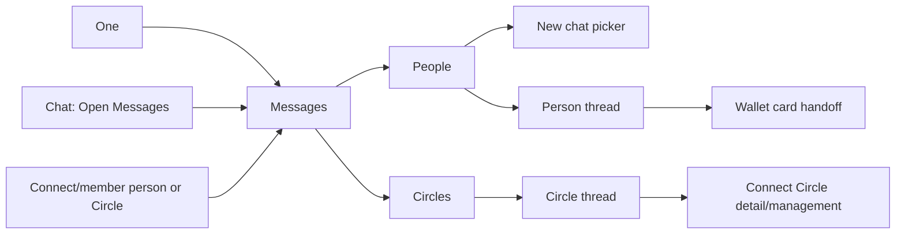

# Messages UI contract

Source: `dcc4f611e39c80a0001df0ada3f47e85b445421e` (`origin/main`, 24 October 2026). The reference SHA is the current main SHA at inspection. This contract records the mounted `/one/messages` web experience. Its lanes are **People** and **Circles**. Messages has no separate agent, setup wizard, phone-message import, or general voice send executor. Current production code, route contracts and schemas remain executable authority.

## Visual Map

`app/one/messages/page.tsx` mounts `DirectMessagesRoute`, which resolves explicit opaque selection before same-owner restored selection and then mounts `DirectMessagesPage`. `MessagesBackButton` uses `NativeShellBack` and the authored parent `/one`. The generated **Back to Connections** action separately targets `/one/connect`; its destination is intentional. People and Circles select a thread locally; phone shows one pane, while desktop keeps list and thread together. The global TopAppBar is deliberately suppressed on Messages; the route owns its one header. The signed-in avatar uses the shared Profile pane opener with its originating element and focus return. Peer profile links retain tagged person return and are distinct from the signed-in Profile action.

The outer One authentication, vault and setup gates retain their owners. The signed-out Messages page renders **Messages**, **Sign in to see conversations with your connections.**, and **Sign in** (`/login`). No Messages-specific setup step is mounted. Invalid/stale/denied opaque selections return to safe list state; a route handle is navigation only, never send authority. Per-tab last selection is owner-scoped; modified clicks and new tabs use the existing link resolver.

## Page, state and action ledger

Dynamic person/Circle names, message text, file names, dates, durations and counts below are templates or server projections. Unless a wire is named, interaction is local and makes **no API call**. All rows use a shared list read; they do not each issue a request. Source owners are under `components/direct-messages/` and `components/connect/circles/` unless another path is named.

| Host and visible state / copy | Trigger, branch and effect | Owner and wire |
| --- | --- | --- |
| People list header **Messages**; **People {count}**, **Circles {count}**; **Compose message**, **New chat**, **Refresh conversations**, theme mode and signed-in **Open Profile** | Tabs switch local lane and retire inactive thread/read state. Theme is local theme state. Both compose controls open the same picker, with one responsive entry hidden. Refresh is disabled/busy during a read. Profile opens the shared blocking pane; Back unwinds it first. | `direct-messages-page.tsx`, `messages-back-button.tsx`; list GET `/api/one/messages/conversations`, count is loaded lane total, distinct from aggregate unread. |
| **Search conversations** / **Search messages or people**; **Loading conversations…**; **Conversations could not be loaded. Check your connection and try again.** / **Try again**; **No chats yet** / **Choose a connection to start chatting.** / **New chat**; **No matching chats** / **Try another name or message.** | Search/filter and empty-state copy are local. Try again repeats the shared list GET. Refresh failure retains readable items; unavailable is not zero. New chat opens picker without sending. | `direct-messages-page.tsx`; GET conversations returns `items`, `unreadCount`. |
| Person row `{name}`, `{preview}`, `{time}`, `{unread}` (display cap **99+**), selected state; fallback **Connection**, **Start a conversation**, **Message deleted**, outgoing **You:** | Row opens selected person route. **Chat options** (including context menu/long press) does not navigate. Menu **Delete chat** opens viewer-only confirmation. | `direct-message-inbox-row.tsx`, `direct-messages-page.tsx`; same shared conversations response: `id`, `peerPersonRef`, `peerDisplayName`, `peerPhotoUrl`, `lastMessageAt`, `latestMessage`, `unreadCount`. Preview passes Wallet-safe formatter. |
| New chat dialog **New chat**, **Search connections**, **Loading connections…**, **Connections are unavailable. Try your search again.**, **No connections found.**, **Message {name}**, **Load more** | Nonempty query is debounced 180 ms. Paged 50-item accepted-connection search deduplicates, disables rows without public refs; Load more appends. Selecting a row closes picker and resolves route; it sends no greeting. X/outside/Escape/Back cancel with no send and restore focus. Error recovery is a new search, not an extra retry CTA. | `direct-messages-page.tsx`, `ConnectionsService`; accepted-connection lookup; route-token POST `/api/one/messages/route-token` returns `token`, `kind`, `ref`. |
| Chat removal **Delete chat with {name} for you only?**, **Cancel**, **Delete chat**, **Deleting…** | Options→Delete→Cancel: no DELETE. Confirm holds synchronous per-chat lock, blocks dismissal while pending and pending sends before opening; acknowledged success removes only viewer row, cache and selection. Failure toast retains row; a later send can recreate it. Owner/thread fences reject late UI effects. | `direct-messages-page.tsx`; DELETE `/api/one/messages/conversations/{id}` returns `conversationId`, `deleted`, `scope:me`; direct-message event/cache update after acknowledgement. |
| Selected person header `{peer name}`, avatar, **Connected** / **Messaging unavailable**, disconnected notice, **Back to messages**, disabled **Start voice call** / **Calls are not available yet**, **Search messages**, signed-in **Open Profile** | Peer identity opens peer profile with return token; call has no handler. Back closes search/action layer then selection. Profile covers reads/actions. Search opens local loaded-message filter; **Close message search**, Escape and Back reset it. **No messages match …** and match count use loaded messages/replies only, not server search. | `direct-messages-page.tsx`; selected GET `/api/one/messages/with/person/{personRef}` yields `conversation`, `peerPersonRef`, `peerDisplayName`, `peerPhotoUrl`, `canSend`, `disconnectedNotice`. |
| **Your messages** / **Select a conversation to see the chat here.**; selected loading/unavailable/empty **Start the conversation with {name}**; **Try again**; **Load older messages** / **Loading…**; **Go to latest messages** | Initial and cursor reads are 60 items. Retry repeats read. Older page prepends with scroll anchoring and retains readable state on failure. Latest scrolls locally; it does not send. Rendering/searching/scrolling above bottom does not acknowledge read. | `direct-messages-page.tsx`; GET `/api/one/messages/conversations/{id}/messages?limit=60&before={cursor}` yields `conversation`, `items`, `canSend`, `disconnectedNotice`, `nextBefore`. |
| Person transcript: date markers, sender/avatar grouping, reply snippet, text/structured Wallet, **Message deleted**, **Edited**, time and **Sent**/**Delivered**/**Read**, reactions | Body stays 16/22; metadata and receipt states remain distinct. Message menu/reactions require fresh current-owner admission, never warm cache alone. Receipt needs focused, foreground, uncovered, at-bottom (≤8px) visible frontier. | `direct-messages-page.tsx`; message response fields `id`, `conversationId`, `senderIsViewer`, `content`, `createdAt`, `readAt`, `deliveredAt`, `editedAt`, `deletedForEveryoneAt`, `replyTo`, `reactions`, `kind`, `attachment`. POST delivered `{messageIds}`; POST read `{throughMessageId}`. |
| Docked **Message {name}** composer, 4000 counter, reply chip, attachment/emoji/mic/Send, busy/unknown/error states | Multiline and IME guards preserve desktop Enter/Shift+Enter and mobile keyboard behavior. Reply close removes local draft only. Send commits only on explicit click/key, with stable `clientMessageId`; uncertain outcome retries same attempt. Disabled/disconnected/current-owner guards remain. Dock portal is a separate typography and keyboard owner. | `direct-messages-page.tsx`, `AgentDockPortal`; POST `/api/one/messages` body `content`, `recipientPersonRef`, `clientMessageId`, optional `replyToMessageId`, `attachment{name,mimeType,data}`. Returned message and conversation identities must match before commit. |
| Person message menu and quick emoji: **Reply**, own **Edit**, **Delete for me**, own **Delete for everyone**, reactions; edit field/actions and delete confirmation | Reply is local until Send. Edit Save PATCHes nonempty text; Cancel/X/outside/Back discards uncommitted edit. Delete Cancel is no call; confirm DELETE uses exact scope. Reaction choose PUT/DELETE with optimistic rollback/readback failure, no extra confirmation. Long press/context menu does not navigate. Closing UI does not cancel an already dispatched request. | `direct-messages-page.tsx`, `direct-message-emoji-picker.tsx`; PATCH/DELETE `/api/one/messages/conversations/{id}/messages/{messageId}`; PUT/DELETE reaction `{emoji}`. |
| Person attachment menu **Photo**, **Document**, **Up to 5 MB**; selected filename/size, photo preparing/preview/remove; received **Load photo**, **Loading photo**, **Open photo**; Photo dialog; document **Download {name}** | One file, JPEG/PNG/WebP or PDF/DOCX/TXT. Picker cancel, invalid/empty/oversize/read failure do not send. Source has an imperfect photo preparing/separator placeholder; it is preserved as actual copy. Viewer close/Back restores focus. Guarded fetch validates MIME/bytes/decode and retires blob URLs. System share cancel is quiet; native temporary cache file is removed. | `direct-messages-page.tsx`, attachment renderer and `shareFile`; guarded GET `/api/one/messages/.../attachments/...` on admitted visible media. Selecting/removing/photo viewing is no send. WAV comes from recorder, not an arbitrary-audio picker. |
| Voice **Record voice message**, **Starting…**, timer, **Finishing…**, **Voice recording**, **Cancel recording**, **Send voice message**; grant message **Microphone enabled. Tap the mic again to record.**; playback Play/Pause, duration, 1x/1.5x/2x | Fresh grant requires second tap. Cancel/background/disable/unmount ends capture with no send. Finish/send and 60-second limit use the existing Send path; no preview/approval/transcription. Playback owns audio lease and can pause/retry; narrow phone hides speed control. OS permission sheet is platform-owned. | `direct-message-voice-recorder.tsx`, `direct-message-voice-player.tsx`; browser AudioWorklet/admitted native bridge; mono 16kHz PCM16 WAV ≤60s/5MiB through same POST send. |
| Circles list header **Messages**, theme, **Edit circles**, **Create circle**, **Refresh circles**, **Search circles**, lane switcher, signed-in **Open Profile** | Edit/Create navigate to authored Connect routes; empty-state Create goes plain Connect. Search is local, refresh repeats one directory GET. Circle selection is local/owner-restored and lost membership removes it. | `circle-messages-pane.tsx`; GET `/api/one/location/circles` with vault owner token. Ordinary circles only; Trusted/SMS/system excluded. |
| Circle list **Unlock One to view your circles.**, **Loading circles…**, retained **Circles are unavailable. Return to this tab to retry.**, **No matching circles** / **Try another name.**, **No circles yet** / **Create a circle**, row `{name}`, `{memberCount} member(s)` | Row has image and message glyph; it has no last-message preview/time/unread/menu/swipe. Select opens Circle chat; Back closes it. Empty Create navigates. | `circle-messages-pane.tsx`; shared directory yields `id`, `name`, `photoUrl`, `memberCount`, `isSystem`, `systemKind`. |
| Selected Circle header `{circle name}`, `{memberCount} member(s)`, **Back to circles**, signed-in **Open Profile**; placeholder **Select a circle to start chatting.** | Back clears local selection. Circle header does not add settings/search/alerts controls. `CircleChat` is shared with Connect, passed `chatLane`; Connect retains its inline **Circle chat**, unread, **Alerts**/**Chat alerts** header. | `circle-messages-pane.tsx`, `circle-chat.tsx`. |
| Circle chat **Connecting chat…**, access revoked/unavailable, **Reconnect**, **Loading messages…**, **Start the conversation. Say hello or share a file.**, **Load earlier messages**, **Go to latest messages**, unconfirmed delivery/retry notice | Connect/roster/history use browser-sealed recipient envelopes, original membership/key epoch and vault authority. Retry of uncertain send reuses sealed attempt; no automatic reseal to changed roster. Partial/undecryptable history stays explicit. Empty Circle mic **Talk to One** routes to private-agent chat; it is not Circle recording. | `circle-chat.tsx`, `lib` Circle service/crypto; `/api/one/circles/{circleId}/chat` roster, wait, messages, resolve, updates, read, preferences and historical keys. |
| Circle transcript: sender/avatar/date, **Edited**, **Sent**, **Sent · Read by N of M**, **Seen by everyone**, deleted/undecryptable/system-event pills, **Sending…**, **Delivery unconfirmed** | Read totals use original recipients, not current roster. At-bottom/focused/uncovered read stops before undecryptable incoming messages. Menu is bubble DropdownMenu (also long press), separate from member action sheet. | `circle-chat-message.tsx`, `circle-chat-system-event.tsx`; chat message/reaction/read projections. |
| Circle quick reactions ❤️😂😮😢👍🙏, **More reactions…**, **Reply**, own **Edit**, **Delete for me/everyone**; **Update the text. Attachments stay with the message.**, **Edit message text**, **Cancel**, **Save changes**, **Saving…**; delete confirmation **Delete for everyone?**/**Delete for you?**, warning, **Delete message**/**Deleting…** | Reply is local; emoji/reaction mutates only on selection. Edit Cancel/outside/Escape/Back makes no PATCH. Delete Cancel makes no DELETE. Confirm uses mutation dismissal lock, expected revision, exact encrypted retry; failed optimistic reaction rolls back. | `circle-chat-message-action-dialog.tsx`, `circle-chat.tsx`; encrypted PATCH/DELETE and reaction paths beneath `/api/one/circles/{circleId}/chat`. |
| Circle file picker/draft image/video/document, received **Loading**, **Retry image**, **Retry full image**, **Shared image** dialog/**Close**, **Open video**/**Reload video**, **Download document** | One file ≤5MiB, JPEG/PNG/WebP/MP4/WebM/PDF/DOCX/text; separately validated and sealed. Selection/removal is no send. Viewer fetch respects recipient, member, blob lifetime and read suppression. HTML video controls are browser-owned. | `circle-chat-media.tsx`, `circle-chat.tsx`; encrypted image transport under Circle chat API. |
| Circle notification recovery **Turn on**, **Retry**, denial explanation, native **Open settings** | Only eligible explicit action requests permission; selecting Circle does not. Browser/native permission UI and settings are OS/provider-owned. | shared Circle chat notification owner; chat preferences API. |
| Wallet message **View card request**, modern **You shared a card.**/**A card was shared with you.**, **View card**, **Checking access…**, **Verify identity**, active/expired/unavailable; legacy **Shared payment card**, **View card details**, **Opening…**, **Unlock to view card**, **Hide card** | Request links to `/one/wallet?card_request={UUID}`. Sender has no reveal action. Native notice directs browser view. Shared-card SettingsDetailPanel/Unlock dialog use Wallet custody; leaving window retires reveal. Masked versus encrypted full number, expiry, recipient and verification gates remain Wallet-owned. Privacy notice: “For you only. Do not copy or share. This card closes when you leave this window. Browsers cannot block screenshots or photos.” | `components/wallet/wallet-card-access-message.tsx`, `wallet-shared-card-message.tsx` mounted in People transcript; Wallet service/verification owners. Do not render raw envelope in preview/search/reply/edit. |

### Wire authority and state boundaries

People uses Firebase participant/current accepted-connection authority and server-managed AES-256-GCM. Circle uses a vault owner token plus browser-sealed recipient envelopes. Their transports must not be mixed. The People API also exposes unread-count metadata and events SSE; these are separate from loaded lane totals. Delivery acknowledgements may follow an authenticated inbox body, never a push hint. Warm RAM transcript can display while rechecking, but cannot authorize send, attachment, mutation or read. Denial purges private display; transient refresh failure retains the previous readable state. Per-tab storage contains owner-scoped navigation selection and emoji preferences, not plaintext transcript/draft/attachment or an outbox.

The service owners define the precise transport fields: `lib/services/direct-messages-service.ts` for Firebase ID-token People requests, and `lib/services/circle-chat-service.ts` for `Authorization: Bearer {vaultOwnerToken}` Circle requests. The Circle root below is `/api/one/circles/{circleId}/chat`; every request is `no-store`. The Circle payload is sealed by `lib/circle-chat/crypto.ts` before POST, and the service opens received content with the current recipient key.

| Circle wire | Request and projection used by Messages |
| --- | --- |
| GET root; GET `/wait?after={sequence}` | Roster `members`, `rosterVersion`, `unreadCount`, `latestSequence`, `muted`, optional `notificationDevices`; wait projects `changed`, `readChanged`, `receiptsChanged`, `reactionsChanged`, `membershipChanged`, `photoChanged`. |
| GET `/messages?before={sequence}&after={sequence}&receiptAfter={sequence}&receiptThrough={sequence}` | Only applicable cursor keys are sent. Response has `items`, `hasMore`, optional `receipts`, `replyTargets`, `reactionUpdates`, `events` and sender photo projection. |
| POST `/messages`; POST `/messages/resolve`; POST `/messages/updates` | Send uses the prepared `SealedChatMessage` with its stable client ID and frozen roster/version; returns the accepted `ChatMessage`. Resolve/updates take `{messageIds}` and return current items or `{states, unavailableIds}`. |
| PATCH/DELETE `/messages/{messageId}`; PUT/DELETE `/messages/{messageId}/reactions/{emoji}` | Edit submits `{ciphertext, iv, expectedRevision}`; delete submits `{scope, tombstone?}`. Reactions return the message ID and current reactions. Cancel is local and sends none of these requests. |
| GET `/messages/{messageId}/image`; GET `/keys/{recipientKeyId}` | Image returns encrypted `{ciphertext, iv}`; historical key recovery is bounded to a recipient-key miss. Viewer close retires the blob URL. |
| POST `/read`; PUT `/preferences` | Read submits `{sequence}` and may return notification badge count/version. Preference submits `{muted}` and returns the saved value. A permission prompt itself is OS/browser-owned. |

The Circle chat is dual-hosted. Connect’s Chat/Members detail keeps its own header, member action Drawer on phone/dropdown on desktop, Circle management, `readingBlocked` under covering overlays, and member Message gate requiring an accepted direct connection and public person ref. Circle Feed/push opens Connect circle detail/`circleChat`; visual work does not remap it to Messages. More about those hosts: [Connect](./connect.md), [Feed](./feed.md), [Profile](./profile.md), [navigation](./navigation.md), and [typography](./typography.md).

## Typography, action anatomy and geometry

The family is self-hosted Plus Jakarta Sans. Route/contextual title is **17/22/600**; lane tab **15/20/550** with accessible tab/count; row name **14/21/550**, preview **12/18/400**; utility **13/21/550**, or 12px on narrow phone; helper **13/18/400**; status **13/18/600**; form label **15/22/550**; ordinary input **16/22/400** at ≤620px and **14/22/400** above where appropriate; modal task title **20/28/600**, description **14/20/400**, action **13/20/600**; compact CTA **12/18/550**. Message bodies stay People/Circle Messages **16/22/400**, Circle Connect inline **15px/1.48**. Timestamps, receipts, durations, reply snippets, emoji and waveform have distinct roles. CSS 550/650 are requested values; the browser selects the nearest available self-hosted face. The final computed style and loaded face require browser evidence.

Equivalent quiet text CTAs have a transparent 44px target around a 44px solid-surface pill with 1px `color-mix(in srgb, var(--app-accent) 32%, var(--app-card-surface-default-solid))` border, accent text and full radius. Short row target min-width/padding: 88/15px; ≤620px 78/11px; ≤350px 72/9px. Long/working labels can grow. Send/record/media/reaction/shell stay icon controls; delete retains destructive tone; button type, disabled, ripple/focus and reduced-motion remain effective.

The expanded shell is full width. At (width ≥768 **and** height ≥500) or width ≥1024, list width is `var(--app-messages-sidebar-width)` (30vw, with a 272px minimum at 768–1023px so five 44px Circle header actions fit), thread fills the rest. Otherwise one active pane is visible. Ordinary headers are 68px with 16px inline inset; tablet 768–1279 aligns list/thread at 96px; short landscape uses 44px. The page seats under measured top/safe-top and reserves `max(bottom chrome, keyboard + dock height + clearance)`; keyboard resize does not add a second inset. List rows are at least 70px; actions target 44px; transcript inline inset is 16px. People bubbles cap near 75%/40rem on expanded view, 85% on compact with peer gutter; Circle lane has its own 76%/84% limits. New chat dialog is `min(440px, 100vw - 32px)`, results ≤`min(50dvh, 420px)`; photo is content/viewport-capped; emoji popover has its own height/column limits. Wallet access may use a mobile Sheet or desktop max-width 820px. Scroll owners are the list and message transcript; the dock composer is portaled and keeps its own measured keyboard frame. Exact x/y depend on viewport, safe area, content and font loading; do not substitute guessed screenshot coordinates.

## Portals, Back and exclusions

New chat and photo use Dialog; People edit uses Dialog, delete message/chat use AlertDialog; inbox/message/attachment menus use DropdownMenu or local menu; emoji/reaction uses Popover; Circle edit/delete/full-image use their existing Dialog/AlertDialog/Dialog; Wallet has its own SettingsDetailPanel, Sheet and VaultUnlockDialog. These are portaled outside the page wrapper. Close icon, Escape, outside click and native Back unwind the top admitted layer and restore focus unless that owner rejects dismissal during a mutation. Search/filter/scroll/picker/emoji insertion and cancelling uncommitted forms make no mutation call. A dispatched send/edit/delete may complete after UI closure; its actual acknowledgement remains authoritative. Toast content retains shared toast typography.

Compatibility MP4/WebM labels in People do not create a People video picker. No inbox archive/mute/block/pin/report, Circle row preview/unread/menu, Circle voice recorder, new call feature, global launcher, phone-message import or account-linking flow is mounted. Native Back/microphone/share and OS permission/media controls are bounded adapters; web CSS does not style OS sheets. Generated voice actions do not expose a general Messages send/edit/delete executor.

## Verification status

The ledger has 21 mounted page/state/action families: 12 People, 8 Circle and 1 Wallet. The route uses the existing authored Back and Search contracts. `npm run build:ui-contracts` passes on the integrated source and refreshes the content-addressed review receipts and generated mirrors; `npm run verify:ui-contracts` passes all seven owners.

Production-optimized Chromium fixtures loaded the actual CSS modules, global layers and self-hosted font before sampling at 390px. Values below are computed `font-size/line-height/font-weight`, rather than inferred selectors. The self-hosted face is selected by the browser from the requested 550/650 CSS weights.

| Mounted role | Before | After |
| --- | --- | --- |
| People list title | 20/24/600 | 17/22/600 |
| People lane tab, target | 12/18/600, 34px | 15/20/550, 44px |
| Person row name; preview | 14/21/600; 13/19.5/400 | 14/21/550; 12/18/400 |
| Selected person title; bubble; composer | 16/20/600; 16/22/400; 16/24/400 | 17/22/600; 16/22/400; 16/24/400 |
| New chat title; picker search | about 20/24/600; 16/24/400 | 20/28/600; 16/22/400 |
| Load older CTA | 17/22/650, filled, 50px target | 12/18/550, transparent outer/1px bordered inner pill, 44px target |
| Circle Messages row; title; bubble | See original Connect/Circle fixture | 14/21/550; 17/22/600; 16/22/400 |
| Circle action menu; delete title | See original Connect/Circle fixture | 13/21/550; 20/28/600 |

The signed-in Profile target computed 44×44px in both Messages lanes and emitted the existing `tap` opener with its trigger element. New chat, message action, Circle delete and emoji popovers were sampled at their actual portal hosts; the selected Circle body retained 16/22/400 while Connect's inline Circle body kept its 15px context. The quiet action's outer background was transparent and the pseudo-element's 1px border and solid interior were visible in the rendered fixture. Header containment passed at widths 320, 350, 360, 374, 379, 390, 430, 479, 620, 767, 768, 1023, 1024, 1279, 1280 and 1440px, plus 499/500px short-height edges. At 320px, actions occupy a second header row without covering Back/title; the 768px split uses a 272px sidebar minimum to seat five Circle actions.

Verification: `npm run typecheck`, focused ESLint, 194 of 196 component cases initially passed then the two stale top-bar assertions were corrected and all 27 owning cases passed; 500 Back hierarchy cases passed; `npm run verify:cache` passed 102 cases after refreshing its baseline manifest; docs parity/links/governance/brand/diagrams/setup/shareable-link/encryption checks passed. Chromium's 83 direct layout cases initially had four old geometry assertions; their focused rerun passed after updating expected tablet/320px geometry, and three new computed/edge cases passed. Circle/Connect had 85 of 89 initial cases; the four old Circle heading expectations passed on focused rerun. Design-system, accent, hierarchy, restraint and render-performance checks passed; aggregate `verify:design-system` still fails on unchanged stale brand assets outside Messages. The synthetic browser suite exercised no real send or account/provider action.

**Implementation complete / acceptance pending:** physical iOS/Android Back, keyboard resize and OS permission/share sheet proof; text zoom and every rare media/error/Wallet reveal combination in a live device; visual sampling of all 21 ledger families across every theme/accent/interaction state. Source/tests are evidence for behavior, but cannot substitute for those pixels or platform interactions.
